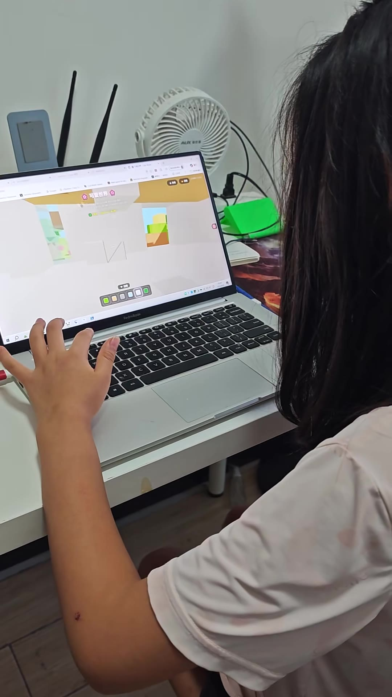
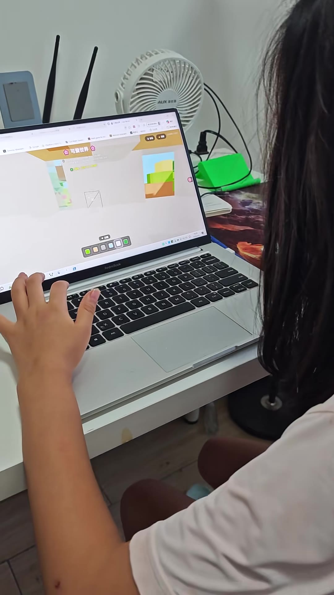
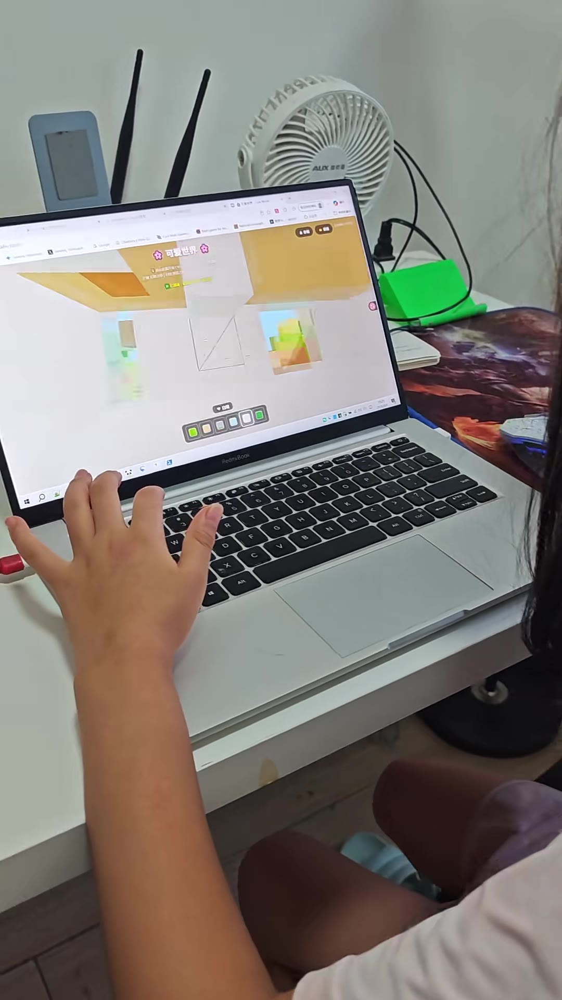
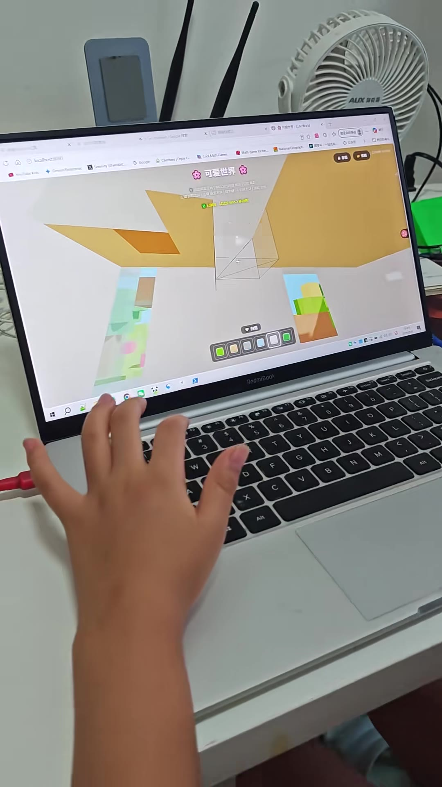
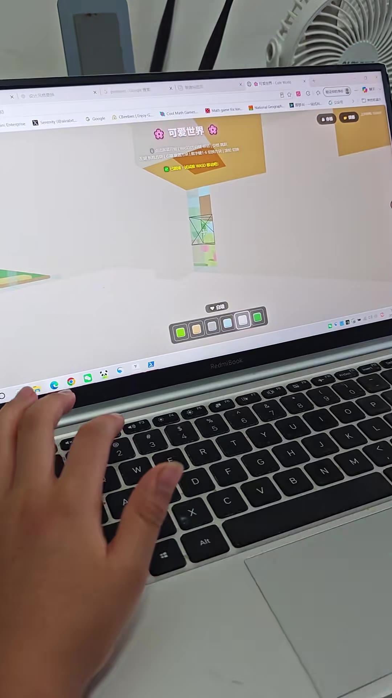
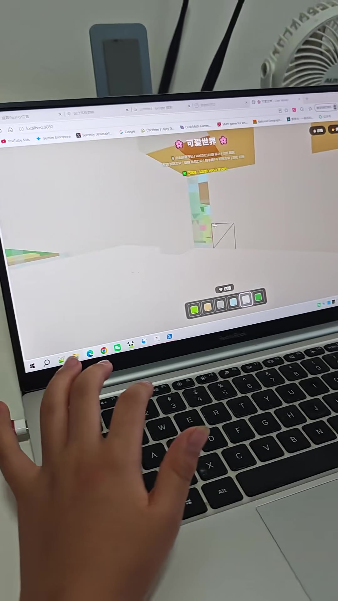
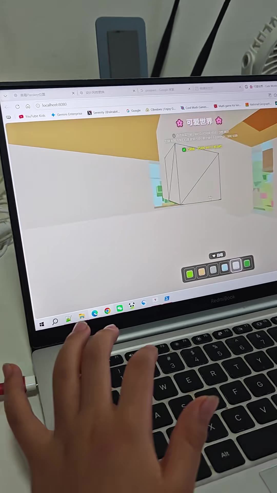
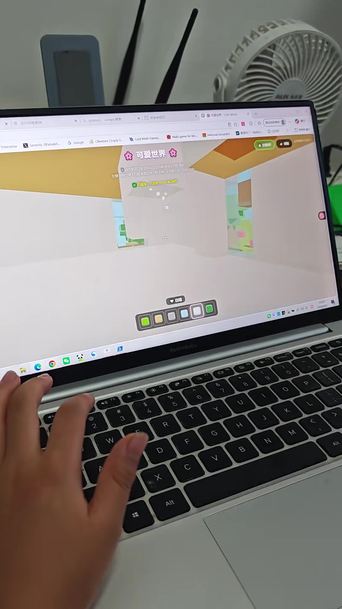
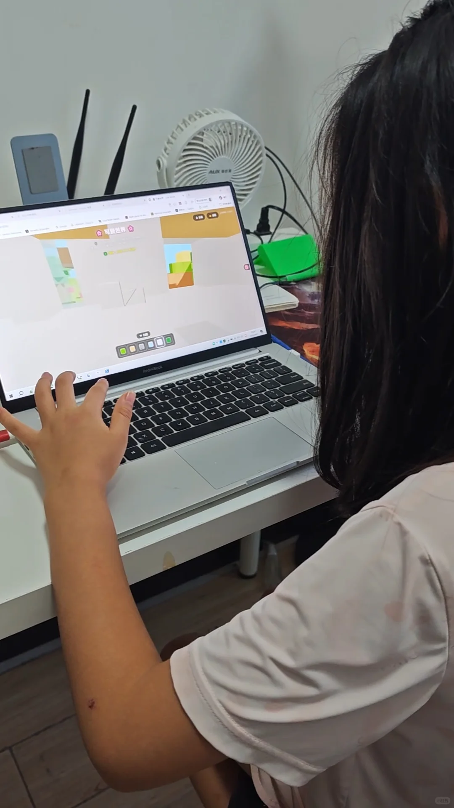

---
title: "和女儿一起vibe coding一个我的世界"
source: "https://www.xiaohongshu.com/discovery/item/6a76da4b00000000290300d3?app_platform=android&ignoreEngage=true&app_version=9.41.0&share_from_user_hidden=true&xsec_source=app_share&type=video&xsec_token=CBGeugn3gG722xeEUfXIrz_aIR6CSkPA7jNGC3j7J2_Lc%3D&author_share=1&xhsshare=CopyLink&shareRedId=OD06N0RGNj42NzUyOTgwNjY7OTg8RkdL&apptime=1786185801&share_id=6673b050ae9e4367be70d52015ccb41e&share_channel=copy_link"
author: "发疯的疯呀"
author_uid: "69c899f3000000003301a768"
date: "昨天 15:27 陕西"
tags: ["vibe coding", "亲子编程", "我的世界", "LUA脚本", "游戏开发"]
platform: "xiaohongshu"
category: "游戏设计/儿童游戏项目"
summary: "作者分享与女儿合作进行vibe coding的经历，共同开发了一个《我的世界》相关项目。文中提及W、E、X等按键操作及LUA编程语言，推测项目涉及通过脚本代码控制游戏内容或交互。这是一次亲子编程实践，体现了共同学习与创作的乐趣。"
---

# 和女儿一起vibe coding一个我的世界

> 作者: 发疯的疯呀 | 日期: 昨天 15:27 陕西 | 原文: https://www.xiaohongshu.com/discovery/item/6a76da4b00000000290300d3?app_platform=android&ignoreEngage=true&app_version=9.41.0&share_from_user_hidden=true&xsec_source=app_share&type=video&xsec_token=CBGeugn3gG722xeEUfXIrz_aIR6CSkPA7jNGC3j7J2_Lc%3D&author_share=1&xhsshare=CopyLink&shareRedId=OD06N0RGNj42NzUyOTgwNjY7OTg8RkdL&apptime=1786185801&share_id=6673b050ae9e4367be70d52015ccb41e&share_channel=copy_link

> **摘要**:作者分享与女儿合作进行vibe coding的经历，共同开发了一个《我的世界》相关项目。文中提及W、E、X等按键操作及LUA编程语言，推测项目涉及通过脚本代码控制游戏内容或交互。这是一次亲子编程实践，体现了共同学习与创作的乐趣。

和女儿一起vibe coding一个我的世界
昨天 15:27 陕西

#vibe coding #亲子编程 #我的世界 #LUA脚本 #游戏开发

## 视频

[视频 1](./video.mp4)

<video controls width="100%"><source src="./video.mp4" type="video/mp4">您的浏览器不支持视频播放。</video>

附件: [音频](./audio/audio.wav) | [处理清单](./video_manifest.json)

## 视频图文总结

> 按关键帧关联完整视频转录；文字保留机器转写原文，时间点仅用于定位。

### 1. 00:00

- 画面文字（OCR）：H
W
#5
移
XW
KLA

### 2. 00:01

- 画面文字（OCR）：oogipae
0R7#5#R.0
间
XIV

### 3. 00:02

- 画面文字（OCR）：AUXS
可爱世界
RedmBook

### 4. 00:03

- 内容摘要：跟女儿用cloud开发了一个我的世界（00:01-00:05）
- 画面文字（OCR）：：
o
Goo
8
gog/sc
□□□□□O
#已
可爱世界
电1828
B
RedmiBook
福
B☆BGO
whnpo
品容档
-
8
盟

### 5. 00:05

- 画面文字（OCR）：X包封牌
X
e
Serenty(ealabt G Google
X
☆可爱世界CunWiog
X
CBeebies EryayG
口
Cool Math Games
日☆
日
Q
☆
皖工99
四
Math game fiox bn
福天
Hational Geognch
)
022号
可爱世界
,
-
存格
读部
S杰WASU方R移动|空联
左建方只（6数置方块|数字键1-6切换方块|编轮切0
已就绪·试试按WASD移动吧！
白墙
S
RedmiBook
2
r
T
w
X
Alt

### 6. 00:06

- 画面文字（OCR）：#
Obalbastsuo
Xle8ie
×1G
t Sooge
NouTube s
X
Gen Enterprae
区
Srency(@aeb
G Google
CReebes Engy G
Cool M Games
Mme le
可爱世界
I点服餐开始|WASD/万R量FZ|保
健2方#/6放政方块|陈字键140方2/30
已汉·汇式C片KASO8
白酒
0
w
X
Alt

### 7. 00:07

- 内容摘要：他现在已经玩上了（00:06-00:09）
- 画面文字（OCR）：查看Passkey位置
×
设计风挡更换
×G
0
localhost:8080
×信
YouTube Kids
Gemini Enterprise
Serenity (@aleabit
G Google  CBeebies EnjoyG_
Cool Math Games
Mat gan foro
Nao
可爱世界
开
左盟方10（
已感络 电5WO8
白墙
RedmiBook
P3
w
E
R
A
F

### 8. 00:08

- 画面文字（OCR）：设日关植更换
X白
XIG pnteren Goge
日☆日
0
众
WIern
HaboralGeen
D
一
DcoN
Serenity (@alcabil
Cool Math Games
Math game for ion..
G Google
CBecbies EnoyG
可爱世界
点市费开站（WASD/万有B空业
左建方块|石建收方快|1方袋
2已改线武68
?白墙
D2
SG4O
RedmiBob
#
2
3
w
R
T
X
Alt

## 视频画面文字 (OCR)

> OCR 仅供参考，可能包含识别错误；请以视频画面和转写来源为准。

### 关键帧 1 · 0.5s

H
W
#5
移
XW
KLA

### 关键帧 2 · 1.64s

oogipae
0R7#5#R.0
间
XIV

### 关键帧 3 · 2.77s

AUXS
可爱世界
RedmBook

### 关键帧 4 · 3.91s

：
o
Goo
8
gog/sc
□□□□□O
#已
可爱世界
电1828
B
RedmiBook
福
B☆BGO
whnpo
品容档
-
8
盟

### 关键帧 5 · 5.05s

X包封牌
X
e
Serenty(ealabt G Google
X
☆可爱世界CunWiog
X
CBeebies EryayG
口
Cool Math Games
日☆
日
Q
☆
皖工99
四
Math game fiox bn
福天
Hational Geognch
)
022号
可爱世界
,
-
存格
读部
S杰WASU方R移动|空联
左建方只（6数置方块|数字键1-6切换方块|编轮切0
已就绪·试试按WASD移动吧！
白墙
S
RedmiBook
2
r
T
w
X
Alt

### 关键帧 6 · 6.19s

#
Obalbastsuo
Xle8ie
×1G
t Sooge
NouTube s
X
Gen Enterprae
区
Srency(@aeb
G Google
CReebes Engy G
Cool M Games
Mme le
可爱世界
I点服餐开始|WASD/万R量FZ|保
健2方#/6放政方块|陈字键140方2/30
已汉·汇式C片KASO8
白酒
0
w
X
Alt

### 关键帧 7 · 7.32s

查看Passkey位置
×
设计风挡更换
×G
0
localhost:8080
×信
YouTube Kids
Gemini Enterprise
Serenity (@aleabit
G Google  CBeebies EnjoyG_
Cool Math Games
Mat gan foro
Nao
可爱世界
开
左盟方10（
已感络 电5WO8
白墙
RedmiBook
P3
w
E
R
A
F

### 关键帧 8 · 8.46s

设日关植更换
X白
XIG pnteren Goge
日☆日
0
众
WIern
HaboralGeen
D
一
DcoN
Serenity (@alcabil
Cool Math Games
Math game for ion..
G Google
CBecbies EnoyG
可爱世界
点市费开站（WASD/万有B空业
左建方块|石建收方快|1方袋
2已改线武68
?白墙
D2
SG4O
RedmiBob
#
2
3
w
R
T
X
Alt

## 字幕文件

[TXT](./transcript/video.txt) | [JSON](./transcript/video.json) | [SRT](./transcript/video.srt) | [VTT](./transcript/video.vtt)

## 转写来源

[平台字幕 TXT](./transcript/platform/video.txt) | [平台字幕 JSON](./transcript/platform/video.json) | [平台字幕 SRT](./transcript/platform/video.srt) | [平台字幕 VTT](./transcript/platform/video.vtt) | [本地 ASR TXT](./transcript/asr/video.txt) | [本地 ASR JSON](./transcript/asr/video.json) | [本地 ASR SRT](./transcript/asr/video.srt) | [本地 ASR VTT](./transcript/asr/video.vtt)

## 其他来源转写

### 本地 ASR

- **00:01-00:05** 跟女兒用Claw的開發了一個我的世界
- **00:05-00:08** 他現在已經玩上了

## 视频转录

- **00:01-00:05** 跟女儿用cloud开发了一个我的世界
- **00:06-00:09** 他现在已经玩上了

## 图片

## 图片文字 (OCR)

> OCR 仅供参考，可能包含识别错误；请以原图为准。

W
2
E
X
LUA
