---
title: "小学生的VibeCoding，Ai时代真正技术平权！"
source: "https://www.xiaohongshu.com/discovery/item/6a1159cf0000000006036434?app_platform=android&ignoreEngage=true&app_version=9.36.0&share_from_user_hidden=true&xsec_source=app_share&type=video&xsec_token=CB2Fsq8cUuzk3S8QQT8CUud-ldUunjQzTUrvtlQNA-GK4%3D&author_share=1&xhsshare=CopyLink&shareRedId=N0dINjg3NUpMPko6S0EySDs0P0lFSjdL&apptime=1783096430&share_id=590f1be8b97c440e97592b9665e740b1&share_channel=copy_link"
author: "大斐+"
author_uid: "637f13af000000001f018da7"
date: "05-23"
tags: ["vibecoding", "我在小红书做游戏", "少儿编程", "ai编程", "claude", "网站", "自然灾害", "科普视频", "人工智能", "技术平权"]
platform: "xiaohongshu"
category: "游戏设计"
---

# 小学生的VibeCoding，Ai时代真正技术平权！

> 作者: 大斐+ | 日期: 05-23 | 原文: https://www.xiaohongshu.com/discovery/item/6a1159cf0000000006036434?app_platform=android&ignoreEngage=true&app_version=9.36.0&share_from_user_hidden=true&xsec_source=app_share&type=video&xsec_token=CB2Fsq8cUuzk3S8QQT8CUud-ldUunjQzTUrvtlQNA-GK4%3D&author_share=1&xhsshare=CopyLink&shareRedId=N0dINjg3NUpMPko6S0EySDs0P0lFSjdL&apptime=1783096430&share_id=590f1be8b97c440e97592b9665e740b1&share_channel=copy_link

小学生用Vibe Coding做的自然灾害科普知识互动网站✨
AI时代真正实现技术平权
	
#vibecoding #我在小红书做游戏 #少儿编程 #ai编程 #claude #网站 #自然灾害 #科普视频 #人工智能 #技术平权

## 视频

[视频 1](./video.mp4)

<video controls width="100%"><source src="./video.mp4" type="video/mp4">您的浏览器不支持视频播放。</video>

## 视频帧截图

> 共 30 张关键帧(按场景切换抽取),点击展开。

展开全部帧

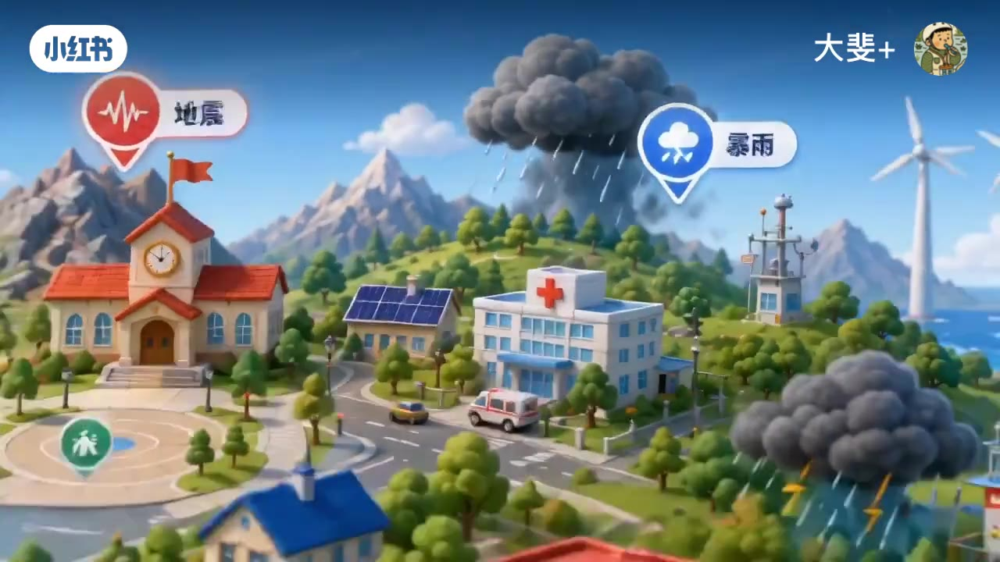

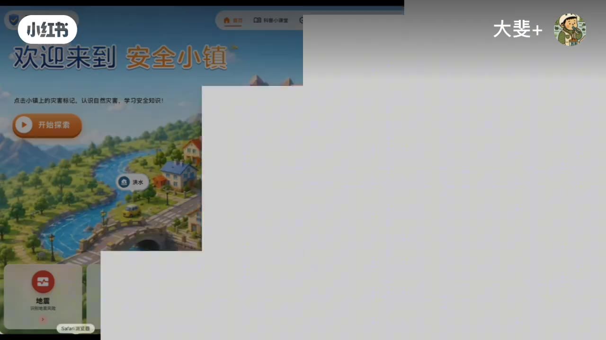

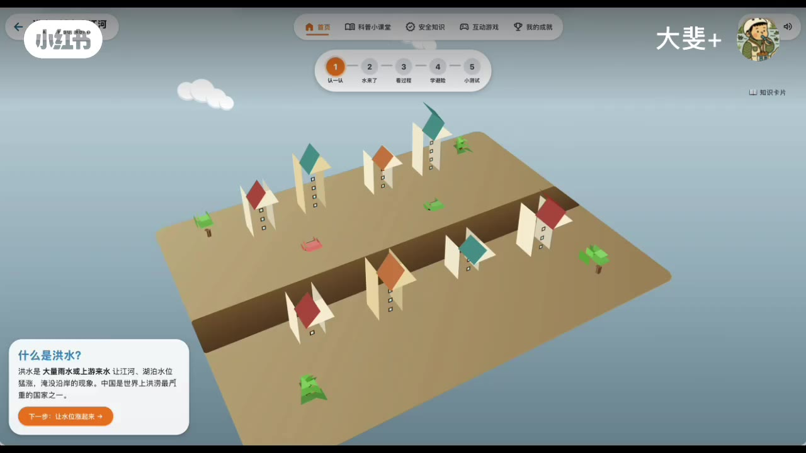

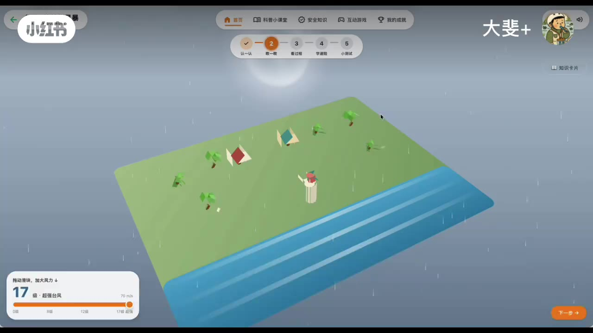

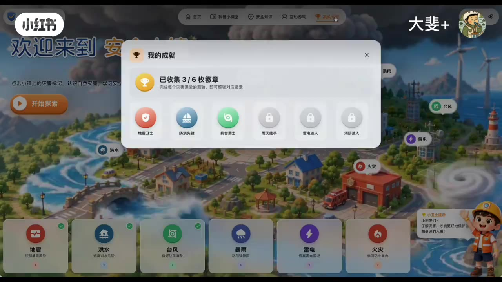

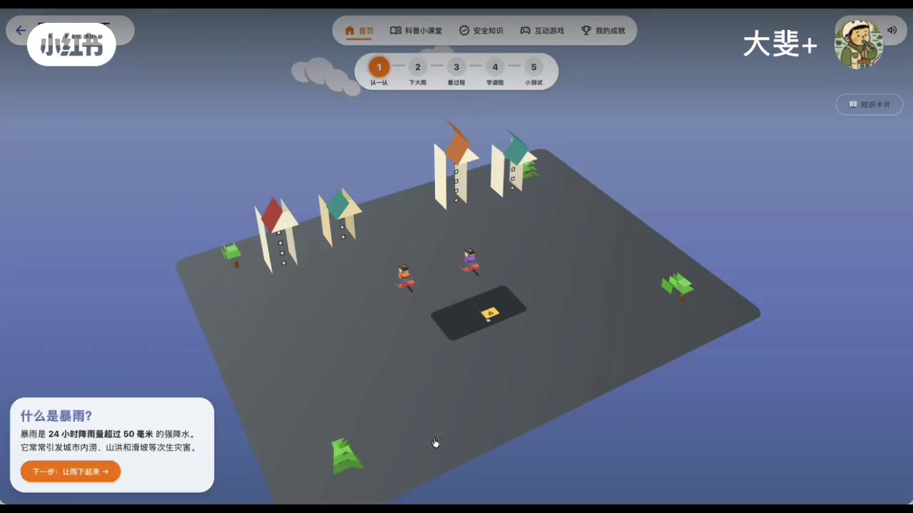

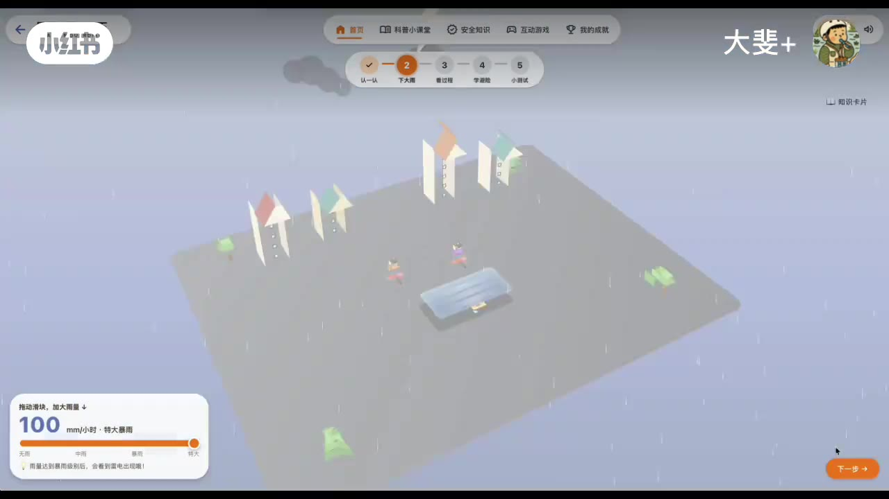

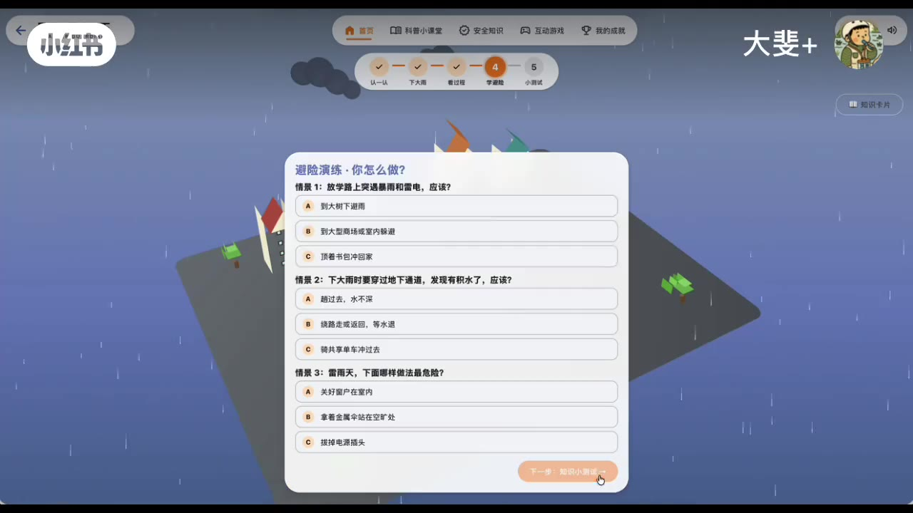

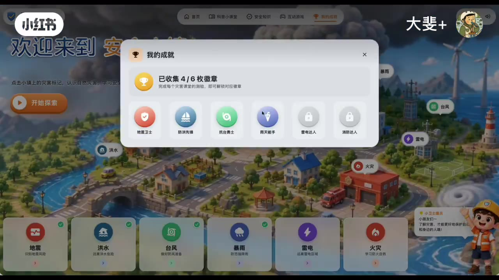

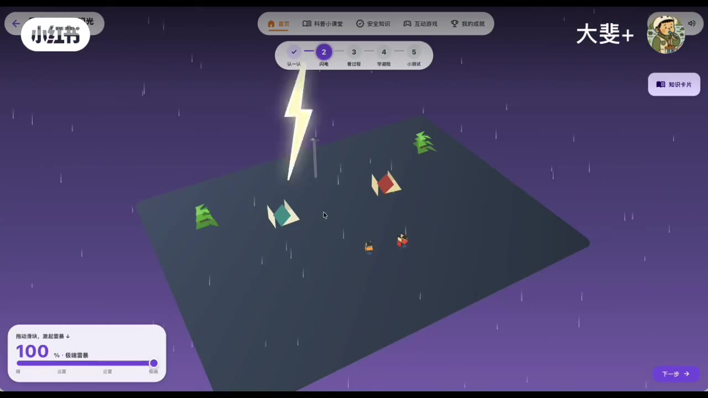

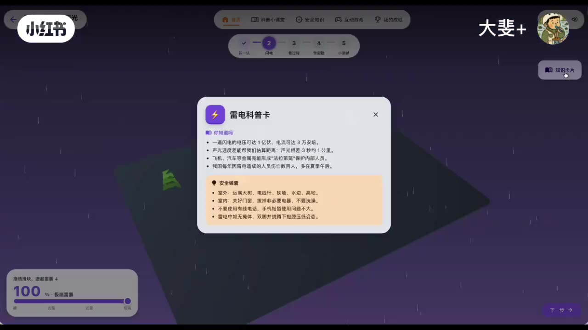

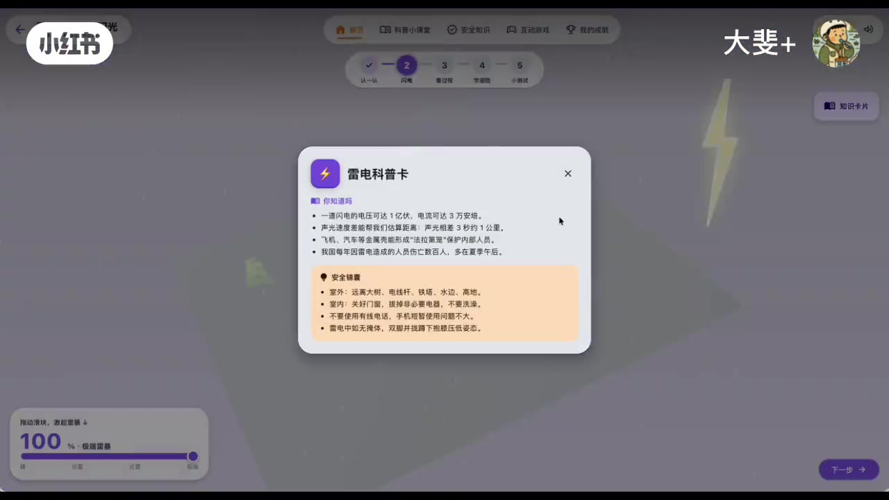

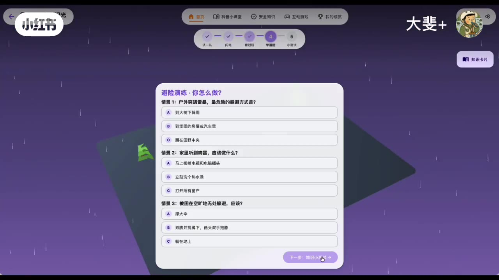

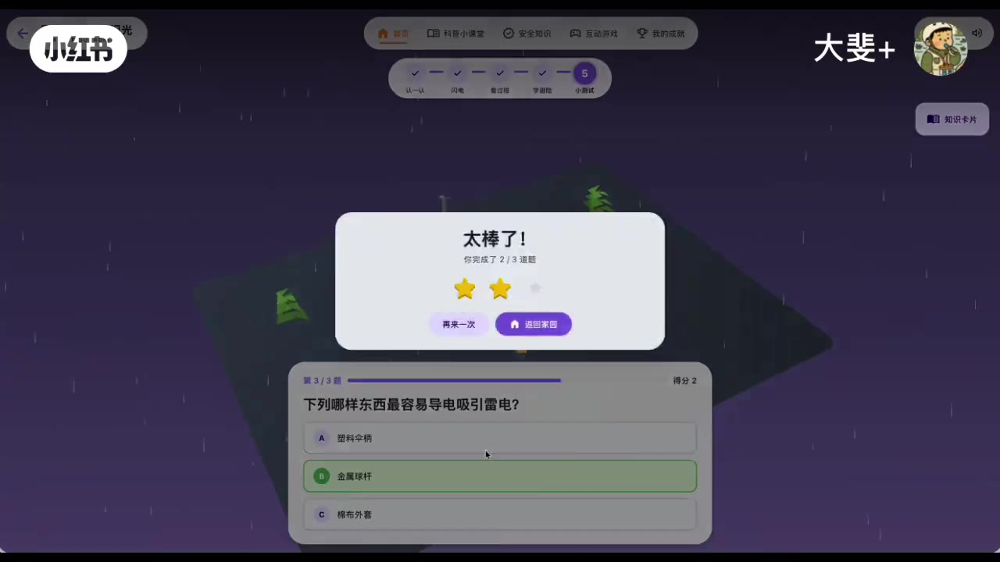

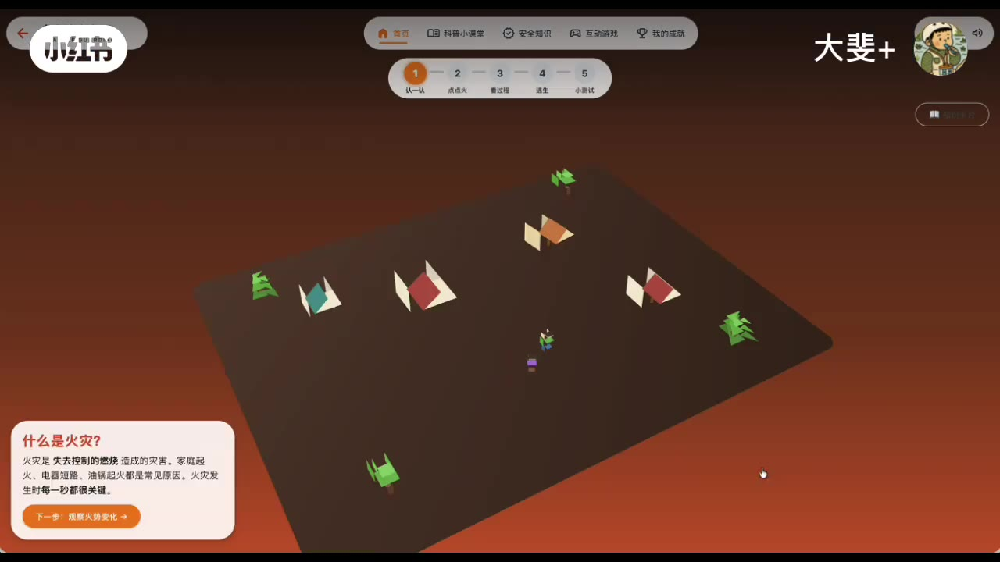

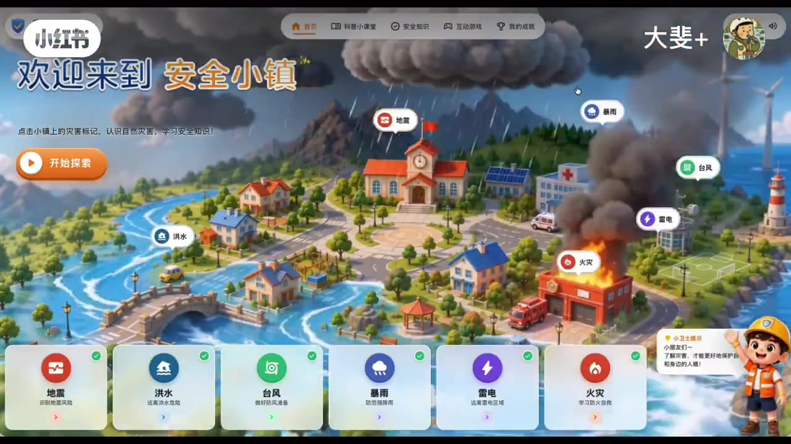

## 视频转录

> 本视频音频为音乐/音效,无语音旁白。faster-whisper 用 tiny/base/small 三个模型均只识别出结尾字幕署名"字幕by索兰娅",无正文语音可转录。原始记录见 [_transcript/video.md](./transcript/video.md)。
>
> 该笔记正文以画面+字幕呈现,建议参考上方「视频帧截图」浏览关键画面。

## 图片

