# 小孩哥为了玩游戏也是拼了😄

> 作者: blocklegend | 日期: 昨天 15:35 陕西 | 原文: https://www.xiaohongshu.com/discovery/item/6a7ec554000000000502acb3?app_platform=android&ignoreEngage=true&app_version=9.42.0&share_from_user_hidden=true&xsec_source=app_share&type=video&xsec_token=CBZeYHAgdnMlrKFAdn3y9ojuCUpKk1L9YoMEmp_2eKdS4%3D&author_share=1&xhsshare=CopyLink&shareRedId=OD06N0RGNj42NzUyOTgwNjY7OTg8RkdL&apptime=1786782784&share_id=051ce8a5719d4affb5ff33a46fd4f6d4&share_channel=copy_link

> **摘要**:一位小学生为了玩游戏,巧用游戏化的方式学习数学算术题(如78-10),并将解题过程嵌入游戏环节中。妈妈从怀疑到检查并认可孩子的做法,展现了寓教于乐的教育理念。该帖融合了游戏开发与AI教育元素,体现了小学生在暑假中通过《方块传奇》等游戏进行趣味学习的日常。

小孩哥为了玩游戏也是拼了😄
#游戏中学习
#方块传奇blocklegend
#小学生英语
#我的世界学英语
#小孩的世界
#游戏开发
#AI教育
#AI学习
#小学生日常
#暑假学习
昨天 15:35 陕西

#游戏化学习 #小学生教育

## 视频

[视频 1](./video.mp4)

<video controls width="100%"><source src="./video.mp4" type="video/mp4">您的浏览器不支持视频播放。</video>

附件: [音频](./audio/audio.wav) | [处理清单](./video_manifest.json)

## 视频图文总结

> 按关键帧关联完整视频转录；文字保留机器转写原文，时间点仅用于定位。

### 1. 00:00

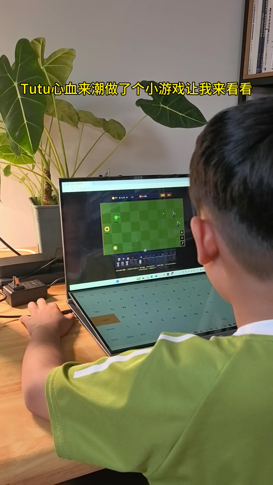

- 画面文字（OCR）：| 中
| 4 H:
yb 用，
HE
d |
ES 和
| 有 |
a
u il
~N 六士口不 | TT
Tutu GSR ER Vf HEHE
SAN
: 人 | R Ana
R AR 2S
\
\ | \.
y “A Fa
WN |
:
NJ PAE
| hee
wi ee
: 1 é a A
7) \
- pc a Re i | |
本 | 人 ATA | |
) “2 < : -一 we 人 CR
\ A > oa “> ve ; x : }
- : 下 oo «\ v2 ] i h : y ;
< . a \ BY 2 > 1 4 ] ] | 1 " |
x < - ~ = 让 Er «RS x . a
-’ \ : 0 N E ) 3
2 寺 PAN © A J!
/ A

### 2. 00:03

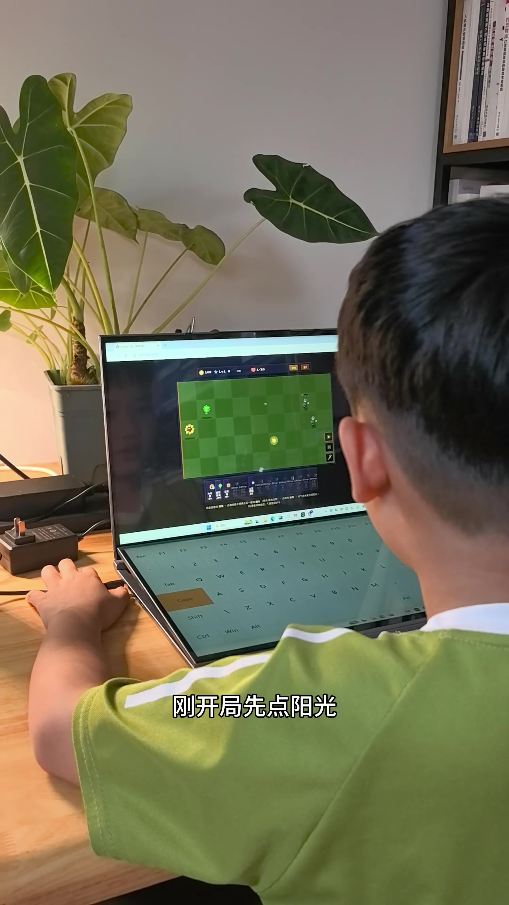

- 内容摘要：猪猪心血来潮做了个小游戏，让我来看看（00:00-00:04）
- 画面文字（OCR）：一王国 =
Ll: 1
bk
AE
a: Ji
: : cH
| HE HE
i 7 fH
i 时六
\| Pr ! | i) s
« «if
; |
| be 一 | |
Ne oh y 7 LE i 3
| BN HER |
\ 本。 3 Po
、
\ . 和
>» y, i x
\ wl 八
A : \
\ \
NAN
、 4
\ vA il
a :
a
全: 要 oz Kier 8 一 wv i
| —=% Fl
& mm -
A 9, i
= 2 .
¥
C
7]
站
4 PA 0 0 = feted
Ly 2. TaN 4
1s i = \
下二
= oy | < —
< E-
\ ” a
= SEN oy NR NB E
” \ j < AY ~ 二
\ ~ > 1 于
(=
PRON NS |
v y. 更 PA
A\ bi, ass | —
{
NFER em BEE
ZAM
; er |
& ol re 有 pF
— \ >.

### 3. 00:05

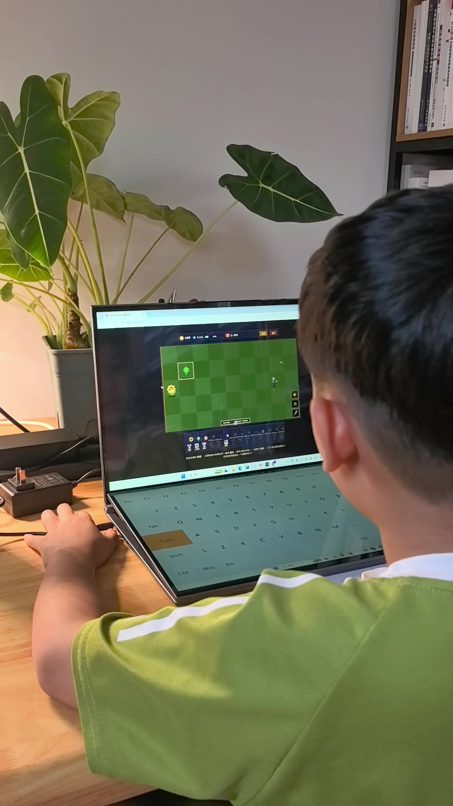

- 内容摘要：答题它可以产植物（00:05-00:07）
- 画面文字（OCR）：| v
| ~ i |
| 1: |
LAN 下 1:1 :
iE
Pl 站 iH: i
: iy
HL
- HE
ah. if H
S | | BE 由
- nN | |
\ \ |
| |
| aN:
{ M + 'H ¥
| AR
ly hn
Rd AW k
2
4 2
|
\
\ 和 Yr) | | \
SE | !
\ 衣 A |
he | | \
|
\
\ y
N\ y il
;
天 wd a
|
|
-一 9
o
本 gg
To _ 7]
DY cee ACE Pl \
1 LEE
—E— Pe Pd b
= |
| = ve 一一
‘if Ye i a = b= i i ;
- EN 2 2 > = 村 |
——— = \ Se
ae \ <n . x = hi i 5 1
与 N=
-一 \ : ye \ Les ~ N=? 中 3
} 2 2 入 5
d PRN p
- " =
7 、 |

### 4. 00:08

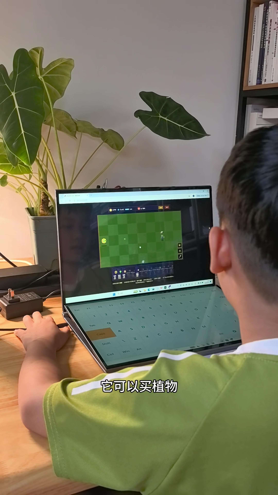

- 画面文字（OCR）：| f
| ~ ijl
7H]
中肝，，
iH» <A
A
~Y\ iH
Py ig I
| - p— | ty |
Pr | | |
) CW
NN. Br
| J
- 4 :
\
| |
|
R ”
这 | f\
\\
\' /
de.
A 1 AF 用和 | Eee
| Oi ki mmee B® a
a per
> , 中后
4
1 0
[
一本 2 er
TET Fl yz
ss ER
Cl i Tn, - vo A
> | | N ’ E oa rc © “ - bY S h
: : x J ~ NS 和 \ o < N
- 下
= \ <a Q nN iy 4 v 1
’ : :
EE A Ni |
<< ~\ >
| 和 NS <
< NA
| e™ Sat
— Sd A\ Pat EN NAD NS i» -
| \
C cave:
~~ 1
ry

### 5. 00:10

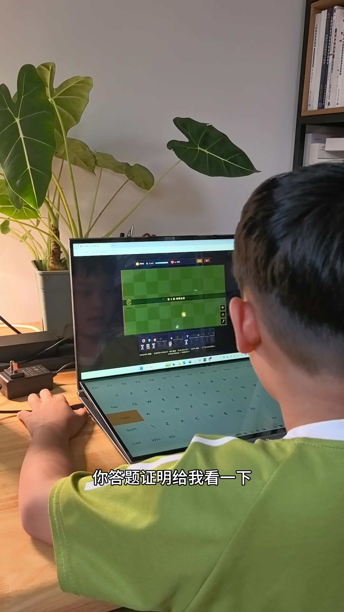

- 内容摘要：它它可以买买植物让我看一下，你答一题证明给我看一下，嗯，有吧（00:07-00:14）
- 画面文字（OCR）：|
oll A
BI
Hl.
i ! LH <?
| H i: I
| i
i | 时
<<) VE.
77 4 | |
‘ HR |
\ ON ri
\ \§ ey
Oise | | \
> ANA
\\ V4
BR) A 1 ~
, 网 @206 Lui m——— Pum = :
« uy =m
一
s s1nmase — [==
mi: |
LL 0
"加 ’ |
| - eer ttm VE 让本
- | gE iy ©
I fini iT
-一后 SS < Pvc aa pan
NY EAS SC |
\ \ 了 H] ~ FS bY hs RS N o <
< ” 2 Ric k
— \ i <、
oo \ As |
ee ht A \ ) 民 < 4 n g 4 L [A i
-_ h- 3
) <x . y 4
4 CAA\ SRN —
d 了 ap a B SS AN .
(REESRTIEER A FE —ID
4 &

### 6. 00:13

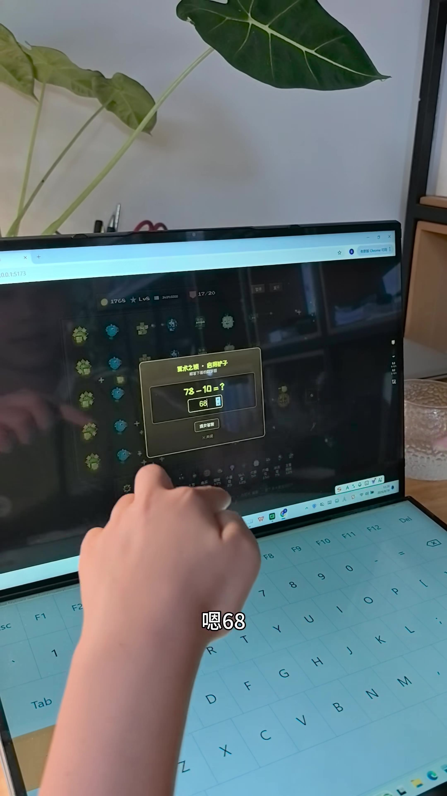

- 画面文字（OCR）：|
~ 四
v4
ym NA
| | x @ no
@ 1768 X LuS HE 2a5 17/20
"® | 10=? 4 —
78- —
国人 = 三
n 9° =
3 义关到 yn > 3
i» : :
eg DASE — SS
rks TN
3 ) ha
\ oy a
<2 { peo
== : SIN
EY i) | )
一 1 = 1 = \ > > 4 $ Eg,
p—— \ NEN NX
FE2 LE i : of
(Sa \ g
下"E68 \ RB > 入 NL 2
AAA “ y
3 i 0
\ , x 5
ta? = A
N
| C
| 站筷 E
>"

### 7. 00:15

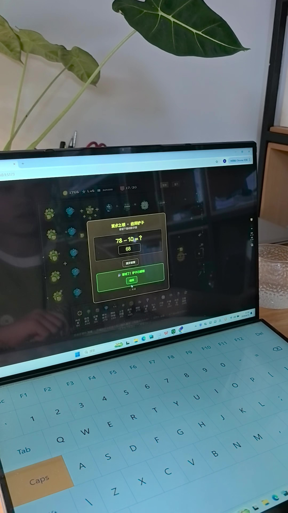

- 画面文字（OCR）：3 / py,
Q
a : |
\ | |
€
4 J
“a
| + 0 mi Come AA ,
@ 1765 Xx Lv | sso 17/20 :
8 +r «© :
& vy | 一 | |
» | J = = 5 . :
= (r 一
- iw -
Pee =
of if x kid a
- §&% Haid iti
7 > P » a 5 ed ppg
: ; 8 £ = AS
Co = ET EN、
_ Ee LL
= 一一 AS
" aS NS oR Ry 六
<5 WU NE S N
pp - A \, \ \ \ . 区
— 2 52 = © 多 A ad . _
C FA\ _
2: e 3
A oq 本本
= \
ie x SS ANN
TaP
N
[EN
C
HS
二 SN D>”
fy ’ "

### 8. 00:18

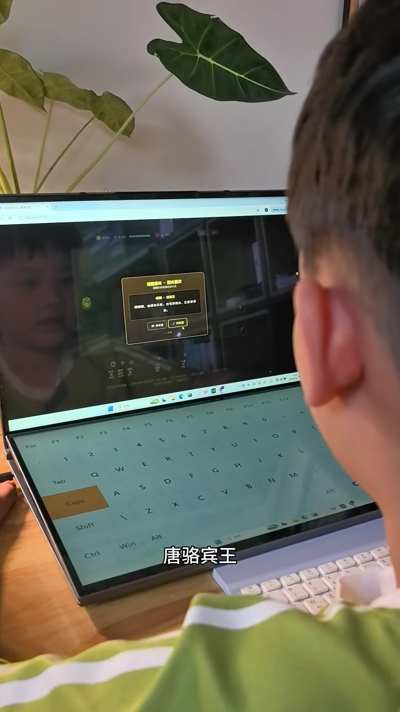

- 内容摘要：提交答案猜对了，我不要这个糖果兵王（00:14-00:19）
- 画面文字（OCR）：|
4
oy /
§ mm、 /
a L, y
y
A |
g’
@ 23: + Lvl sm 27
ame - BAX .
yoo > on - SKE
gum. sanxe. 62 S551
=.
a —
x 天尖 PN [ }
wf 上 El a )
S -
区 3 <\S a
<1 =
“© .
_ «5S <> =
2 28 E Ir D>
PY S55 = 5 = 3
Ry pe O 人
= 之要 ~ iy . A
: bs, No S > 3
= NN 之 he |
~ 2° © = SS 3 :
=
P~ pe :
\ 和 2
(e hi
om >
4 \ EN 2 2 E
cx a i
=> = 9
\! pt |
Es “= I
\ = BREE
- =
rT < §
na
\ 大
| -L 上
| ’
- F < 区
—
¢
FF

### 9. 00:20

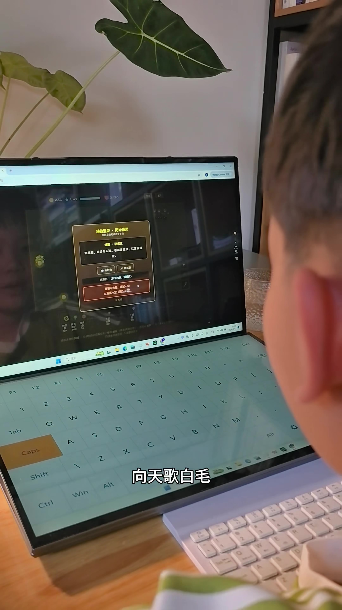

- 画面文字（OCR）：-
『
Te H
a. . |
a ah |
~~ we
y
0 x
& OQ neNCOemeSA i
:
>] 231 Lvl mn 2.20
EP rn . rE
RRRR . EER
I 8 - BRE 2 |
= | mmm, eNARE. asnaK, IRE c
:二 =. be I [
fil (ERE, REN - = pe
nn, WEE 所 5 AE
x KR )
IE 2 ’ .
Re gz 22 1
时 5 多 2 LN»
c oa. ie)
= 日 @ SLT JEN i
- ase = £2 g So
a EN <
J— — Cas ET
= 人 = “re ) >
— NO oS WT 本一一 eco he A =
<< 所村上 pr > >
oe > Na © ~
£2 SLES S
< Gy 司入 _— i ~
Sh VA EE > AS
3 Ce a - b =
NN o Ce 到
= SS 一
o < )
cave? NN Cc a - a ES = -
| SR ahi ‘8 _&
TR a os
ont k I — = c=
C = EN
LERHREES
WAC LL
\ cx
pre

和

### 10. 00:22

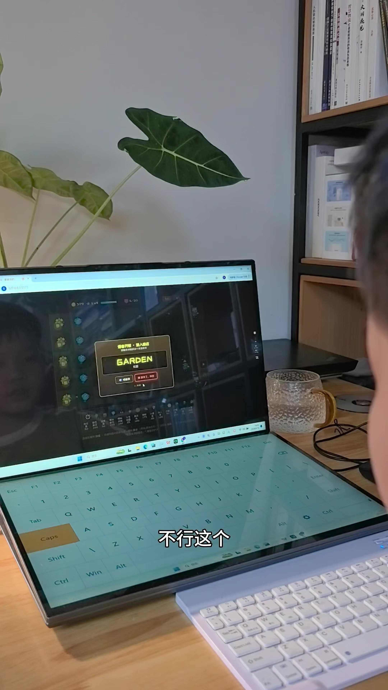

- 内容摘要：向天歌白毛不行这个garden（00:20-00:25）
- 画面文字（OCR）：Mor 2
‘ i
7 ’ ’ " ] :
1 HEH
: 2 1 4 

Co ST |
al |
“» 和 Pe « = 柯 ma i
ve
by 7 |
: i |
4
]
B .
|
加
- [+]
oe vs
2 pr a
o 区 NE
Pst xan :
- JE ] :
& ° GARDEN E
— .
‘eo Ey =
各 ¢ mec gE
ES 8&5 SIIe
YU pir ——
& 全 DAE Pa
y Yas ate aie
，村 s
9; a © af - <、 - a 了
b= 3 ox 7 RS 大 £9 4 .
ma 92 ws = 5 25 ;
n= - 人 CAE %,
= PT pe /
: Ra
< = a % - - tet 4
«NS < «NE na
ss f="
<1 fF =
A Ss Ss = = ) : >
- ] : 2 se - =
= 2 . = ! o ud 3 = <<
、- pi y
3 A NS : ) g )
A 2 nN - :
NG 所 * R oe"
i , |
Q = = |
20 5 |
= = o
| . B 一 =
\ cav*® \ == i
\ \ 有 E 2
\ i) % - ©
\ | \ ant 2 2 ; |
A : 3
PAN
\ NAT a
CA |
a |
ol o

### 11. 00:23

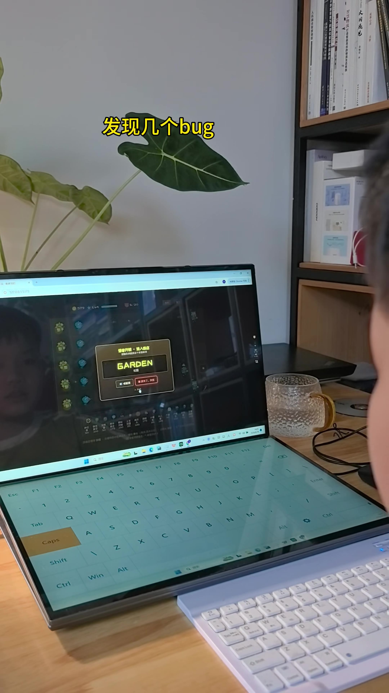

- 画面文字（OCR）：H 1 rr
A |
10 TEAL |
Pm 4
: Bir 2%
HER: «HI 峭 1
nls f
IRN 4
下 EEL: 3 -
| 1 8 .
1 |
y |
EN
LJ
| [
+ BH : 1
i : I
I H
LW:
| ]
po .
TIS nl PN 10 ’
Sil [1 bug |
: ck
Cd NT | 3
| ——
由 -_—- ES
EN & -. y 3
at B |
3 | #
X 2 |
| x
x
WA | 《
|
| SS
0
@ 579 Kk iva we bse
2
党
#% @ \
or
wane RASS :
ove ke amen i
& © GARDEN 3
wa aad 的 . B =m) Ghar. siz
A > Be: rr nT oy
$ LIP dt A
on © FARR So ss
wr & A a Rr
y ¥ A : 9 SEE )
« 多 4's 2
(57 i pa *8 5 en nd ARE 小
G ges w= 1% SA
ne 2 IP AR oa /
» t DC a :
S NN -一 4
~ > a
p < ~~
_ PEN .
< SC 2 = : - <
< «© pe S = 3 SS =
" i _ . 3 aN _—
FA < [3 = ee 、
cs Av > 0 .
~ -
2 oi 1
N : ~ 3 NE 内
< Aa)
心 \N 一 s
av h » g
| ~ EN CON 有
| = = o>
- ) (= a 由
\ | cav® ~ = >
= ae -
中 >
A cx = |
司站 -一 PAN \
NAT 一 Csxw
=

### 12. 00:26

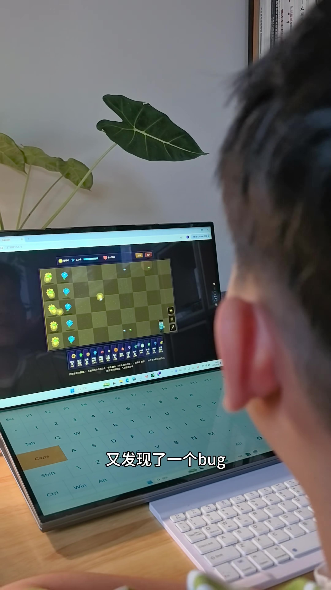

- 画面文字（OCR）：HB '
A - il
: 0.1 A. 5
Tl HEH
5 I» LF
s BIN “1
i i oi 站 1 il]
| 天 fy
If
id
\ os
、区人
- - a
‘
4
9
JRE 3
— 下
[Reve +
154 %
- !
\ hl Ff
o = |
_& El
p= I 4
i 1
ry bad © 上
p [a :
ha — "| 0 gl 1 站 AY iT 是
E32 | : sl
mer > -
ip? TAL 1540
Ps ° ® = [J [J » =
OL LR
1
apm
pe 和 aa
m— e ®
= 3
RAN < 气它 Na F
3 on Nis - .
- 本 - 2 2 >
OD = F -
二 > i
、N 三 > 人 | |
ra y -
© 四 |
Ccav® — > A
Ns 四二于由 |
ENS - 2
<a W255 bug
PY or
NYA) |
\ CA 站
| | |
g p—

### 13. 00:27

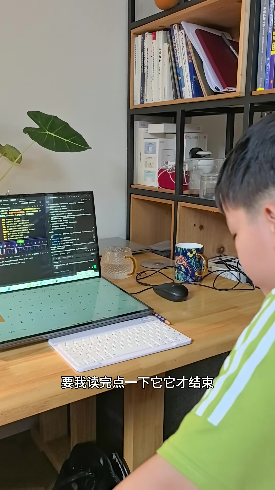

- 内容摘要：又是发现一个要我读完点一下他（00:25-00:28）
- 画面文字（OCR）：J
a ri
fA] i
8 iw 0 \
| | | = % 2 y
: | | i
: g | 和 “HH i ，
: Hr << 天 \ il 和 i i 0 | 5 i %
Cr ，，， TP
i: \
Lil id -B
: 0! y,
nn {
H § I
1 a i a
| BH | t .
i :
1 | 1
|
| | |
-一 - ERTT
« 商喇 =
v4 | | 人 Sa. 7
8 ’ 7 —
Pa 'g - Fy)
4 \ Ee
— EL
po a
» See speoes 了是 RK -本 ea i
-— Tc -
sammy OWA csmmnesms © 8° EE pes y "
© S88 E wem—— rn erem
pr manara Tri i’
rene ——— “ 恒 EE mm
= Se en :二 -一 ;
fp — mo pe————"
TB wmamanerrni da ‘=m 2 % - ’
[— PN pero = &
emer EE] Ee
Ti Ele iLL ET EN 7
和 2 "iw 4
El an wn 学站 — ’ re - ety iF = —
-s — SEEN) =
’ ) 一一一二六 ES ¢ 二 ee = 二 re m2 BN 已 ~ ~ NN
-一 3 - Ro N=
- mA Na 一 f -
= «- ve . - an I, a a -
人 AN 本 _~
多 - ~- vi ; -= s
« -
> ~~ Rr = ~ Ge = NS i |
a = = x a er - — o
pt a - 了 -一一一 °
5 一 = - 2 一
~ > = :
we
Ei TE ey Sell
3 STG =]
|
©
\
3

### 14. 00:28

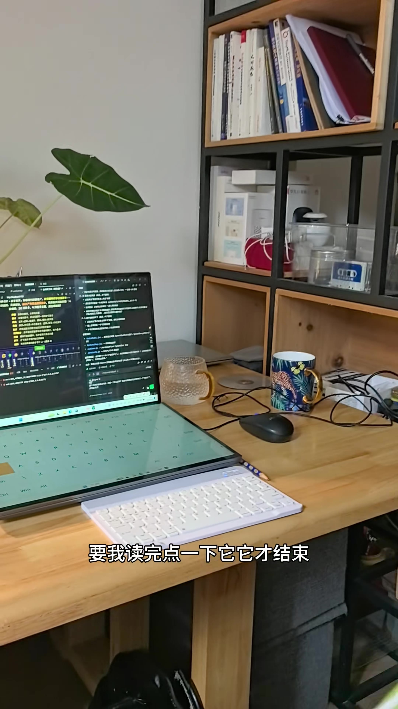

- 画面文字（OCR）：f
( NL
Fi \ |
| | /
In “LB | 机 N\
alr. I 'v
fli ¢ | (| 四
H | : | » \
\ |
| \
| | i
I} | 辣
x ， ea
|
|.
J {ons
| asm.
a | | | -
4 4 1a ! Ll i | i |
TN 一 Sam 中
= Lares BEDAN ， » =]
RL 一 sew =r,
Bes G08 commsesms © © pe. S————— -om 一 -
AT Don | ~
= .三 - 二二 pane. + Ma————
J . |
= Tar Tm |
pa a ae 5 |
Te (0 a
a Cc EE 0 7 =n ™
i BEN yo om Po p= — 3 11 ’ pe | 7
ee wm ass » 0 ve" AG " oo . Pp ER
emm———— = a] ，再 29) NE 一
= SE) a Vy BRN
we mm g ” ed . Pa j,. % x .
— - Sy 7~ Nil
He )
—— — ~~ _— -
4 时 PP N . / i
% he - © Li 一 ~~ Bh
ss 去
z om = 去 BD = 一下 ss
ER —
—
-一 a o\ ML
| EEE SEE Ee
BZ FA TE SR SH Td =
—5 加 pe Gi 本二 =
四 A

### 15. 00:29

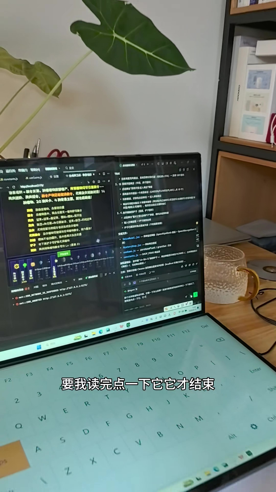

- 画面文字（OCR）：-___
AN 四 NE a .
Ny 5 :
4 J
> 2 a 4 |
JR WM We Wma mt |
stn BN wedamalt oom ET AS Ae dunes
Res wv AR. POE x
SEAN «BERN, haGwEaF 有 + RSMESANA mm
ma, Rode hrgmenr Ta! 1. was (v8, 789
naw. PN prove) wasual | + pamyEanRR NIE
= 3 和 (SONATA 1)
wa Bogue. AwesR J FE 一下 NE
me Sues®. RogRR-aneIat Josey a -一 nA gn unas. mt M-NRE . frp me
»n REOR-nERES gn.munaEn 3 met
RBS preeTEaREAUes. un@s! FT 有 oe aural’. gesazassl pS Lo 4 4
| 24 punt Sah |
wR S aungnne HL 852 . . or | mn tT |
[re » “48 上 pysteryshes- 35% Is 2 = |
8S 0 y '* 外国 yr f J Js en I
se . constants-3* — SHOP! -
air wae fw 和 ET rr wos ~— 二
= | oF Ae Su ogg9g7 一 -一一 puss ©7 mw ws o Ea%S pest 07 -一 -一
- 35 EX a © é
L—= .3:5373/ = 四下一、了 tos 37 = p —
po aan’ =
er 5 有 B
日 N
"gad c= = — g -
_ Ea oo 8
- _— a 加
© a Q
<1 wa = TN
> ve “ ; = 3
> wd 本 = N
v2
os J
2IN CN <
3 ER FR SE @ -
24 RN hes 和 ss
oy | 到结束
< 站 > od
a WN 4
(€
V p SN
< ic
3 ~ 时 o
L NS 人
| . ®
" -
>

### 16. 00:30

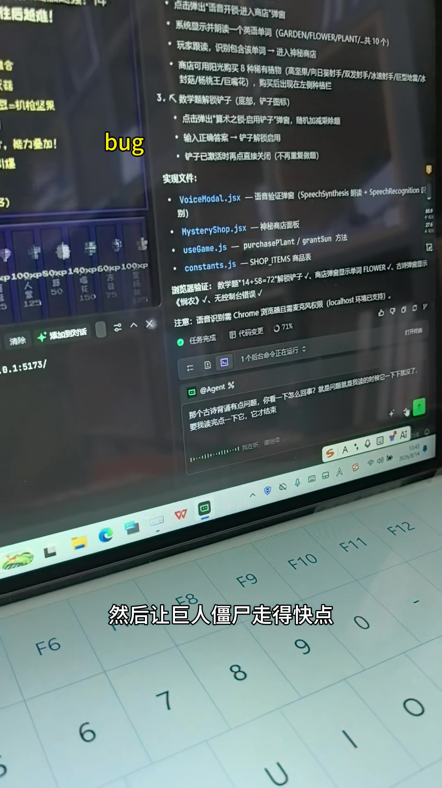

- 画面文字（OCR）：TEs 00 ' Rid
; hr 和商认和角读一个英语单词
(GARDEN
。商店可用阳光购 i
; % 8 WEED (高
3 HRN ER 坚果 /向日
) ， REE RE
= 机枪坚果 « K 数学题解锁铲子〈底部，铲子图标 )
| ¢ 点击弹出"算术之锁 ,启用铲子"弹徐，随，随机加减乘除题', NEM! ，输入正确答案一铲子解锁启用 LL V 。铲子已激活时再点直接关闭 (不再重复做咯 )
实现文件 ; -
5) h 。 VoiceModal.jsx — EERIE (SpeechSynthesis ii + SpeechRecognition 让一一别 ) -
MysteryShop. jsx 一神秘商店面板
4 ¥ R J : t + yseBame.js 一 purchasePlant / grantSun 方法人 xX BR C
0 100yPE0NP140XPEOKP 108 it 。 constants.js — SHOP_ITEMS 7 B
3 y 元 WER V。古诗璋让引
5 ; FAERIE: gp 14+58=T2 HIT J. fEemET#aA flo 二 129 4 \ 台错误 J
J (RR) V、无控制有 FRIR (localhost FREER) 4
- AN BEE gsi Chrome 3% giao 7
清除仿 EBS ys 图 REE o 71% 到
9.1:5173/ = 1k 人 SG 人 SEEEE“
_ 下下载 & 了，
o eAgent ¥ = ae
FEE a
Bare +
prea AES of Ai |
RITE 5 A 0 0 pd g
en? = pM
Ta OR © 病
: = U =)
w © —
, - 本一一贸一 a Nv
Wo pe ES SN 人机 SAS
| SS
REREAREE :
A EENERE SIRES
ge 9

### 17. 00:31

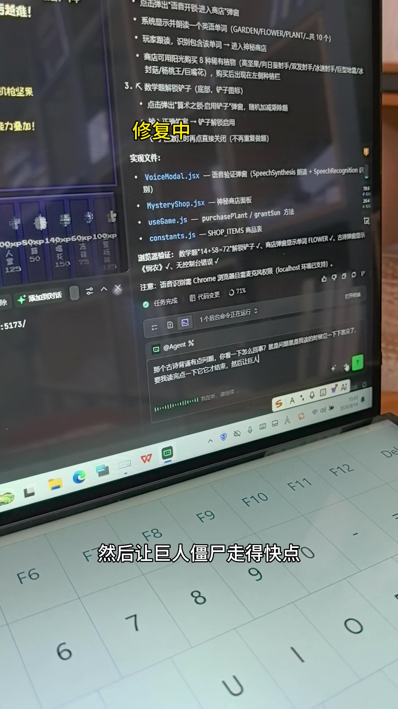

- 该时间点暂无可提取文字。

### 18. 00:31

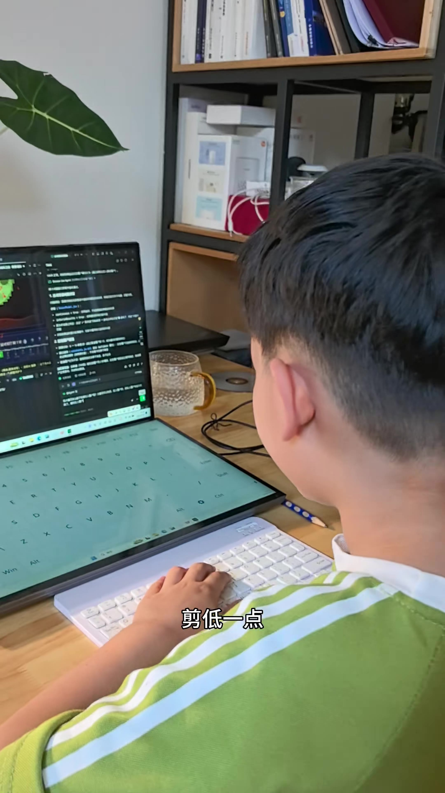

- 内容摘要：他才结束，然后让巨人僵尸走得快一点，点一点修复加一（00:28-00:34）

### 19. 00:32

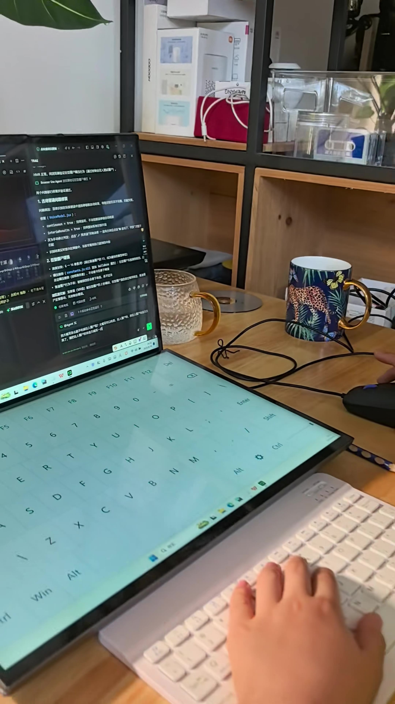

- 该时间点暂无可提取文字。

### 20. 00:33

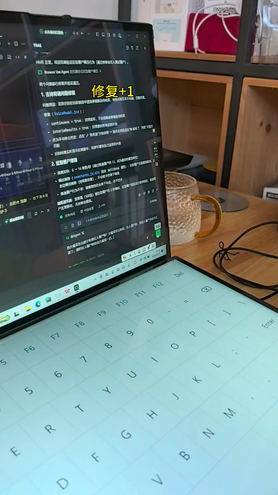

- 该时间点暂无可提取文字。

### 21. 00:34

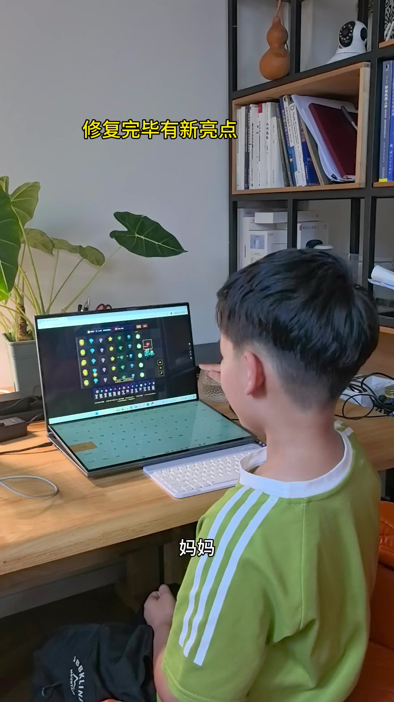

- 该时间点暂无可提取文字。

### 22. 00:36

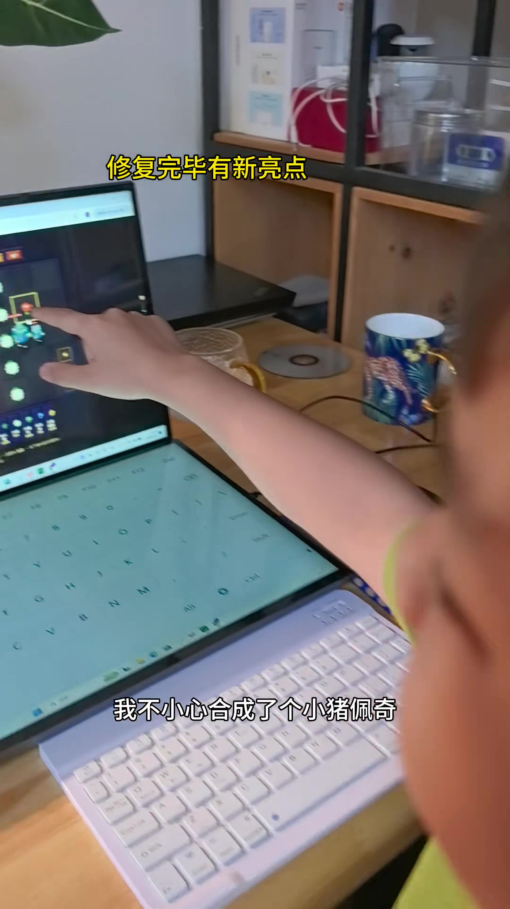

- 该时间点暂无可提取文字。

### 23. 00:37

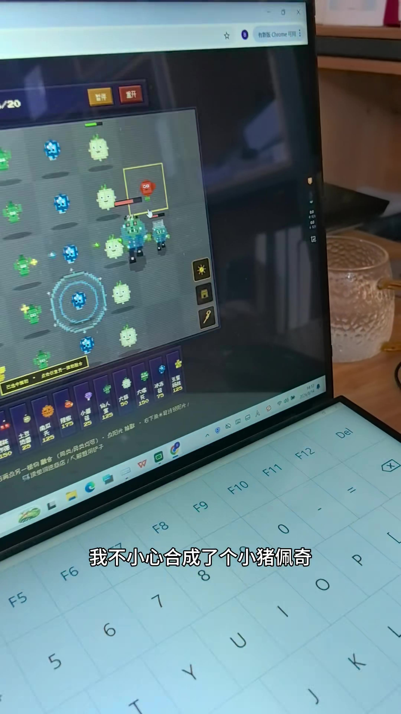

- 内容摘要：妈妈，我们俩就合成了个小猪佩奇，红色的呀，好小（00:34-00:39）

### 24. 00:38

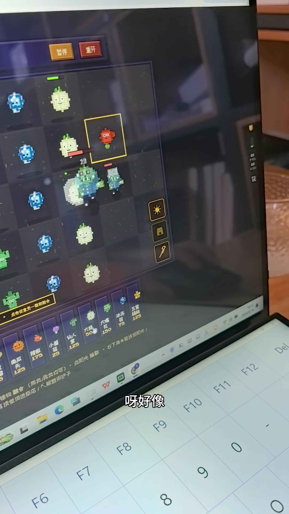

- 该时间点暂无可提取文字。

## 视频画面文字 (OCR)

> OCR 仅供参考，可能包含识别错误；请以视频画面和转写来源为准。

### 关键帧 1 · 0.5s

| 中
| 4 H:
yb 用，
HE
d |
ES 和
| 有 |
a
u il
~N 六士口不 | TT
Tutu GSR ER Vf HEHE
SAN
: 人 | R Ana
R AR 2S
\
\ | \.
y “A Fa
WN |
:
NJ PAE
| hee
wi ee
: 1 é a A
7) \
- pc a Re i | |
本 | 人 ATA | |
) “2 < : -一 we 人 CR
\ A > oa “> ve ; x : }
- : 下 oo «\ v2 ] i h : y ;
< . a \ BY 2 > 1 4 ] ] | 1 " |
x < - ~ = 让 Er «RS x . a
-’ \ : 0 N E ) 3
2 寺 PAN © A J!
/ A

### 关键帧 2 · 3.05s

一王国 =
Ll: 1
bk
AE
a: Ji
: : cH
| HE HE
i 7 fH
i 时六
\| Pr ! | i) s
« «if
; |
| be 一 | |
Ne oh y 7 LE i 3
| BN HER |
\ 本。 3 Po
、
\ . 和
>» y, i x
\ wl 八
A : \
\ \
NAN
、 4
\ vA il
a :
a
全: 要 oz Kier 8 一 wv i
| —=% Fl
& mm -
A 9, i
= 2 .
¥
C
7]
站
4 PA 0 0 = feted
Ly 2. TaN 4
1s i = \
下二
= oy | < —
< E-
\ ” a
= SEN oy NR NB E
” \ j < AY ~ 二
\ ~ > 1 于
(=
PRON NS |
v y. 更 PA
A\ bi, ass | —
{
NFER em BEE
ZAM
; er |
& ol re 有 pF
— \ >.

### 关键帧 3 · 5.6s

| v
| ~ i |
| 1: |
LAN 下 1:1 :
iE
Pl 站 iH: i
: iy
HL
- HE
ah. if H
S | | BE 由
- nN | |
\ \ |
| |
| aN:
{ M + 'H ¥
| AR
ly hn
Rd AW k
2
4 2
|
\
\ 和 Yr) | | \
SE | !
\ 衣 A |
he | | \
|
\
\ y
N\ y il
;
天 wd a
|
|
-一 9
o
本 gg
To _ 7]
DY cee ACE Pl \
1 LEE
—E— Pe Pd b
= |
| = ve 一一
‘if Ye i a = b= i i ;
- EN 2 2 > = 村 |
——— = \ Se
ae \ <n . x = hi i 5 1
与 N=
-一 \ : ye \ Les ~ N=? 中 3
} 2 2 入 5
d PRN p
- " =
7 、 |

### 关键帧 4 · 8.15s

| f
| ~ ijl
7H]
中肝，，
iH» <A
A
~Y\ iH
Py ig I
| - p— | ty |
Pr | | |
) CW
NN. Br
| J
- 4 :
\
| |
|
R ”
这 | f\
\\
\' /
de.
A 1 AF 用和 | Eee
| Oi ki mmee B® a
a per
> , 中后
4
1 0
[
一本 2 er
TET Fl yz
ss ER
Cl i Tn, - vo A
> | | N ’ E oa rc © “ - bY S h
: : x J ~ NS 和 \ o < N
- 下
= \ <a Q nN iy 4 v 1
’ : :
EE A Ni |
<< ~\ >
| 和 NS <
< NA
| e™ Sat
— Sd A\ Pat EN NAD NS i» -
| \
C cave:
~~ 1
ry

### 关键帧 5 · 10.71s

|
oll A
BI
Hl.
i ! LH <?
| H i: I
| i
i | 时
<<) VE.
77 4 | |
‘ HR |
\ ON ri
\ \§ ey
Oise | | \
> ANA
\\ V4
BR) A 1 ~
, 网 @206 Lui m——— Pum = :
« uy =m
一
s s1nmase — [==
mi: |
LL 0
"加 ’ |
| - eer ttm VE 让本
- | gE iy ©
I fini iT
-一后 SS < Pvc aa pan
NY EAS SC |
\ \ 了 H] ~ FS bY hs RS N o <
< ” 2 Ric k
— \ i <、
oo \ As |
ee ht A \ ) 民 < 4 n g 4 L [A i
-_ h- 3
) <x . y 4
4 CAA\ SRN —
d 了 ap a B SS AN .
(REESRTIEER A FE —ID
4 &

### 关键帧 6 · 13.26s

|
~ 四
v4
ym NA
| | x @ no
@ 1768 X LuS HE 2a5 17/20
"® | 10=? 4 —
78- —
国人 = 三
n 9° =
3 义关到 yn > 3
i» : :
eg DASE — SS
rks TN
3 ) ha
\ oy a
<2 { peo
== : SIN
EY i) | )
一 1 = 1 = \ > > 4 $ Eg,
p—— \ NEN NX
FE2 LE i : of
(Sa \ g
下"E68 \ RB > 入 NL 2
AAA “ y
3 i 0
\ , x 5
ta? = A
N
| C
| 站筷 E
>"

### 关键帧 7 · 15.81s

3 / py,
Q
a : |
\ | |
€
4 J
“a
| + 0 mi Come AA ,
@ 1765 Xx Lv | sso 17/20 :
8 +r «© :
& vy | 一 | |
» | J = = 5 . :
= (r 一
- iw -
Pee =
of if x kid a
- §&% Haid iti
7 > P » a 5 ed ppg
: ; 8 £ = AS
Co = ET EN、
_ Ee LL
= 一一 AS
" aS NS oR Ry 六
<5 WU NE S N
pp - A \, \ \ \ . 区
— 2 52 = © 多 A ad . _
C FA\ _
2: e 3
A oq 本本
= \
ie x SS ANN
TaP
N
[EN
C
HS
二 SN D>”
fy ’ "

### 关键帧 8 · 18.36s

|
4
oy /
§ mm、 /
a L, y
y
A |
g’
@ 23: + Lvl sm 27
ame - BAX .
yoo > on - SKE
gum. sanxe. 62 S551
=.
a —
x 天尖 PN [ }
wf 上 El a )
S -
区 3 <\S a
<1 =
“© .
_ «5S <> =
2 28 E Ir D>
PY S55 = 5 = 3
Ry pe O 人
= 之要 ~ iy . A
: bs, No S > 3
= NN 之 he |
~ 2° © = SS 3 :
=
P~ pe :
\ 和 2
(e hi
om >
4 \ EN 2 2 E
cx a i
=> = 9
\! pt |
Es “= I
\ = BREE
- =
rT < §
na
\ 大
| -L 上
| ’
- F < 区
—
¢
FF

### 关键帧 9 · 20.91s

-
『
Te H
a. . |
a ah |
~~ we
y
0 x
& OQ neNCOemeSA i
:
>] 231 Lvl mn 2.20
EP rn . rE
RRRR . EER
I 8 - BRE 2 |
= | mmm, eNARE. asnaK, IRE c
:二 =. be I [
fil (ERE, REN - = pe
nn, WEE 所 5 AE
x KR )
IE 2 ’ .
Re gz 22 1
时 5 多 2 LN»
c oa. ie)
= 日 @ SLT JEN i
- ase = £2 g So
a EN <
J— — Cas ET
= 人 = “re ) >
— NO oS WT 本一一 eco he A =
<< 所村上 pr > >
oe > Na © ~
£2 SLES S
< Gy 司入 _— i ~
Sh VA EE > AS
3 Ce a - b =
NN o Ce 到
= SS 一
o < )
cave? NN Cc a - a ES = -
| SR ahi ‘8 _&
TR a os
ont k I — = c=
C = EN
LERHREES
WAC LL
\ cx
pre

和

### 关键帧 10 · 22.48s

Mor 2
‘ i
7 ’ ’ " ] :
1 HEH
: 2 1 4 

Co ST |
al |
“» 和 Pe « = 柯 ma i
ve
by 7 |
: i |
4
]
B .
|
加
- [+]
oe vs
2 pr a
o 区 NE
Pst xan :
- JE ] :
& ° GARDEN E
— .
‘eo Ey =
各 ¢ mec gE
ES 8&5 SIIe
YU pir ——
& 全 DAE Pa
y Yas ate aie
，村 s
9; a © af - <、 - a 了
b= 3 ox 7 RS 大 £9 4 .
ma 92 ws = 5 25 ;
n= - 人 CAE %,
= PT pe /
: Ra
< = a % - - tet 4
«NS < «NE na
ss f="
<1 fF =
A Ss Ss = = ) : >
- ] : 2 se - =
= 2 . = ! o ud 3 = <<
、- pi y
3 A NS : ) g )
A 2 nN - :
NG 所 * R oe"
i , |
Q = = |
20 5 |
= = o
| . B 一 =
\ cav*® \ == i
\ \ 有 E 2
\ i) % - ©
\ | \ ant 2 2 ; |
A : 3
PAN
\ NAT a
CA |
a |
ol o

### 关键帧 11 · 23.46s

H 1 rr
A |
10 TEAL |
Pm 4
: Bir 2%
HER: «HI 峭 1
nls f
IRN 4
下 EEL: 3 -
| 1 8 .
1 |
y |
EN
LJ
| [
+ BH : 1
i : I
I H
LW:
| ]
po .
TIS nl PN 10 ’
Sil [1 bug |
: ck
Cd NT | 3
| ——
由 -_—- ES
EN & -. y 3
at B |
3 | #
X 2 |
| x
x
WA | 《
|
| SS
0
@ 579 Kk iva we bse
2
党
#% @ \
or
wane RASS :
ove ke amen i
& © GARDEN 3
wa aad 的 . B =m) Ghar. siz
A > Be: rr nT oy
$ LIP dt A
on © FARR So ss
wr & A a Rr
y ¥ A : 9 SEE )
« 多 4's 2
(57 i pa *8 5 en nd ARE 小
G ges w= 1% SA
ne 2 IP AR oa /
» t DC a :
S NN -一 4
~ > a
p < ~~
_ PEN .
< SC 2 = : - <
< «© pe S = 3 SS =
" i _ . 3 aN _—
FA < [3 = ee 、
cs Av > 0 .
~ -
2 oi 1
N : ~ 3 NE 内
< Aa)
心 \N 一 s
av h » g
| ~ EN CON 有
| = = o>
- ) (= a 由
\ | cav® ~ = >
= ae -
中 >
A cx = |
司站 -一 PAN \
NAT 一 Csxw
=

### 关键帧 12 · 26.01s

HB '
A - il
: 0.1 A. 5
Tl HEH
5 I» LF
s BIN “1
i i oi 站 1 il]
| 天 fy
If
id
\ os
、区人
- - a
‘
4
9
JRE 3
— 下
[Reve +
154 %
- !
\ hl Ff
o = |
_& El
p= I 4
i 1
ry bad © 上
p [a :
ha — "| 0 gl 1 站 AY iT 是
E32 | : sl
mer > -
ip? TAL 1540
Ps ° ® = [J [J » =
OL LR
1
apm
pe 和 aa
m— e ®
= 3
RAN < 气它 Na F
3 on Nis - .
- 本 - 2 2 >
OD = F -
二 > i
、N 三 > 人 | |
ra y -
© 四 |
Ccav® — > A
Ns 四二于由 |
ENS - 2
<a W255 bug
PY or
NYA) |
\ CA 站
| | |
g p—

### 关键帧 13 · 27.6s

J
a ri
fA] i
8 iw 0 \
| | | = % 2 y
: | | i
: g | 和 “HH i ，
: Hr << 天 \ il 和 i i 0 | 5 i %
Cr ，，， TP
i: \
Lil id -B
: 0! y,
nn {
H § I
1 a i a
| BH | t .
i :
1 | 1
|
| | |
-一 - ERTT
« 商喇 =
v4 | | 人 Sa. 7
8 ’ 7 —
Pa 'g - Fy)
4 \ Ee
— EL
po a
» See speoes 了是 RK -本 ea i
-— Tc -
sammy OWA csmmnesms © 8° EE pes y "
© S88 E wem—— rn erem
pr manara Tri i’
rene ——— “ 恒 EE mm
= Se en :二 -一 ;
fp — mo pe————"
TB wmamanerrni da ‘=m 2 % - ’
[— PN pero = &
emer EE] Ee
Ti Ele iLL ET EN 7
和 2 "iw 4
El an wn 学站 — ’ re - ety iF = —
-s — SEEN) =
’ ) 一一一二六 ES ¢ 二 ee = 二 re m2 BN 已 ~ ~ NN
-一 3 - Ro N=
- mA Na 一 f -
= «- ve . - an I, a a -
人 AN 本 _~
多 - ~- vi ; -= s
« -
> ~~ Rr = ~ Ge = NS i |
a = = x a er - — o
pt a - 了 -一一一 °
5 一 = - 2 一
~ > = :
we
Ei TE ey Sell
3 STG =]
|
©
\
3

### 关键帧 14 · 28.56s

f
( NL
Fi \ |
| | /
In “LB | 机 N\
alr. I 'v
fli ¢ | (| 四
H | : | » \
\ |
| \
| | i
I} | 辣
x ， ea
|
|.
J {ons
| asm.
a | | | -
4 4 1a ! Ll i | i |
TN 一 Sam 中
= Lares BEDAN ， » =]
RL 一 sew =r,
Bes G08 commsesms © © pe. S————— -om 一 -
AT Don | ~
= .三 - 二二 pane. + Ma————
J . |
= Tar Tm |
pa a ae 5 |
Te (0 a
a Cc EE 0 7 =n ™
i BEN yo om Po p= — 3 11 ’ pe | 7
ee wm ass » 0 ve" AG " oo . Pp ER
emm———— = a] ，再 29) NE 一
= SE) a Vy BRN
we mm g ” ed . Pa j,. % x .
— - Sy 7~ Nil
He )
—— — ~~ _— -
4 时 PP N . / i
% he - © Li 一 ~~ Bh
ss 去
z om = 去 BD = 一下 ss
ER —
—
-一 a o\ ML
| EEE SEE Ee
BZ FA TE SR SH Td =
—5 加 pe Gi 本二 =
四 A

### 关键帧 15 · 29.4s

-___
AN 四 NE a .
Ny 5 :
4 J
> 2 a 4 |
JR WM We Wma mt |
stn BN wedamalt oom ET AS Ae dunes
Res wv AR. POE x
SEAN «BERN, haGwEaF 有 + RSMESANA mm
ma, Rode hrgmenr Ta! 1. was (v8, 789
naw. PN prove) wasual | + pamyEanRR NIE
= 3 和 (SONATA 1)
wa Bogue. AwesR J FE 一下 NE
me Sues®. RogRR-aneIat Josey a -一 nA gn unas. mt M-NRE . frp me
»n REOR-nERES gn.munaEn 3 met
RBS preeTEaREAUes. un@s! FT 有 oe aural’. gesazassl pS Lo 4 4
| 24 punt Sah |
wR S aungnne HL 852 . . or | mn tT |
[re » “48 上 pysteryshes- 35% Is 2 = |
8S 0 y '* 外国 yr f J Js en I
se . constants-3* — SHOP! -
air wae fw 和 ET rr wos ~— 二
= | oF Ae Su ogg9g7 一 -一一 puss ©7 mw ws o Ea%S pest 07 -一 -一
- 35 EX a © é
L—= .3:5373/ = 四下一、了 tos 37 = p —
po aan’ =
er 5 有 B
日 N
"gad c= = — g -
_ Ea oo 8
- _— a 加
© a Q
<1 wa = TN
> ve “ ; = 3
> wd 本 = N
v2
os J
2IN CN <
3 ER FR SE @ -
24 RN hes 和 ss
oy | 到结束
< 站 > od
a WN 4
(€
V p SN
< ic
3 ~ 时 o
L NS 人
| . ®
" -
>

### 关键帧 16 · 30.2s

TEs 00 ' Rid
; hr 和商认和角读一个英语单词
(GARDEN
。商店可用阳光购 i
; % 8 WEED (高
3 HRN ER 坚果 /向日
) ， REE RE
= 机枪坚果 « K 数学题解锁铲子〈底部，铲子图标 )
| ¢ 点击弹出"算术之锁 ,启用铲子"弹徐，随，随机加减乘除题', NEM! ，输入正确答案一铲子解锁启用 LL V 。铲子已激活时再点直接关闭 (不再重复做咯 )
实现文件 ; -
5) h 。 VoiceModal.jsx — EERIE (SpeechSynthesis ii + SpeechRecognition 让一一别 ) -
MysteryShop. jsx 一神秘商店面板
4 ¥ R J : t + yseBame.js 一 purchasePlant / grantSun 方法人 xX BR C
0 100yPE0NP140XPEOKP 108 it 。 constants.js — SHOP_ITEMS 7 B
3 y 元 WER V。古诗璋让引
5 ; FAERIE: gp 14+58=T2 HIT J. fEemET#aA flo 二 129 4 \ 台错误 J
J (RR) V、无控制有 FRIR (localhost FREER) 4
- AN BEE gsi Chrome 3% giao 7
清除仿 EBS ys 图 REE o 71% 到
9.1:5173/ = 1k 人 SG 人 SEEEE“
_ 下下载 & 了，
o eAgent ¥ = ae
FEE a
Bare +
prea AES of Ai |
RITE 5 A 0 0 pd g
en? = pM
Ta OR © 病
: = U =)
w © —
, - 本一一贸一 a Nv
Wo pe ES SN 人机 SAS
| SS
REREAREE :
A EENERE SIRES
ge 9

## 字幕文件

[TXT](./transcript/video.txt) | [JSON](./transcript/video.json) | [SRT](./transcript/video.srt) | [VTT](./transcript/video.vtt)

## 转写来源

[平台字幕 TXT](./transcript/platform/video.txt) | [平台字幕 JSON](./transcript/platform/video.json) | [平台字幕 SRT](./transcript/platform/video.srt) | [平台字幕 VTT](./transcript/platform/video.vtt) | [本地 ASR TXT](./transcript/asr/video.txt) | [本地 ASR JSON](./transcript/asr/video.json) | [本地 ASR SRT](./transcript/asr/video.srt) | [本地 ASR VTT](./transcript/asr/video.vtt)

## 其他来源转写

### 本地 ASR

- **00:00-00:01** 多主新鞋来操作了
- **00:01-00:03** 和小游戏让我来主动
- **00:05-00:07** 大提他可以产生我
- **00:07-00:09** 他可以
- **00:09-00:10** 那也就是我
- **00:10-00:11** 我看一下你大提
- **00:11-00:11** 正面给我看一下
- **00:11-00:12** 嗯
- **00:12-00:13** 这边有白
- **00:13-00:14** 这边有哪个吧
- **00:14-00:15** 提交答案
- **00:15-00:16** 对了
- **00:16-00:17** 产生一句话
- **00:17-00:17** 我不要这个
- **00:18-00:18** 好
- **00:18-00:19** 我边王
- **00:20-00:21** 今天哥白毛
- **00:21-00:22** 为什么就
- **00:22-00:23** 打着
- **00:23-00:24** 发生几个
- **00:25-00:26** 变成发生的
- **00:26-00:28** 要我读完点一下
- **00:28-00:29** 他才结束
- **00:29-00:31** 然后让你人将士走得太阳
- **00:33-00:34** 修复价
- **00:34-00:34** 咱们
- **00:34-00:36** 我们要成为一个小猪佩琪
- **00:36-00:37** 我们知道的
- **00:37-00:38** 哟
- **00:38-00:39** 我想

## 视频转录

- **00:00-00:04** 猪猪心血来潮做了个小游戏，让我来看看
- **00:05-00:07** 答题它可以产植物
- **00:07-00:14** 它它可以买买植物让我看一下，你答一题证明给我看一下，嗯，有吧
- **00:14-00:19** 提交答案猜对了，我不要这个糖果兵王
- **00:20-00:25** 向天歌白毛不行这个garden
- **00:25-00:28** 又是发现一个要我读完点一下他
- **00:28-00:34** 他才结束，然后让巨人僵尸走得快一点，点一点修复加一
- **00:34-00:39** 妈妈，我们俩就合成了个小猪佩奇，红色的呀，好小

## 图片

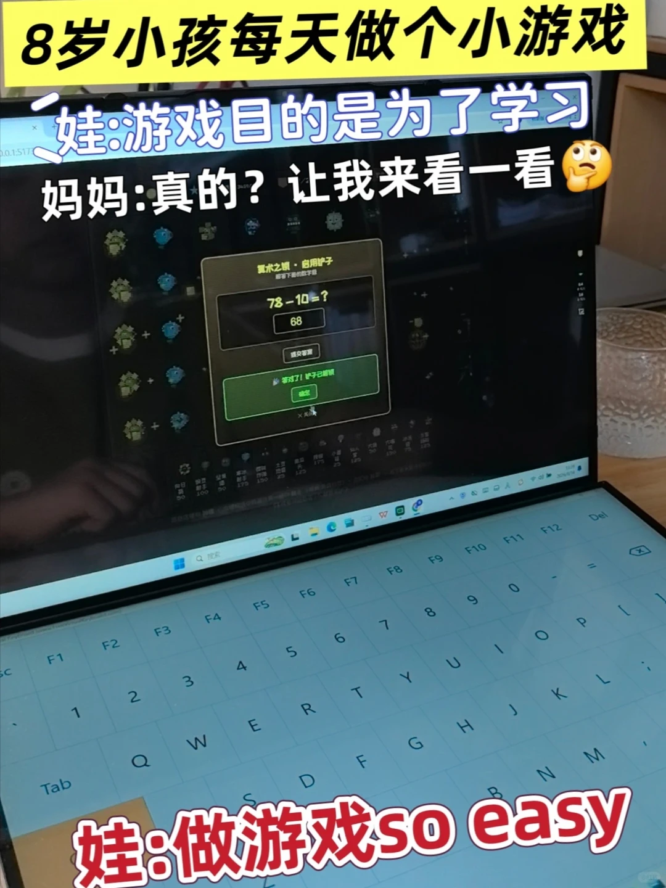

## 图片文字 (OCR)

> OCR 仅供参考，可能包含识别错误；请以原图为准。

小孩入做小游双
娃：游戏目的是为了学习
妈妈:真的？让我来看一看
算术之馈·启用铲子
容下图的称字题
78-10-？
68
交答室
答对了！铲子已锁
Q搜乐
ODA
W
S
专业装
F3
F4
F5
F6
F7
F8
F9
F10
F11
F12
F2
8
9
0
2
3
4
5
6
7
P
O
U
1
Y
T
E
R
W
K
H
J
G
F
M
N
