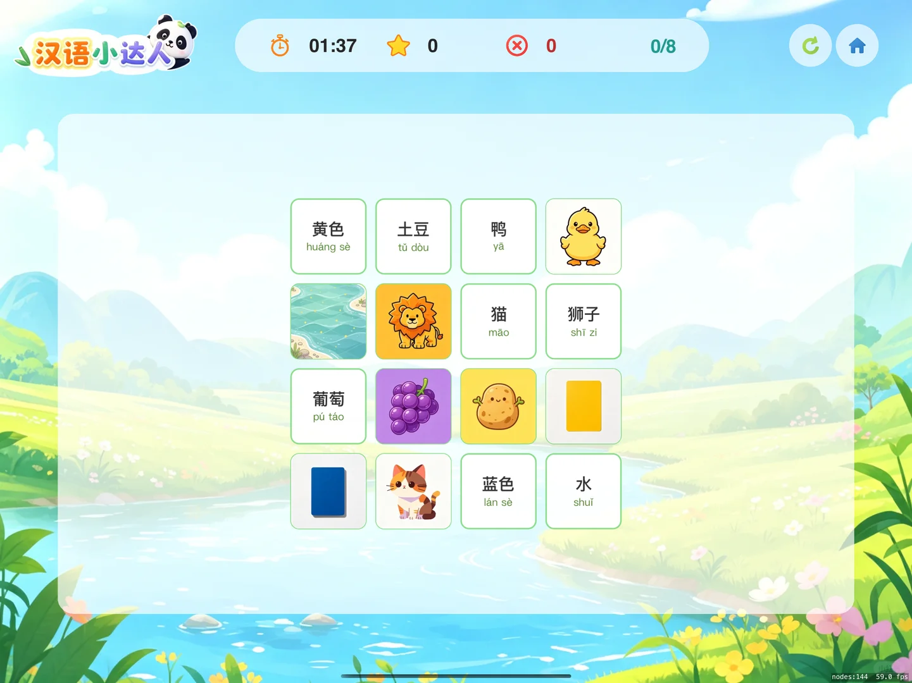
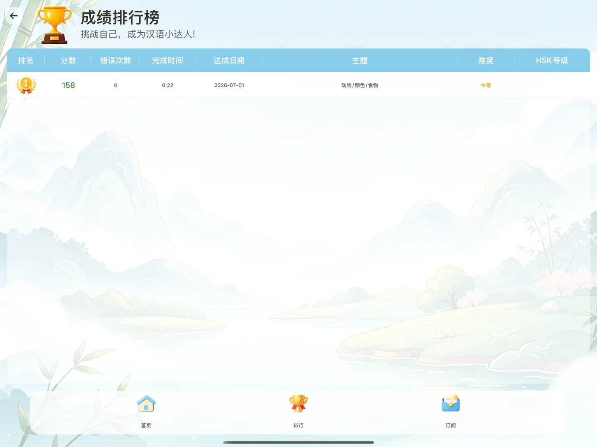

---
title: "游戏终于能畅玩了！排行榜也来“卷”了"
source: "https://www.xiaohongshu.com/discovery/item/6a453353000000002102154e?app_platform=android&ignoreEngage=true&app_version=9.36.0&share_from_user_hidden=true&xsec_source=app_share&type=normal&xsec_token=CBcazF4Zq5bbSpRRPXXakK21Y3zEKTw4TdDiegB1vIz7U%3D&author_share=1&xhsshare=CopyLink&shareRedId=N0dINjg3NUpMPko6S0EySDs0P0lFSjdL&apptime=1782921756&share_id=8dffbafc2f034ac095601d32160b17d8&share_channel=copy_link"
author: "CrazyDev007"
author_uid: "68400378000000001d024e30"
date: "47分钟前 广东"
tags: ["独立开发者", "OPC", "日更挑战"]
platform: "xiaohongshu"
category: "游戏设计"
---

# 游戏终于能畅玩了！排行榜也来“卷”了

> 作者: CrazyDev007 | 日期: 47分钟前 广东 | 原文: https://www.xiaohongshu.com/discovery/item/6a453353000000002102154e?app_platform=android&ignoreEngage=true&app_version=9.36.0&share_from_user_hidden=true&xsec_source=app_share&type=normal&xsec_token=CBcazF4Zq5bbSpRRPXXakK21Y3zEKTw4TdDiegB1vIz7U%3D&author_share=1&xhsshare=CopyLink&shareRedId=N0dINjg3NUpMPko6S0EySDs0P0lFSjdL&apptime=1782921756&share_id=8dffbafc2f034ac095601d32160b17d8&share_channel=copy_link

大家好，我又来了！
今天是小产品「汉字游乐场」日更第2天，从昨天磕磕绊绊的卡片引擎，到今天终于跑通完整游戏流——效率拉满，成就感爆棚。
	
今日三件大事，全部拿下：
✅ 游戏界面UI布局大翻新
昨天还像散落拼图的卡片，今天经过网格间距调整、弹性适配不同屏幕尺寸，加上圆角+阴影的“呼吸感”设计，每一张卡片都规整又亲切。现在iPad上能自动排布，视觉终于配得上“寓教于乐”这四个字了。
	
✅ 交互逻辑丝滑闭环
答对/答错有即时动效和计分变化，连“下一题”的过渡都加了淡入淡出。现在闭着眼睛（当然得睁着看字）都能顺畅玩完一组练习——第一批种子用户来了不会骂我。
	
✅ 本地成绩排行榜上线
用UserDefaults存下最高分和最近10次战绩，首页加了个“排行榜”入口，能看到自己的最佳记录和进步曲线。虽然只有我一个人在刷，莫名燃起来了——这就是“与自己赛跑”的OPC精神吧。
	
明日硬仗预告（2026.07.02）：
⭕ 整合HSK 1-2级官方词汇
给游戏注入真正的“学有所值”内核，让初学者能按考纲体系化记忆，不止是瞎玩。
⭕ 接入苹果内购与订阅
迈出商业化第一步——考虑解锁全部词库、去广告、专属主题等。虽然心里没底，但独立产品得自己学会造血，明天啃下这块硬骨头。
	
日更第2天，身体很累，心里很亮。
如果你也在一人创业、或正学中文，留下你的足迹，咱们互相云打气。
	
明天同一时间，我会带着HSK词汇表和内购流程图回来。
	
#独立开发者 #OPC #日更挑战

## 图片

