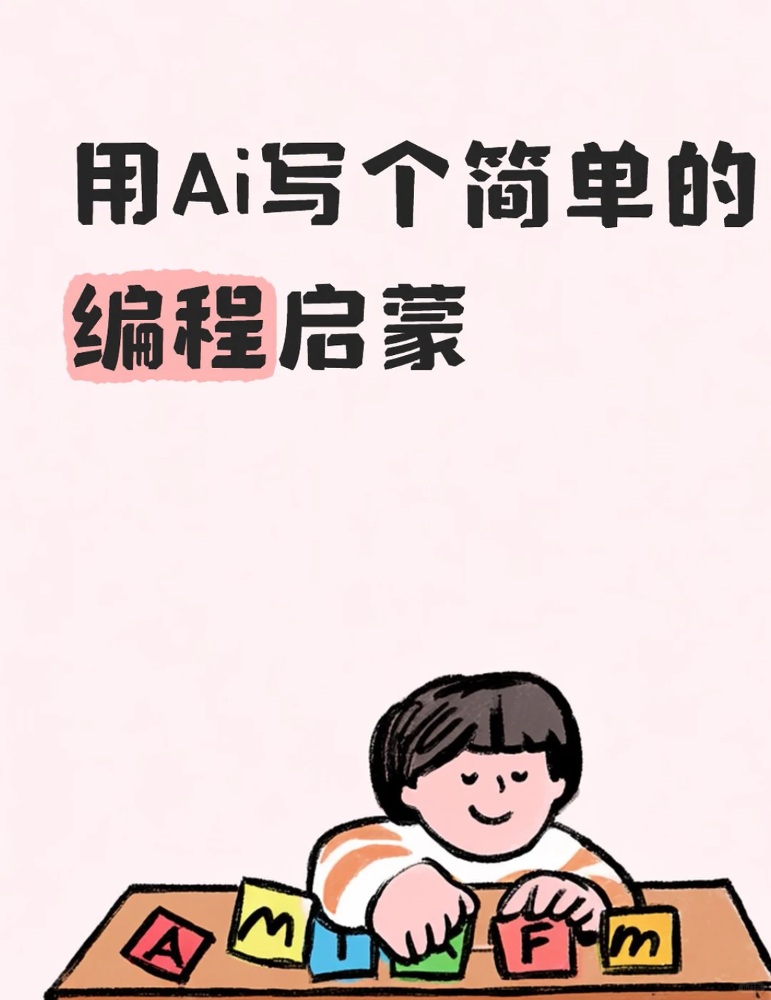
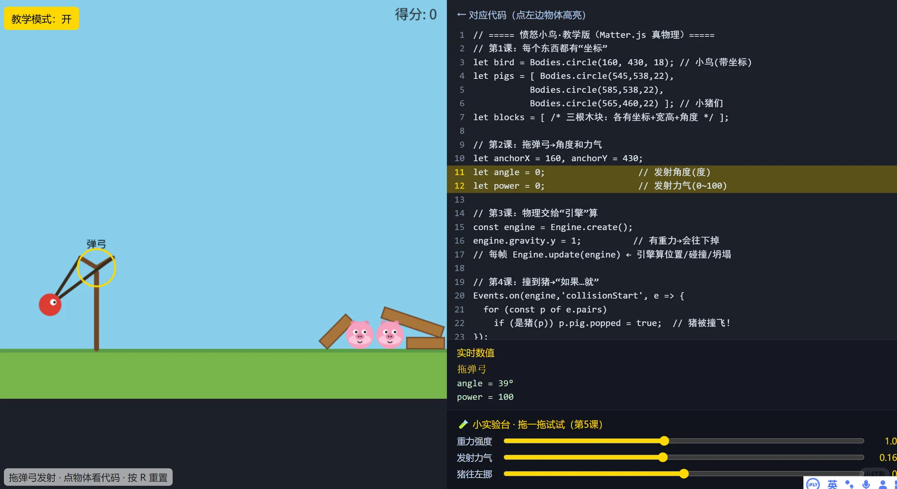
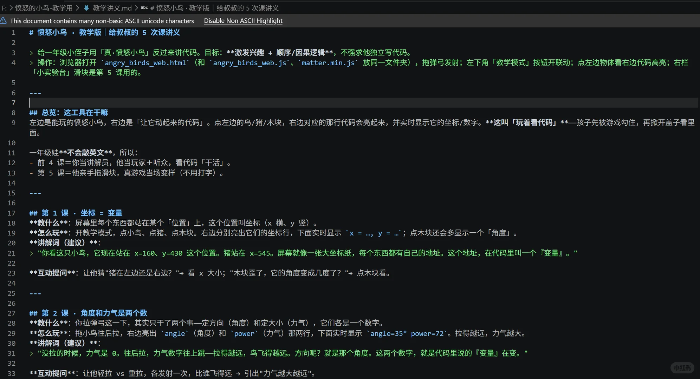

# 用小游戏做编程启蒙，欢迎您来聊聊

> 作者: 课境数创^-^ Ai+教学探索 | 日期: 3小时前 | 原文: https://www.xiaohongshu.com/discovery/item/6a7548a00000000033035a4f?app_platform=android&ignoreEngage=true&app_version=9.41.0&share_from_user_hidden=true&xsec_source=app_share&type=normal&xsec_token=CBiojYszvscFvFCpq3gQcptUH2GlhfMPdUiyFGnpevH6I%3D&author_share=1&xhsshare=CopyLink&shareRedId=N0dINjg3NUpMPko6S0EySDs0P0lFSjdL&apptime=1786077406&share_id=11636d1fd6e04045b9f949a8a6a7047f&share_channel=copy_link

> **摘要**:作者为一年级小侄子开发了一款基于Matter.js物理引擎的网页版"愤怒小鸟·教学版",通过左右分屏联动的方式,将真实游戏与对应代码结合。左侧可正常拖拽弹弓玩游戏,右侧实时显示坐标、角度、力气等变量数值;开启"教学模式"后,点击物体即可高亮对应代码;"小实验台"滑块让孩子无需敲英文就能直观理解变量、

用小游戏做编程启蒙，欢迎您来聊聊
最近给一年级小侄子做了个编程启蒙尝试🐦
就是网页版愤怒的小鸟。左边拖弹弓玩，右边实时显示对应代码。
	
开"教学模式"，点击哪里，对应的代码就高亮，坐标、角度、力气全看得见～
	
还有"小实验台"滑块，娃拖一下真游戏当场变样，不敲英文字母也能懂变量和循环！
	
完全离线，双击就能玩，可以分享。[嘻嘻R]
	
#编程启蒙 #少儿编程 #亲子教育 #一年级 #愤怒的小鸟 #陪娃日常 #家庭教育 #网页小游戏 ✨
3小时前

#Matter.js

## 图片

## 图片文字 (OCR)

> OCR 仅供参考，可能包含识别错误；请以原图为准。

用Ai写个简单的
编程启蒙

对应代码（点左边物体高亮）
1
愤怒小鸟·教学版（Matter.js真物理）
2
//第1课：每个东西都有“坐标”
3
let bird= Bodies.circle(160，430，18)；//小鸟(带坐标)
4
letpigs =[ Bodies.circle(545,538,22),
5
Bodies.circle(585,538,22),
6
Bodies.circle(565,460,22)]；//小猪们
7
letblocks =[/*三根木块：各有坐标+宽高+角度*/];
8
9
//第2课：拖弹弓→角度和力气
10
let anchorX = 160,anchorY =430;
11
let angle=0;
//发射角度（度）
12
let power = 0;
//发射力气（0~100）
13
14
1/第3课：物理交给“引擎”算
15
const engine=Engine.create();
弹弓
16
engine.gravity.y =1;
//有重力→会往下掉
17
//每帧 Engine.update(engine)←引擎算位置/碰撞/坍塌
18
19
//第4课：撞到猪→“如果.就”
20
Events.on(engine,'collisionStart',e => {
21
for (const p of e.pairs)
22
if(是猪(p))p.pig.popped=true；//猪被撞飞！
23 }):
实时数值
拖弹弓
angle = 39°
power = 100
小实验台·拖一拖试试（第5课）
重力强度
发射力气
猪往左挪

Thisdocumentcontainsmanynon-basicASCllunicodecharacters
DisableNonASCll Highlight
#愤怒小鸟·教学版|给叔叔的5次课讲义
>给一年级小侄子用「真·愤怒小鸟」反过来讲代码。目标：**激发兴趣+顺序/因果逻辑**，不强求他独立写代码。
>操作：浏览器打开angry_birds_web.html`（和angry_birds_web.js`、`matter.min.js`放同一文件夹），拖弹弓发射；左下角「教学模式」按钮开联动；点左边物体看右边代码高亮；右栏
「小实验台」滑块是第5课用的。
##总览：这工具在干嘛
左边是能玩的愤怒小鸟，右边是「让它动起来的代码」。点左边的鸟/猪/木块，右边对应的那行代码会亮起来，并实时显示它的坐标/数字。**这叫「玩着看代码」**——孩子先被游戏勾住，再掀开盖子看
面。
一年级娃**不会敲英文**，所以：
-前4课=你当讲解员，他当玩家+听众，看代码「干活」。
-第5课=他亲手拖滑块，真游戏当场变样（不用打字）。
##第1课·坐标=变量
**教什么**：屏幕里每个东西都站在某个「位置」上，这个位置叫坐标（x横、y竖）。
**怎么玩**：开教学模式，点小鸟、点猪、点木块。右边分别亮出它们的坐标行，下面实时显示x= …，y =…^；点木块还会多显示一个「角度」
**讲解词（建议）**：
>"你看这只小鸟，它现在站在x=160、y=430这个位置。猪站在x=545。屏幕就像一张大坐标纸，每个东西都有自己的地址。这个地址，在代码里叫一个『变量』。
**互动提问**：让他猜"猪在左边还是右边？"→看×大小；"木块歪了，它的角度变成几度了？"→点木块看。
##第2课·角度和力气是两个数
**教什么**：你拉弹弓这一下，其实只干了两个事—定方向（角度）和定大小（力气），它们各是一个数字。
**怎么玩**：拖小鸟往后拉，右边亮出angle`（角度)和`power`（力气）那两行，下面实时显示angle=35°power=72`。拉得越远，力气越大。
**讲解词（建议）**：
> "没拉的时候，力气是 0。往后拉，力气数字往上跳—拉得越远，鸟飞得越远。方向呢？就是那个角度。这两个数字，就是代码里说的『变量』在变。
