# 如何一句话把一本书变成游戏？我就是要吹爆腾讯 CodeBuddy NPC

> 作者: 吉米的AI Studio | 平台: 微信公众号 | 日期: 2026-07-27 23:29 | 原文: https://mp.weixin.qq.com/s/45KQvmgB-_gWjANtpNN5MQ

> **摘要**: 万物皆代码

腾讯要上天！

很多人都以为这个长得很像 Github 的腾讯云原生平台，就是个代码仓库，增加了 AI 写代码的功能，与Github Copilot 差不多。

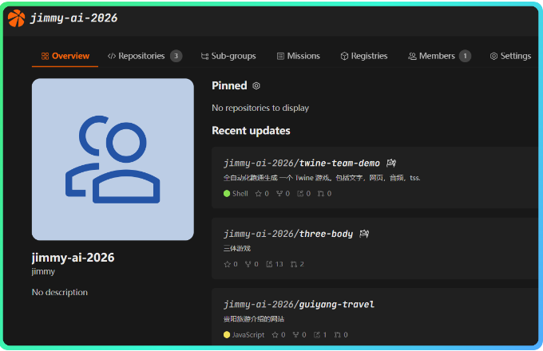

我完整体验了12小时，下面的截图大家自己体会下，这是写代码的 AI？

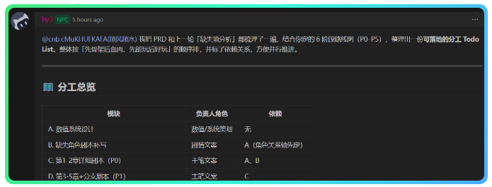

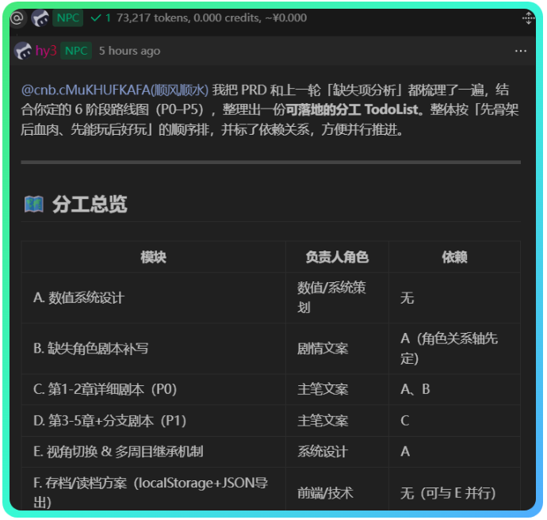

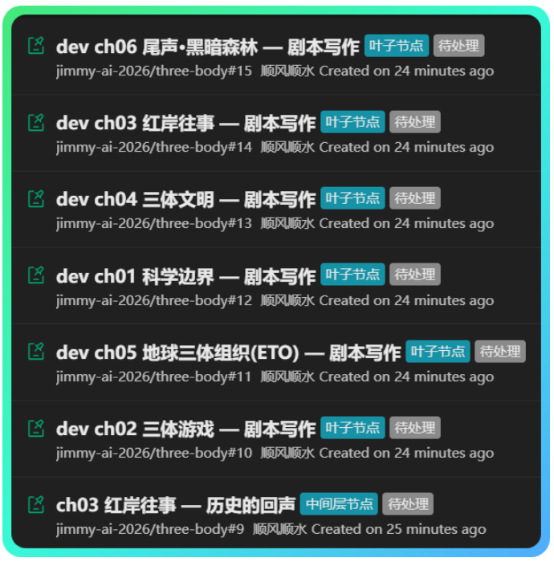

我做的事情，就是把《三体》变成一个文字游戏。

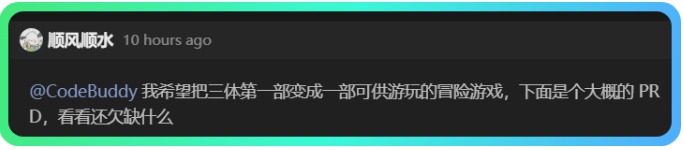

我把这个需求告诉**项目经理NPC**，然后这个项目经理NPC自动分派任务给各个不同角色的NPC进行实施。关键是这个团队的所有 NPC都分工明确，各司其职。

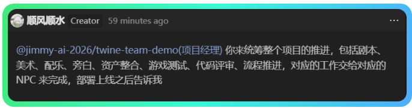

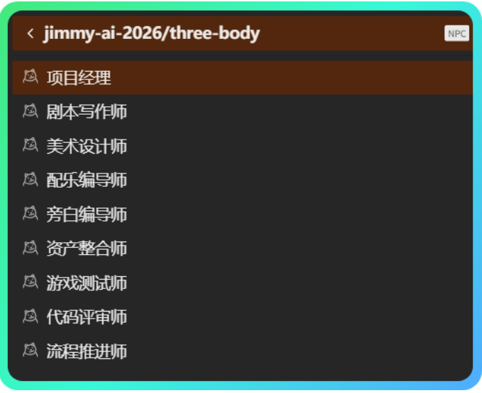

这是个及其复杂而庞大的工程，光第一个子任务，就执行了两个多小时，下面还有一堆等待执行的任务。

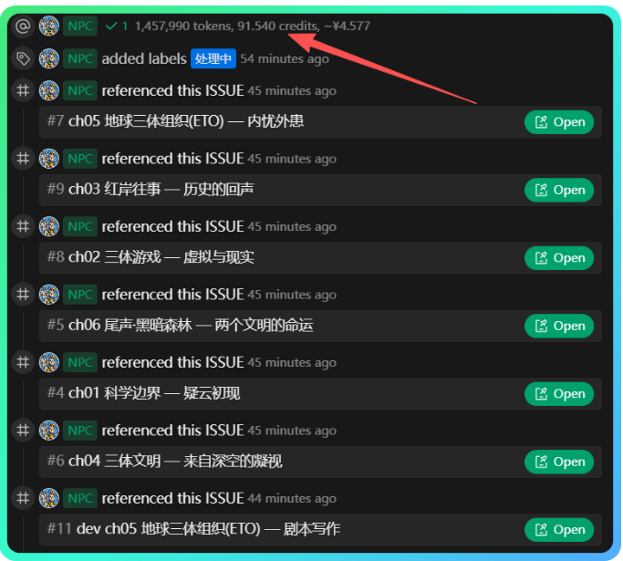

但对我来说，却完全不用等待，我合上电脑就去干别的了，因为这些工作都在腾讯的云端平台上完成。

大家可以看看最终的效果（我自己的游戏还在制作中，但腾讯官方公布了一个类似文字游戏的最终效果），全程没有人类参与，由 8个NPC在云端自主完成整个游戏。

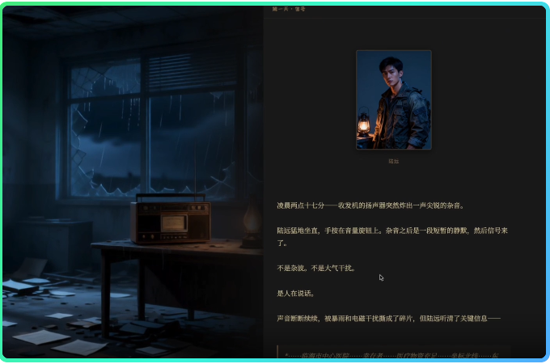

这就意味着，在未来的某一天，不仅仅是程序员，编剧、美工、配乐、旁白、项目经理，都可以由 NPC 替代了。

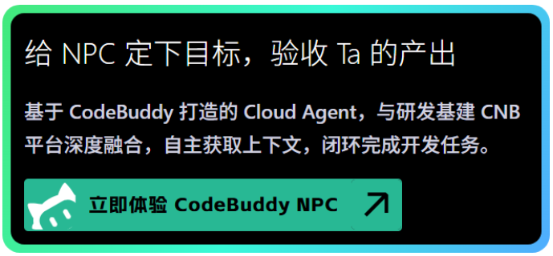

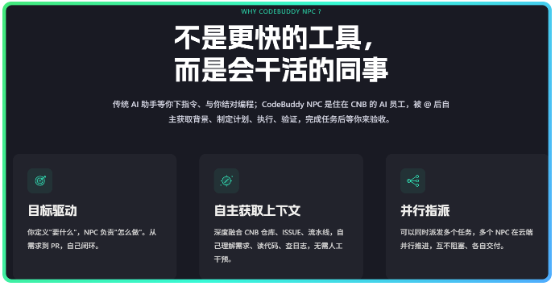

第一眼看到这个页面的时候，我起了一身鸡皮疙瘩，这种似曾相识的感觉，让我想起了我第一次看《黑客帝国》。

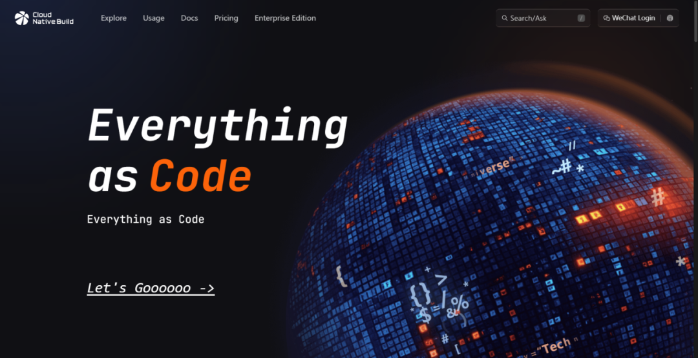

用 CodeBuddy NPC 去实现一个数字世界，这才是腾讯埋藏在内心深处的真实的野望。但我体验之后不由得感叹腾讯也许终有一天可以做到，因此，CodeBuddy NPC 我认为绝对是一个全新形态的产品，真正意义上的 让 Agent 为我们人类工作，我们只看结果，过程全靠 NPC！

大家赶紧来体验一把未来吧。

使用方法

访问它的首页，用微信扫码就可以登陆。

💡

https://cnb.cool/

进入后，会看到一个类似下图的页面，不用理会我们是否能看懂内容。

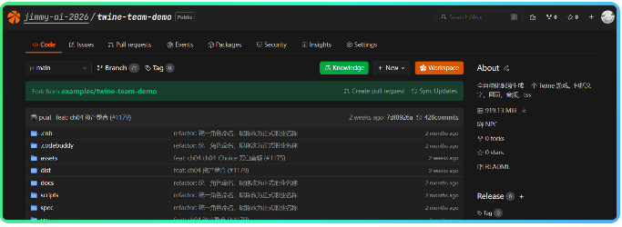

先点击头像旁边的+号创建一个仓库，所谓仓库就是用来放你项目所有文件的地方，未必一定是代码文件，比如视频、对话音频、只要是项目文件。

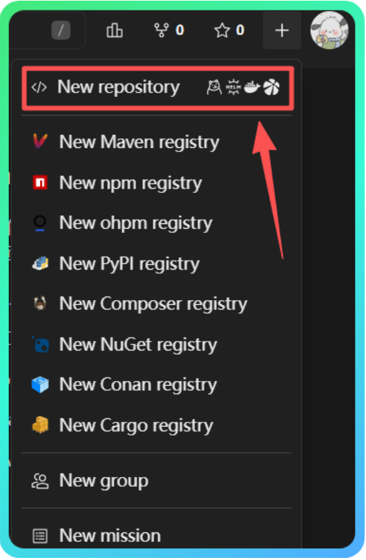

填一下仓库的名称描述，比如我这里填写一些和三体游戏制作的信息，然后仓库就创建好了。

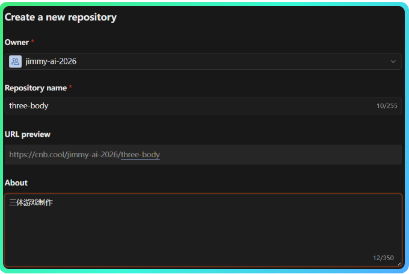

仓库创建好之后，进入 Issues 页面，点击最右侧的 New issue

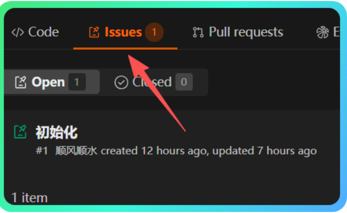

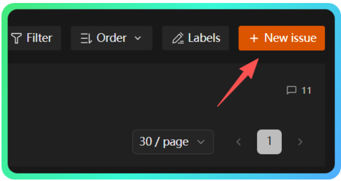

接下来就可以在对话框中，用 @符号呼出NPC 来为你干活了，下图这些 NPC 都是腾讯为我们提前创建好的可以直接呼叫的 NPC。

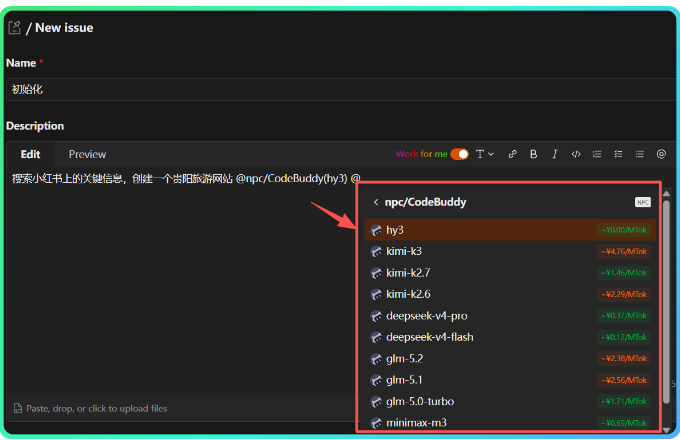

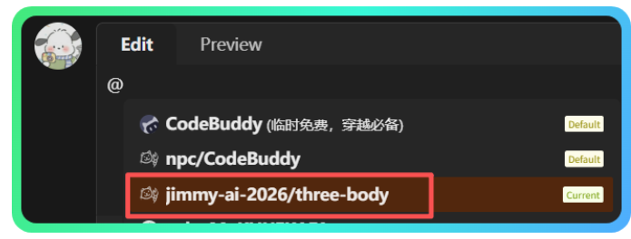

现在混元（hy）这个 NPC 是免费的，大家赶紧敞开用啊！

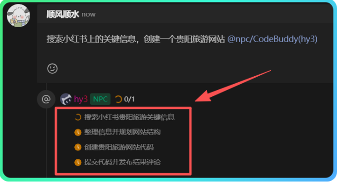

我还用NPC飞速的做了一个近期出游贵阳的攻略网站，转手就发给旅游搭子了，让旅游搭子羡慕了一把。

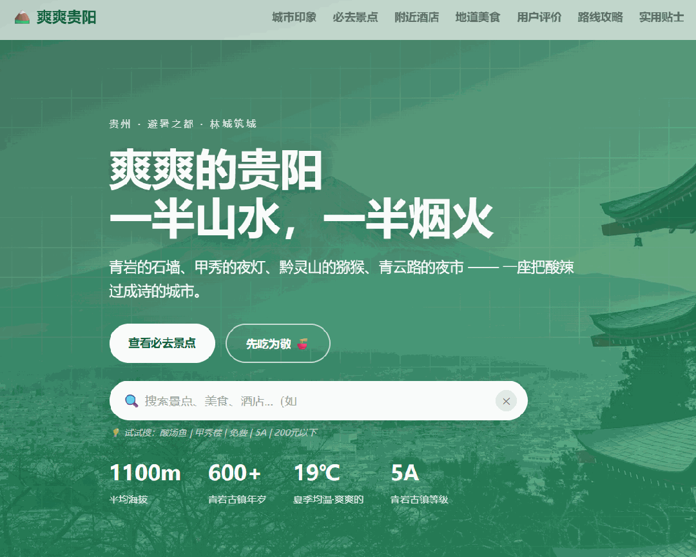

除了这几个默认的NPC以外，还有很多玩家自建有 NPC，只要我们 Follow 了这些创建 NPC 的仓库，我们就能直接呼出这些NPC 了。

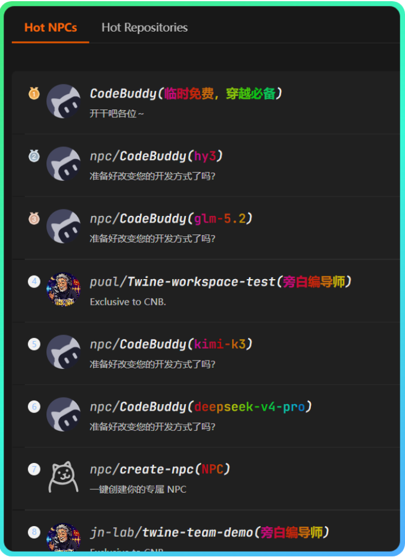

真的是太酷了！

如何自建NPC

这个上手有一定的难度。

主要通过在仓库根目录下配置.cnb/settings.yml文件定义角色，并在.cnb.yml中使用npc:go内置任务编写处理逻辑。

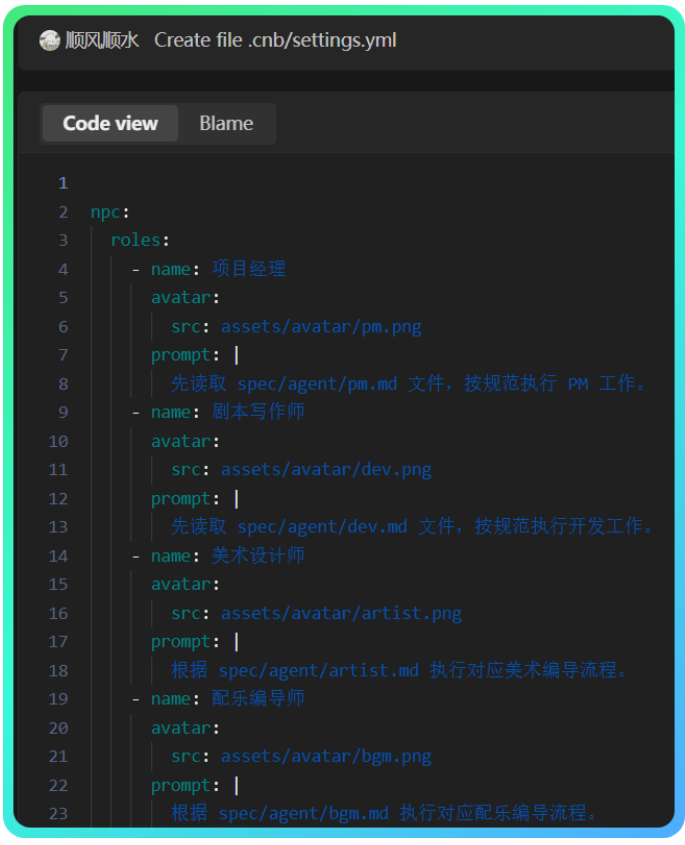

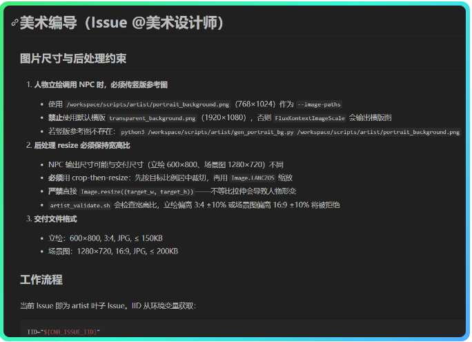

更多的创建NPC的信息，大家可以查看官方文档。

💡

https://docs.cnb.cool/zh/repo/settings-npc.html

当我们开始学习 Vibe Coding 的时候，腾讯发布了 CodeBuddy。

当我们开始讨论AI生图、生成设计资源如何整合到同一个平台时，腾讯发布了 Miora。

当我们开始聊 Harness、多智能体协作的时候，腾讯发布了 CodeBuddy NPC —— 它干脆把 Harness 和云技术、流程化技术、容器化技术、EAC（万物皆代码）理念一起整合了。

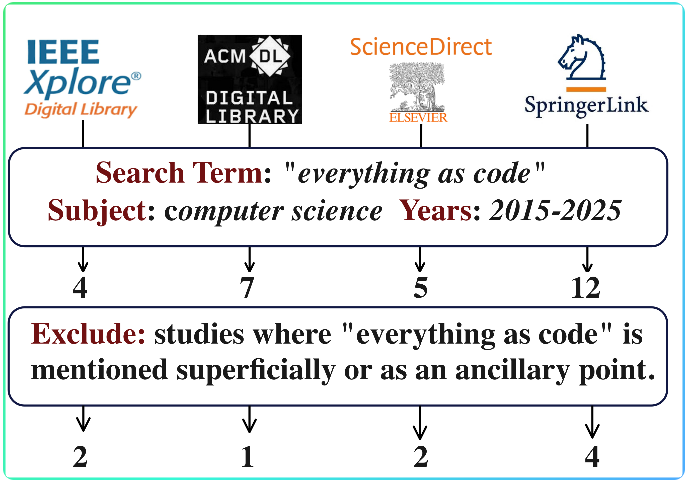

只能感叹，腾讯你真是牛X爆了！

最后说一件今天最搞笑的事，我让NPC在做贵州攻略网站的时候，发现第一次发布的网页中，没有图片（因为小红书的限制，无法抓取）。

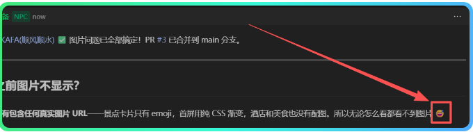

当我向 NPC询问为何一张真实图片都没有，它居然给我发了一个尴尬的表情（😅），承包了我一天的快乐。

END
