---
title: "8岁娃用AI做了个语文课本的游戏！"
source: "https://www.xiaohongshu.com/discovery/item/6a66b82c000000001101c732?app_platform=android&ignoreEngage=true&app_version=9.40.1&share_from_user_hidden=true&xsec_source=app_share&type=video&xsec_token=CBBOnm7swV9C6lvWzuEWyN-68s4ESC37ENztNLnpZw2No%3D&author_share=1&xhsshare=CopyLink&shareRedId=OD06N0RGNj42NzUyOTgwNjY7OTg8RkdL&apptime=1785860867&share_id=5a47da7a2b3b4b09801c71cd6ebcbeaa&share_channel=copy_link"
author: "好巧啊我也叫MOMO"
author_uid: "565964ccf53ee03650c23b05"
date: "07-27 上海"
tags: ["游戏中学习", "寓学习于游戏", "游戏开发", "独立游戏", "codex", "vibecoding", "少儿编程", "AI编程", "亲子开发", "语文课本游戏"]
platform: "xiaohongshu"
category: "AI"
summary: "一位父亲与8岁孩子合作，将二年级下册语文课本的课文改编成多款独立游戏，包括赛车、农场、对对碰、涂鸦、扫雷、3D探索、置放、跑酷射击等多种类型。AI技术大幅降低了开发门槛，让孩子通过口述需求即可实现创意落地，展现了AI原住民一代在编程与想象力结合上的巨大潜力。"
---

# 8岁娃用AI做了个语文课本的游戏！

> 作者: 好巧啊我也叫MOMO | 日期: 07-27 上海 | 原文: https://www.xiaohongshu.com/discovery/item/6a66b82c000000001101c732?app_platform=android&ignoreEngage=true&app_version=9.40.1&share_from_user_hidden=true&xsec_source=app_share&type=video&xsec_token=CBBOnm7swV9C6lvWzuEWyN-68s4ESC37ENztNLnpZw2No%3D&author_share=1&xhsshare=CopyLink&shareRedId=OD06N0RGNj42NzUyOTgwNjY7OTg8RkdL&apptime=1785860867&share_id=5a47da7a2b3b4b09801c71cd6ebcbeaa&share_channel=copy_link

> **摘要**:一位父亲与8岁孩子合作，将二年级下册语文课本的课文改编成多款独立游戏，包括赛车、农场、对对碰、涂鸦、扫雷、3D探索、置放、跑酷射击等多种类型。AI技术大幅降低了开发门槛，让孩子通过口述需求即可实现创意落地，展现了AI原住民一代在编程与想象力结合上的巨大潜力。

和娃合作第一款独立游戏终于要上线了[庆祝R][庆祝R][庆祝R]
以刚上完的《语文》课本（二年级下）为游戏蓝本，给每个单元甄选了一篇课文来发挥脑洞做游戏。
	
🏍️​赛车游戏《开满鲜花的小路》
🏘️​农场游戏《千人糕》
🧩​对对碰《中国美食》
🖌️​涂鸦游戏《彩色的梦》（未完工）
💣扫雷游戏​《小马过河》
🌳3D探索《如果你在野外迷了路》
✅置放游戏​《青蛙卖泥塘》
🏃🏻‍♂️🏹​跑酷+射击游戏《羿射九日》
	
AI加持下，想象力不再是插上翅膀，而是装上了涡轮发动机，很难想象这批AI native的孩子，未来能有多大的力量
	
👦🏻全程娃主力口遁输出需求
👨🏻爸爸负责loop
	
#游戏中学习 #寓学习于游戏 #游戏开发 #独立游戏 #codex #vibecoding #少儿编程

#AI编程 #亲子开发 #语文课本游戏

## 视频

[视频 1](./video.mp4)

<video controls width="100%"><source src="./video.mp4" type="video/mp4">您的浏览器不支持视频播放。</video>

附件: [音频](./audio/audio.wav) | [处理清单](./video_manifest.json)

## 视频图文总结

> 按关键帧关联完整视频转录；文字保留机器转写原文，时间点仅用于定位。

### 1. 00:00

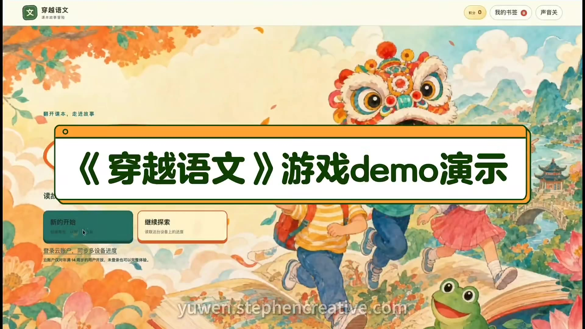

- 画面文字（OCR）：开课本，
走进故事
《穿越语文》游戏demo演示
读故
新的开始
继续探索
读取这台设备上的进
登录云账户，同步多设备进度
云账户仅对年满14限岁的用户开放，未登录也可以完体验

### 2. 00:02

- 画面文字（OCR）：课本故事冒险
先认识一下
故事里的小主角是谁？
写下名字，再选一个喜欢的形象。
你的名字
例如：小满
最多8个字，之后还可以重新设置。
选择形象
小小探险家
故事收藏家
开朗的男孩形象
活泼的女孩形象
选好啦
yuwen.stephencreative.com

### 3. 00:04

- 画面文字（OCR）：登录成功
正在翻到你的语文课本
vuwen.stephencreative.com

### 4. 00:05

- 画面文字（OCR）：义务教育教科书
语文
返回首页
咕噜，选一本书出发
二年级下册
吧。
这次的故事都来自二年级下册。其他年级的课本会在未来逐步加入。
当前课本
语文二年级下册
已选中
翻开课本
Demo当前默认课本
yuwen.stephencreative.com

### 5. 00:07

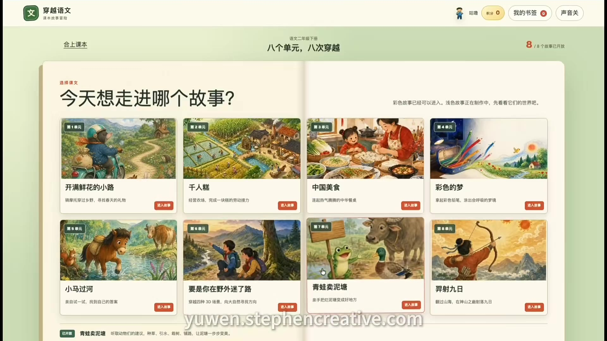

- 画面文字（OCR）：语文二年级下册
合上课本
八个单元，八次穿越
/8个故事已开放
选择课文
今天想走进哪个故事？
彩色故事已经可以进入。浅色故事正在制作中，先看看它们的世界吧。
第1单元
第2单元
3单元
丽4单元
开满鲜花的小路
千人糕
中国美食
彩色的梦
骑摩托穿过乡野
寻找春天的礼物
经营农场，完成一块糕的劳动接力
连起热气腾腾的中华餐点
拿起彩色铅笔，涂出会呼吸的梦境
进入故事
进入故事
进入故事
进入故事
第5单元
6单元
第7单元
第8单元
小马过河
要是你在野外迷了路
青蛙卖泥塘
羿射九日
亲自试一试，找到自己的答案
穿越四种3D场景，
向大自然寻找方向
亲手把烂泥塘变成好地方
翻过山海，在神山之巅射落九日
进入故事
进入故事
进入放事
进入故事
yuwen.stephencreative.com
已开放
青蛙卖泥

### 6. 00:09

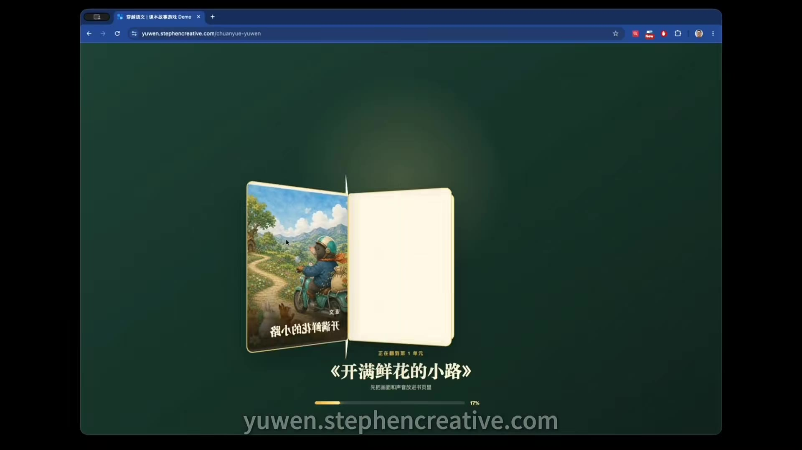

- 画面文字（OCR）：穿越语文|课本故事游戏Demo×
yuwen.stephencreative.com/chuanyue-yuwen
MN
文
小白苏开
正在到期1单元
《开满鲜花的小路》
先把画面和声音放进书页里
yuwen.stephencreative.com

### 7. 00:11

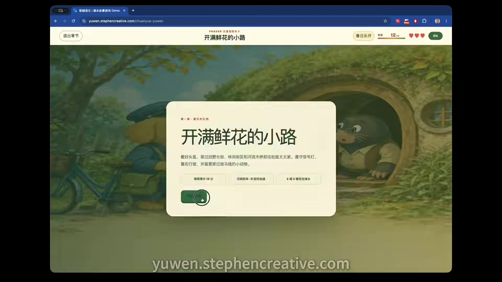

- 画面文字（OCR）：穿越语文|课本故事游戏Demo×
yuwen.stephencreative.com/chuanyue-yuwen
PHASEH交班丽关卡
退出章节
春日乐开
12/
开满鲜花的小路
0%
第一题天的儿
开满鲜花的小路
戴好头盛，穿过田野长街、林间街区和河流木桥前往松鼠太太家。遵守信号灯、
靠右行驶，并留惠穿过斑马线的小动物。
通分2分
车
+U铺安全提头
yuwen.stephencreative.com

### 8. 00:15

- 画面文字（OCR）：穿越语文|课本故事游戏D×
yuwen.stephencreative.com/chuanyue-yuwen
PHASER交通规丽关卡
退出章节
开满鲜花的小路
春日乐开
写痘
12/12
0%
照积分12分
穿过长街，向橡树之
家出发
摩托车自动前进。看到路口时可以提前点击左右键，系统会记住方向并沿弧
线转入正确车道。走错路线时按↓或U键安全掉头，道路尽头也会自动调
头。闯红灯扣6分，撞车和逆行各扣3分；红灯右转不扣分，但必须避让来
车和动物。
摩托车出发
yuwen.stephencreative.com

### 9. 00:17

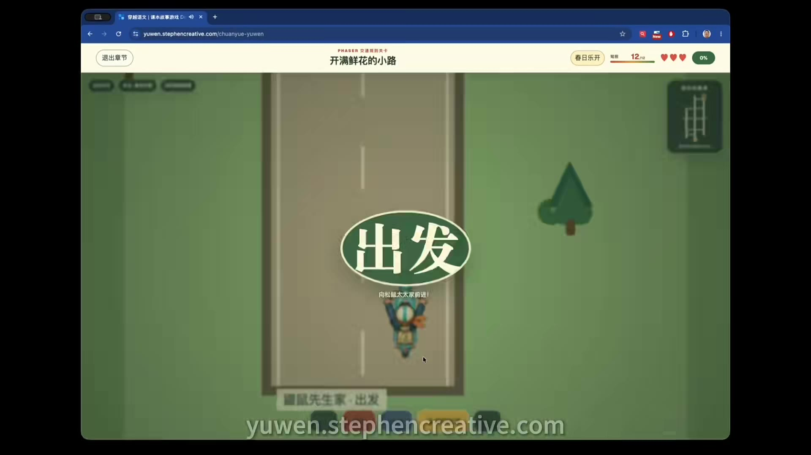

- 画面文字（OCR）：穿越语文|课本故事游戏D×
yuwen.stephencreative.com/chuanyue-yuwen
PHASER交通规丽关卡
退出章节
开满鲜花的小路
春日乐开
螺痘
12/12
0%
出发
向松慧太太家前进！
温量先生家·出发
yuwen.stephencreative.com

### 10. 00:18

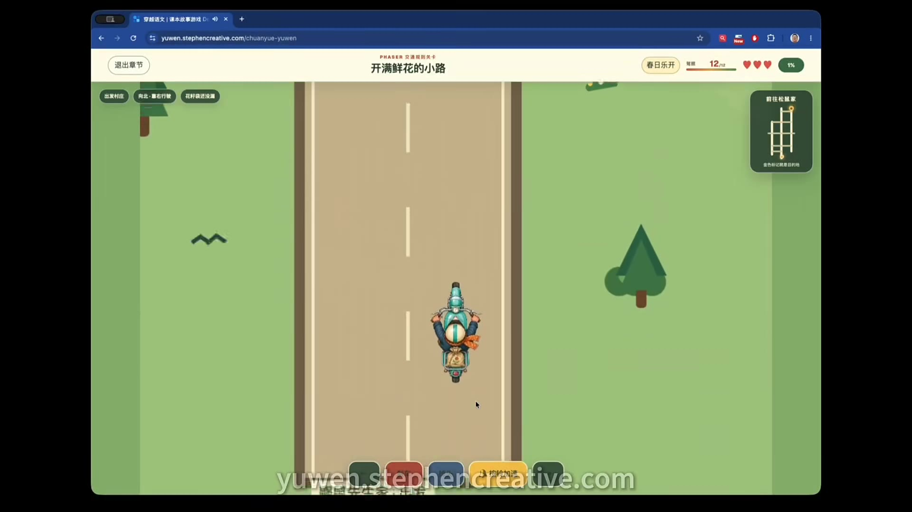

- 画面文字（OCR）：穿越语文|课本故事游戏Dx
yuwen.stephencreative.com/chuanyue-yuwen
PHASER交通规则关卡
退出章节
开满鲜花的小路
春日乐开
12/12
1%
出发村庄
向北·右行驶
花籽还没漏
前往松鼠家
金色记就是目的地
yuwen.stephencreative.com

### 11. 00:25

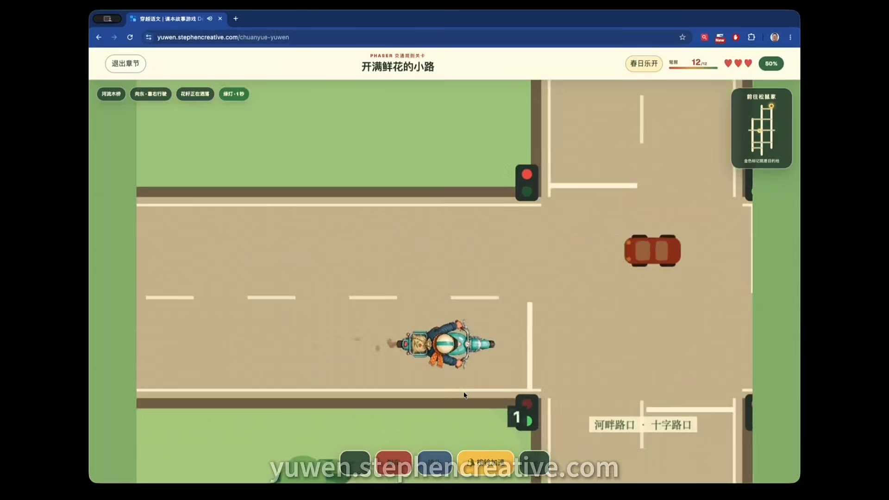

- 画面文字（OCR）：穿越语文|课本故事游戏D：×
yuwen.stephencreative.com/chuanyue-yuwen
PHASER交通规关卡
退出章节
开满鲜花的小路
春日乐开
画
12/2
50%
河流木桥
向东·票右行驶
花籽正在酒落
绿灯·1秒
前往松家
日
金色标记量目的地
河畔路口
·十字路口
yuwen.stephencreative.com

### 12. 00:27

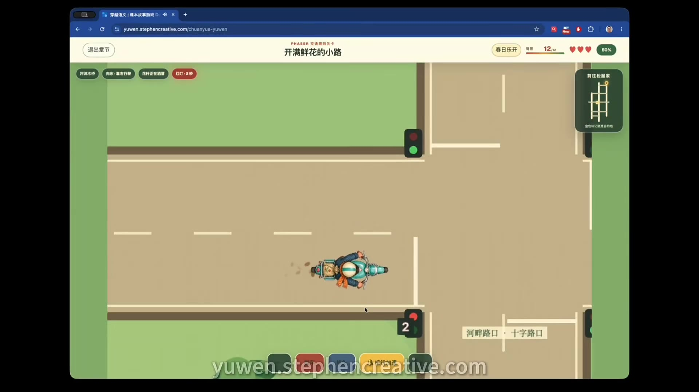

- 画面文字（OCR）：yuwen.stephencreative.com
046504
十字路口
河畔路口
2
8
日02
前往松鼠家
工灯·2秒
花籽正在酒落
向东·意右行驶
河流木桥
开满鲜花的小路
%09
z1/
2
春日乐开
退出章节
PHASER交通现关卡
yuwen.stephencreative.com/chuanyue-yuwen
穿越语文|课本故事游戏D：×

### 13. 00:29

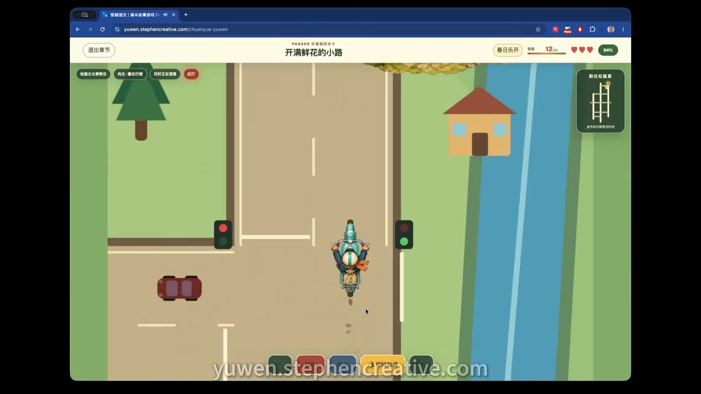

- 画面文字（OCR）：穿越语文|课本故事游戏Dx
yuwen.stephencreative.com/chuanyue-yuwen
PHASER交通现则关卡
退出章节
开满鲜花的小路
春日乐开
12/2
94%
松太太家附近
向北·意右行驶
花籽正在酒落
红灯
前往松鼠家
金色标记显目的
日
yuwen.stephencreative.com

### 14. 00:32

- 画面文字（OCR）：yuwen.stephencreative.com
当日
开满鲜花的小路
%66
20
丽务
退出章节
PHASER交通规关卡
ceeeereerereereseereeeereeee
穿越语文|课本故事游戏D：×

### 15. 00:37

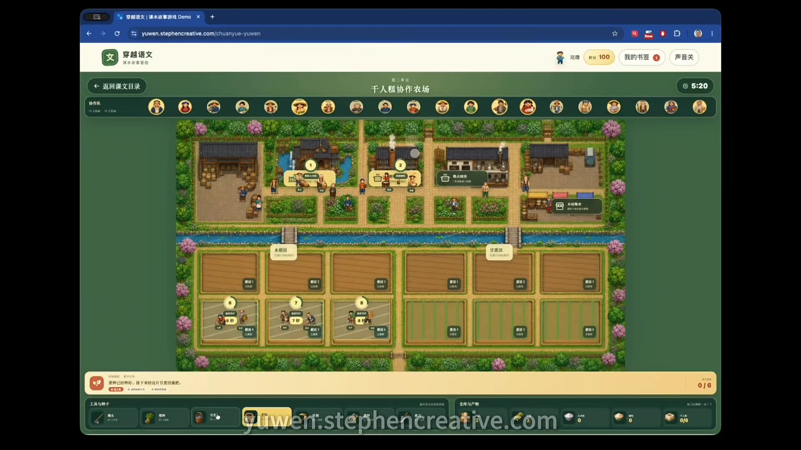

- 画面文字（OCR）：穿越语文|课本故事游戏Demo×
yuwen.stephencreative.com/chuanyue-yuwen
文
穿越语文
咕
分100
我的书签
声音关
课本故事置险
第二单元
返回课文目录
千人糕协作农场
5:20
协作队
人
人通
点国房
少间集市
水稻田
甘藏田
MH1
田2
3
1
3
n8
UMS
明
M
种已经种好，接下来给这片甘田肥。
0/6
D
工具与种子
A
仓库与产物
uwen:stephencreative.com
0/6

### 16. 00:46

- 画面文字（OCR）：穿越语文|课本故事游戏Demo×
yuwen.stephencreative.com/chuanyue-yuwen
文
穿越语文
咕噜
分100
我的书签
声音关
课本效事留险
返回课文
第三单元·中国美食
热气腾腾的中华
餐桌
课本里的菜肴和各地风味都摆上了桌。找出两道相同的美食，用不超过
两个转弯的路线把它们连起来。
01
点两张相同卡片
02
路线最多转两次
03
限时完成三关
开席，开始连连看
yuwen.stephencreative.com

### 17. 00:47

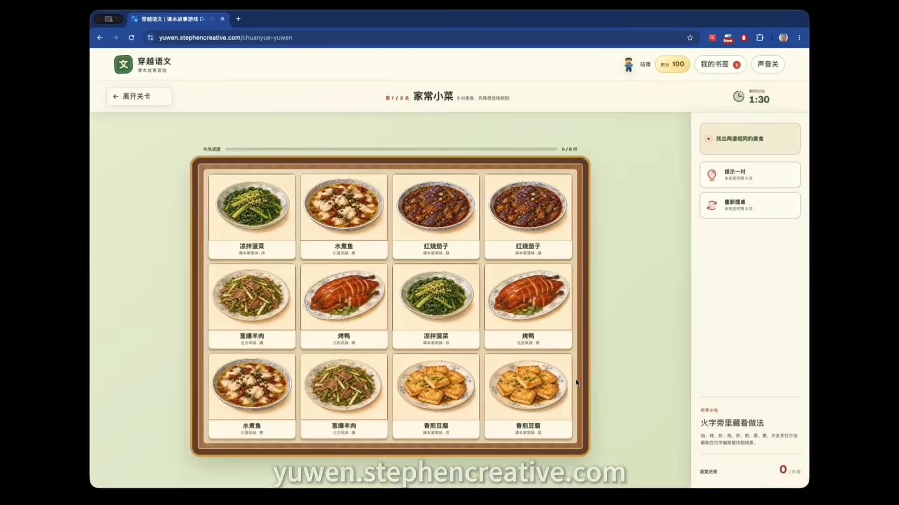

- 该时间点暂无可提取文字。

### 18. 00:50

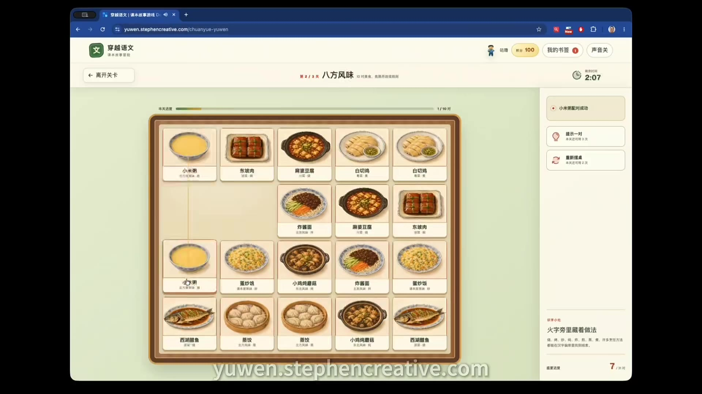

- 该时间点暂无可提取文字。

### 19. 00:53

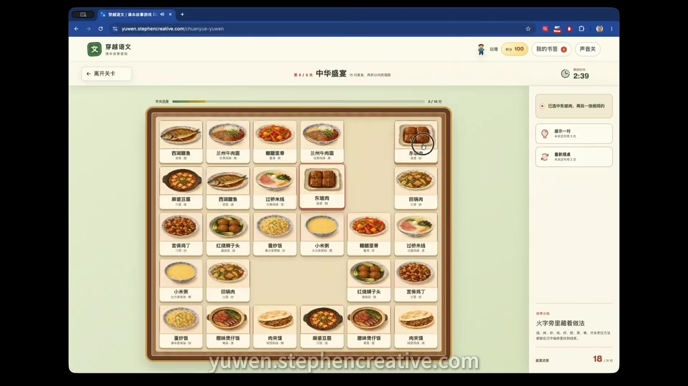

- 该时间点暂无可提取文字。

### 20. 00:55

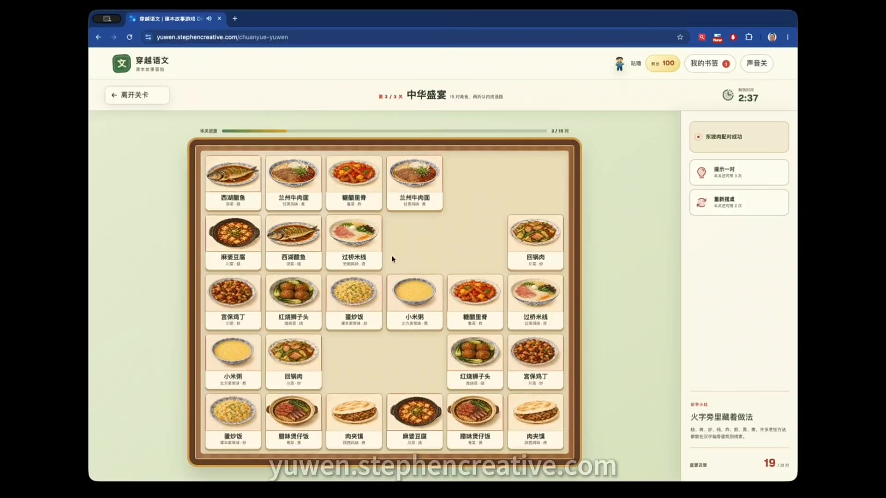

- 该时间点暂无可提取文字。

### 21. 00:58

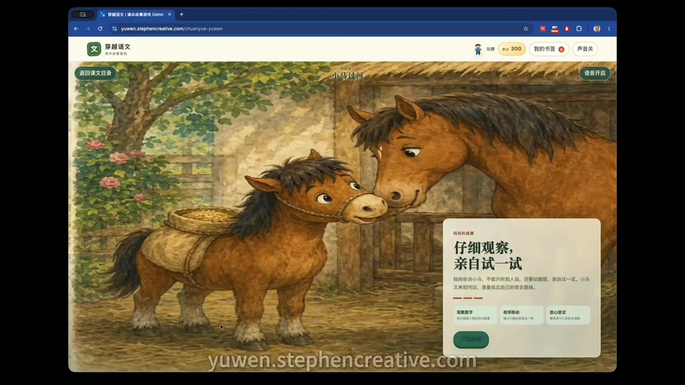

- 该时间点暂无可提取文字。

### 22. 01:04

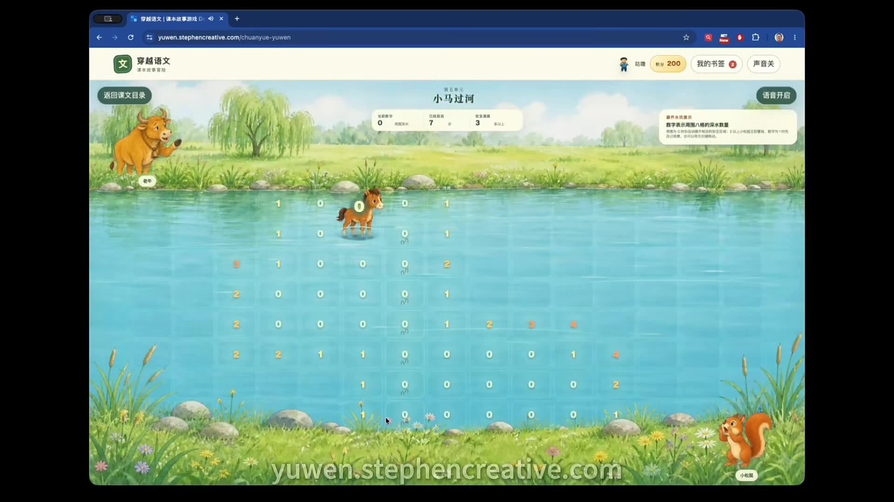

- 该时间点暂无可提取文字。

### 23. 01:13

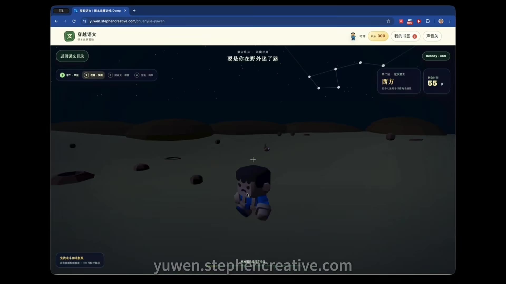

- 该时间点暂无可提取文字。

### 24. 01:22

- 该时间点暂无可提取文字。

### 25. 01:32

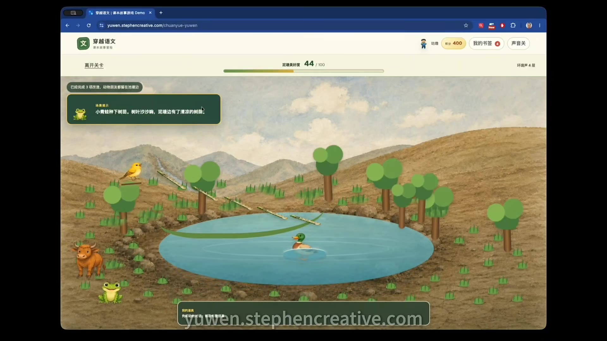

- 该时间点暂无可提取文字。

### 26. 01:41

- 该时间点暂无可提取文字。

### 27. 01:50

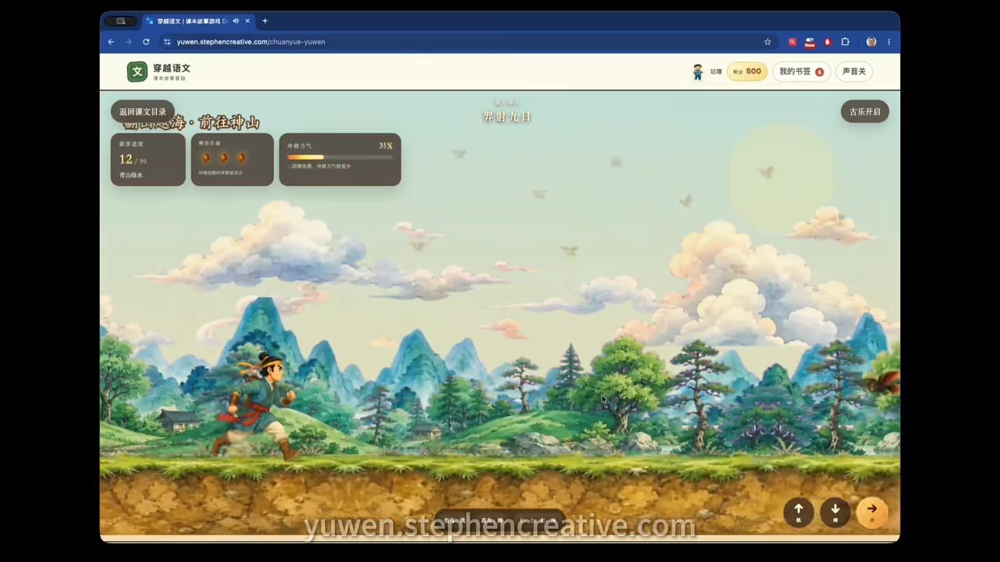

- 该时间点暂无可提取文字。

### 28. 01:59

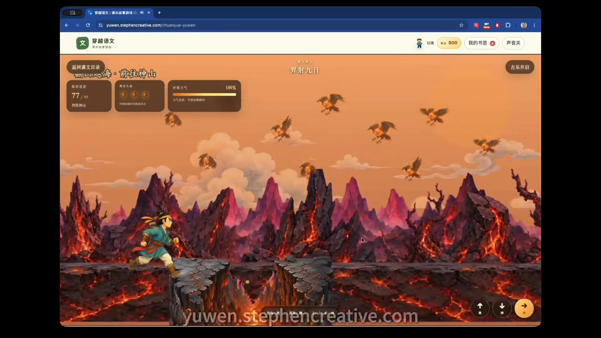

- 该时间点暂无可提取文字。

### 29. 02:08

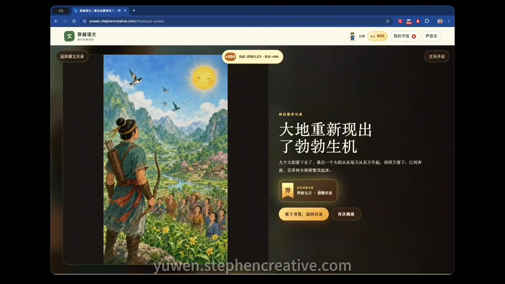

- 该时间点暂无可提取文字。

### 30. 02:17

- 该时间点暂无可提取文字。

## 视频画面文字 (OCR)

> OCR 仅供参考，可能包含识别错误；请以视频画面和转写来源为准。

### 关键帧 1 · 0.5s

开课本，
走进故事
《穿越语文》游戏demo演示
读故
新的开始
继续探索
读取这台设备上的进
登录云账户，同步多设备进度
云账户仅对年满14限岁的用户开放，未登录也可以完体验

### 关键帧 2 · 2.67s

课本故事冒险
先认识一下
故事里的小主角是谁？
写下名字，再选一个喜欢的形象。
你的名字
例如：小满
最多8个字，之后还可以重新设置。
选择形象
小小探险家
故事收藏家
开朗的男孩形象
活泼的女孩形象
选好啦
yuwen.stephencreative.com

### 关键帧 3 · 4.83s

登录成功
正在翻到你的语文课本
vuwen.stephencreative.com

### 关键帧 4 · 5.83s

义务教育教科书
语文
返回首页
咕噜，选一本书出发
二年级下册
吧。
这次的故事都来自二年级下册。其他年级的课本会在未来逐步加入。
当前课本
语文二年级下册
已选中
翻开课本
Demo当前默认课本
yuwen.stephencreative.com

### 关键帧 5 · 7.47s

语文二年级下册
合上课本
八个单元，八次穿越
/8个故事已开放
选择课文
今天想走进哪个故事？
彩色故事已经可以进入。浅色故事正在制作中，先看看它们的世界吧。
第1单元
第2单元
3单元
丽4单元
开满鲜花的小路
千人糕
中国美食
彩色的梦
骑摩托穿过乡野
寻找春天的礼物
经营农场，完成一块糕的劳动接力
连起热气腾腾的中华餐点
拿起彩色铅笔，涂出会呼吸的梦境
进入故事
进入故事
进入故事
进入故事
第5单元
6单元
第7单元
第8单元
小马过河
要是你在野外迷了路
青蛙卖泥塘
羿射九日
亲自试一试，找到自己的答案
穿越四种3D场景，
向大自然寻找方向
亲手把烂泥塘变成好地方
翻过山海，在神山之巅射落九日
进入故事
进入故事
进入放事
进入故事
yuwen.stephencreative.com
已开放
青蛙卖泥

### 关键帧 6 · 9.65s

穿越语文|课本故事游戏Demo×
yuwen.stephencreative.com/chuanyue-yuwen
MN
文
小白苏开
正在到期1单元
《开满鲜花的小路》
先把画面和声音放进书页里
yuwen.stephencreative.com

### 关键帧 7 · 11.07s

穿越语文|课本故事游戏Demo×
yuwen.stephencreative.com/chuanyue-yuwen
PHASEH交班丽关卡
退出章节
春日乐开
12/
开满鲜花的小路
0%
第一题天的儿
开满鲜花的小路
戴好头盛，穿过田野长街、林间街区和河流木桥前往松鼠太太家。遵守信号灯、
靠右行驶，并留惠穿过斑马线的小动物。
通分2分
车
+U铺安全提头
yuwen.stephencreative.com

### 关键帧 8 · 15.43s

穿越语文|课本故事游戏D×
yuwen.stephencreative.com/chuanyue-yuwen
PHASER交通规丽关卡
退出章节
开满鲜花的小路
春日乐开
写痘
12/12
0%
照积分12分
穿过长街，向橡树之
家出发
摩托车自动前进。看到路口时可以提前点击左右键，系统会记住方向并沿弧
线转入正确车道。走错路线时按↓或U键安全掉头，道路尽头也会自动调
头。闯红灯扣6分，撞车和逆行各扣3分；红灯右转不扣分，但必须避让来
车和动物。
摩托车出发
yuwen.stephencreative.com

### 关键帧 9 · 17.37s

穿越语文|课本故事游戏D×
yuwen.stephencreative.com/chuanyue-yuwen
PHASER交通规丽关卡
退出章节
开满鲜花的小路
春日乐开
螺痘
12/12
0%
出发
向松慧太太家前进！
温量先生家·出发
yuwen.stephencreative.com

### 关键帧 10 · 18.81s

穿越语文|课本故事游戏Dx
yuwen.stephencreative.com/chuanyue-yuwen
PHASER交通规则关卡
退出章节
开满鲜花的小路
春日乐开
12/12
1%
出发村庄
向北·右行驶
花籽还没漏
前往松鼠家
金色记就是目的地
yuwen.stephencreative.com

### 关键帧 11 · 25.63s

穿越语文|课本故事游戏D：×
yuwen.stephencreative.com/chuanyue-yuwen
PHASER交通规关卡
退出章节
开满鲜花的小路
春日乐开
画
12/2
50%
河流木桥
向东·票右行驶
花籽正在酒落
绿灯·1秒
前往松家
日
金色标记量目的地
河畔路口
·十字路口
yuwen.stephencreative.com

### 关键帧 12 · 27.96s

yuwen.stephencreative.com
046504
十字路口
河畔路口
2
8
日02
前往松鼠家
工灯·2秒
花籽正在酒落
向东·意右行驶
河流木桥
开满鲜花的小路
%09
z1/
2
春日乐开
退出章节
PHASER交通现关卡
yuwen.stephencreative.com/chuanyue-yuwen
穿越语文|课本故事游戏D：×

### 关键帧 13 · 29.63s

穿越语文|课本故事游戏Dx
yuwen.stephencreative.com/chuanyue-yuwen
PHASER交通现则关卡
退出章节
开满鲜花的小路
春日乐开
12/2
94%
松太太家附近
向北·意右行驶
花籽正在酒落
红灯
前往松鼠家
金色标记显目的
日
yuwen.stephencreative.com

### 关键帧 14 · 32.33s

yuwen.stephencreative.com
当日
开满鲜花的小路
%66
20
丽务
退出章节
PHASER交通规关卡
ceeeereerereereseereeeereeee
穿越语文|课本故事游戏D：×

### 关键帧 15 · 37.11s

穿越语文|课本故事游戏Demo×
yuwen.stephencreative.com/chuanyue-yuwen
文
穿越语文
咕
分100
我的书签
声音关
课本故事置险
第二单元
返回课文目录
千人糕协作农场
5:20
协作队
人
人通
点国房
少间集市
水稻田
甘藏田
MH1
田2
3
1
3
n8
UMS
明
M
种已经种好，接下来给这片甘田肥。
0/6
D
工具与种子
A
仓库与产物
uwen:stephencreative.com
0/6

### 关键帧 16 · 46.27s

穿越语文|课本故事游戏Demo×
yuwen.stephencreative.com/chuanyue-yuwen
文
穿越语文
咕噜
分100
我的书签
声音关
课本效事留险
返回课文
第三单元·中国美食
热气腾腾的中华
餐桌
课本里的菜肴和各地风味都摆上了桌。找出两道相同的美食，用不超过
两个转弯的路线把它们连起来。
01
点两张相同卡片
02
路线最多转两次
03
限时完成三关
开席，开始连连看
yuwen.stephencreative.com

## 图片

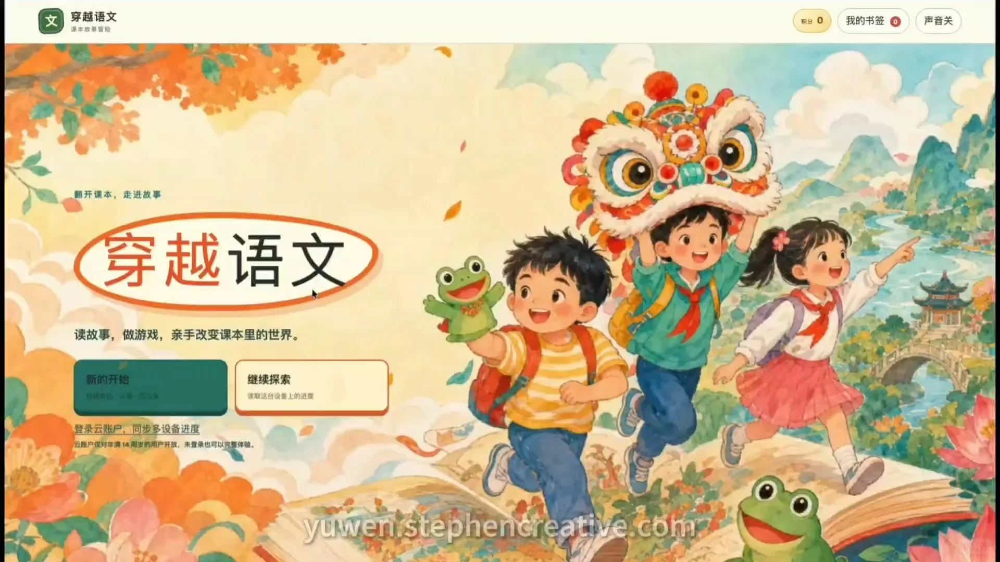

## 图片文字 (OCR)

> OCR 仅供参考，可能包含识别错误；请以原图为准。

课本故
随开课本，走进故事
穿越语文
读故事，做游戏，亲手改变课本里的世界。
继续探索
新的开始
谨取这台设备上的进
从通
登录云账户，同步多设备进度
云账户仅对年满14用岁的用户开放，未登录也可以完要体验
