---
title: "9岁啾宝作出了人生第一个游戏"
source: "https://www.xiaohongshu.com/discovery/item/6a734f380000000005022920?app_platform=android&ignoreEngage=true&app_version=9.40.1&share_from_user_hidden=true&xsec_source=app_share&type=video&xsec_token=CBo9MVi9Csu5HxKqxoGoK4gr0I8G3FLADjJQFVJMw5eBQ%3D&author_share=1&xhsshare=CopyLink&shareRedId=OD06N0RGNj42NzUyOTgwNjY7OTg8RkdL&apptime=1785943840&share_id=89c73d186a664825af8a356e090ccd02&share_channel=copy_link"
author: "啾宝实验室"
author_uid: "5c0a05da000000000500bb88"
date: "昨天 22:56 北京"
tags: ["儿童创意", "亲子共创", "AI教育", "项目式学习", "儿童编程", "游戏设计", "成长记录", "AI创作", "亲子陪伴", "howto用好AI"]
platform: "xiaohongshu"
category: "AI"
summary: "9岁啾宝在成人与AI协助下，将脑海中的魔法森林构想做成了一款名为《魔法森林：宝石钥匙》的完整网页游戏，包含10个关卡共30道场景化谜题，涉及诗句理解、英文、计算、观察等多学科知识。游戏机制鼓励反复尝试而非惩罚错误，已完成的题目会保留，孩子可借助提示继续探索。这个项目展现了儿童创意通过亲子共创与AI辅"
---

# 9岁啾宝作出了人生第一个游戏

> 作者: 啾宝实验室 | 日期: 昨天 22:56 北京 | 原文: https://www.xiaohongshu.com/discovery/item/6a734f380000000005022920?app_platform=android&ignoreEngage=true&app_version=9.40.1&share_from_user_hidden=true&xsec_source=app_share&type=video&xsec_token=CBo9MVi9Csu5HxKqxoGoK4gr0I8G3FLADjJQFVJMw5eBQ%3D&author_share=1&xhsshare=CopyLink&shareRedId=OD06N0RGNj42NzUyOTgwNjY7OTg8RkdL&apptime=1785943840&share_id=89c73d186a664825af8a356e090ccd02&share_channel=copy_link

> **摘要**:9岁啾宝在成人与AI协助下，将脑海中的魔法森林构想做成了一款名为《魔法森林：宝石钥匙》的完整网页游戏，包含10个关卡共30道场景化谜题，涉及诗句理解、英文、计算、观察等多学科知识。游戏机制鼓励反复尝试而非惩罚错误，已完成的题目会保留，孩子可借助提示继续探索。这个项目展现了儿童创意通过亲子共创与AI辅

9岁啾宝作出了人生第一个游戏
最近，啾宝完成了一件很有纪念意义的事：
把啾宝脑海里的魔法森林，做成了一款可以从开始页完整玩到最终宝箱的网页游戏。
	
它叫《魔法森林：宝石钥匙》。
游戏里有10个关卡，每关包含3道发生在同一场景里的谜题。孩子不是在做一张换了森林皮肤的试卷，而是用学过的知识解决真正的场景问题：
读诗句，找到藏着线索的池塘；
理解 under，从荷叶下面寻找钥匙；
计算木板数量，修好断桥；
观察影子、过滤材料和动物脚印；
集齐10枚宝石碎片，念出“月宝变钥匙！”
我们很在意的一条规则是：答错不等于失败。
已经完成的题会保留，只替换还没完成的题。孩子可以查看提示、完成森林小挑战，再回来继续尝试。
	
这不是一个“9岁孩子独立写完所有代码”的故事。
啾宝提出了游戏创意、角色、咒语和核心玩法；成人与AI协助整理产品规则、制作素材、编写程序和验证流程。真正珍贵的，是孩子发现：自己的想象不只可以画在纸上，也可以一步步变成别人能够体验的作品。
这段视频，是它第一次完整的成片记录。💎
	
#儿童创意  #亲子共创  #AI教育  #项目式学习  #儿童编程  #游戏设计  #成长记录 #AI创作  #亲子陪伴 #howto用好AI
昨天 22:56 北京

## 视频

[视频 1](./video.mp4)

<video controls width="100%"><source src="./video.mp4" type="video/mp4">您的浏览器不支持视频播放。</video>

附件: [音频](./audio/audio.wav) | [处理清单](./video_manifest.json)

## 视频图文总结

> 按关键帧关联完整视频转录；文字保留机器转写原文，时间点仅用于定位。

### 1. 00:00

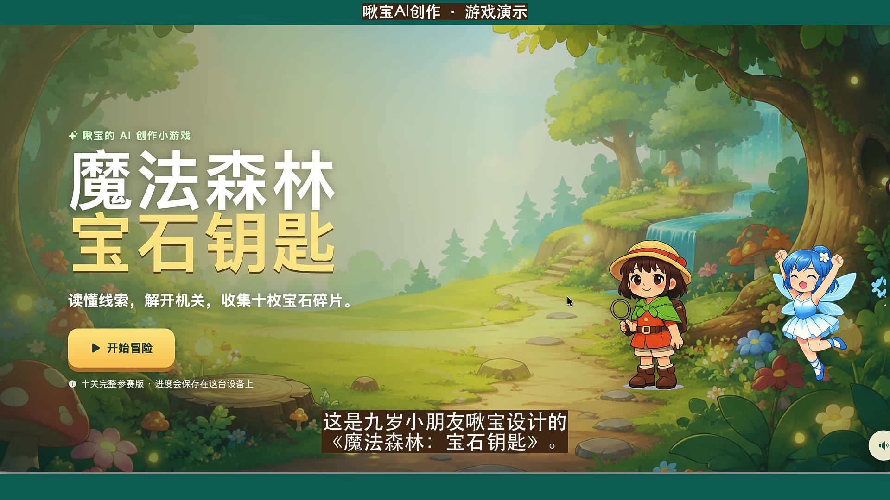

- 画面文字（OCR）：BEANE 游戏演示
7 I
Ng
+ BE Al EAI Ba .
包 I =i [] 1 a 4
== > << wid V4) A 人也 /AAA 2M | SEE
y mm Ee E31 Sos
A y=) = I — J
EA HEt > =
4 = | a = De®,
HI R= BC ey ，
RY br AE Lh = TT : 2 -< - : Ne / A J
读恒线素，解开机关， BETHSERA. Ea TE :
- a “3
> FHAER 下 Ny - —- = A
0 TXRESENR HERRFEXAREE : : TC Lm ~ re
BENS NARBERTH
《魔法森林 : 宝石钥匙》。属 @
Te SN Ea A

### 2. 00:03

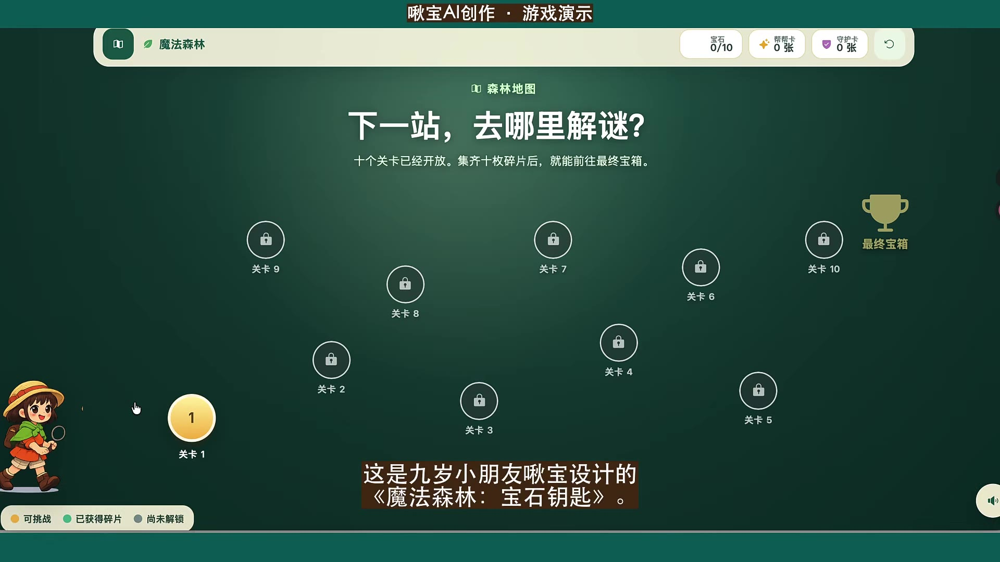

- 内容摘要：这是九岁小朋友灸宝设计的魔法森林宝石钥匙（00:00-00:04）
- 画面文字（OCR）：欧宝 AI 创作游戏演示 mw 森林地图 whe Sy 下一站，去哪里解谜 ?
十个关卡已经开放。集齐十枚碎片后，就能前往最终宝箱。
|
® Ca) ® <
关卡 9 关卡 7 (a) 关卡 10
Ca) 志关卡 8
® 运四 ® @
¥ 0 =
Be O 关卡 3
= 关卡 1 = pm
73. BEAL BRE 8A
《魔法森林 : 宝石钥匙》。 C
[oama_o esas © wimn | BREBA © 尚未解锁

### 3. 00:04

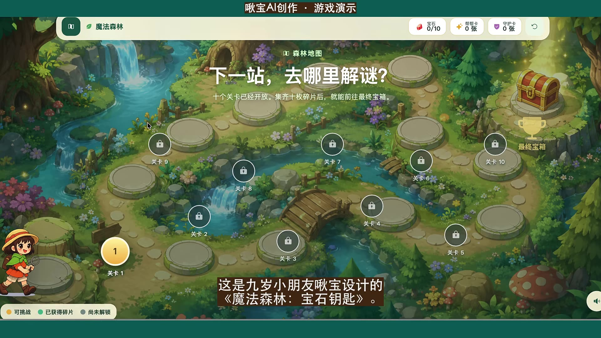

- 画面文字（OCR）：WMEAIGHE - 游戏演示
”多本 so +8 3% o 8
fe Ir GD za oF
*, : wz 人 * w 森林地图 “ 冯 cc ©
ER WL) rasa fC A
& HE Br SY Ls THREE fia — 2 Jr va
Tn gr ] gs xg I PEREZ, ee SS 月本 - 人 - 3 F Re, LS SS | :
i 2.7 — © —¥ § pe . y : @ x 3 wv £5 了
w oy 5: S Se Res RE ‘3% hs JY 本 i 3 Ne A Ra 一 lo ge 人 Se : pr (a) = TRE (a) 最终宝箱 vi a Pr 、 Bre an ut ey = oe 二 (5% D) oa | :
OO、了 —_— AEE 。 eC : =: %-. Lx \
io oo : ll, 局 K (a) Dp + JA
Be (a) i \ Pe =
Zo a de). (0)
(1°,° ; SS 全和 as 人 ah hn
Pod 2 | .
Se 这是九岁小朋友哆宝设计的《魔法森林 : 宝石钥匙》。 @

### 4. 00:06

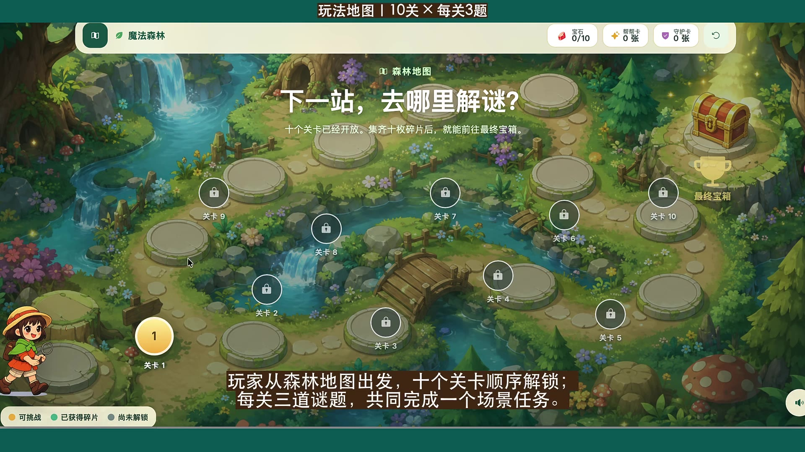

- 画面文字（OCR）：玩法地图 | 105% X 每关 3 题
名舌 a 8h | +0% o3% oo IN
i ~ Pr ie 有 >- A’
Granchn THER Va ma wr’ > 2
> Sh of | as 1 A PEE. rd CC) od 03
WON | pth, HERES aT
LIEN {oe rox paar re = : red | 5
个关卡已绎天放款集齐填析碎片后 ,一就能前往最终宝箱 5 ~ 3 ares. =
‘ fe — E+ *, * 3 gk 一 Sf “ | 4
了 2 ) gs 3 . (@ Ay Ao -
tai NET wr <i RS
EB 0 bi Ok) SO 和 ¥ ( 大 ef 作二 ER 63¢ = *
Ha Na Ama x8 A = 3 . 0 C3 3 »
sy 5 RY, 2 ENE *: 有下 aa 2% (a) 本 oo \ %F4 人 Zo Long a AE (a) R (a)
A 4
4 [§ L s 1
% SF 关卡 1
3 玩家从森林地图出发，十个关卡顺序解锁 ;
“每关三道谜题，共同完成一个场景任务。多

### 5. 00:10

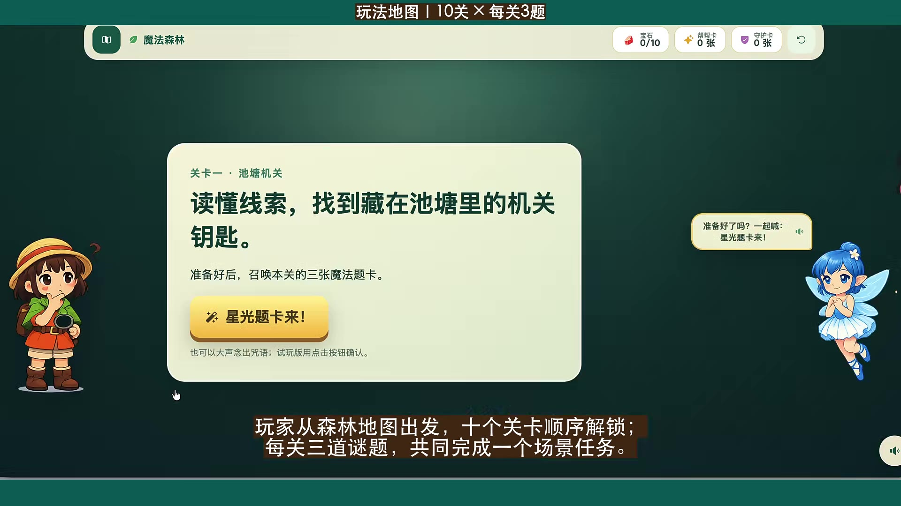

- 内容摘要：玩家从森林地图出发，十个关卡顺序解锁每关三道谜题，共同完成一个场景任务（00:06-00:13）
- 画面文字（OCR）：玩法地图 | 10% X 每关 3 题关卡一，池塘机关读懂线索，找到藏在池塘里的机关 A
i
( % ©) 准备好后，召唤本关的三张魔法题卡。 G)
S oy 人
a 次星光题卡来 ! 入 wo) Ap 星光题卡来 »
[——( AINABRUIE; MEARE RERA, &)
pg %
a A. » i"玩家从森林地图出发，十个关卡顺序解锁 ;
每关三道六题，共同完成一个场景任务。 C

### 6. 00:12

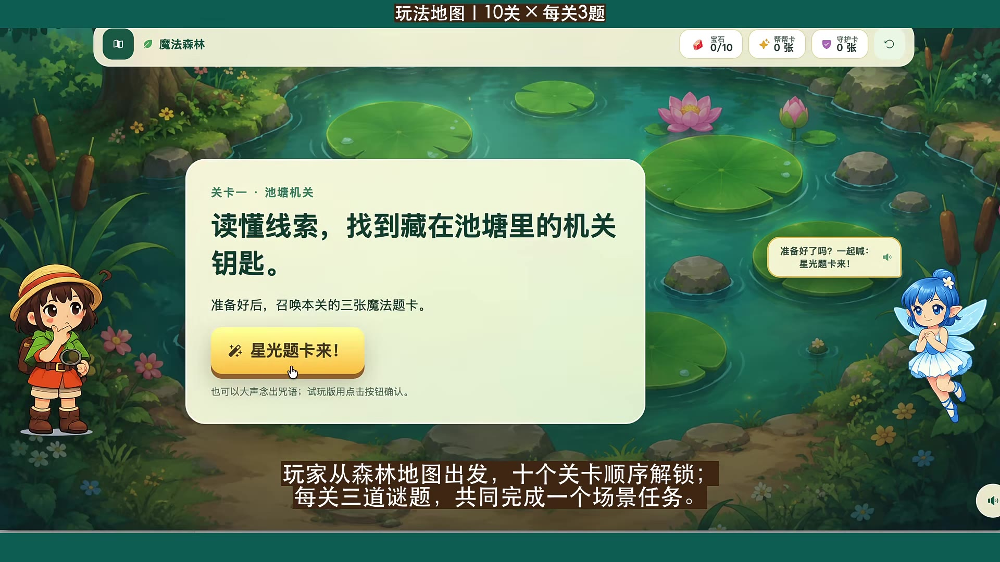

- 画面文字（OCR）：玩法地图 | 10x X 每关 3 题
& - rs pay 全一去
Sal pe REF ‘0 i 1
= \ -— ‘Q |
3 E by y
\ v. )/ > go NS
- (4 . Ri 关卡一，池塘机关 g ==
»; > 73) » — 一一人读懂线索，找到藏在池塘里的机关 EER
AE 钥匙。星光题卡来 ! | o
I S SN 二 vy A NN
Ab 准备好后，召唤本关的三张了法题卡。 &y
C9 & od
AD 也可以大声念出咒语 ; 试玩版用点击按钮确认。 \ JY
gy A
a BA. »
玩家从森林地图出发，十个关卡顺序解锁 ;
每关三道谜题，共同完成一个场景任务。 €

### 7. 00:18

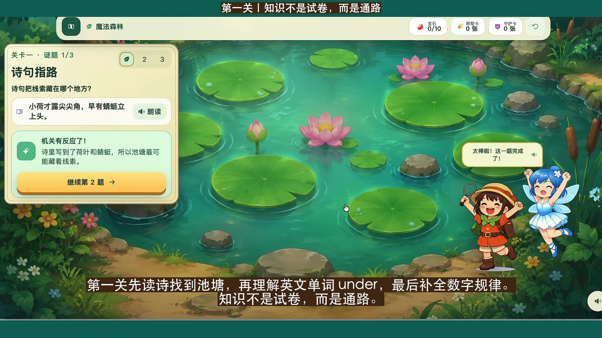

- 内容摘要：第一关先读诗找到池塘（00:16-00:18）
- 画面文字（OCR）：第一关 | 知识不是试卷，而是通路关卡一，迹题 113 CE ) & j r J
5 c a 、 1 aA 诗句指路 CO NY
o UN = . es, -
诗句把线索藏在哪个地方 ? Nc & a 4 > - Nd
= MEA TERRA, BREET 必朗读 - ee Es 引 { ~~] ) G4 2 bi &
£3. Se R87, 3 ~ sd ~~
\ a. J ~ 多一到 2 =
® 机关有反应了 ! 7) i ASI a) ee :
BESET AMAEE, FCtERE a ES > - = All ZEEE,
能大着线索。加一 E 7 六区全
| \ * 区 =~ > a
SCT | Tater
—— ea \ NS >_4 p, 有 al 7 1, “INQ ‘ SL 从
< y. oo bg
; A . g (a) ws
Y Se od
- 第一关先读诗找到池塘，再理解英文单词 under，最后补全数字规律。知识不是试卷，而是通路。 C

### 8. 00:21

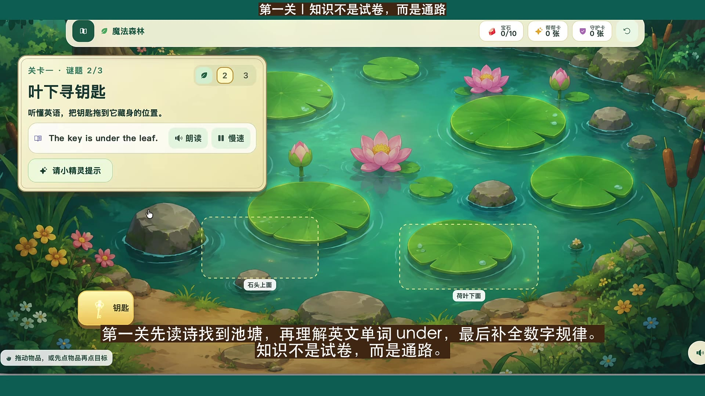

- 内容摘要：再理解英文单词under最后补全数字规律知识不是试卷而是通路（00:18-00:23）
- 画面文字（OCR）：第一关 | 知识不是试卷，而是通路关卡一谜题 2/3 2 B) 3 n— = NN = ) » 四 9， /从和 SS 叶下寻钥是 a i. ut &
pe Ny 听懂英语，把钥匙拖到它藏身的位置。 _ ll 8 Rat
、 nw \
08 The key is under the leaf. 中朗读 Wl 慢速了 > vy J 3 i J’ eS J :
< 48 - ah ¢ ) J ss a ok
+ 请小精灵提示 ) YT. - La ;
= EY) 一 ”Le / 号一一一一 = NG \ - > 0) hn AN /
~~ \ La 2) Ng 4
"3 “Ta ) — —
¢ 人六 ) es 1 2 7. 1 Ra 人 AY) — : _— '人全 E
— | No.) Sy
第一关先读诗找到池塘，再理解英文单词 under，最后补全数字规律。知识不是试卷，而是通路。 C

### 9. 00:23

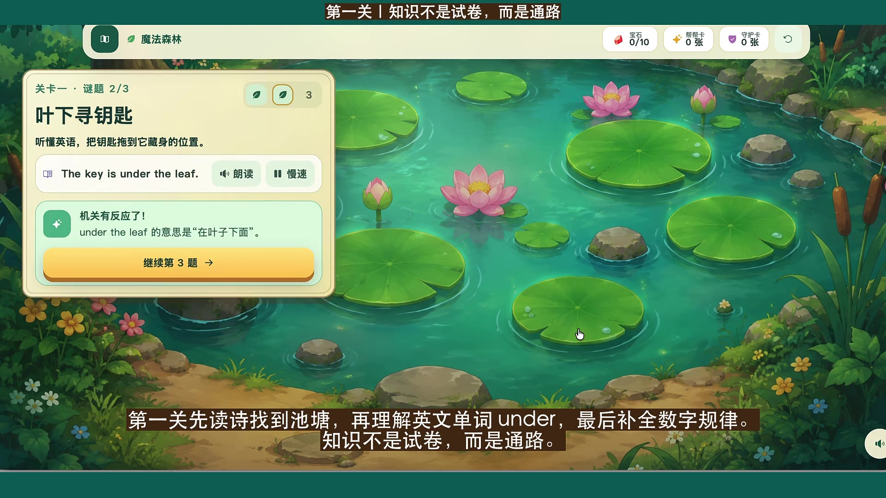

- 画面文字（OCR）：第一关 | 知识不是试卷，而是通路 HTS =. 站 ss 听懂英语，把钥匙拖到它藏身的位置。 => 4 a | 4 hy 8 Rd,
hos ) 人 - as A 村
E The key is under the leaf. 中朗读 0 1&&F cae ade * ~ J a
7 a ry N ss ga oe 》机关有反应了 ! ) ls ~¢ = We ;
| [+] under the leaf 的意思是 “在叶子下面 ”。人 p BEE / -)
A 人
| 继续第 3 题 > | = =
— 一 UN 网 / :
E—EEEEHKEGNE, BEMELER under, BEHEMTIE.
: 知识不是试卷，而是通路。 C

### 10. 00:24

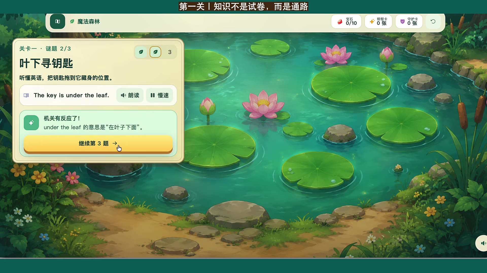

- 画面文字（OCR）：第一关 | 知识不是试卷，而是通路
(= ] 2 魔法森林 oho 0% 3% ©
关卡一，迹题 2/3 > (2) . —— & ), ® <3
x po = = S77 —&
叶下寻钥是 a"听懂英语，把钥匙拖到它藏身的位置。 > 4 a | 4 by 8 Rd,
Lae ] A h - ) Ged Po 4
[2 The key is under the leaf. 中朗读 1 慢速 Be ws al bY Ld N / 4 Y. ;
3 ). TEEN ’ J 4 == 二一 .
Ww 4 <
(+) 机关有反应了 ! rls ~ fe = 人国 under the leaf 的意思是 “在叶子下面"。 rn . a / =
\ ” )
继续第 3 题 > \ bs EF $. : J
| | cia 是 | ER
ly = 一 ( 7 \ E
= CN 5" /
{ >
9a i
Sle -

### 11. 00:30

- 画面文字（OCR）：第一关 | 知识不是试卷，而是通路 TN
B\
|
od Pp 关卡完成
|
bY
=~ 宝石碎片找到了 !
AAA 完 cer *
LA Nez 本关已经完成 3 个机关，碎片稳稳地放进背包。作
N A A Le 74 党
2 已完成 2 已完成 2 已完成 Sad 2
+ 三题全对 ! 可以选择一张奖励卡。 tag)
= [ep | Lo
he
—

### 12. 00:31

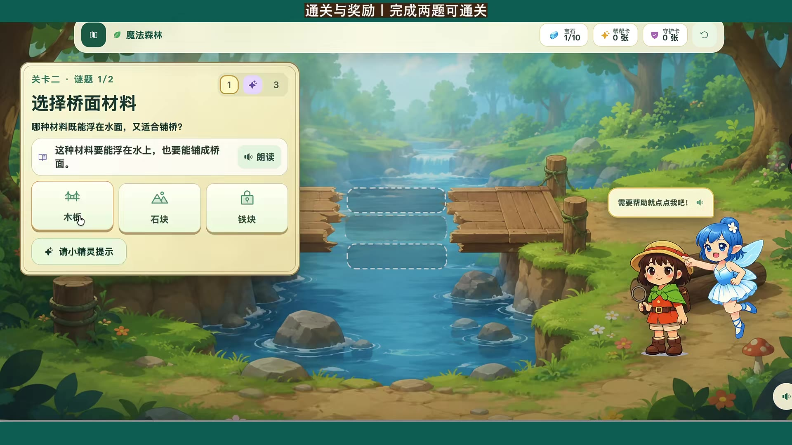

- 画面文字（OCR）：通关与奖励 | 完成两题可通关
[ 总视儿 + 路 eI o
” 人 PE 村 T IY 7 a Ey 关卡二迹题 1/2 (1) + 5 2 ， ¥ La
35-3 3 "A Jom 选择桥面材料去 ay ho -a A
哪种材料既能浮在水面，又适合铺桥 ? Eee CL ps 4 i Tg of
a Ey ‘or ¥ 4 ic, A
= Ee 也要能铺成桥。。，衣读 —. = = i A 4
o -~ br Fa gua <3 Pt
(ET 。一和 RN 全 a
iy Bi sir | a § 7S
一一 lV, -
+ 请小精灵提示 1 ie CNY < 要
y’ — ( A
a se ha 4
SGN 请 = OFS
RE 所 R p t 2
ALINE Ng
: == Tu” =. Te 包本一 = 让 “2

### 13. 00:32

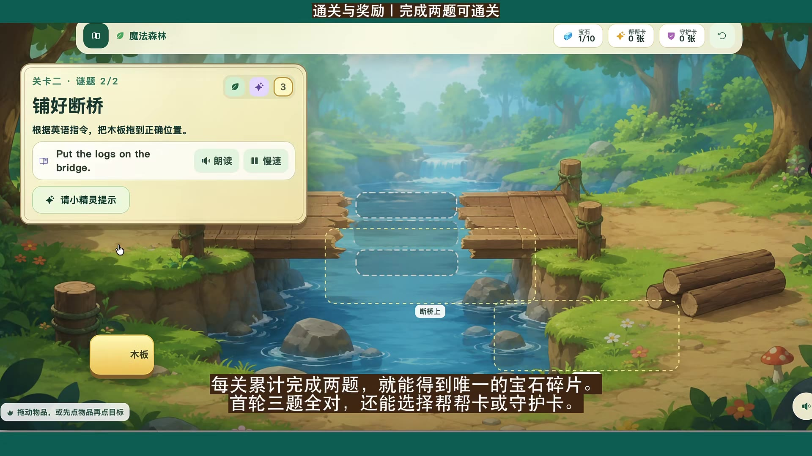

- 内容摘要：每关累计完成两题（00:31-00:32）
- 画面文字（OCR）：通关与奖励 | 完成两题可通关
A :sx oFo | «8% | 93% | 5
& i 4 Ta a 4
关卡二 RE 2/2 > +) IN - 、 3. oF 铺好断桥 JU 上 ny Fx a
根据英语指令，把木板拖到正确位置。 v. ren A or
fa -| ia 二信和 A
N . CE ai ws a= a
+ 请小精灵提示 ee EEE al ad
VV a, .
= 一- < TE 一一 ER (一 = 一-====---- 公 - i 一二一本 = TE — wv
tS taal — CE _— ee. =?
Pe ps ! p= po J
) Re -了 -=
Ly Ee
2 : - a” (Te oe -
; = = - cw» REN 局
(Raa. oo — [1 Ee: :
SXRN RFE, REBIE—NEAHE.
首轮三题全对，还能选择帮帮卡或守护卡。 @

### 14. 00:33

- 画面文字（OCR）：通关与奖励 | 完成两题可通关 El 关卡完成
|S | 1
JN 宝石碎片找到了 | |
QU ALN. 本关已经完成 3 个机关，碎片稳稳地放进背包。 5
所 &» S/F «
9 已完成 “| 2 已完成 | 9 已完成 ad = ;
\ |
i | + 三题全对 ! 可以选择一张奖励卡。 | A
u 9)
一 |
每关累计完成两题，就能得到唯一的宝石碎片。首轮三题全对，还能选择帮才卡或守护卡。 @

### 15. 00:36

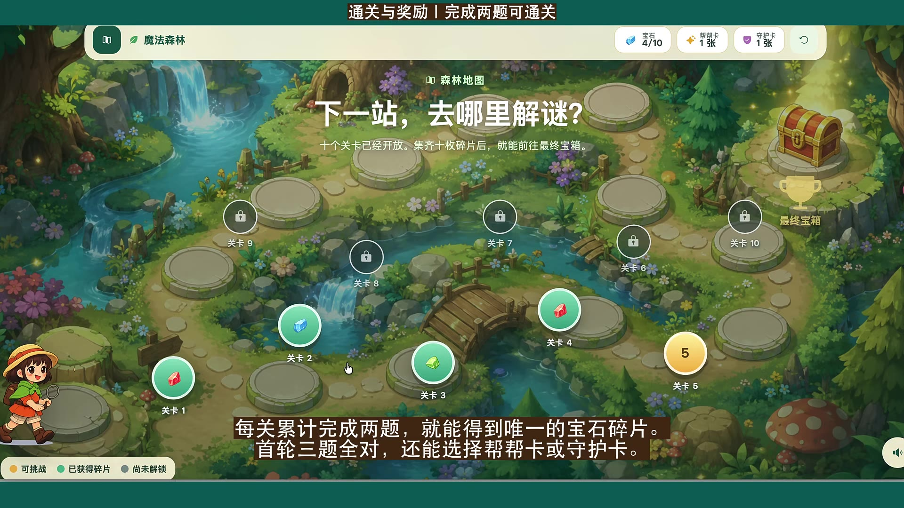

- 内容摘要：就能得到唯一的宝石碎片，首轮三题全对，还能选择帮帮卡或守护卡（00:32-00:38）
- 画面文字（OCR）：通关与奖励 | 完成两题可通关 Rd ©) - no Po 1% 9% | o IN
fr ER 7 — .
*, NH “ = A j > 时森林地图。 : = . rr.
> Na | | PRR. ASS PEE; sli @ D « BB 0%
“二下一站 ,去哪里解壕 ? - 5 - F Sea
LEE A pg == . oS , ook 3
TN Je xem RAR, AEACBATH, 0 : A :
A ZA (um 2a 0 . SHE CA
ERE oy pr Na "> oi ig 3 一 ol Ed E
、 el, ge @ ve ou 3 * J RV 人 Rs 一 Se Te 二 =- = we [= a LAUNST Een
E be ye 8 265 a satay WF 7 RY ic = (= ) a : 7s
REVERE” dove CeO (JH
L Eas —— > y Er L £8 RE = r ° RQ 3. % pe A
a p AL ° 3 ® RE sk
bs Nf =
—m se 3 pe * - ¢ a 人 Zo 3 和 Reo ot J ™
oe Ody
5X0) y 4 [ 关卡 5
PR ss 关卡 3 0
二每关票计完成两题，就能得到唯一的宝石碎片。
: 首轮三题全对，还能选择帮才卡或守护卡。 C

### 16. 00:36

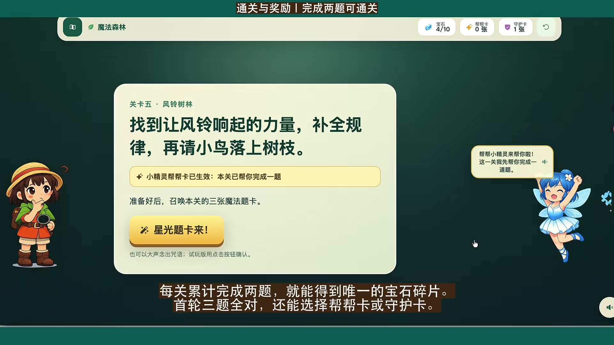

- 画面文字（OCR）：通关与奖励 | 完成两题可通关关卡五风铃树林找到让风铃响起的力量，补全规
4 3 EE
12, 再请小鸟落上树枝。 | 帮帮小精灵来帮你啦 ! |
AP | RoxEEAAEA «|
70 SS | + 小精灵帮帮卡已生效 : 本关已帮你完成一是 | _ "re
(0 Q 图 ®) \ i 56) 4 人 4
oF 准备好后，召唤本关的三张魔法题卡。 Nez dd 党
) 上 A )
也可以大声念出咒语 ; 试玩版用点击按钮确认。 4
a BA. »
每关票计完成两题，就能得到唯一的宝石碎片。首轮三是全对，还能选择帮用卡或守护卡。《

### 17. 00:38

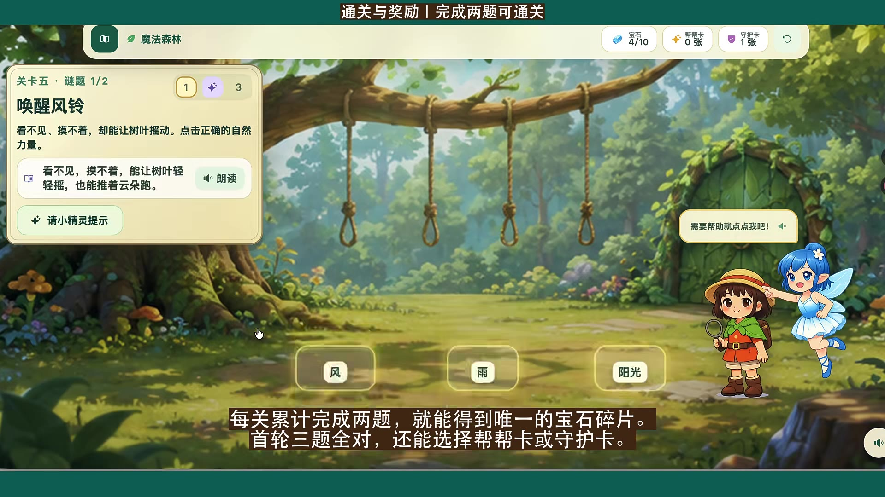

- 该时间点暂无可提取文字。

### 18. 00:39

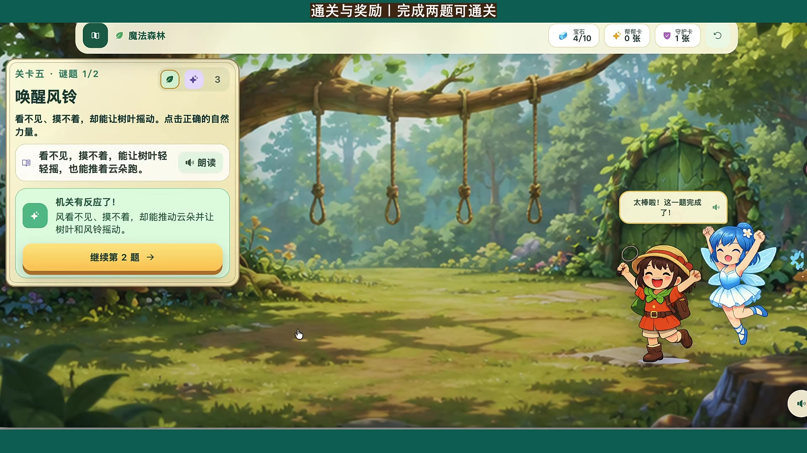

- 该时间点暂无可提取文字。

### 19. 00:42

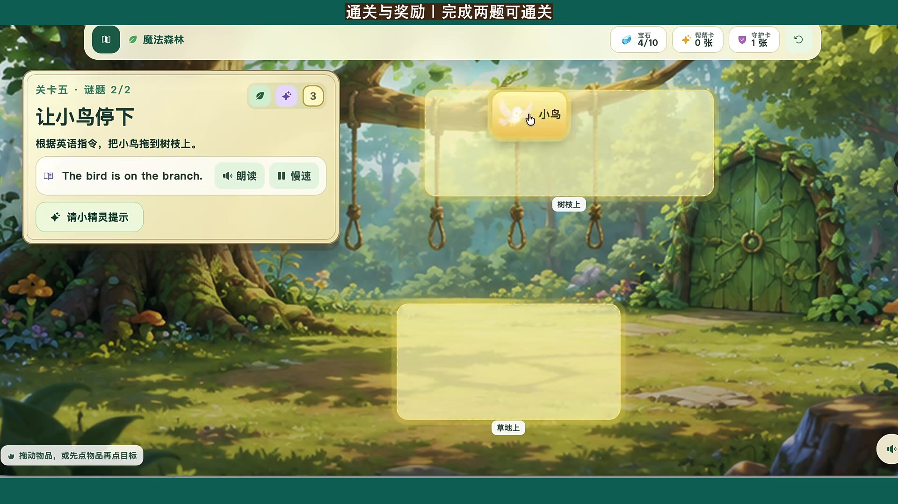

- 该时间点暂无可提取文字。

### 20. 00:42

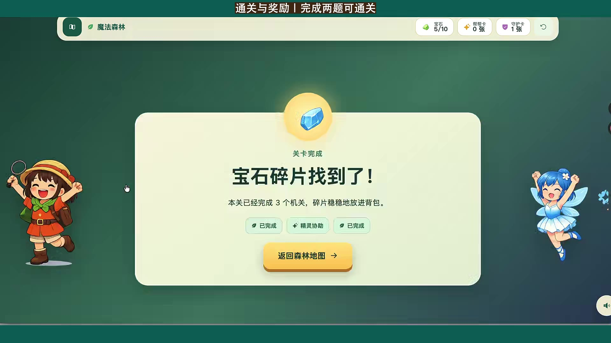

- 该时间点暂无可提取文字。

### 21. 00:43

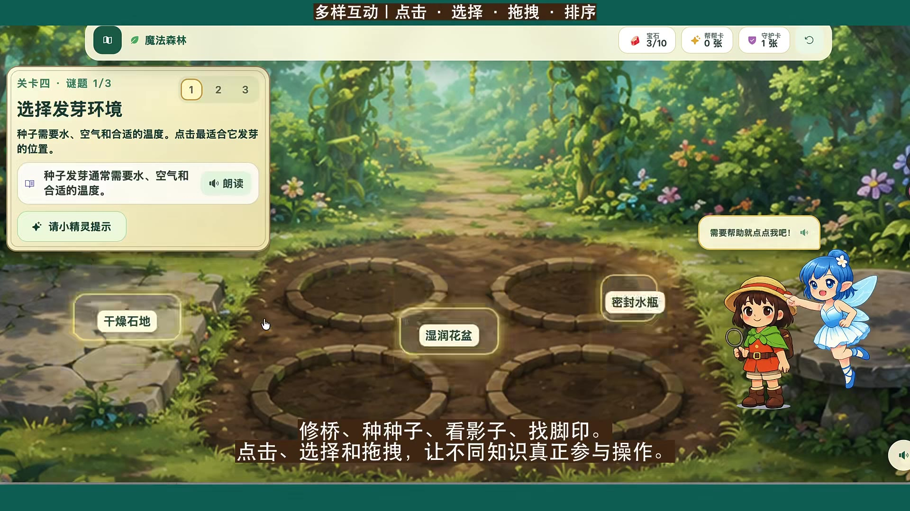

- 该时间点暂无可提取文字。

### 22. 00:46

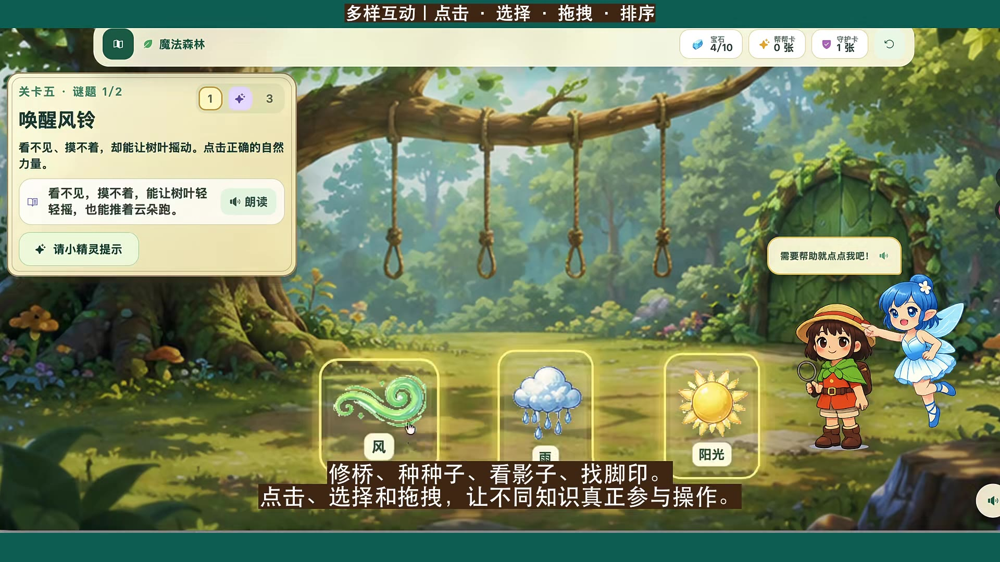

- 内容摘要：修桥种种子，看影子，找脚印，点击选择和拖拽，让不同知识真正参与操作（00:43-00:50）

### 23. 00:47

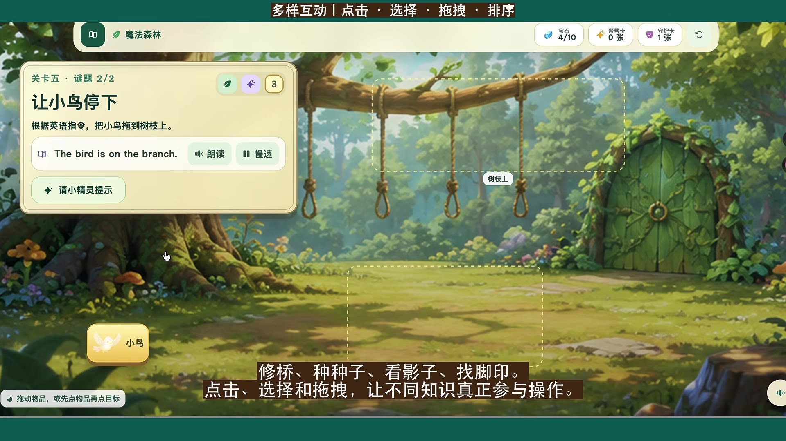

- 该时间点暂无可提取文字。

### 24. 00:53

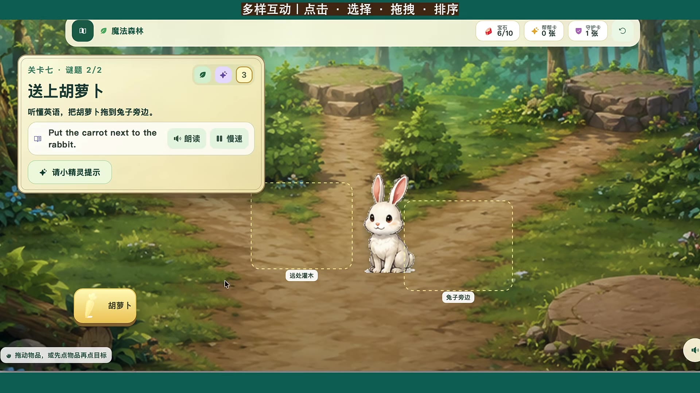

- 内容摘要：答错了也不会被批评（00:55-00:57）

### 25. 00:59

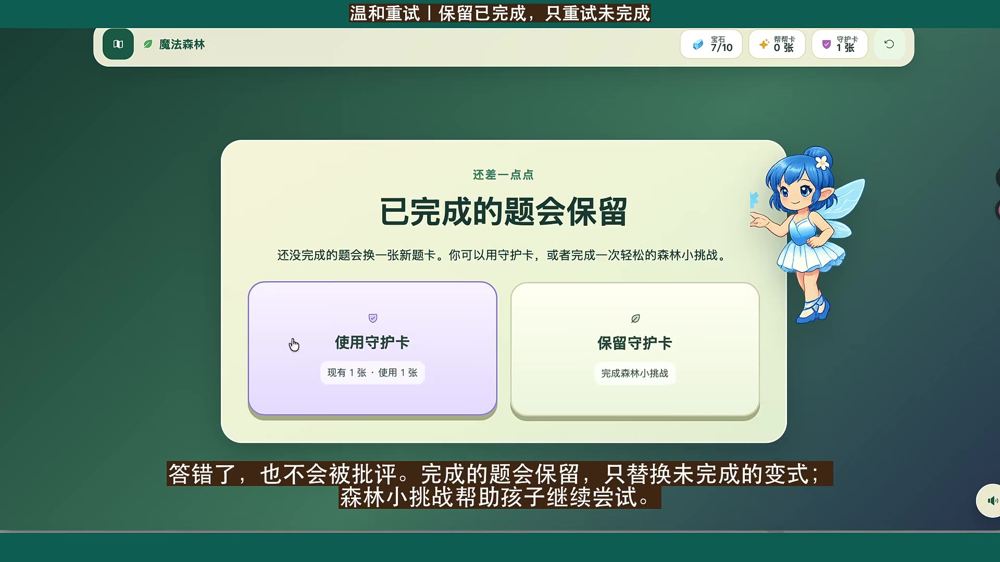

- 内容摘要：完成的题会保留，只替换未完成的便是森林小挑战，帮助孩子继续尝试（00:57-01:03）

### 26. 01:05

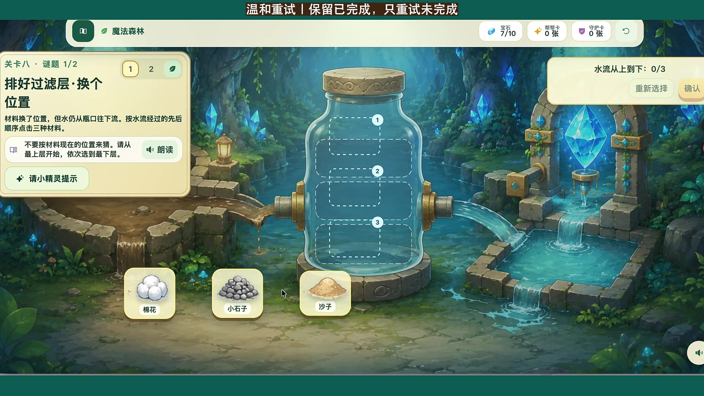

- 该时间点暂无可提取文字。

### 27. 01:11

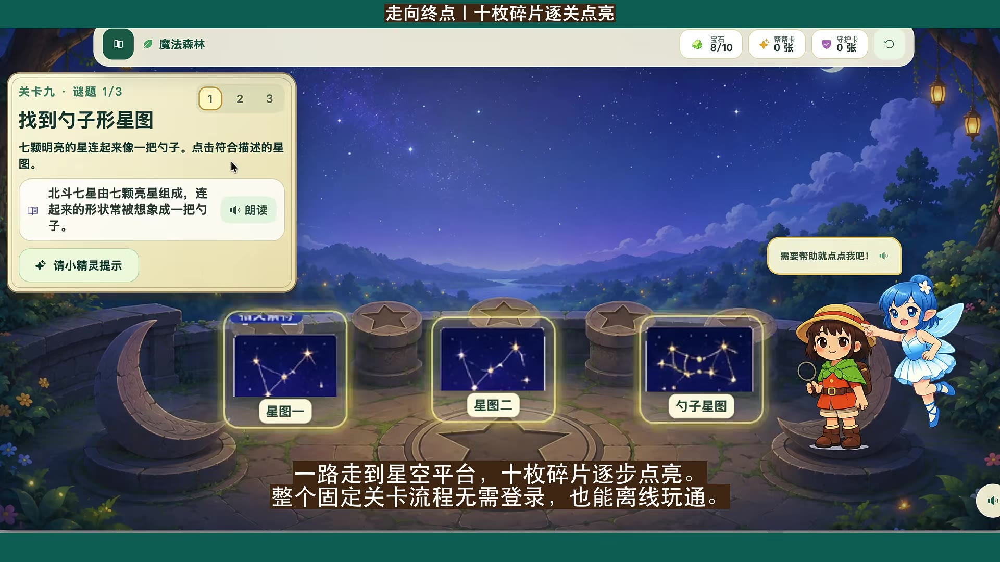

- 内容摘要：一路走到星空平台，十枚碎片逐步点亮，整个固定关卡流程，无需登录也能离线玩通（01:08-01:15）

### 28. 01:17

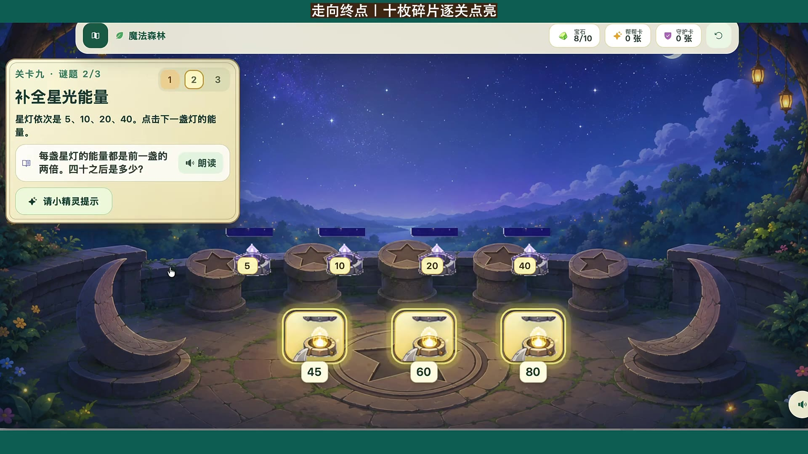

- 内容摘要：最后念出月宝变钥匙（01:19-01:20）

### 29. 01:23

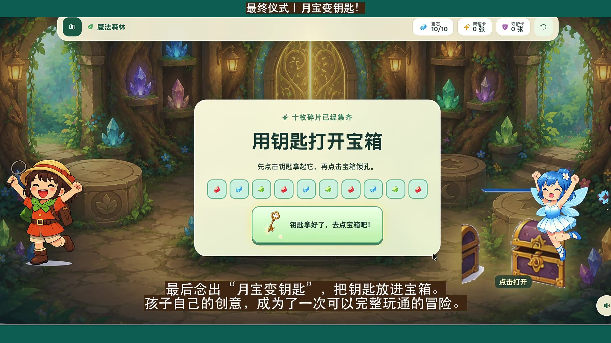

- 内容摘要：把钥匙放进宝箱，孩子自己的创意成为了一次可以完整玩通的冒险（01:20-01:26）

### 30. 01:29

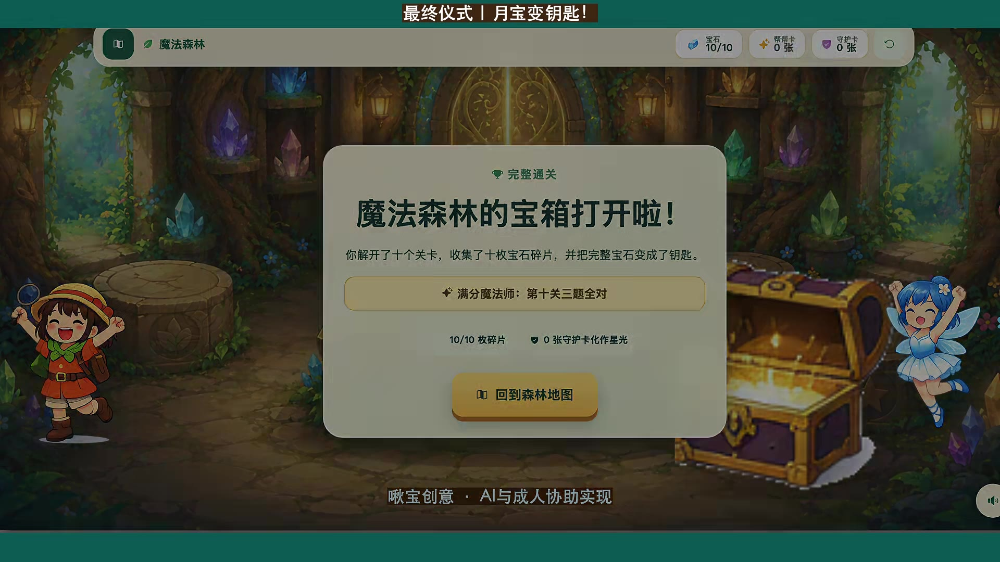

- 该时间点暂无可提取文字。

## 视频画面文字 (OCR)

> OCR 仅供参考，可能包含识别错误；请以视频画面和转写来源为准。

### 关键帧 1 · 0.5s

BEANE 游戏演示
7 I
Ng
+ BE Al EAI Ba .
包 I =i [] 1 a 4
== > << wid V4) A 人也 /AAA 2M | SEE
y mm Ee E31 Sos
A y=) = I — J
EA HEt > =
4 = | a = De®,
HI R= BC ey ，
RY br AE Lh = TT : 2 -< - : Ne / A J
读恒线素，解开机关， BETHSERA. Ea TE :
- a “3
> FHAER 下 Ny - —- = A
0 TXRESENR HERRFEXAREE : : TC Lm ~ re
BENS NARBERTH
《魔法森林 : 宝石钥匙》。属 @
Te SN Ea A

### 关键帧 2 · 3.17s

欧宝 AI 创作游戏演示 mw 森林地图 whe Sy 下一站，去哪里解谜 ?
十个关卡已经开放。集齐十枚碎片后，就能前往最终宝箱。
|
® Ca) ® <
关卡 9 关卡 7 (a) 关卡 10
Ca) 志关卡 8
® 运四 ® @
¥ 0 =
Be O 关卡 3
= 关卡 1 = pm
73. BEAL BRE 8A
《魔法森林 : 宝石钥匙》。 C
[oama_o esas © wimn | BREBA © 尚未解锁

### 关键帧 3 · 4.07s

WMEAIGHE - 游戏演示
”多本 so +8 3% o 8
fe Ir GD za oF
*, : wz 人 * w 森林地图 “ 冯 cc ©
ER WL) rasa fC A
& HE Br SY Ls THREE fia — 2 Jr va
Tn gr ] gs xg I PEREZ, ee SS 月本 - 人 - 3 F Re, LS SS | :
i 2.7 — © —¥ § pe . y : @ x 3 wv £5 了
w oy 5: S Se Res RE ‘3% hs JY 本 i 3 Ne A Ra 一 lo ge 人 Se : pr (a) = TRE (a) 最终宝箱 vi a Pr 、 Bre an ut ey = oe 二 (5% D) oa | :
OO、了 —_— AEE 。 eC : =: %-. Lx \
io oo : ll, 局 K (a) Dp + JA
Be (a) i \ Pe =
Zo a de). (0)
(1°,° ; SS 全和 as 人 ah hn
Pod 2 | .
Se 这是九岁小朋友哆宝设计的《魔法森林 : 宝石钥匙》。 @

### 关键帧 4 · 6.43s

玩法地图 | 105% X 每关 3 题
名舌 a 8h | +0% o3% oo IN
i ~ Pr ie 有 >- A’
Granchn THER Va ma wr’ > 2
> Sh of | as 1 A PEE. rd CC) od 03
WON | pth, HERES aT
LIEN {oe rox paar re = : red | 5
个关卡已绎天放款集齐填析碎片后 ,一就能前往最终宝箱 5 ~ 3 ares. =
‘ fe — E+ *, * 3 gk 一 Sf “ | 4
了 2 ) gs 3 . (@ Ay Ao -
tai NET wr <i RS
EB 0 bi Ok) SO 和 ¥ ( 大 ef 作二 ER 63¢ = *
Ha Na Ama x8 A = 3 . 0 C3 3 »
sy 5 RY, 2 ENE *: 有下 aa 2% (a) 本 oo \ %F4 人 Zo Long a AE (a) R (a)
A 4
4 [§ L s 1
% SF 关卡 1
3 玩家从森林地图出发，十个关卡顺序解锁 ;
“每关三道谜题，共同完成一个场景任务。多

### 关键帧 5 · 10.2s

玩法地图 | 10% X 每关 3 题关卡一，池塘机关读懂线索，找到藏在池塘里的机关 A
i
( % ©) 准备好后，召唤本关的三张魔法题卡。 G)
S oy 人
a 次星光题卡来 ! 入 wo) Ap 星光题卡来 »
[——( AINABRUIE; MEARE RERA, &)
pg %
a A. » i"玩家从森林地图出发，十个关卡顺序解锁 ;
每关三道六题，共同完成一个场景任务。 C

### 关键帧 6 · 12.37s

玩法地图 | 10x X 每关 3 题
& - rs pay 全一去
Sal pe REF ‘0 i 1
= \ -— ‘Q |
3 E by y
\ v. )/ > go NS
- (4 . Ri 关卡一，池塘机关 g ==
»; > 73) » — 一一人读懂线索，找到藏在池塘里的机关 EER
AE 钥匙。星光题卡来 ! | o
I S SN 二 vy A NN
Ab 准备好后，召唤本关的三张了法题卡。 &y
C9 & od
AD 也可以大声念出咒语 ; 试玩版用点击按钮确认。 \ JY
gy A
a BA. »
玩家从森林地图出发，十个关卡顺序解锁 ;
每关三道谜题，共同完成一个场景任务。 €

### 关键帧 7 · 18.3s

第一关 | 知识不是试卷，而是通路关卡一，迹题 113 CE ) & j r J
5 c a 、 1 aA 诗句指路 CO NY
o UN = . es, -
诗句把线索藏在哪个地方 ? Nc & a 4 > - Nd
= MEA TERRA, BREET 必朗读 - ee Es 引 { ~~] ) G4 2 bi &
£3. Se R87, 3 ~ sd ~~
\ a. J ~ 多一到 2 =
® 机关有反应了 ! 7) i ASI a) ee :
BESET AMAEE, FCtERE a ES > - = All ZEEE,
能大着线索。加一 E 7 六区全
| \ * 区 =~ > a
SCT | Tater
—— ea \ NS >_4 p, 有 al 7 1, “INQ ‘ SL 从
< y. oo bg
; A . g (a) ws
Y Se od
- 第一关先读诗找到池塘，再理解英文单词 under，最后补全数字规律。知识不是试卷，而是通路。 C

### 关键帧 8 · 21.07s

第一关 | 知识不是试卷，而是通路关卡一谜题 2/3 2 B) 3 n— = NN = ) » 四 9， /从和 SS 叶下寻钥是 a i. ut &
pe Ny 听懂英语，把钥匙拖到它藏身的位置。 _ ll 8 Rat
、 nw \
08 The key is under the leaf. 中朗读 Wl 慢速了 > vy J 3 i J’ eS J :
< 48 - ah ¢ ) J ss a ok
+ 请小精灵提示 ) YT. - La ;
= EY) 一 ”Le / 号一一一一 = NG \ - > 0) hn AN /
~~ \ La 2) Ng 4
"3 “Ta ) — —
¢ 人六 ) es 1 2 7. 1 Ra 人 AY) — : _— '人全 E
— | No.) Sy
第一关先读诗找到池塘，再理解英文单词 under，最后补全数字规律。知识不是试卷，而是通路。 C

### 关键帧 9 · 23.2s

第一关 | 知识不是试卷，而是通路 HTS =. 站 ss 听懂英语，把钥匙拖到它藏身的位置。 => 4 a | 4 hy 8 Rd,
hos ) 人 - as A 村
E The key is under the leaf. 中朗读 0 1&&F cae ade * ~ J a
7 a ry N ss ga oe 》机关有反应了 ! ) ls ~¢ = We ;
| [+] under the leaf 的意思是 “在叶子下面 ”。人 p BEE / -)
A 人
| 继续第 3 题 > | = =
— 一 UN 网 / :
E—EEEEHKEGNE, BEMELER under, BEHEMTIE.
: 知识不是试卷，而是通路。 C

### 关键帧 10 · 24.24s

第一关 | 知识不是试卷，而是通路
(= ] 2 魔法森林 oho 0% 3% ©
关卡一，迹题 2/3 > (2) . —— & ), ® <3
x po = = S77 —&
叶下寻钥是 a"听懂英语，把钥匙拖到它藏身的位置。 > 4 a | 4 by 8 Rd,
Lae ] A h - ) Ged Po 4
[2 The key is under the leaf. 中朗读 1 慢速 Be ws al bY Ld N / 4 Y. ;
3 ). TEEN ’ J 4 == 二一 .
Ww 4 <
(+) 机关有反应了 ! rls ~ fe = 人国 under the leaf 的意思是 “在叶子下面"。 rn . a / =
\ ” )
继续第 3 题 > \ bs EF $. : J
| | cia 是 | ER
ly = 一 ( 7 \ E
= CN 5" /
{ >
9a i
Sle -

### 关键帧 11 · 30.17s

第一关 | 知识不是试卷，而是通路 TN
B\
|
od Pp 关卡完成
|
bY
=~ 宝石碎片找到了 !
AAA 完 cer *
LA Nez 本关已经完成 3 个机关，碎片稳稳地放进背包。作
N A A Le 74 党
2 已完成 2 已完成 2 已完成 Sad 2
+ 三题全对 ! 可以选择一张奖励卡。 tag)
= [ep | Lo
he
—

### 关键帧 12 · 31s

通关与奖励 | 完成两题可通关
[ 总视儿 + 路 eI o
” 人 PE 村 T IY 7 a Ey 关卡二迹题 1/2 (1) + 5 2 ， ¥ La
35-3 3 "A Jom 选择桥面材料去 ay ho -a A
哪种材料既能浮在水面，又适合铺桥 ? Eee CL ps 4 i Tg of
a Ey ‘or ¥ 4 ic, A
= Ee 也要能铺成桥。。，衣读 —. = = i A 4
o -~ br Fa gua <3 Pt
(ET 。一和 RN 全 a
iy Bi sir | a § 7S
一一 lV, -
+ 请小精灵提示 1 ie CNY < 要
y’ — ( A
a se ha 4
SGN 请 = OFS
RE 所 R p t 2
ALINE Ng
: == Tu” =. Te 包本一 = 让 “2

### 关键帧 13 · 32.2s

通关与奖励 | 完成两题可通关
A :sx oFo | «8% | 93% | 5
& i 4 Ta a 4
关卡二 RE 2/2 > +) IN - 、 3. oF 铺好断桥 JU 上 ny Fx a
根据英语指令，把木板拖到正确位置。 v. ren A or
fa -| ia 二信和 A
N . CE ai ws a= a
+ 请小精灵提示 ee EEE al ad
VV a, .
= 一- < TE 一一 ER (一 = 一-====---- 公 - i 一二一本 = TE — wv
tS taal — CE _— ee. =?
Pe ps ! p= po J
) Re -了 -=
Ly Ee
2 : - a” (Te oe -
; = = - cw» REN 局
(Raa. oo — [1 Ee: :
SXRN RFE, REBIE—NEAHE.
首轮三题全对，还能选择帮帮卡或守护卡。 @

### 关键帧 14 · 33.87s

通关与奖励 | 完成两题可通关 El 关卡完成
|S | 1
JN 宝石碎片找到了 | |
QU ALN. 本关已经完成 3 个机关，碎片稳稳地放进背包。 5
所 &» S/F «
9 已完成 “| 2 已完成 | 9 已完成 ad = ;
\ |
i | + 三题全对 ! 可以选择一张奖励卡。 | A
u 9)
一 |
每关累计完成两题，就能得到唯一的宝石碎片。首轮三题全对，还能选择帮才卡或守护卡。 @

### 关键帧 15 · 36.1s

通关与奖励 | 完成两题可通关 Rd ©) - no Po 1% 9% | o IN
fr ER 7 — .
*, NH “ = A j > 时森林地图。 : = . rr.
> Na | | PRR. ASS PEE; sli @ D « BB 0%
“二下一站 ,去哪里解壕 ? - 5 - F Sea
LEE A pg == . oS , ook 3
TN Je xem RAR, AEACBATH, 0 : A :
A ZA (um 2a 0 . SHE CA
ERE oy pr Na "> oi ig 3 一 ol Ed E
、 el, ge @ ve ou 3 * J RV 人 Rs 一 Se Te 二 =- = we [= a LAUNST Een
E be ye 8 265 a satay WF 7 RY ic = (= ) a : 7s
REVERE” dove CeO (JH
L Eas —— > y Er L £8 RE = r ° RQ 3. % pe A
a p AL ° 3 ® RE sk
bs Nf =
—m se 3 pe * - ¢ a 人 Zo 3 和 Reo ot J ™
oe Ody
5X0) y 4 [ 关卡 5
PR ss 关卡 3 0
二每关票计完成两题，就能得到唯一的宝石碎片。
: 首轮三题全对，还能选择帮才卡或守护卡。 C

### 关键帧 16 · 36.97s

通关与奖励 | 完成两题可通关关卡五风铃树林找到让风铃响起的力量，补全规
4 3 EE
12, 再请小鸟落上树枝。 | 帮帮小精灵来帮你啦 ! |
AP | RoxEEAAEA «|
70 SS | + 小精灵帮帮卡已生效 : 本关已帮你完成一是 | _ "re
(0 Q 图 ®) \ i 56) 4 人 4
oF 准备好后，召唤本关的三张魔法题卡。 Nez dd 党
) 上 A )
也可以大声念出咒语 ; 试玩版用点击按钮确认。 4
a BA. »
每关票计完成两题，就能得到唯一的宝石碎片。首轮三是全对，还能选择帮用卡或守护卡。《

## 字幕文件

[TXT](./transcript/video.txt) | [JSON](./transcript/video.json) | [SRT](./transcript/video.srt) | [VTT](./transcript/video.vtt)

## 转写来源

[平台字幕 TXT](./transcript/platform/video.txt) | [平台字幕 JSON](./transcript/platform/video.json) | [平台字幕 SRT](./transcript/platform/video.srt) | [平台字幕 VTT](./transcript/platform/video.vtt) | [本地 ASR TXT](./transcript/asr/video.txt) | [本地 ASR JSON](./transcript/asr/video.json) | [本地 ASR SRT](./transcript/asr/video.srt) | [本地 ASR VTT](./transcript/asr/video.vtt)

## 其他来源转写

### 本地 ASR

- **00:00-00:04** 這是9歲小朋友丘寶設計的 魔法森林 寶石鑰匙
- **00:04-00:08** 玩家從森林地圖出發
- **00:08-00:13** 十個關卡 順序解鎖 美觀三道迷題 共同完成一個場景任務
- **00:13-00:21** 第一關 先讀師找到池堂 在理解英文單詞 安德爾 最後補全數字規律
- **00:21-00:24** 知識不是事件 而是通路
- **00:24-00:34** 美觀累計完成兩題 就能得到唯一的寶石碎片
- **00:34-00:38** 手輪三題全隊 還能選擇幫幫卡 或守護卡
- **00:43-00:46** 修橋 種種子 看影子 找角印
- **00:46-00:50** 點擊 選擇和拖綴 讓不同知識 真正參與操作
- **00:50-00:57** 答錯了 也不會被批評
- **00:57-01:00** 完成的體會保留 只替換未完成的辨識
- **01:00-01:08** 森林小挑戰 幫助孩子繼續嘗試
- **01:08-01:11** 一路走到星空平台 十美碎片 逐步點亮
- **01:11-01:19** 整個固定關卡流程 無需登錄 也能理現完通
- **01:19-01:22** 最後 念出月寶邊鑰匙 把鑰匙放進寶箱
- **01:22-01:26** [uncertain] 孩子自己的創意 成為了一次 可以完整完通的冒險

## 视频转录

- **00:00-00:04** 这是九岁小朋友灸宝设计的魔法森林宝石钥匙
- **00:06-00:13** 玩家从森林地图出发，十个关卡顺序解锁每关三道谜题，共同完成一个场景任务
- **00:16-00:18** 第一关先读诗找到池塘
- **00:18-00:23** 再理解英文单词under最后补全数字规律知识不是试卷而是通路
- **00:31-00:32** 每关累计完成两题
- **00:32-00:38** 就能得到唯一的宝石碎片，首轮三题全对，还能选择帮帮卡或守护卡
- **00:43-00:50** 修桥种种子，看影子，找脚印，点击选择和拖拽，让不同知识真正参与操作
- **00:55-00:57** 答错了也不会被批评
- **00:57-01:03** 完成的题会保留，只替换未完成的便是森林小挑战，帮助孩子继续尝试
- **01:08-01:15** 一路走到星空平台，十枚碎片逐步点亮，整个固定关卡流程，无需登录也能离线玩通
- **01:19-01:20** 最后念出月宝变钥匙
- **01:20-01:26** 把钥匙放进宝箱，孩子自己的创意成为了一次可以完整玩通的冒险

## 图片

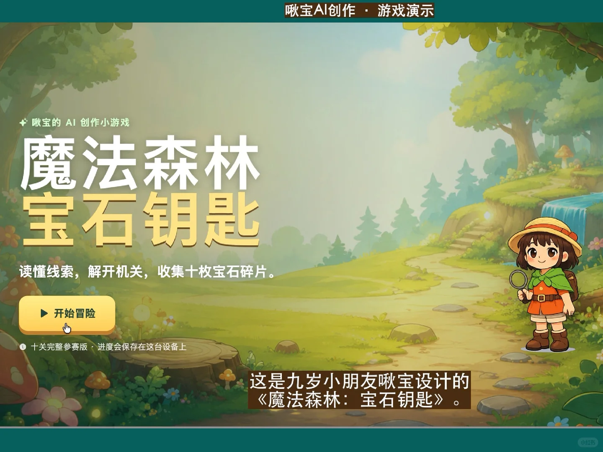

## 图片文字 (OCR)

> OCR 仅供参考，可能包含识别错误；请以原图为准。

啾宝的AI创作小游戏
魔法森林
宝石钥匙
❤
卖懂线索，解开机关，收集十枚宝石碎片。
开始冒险
十关完整参赛版·进度会保存在这台设备上
这是九岁小朋友啾宝设计的
《魔法森林：宝石钥匙》。
