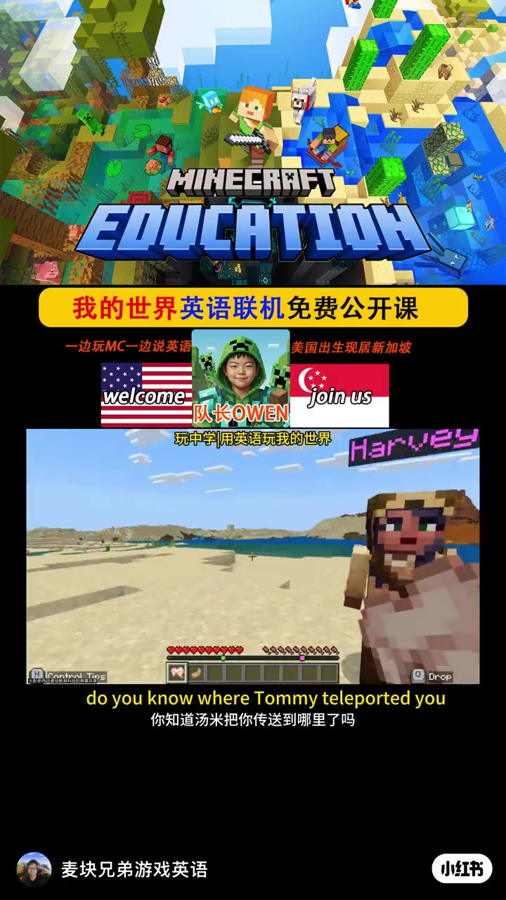
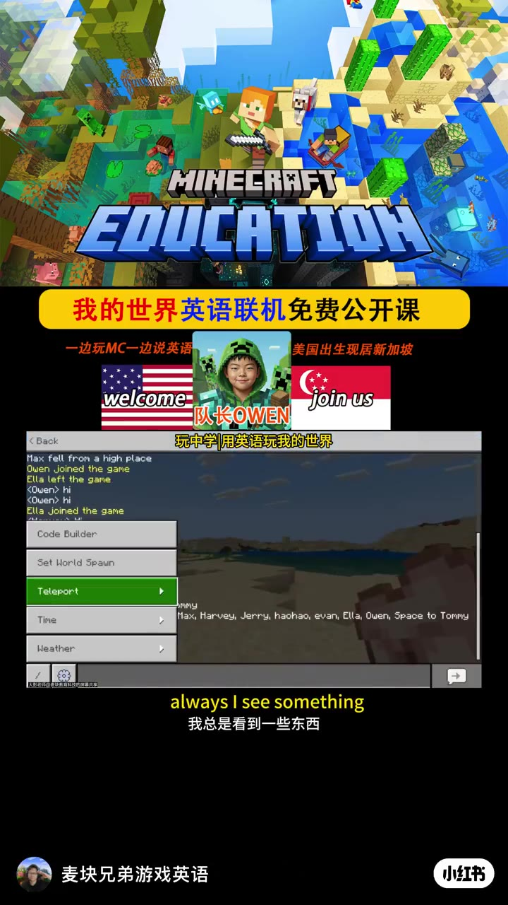
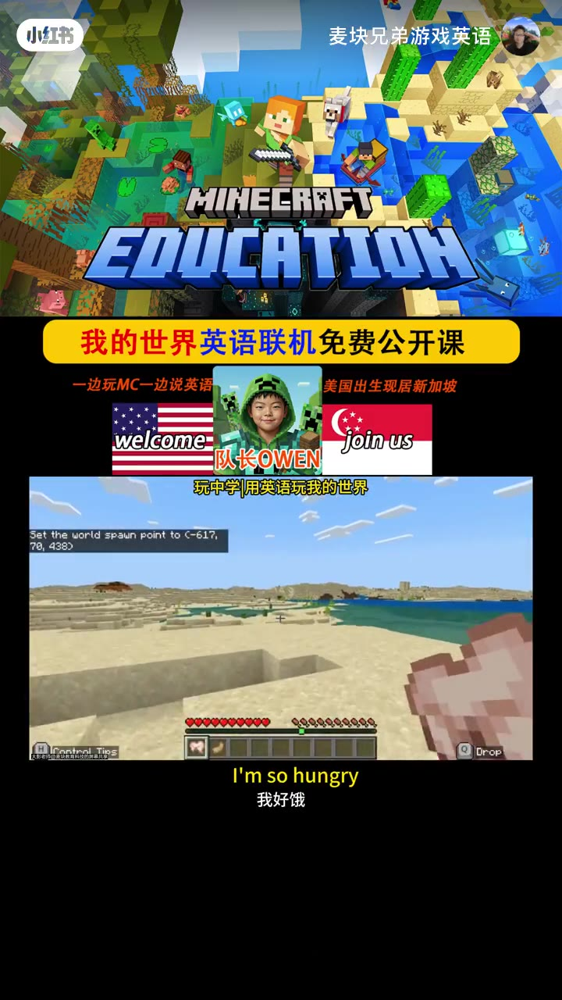
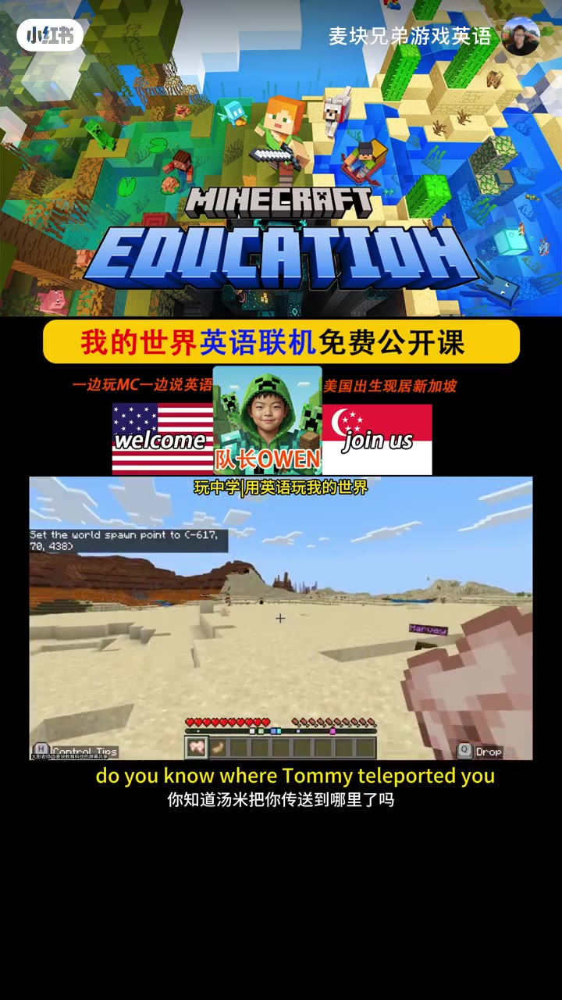
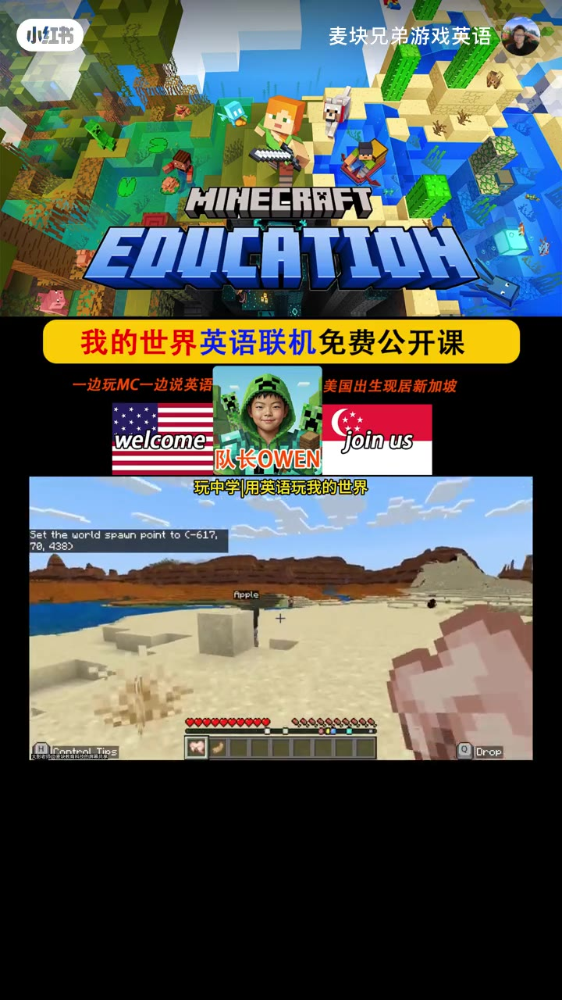
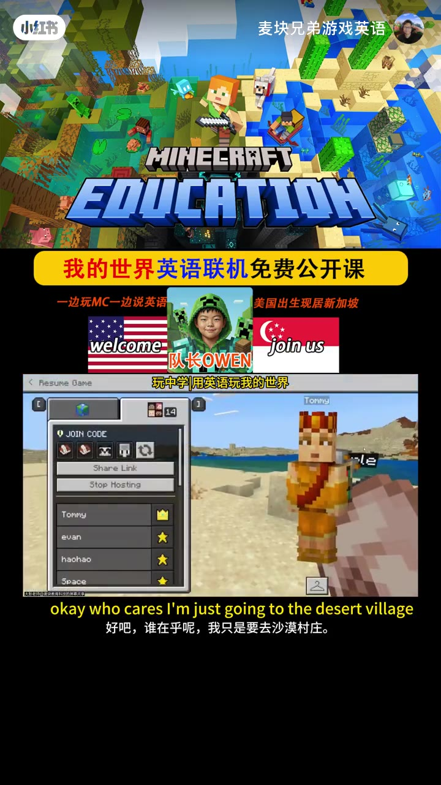
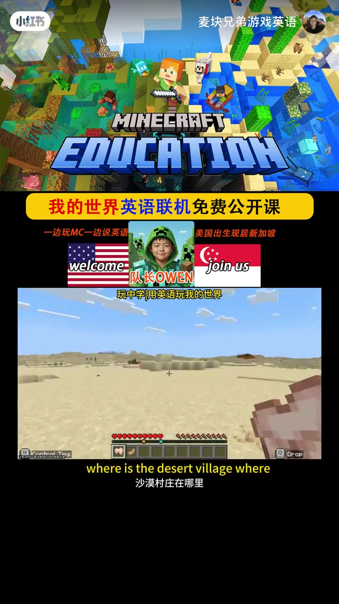
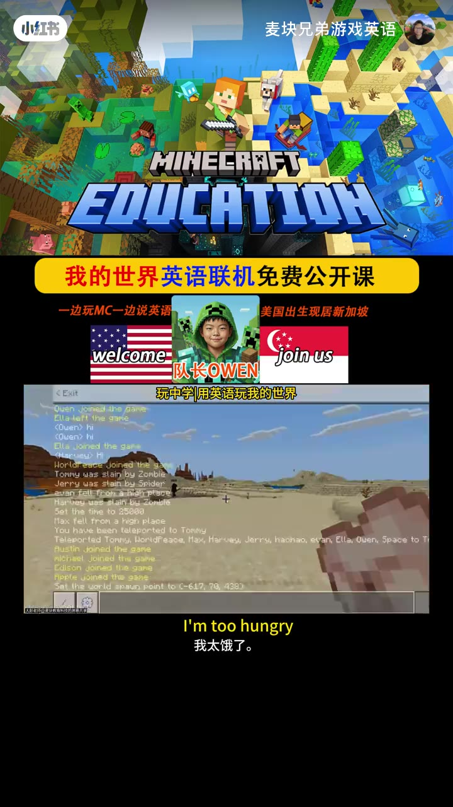
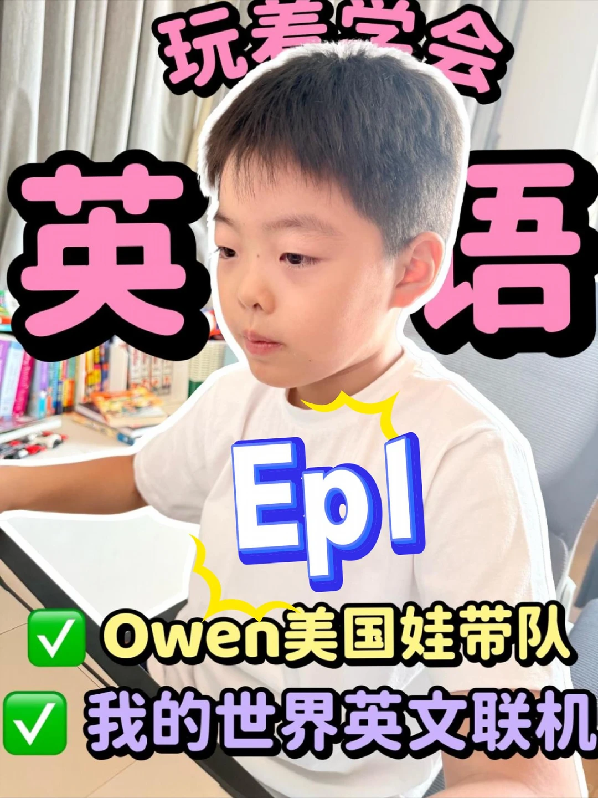

---
title: "Ep1美国娃Owen英语带娃玩我的世界"
source: "https://www.xiaohongshu.com/discovery/item/6a0c350c000000003502fbf2?app_platform=android&ignoreEngage=true&app_version=9.38.1&share_from_user_hidden=true&xsec_source=app_share&type=video&xsec_token=CBDuYtI02mrlCDHj3SxGch0ZjVLQ3s9AvHAtRxpy4cv2A%3D&author_share=1&xhsshare=CopyLink&shareRedId=N0dINjg3NUpMPko6S0EySDs0P0lFSjdL&apptime=1784641992&share_id=a89664301fc645e3ae6c73f2632b6a5b&share_channel=copy_link"
author: "麦块兄弟游戏英语"
author_uid: "68d8b25c0000000021023240"
date: "编辑于 05-19"
tags: ["我的世界教育版", "英语启蒙", "MC", "少儿英语", "外教英语", "游戏化英语学习", "英语学习", "趣味英语", "玩中学会英语", "游戏化英语", "外教口语课"]
platform: "xiaohongshu"
category: "游戏设计"
summary: "这是一则关于《我的世界教育版》英文联机公开课的宣传内容，由现居新加坡的美国外教Owen带队，面向少儿进行英语启蒙与口语训练。课程免费开放，每周二至周日晚20:00开课，通过联机游戏的方式让孩子在玩中学习英语，兼具趣味性与教育性。"
---

# Ep1美国娃Owen英语带娃玩我的世界

> 作者: 麦块兄弟游戏英语 | 日期: 编辑于 05-19 | 原文: https://www.xiaohongshu.com/discovery/item/6a0c350c000000003502fbf2?app_platform=android&ignoreEngage=true&app_version=9.38.1&share_from_user_hidden=true&xsec_source=app_share&type=video&xsec_token=CBDuYtI02mrlCDHj3SxGch0ZjVLQ3s9AvHAtRxpy4cv2A%3D&author_share=1&xhsshare=CopyLink&shareRedId=N0dINjg3NUpMPko6S0EySDs0P0lFSjdL&apptime=1784641992&share_id=a89664301fc645e3ae6c73f2632b6a5b&share_channel=copy_link

> **摘要**:这是一则关于《我的世界教育版》英文联机公开课的宣传内容，由现居新加坡的美国外教Owen带队，面向少儿进行英语启蒙与口语训练。课程免费开放，每周二至周日晚20:00开课，通过联机游戏的方式让孩子在玩中学习英语，兼具趣味性与教育性。

#我的世界教育版 #英语启蒙 #MC #少儿英语 #外教英语 #游戏化英语学习 #英语学习 #趣味英语 #玩中学会英语
📚我的世界教育版英文联机公开课
👉免费👉免费👉免费
⌛️每周二到周日晚20:00
🈶️联机游戏🎮锻炼口语🇬🇧
欢迎加入Owen战队🇺🇸美国娃现居新加坡🇸🇬

#游戏化英语 #外教口语课

## 视频

[视频 1](./video.mp4)

<video controls width="100%"><source src="./video.mp4" type="video/mp4">您的浏览器不支持视频播放。</video>

附件: [音频](./audio/audio.wav) | [处理清单](./video_manifest.json)

## 视频关键帧

## 视频画面文字 (OCR)

> OCR 仅供参考，可能包含识别错误；请以视频画面和转写来源为准。

### 关键帧 1 · 0.5s

HIHECRAFT
EDUCATIOH
我的世界英语联机免费公开课
一边玩MC一边说英语
美国出生现居新加坡
welcome
joinus
队长OWEN
玩中学用英语玩我的世界
Harvey
00000
Drop
do you know where Tommy teleported you
你知道汤米把你传送到哪里了吗
麦块兄弟游戏英语
小红书

### 关键帧 2 · 3.97s

MIHECRAFT
EDUCATIOH
我的世界英语联机免费公开课
一边玩MC一边说英语
美国出生现居新加坡
welcome
joinus
队长OWEN
玩中学用英语玩我的世界
Back
lax fell from a high place
wen joined the game
lla left the
game
<Owen>hi
（Owen>hi
Eulajoined the game
Code Builder
Set World Spaun
Teleport
SMMy
Time
Max, Harvey, Jerry. haohao, evan, Ella, Owen, Space to Tommy
X
Weather
/
D
always I see something
我总是看到一些东西
麦块兄弟游戏英语
小红书

### 关键帧 3 · 7.45s

MINECRAFT
EDUCATIOH
我的世界英语联机免费公开课
一边玩MC一边说英语
美国出生现居新加坡
welcome
joinus
队长OWEN
玩中学用英语玩我的世界
et the world spawn point to c-617,
70,4380
Drop
Control
R
Tins
I'm so hungry
我好饿

### 关键帧 4 · 10.92s

HIHECRAFT
EDUCATIOH
我的世界英语联机免费公开课
一边玩MC一边说英语
美国出生现居新加坡
welcome
joinus
队长OWEN
玩中学用英语玩我的世界
70.438）
0000000
Drop
ontrnl
do you know where Tommy teleported you
你知道汤米把你传送到哪里了吗

### 关键帧 5 · 14.39s

HIHECRAFT
EDUCATIOH
我的世界英语联机免费公开课
一边玩MC一边说英语
美国出生现居新加坡
welcome
joinus
队长OWEN
玩中学用英语玩我的世界
Set the world spawn point to c-617.
70,4380
Apple
Q000090009
Control
Tins
Drop

### 关键帧 6 · 17.86s

MINECRAFT
EDUCATIOH
我的世界英语联机免费公开课
一边玩MC一边说英语
美国出生现居新加坡
welcome
join us
队长OWEN
玩中学用英语玩我的世界
Resume
Game
Tommy
JOIN CODE
Share Link
Stop Hosting
Tommy
evan
haohao
Space
okay who cares I'm just going to the desert village
好吧，谁在乎呢，我只是要去沙漠村庄。

### 关键帧 7 · 21.34s

MINECRAFT
EDUCATIOH
1
我的世界英语联机免费公开课
一边玩MC一边说英语
美国出生现居新加坡
welcome
joinus
队长OWEN
玩中学用英语玩我的世界
Drop
where is the desert village where
沙漠村庄在哪里

### 关键帧 8 · 24.81s

HINECRAFT
EDUCATIOH
8
我的世界英语联机免费公开课
一边玩MC一边说英语
美国出生现居新加坡
welcome
joinus
队长OWEN
<Exit
玩中学用英语玩我的世界
Quen Joined the game
Ella left the gane
<ouen>hi
(Ouen>hi
Eua Joined the ga
<HarueyHi
Worlareace Joined the ge
Tommy was slain by Zomble
Jerry was slain by Spider
evan fell fron a higtr ptace
+
Harvey uas slain by Zonisle
5et the tie to 25000
Max fell from a high place
You have been taleported to Tonmy
Teleported Tommy,WortdPeace,Max,Harveg Jerry,haohao,evan Ella, Ouen,Space to T
Rustin jained the gane
michael
jeined th gare
Edison
Joined thie gare
Hprte
Joined the gane
Set the world apaun point to (-617,70.438
I'm too hungry
我太饿了。

## 字幕文件

[TXT](./transcript/video.txt) | [JSON](./transcript/video.json) | [SRT](./transcript/video.srt) | [VTT](./transcript/video.vtt)

## 转写来源

[平台字幕 TXT](./transcript/platform/video.txt) | [平台字幕 JSON](./transcript/platform/video.json) | [平台字幕 SRT](./transcript/platform/video.srt) | [平台字幕 VTT](./transcript/platform/video.vtt) | [本地 ASR TXT](./transcript/asr/video.txt) | [本地 ASR JSON](./transcript/asr/video.json) | [本地 ASR SRT](./transcript/asr/video.srt) | [本地 ASR VTT](./transcript/asr/video.vtt)

## 其他来源转写

### 本地 ASR

- **00:00-00:02** Do you know where Tommy teleported you?
- **00:02-00:03** Always!
- **00:03-00:04** I say something!
- **00:04-00:07** Okay, I can't get some food now.
- **00:07-00:08** I'm so hungry.
- **00:08-00:12** Do you know where Tommy teleported you?
- **00:12-00:14** I know!
- **00:14-00:16** I think I'm so sneaky.
- **00:16-00:17** Look at that!
- **00:17-00:20** Okay, who cares? I'm just going to the desert village.
- **00:20-00:22** We are in the desert village.
- **00:22-00:24** We are in the desert village.
- **00:24-00:25** But I'm too hungry!

## 视频转录

- **00:00-00:03** Do you know where tommy teleported you
- **00:03-00:05** Oh wait I see something okay
- **00:05-00:09** I can get some food now I'm so hungry,Do you know where?
- **00:09-00:11** Stormy teleported you
- **00:12-00:15** Teacher I know they get so sticky
- **00:15-00:19** Oh no okay who cares,I'm just going to the desert village
- **00:19-00:25** Where is the desert village,Where is the payment?

## 图片

## 图片文字 (OCR)

我的世界英文联机
Owen美国娃带队
^
Epl
品
英
