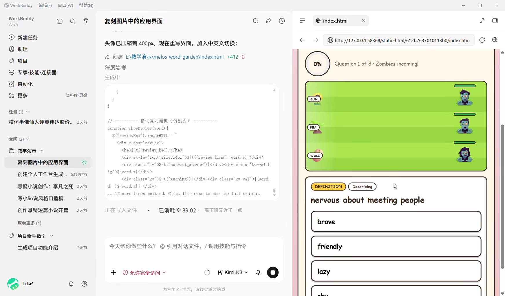
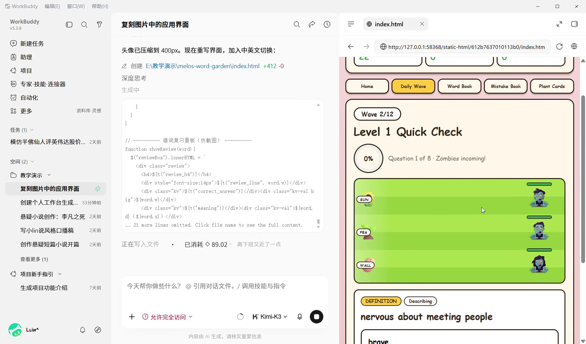
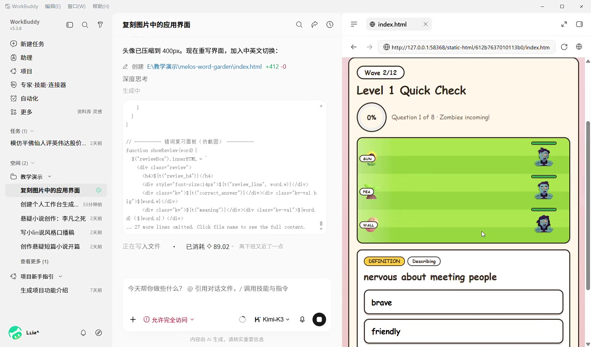
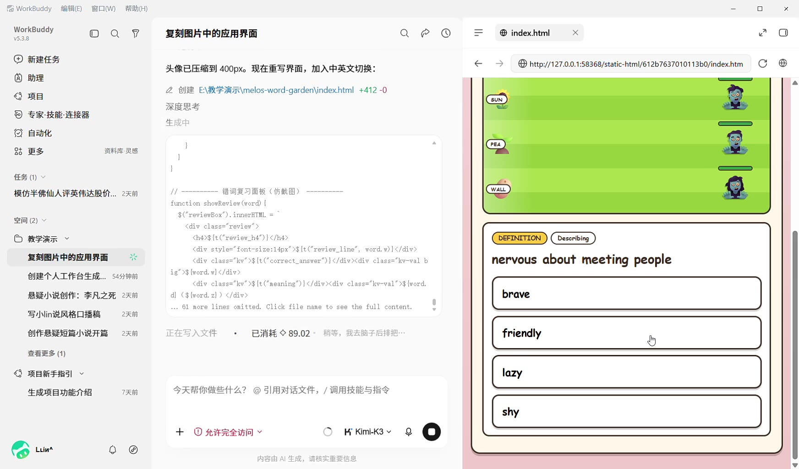
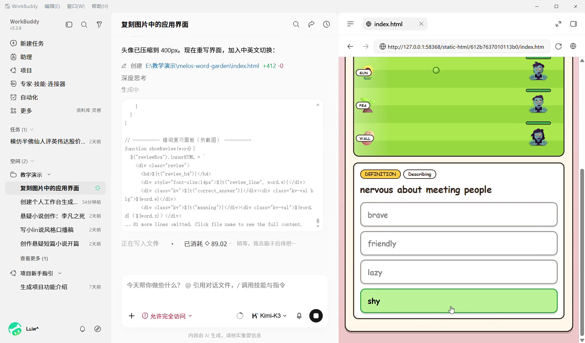
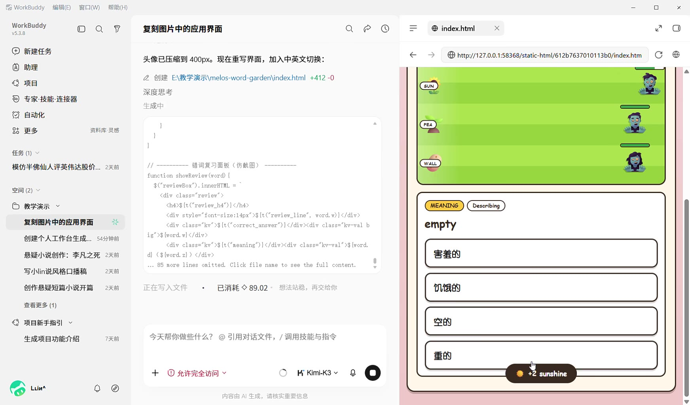
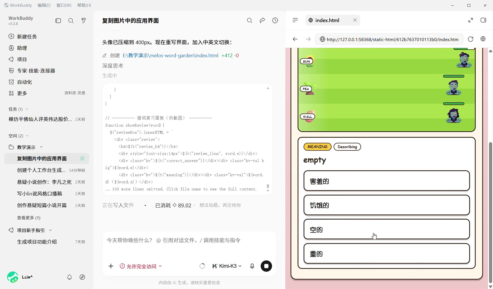
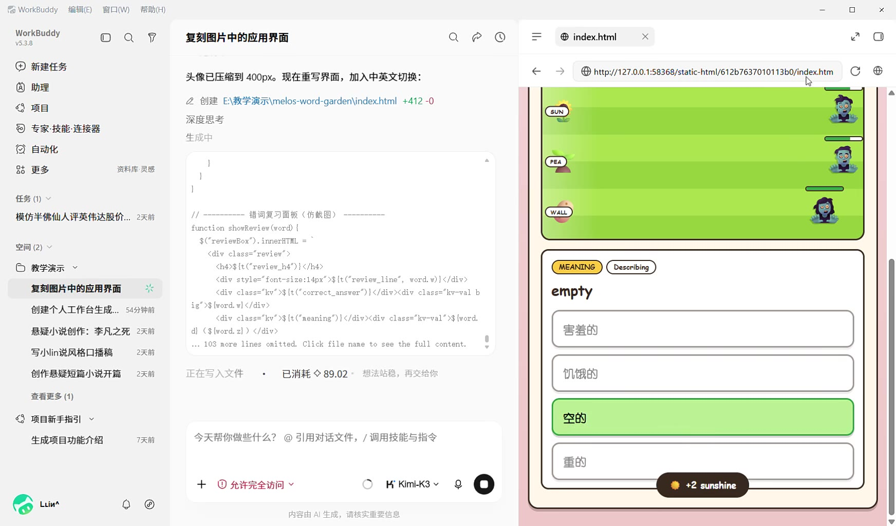

---
title: "WorkBuddy复刻植物大战僵尸背单词🔥"
source: "https://www.xiaohongshu.com/discovery/item/6a6ee6a70000000006005956?app_platform=android&ignoreEngage=true&app_version=9.40.1&share_from_user_hidden=true&xsec_source=app_share&type=video&xsec_token=CBEofQ71ObMzI8ATt4VZfLDO1rnjD5mJw3gXIA5rS4vOM%3D&author_share=1&xhsshare=CopyLink&shareRedId=N0dINjg3NUpMPko6S0EySDs0P0lFSjdL&apptime=1785724745&share_id=ac6649eee35a41f5ba74d807cc06ecf8&share_channel=copy_link"
author: "咨言 AI"
author_uid: "5c285fe60000000006014aea"
date: "编辑于 11小时前 广东"
tags: ["AI编程", "WorkBuddy", "背单词游戏", "植物大战僵尸", "育儿神器"]
platform: "xiaohongshu"
category: "数码"
summary: "本文介绍用WorkBuddy无代码复刻植物大战僵尸背单词App的全过程，包含答对发射豌豆、答错入错词本、185个KET词汇及四类题型、闯关解锁植物卡等功能，支持手机电脑同步进度。作者称全程仅靠自然语言提需求即可完成开发，并整理了可复用提示词模板，支持奥特曼、马里奥等主题换皮，为家长提供专属学习游戏定"
---

# WorkBuddy复刻植物大战僵尸背单词🔥

> 作者: 咨言 AI | 日期: 编辑于 11小时前 广东 | 原文: https://www.xiaohongshu.com/discovery/item/6a6ee6a70000000006005956?app_platform=android&ignoreEngage=true&app_version=9.40.1&share_from_user_hidden=true&xsec_source=app_share&type=video&xsec_token=CBEofQ71ObMzI8ATt4VZfLDO1rnjD5mJw3gXIA5rS4vOM%3D&author_share=1&xhsshare=CopyLink&shareRedId=N0dINjg3NUpMPko6S0EySDs0P0lFSjdL&apptime=1785724745&share_id=ac6649eee35a41f5ba74d807cc06ecf8&share_channel=copy_link

> **摘要**:本文介绍用WorkBuddy无代码复刻植物大战僵尸背单词App的全过程，包含答对发射豌豆、答错入错词本、185个KET词汇及四类题型、闯关解锁植物卡等功能，支持手机电脑同步进度。作者称全程仅靠自然语言提需求即可完成开发，并整理了可复用提示词模板，支持奥特曼、马里奥等主题换皮，为家长提供专属学习游戏定

WorkBuddy复刻植物大战僵尸背单词🔥
谁懂啊！孩子背单词坐不住5分钟，现在天天主动打卡😭
	
前几天看到有博主发的植物大战僵尸背单词，觉得有趣。
	
于是，我也用WorkBuddy直接复刻了一个植物大战僵尸版背单词App，全程没写一行代码！
	
🌻 答对单词→豌豆射手发射打僵尸
🧟 答错→僵尸前进，单词自动进错词本
📚 内置185个KET级词汇，释义/词义/例句/拼写4种题型
🎴 闯关解锁植物卡，还有打击音效和中英文切换
📱 手机电脑都能玩，进度自动保存
	
最爽的是全程"说人话"提需求就行，改标题、换头像、加音效都是一句话的事，AI秒改✅
	
提示词我整理成了模板，还带换皮公式——奥特曼口算、马里奥拼音都能套👇
	
💬 评论区扣"提示词"或直接私信我
我把完整提示词发你，照着改就能给娃做专属学习游戏！
	
#WorkBuddy #AI神器 #背单词 #英语启蒙 #宝妈必备 #植物大战僵尸 #AI编程 #育儿好物分
编辑于 11小时前 广东

#背单词游戏 #育儿神器

## 视频

[视频 1](./video.mp4)

<video controls width="100%"><source src="./video.mp4" type="video/mp4">您的浏览器不支持视频播放。</video>

附件: [音频](./audio/audio.wav) | [处理清单](./video_manifest.json)

## 视频图文总结

> 按关键帧关联完整视频转录；文字保留机器转写原文，时间点仅用于定位。

### 1. 00:00

- 画面文字（OCR）：% WorkBuddy 编辑日 ”窗口 W) 帮助 (H) 二加有 WE 0 Q 9 ，复刻图片中的应用界面 Q @ © = @indexhtml x Fe)
© 新建任务头像已压缩到 400px。现在重写界面，加入中英文切换 : & 全国 httpW127.00.1:58368/static-html/612b7637010113bo/indexhtm ~~ C 〇 @&

， 5
® 助理 =
ol 2 创建 E\ 教学演示 \melos-word-gardenNindexhtml +412 -0
4 项目 — Question 1 of 8 - Zombies incoming!
2:
© 专家 .技能 .连接器生成中贷自动化 (
1 .
35 更多资料库 RE ) <
1
任务 () ~
模仿半佛仙人评英伟达股价 .。 :天前 1/ 一一一 ARATE (ME) 一一- 一一一 function shovReview (rord) { (rea )
$("revievBox”). innerHTHL =
SLE 

白教学演示 ~ <h>3{t Creview_hd")}</hd> | =Y 站

3{t (‘reviev_line’, word w)}
 | Ca)
复刻图片中的应用界面站 
${t(“correct_answer”)}

$ word. wl 

加 
$ {t(“neaning”) | 

§ word.
: dl ($fvord.zj) </di 悬疑小说创作 : 李凡之死 2 天前《Sword 可) 
 可人 NO (Dernbn ) [N
3 or ... 12 more lines onitted. Click file name to see the full content. 里 =
写 4Nin 说风格口播稿 2x nervous about meeting people 创作悬疑短篇小说开篇。 2 天前正在写入文件。已消耗令 89.02 高下班又近了一点
<3 项目新手指引 ~
aa or CARREIRA, (RRR
Luinr 0 ©@
® 内容由 Al 生成，请核实重要信息 ( ]
Pe v

### 2. 00:01

- 画面文字（OCR）：% WorkBuddy ”编辑 (日 ” 畜口 (W) ”帮助 (H) — 口 x
BLY 0 Q 9 。复刻图片中的应用界面 Q @ © = @indechml x oo
® 新建任务 ic 头像已压缩到 400px。现在重写界面，加入中英文切换 : & 全国 htpVW127.00.158368/static-htmy612b7637010113bo/indexhtm ” C 〇 @
® 助理 LUc= Jv v ~
ola 2 创建 E 教学演示 \melos-word-gardenNindex html +412 -0 |
生成中 > / -
从自动化
1
任务 () ~ Level 1 Quick Check 模仿半佛仙人评英伟达股价 .2 天首 I] ARATE (HUE) 一一一一 function showReview (word) {
THE #Creviommend: dmnein, = Question 1 of 8 - Zombies incoming!

© 教学演示 ~ <he>3{t Creviev_hd")}</he>

3 [t(“reviev_line’, word. w)}
 1
复刻图片中的应用界面 x 
${t("correct_answer”)}

$ {t(“neaning”) | 

§ word. Is 悬疑小说创作 : 李凡之死 2 天前 dl ($lvord. zl) 

21 more lines onitted. Click file name to see the full content. '写小 in 说风格口播稿 on Ce 创作悬疑短篇小说开篇。 2 天前正在写入文件。已消耗令 89.02 。高下班又近了一点查看更多 (1) | 一到 oi
(a)
<3 项目新手指引 ~
生成项目功能介绍 7 天前今天帮你做些什么 @ 引用对话文件，/ 调用技能与指令十 “加允许完全访问 “ > kmrksv 9 0 nervous about meeting people
& S Luint 0 ©@
® 内容由 Al 生成，请核实重要信息 hrave v

### 3. 00:03

- 画面文字（OCR）：% WorkBuddy ”编辑 (日 ” 畜口 (W) ”帮助 (H) — 口 x
eB 0 Q 9 。复刻图片中的应用界面 Q @ © = @indechml x oo
® 新建任务 ic 头像已压缩到 400px。现在重写界面，加入中英文切换 : & 全国 htpVW127.0.0.158368/static-htmy612b7637010113bo/indexhtm ” C 〇 @
® 助理 7
全站 2 创建 EN 教学演示 \melos-word-gardenNindexhtml +412 -0 (amend)
QD 专家 -技能 -连接器生成中 Level 1 Quick Check 从自动化点资料库 RE
HEE 1 (=) Question 1 of 8 - Zombies incoming!
1
任务 0) ~
模仿半佛仙人评英伟达股价 .2 天首 I] ARATE (HUE) 一一一一 function showReview (word) { |
$("reviewBox”). innerHTIL =、 ed) =
SLE 

© 教学演示 ~ <h>3{t Creview_hd")}</hd>

${t(“reviev_line’, word. w)}

复刻图片中的应用界面 Sp 
${t("correct_ansver”)1
(div class="kv-val b (rea)
创建个人工作台生成 ssi 和

$ {t(“neaning”)} 

 Py >
Ra lines onitted, Click file name to see the full content. © | Craw)
写小 lin 说风格口播稿 ?天前创作悬疑短篇小说开篇。 2 天前正在写入文件。已消耗人 89.02 。离下班又近了一点查看更多 (1) 人 ED (Coser)
人项目新手指引 ~ nervous about meeting people
or h EE (roe
+ © 允许完全访问 v 3 KWKmK3v 9 0
全 Liin®
® She 内容由 Al 生成，请核实重要信息 =

### 4. 00:04

- 画面文字（OCR）：% WorkBuddy GHEE) EHOW) BIH) - ox
eB 0 Q 9 。复刻图片中的应用界面 Q @ © = @indechml x oo
® 新建任务头像已压缩到 400px。现在重写界面，加入中英文切换 : & 人 @ httpy//127.00.1:58368/static-html/612b7637010113b0/indexhtm “ C 〇 @

, 8
® 助理 =
“ 2 创建 EN 教学演示 \melos-word-gardenNindexhtml +412 -0
4 项目深度思考 Question 1 of 8 - Zombies incoming!
QD 专家 -技能 -连接器生成中从自动化 @
1 .
3% 更多 ARE RE | | Go)
1
任务 () ~
模仿半佛仙人评英伟达股价 .。 :天前 I] -一一一一错词复习面板 ( 仿坑图 ) 一一一一一 function shovReview (rord) { (rea )
$("revievBox”). innerHTHL =
SLE 

© 教学演示 ~ <he>3{t Creviev_hd")}</he> oN 站
= 
31t (‘reviev_line’, word w)}
 | Cra)
复刻图片中的应用界面 2 
${t("correct_answer”)}
{div class="kv-val b
创建个人工作台生成 .， 53 分钟前 ig”>$ fword. vl 

加 
$ {t(“neaning”) | 

§ word.
: dl ($fvord.zj) </di 悬疑小说创作 : 李凡之死 2 天前 | 《$fwor 对可 CEICT)
33 more lines onitted. Click file name to see the full content. v 5
写人 in 说风格口播稿。。 ?和 nervous about meeting people 创作悬疑短篇小说开篇。 2 天前正在写入文件。已消耗令 89.02 离下班又近了一点
<3 项目新手指引 ~
SERS or CATIA CART, (RRR
Luinr 0 ©@
® 内容由 Al 生成，请核实重要信息 ( 1
ilo. v

### 5. 00:05

- 画面文字（OCR）：% WorkBuddy 4856) HOW) 帮助 (H) 一 a x
eBid py EREKNEARE QP QO = @indehm x Ele)
® 新建任务 ic 头像已压缩到 400px。现在重写界面，加入中英文切换 : & 全国 httpVW127.00.158368/static-htmy612b7637010113bo/indexhtm ” C 〇 @
® 助理民
2 创建 E 教学演示 \melos-word-gardenNindexhtml +412 -0
© 项上 er
QD 专家 -技能 -连接器生成中
© 自动化 <
中更多 ANE RS ， @
1
任务 () ~ oN 模仿半佛仙人评英伟达股价 .2 天首 1/ 一一一 - WARE (FE) 一一 | Cua)
function showReview (word) {
$("revievBox”). innerHTHL =
MQ) 

名教学演示 ~ 《ha42$1t(Creview_h4)]<7h4> CREEOND (Denb)
7 
${t(“reviev_line’, word w)}

复刻图片中的应用界面六 (div class="kv">§ {+ ("correct _ansver")] /div>div class="kv-val b nervous about meeting people 创建个人工作台生成 .， 53 分钟前 ig” >$ fword. vl 

” 
$ {t (“meaning”) } 
¢div class="kv-val”>§ word.
悬疑小说创作 : 李凡之死 2 天前 dl ($ivord.z}) 

42 more lines onitted. Click file name to see the full content. 4
写小 in 说风格口播稿 on
Hina or ’ Es a
查看更多 (1)
i (or 生成项目功能介绍 fe 今天帮你做些什么 © 引用对话文件，/ 调用技能与指令十 “加允许完全访问 v > KKmik3v 9 0
& Luinr 0 四
® 内容由 Al 生成，请核实重要信息 M

### 6. 00:07

- 画面文字（OCR）：% WorkBuddy ”编辑 (日 HOW) ”帮助 (H) 一口 x
esd 0 QV 复刻图片中的应用界面 Q @ © = ®indexhtm x Ee)
四新建任务 ic 头像已压缩到 400px。现在重写界面，加入中英文切换 : & 全 @ hitpy/127.00.1:58368/static-html/612b7637010113b0/indexhtm 〇 @&
® 助理 =
2 创建 EN\ 教学演示 \melos-word-gardenNindexhtml +412 -0
YE Go)
® 专家 -技能 .连接器生成中
Q 自动化 <
% 更多资料库灵感 i i : Ce)
1
任务 () ~ oN 模仿半佛仙人评英伟达股价 .。 :天前 J 一一一一 AEE (RE) 一一一一 | Cras)
function showReview (word) {
$(“revievBox”). innerHTIL = ~
MQ) 

所教学演示 ~ <h>§{t(revien ha") 1 </ha> CEEOND (Describing )
" 
${t(“reviev_line’, word w)}

复刻图片中的应用界面。六 (div class="kv">§ {+ ("correct _ansver")] /div>div class="kv-val b nervous about meeting people 创建个人工作台生成 53 分钟前 ig” >$ fword. vl 

” 
$ {t (‘neaning”) | 

§ word.
悬疑小说创作 : 李凡之死 2 天前 dl ($lvord.z}) 

45 more lines omitted. Click file name to see the full content. '写小 in 说风格口播稿 ?天前民 EBERT wn EESAXH 。 BMEOMO. HE, REET 查看更多 (1)
i iis N (or 生成项目功能介绍 7 天前今天帮你做些什么 ? © 引用对话文件，/ 调用技能与指令十 “加允许完全访问 v > KKmik3v 9 0
& Luinr 0 四
® 内容由 Al 生成，请核实重要信息 bet

### 7. 00:08

- 画面文字（OCR）：% WorkBuddy 4856) HOW) 帮助 (H) 一 I=] x
esd 0 QV 复刻图片中的应用界面 Q @ © = ®indexhtm x Ee)
四新建任务头像已压缩到 400px。现在重写界面，加入中英文切换 : & 人 @ httpy//127.00.1:58368/static-html/612b7637010113b0/indexhtm C 〇 @

E 0 写界面， 3
® 助理 7
2 创建 E 教学演示 \melos-word-gardenNindexhtml +412 -0
© 项上 er
QD 专家 -技能 -连接器 a
Th
© 自动化 <
中更多 ANE RS ， @
1
任务 () ~
i | )
模仿半佛仙人评英伟达股价 .2 天首 1/ 一一一 - WARE (FE) 一一 Cua)
function showReview (word) {
$("revievBox”). innerHTHL =
MQ) 

名教学演示 ~ 《ha42${t(Creview_h4)]<7h4y CREEOND (Deseribing )
B 
${t(“reviev_line’, word w)}

复刻图片中的应用界面六 (div class="kv">§ {+ ("correct _ansver")] /div>div class="kv-val b nervous about meeting people 创建个人工作台生成 .， 53 分钟前 ig” >$ fword. vl 

” 
$ {t (“meaning”) } 
¢div class="kv-val”>§ word.
悬疑小说创作 : 李凡之死 2 天前 dl ($lvord.z}) 

53 more lines onitted. Click file name to see the full content. 4
写小 lin 说风格口播稿 ?天前创作悬疑短篇小说开篇。 2 天前正在写入文件。 ”已消耗人 89.02 。稍等，我去脑子后排把 … friendly 四查看更多 (1)
i (or 生成项目功能介绍 fe 今天帮你做些什么 © 引用对话文件，/ 调用技能与指令十 “加允许完全访问 v > KKmik3v 9 0
& Luinr 0 四
® 内容由 Al 生成，请核实重要信息 M

### 8. 00:10

- 画面文字（OCR）：% WorkBuddy {B5(E) HOW) ”帮助 (H) = 口 x
Buddy py 复记图片中的应用界面 QP QO = eindechml x Ele)
® 新建任务 ic 头像已压缩到 400px。现在重写界面，加入中英文切换 : & > @ httpy/127.00.1:58368/static-html/612b7637010113b0/indexhtm “ C 〇 @
® 助理 =
2 创建 E 教学演示 \melos-word-gardenNindex html +412 -0 | =
© ma Go)
QD 专家 -技能 -连接器生成中
© 自动化 | =
中更多 ARE RE , J h
1
任务 () ~
模仿半佛仙人评英伟达股价 .。 2 天前 J -一一一一错词复习面板〈仿截图 ) 一 -一一 -一 [IC
function showReview (word) {
$(“revievBox”). innerHTHL =
=H) 

& 教学演示 ~ 《ha4>${t(Creview_h4)]<7h47 (ENTE) (Deseribing )

${t(“reviev_line’, word w)}

复刻图片中的应用界面。并 diy class=rkw“39 ft(ecorrect_ansyerjk/divycdiy class=ckv-val b nervous about meeting people 创建个人工作台生成 .， 54 分钟前 ig” ?fword vl 

的 
§ word.
悬疑小说创作 : 李凡之死 2 天前 dl ($ivord.z}) 

61 more lines onitted. Click file name to see the full content. 4
写小 lin 说风格口播稿 ?天前创作悬疑短篇小说开篇。 2 天前正在写入文件。 ”已消耗 89.02 -。 BE REABTFEHL- friendly 四查看更多 (1)
joa (oo 生成项目功能介绍 7 天前今天帮你做些什么 © 引用对话文件，/ 调用技能与指令十 “加允许完全访问 v > KKmik3v 8 0
& Lunt 0 @
® 内容由 Al 生成，请核实重要信息 bet

### 9. 00:11

- 画面文字（OCR）：% WorkBuddy {B5(E) HOW) ”帮助 (H) = 口 x
Buddy py 复记图片中的应用界面 QP QO = eindechml x Ele)
® 新建任务 ic 头像已压缩到 400px。现在重写界面，加入中英文切换 : & > @ httpy/127.00.1:58368/static-html/612b7637010113b0/indexhtm “ C 〇 @
® 助理 =
2 创建 E\ 教学演示 \melos-word-gardenNindex html +412 -0 | -
© ma Go)
® 专家 -技能 .连接器生成中
Q 自动化 | <
8 更多 ERE RE ， J A Gea)
|
任务 0) ~
模仿半佛仙人评英伟达股价 .。 2 天前 J -一一一一错词复习面板〈仿截图 ) 一 -一一 -一 [IC
function showReview (vord) {
$(“revievBox”). innerHTIL = ~
SNC 

& 教学演示 ~ 《ha4>${t(Creview_h4)]<7h47 CEON (Denb)

${t(“reviev_line’, word w)}

复刻图片中的应用界面。六 diy class=rkw“39 ft(ecorrect_ansyerjk/divycdiy class=ckv-val b nervous about meeting people 创建个人工作台生成 .， 54 分钟前 ig” ?fword vl 

${t(“neaning”) } 

$ {word.
a HE or sci hon (oe
68 more lines omitted. Click file name to see the full content. '写小 in 说风格口播稿 ?天前创作悬疑短篇小说开篇。 2 天前正在写入文件。 ”已消耗 89.02 -。稍等，我去脑子后排把 … friendly 四查看更多 (1)
- Im 生成项目功能介绍 7 天前今天帮你做些什么 © 引用对话文件，/ 调用技能与指令十 “加允许完全访问 v > KKmik3v 8 0
& Lunt 0 @
4 内容由 Al 生成，请核实重要信息 v

### 10. 00:12

- 画面文字（OCR）：% WorkBuddy {B5(E) HOW) ”帮助 (H) = 口 x
We pq 了复鹿图片中的应用界面 Q #0 = @idehml x so
® 新建任务 ic
pie 头像已压缩到 400px。现在重写界面，加入中英文切换 : & > @ httpy/127.00.1:58368/static-html/612b7637010113b0/indexhtm “ C 〇 @

a
ola 2 创建 E 教学演示 \melos-word-gardenNindexhtml +412 -0 |
一深度思考 oo
QD 专家 -技能 -连接器 _
生成中
Q 自动化 | 本
8 更多 ERE RE ， Cen)
1
任务 (0) ~ EY
ne lh | Grad 模仿半佛仙人评英伟达股价 .。 :天前 J 一一一一 WARE (RE) 一一一一 function showReview (word) {
$(“revievBox”). innerHTHL =
ERIE 

& 教学演示 ~ 《ha4>$1t(Creview_h4)]<7h4> (ENTE) (eseribing )
， 
${t(“reviev_line’, word w)}
 加复刻图片中的应用界面。六 diy class=rkv“39 ft(ecorrect_ansyerjcjdivycdiy class=ckv-val b nervous about meeting people 创建个人工作台生成 .， 54 分钟前 ig” ?fword vl 

的 
$ {t ("meaning") | 

§ word.
悬疑小说创作 : 李凡之死 2 天前 dl ($lvord.z}) 
 i
Sp 说风格播稿 ... 73 more lines onitted. Click file name to see the full content. v
小 lin: 0: 2 天前所 we EESAXH 。 BMEOMO. HE, REE 查看更多 (1)
joa (0 7]
生成项目功能介绍 7 天前今天帮你做些什么 © 引用对话文件，/ 调用技能与指令十 “加允许完全访问 v > KKmik3v 8 0
& Lunt 0 @
® 内容由 Al 生成，请核实重要信息 bet

### 11. 00:14

- 画面文字（OCR）：% WorkBuddy {B5(E) HOW) ”帮助 (H) = 口 x
Buddy py 复记图片中的应用界面 QP QO = eindechml x Ele)
® 新建任务 ic
pie 头像已压缩到 400px。现在重写界面，加入中英文切换 : & 全 @ httpy/127.00.1:58368/static-html/612b7637010113b0/indexhtm “ C 〇 @

a
® 1 2 创建 EN 教学演示 \melos-word-gardenNindexhtml +412 -0 | A
QD 专家 -技能 -连接器生成中
@ 自动化 |
8 更多资料库 .灵感 ) i h
1
任务 0) ~
模仿半佛仙人评英伟达股价 .。 2 天前 J -一一一一错词复习面板〈仿截图 ) 一 -一一 -一 [IC
function showReview (word) {
$(“revievBox”). innerHTHL =
SNC 

& 教学演示 ~ 《ha4>$1t(Creview_h4)]<7h47 CNEEON (Describing )
时 
${t(“reviev_line’, word w)}

复刻图片中的应用界面六 diy class=rkw“39 ft(ecorrect_ansyerjk/divycdiy class=ckv-val b nervous about meeting people 创建个人工作台生成 34 分钟前 ig” ?fword vl 

a. 
§ [t (‘meaning’) ¢/div>
$ word, (owe 悬疑小说创作 : 李凡之死 2 天前 dl ($lvord.z}) 

Sp 说风格口播稿 ... 77 more lines omitted. Click file name to see the full content. '小 lin: 2 天前 EBERT wh TASAXS 。 BMEOMO. HE. 3
查看更多 (1)
- Im 生成项目功能介绍际遇今天帮你做些什么 ? © 引用对话文件，/ 调用技能与指令十 “加允许完全访问 v > KKmik3v 8 0
& Lunt 0 @
® 内容由 Al 生成，请核实重要信息 he

### 12. 00:15

- 画面文字（OCR）：名 WorkBuddy 4B3(E) HOW) 帮助 (H) 一 o x
WorkBucdy 0D Q 7 复刻图片中的应用界面 Q ® © = 三 @indexhml x 20
® 新建任务国头像已压缩到 400px。现在重写界面，加入中英文切换 : & 人 @ httpy/127.00.1:58368/static-html/612b7637010113b0/indexhtm ” C 〇 @
® 助理 <
2 创建 EN 教学演示 \melos-word-gardenNindexhtml +412 -0 ~
4 m8 €n)
® 专家 -技能 -连接器生成中贷自动化 2
85 更多资料库 .灵感 ) 1 (rea)
1
任务 () ~ EY 模仿半佛仙人评英伟达股价 .。 :天前 // 一一一 WARE (ME) 一 -一一 Ca)
function showReview (word) {
$(“revievBox”). innerHTIL = ~
SLE) 

© 教学演示 ~ 《ha2$ ItCreview_h4)]</h4> (oeFINTTIoN) (Describing )

§{t(“reviev_line’, word w)}

复刻图片中的应用界面。 :六 Cae class=vkv“39 ft(ecorrect_ansyerjc/divycdiy class=ckv-val b nervous about meeting people 创建个人工作台生成 .54 分钟前 ig" ?fword wl 

的 
$ {t (‘neaning”) | 

§ word.
悬疑小说创作 : 李凡之死 2 天前 dl ($lvord. z}) 

81 more lines onitted. Click file name to see the full content. 4
写小 lin 说风格口播稿 2 天前创作悬疑短篇小说开篇。 2 天前正在写入文件。 ”已消耗 2 89.02 - 稍等，我去脑子后排把 … friendly 查看更多 (1)
i N (or 生成项目功能介绍 7 天前今天帮你做些什么 @ 引用对话文件，/ 调用技能与指令十 “加允许完全访问 “ oO KKmik3v 9 0 >]
& ) Lunt 0 四
C4 内容由 Al 生成，请核实重要信息 pe

### 13. 00:16

- 画面文字（OCR）：% WorkBuddy {B%8(E) HOW) ”帮助 (H) = 口 x
More DQ 7 。复刻图片中的应用界面 Qpao = @indexhtm xX Ee)
® 新建任务 ic 头像已压缩到 400px。现在重写界面，加入中英文切换 : & 人 @ httpy//127.00.1:58368/static-html/612b7637010113b0/indexhtm ” C 〇 @
® 助理二
2 创建 E 教学演示 \melos-word-gardenNindexhtml +412 -0
< mA Go) 2
QD 专家 -技能 -连接器生成中从自动化 <
% 更多 TY ， 2 一 Ce)
1
任务 0) ~ ny 模仿半佛仙人评英伟达股价 .，2 天前 J) 一一一一错词复习面板〈仿吉图) 一一一一 Lead
function showReview (word) {
$("revievBox”). innerTIL = -
HE 

O 教学演示 ~ <h>$ {1 Crevien ha) 1 </ha> (WEANING) (Dsseriting)

§{t(“reviev_line’, word w)}

复刻图片中的应用界面。 : 
$ [1 ("correct_ansver”)}

的 
$ {t (“meaning”) | 

§ word.
悬疑小说创作 : 李凡之死 2 天前 dl ($lvord.z}) 

85 more lines onitted. Click file name to see the full content. 4
写小 lin 说风格口播稿 2 天前 eas or ee ’ Ea == RE 查看更多 (1)
“ a (sa 生成项目功能介绍 7 天前今天帮你做些什么 @ 引用对话文件，/ 调用技能与指令
+ O 允许完全访问 KM Kim-k3v 9 +2 sunshine
& Luin® 0 四
® 内容由 Al 生成，请核实重要信息

### 14. 00:18

- 画面文字（OCR）：% WorkBuddy (BH) BOW) BIH) = @ =
id DQ 7 复记图片中的应用界面 QPQ@ = ®ideahm x ae
® 新建任务 ’ .

头像已压缩到 400px。现在重写界面，加入中英文切换 : © 人 @ htpy/127.00.1:58368/static-html/612b7637010113b0/indexhtm ~~ CG @
® 助理 -
2 创建 E 教学演示 \melos-word-gardenNindexhtml +412 -0
DEL G2)
QD 专家 -技能 -连接器生成中从自动化中更多资料库灵感， CD)
1
任务 () ~ ey 模仿半佛仙人评英伟达股价 .，: 天前 J] 一一一钳词复习面板〈仿礁图 ) 一一一一 | Gra)
function showReview (word) {
$("revievBox”). innerTIL = -
Esc 

O 教学演示 ~ <h>$ {1 Crevien ha) 1 </ha> (meanne)
T 
§{t(“reviev_line’, word w)}

复刻图片中的应用界面。六 
$ [1 ("correct_ansver”)}

的 
$ {t (“meaning”) | 

§ word.
悬疑小说创作 : 李凡之死 2 天前 dl ($lvord.z}) 

93 more lines onitted. Click file name to see the full content. 4
写小 lin 说风格口播稿 :天前 OFRRERMGE oe 正在 SS 人 EERO. Hive, 下查看更多 (1)
“ mas (sa 生成项目功能介绍 7 天前今天帮你做些什么 @ 引用对话文件，/ 调用技能与指令十 “加允许完全访问 “ 3 Frkmrksv 9 0 CHE
lv Luin® 0 ©
® 内容由 Al 生成，请核实重要信息

### 15. 00:19

- 画面文字（OCR）：% WorkBuddy (BH) BOW) BIH) - ox
id DQ 7 复记图片中的应用界面 Q@ © = e@indsnml x oo
® 新建任务 ’ .

头像已压缩到 400px。现在重写界面，加入中英文切换 : © 人 @ htpy/127.00.1:58368/static-html/612b7637010113b0/indexhtm ~~ CG @
® 助理 =
2 创建 E\EFER\melos-word-garden\indexhtml +412 -0 ~
VLR G2)
® 专家 -技能 -连接器本生成中
© 自动化中更多资料库灵感， & ©)
1
任务 () ~ ey
BROPEGIUATER EAR... 2x 1) 一一一一 - 错词复习面板〈仿截图 ) -一 -一 | Gwar)
function showReview (word) {
$("revievBox”). innerTIL = -
SR 

O 教学演示 ~ <h>$ {1 Crevien ha) 1 </ha> (meanne)
" 
§{t(“reviev_line’, word w)}

复刻图片中的应用界面。六 Civ class="kv">§ [t(“correct_ansver) | 

的 
$ {t (“meaning”) | 

§ word.
悬疑小说创作 : 李凡之死 2 天前 dl ($lvord.z}) 

+... 100 more lines omitted. Click file name to see the full content. 4
写小 lin 说风格口播稿 2 天前 Ha ’ Ea ia RE 查看更多 (1)
“ me (es 生成项目功能介绍 7 天前今天帮你做些什么 @ 引用对话文件，/ 调用技能与指令十 “加允许完全访问 “ > KWKmK3v 9 0 CH
@ Liin®
® ore 内容由 Al 生成，请核实重要信息

### 16. 00:21

- 画面文字（OCR）：名 WorkBuddy {B3E) EHOW) BiH) 一口 x
WerkBuddy 0 Q 7 复刻图片中的应用界面 Q ® © = @indexhml x 20
外新建任务 =

头像已压缩到 400px。现在重写界面，加入中英文切换 : & 人， @ httpy//127.0.0.1:58368/static-html/612b76370101 ie C ®
® 助理 =
2 创建 E\ 教学演示 \melos-word-gardenNindexhtml +412 -0
Rae >)
©) 专家 -技能 -连接器生成中 —
Q 自动化 -
8% 更多资料库灵感， Co
1
任务 () ~ 1
模仿半佛仙人评英伟达股价 .。 :天前 // 一一一- 错词复习面板 ( 仿截图 ) 一 -一一 Cras)
function showReview (word) {
$(“revievBox”). innerHTHL =
HE 

O 教学演示 ~ <h>${tCrevien ha) 1 </ha> CE
， 
${t(“reviev_line’, word. w)}

复刻图片中的应用界面六 
$ [1 ("correct_ansver”)}

$ fword. wl 

” 
§|t (‘neaning”) | 

$ {vord.
悬疑小说创作 : 李凡之死 2 天前 dl 〈$fword zl) 
 害羞的
:103 more lines onitted. Click file name to see the full content. 4
写小 lin 说风格口播稿 2 天前上 Sed ’ a= RE EE 查看更多 (1)
nih (8
生成项目功能介绍 7 天前今天帮你做些什么 © 引用对话文件，/ 调用技能与指令十 “加允许完全访问 v o rmmev 9 加 2 oats
& ) Luint 0 @
® 内容由 Al 生成，请核实重要信息 be

## 视频画面文字 (OCR)

> OCR 仅供参考，可能包含识别错误；请以视频画面和转写来源为准。

### 关键帧 1 · 0.5s

% WorkBuddy 编辑日 ”窗口 W) 帮助 (H) 二加有 WE 0 Q 9 ，复刻图片中的应用界面 Q @ © = @indexhtml x Fe)
© 新建任务头像已压缩到 400px。现在重写界面，加入中英文切换 : & 全国 httpW127.00.1:58368/static-html/612b7637010113bo/indexhtm ~~ C 〇 @&

， 5
® 助理 =
ol 2 创建 E\ 教学演示 \melos-word-gardenNindexhtml +412 -0
4 项目 — Question 1 of 8 - Zombies incoming!
2:
© 专家 .技能 .连接器生成中贷自动化 (
1 .
35 更多资料库 RE ) <
1
任务 () ~
模仿半佛仙人评英伟达股价 .。 :天前 1/ 一一一 ARATE (ME) 一一- 一一一 function shovReview (rord) { (rea )
$("revievBox”). innerHTHL =
SLE 

白教学演示 ~ <h>3{t Creview_hd")}</hd> | =Y 站

3{t (‘reviev_line’, word w)}
 | Ca)
复刻图片中的应用界面站 
${t(“correct_answer”)}

$ word. wl 

加 
$ {t(“neaning”) | 

§ word.
: dl ($fvord.zj) </di 悬疑小说创作 : 李凡之死 2 天前《Sword 可) 
 可人 NO (Dernbn ) [N
3 or ... 12 more lines onitted. Click file name to see the full content. 里 =
写 4Nin 说风格口播稿 2x nervous about meeting people 创作悬疑短篇小说开篇。 2 天前正在写入文件。已消耗令 89.02 高下班又近了一点
<3 项目新手指引 ~
aa or CARREIRA, (RRR
Luinr 0 ©@
® 内容由 Al 生成，请核实重要信息 ( ]
Pe v

### 关键帧 2 · 1.87s

% WorkBuddy ”编辑 (日 ” 畜口 (W) ”帮助 (H) — 口 x
BLY 0 Q 9 。复刻图片中的应用界面 Q @ © = @indechml x oo
® 新建任务 ic 头像已压缩到 400px。现在重写界面，加入中英文切换 : & 全国 htpVW127.00.158368/static-htmy612b7637010113bo/indexhtm ” C 〇 @
® 助理 LUc= Jv v ~
ola 2 创建 E 教学演示 \melos-word-gardenNindex html +412 -0 |
生成中 > / -
从自动化
1
任务 () ~ Level 1 Quick Check 模仿半佛仙人评英伟达股价 .2 天首 I] ARATE (HUE) 一一一一 function showReview (word) {
THE #Creviommend: dmnein, = Question 1 of 8 - Zombies incoming!

© 教学演示 ~ <he>3{t Creviev_hd")}</he>

3 [t(“reviev_line’, word. w)}
 1
复刻图片中的应用界面 x 
${t("correct_answer”)}

$ {t(“neaning”) | 

§ word. Is 悬疑小说创作 : 李凡之死 2 天前 dl ($lvord. zl) 

21 more lines onitted. Click file name to see the full content. '写小 in 说风格口播稿 on Ce 创作悬疑短篇小说开篇。 2 天前正在写入文件。已消耗令 89.02 。高下班又近了一点查看更多 (1) | 一到 oi
(a)
<3 项目新手指引 ~
生成项目功能介绍 7 天前今天帮你做些什么 @ 引用对话文件，/ 调用技能与指令十 “加允许完全访问 “ > kmrksv 9 0 nervous about meeting people
& S Luint 0 ©@
® 内容由 Al 生成，请核实重要信息 hrave v

### 关键帧 3 · 3.24s

% WorkBuddy ”编辑 (日 ” 畜口 (W) ”帮助 (H) — 口 x
eB 0 Q 9 。复刻图片中的应用界面 Q @ © = @indechml x oo
® 新建任务 ic 头像已压缩到 400px。现在重写界面，加入中英文切换 : & 全国 htpVW127.0.0.158368/static-htmy612b7637010113bo/indexhtm ” C 〇 @
® 助理 7
全站 2 创建 EN 教学演示 \melos-word-gardenNindexhtml +412 -0 (amend)
QD 专家 -技能 -连接器生成中 Level 1 Quick Check 从自动化点资料库 RE
HEE 1 (=) Question 1 of 8 - Zombies incoming!
1
任务 0) ~
模仿半佛仙人评英伟达股价 .2 天首 I] ARATE (HUE) 一一一一 function showReview (word) { |
$("reviewBox”). innerHTIL =、 ed) =
SLE 

© 教学演示 ~ <h>3{t Creview_hd")}</hd>

${t(“reviev_line’, word. w)}

复刻图片中的应用界面 Sp 
${t("correct_ansver”)1
(div class="kv-val b (rea)
创建个人工作台生成 ssi 和

$ {t(“neaning”)} 

 Py >
Ra lines onitted, Click file name to see the full content. © | Craw)
写小 lin 说风格口播稿 ?天前创作悬疑短篇小说开篇。 2 天前正在写入文件。已消耗人 89.02 。离下班又近了一点查看更多 (1) 人 ED (Coser)
人项目新手指引 ~ nervous about meeting people
or h EE (roe
+ © 允许完全访问 v 3 KWKmK3v 9 0
全 Liin®
® She 内容由 Al 生成，请核实重要信息 =

### 关键帧 4 · 4.61s

% WorkBuddy GHEE) EHOW) BIH) - ox
eB 0 Q 9 。复刻图片中的应用界面 Q @ © = @indechml x oo
® 新建任务头像已压缩到 400px。现在重写界面，加入中英文切换 : & 人 @ httpy//127.00.1:58368/static-html/612b7637010113b0/indexhtm “ C 〇 @

, 8
® 助理 =
“ 2 创建 EN 教学演示 \melos-word-gardenNindexhtml +412 -0
4 项目深度思考 Question 1 of 8 - Zombies incoming!
QD 专家 -技能 -连接器生成中从自动化 @
1 .
3% 更多 ARE RE | | Go)
1
任务 () ~
模仿半佛仙人评英伟达股价 .。 :天前 I] -一一一一错词复习面板 ( 仿坑图 ) 一一一一一 function shovReview (rord) { (rea )
$("revievBox”). innerHTHL =
SLE 

© 教学演示 ~ <he>3{t Creviev_hd")}</he> oN 站
= 
31t (‘reviev_line’, word w)}
 | Cra)
复刻图片中的应用界面 2 
${t("correct_answer”)}
{div class="kv-val b
创建个人工作台生成 .， 53 分钟前 ig”>$ fword. vl 

加 
$ {t(“neaning”) | 

§ word.
: dl ($fvord.zj) </di 悬疑小说创作 : 李凡之死 2 天前 | 《$fwor 对可 CEICT)
33 more lines onitted. Click file name to see the full content. v 5
写人 in 说风格口播稿。。 ?和 nervous about meeting people 创作悬疑短篇小说开篇。 2 天前正在写入文件。已消耗令 89.02 离下班又近了一点
<3 项目新手指引 ~
SERS or CATIA CART, (RRR
Luinr 0 ©@
® 内容由 Al 生成，请核实重要信息 ( 1
ilo. v

### 关键帧 5 · 5.99s

% WorkBuddy 4856) HOW) 帮助 (H) 一 a x
eBid py EREKNEARE QP QO = @indehm x Ele)
® 新建任务 ic 头像已压缩到 400px。现在重写界面，加入中英文切换 : & 全国 httpVW127.00.158368/static-htmy612b7637010113bo/indexhtm ” C 〇 @
® 助理民
2 创建 E 教学演示 \melos-word-gardenNindexhtml +412 -0
© 项上 er
QD 专家 -技能 -连接器生成中
© 自动化 <
中更多 ANE RS ， @
1
任务 () ~ oN 模仿半佛仙人评英伟达股价 .2 天首 1/ 一一一 - WARE (FE) 一一 | Cua)
function showReview (word) {
$("revievBox”). innerHTHL =
MQ) 

名教学演示 ~ 《ha42$1t(Creview_h4)]<7h4> CREEOND (Denb)
7 
${t(“reviev_line’, word w)}

复刻图片中的应用界面六 (div class="kv">§ {+ ("correct _ansver")] /div>div class="kv-val b nervous about meeting people 创建个人工作台生成 .， 53 分钟前 ig” >$ fword. vl 

” 
$ {t (“meaning”) } 
¢div class="kv-val”>§ word.
悬疑小说创作 : 李凡之死 2 天前 dl ($ivord.z}) 

42 more lines onitted. Click file name to see the full content. 4
写小 in 说风格口播稿 on
Hina or ’ Es a
查看更多 (1)
i (or 生成项目功能介绍 fe 今天帮你做些什么 © 引用对话文件，/ 调用技能与指令十 “加允许完全访问 v > KKmik3v 9 0
& Luinr 0 四
® 内容由 Al 生成，请核实重要信息 M

### 关键帧 6 · 7.36s

% WorkBuddy ”编辑 (日 HOW) ”帮助 (H) 一口 x
esd 0 QV 复刻图片中的应用界面 Q @ © = ®indexhtm x Ee)
四新建任务 ic 头像已压缩到 400px。现在重写界面，加入中英文切换 : & 全 @ hitpy/127.00.1:58368/static-html/612b7637010113b0/indexhtm 〇 @&
® 助理 =
2 创建 EN\ 教学演示 \melos-word-gardenNindexhtml +412 -0
YE Go)
® 专家 -技能 .连接器生成中
Q 自动化 <
% 更多资料库灵感 i i : Ce)
1
任务 () ~ oN 模仿半佛仙人评英伟达股价 .。 :天前 J 一一一一 AEE (RE) 一一一一 | Cras)
function showReview (word) {
$(“revievBox”). innerHTIL = ~
MQ) 

所教学演示 ~ <h>§{t(revien ha") 1 </ha> CEEOND (Describing )
" 
${t(“reviev_line’, word w)}

复刻图片中的应用界面。六 (div class="kv">§ {+ ("correct _ansver")] /div>div class="kv-val b nervous about meeting people 创建个人工作台生成 53 分钟前 ig” >$ fword. vl 

” 
$ {t (‘neaning”) | 

§ word.
悬疑小说创作 : 李凡之死 2 天前 dl ($lvord.z}) 

45 more lines omitted. Click file name to see the full content. '写小 in 说风格口播稿 ?天前民 EBERT wn EESAXH 。 BMEOMO. HE, REET 查看更多 (1)
i iis N (or 生成项目功能介绍 7 天前今天帮你做些什么 ? © 引用对话文件，/ 调用技能与指令十 “加允许完全访问 v > KKmik3v 9 0
& Luinr 0 四
® 内容由 Al 生成，请核实重要信息 bet

### 关键帧 7 · 8.73s

% WorkBuddy 4856) HOW) 帮助 (H) 一 I=] x
esd 0 QV 复刻图片中的应用界面 Q @ © = ®indexhtm x Ee)
四新建任务头像已压缩到 400px。现在重写界面，加入中英文切换 : & 人 @ httpy//127.00.1:58368/static-html/612b7637010113b0/indexhtm C 〇 @

E 0 写界面， 3
® 助理 7
2 创建 E 教学演示 \melos-word-gardenNindexhtml +412 -0
© 项上 er
QD 专家 -技能 -连接器 a
Th
© 自动化 <
中更多 ANE RS ， @
1
任务 () ~
i | )
模仿半佛仙人评英伟达股价 .2 天首 1/ 一一一 - WARE (FE) 一一 Cua)
function showReview (word) {
$("revievBox”). innerHTHL =
MQ) 

名教学演示 ~ 《ha42${t(Creview_h4)]<7h4y CREEOND (Deseribing )
B 
${t(“reviev_line’, word w)}

复刻图片中的应用界面六 (div class="kv">§ {+ ("correct _ansver")] /div>div class="kv-val b nervous about meeting people 创建个人工作台生成 .， 53 分钟前 ig” >$ fword. vl 

” 
$ {t (“meaning”) } 
¢div class="kv-val”>§ word.
悬疑小说创作 : 李凡之死 2 天前 dl ($lvord.z}) 

53 more lines onitted. Click file name to see the full content. 4
写小 lin 说风格口播稿 ?天前创作悬疑短篇小说开篇。 2 天前正在写入文件。 ”已消耗人 89.02 。稍等，我去脑子后排把 … friendly 四查看更多 (1)
i (or 生成项目功能介绍 fe 今天帮你做些什么 © 引用对话文件，/ 调用技能与指令十 “加允许完全访问 v > KKmik3v 9 0
& Luinr 0 四
® 内容由 Al 生成，请核实重要信息 M

### 关键帧 8 · 10.1s

% WorkBuddy {B5(E) HOW) ”帮助 (H) = 口 x
Buddy py 复记图片中的应用界面 QP QO = eindechml x Ele)
® 新建任务 ic 头像已压缩到 400px。现在重写界面，加入中英文切换 : & > @ httpy/127.00.1:58368/static-html/612b7637010113b0/indexhtm “ C 〇 @
® 助理 =
2 创建 E 教学演示 \melos-word-gardenNindex html +412 -0 | =
© ma Go)
QD 专家 -技能 -连接器生成中
© 自动化 | =
中更多 ARE RE , J h
1
任务 () ~
模仿半佛仙人评英伟达股价 .。 2 天前 J -一一一一错词复习面板〈仿截图 ) 一 -一一 -一 [IC
function showReview (word) {
$(“revievBox”). innerHTHL =
=H) 

& 教学演示 ~ 《ha4>${t(Creview_h4)]<7h47 (ENTE) (Deseribing )

${t(“reviev_line’, word w)}

复刻图片中的应用界面。并 diy class=rkw“39 ft(ecorrect_ansyerjk/divycdiy class=ckv-val b nervous about meeting people 创建个人工作台生成 .， 54 分钟前 ig” ?fword vl 

的 
§ word.
悬疑小说创作 : 李凡之死 2 天前 dl ($ivord.z}) 

61 more lines onitted. Click file name to see the full content. 4
写小 lin 说风格口播稿 ?天前创作悬疑短篇小说开篇。 2 天前正在写入文件。 ”已消耗 89.02 -。 BE REABTFEHL- friendly 四查看更多 (1)
joa (oo 生成项目功能介绍 7 天前今天帮你做些什么 © 引用对话文件，/ 调用技能与指令十 “加允许完全访问 v > KKmik3v 8 0
& Lunt 0 @
® 内容由 Al 生成，请核实重要信息 bet

### 关键帧 9 · 11.47s

% WorkBuddy {B5(E) HOW) ”帮助 (H) = 口 x
Buddy py 复记图片中的应用界面 QP QO = eindechml x Ele)
® 新建任务 ic 头像已压缩到 400px。现在重写界面，加入中英文切换 : & > @ httpy/127.00.1:58368/static-html/612b7637010113b0/indexhtm “ C 〇 @
® 助理 =
2 创建 E\ 教学演示 \melos-word-gardenNindex html +412 -0 | -
© ma Go)
® 专家 -技能 .连接器生成中
Q 自动化 | <
8 更多 ERE RE ， J A Gea)
|
任务 0) ~
模仿半佛仙人评英伟达股价 .。 2 天前 J -一一一一错词复习面板〈仿截图 ) 一 -一一 -一 [IC
function showReview (vord) {
$(“revievBox”). innerHTIL = ~
SNC 

& 教学演示 ~ 《ha4>${t(Creview_h4)]<7h47 CEON (Denb)

${t(“reviev_line’, word w)}

复刻图片中的应用界面。六 diy class=rkw“39 ft(ecorrect_ansyerjk/divycdiy class=ckv-val b nervous about meeting people 创建个人工作台生成 .， 54 分钟前 ig” ?fword vl 

${t(“neaning”) } 

$ {word.
a HE or sci hon (oe
68 more lines omitted. Click file name to see the full content. '写小 in 说风格口播稿 ?天前创作悬疑短篇小说开篇。 2 天前正在写入文件。 ”已消耗 89.02 -。稍等，我去脑子后排把 … friendly 四查看更多 (1)
- Im 生成项目功能介绍 7 天前今天帮你做些什么 © 引用对话文件，/ 调用技能与指令十 “加允许完全访问 v > KKmik3v 8 0
& Lunt 0 @
4 内容由 Al 生成，请核实重要信息 v

### 关键帧 10 · 12.84s

% WorkBuddy {B5(E) HOW) ”帮助 (H) = 口 x
We pq 了复鹿图片中的应用界面 Q #0 = @idehml x so
® 新建任务 ic
pie 头像已压缩到 400px。现在重写界面，加入中英文切换 : & > @ httpy/127.00.1:58368/static-html/612b7637010113b0/indexhtm “ C 〇 @

a
ola 2 创建 E 教学演示 \melos-word-gardenNindexhtml +412 -0 |
一深度思考 oo
QD 专家 -技能 -连接器 _
生成中
Q 自动化 | 本
8 更多 ERE RE ， Cen)
1
任务 (0) ~ EY
ne lh | Grad 模仿半佛仙人评英伟达股价 .。 :天前 J 一一一一 WARE (RE) 一一一一 function showReview (word) {
$(“revievBox”). innerHTHL =
ERIE 

& 教学演示 ~ 《ha4>$1t(Creview_h4)]<7h4> (ENTE) (eseribing )
， 
${t(“reviev_line’, word w)}
 加复刻图片中的应用界面。六 diy class=rkv“39 ft(ecorrect_ansyerjcjdivycdiy class=ckv-val b nervous about meeting people 创建个人工作台生成 .， 54 分钟前 ig” ?fword vl 

的 
$ {t ("meaning") | 

§ word.
悬疑小说创作 : 李凡之死 2 天前 dl ($lvord.z}) 
 i
Sp 说风格播稿 ... 73 more lines onitted. Click file name to see the full content. v
小 lin: 0: 2 天前所 we EESAXH 。 BMEOMO. HE, REE 查看更多 (1)
joa (0 7]
生成项目功能介绍 7 天前今天帮你做些什么 © 引用对话文件，/ 调用技能与指令十 “加允许完全访问 v > KKmik3v 8 0
& Lunt 0 @
® 内容由 Al 生成，请核实重要信息 bet

### 关键帧 11 · 14.21s

% WorkBuddy {B5(E) HOW) ”帮助 (H) = 口 x
Buddy py 复记图片中的应用界面 QP QO = eindechml x Ele)
® 新建任务 ic
pie 头像已压缩到 400px。现在重写界面，加入中英文切换 : & 全 @ httpy/127.00.1:58368/static-html/612b7637010113b0/indexhtm “ C 〇 @

a
® 1 2 创建 EN 教学演示 \melos-word-gardenNindexhtml +412 -0 | A
QD 专家 -技能 -连接器生成中
@ 自动化 |
8 更多资料库 .灵感 ) i h
1
任务 0) ~
模仿半佛仙人评英伟达股价 .。 2 天前 J -一一一一错词复习面板〈仿截图 ) 一 -一一 -一 [IC
function showReview (word) {
$(“revievBox”). innerHTHL =
SNC 

& 教学演示 ~ 《ha4>$1t(Creview_h4)]<7h47 CNEEON (Describing )
时 
${t(“reviev_line’, word w)}

复刻图片中的应用界面六 diy class=rkw“39 ft(ecorrect_ansyerjk/divycdiy class=ckv-val b nervous about meeting people 创建个人工作台生成 34 分钟前 ig” ?fword vl 

a. 
§ [t (‘meaning’) ¢/div>
$ word, (owe 悬疑小说创作 : 李凡之死 2 天前 dl ($lvord.z}) 

Sp 说风格口播稿 ... 77 more lines omitted. Click file name to see the full content. '小 lin: 2 天前 EBERT wh TASAXS 。 BMEOMO. HE. 3
查看更多 (1)
- Im 生成项目功能介绍际遇今天帮你做些什么 ? © 引用对话文件，/ 调用技能与指令十 “加允许完全访问 v > KKmik3v 8 0
& Lunt 0 @
® 内容由 Al 生成，请核实重要信息 he

### 关键帧 12 · 15.58s

名 WorkBuddy 4B3(E) HOW) 帮助 (H) 一 o x
WorkBucdy 0D Q 7 复刻图片中的应用界面 Q ® © = 三 @indexhml x 20
® 新建任务国头像已压缩到 400px。现在重写界面，加入中英文切换 : & 人 @ httpy/127.00.1:58368/static-html/612b7637010113b0/indexhtm ” C 〇 @
® 助理 <
2 创建 EN 教学演示 \melos-word-gardenNindexhtml +412 -0 ~
4 m8 €n)
® 专家 -技能 -连接器生成中贷自动化 2
85 更多资料库 .灵感 ) 1 (rea)
1
任务 () ~ EY 模仿半佛仙人评英伟达股价 .。 :天前 // 一一一 WARE (ME) 一 -一一 Ca)
function showReview (word) {
$(“revievBox”). innerHTIL = ~
SLE) 

© 教学演示 ~ 《ha2$ ItCreview_h4)]</h4> (oeFINTTIoN) (Describing )

§{t(“reviev_line’, word w)}

复刻图片中的应用界面。 :六 Cae class=vkv“39 ft(ecorrect_ansyerjc/divycdiy class=ckv-val b nervous about meeting people 创建个人工作台生成 .54 分钟前 ig" ?fword wl 

的 
$ {t (‘neaning”) | 

§ word.
悬疑小说创作 : 李凡之死 2 天前 dl ($lvord. z}) 

81 more lines onitted. Click file name to see the full content. 4
写小 lin 说风格口播稿 2 天前创作悬疑短篇小说开篇。 2 天前正在写入文件。 ”已消耗 2 89.02 - 稍等，我去脑子后排把 … friendly 查看更多 (1)
i N (or 生成项目功能介绍 7 天前今天帮你做些什么 @ 引用对话文件，/ 调用技能与指令十 “加允许完全访问 “ oO KKmik3v 9 0 >]
& ) Lunt 0 四
C4 内容由 Al 生成，请核实重要信息 pe

### 关键帧 13 · 16.96s

% WorkBuddy {B%8(E) HOW) ”帮助 (H) = 口 x
More DQ 7 。复刻图片中的应用界面 Qpao = @indexhtm xX Ee)
® 新建任务 ic 头像已压缩到 400px。现在重写界面，加入中英文切换 : & 人 @ httpy//127.00.1:58368/static-html/612b7637010113b0/indexhtm ” C 〇 @
® 助理二
2 创建 E 教学演示 \melos-word-gardenNindexhtml +412 -0
< mA Go) 2
QD 专家 -技能 -连接器生成中从自动化 <
% 更多 TY ， 2 一 Ce)
1
任务 0) ~ ny 模仿半佛仙人评英伟达股价 .，2 天前 J) 一一一一错词复习面板〈仿吉图) 一一一一 Lead
function showReview (word) {
$("revievBox”). innerTIL = -
HE 

O 教学演示 ~ <h>$ {1 Crevien ha) 1 </ha> (WEANING) (Dsseriting)

§{t(“reviev_line’, word w)}

复刻图片中的应用界面。 : 
$ [1 ("correct_ansver”)}

的 
$ {t (“meaning”) | 

§ word.
悬疑小说创作 : 李凡之死 2 天前 dl ($lvord.z}) 

85 more lines onitted. Click file name to see the full content. 4
写小 lin 说风格口播稿 2 天前 eas or ee ’ Ea == RE 查看更多 (1)
“ a (sa 生成项目功能介绍 7 天前今天帮你做些什么 @ 引用对话文件，/ 调用技能与指令
+ O 允许完全访问 KM Kim-k3v 9 +2 sunshine
& Luin® 0 四
® 内容由 Al 生成，请核实重要信息

### 关键帧 14 · 18.33s

% WorkBuddy (BH) BOW) BIH) = @ =
id DQ 7 复记图片中的应用界面 QPQ@ = ®ideahm x ae
® 新建任务 ’ .

头像已压缩到 400px。现在重写界面，加入中英文切换 : © 人 @ htpy/127.00.1:58368/static-html/612b7637010113b0/indexhtm ~~ CG @
® 助理 -
2 创建 E 教学演示 \melos-word-gardenNindexhtml +412 -0
DEL G2)
QD 专家 -技能 -连接器生成中从自动化中更多资料库灵感， CD)
1
任务 () ~ ey 模仿半佛仙人评英伟达股价 .，: 天前 J] 一一一钳词复习面板〈仿礁图 ) 一一一一 | Gra)
function showReview (word) {
$("revievBox”). innerTIL = -
Esc 

O 教学演示 ~ <h>$ {1 Crevien ha) 1 </ha> (meanne)
T 
§{t(“reviev_line’, word w)}

复刻图片中的应用界面。六 
$ [1 ("correct_ansver”)}

的 
$ {t (“meaning”) | 

§ word.
悬疑小说创作 : 李凡之死 2 天前 dl ($lvord.z}) 

93 more lines onitted. Click file name to see the full content. 4
写小 lin 说风格口播稿 :天前 OFRRERMGE oe 正在 SS 人 EERO. Hive, 下查看更多 (1)
“ mas (sa 生成项目功能介绍 7 天前今天帮你做些什么 @ 引用对话文件，/ 调用技能与指令十 “加允许完全访问 “ 3 Frkmrksv 9 0 CHE
lv Luin® 0 ©
® 内容由 Al 生成，请核实重要信息

### 关键帧 15 · 19.7s

% WorkBuddy (BH) BOW) BIH) - ox
id DQ 7 复记图片中的应用界面 Q@ © = e@indsnml x oo
® 新建任务 ’ .

头像已压缩到 400px。现在重写界面，加入中英文切换 : © 人 @ htpy/127.00.1:58368/static-html/612b7637010113b0/indexhtm ~~ CG @
® 助理 =
2 创建 E\EFER\melos-word-garden\indexhtml +412 -0 ~
VLR G2)
® 专家 -技能 -连接器本生成中
© 自动化中更多资料库灵感， & ©)
1
任务 () ~ ey
BROPEGIUATER EAR... 2x 1) 一一一一 - 错词复习面板〈仿截图 ) -一 -一 | Gwar)
function showReview (word) {
$("revievBox”). innerTIL = -
SR 

O 教学演示 ~ <h>$ {1 Crevien ha) 1 </ha> (meanne)
" 
§{t(“reviev_line’, word w)}

复刻图片中的应用界面。六 Civ class="kv">§ [t(“correct_ansver) | 

的 
$ {t (“meaning”) | 

§ word.
悬疑小说创作 : 李凡之死 2 天前 dl ($lvord.z}) 

+... 100 more lines omitted. Click file name to see the full content. 4
写小 lin 说风格口播稿 2 天前 Ha ’ Ea ia RE 查看更多 (1)
“ me (es 生成项目功能介绍 7 天前今天帮你做些什么 @ 引用对话文件，/ 调用技能与指令十 “加允许完全访问 “ > KWKmK3v 9 0 CH
@ Liin®
® ore 内容由 Al 生成，请核实重要信息

### 关键帧 16 · 21.07s

名 WorkBuddy {B3E) EHOW) BiH) 一口 x
WerkBuddy 0 Q 7 复刻图片中的应用界面 Q ® © = @indexhml x 20
外新建任务 =

头像已压缩到 400px。现在重写界面，加入中英文切换 : & 人， @ httpy//127.0.0.1:58368/static-html/612b76370101 ie C ®
® 助理 =
2 创建 E\ 教学演示 \melos-word-gardenNindexhtml +412 -0
Rae >)
©) 专家 -技能 -连接器生成中 —
Q 自动化 -
8% 更多资料库灵感， Co
1
任务 () ~ 1
模仿半佛仙人评英伟达股价 .。 :天前 // 一一一- 错词复习面板 ( 仿截图 ) 一 -一一 Cras)
function showReview (word) {
$(“revievBox”). innerHTHL =
HE 

O 教学演示 ~ <h>${tCrevien ha) 1 </ha> CE
， 
${t(“reviev_line’, word. w)}

复刻图片中的应用界面六 
$ [1 ("correct_ansver”)}

$ fword. wl 

” 
§|t (‘neaning”) | 

$ {vord.
悬疑小说创作 : 李凡之死 2 天前 dl 〈$fword zl) 
 害羞的
:103 more lines onitted. Click file name to see the full content. 4
写小 lin 说风格口播稿 2 天前上 Sed ’ a= RE EE 查看更多 (1)
nih (8
生成项目功能介绍 7 天前今天帮你做些什么 © 引用对话文件，/ 调用技能与指令十 “加允许完全访问 v o rmmev 9 加 2 oats
& ) Luint 0 @
® 内容由 Al 生成，请核实重要信息 be

## 图片

## 图片文字 (OCR)

> OCR 仅供参考，可能包含识别错误；请以原图为准。

五五一0
SUN
PEA
WALL
谁懂！WorkBuddy做的
植物大战僵尸单词游戏太香了
friendly
件，/调用技能与指令
lazy
K'Kimi-K3
Q
核实重要信自
