# 三年级小学做了个我的世界风格的古诗探索游戏，包含1-6年级的古诗，我都玩得停不下

> 作者: 木妈 | 日期: 07-30 四川 | 原文: https://www.xiaohongshu.com/explore/6a6a9b6600000000060125e2?xsec_token=ABU_jyNJQ0iDqMRbVC1iqT5bd8TsWarlaJdk75q5lH5CY=&xsec_source=pc_search

> **摘要**:一位三年级小学生利用Codex AI编程工具，开发了一款我的世界风格的古诗探索游戏，覆盖小学1-6年级古诗。游戏通过诗境地图、收集诗句碎片、解锁诗人故事、完成诗词挑战等方式进行探索，进度达75%。孩子表示这款游戏专为想学好古诗但觉得枯燥的同学设计，结合AI编程与古诗学习，边玩边学。

三年级小学做了个我的世界风格的古诗探索游戏，包含1-6年级的古诗，我都玩得停不下来。 我问孩子这个游戏的是给谁玩的？他说是给想要学好古诗，但又觉得古诗枯燥的同学玩的，那些本来就不想学古诗只想玩游戏的不适合，因为担心只顾着玩游戏忘记学习了。 #AI编程 #小学生玩AI  #AI新手村 #AI游戏 #我的世界生存  #小学生AI #AIcoding #我在小红书做游戏  #vibecoding
07-30 四川

#小学生 #古诗游戏 #Codex

## 视频

[视频 1](./video.mp4)

<video controls width="100%"><source src="./video.mp4" type="video/mp4">您的浏览器不支持视频播放。</video>

附件: [音频](./audio/audio.wav) | [处理清单](./video_manifest.json)

## 视频图文总结

> 按关键帧关联完整视频转录；文字保留机器转写原文，时间点仅用于定位。

### 1. 00:00

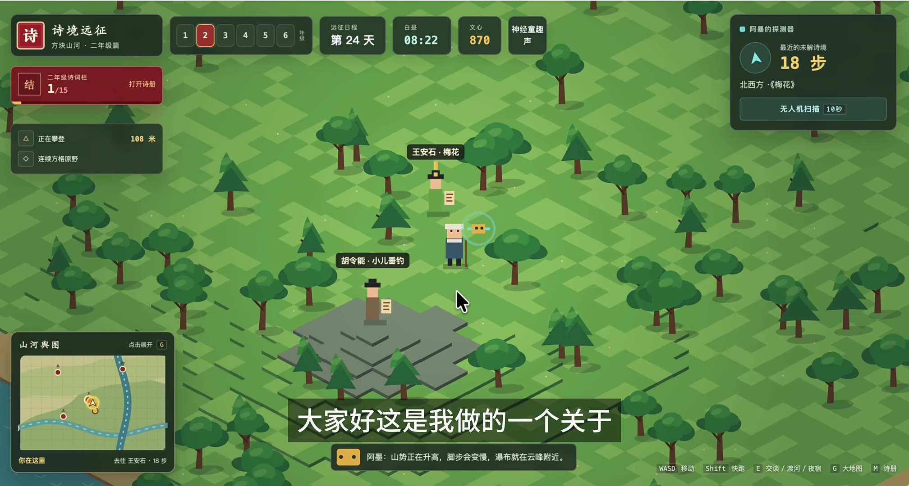

- 内容摘要：大家好，这是我做的一个关于失叫失禁远征的一个探索游戏（00:00-00:04）
- 画面文字（OCR）：2 | | D
诗境远征 EXER ag xb 神经童起 ® 阿显的探测器图方块山河 .二年级简 - 23 45 5B) maak || es:22 | 870 声 uals = 最近的未解诗境办入， 18 步二年级诗词栏 _ 1 wo"
[#] Loe 打开诗肌 | 北西方《梅花 )
RE Vy i pT Of 无人机扫描 19 秒和 | Fees 108 % a, 1 多
| | = y
| 连续方格原野 | | | (EP » < y_ ， w
y Sry no PY” 下局
-四 | | | » €
| 1” Ha © y 2
3 : ae 0 - “ >
N a : . ;
2 WN mene En | n 6
» b Sm WN 本 )
Ny ( Ce “~~ ) &
p EB
yr = JA. 1 |. 7 ed |， =
| wm 点击展开 [6 < ARE. - ]
人个和 1
| 大家好这是我做的一个关于 |
sai SUNY 大家好这是 JET
: 4 > 一一一 -一一一一一一 ov 你在这里 TD OB mE: 山势正在升高，肢步会变慢，混布就在云峰附近。 | |
Ek — 四一一到 = y WASD af Shift R38 E | 交谈/ 渡河 / 夜宿 6 KE M FH
< - ou AE

### 2. 00:16

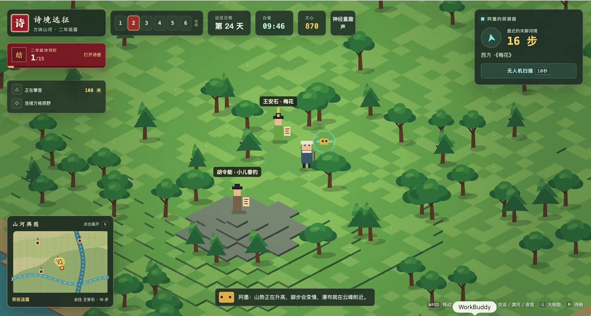

- 内容摘要：它是一个让我们在游戏里也能学到诗词，把诗词学好的一个探索游戏（00:05-00:11）
- 内容摘要：它用wasd控制上下左右（00:12-00:14）
- 画面文字（OCR）：EB 诗境远征司 :回回回回日 Fe 全 | 2 | 神经章直 | | Py r—
河 . 二 H 70 =
方块山河二年级篇用 A 声最近的未解诗境入，16 步二年级诗词栏 _ wd -
[和 | 15s TRE By ™ 西方《梅花 )
FN - fie > p< 无人机扫描 16 秒 fa ress 108 米 0 Pt i da 3
o | 连续方格原野 ] |B a EEE I
: p= ’) y._ X
a ed a 3 [| prs < ~ 司区 > a a]
' <= Ea a, ol
af a = +) i =<
~f A 人到一 y A ‘ <
4h a | L : [
<F crn 2 Tey = i
N S ) ’ . > a 3 > 2 y 4
) J. y - << o IS ie 可 )
网 y | N bf —_ 人 h | i
NY f 2 三 2 - > J
; = 3 RIE X
~ | | | a 站
| B 3 py A
| 山河与图点击展开 [6 SN a » ，A i 2 .
: 六 h Al :
O Wt < 2 psy ZR
> " xz
2 办 ss - [se 7 <n ”
3 | - AR < 和 ww 站 = :
3 2 | 证 NNN » AAA 家 N p 3 ” 9 ”
i 2 ANNAN AN ~~ \
你在这里 tr Tom 185 a OB) m=: usEens, wrame, BERERSKE. p> < 8
~ —_— oo” — >a g — Sy 本 okeuddy Jae G | 大地图 MSH

### 3. 00:17

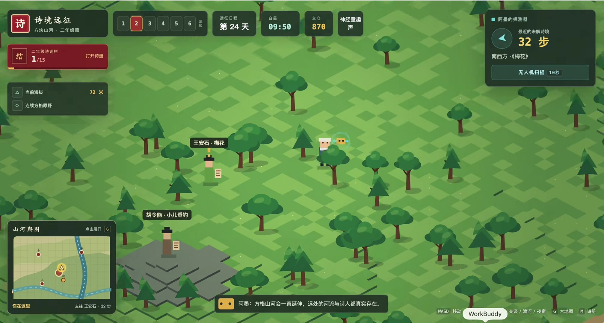

- 画面文字（OCR）：有 B= 要， - Fa Ba
(CES ERED EY EE =
= 级方块山河二年级篇 ) | 四第 24 天 09:50 870 = E i” 最近的未解诗境 md 32 步二年级诗词栏 = =
[#] Ts 打开诗册南西方《梅花》
a RD. 无人机扫描 16 落 i
入，当前海拔 72 米本 po a 4
oO 连续方格原野一一 mm 一人 = >
2 N
号 | 国 = 、
Ie wE 导 A op 3
A @ 年 < ® A 全
- 5 BP
F A p L
ll 山河与图点击展开 (6 ey 一 &
| 8 g ~
i Ss =
| : : | § Es, Pe HH Ra
| A \ N 7
| GO : NN ae ,一 = - —
: ; £& 1.1
| ; pA a “>
- 7 ¥ E 7 : 可会一远处的河流与并有 ve Jo— > 1 Tg OB) mm: meume—mEe, EARS EABAREE, so 153 QU 5 m5 sm nw
NTN Fo Lh x a

### 4. 00:18

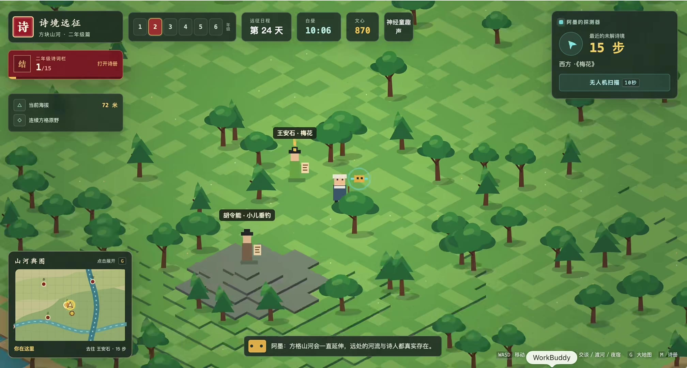

- 内容摘要：按shift就可以比原来速度跑得很快，按下面这上下左右也可以控制方向（00:14-00:21）
- 画面文字（OCR）：= > SVN ha 2
3 全 ED 2 区 -
A >> 1d =P > Sp A
CE TT Teed
aN 23 是 A po RS = « A > _ 一 ta > 己 arr a” TT rye
ee 一 A % er oo

### 5. 00:25

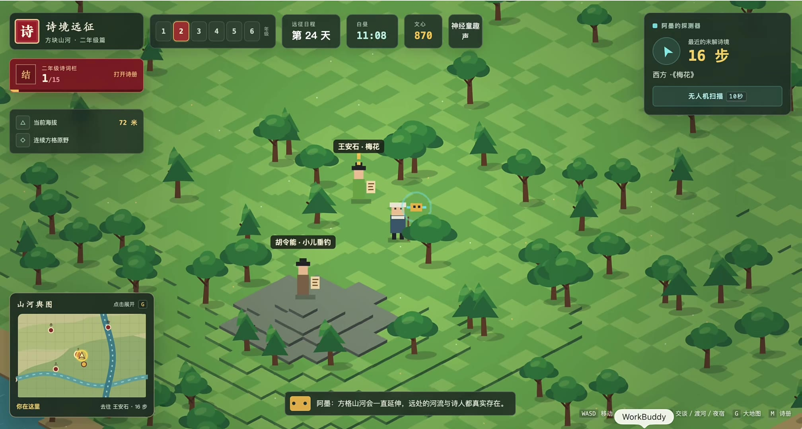

- 内容摘要：按大家的喜好来，它是一个可以和里面的诗人交谈的一个小游戏，假如我往前走（00:21-00:28）
- 画面文字（OCR）：BE FF BE SS aa _L vv rr ae ama we EE.
= Tl 2
诗境远征 8 Sloe lc FE Beil 让 [| zo Hwee Y » 网昌的探测器图方块山河，二年级篇 “由第 24 天 | SHS J ee EERE
_ > 16 步二 sam r ) 本加 Re ET . 西方《梅花》一 | 无人机扫描 100
和 | 当前海拔 72 米 9 : . - )
o | mEHHRE 1 oe EEE -» =
4 ) Loe B
1L°@d ou o N
: < 全 | | ili, > y
- Lo - - A > oy ) IE
| | i I"目 BD . pe | | | j i
) : : NE J 3 ar = LE p ] {
~ \ ul | “I {
= TEED) z— aaa > \ 2
S a oT on “oul
4 Lr — 本 K - 2 \
p | w_ <a Sa ‘ |
) 0 人 =] a . i _a ;
_— oc Tndl | a _ = ge
| wmmm 点击展开 |G > \ : J
: pe NSN nat N sr = EN > 本
0 “ 1 ) op
SS 一轩 |
< >
Q | NN 3 AAT ~~
| NEN “4D A NS 3 No
; LEE, a - ]
peo] IY FB: 方格山河会一直延伸，远处的河流与诗人都真实存在 \
: ) E : 会河流与。全 -上 HEIRE OF ~ Ee mali == J [ws oreuddy 用全 GAME MH
B -所 _ >” 和 ed

### 6. 00:27

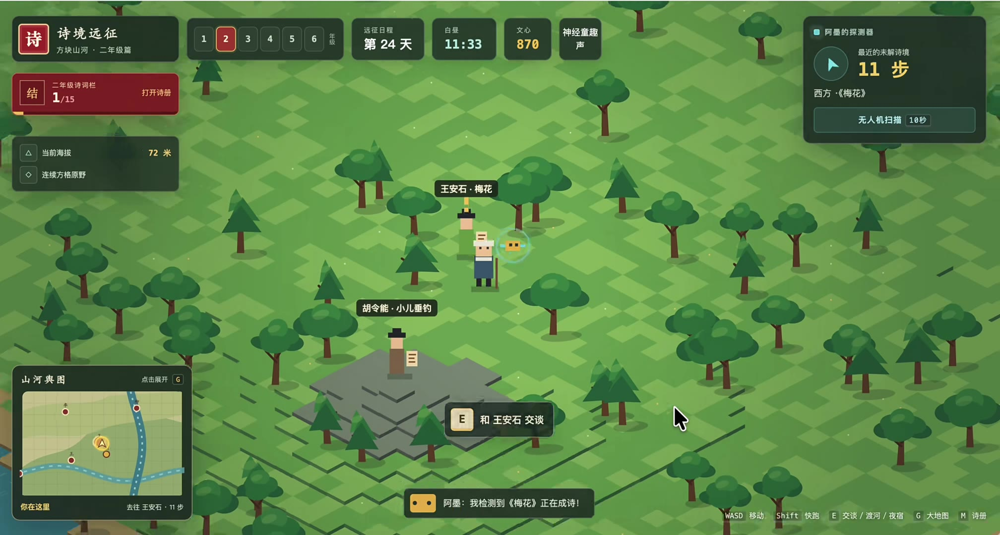

- 画面文字（OCR）：— || amas ae 26 神经章趣 | ® 阿到的探测器图 ied .二年级简 ! 8 SEC) E 四第 24 天 11:33 870 声最近的未解诗境站 P11 步二年级诗词栏全全
[#] iis 打开诗册本人西方《梅花》
pp CS a a 无人机扫描 16 秒
| 和 | 当前海拔 72 米 of -
[oo mmsnRE 全 q PY A g
A
«C 2 1d 全 J
和 TH Te
SN Cops 1 >
RP NE >
4 9 全 Co pa <
o pe ry ps f
= < Y. > YN 目 | >
ol FT RE 点击展开 [5] [8 ~~ 过 LA i
g \ ~ NS EN No _— oz 2
% ¥ >® NN aM: EEF) | I
| NS 机 a ) M a
4 Sl |< SS
wee FU Se = 国 ==: sews vem Eww 和下 To WE ? 本 y Sg” “> iene v

### 7. 00:34

- 内容摘要：在王安石写的梅，在王安石正在写梅花的旁边字（00:28-00:33）
- 内容摘要：和王安石交谈按e（00:34-00:35）
- 画面文字（OCR）：诗境远征 8 5 [J BEAR as x 神经童趣 | ae EET 图方块山河 .二年级篇 SEJEIE] & 第 24 天 | 12:17 870 | = [2
河 … 二 ; | 最近的未解诗境二年级诗词栏 7
[#] Nis 打开诗有册附近方《梅花》
E J 无人机扫描 108
|
和 A 当前海拔 72 米站 . . hy 1
© ESSERE
11 所全王安石. 梅花
1 和 _ 可 od Ng WF :
’ \ a ) F
rs NE 1
< | 胡令能 LER TD 站
~ > a 1 » »
) LL |
) 本 y
一一一全一 » Sw >
山河与图点击展开 |G Ny i = : :
0 \o :
i : ES]: nzzsxx 必二
0 > 1 \ . 2
<= |
IE 有 . ry PU. a] R
| J | 和王安石交谈按 e
你在这里 JUN i I OF ==: 我检测到《梅花 ) 正在成诗 ! “~
= 二 Am a ~~ WASD $a Shift) 快跑 E ,交谈内渡河 / 夜宿 G6 AE MSH
~~ . Pris es 了 <

### 8. 00:37

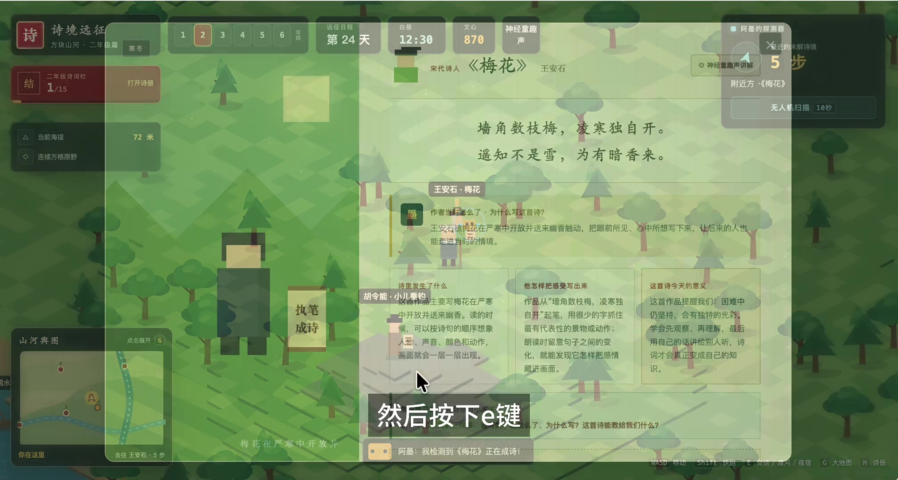

- 内容摘要：然后按下e键，然后就可以看他写的诗了，他会告诉我们诗里发生了什么（00:35-00:41）
- 内容摘要：怎么把感受写出来（00:42-00:43）
- 画面文字（OCR）：Ere — Tene 远征日
i) o
x% oe a 近宋代诗人《梅花》王安石 © MARBMIIN 墙角数枝梅，凑寄独自开。过知不是雪，为有瞳香来。到 | p- . AR ~~ j | 8: 我检测到《梅化》正在成诗 ! | -4 ，

### 9. 00:50

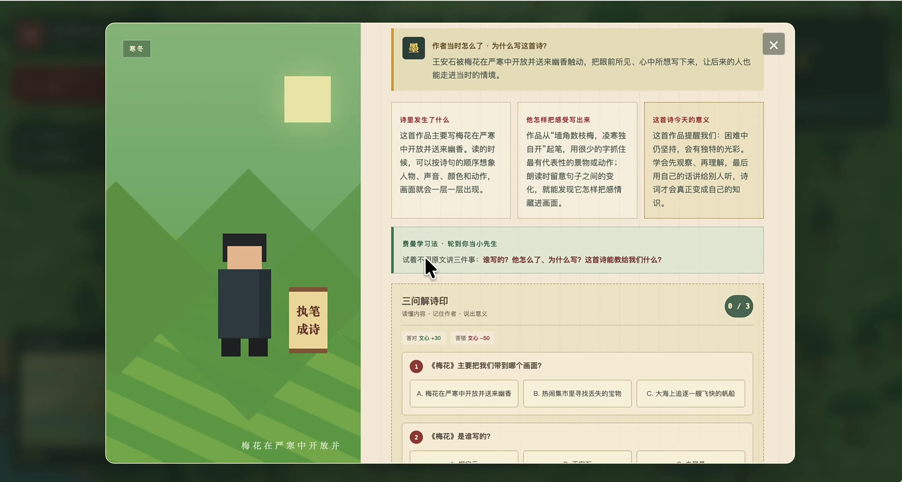

- 内容摘要：这首诗今天的意意思它在里面会讲（00:43-00:46）
- 内容摘要：为什么会讲这些诗，下面它还会引导我们说要用费曼学习法学习（00:46-00:52）
- 画面文字（OCR）：xe | (= | 作者当时怎么了。为什么写这首诗 ? X
— 王安石被梅花在严寒中开放并送来幽香触动，把眼前所见、心中所想写下来，让后来的人也能走进当时的情境。诗里发生了什么他怎样把感受写出来这首诗今天的意义这首作品主要写梅花在严寒 TERM ERIS, RTH 这首作品提醒我们 : 困难中中开放并送来幽香。读的时 BARE, BRONTE 仍坚持，会有独特的光彩。候，可以按诗句的顺序想象最有代表性的景物或动作 ; 学会先观察、再理解，最后人物、声音、颜色和动作，朗读时留意句子之间的变用自己的话讲给别人听，诗画面就会一层一层出现。化，就能发现它怎样把感情词才会真正变成自己的知

| 藏进画面。识。

| | BB¥SE - REMYNEE 试着不虽原文讲三件事 :; 谁写的 ? 他怎么了、为什么写 ? 这首诗能教给我们什么 ?

| 从 ee
| 三问解诗印 D
成诗答对文心 +30 Hill XO -50
| EE
(1) 《梅花》主要把我们带到哪个画面 ?
A. 梅花在严寒中开放并送来幽香 B. 热闹集市里寻找丢失的宝物 C. 大海上追逐一舰飞快的帆船
© sm mes

### 10. 00:58

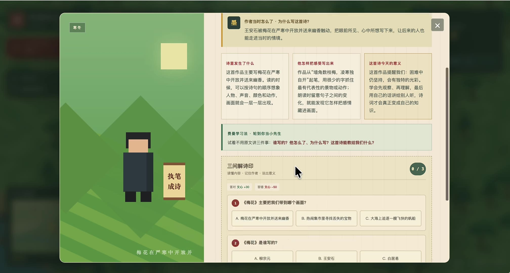

- 内容摘要：轮到你当小先生了，你就可以找周围的同学ai把你今天学到的讲给别人听（00:52-00:58）
- 内容摘要：然后后面这就是一个答题（00:58-01:00）
- 画面文字（OCR）：= (= | 作者当时怎么了为什么写这首诗 ?
= IREHASHAEF RAFF HERE, BRAD, ORFAASTR, ILEROAL 。国人能走进当时的情境。诗里发生了什么他怎样把感受写出来这首诗今天的意义这首作品主要写梅花在严寒作品从 “墙角数枝梅，凌寒独这首作品提醒我们 : 困难中中开放并送来幽香。恋的时 BARE, BRONTE 仍坚持，会有独特的光彩。候，可以按诗句的顺序想象最有代表性的景物或动作 ; 学会先观察、再理解，最后人物、声音、颜色和动作，朗读时留意句子之间的变用自己的话讲给别人听，诗画面就会一层一层出现。化，就能发现它怎样把感情词才会真正变成自己的知藏进画面。识。
| BBYIE - REUMYUNEE
| | | 试着不用原文讲三件事 : 谁写的 ? 他怎么了、为什么写 ? 这首诗能教给我人什么?
|
| 三问解诗印 o / 3)
a mann cane ums | 区
| 成诗答对文 +30 FE KO-50
| =
© sn rEERNEIS EE
A 梅花在严寒中开放并送来幽香 B. 热闹集市里寻找丢失的宝物 C. 大海上追逐一般飞快的帆船
© usw mise
A 柳宗元 B. 王安石 C. 白居易

### 11. 01:03

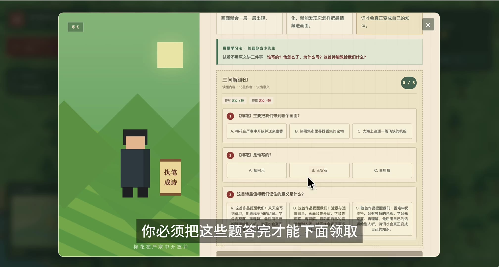

- 内容摘要：你必须把这些题答完才能下面领取，如果你没有答完是不能领取这个失印的（01:00-01:06）
- 画面文字（OCR）：画面就会一层一层出现。化，就能发现它怎样把感情词才会真正变成自己的知 WHEE, 识。 | X
费曼学习法轮到你当小先生试着不用原文讲三件事 : 谁写的 ? 他怎么了、为什么写 ? 这首诗能教给我们什么 ?
三问解诗印 D
SHAE - 记住作者，说出意义答对文心 +30 Fill 文心 -50
© 《笠花 ) 主要把我们带到哪个画面 ?
[= A BREFRGFREREE | | BARNHEIRNEANTH C. 大海上追逐一般飞快的帆船
© usm mes
EPE
| 执笔 A 柳宗元 B. 王安石 C. 白居易
| — © 这首诗最值得我们记住的意义是什么 ?
A 这首作品探醒我们 ;从天空写 B. 这首作品提醒我们 : 近景与远 C. 这首作品提醒我们 : 困难中仍到草地，能表现空间的辽阔。学 | | 景组合，画面会更开疗。学会先 | | 坚持，会有独特的光彩。学会先 bhi mic E41 RE ASR E a iS hs BIE, BEECHES
HESHRAR, BEd SN; PGRIALE. ARTS Fs 出办别人听，诗词才会真正变成你必须把这些题答完才能下面领取医于 WO ITECIRR=ET IT Be MHEHIVIEX

### 12. 01:07

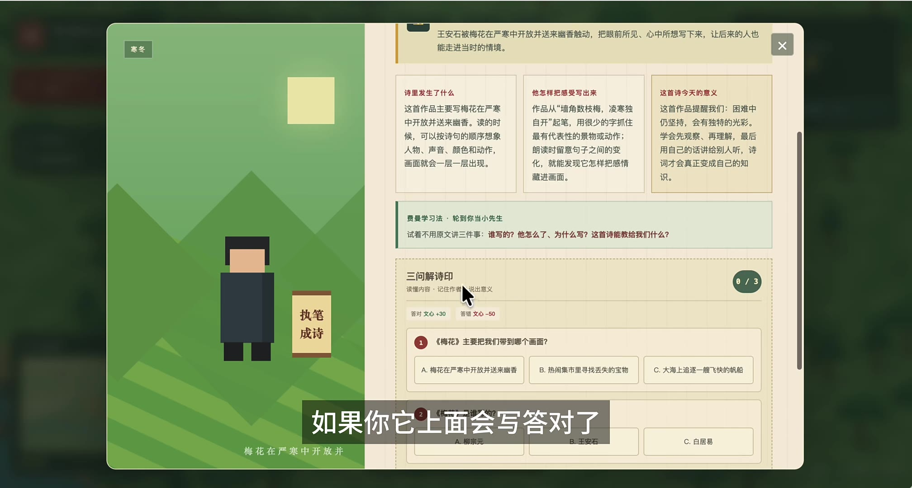

- 内容摘要：如果它上面会写答对了文心就会加三十（01:07-01:10）
- 画面文字（OCR）：王安石被梅花在严寒中开放并送来幽香触动，把眼前所见、心中所想写下来，让后来的人也
| =x 能走进当时的情境。 X
诗里发生了什么他怎样把感受写出来这首诗今天的意义这首作品主要写梅花在严寒作品从 “墙角数枝梅，凌寒独这首作品提醒我们 : 困难中中开放并送来幽香。读的时自开"起笔，用很少的字抓住仍坚持，会有独特的光彩。候，可以按诗句的顺序想象最有代表性的景物或动作 ; 学会先观察、再理解，最后人物、声音、颜色和动作，朗读时留意句子之间的变用自己的话讲给别人听，诗画面就会一层一层出现。化，就能发现它怎样把感情词才会真正变成自己的知藏进画面。识。

| BB¥SE - REMYNEE

| 试着不用原文讲三件事 : 谁写的 ? 他怎么了、为什么写 ? 这首诗能教给我们什么 ?
三问解诗印 D
SAE TR

| 执笔答对文心 430 Ell 文心 -50

| 成诗 ( 《梅花》主要把我们带到哪个画面 ?

| —

| A. 梅花在严寒中开放并送来幽香 B. 热闹集市里寻找丢失的宝物 C. 大海上追逐一舰飞快的帆船 Lp] AN 2
小巴 Po A=
元 B. 王安石 C. 白居易

### 13. 01:15

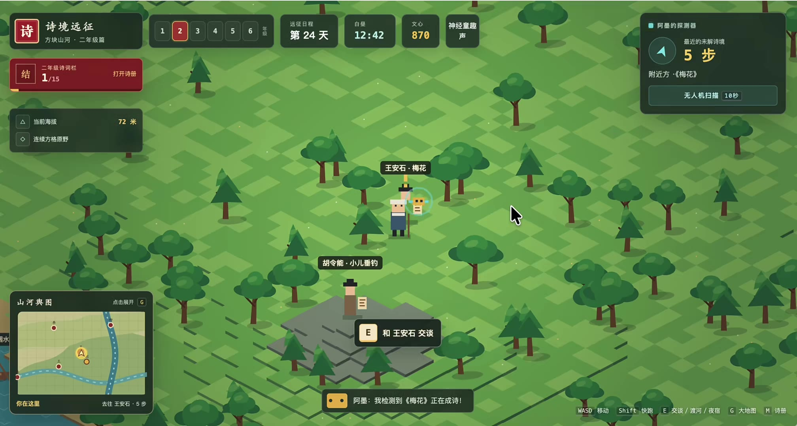

- 内容摘要：答错了文心就会减五十，答完题就可以去把这个领取了（01:10-01:15）
- 画面文字（OCR）：-
诗境远征引人向 | 同局 js EE Er En 神经童趣人 » 网显的探测器图方块山河 .二年级篇 8) “上内第 24 天 12:42 870 声 - BERRI \
- g 45%
二年级诗词栏
[#] 1/15 TE A 附近方《梅花》上一无人机扫描 16 区入 | 当前海拔 72 米一
@，连续方格原野 py
3 4 ~ A A -
> A :
a Se ] 2 os 个 | A
- . n = [3 -
A
h 参 9 > pe
b he A
- 3 > 3 za 4
山河与图点击展开 | G ~ NN 目 >
四 0 E S 4 =
ES OS an 四 nzzsxx oc -要水 | \ Ta
A > > \ Va bi = <
SP 全 Bl Semen As 国 m=: men ose Ew ~~ Jd 一 ge AsD 移动 ”Shiftyj 快跑 E ,交谈大渡河 / BE GAME MEH

### 14. 01:17

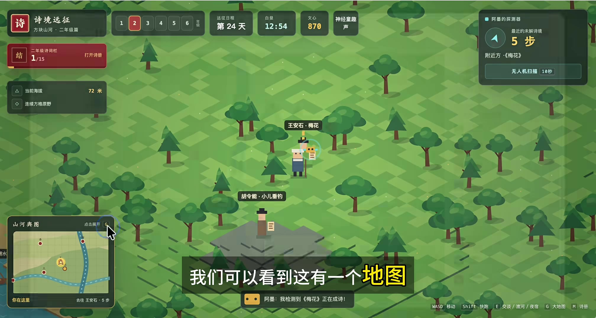

- 内容摘要：我们可以看到这有一个地图（01:15-01:18）
- 画面文字（OCR）：T EE
= &@s &
[#] ae 打开 ip er)
SF f YX | RANG 100 i
A 当前海拔 72 米
| | mmrmme 华 ;
a pe 有 Eo 人
| 2 a. ® LH 全且 SS 3 i a
NE. A h
j . Y. rE <, 2
SN mer LES 3 <
rs » ol =
>< 二 2 55 J 1 pr
LRA 点击展开区 Ng ~ 1 EB B 1
0 5 ~ <I ~ ™
= : \ | % SS BN SN a a - 1 &
N 3 lo} B a EN 6
I= 我们可以看到这有一个地图区过 > |
你在这里 x TRE 50 一 Al a | OB) m=: zen Gs) 正在成诗 ! ps AR of 2 fe. SE
1 -一一一 ce —— 25s sw) mam om nm

### 15. 01:20

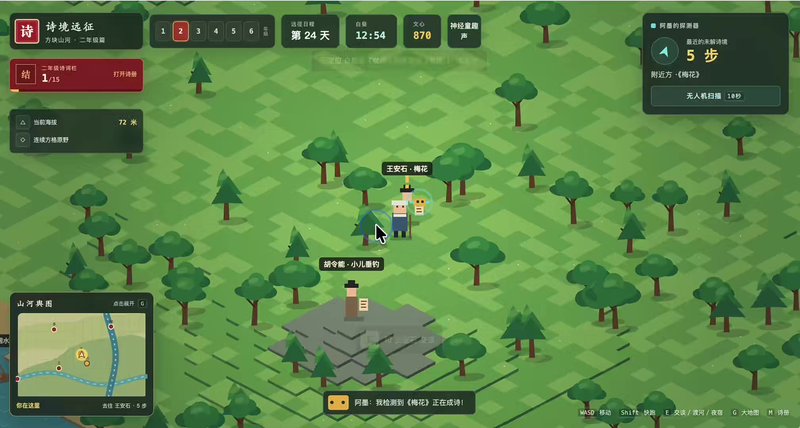

- 内容摘要：这里面会有这些位置，这个地图里可以看见你在哪这个地方洲（01:18-01:23）
- 画面文字（OCR）：所 did” WB dd LJ a =
诗境远征区远征日程 223 文心 8 阿到的探测器图方块山河，二年级篇回 ES | 二第 24 天 12:54 870 ¥ 最近的未解诗境 Ne A 45 步 J
| SERRE Th v 附近方《梅花》结 | 1s
TT 无人机扫描 108
人入” 当前海拔 72 米
C 连续方格原野
= @« < :
| 2 A :
A ws i 1.6 | +e 本
“y Ns 3
» \ 3 一
B, \ :
rn «Qe :
= t "on Foy 1 \ (办
| 山河民力 ARF (oN ~ 上
s ER ~ 了元
= ， | 2 2 局 «
ro pr Sg < <2 oy > z
2° f Ro. - 一 Se ae BB ==: Ri 和 vem Eww: mn 有 ) el BRET TD A ® shift 4 交谈 7 渡河 / 夜宿大地图 5

### 16. 01:24

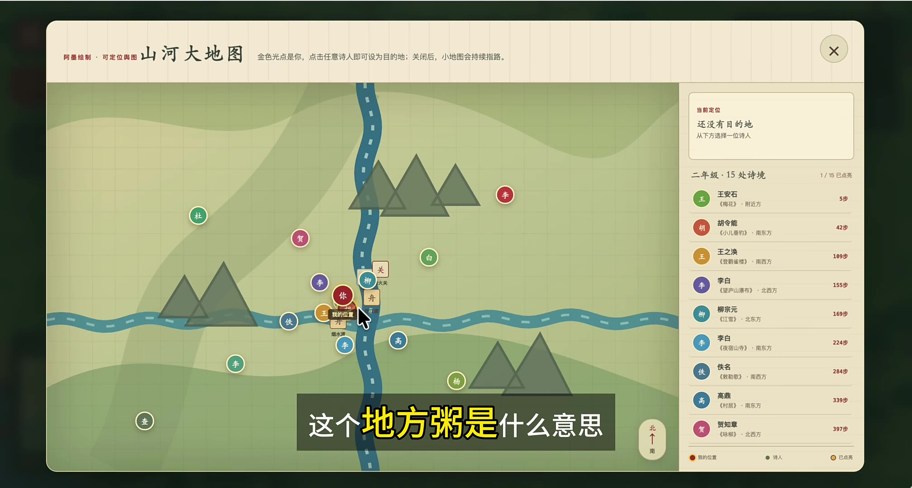

- 内容摘要：是什么意思？我来给你们演示一下（01:24-01:26）
- 画面文字（OCR）：mauy - mzonm ly 77] 大地图 sexsen scamsimmanans: x05, Mums sss xX
| j
FY 当前定位还没有目的地了二年级 . 15 处诗境
i» WA 全 © e=.. 2
(3) [
二 [1 四胡令能
”人 o © =. 了
| 关 va 2
PA
= EN IO =: | © x 0% cas
of Iz = Lu
1 = A / \ x ;
2 \ 人人 \ (+) Be 2049
Ll w) /\ 2
| ， = - on" =
© 、三 =
© 这个。 - J MA 什么意思 © Tn 397%
» 南 Ww ren . 6
下 «WV TR SN SUNT FR GRU GU MTR |

### 17. 01:27

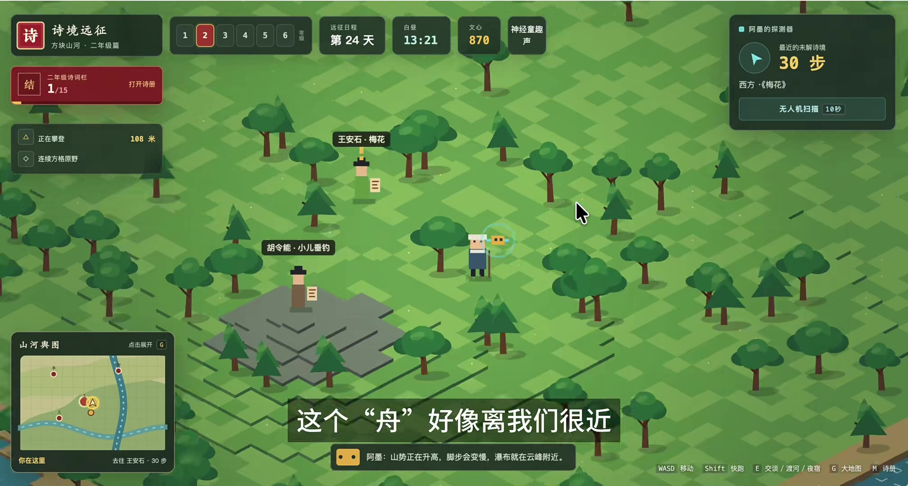

- 该时间点暂无可提取文字。

### 18. 01:28

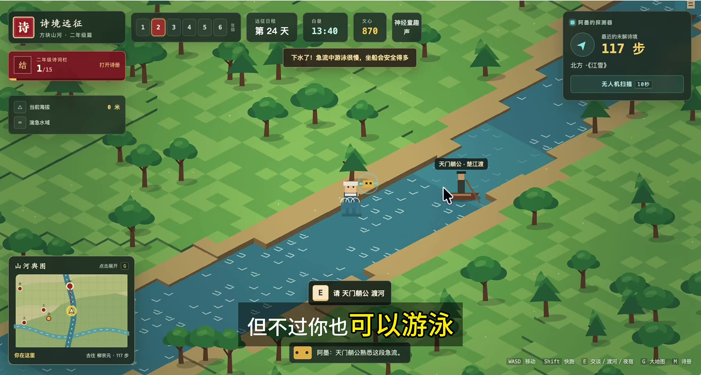

- 内容摘要：看一下洲，好像这个洲好像离我们很近，但不过你也可以游泳，你们想问这个是什么？（01:26-01:32）

### 19. 01:41

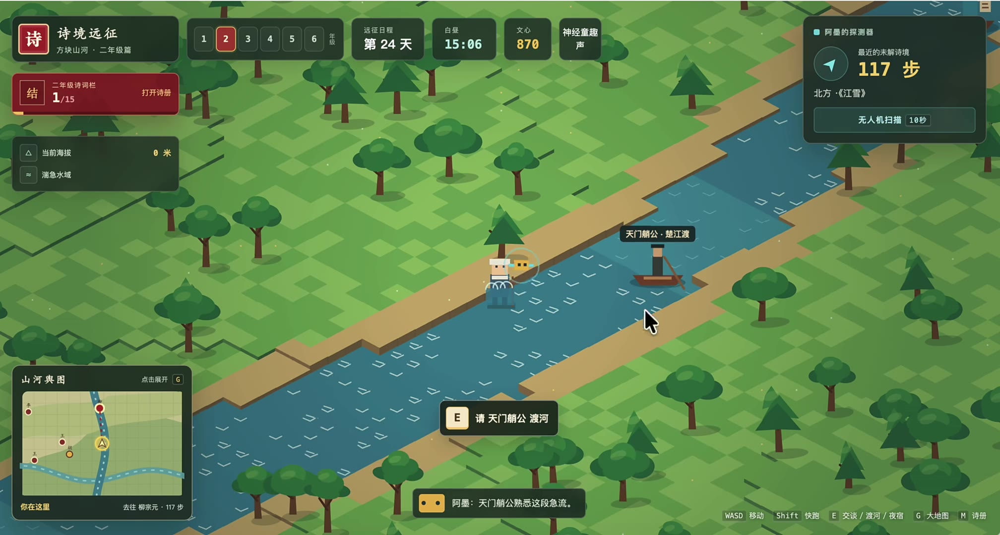

- 内容摘要：这个是我们的无人机助手阿莫，你看我们在水里，他跟我们说这段水流非常的急促湍急（01:32-01:40）

### 20. 01:42

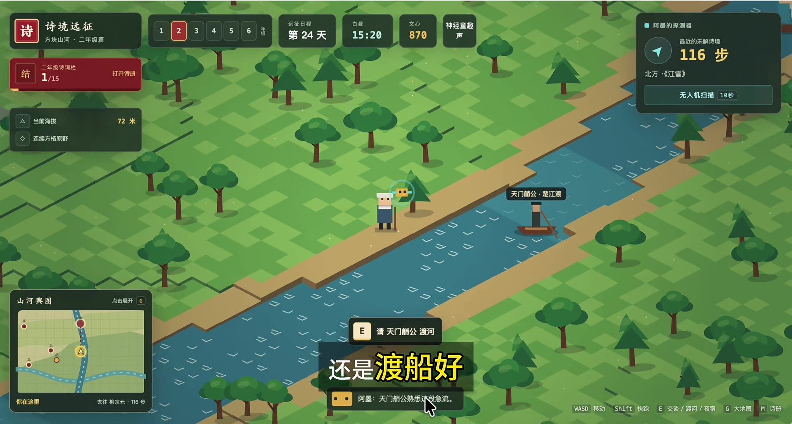

- 内容摘要：他的意思是我们有点危险，还是渡船好，这下面还会有一行熟悉的小字，但不过（01:41-01:46）

### 21. 01:52

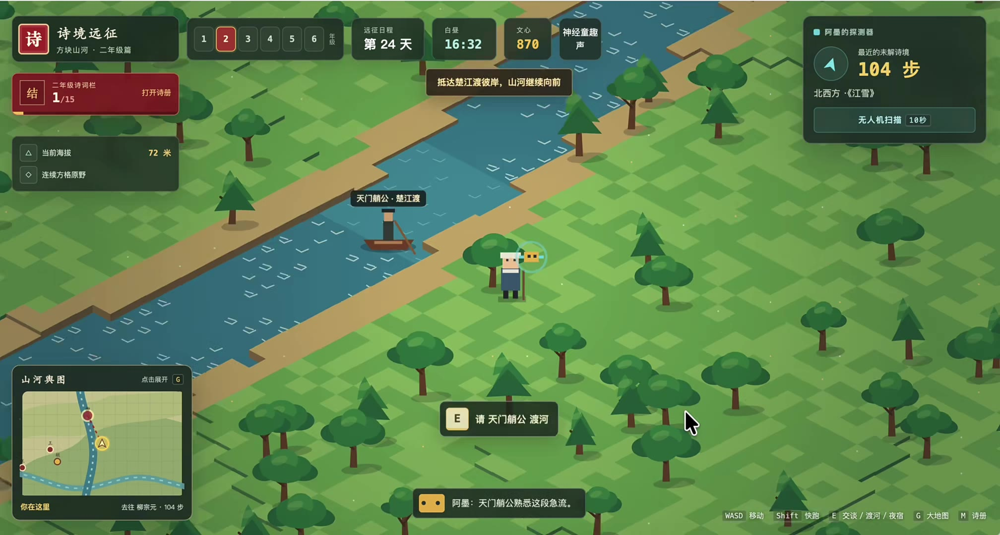

- 内容摘要：他这写成了请这个渔夫来渡，让我们过河，按e就可以渡河过去了（01:46-01:53）

### 22. 01:57

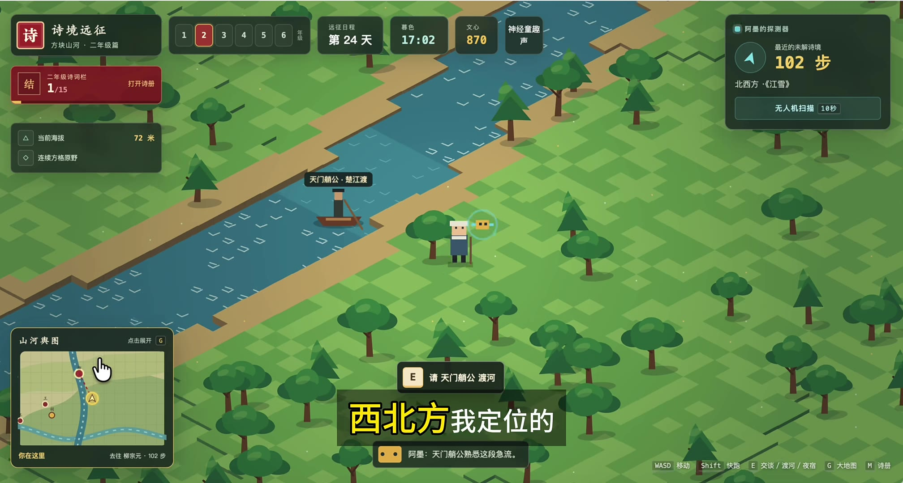

- 内容摘要：我们可以看见这个是西西北方我定位的（01:53-01:57）
- 内容摘要：我们过去看看（01:58-01:59）
- 内容摘要：他是谁？柳宗元正在写江雪（02:00-02:01）
- 内容摘要：Ok我们可以和他交谈一样的rotating是太简单了（02:01-02:05）

### 23. 02:14

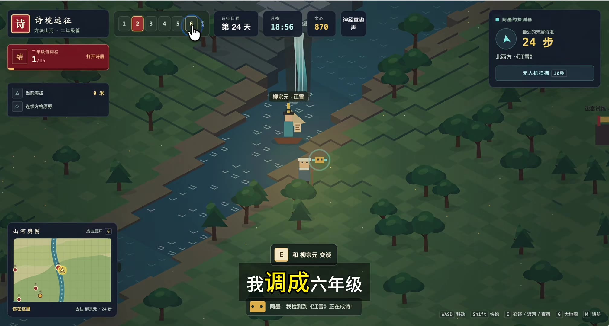

- 内容摘要：我都那么高年级了，学这个干啥？（02:05-02:08）
- 内容摘要：不要紧，在小学六年级以内总有你学的内容上面会有一二三四五六年级（02:08-02:13）
- 内容摘要：我调成六年级，这些诗人就会改变，我调成三年级（02:13-02:17）
- 内容摘要：地图不变，诗人的位置更新了，如果你觉得这个夜晚看起来有点黑，你可以按（02:18-02:23）

### 24. 02:31

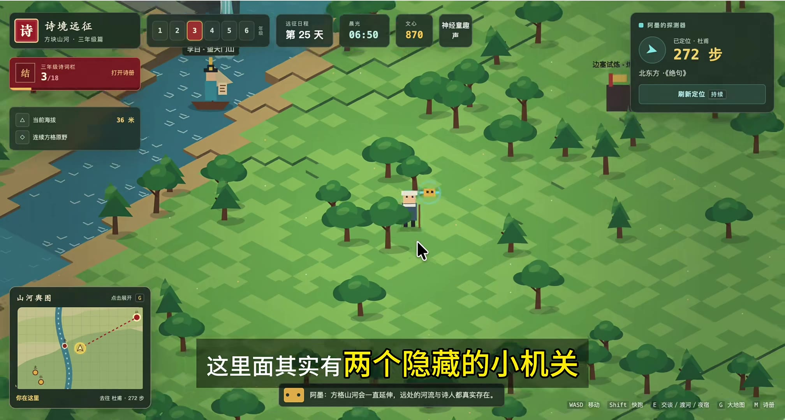

- 内容摘要：E这会有一行字，D休息到清晨，而且e它就又到了白天又可以和其他人交谈了（02:23-02:30）
- 内容摘要：这里面其实有两个隐藏的小机关（02:30-02:33）
- 内容摘要：这个是风火关，里面可以打打这个怪物，点五下就好了（02:33-02:37）
- 内容摘要：你这样你就可以获得一个木剑（02:37-02:39）

### 25. 02:48

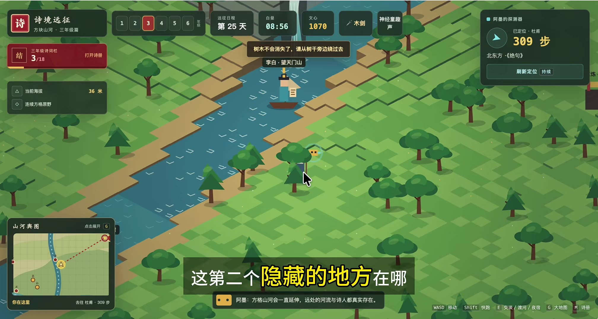

- 内容摘要：当你走到树旁边你看走不动了，那是因为你被树挡住了，绕开路走，这还有一个隐藏的（02:39-02:46）
- 内容摘要：这第二个隐藏地方在哪儿？（02:46-02:48）
- 内容摘要：你们知不知道叶绍翁写的夜书所见，你们知不知道他写这首诗的时候是在黑夜（02:48-02:55）

### 26. 03:05

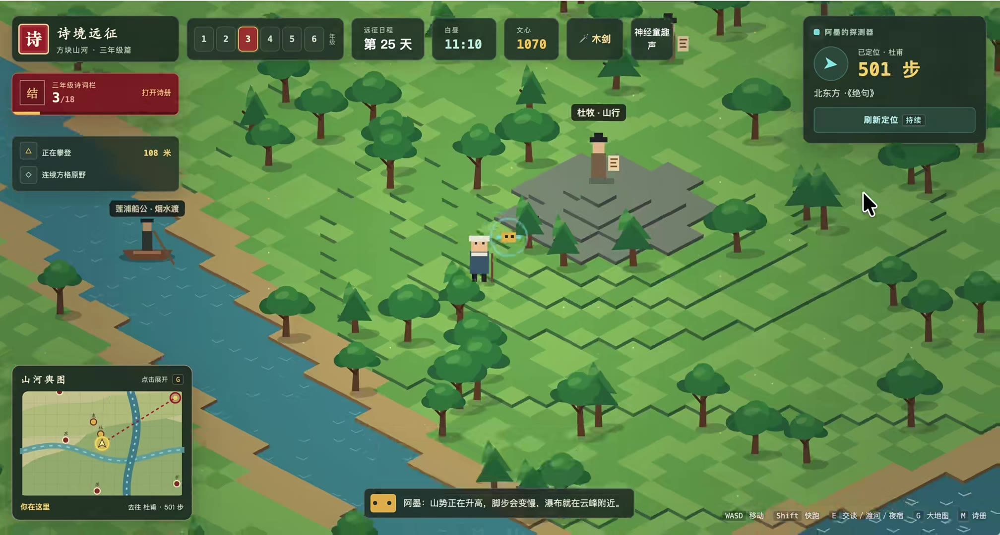

- 内容摘要：所以如果你白天走到那个地方（02:55-02:57）
- 内容摘要：你是看不到叶绍翁的，我们看一下叶绍翁的位置好像在这儿（02:57-03:01）
- 内容摘要：我们看可以去找一下叶绍翁（03:02-03:04）
- 内容摘要：看一下是不是这样（03:04-03:05）
- 内容摘要：按下shift是不是奔跑（03:05-03:07）
- 内容摘要：看上面这个小地图上面显示了个叶子，那这个上面叶子叶绍翁叶如所见（03:07-03:11）
- 内容摘要：我们过去见证一下，Ok（03:11-03:13）

### 27. 03:21

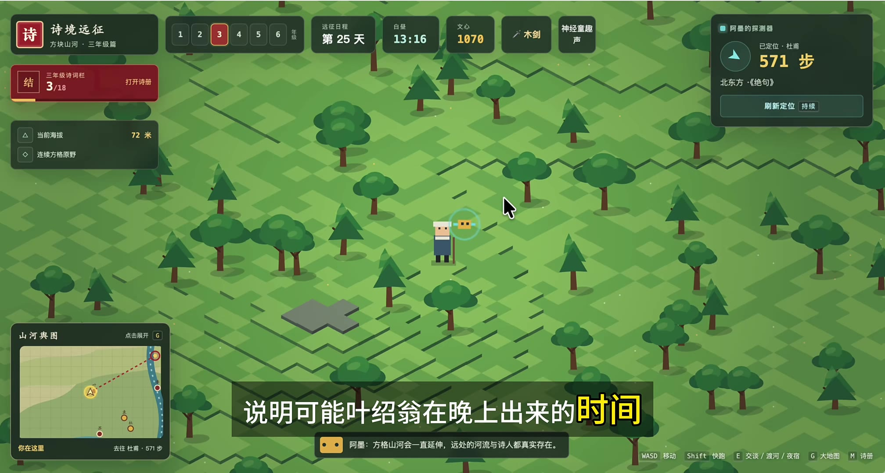

- 内容摘要：我们在这可以等一下（03:13-03:14）
- 内容摘要：它是显示它这个小地图显示我们已经覆盖在叶绍翁手上面的位置了（03:14-03:19）
- 内容摘要：说明可能叶绍翁在晚上出来的时间，我们就可以找到啥，Ok大家可以看到现在天黑了（03:19-03:25）
- 内容摘要：叶绍翁就在这儿了（03:25-03:27）
- 内容摘要：这也是我给大家设计的一个隐藏小机关（03:27-03:30）

### 28. 03:38

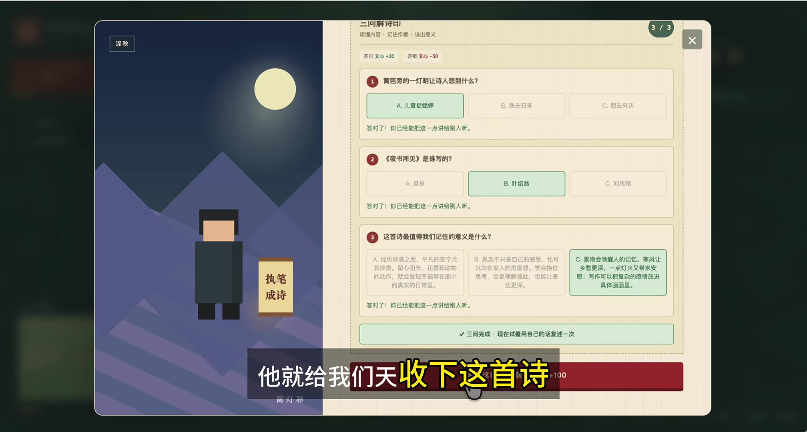

- 内容摘要：我们可以过去就可以和叶绍翁交谈（03:31-03:33）
- 内容摘要：又是熟悉的我们，然后我们先答题，你看三个问题都答对了（03:33-03:37）
- 内容摘要：它就给我们填收下这首诗获得诗意（03:37-03:40）
- 内容摘要：这样那我们就收下了（03:40-03:41）
- 内容摘要：你就可以发现我们刚是三年级解锁了三首诗就变成了四首诗了，Ok我们现在（03:41-03:46）

### 29. 03:55

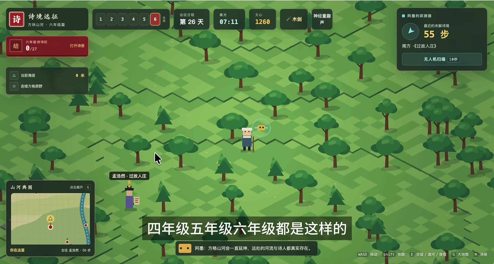

- 内容摘要：可以睡会儿觉，你看白天他就不在了，因为他是晚上写的诗，就不能白天和他一起（03:46-03:51）
- 内容摘要：以此类推，四年级五年级六年级都是这样的，都会在这些荒郊野岭啊，船上啊，看到人（03:52-03:58）
- 内容摘要：现在我们就可以看一下它的画质，我采用了我的世界的画质来给它安上的（03:58-04:06）

### 30. 04:12

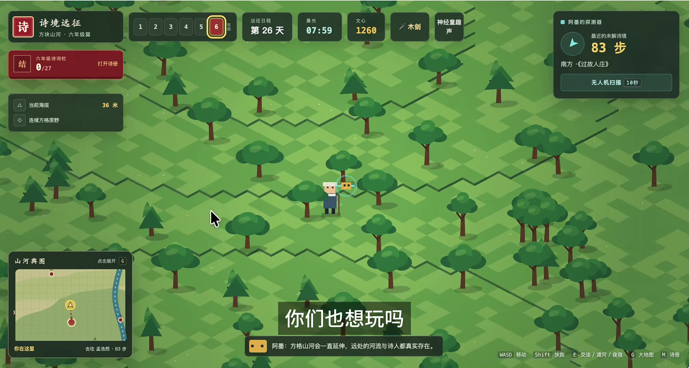

- 内容摘要：我觉得这样的话只会让大家更喜欢这个游戏（04:06-04:10）
- 内容摘要：你们也想玩吗？（04:10-04:12）

## 视频画面文字 (OCR)

> OCR 仅供参考，可能包含识别错误；请以视频画面和转写来源为准。

### 关键帧 1 · 0.5s

2 | | D
诗境远征 EXER ag xb 神经童起 ® 阿显的探测器图方块山河 .二年级简 - 23 45 5B) maak || es:22 | 870 声 uals = 最近的未解诗境办入， 18 步二年级诗词栏 _ 1 wo"
[#] Loe 打开诗肌 | 北西方《梅花 )
RE Vy i pT Of 无人机扫描 19 秒和 | Fees 108 % a, 1 多
| | = y
| 连续方格原野 | | | (EP » < y_ ， w
y Sry no PY” 下局
-四 | | | » €
| 1” Ha © y 2
3 : ae 0 - “ >
N a : . ;
2 WN mene En | n 6
» b Sm WN 本 )
Ny ( Ce “~~ ) &
p EB
yr = JA. 1 |. 7 ed |， =
| wm 点击展开 [6 < ARE. - ]
人个和 1
| 大家好这是我做的一个关于 |
sai SUNY 大家好这是 JET
: 4 > 一一一 -一一一一一一 ov 你在这里 TD OB mE: 山势正在升高，肢步会变慢，混布就在云峰附近。 | |
Ek — 四一一到 = y WASD af Shift R38 E | 交谈/ 渡河 / 夜宿 6 KE M FH
< - ou AE

### 关键帧 2 · 16.37s

EB 诗境远征司 :回回回回日 Fe 全 | 2 | 神经章直 | | Py r—
河 . 二 H 70 =
方块山河二年级篇用 A 声最近的未解诗境入，16 步二年级诗词栏 _ wd -
[和 | 15s TRE By ™ 西方《梅花 )
FN - fie > p< 无人机扫描 16 秒 fa ress 108 米 0 Pt i da 3
o | 连续方格原野 ] |B a EEE I
: p= ’) y._ X
a ed a 3 [| prs < ~ 司区 > a a]
' <= Ea a, ol
af a = +) i =<
~f A 人到一 y A ‘ <
4h a | L : [
<F crn 2 Tey = i
N S ) ’ . > a 3 > 2 y 4
) J. y - << o IS ie 可 )
网 y | N bf —_ 人 h | i
NY f 2 三 2 - > J
; = 3 RIE X
~ | | | a 站
| B 3 py A
| 山河与图点击展开 [6 SN a » ，A i 2 .
: 六 h Al :
O Wt < 2 psy ZR
> " xz
2 办 ss - [se 7 <n ”
3 | - AR < 和 ww 站 = :
3 2 | 证 NNN » AAA 家 N p 3 ” 9 ”
i 2 ANNAN AN ~~ \
你在这里 tr Tom 185 a OB) m=: usEens, wrame, BERERSKE. p> < 8
~ —_— oo” — >a g — Sy 本 okeuddy Jae G | 大地图 MSH

### 关键帧 3 · 17.28s

有 B= 要， - Fa Ba
(CES ERED EY EE =
= 级方块山河二年级篇 ) | 四第 24 天 09:50 870 = E i” 最近的未解诗境 md 32 步二年级诗词栏 = =
[#] Ts 打开诗册南西方《梅花》
a RD. 无人机扫描 16 落 i
入，当前海拔 72 米本 po a 4
oO 连续方格原野一一 mm 一人 = >
2 N
号 | 国 = 、
Ie wE 导 A op 3
A @ 年 < ® A 全
- 5 BP
F A p L
ll 山河与图点击展开 (6 ey 一 &
| 8 g ~
i Ss =
| : : | § Es, Pe HH Ra
| A \ N 7
| GO : NN ae ,一 = - —
: ; £& 1.1
| ; pA a “>
- 7 ¥ E 7 : 可会一远处的河流与并有 ve Jo— > 1 Tg OB) mm: meume—mEe, EARS EABAREE, so 153 QU 5 m5 sm nw
NTN Fo Lh x a

### 关键帧 4 · 18.5s

= > SVN ha 2
3 全 ED 2 区 -
A >> 1d =P > Sp A
CE TT Teed
aN 23 是 A po RS = « A > _ 一 ta > 己 arr a” TT rye
ee 一 A % er oo

### 关键帧 5 · 25.03s

BE FF BE SS aa _L vv rr ae ama we EE.
= Tl 2
诗境远征 8 Sloe lc FE Beil 让 [| zo Hwee Y » 网昌的探测器图方块山河，二年级篇 “由第 24 天 | SHS J ee EERE
_ > 16 步二 sam r ) 本加 Re ET . 西方《梅花》一 | 无人机扫描 100
和 | 当前海拔 72 米 9 : . - )
o | mEHHRE 1 oe EEE -» =
4 ) Loe B
1L°@d ou o N
: < 全 | | ili, > y
- Lo - - A > oy ) IE
| | i I"目 BD . pe | | | j i
) : : NE J 3 ar = LE p ] {
~ \ ul | “I {
= TEED) z— aaa > \ 2
S a oT on “oul
4 Lr — 本 K - 2 \
p | w_ <a Sa ‘ |
) 0 人 =] a . i _a ;
_— oc Tndl | a _ = ge
| wmmm 点击展开 |G > \ : J
: pe NSN nat N sr = EN > 本
0 “ 1 ) op
SS 一轩 |
< >
Q | NN 3 AAT ~~
| NEN “4D A NS 3 No
; LEE, a - ]
peo] IY FB: 方格山河会一直延伸，远处的河流与诗人都真实存在 \
: ) E : 会河流与。全 -上 HEIRE OF ~ Ee mali == J [ws oreuddy 用全 GAME MH
B -所 _ >” 和 ed

### 关键帧 6 · 27.2s

— || amas ae 26 神经章趣 | ® 阿到的探测器图 ied .二年级简 ! 8 SEC) E 四第 24 天 11:33 870 声最近的未解诗境站 P11 步二年级诗词栏全全
[#] iis 打开诗册本人西方《梅花》
pp CS a a 无人机扫描 16 秒
| 和 | 当前海拔 72 米 of -
[oo mmsnRE 全 q PY A g
A
«C 2 1d 全 J
和 TH Te
SN Cops 1 >
RP NE >
4 9 全 Co pa <
o pe ry ps f
= < Y. > YN 目 | >
ol FT RE 点击展开 [5] [8 ~~ 过 LA i
g \ ~ NS EN No _— oz 2
% ¥ >® NN aM: EEF) | I
| NS 机 a ) M a
4 Sl |< SS
wee FU Se = 国 ==: sews vem Eww 和下 To WE ? 本 y Sg” “> iene v

### 关键帧 7 · 34.05s

诗境远征 8 5 [J BEAR as x 神经童趣 | ae EET 图方块山河 .二年级篇 SEJEIE] & 第 24 天 | 12:17 870 | = [2
河 … 二 ; | 最近的未解诗境二年级诗词栏 7
[#] Nis 打开诗有册附近方《梅花》
E J 无人机扫描 108
|
和 A 当前海拔 72 米站 . . hy 1
© ESSERE
11 所全王安石. 梅花
1 和 _ 可 od Ng WF :
’ \ a ) F
rs NE 1
< | 胡令能 LER TD 站
~ > a 1 » »
) LL |
) 本 y
一一一全一 » Sw >
山河与图点击展开 |G Ny i = : :
0 \o :
i : ES]: nzzsxx 必二
0 > 1 \ . 2
<= |
IE 有 . ry PU. a] R
| J | 和王安石交谈按 e
你在这里 JUN i I OF ==: 我检测到《梅花 ) 正在成诗 ! “~
= 二 Am a ~~ WASD $a Shift) 快跑 E ,交谈内渡河 / 夜宿 G6 AE MSH
~~ . Pris es 了 <

### 关键帧 8 · 37.1s

Ere — Tene 远征日
i) o
x% oe a 近宋代诗人《梅花》王安石 © MARBMIIN 墙角数枝梅，凑寄独自开。过知不是雪，为有瞳香来。到 | p- . AR ~~ j | 8: 我检测到《梅化》正在成诗 ! | -4 ，

### 关键帧 9 · 50.83s

xe | (= | 作者当时怎么了。为什么写这首诗 ? X
— 王安石被梅花在严寒中开放并送来幽香触动，把眼前所见、心中所想写下来，让后来的人也能走进当时的情境。诗里发生了什么他怎样把感受写出来这首诗今天的意义这首作品主要写梅花在严寒 TERM ERIS, RTH 这首作品提醒我们 : 困难中中开放并送来幽香。读的时 BARE, BRONTE 仍坚持，会有独特的光彩。候，可以按诗句的顺序想象最有代表性的景物或动作 ; 学会先观察、再理解，最后人物、声音、颜色和动作，朗读时留意句子之间的变用自己的话讲给别人听，诗画面就会一层一层出现。化，就能发现它怎样把感情词才会真正变成自己的知

| 藏进画面。识。

| | BB¥SE - REMYNEE 试着不虽原文讲三件事 :; 谁写的 ? 他怎么了、为什么写 ? 这首诗能教给我们什么 ?

| 从 ee
| 三问解诗印 D
成诗答对文心 +30 Hill XO -50
| EE
(1) 《梅花》主要把我们带到哪个画面 ?
A. 梅花在严寒中开放并送来幽香 B. 热闹集市里寻找丢失的宝物 C. 大海上追逐一舰飞快的帆船
© sm mes

### 关键帧 10 · 58.87s

= (= | 作者当时怎么了为什么写这首诗 ?
= IREHASHAEF RAFF HERE, BRAD, ORFAASTR, ILEROAL 。国人能走进当时的情境。诗里发生了什么他怎样把感受写出来这首诗今天的意义这首作品主要写梅花在严寒作品从 “墙角数枝梅，凌寒独这首作品提醒我们 : 困难中中开放并送来幽香。恋的时 BARE, BRONTE 仍坚持，会有独特的光彩。候，可以按诗句的顺序想象最有代表性的景物或动作 ; 学会先观察、再理解，最后人物、声音、颜色和动作，朗读时留意句子之间的变用自己的话讲给别人听，诗画面就会一层一层出现。化，就能发现它怎样把感情词才会真正变成自己的知藏进画面。识。
| BBYIE - REUMYUNEE
| | | 试着不用原文讲三件事 : 谁写的 ? 他怎么了、为什么写 ? 这首诗能教给我人什么?
|
| 三问解诗印 o / 3)
a mann cane ums | 区
| 成诗答对文 +30 FE KO-50
| =
© sn rEERNEIS EE
A 梅花在严寒中开放并送来幽香 B. 热闹集市里寻找丢失的宝物 C. 大海上追逐一般飞快的帆船
© usw mise
A 柳宗元 B. 王安石 C. 白居易

### 关键帧 11 · 63.33s

画面就会一层一层出现。化，就能发现它怎样把感情词才会真正变成自己的知 WHEE, 识。 | X
费曼学习法轮到你当小先生试着不用原文讲三件事 : 谁写的 ? 他怎么了、为什么写 ? 这首诗能教给我们什么 ?
三问解诗印 D
SHAE - 记住作者，说出意义答对文心 +30 Fill 文心 -50
© 《笠花 ) 主要把我们带到哪个画面 ?
[= A BREFRGFREREE | | BARNHEIRNEANTH C. 大海上追逐一般飞快的帆船
© usm mes
EPE
| 执笔 A 柳宗元 B. 王安石 C. 白居易
| — © 这首诗最值得我们记住的意义是什么 ?
A 这首作品探醒我们 ;从天空写 B. 这首作品提醒我们 : 近景与远 C. 这首作品提醒我们 : 困难中仍到草地，能表现空间的辽阔。学 | | 景组合，画面会更开疗。学会先 | | 坚持，会有独特的光彩。学会先 bhi mic E41 RE ASR E a iS hs BIE, BEECHES
HESHRAR, BEd SN; PGRIALE. ARTS Fs 出办别人听，诗词才会真正变成你必须把这些题答完才能下面领取医于 WO ITECIRR=ET IT Be MHEHIVIEX

### 关键帧 12 · 67.6s

王安石被梅花在严寒中开放并送来幽香触动，把眼前所见、心中所想写下来，让后来的人也
| =x 能走进当时的情境。 X
诗里发生了什么他怎样把感受写出来这首诗今天的意义这首作品主要写梅花在严寒作品从 “墙角数枝梅，凌寒独这首作品提醒我们 : 困难中中开放并送来幽香。读的时自开"起笔，用很少的字抓住仍坚持，会有独特的光彩。候，可以按诗句的顺序想象最有代表性的景物或动作 ; 学会先观察、再理解，最后人物、声音、颜色和动作，朗读时留意句子之间的变用自己的话讲给别人听，诗画面就会一层一层出现。化，就能发现它怎样把感情词才会真正变成自己的知藏进画面。识。

| BB¥SE - REMYNEE

| 试着不用原文讲三件事 : 谁写的 ? 他怎么了、为什么写 ? 这首诗能教给我们什么 ?
三问解诗印 D
SAE TR

| 执笔答对文心 430 Ell 文心 -50

| 成诗 ( 《梅花》主要把我们带到哪个画面 ?

| —

| A. 梅花在严寒中开放并送来幽香 B. 热闹集市里寻找丢失的宝物 C. 大海上追逐一舰飞快的帆船 Lp] AN 2
小巴 Po A=
元 B. 王安石 C. 白居易

### 关键帧 13 · 75.13s

-
诗境远征引人向 | 同局 js EE Er En 神经童趣人 » 网显的探测器图方块山河 .二年级篇 8) “上内第 24 天 12:42 870 声 - BERRI \
- g 45%
二年级诗词栏
[#] 1/15 TE A 附近方《梅花》上一无人机扫描 16 区入 | 当前海拔 72 米一
@，连续方格原野 py
3 4 ~ A A -
> A :
a Se ] 2 os 个 | A
- . n = [3 -
A
h 参 9 > pe
b he A
- 3 > 3 za 4
山河与图点击展开 | G ~ NN 目 >
四 0 E S 4 =
ES OS an 四 nzzsxx oc -要水 | \ Ta
A > > \ Va bi = <
SP 全 Bl Semen As 国 m=: men ose Ew ~~ Jd 一 ge AsD 移动 ”Shiftyj 快跑 E ,交谈大渡河 / BE GAME MEH

### 关键帧 14 · 77.9s

T EE
= &@s &
[#] ae 打开 ip er)
SF f YX | RANG 100 i
A 当前海拔 72 米
| | mmrmme 华 ;
a pe 有 Eo 人
| 2 a. ® LH 全且 SS 3 i a
NE. A h
j . Y. rE <, 2
SN mer LES 3 <
rs » ol =
>< 二 2 55 J 1 pr
LRA 点击展开区 Ng ~ 1 EB B 1
0 5 ~ <I ~ ™
= : \ | % SS BN SN a a - 1 &
N 3 lo} B a EN 6
I= 我们可以看到这有一个地图区过 > |
你在这里 x TRE 50 一 Al a | OB) m=: zen Gs) 正在成诗 ! ps AR of 2 fe. SE
1 -一一一 ce —— 25s sw) mam om nm

### 关键帧 15 · 80.03s

所 did” WB dd LJ a =
诗境远征区远征日程 223 文心 8 阿到的探测器图方块山河，二年级篇回 ES | 二第 24 天 12:54 870 ¥ 最近的未解诗境 Ne A 45 步 J
| SERRE Th v 附近方《梅花》结 | 1s
TT 无人机扫描 108
人入” 当前海拔 72 米
C 连续方格原野
= @« < :
| 2 A :
A ws i 1.6 | +e 本
“y Ns 3
» \ 3 一
B, \ :
rn «Qe :
= t "on Foy 1 \ (办
| 山河民力 ARF (oN ~ 上
s ER ~ 了元
= ， | 2 2 局 «
ro pr Sg < <2 oy > z
2° f Ro. - 一 Se ae BB ==: Ri 和 vem Eww: mn 有 ) el BRET TD A ® shift 4 交谈 7 渡河 / 夜宿大地图 5

### 关键帧 16 · 84.38s

mauy - mzonm ly 77] 大地图 sexsen scamsimmanans: x05, Mums sss xX
| j
FY 当前定位还没有目的地了二年级 . 15 处诗境
i» WA 全 © e=.. 2
(3) [
二 [1 四胡令能
”人 o © =. 了
| 关 va 2
PA
= EN IO =: | © x 0% cas
of Iz = Lu
1 = A / \ x ;
2 \ 人人 \ (+) Be 2049
Ll w) /\ 2
| ， = - on" =
© 、三 =
© 这个。 - J MA 什么意思 © Tn 397%
» 南 Ww ren . 6
下 «WV TR SN SUNT FR GRU GU MTR |

## 字幕文件

[TXT](./transcript/video.txt) | [JSON](./transcript/video.json) | [SRT](./transcript/video.srt) | [VTT](./transcript/video.vtt)

## 转写来源

[平台字幕 TXT](./transcript/platform/video.txt) | [平台字幕 JSON](./transcript/platform/video.json) | [平台字幕 SRT](./transcript/platform/video.srt) | [平台字幕 VTT](./transcript/platform/video.vtt) | [本地 ASR TXT](./transcript/asr/video.txt) | [本地 ASR JSON](./transcript/asr/video.json) | [本地 ASR SRT](./transcript/asr/video.srt) | [本地 ASR VTT](./transcript/asr/video.vtt)

## 其他来源转写

### 本地 ASR

- **00:00-00:02** 大家好,这是我做的一个关于
- **00:02-00:05** 叫《失敬远真》的一个探索游戏
- **00:05-00:11** 探索是一个让我们在游戏里也能学到失词把失词学好的一个探索游戏
- **00:11-00:15** 它用WASD控制上下左右
- **00:15-00:18** 按Shift就可以比原来速度跑得很快
- **00:18-00:21** 按下面这上下左右也可以控的方向
- **00:21-00:22** 让大家个喜好来
- **00:22-00:26** 它是一个可以和里面的试人交谈的一个小游戏
- **00:26-00:28** 在若我往前走
- **00:28-00:30** 在网安时写的美
- **00:30-00:33** 在网安时正在写明花都旁边
- **00:33-00:33** 字
- **00:33-00:35** 和网安时交谈
- **00:35-00:36** 按议
- **00:36-00:37** 然后按下议减
- **00:37-00:38** 它就可以看它写的试了
- **00:38-00:41** 它会告诉我们失礼发生的什么
- **00:41-00:43** 怎么把感受写出来
- **00:43-00:45** 这首试今天的意义意思
- **00:45-00:46** 它在里面会讲
- **00:46-00:47** 为什么会讲这试
- **00:47-00:50** 下面它还会引到我们说
- **00:50-00:52** 要用飞慢学习把学习
- **00:52-00:54** 轮到你当小先生
- **00:54-00:56** 就可以找出唯一的同学AI
- **00:56-00:59** 把你今天学到的讲给别人提
- **00:59-01:00** 后面这就是一个答题
- **01:00-01:02** 你必须把这题答完
- **01:02-01:04** 才能下面临取
- **01:04-01:05** 如果没有答完
- **01:05-01:07** 是不能临取这个试印的
- **01:07-01:08** 如果它上面会写
- **01:08-01:09** 答对了
- **01:09-01:10** 温馨就会加三十
- **01:10-01:11** 答错了
- **01:11-01:12** 温馨就会减五十
- **01:12-01:15** 答完题就可以去把这个临取了
- **01:15-01:17** 我们可以看到
- **01:17-01:18** 这有一个地图
- **01:18-01:20** 里面会有这些位置
- **01:20-01:22** 这个地图里可以看见在哪
- **01:22-01:24** 这个地方周是什么意思
- **01:24-01:25** 我来给你们演示一下
- **01:25-01:27** 看一下周皇
- **01:27-01:28** 这个周皇上离我们很近
- **01:28-01:30** 但不过你也可以游泳
- **01:30-01:32** 你们想问这个是什么
- **01:32-01:35** 这个是我们的无人机助手阿摩
- **01:35-01:35** 你看
- **01:35-01:37** 我们在学里
- **01:37-01:39** 他跟我们说这段学流非常的急促
- **01:39-01:41** 突然急
- **01:41-01:42** 他的意思是我们有点危险
- **01:42-01:44** 还是渡船好
- **01:44-01:46** 这下面还会有一行熟悉的小子
- **01:46-01:47** 但不过
- **01:47-01:48** 它是写成了
- **01:48-01:49** 请这个余夫来渡
- **01:49-01:51** 让我们过河
- **01:51-01:53** 阿异就可以渡河过去了
- **01:53-01:58** 我们可以看见这个是西北方不定位的
- **01:58-02:00** 我们过去看看
- **02:00-02:02** 它是属于柳宗人正在写江学
- **02:02-02:02** OK
- **02:02-02:04** 我们可以和他交谈一样的
- **02:04-02:05** 如果听是太简单了
- **02:05-02:07** 我都那么高年级了
- **02:07-02:08** 学这一岗啥
- **02:08-02:10** 不要在小学六年级
- **02:10-02:11** 那总用于学的内容
- **02:11-02:14** 上面会有123456年级
- **02:14-02:15** 我小学六年级
- **02:15-02:16** 这些人就会改变
- **02:16-02:18** 调了三年级
- **02:18-02:20** 地图不变是能位置更新了
- **02:20-02:21** 如今觉得
- **02:21-02:22** 这个夜晚看起来有点黑
- **02:22-02:24** 我们可以按议
- **02:24-02:25** 这会有行字
- **02:25-02:26** 地休息到清晨
- **02:26-02:27** 可以
- **02:27-02:28** 还着又到白天
- **02:28-02:30** 又可以和其他人交谈了
- **02:30-02:33** 这里面其实有两个隐藏小机关
- **02:33-02:34** 这个是风火关
- **02:34-02:35** 里面可以打人
- **02:35-02:36** 打这个怪物
- **02:36-02:37** 点五下就好了
- **02:37-02:39** 你这样就可以获得一个木箭
- **02:39-02:41** 你走到树旁边
- **02:41-02:41** 你看
- **02:41-02:42** 走不动了
- **02:42-02:43** 它训练里面数党合了
- **02:43-02:44** 绕开路
- **02:44-02:44** 住走
- **02:44-02:46** 这还有一个隐藏的
- **02:46-02:48** 是第二个隐藏地方在哪
- **02:48-02:51** 你们知不知道夜少温泄的叶树所见
- **02:51-02:52** 你们知不知道
- **02:52-02:55** 它的鞋之手是的时候是在黑夜
- **02:55-02:57** 所以如果你白鲜走到那个地方
- **02:57-02:58** 你去看不到夜少温泄
- **02:58-02:59** 我们看一下
- **02:59-03:01** 夜少温的位置
- **03:01-03:02** 好像在这儿
- **03:02-03:04** 我们可以去找一些夜少温
- **03:04-03:05** 看一些试伴这样
- **03:05-03:06** 而且试试得是温泄
- **03:06-03:09** 上面吃个小鸡涂上显示了个叶子
- **03:09-03:09** 在这个上面
- **03:09-03:10** 叶子
- **03:10-03:10** 叶少温
- **03:10-03:11** 叶树所见
- **03:11-03:12** 我们过去进镇一下
- **03:12-03:13** OK
- **03:13-03:14** 我们在这可以等一下
- **03:14-03:15** 它是显示
- **03:15-03:16** 它这个小鸡涂显示
- **03:16-03:19** 我们已经覆盖在夜少温使用里头位置了
- **03:19-03:20** 说明可能
- **03:20-03:22** 夜少温在晚上出来的时间
- **03:22-03:23** 我们就可以找到啥
- **03:23-03:23** OK
- **03:23-03:25** 大家可以看到现在天黑了
- **03:25-03:27** 夜少温就在这了
- **03:27-03:31** 这也是我给大家设计的一个隐藏小机关
- **03:31-03:32** 我们可以过去就可以和夜少温交通
- **03:32-03:34** 又是熟悉的
- **03:34-03:36** 我们找我们来跟大家提
- **03:36-03:37** 三个问题
- **03:37-03:38** 对了
- **03:38-03:39** 它就跟我们填收下这种事
- **03:39-03:40** 或者试应
- **03:40-03:41** 在它们就收下了
- **03:41-03:42** 你就可以发现
- **03:42-03:43** 我们刚刚是三年级
- **03:43-03:44** 取结所了三种事
- **03:44-03:45** 就变成了四种事了
- **03:45-03:46** OK
- **03:46-03:47** 我们现在可以稍后交
- **03:47-03:48** 你看
- **03:48-03:49** 白天太久不在了
- **03:49-03:50** 给它是晚上写的事
- **03:50-03:52** 就不能白鲜和它一起
- **03:52-03:53** 一次累退四年级
- **03:53-03:54** 五年级
- **03:54-03:55** 六年级都是这样的
- **03:55-03:56** 都会在这些红椒眼里
- **03:56-03:58** 穿上的看到人
- **03:58-04:02** 现在我们就可以看一下它的画质
- **04:02-04:04** 我采用了我的世界的画质
- **04:04-04:06** 来给它安上的
- **04:06-04:07** 我觉得这样的画质
- **04:07-04:10** 会让大家更喜欢这个游戏
- **04:10-04:12** 你们也想玩吗

## 视频转录

- **00:00-00:04** 大家好，这是我做的一个关于失叫失禁远征的一个探索游戏
- **00:05-00:11** 它是一个让我们在游戏里也能学到诗词，把诗词学好的一个探索游戏
- **00:12-00:14** 它用wasd控制上下左右
- **00:14-00:21** 按shift就可以比原来速度跑得很快，按下面这上下左右也可以控制方向
- **00:21-00:28** 按大家的喜好来，它是一个可以和里面的诗人交谈的一个小游戏，假如我往前走
- **00:28-00:33** 在王安石写的梅，在王安石正在写梅花的旁边字
- **00:34-00:35** 和王安石交谈按e
- **00:35-00:41** 然后按下e键，然后就可以看他写的诗了，他会告诉我们诗里发生了什么
- **00:42-00:43** 怎么把感受写出来
- **00:43-00:46** 这首诗今天的意意思它在里面会讲
- **00:46-00:52** 为什么会讲这些诗，下面它还会引导我们说要用费曼学习法学习
- **00:52-00:58** 轮到你当小先生了，你就可以找周围的同学ai把你今天学到的讲给别人听
- **00:58-01:00** 然后后面这就是一个答题
- **01:00-01:06** 你必须把这些题答完才能下面领取，如果你没有答完是不能领取这个失印的
- **01:07-01:10** 如果它上面会写答对了文心就会加三十
- **01:10-01:15** 答错了文心就会减五十，答完题就可以去把这个领取了
- **01:15-01:18** 我们可以看到这有一个地图
- **01:18-01:23** 这里面会有这些位置，这个地图里可以看见你在哪这个地方洲
- **01:24-01:26** 是什么意思？我来给你们演示一下
- **01:26-01:32** 看一下洲，好像这个洲好像离我们很近，但不过你也可以游泳，你们想问这个是什么？
- **01:32-01:40** 这个是我们的无人机助手阿莫，你看我们在水里，他跟我们说这段水流非常的急促湍急
- **01:41-01:46** 他的意思是我们有点危险，还是渡船好，这下面还会有一行熟悉的小字，但不过
- **01:46-01:53** 他这写成了请这个渔夫来渡，让我们过河，按e就可以渡河过去了
- **01:53-01:57** 我们可以看见这个是西西北方我定位的
- **01:58-01:59** 我们过去看看
- **02:00-02:01** 他是谁？柳宗元正在写江雪
- **02:01-02:05** Ok我们可以和他交谈一样的rotating是太简单了
- **02:05-02:08** 我都那么高年级了，学这个干啥？
- **02:08-02:13** 不要紧，在小学六年级以内总有你学的内容上面会有一二三四五六年级
- **02:13-02:17** 我调成六年级，这些诗人就会改变，我调成三年级
- **02:18-02:23** 地图不变，诗人的位置更新了，如果你觉得这个夜晚看起来有点黑，你可以按
- **02:23-02:30** E这会有一行字，D休息到清晨，而且e它就又到了白天又可以和其他人交谈了
- **02:30-02:33** 这里面其实有两个隐藏的小机关
- **02:33-02:37** 这个是风火关，里面可以打打这个怪物，点五下就好了
- **02:37-02:39** 你这样你就可以获得一个木剑
- **02:39-02:46** 当你走到树旁边你看走不动了，那是因为你被树挡住了，绕开路走，这还有一个隐藏的
- **02:46-02:48** 这第二个隐藏地方在哪儿？
- **02:48-02:55** 你们知不知道叶绍翁写的夜书所见，你们知不知道他写这首诗的时候是在黑夜
- **02:55-02:57** 所以如果你白天走到那个地方
- **02:57-03:01** 你是看不到叶绍翁的，我们看一下叶绍翁的位置好像在这儿
- **03:02-03:04** 我们看可以去找一下叶绍翁
- **03:04-03:05** 看一下是不是这样
- **03:05-03:07** 按下shift是不是奔跑
- **03:07-03:11** 看上面这个小地图上面显示了个叶子，那这个上面叶子叶绍翁叶如所见
- **03:11-03:13** 我们过去见证一下，Ok
- **03:13-03:14** 我们在这可以等一下
- **03:14-03:19** 它是显示它这个小地图显示我们已经覆盖在叶绍翁手上面的位置了
- **03:19-03:25** 说明可能叶绍翁在晚上出来的时间，我们就可以找到啥，Ok大家可以看到现在天黑了
- **03:25-03:27** 叶绍翁就在这儿了
- **03:27-03:30** 这也是我给大家设计的一个隐藏小机关
- **03:31-03:33** 我们可以过去就可以和叶绍翁交谈
- **03:33-03:37** 又是熟悉的我们，然后我们先答题，你看三个问题都答对了
- **03:37-03:40** 它就给我们填收下这首诗获得诗意
- **03:40-03:41** 这样那我们就收下了
- **03:41-03:46** 你就可以发现我们刚是三年级解锁了三首诗就变成了四首诗了，Ok我们现在
- **03:46-03:51** 可以睡会儿觉，你看白天他就不在了，因为他是晚上写的诗，就不能白天和他一起
- **03:52-03:58** 以此类推，四年级五年级六年级都是这样的，都会在这些荒郊野岭啊，船上啊，看到人
- **03:58-04:06** 现在我们就可以看一下它的画质，我采用了我的世界的画质来给它安上的
- **04:06-04:10** 我觉得这样的话只会让大家更喜欢这个游戏
- **04:10-04:12** 你们也想玩吗？

## 图片

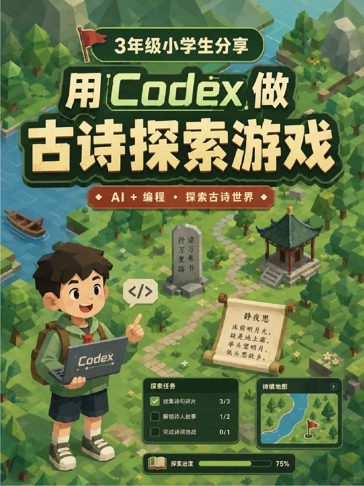

## 图片文字 (OCR)

> OCR 仅供参考，可能包含识别错误；请以原图为准。

3年级小学生分享
用Codex
做
古诗探索游戏
AI+编程·
探索古诗世界
行万里路
读万卷书
</>
静夜思
床前明月光，
疑是地上霜。
举头望明月，
低头思故乡。
Codex
诗境地图
探索任务
3/3
收集诗句碎片
解锁诗人故事
1/2
完成诗词挑战
0/1
探索进度
75%
