---
title: "不会代码的我做了可以在游戏里背单词的网站"
source: "https://www.xiaohongshu.com/discovery/item/6a7dc7120000000028005e2f?app_platform=android&ignoreEngage=true&app_version=9.42.0&share_from_user_hidden=true&xsec_source=app_share&type=video&xsec_token=CB08GDaUxVzF4xbmDxTxfzPAZcf9MSWY90PtNrOE2woK4%3D&author_share=1&xhsshare=CopyLink&shareRedId=N0dINjg3NUpMPko6S0EySDs0P0lFSjdL&apptime=1786813760&share_id=0eb4dd5a7c31442da32e2241f8b84c02&share_channel=copy_link"
author: "IGOR"
author_uid: "5f79880200000000010016aa"
date: "编辑于 2天前 江苏"
tags: ["我在小红书做游戏", "学习网站", "外滩大会全民黑客松", "外滩大会AIcoding大赛", "文字冒险", "雅思", "托福", "四六级", "英语学习打卡", "考研英语"]
platform: "xiaohongshu"
category: "游戏设计/学习游戏机制"
summary: "不会代码的作者手搓了一个把背单词嵌进文字冒险游戏(LexSaga)的网站: 查词存生词库, 把要复习的词拖进冒险词表, AI 把目标词自然编进故事文本与人物对话, 玩家在具体情境里一遍遍遇见和理解单词。支持新手/探索(勇者)/挑战等多种难度、中英混杂文本降低阅读门槛, 提供冒险档案与单词卡按语境回溯复习, 即将开放体验。"
---

# 不会代码的我做了可以在游戏里背单词的网站

> 作者: IGOR | 日期: 编辑于 2天前 江苏 | 原文: https://www.xiaohongshu.com/discovery/item/6a7dc7120000000028005e2f?app_platform=android&ignoreEngage=true&app_version=9.42.0&share_from_user_hidden=true&xsec_source=app_share&type=video&xsec_token=CB08GDaUxVzF4xbmDxTxfzPAZcf9MSWY90PtNrOE2woK4%3D&author_share=1&xhsshare=CopyLink&shareRedId=N0dINjg3NUpMPko6S0EySDs0P0lFSjdL&apptime=1786813760&share_id=0eb4dd5a7c31442da32e2241f8b84c02&share_channel=copy_link

> **摘要**:不会代码的我做了可以在游戏里背单词的网站

不会代码的我做了可以在游戏里背单词的网站
人记不住一张张孤立的词表，但记得住自己亲身体验过的故事。
#我在小红书做游戏 #学习网站  #外滩大会全民黑客松  #外滩大会AIcoding大赛 #文字冒险 #雅思 #托福 #四六级  #英语学习打卡 #考研英语
编辑于 2天前 江苏

## 视频

[视频 1](./video.mp4)

<video controls width="100%"><source src="./video.mp4" type="video/mp4">您的浏览器不支持视频播放。</video>

附件: [音频](./audio/audio.wav) | [处理清单](./video_manifest.json)

## 视频图文总结

> 按关键帧关联完整视频转录；文字保留机器转写原文，时间点仅用于定位。

### 1. 00:00

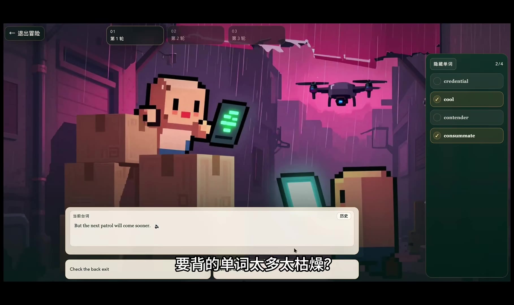

- 画面文字（OCR）：所退出冒险 01 02 03 | | |
第 1 轮第 2 轮 EE | | |
TT Ta
| | | | | | [Sei 隐藏单词 2/4
| |
d | | | | | eredential 国 = : : ‘|Z cool
Bie ¥ YE —
| ’ ~ [] 一
= 本 : B
|
当前台词历史入
0 = < [=
CET

### 2. 00:01

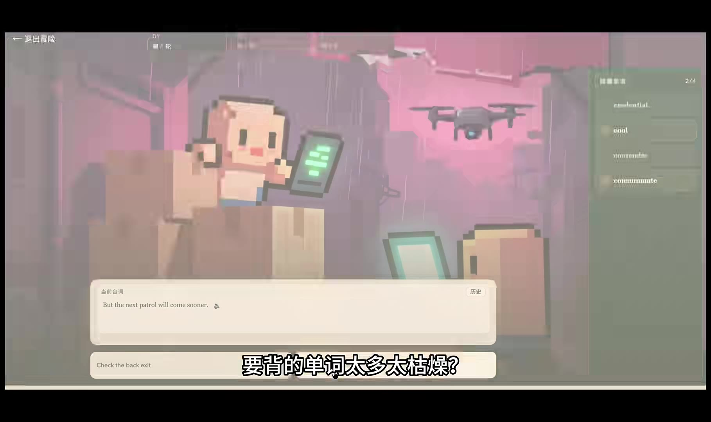

- 内容摘要：要背的单词太多太枯燥（00:00-00:02）
- 画面文字（OCR）：22 HY pl ANE ANA 12

### 3. 00:04

- 内容摘要：背完转头就忘主包，直接把单词塞进了文字冒险游戏里，玩一遍就记住了（00:02-00:08）
- 画面文字（OCR）：< 退出冒险 01 02 03
第办属守 2 第 3 轮
i
隐藏单词 03
y ‘weave
pe ’ =
和 abandon
， | he Ie F Ac > ;
本 >»
| A
\ - /
1 加所 oN 5 »
a)
当前台词历史反放中"主包直接把单词塞进

### 4. 00:07

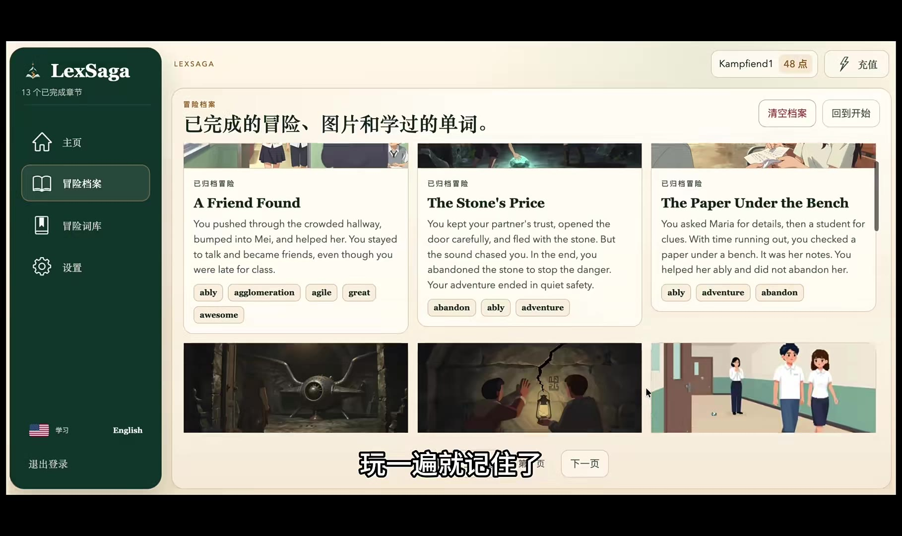

- 画面文字（OCR）：i LEXSAGA Kampfiend1 48 点充值
4 LexSaga 7 x
13 个已完成章节 isl 清空档案 | EEF
ris . = 清空到开始已完成的冒险、图片和学过的单词。价主页 Pr gs = 上人了 r
FF GE IEF A
- oe rah Aros Zo =.
名冒险档案已归档冒险已归档冒险已归档冒险
A Friend Found The Stone's Price The Paper Under the Bench 加冒险词库 You pushed through the crowded hallway, You kept your partner's trust, opened the You asked Maria for details, then a student for
bumped into Mei, and helped her. You stayed door carefully, and fled with the stone. But clues. With time running out, you checked a
to talk and became friends, even though you the sound chased you. In the end, you paper under a bench. It was her notes. You
{es 设置 were late for class. abandoned the stone to stop the danger. helped her ably and did not abandon her.
= Your adventure ended in quiet safety.
ably | agglomeration | agile great ably | adventure | abandon
abandon | ably | adventure
awesome
; s TMA
Na ok
oy | pc x |
J |
有 inf :
= +3 English i
i — SE A XS =
ie Ele

### 5. 00:09

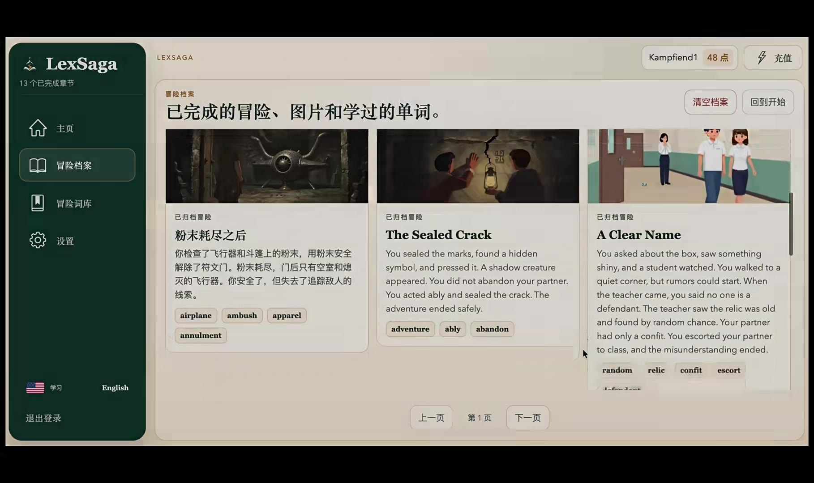

- 内容摘要：相信很多人都同意（00:09-00:11）
- 内容摘要：外语学习里背单词是最枯燥却又完全绕不过去的一环（00:11-00:15）
- 画面文字（OCR）：LEXSAGA Kampfiend1 48 充值
4 LexSaga 4
13 个已完成章节置险档案 Fie wf fo 清空档案回到开始已完成的冒险、图片和学过的单词。
AREY =
Es A. =< . S [| 中 ol [-
MO mex oF sig Jim -
yi, 8 下请 )
已归档冒险已归档冒险已归档冒险 fe) 设置粉未耗尽之后 The Sealed Crack A Clear Name 你检查了飞行器和斗篷上的粉末，用粉未安全 You sealed the marks, found a hidden You asked about the box, saw something 解除了符文门。粉末耗尽，门后只有空室和熄 symbol, and pressed it. A shadow creature shiny, and a student watched. You walked to a
灭的飞行器。你安全了，但失去了追踪敌人的 appeared. You did not abandon your partner. quiet corner, but rumors could start. When 线索。 You acted ably and sealed the crack. The the teacher came, you said no one is a
adventure ended safely. defendant. The teacher saw the relic was old
airplane ambush apparel
and found by random chance. Your partner
adventure | | ably | abandon
annulment had only a confit. You escorted your partner 和 to class, and the misunderstanding ended.
random relic confit escort
== 3 English NEP
EE 上 -页 | 第 1 页 | Fm

### 6. 00:20

- 内容摘要：尤其是英语单词和单词之间根本不讲道理（00:15-00:19）
- 内容摘要：同样是牛，中文一个牛字（00:19-00:20）
- 内容摘要：牛肉牛奶奶牛全都顺理成章（00:20-00:22）
- 内容摘要：英语里却是care obese milk三个毫不相干的词，你只能一个一个硬啃（00:22-00:28）
- 画面文字（OCR）：° LEXSAGA Kampfiend1 41 & 充值
4 LexSaga 7x
14 个已完成章节 HA 、个 [1 ofl] 难度选择查词并保存 PARES 4 人 5 从 4 从了四 “勇者模式 >
HAR 生词库 oy re
MO mex 点击或拖搜生词到右侧冒险词表。 Shacow
break the ice
M ww resilient
clean x keep an eye on 干净的 , 清白的 , 简洁的 \nadv. 清洁地 , 完全地 \nvt 清理 , 使 fragile
{ob wm 干净出空 mvi 被摘干净 mn. 打扫至少添加 3 个。 1
word x i = ZF 视觉风格话 ,消息 , 词 , 诺言 ,命令 vt 用言辞表达 wm[ 计 ] 字 weave x TAY 西式奇幻 v 3 电影感 v
BF, 织法 , 编织式样 vt 编织 ,组合 , 编排 ,使还回前进 vvi 纺织 , 迁回行进 great x
大的 , 非常的 , 主要的 , 重大的 , 崇高的 , 伟大的 nadv 顺利地，
=" Estes 得意地 \nn. 全部 ,大人物 , 大师
4A BEGG EX y i. .
退出登录 abandon 中 YX 一个 GE 个可玩的冒险会消耗 1 点。开启冒险

### 7. 00:40

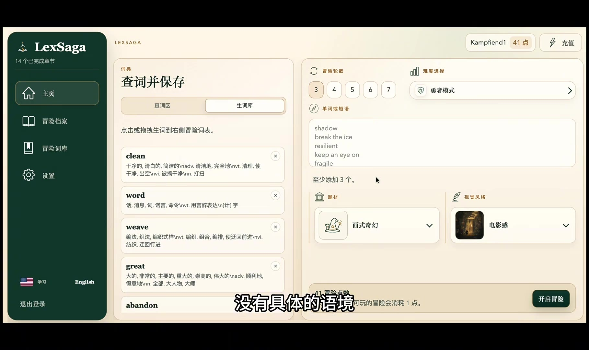

- 内容摘要：这样不讲道理的词，还有成千上万个堆在一起，就是一座祖传的屎山代码（00:28-00:34）
- 内容摘要：可问题是单词又多又难背（00:34-00:36）
- 内容摘要：它难坚持更难（00:36-00:37）
- 内容摘要：就算一时记住了，没有具体的语境也很容易转头就忘，这让主包想起自己小时候（00:37-00:44）
- 内容摘要：其实很多英语单词我是在电子游戏里学会的，那时候大多数游戏都没有中文翻译（00:44-00:50）
- 画面文字（OCR）：< LEXSAGA Kampfiend1 41 fi 入 LexSaga ampfien 多充值
14 个已完成章节 Ld g C umes ofl) mss 查词并保存人主页 | 4 川 5 川 5617 © ”勇者模式 >
将词区生词 @) 站可知 mers 点击或拖搜生词到右侧冒险词表。 shadow
break the ice
LIRCTS ian
clean x keep an eye on 干净的 , 清白的 ,简洁的 adv 清洁地 , 完全地 \nvt 清理 ,使 fragile
{ob 设置 Fig, 出空 vi 被摘干净 \n. 打扫至少添加 3 个。 1
word 使 mw Z 视觉风格话消息 , 词 , 诺言 , 命令 vt 用言辞表达 wm[ 计 ] 字 weave x TAY 西式奇幻 v 3 电影感 Vv 编法织法 ,编织式样 vt 编织 ,组合 , BH, 使还回前进 vi 纺织 , 迁回行进 great x
= i 大的 , 非常的 , 主要的 , 重大的 , 崇高的 , 伟大的 adv 顺利地，
= 习 Brel 得意地 \nn. 全部 ,大人物 , 大师
= ANY TN
Hi Tn S| EAH 和 Trmommanit 1 5. SHAE

### 8. 01:00

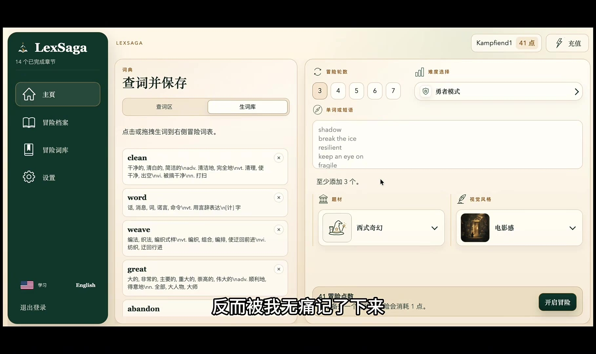

- 内容摘要：为了玩懂剧情（00:50-00:51）
- 内容摘要：我只能遇到一个生词就暂停下来手动查一次词典（00:51-00:55）
- 内容摘要：但奇怪的是这些在游戏里查过的单词反而被我无痛记了下来（00:55-01:00）
- 内容摘要：因为我记住的不只是他们的中文释义，还有他们出现时的角色画面和剧情（01:00-01:06）
- 内容摘要：人记不住一张孤立的词表（01:06-01:08）
- 画面文字（OCR）：: LEXSAGA Kampfiend1 41 = 充值
4 LexSaga 7s
14 个已完成章节 HR 5 个 [1 ofl] 难度选择查词并保存合主页 sll (4567 @ “勇者模式 >
查词区生词库 @) 单词或短语
@) 单词或短语
[[O mex 点击或拖搜生词到右侧冒险词表。 RAW 加冒险词库 resilient
clean x keep an eye on 干净的 , 清白的 , 简洁的 nadv 清洁地 , 完全地 \nvt 清理 , 使 ragile
{ob wm 干净 ,出空 mvi 被摘干净 n. 打扫至少添加 3 个。入 word x om mn ZF 视觉风格话 , 消息 , 词 , 诺言 ,命令 vt 用言辞表达 wm[ 计 ] 字 weave x TAY 西式奇幻 v 3 电影感 v
编法 , 织法 , 编织式样 vt 编织 ,组合 , WF, BITRE \nvi 纺织 , 迁回行进 great x
I 大的 , 非常的 , 主要的 , 重大的 , 崇高的 , 伟大的 adv 顺利地，
Ea ESTEE 得意地 \nn. 全部 ,大人物 , 大师 Noose Stoo, 开启冒险退出登录 abandon 5 ARTE TE Ee a TS 险会消耗 1 点。

### 9. 01:20

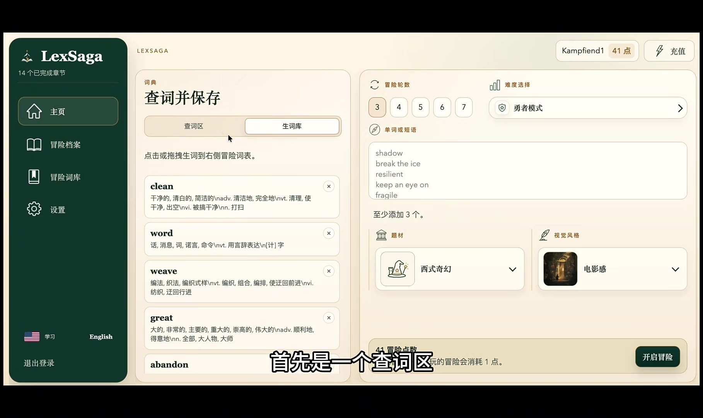

- 内容摘要：但记得住一段自己亲身经历的故事，既然这样，为什么不能把背单词？（01:08-01:14）
- 内容摘要：和游戏体验结合起来呢（01:14-01:16）
- 内容摘要：于是主包手搓了这个网站，打开网站主页首先是一个查词区，你可以搜索想学的单词（01:16-01:23）
- 内容摘要：把它们保存进自己的生词库（01:23-01:25）
- 内容摘要：再把这次想复习的词拖进右边的冒险词表（01:25-01:28）
- 画面文字（OCR）：A ho Kampfiend1 41 点充值
4 LexSaga 7 x
14 个已完成章节
2 并保存他四险轮数 ofl) 难度选择 ANE 得词 5 3 4]|5]l6])7 © “勇者模式 >
FAK 生词库 1
©) wan
[MO mews 点击或拖搜生词到右侧冒险词表。 shadow 加冒险词库 resilient
clean x keep aneye on 干净的 , 清白的 ,简洁的 adv 清洁地 , 完全地 \nvt 清理 ,使 fragile
{ob wm 干净出空 mvi 被摘干净 mn. 打扫有 ZR Mo
word x 使 ms 视觉风格话消息 , 词 , 诺言 , 命令 vt 用言辞表达 wm[ 计 ] 字 weave x TAY 西式奇幻 v 3 电影感 v
编法 , 织法 ,编织式样 vt BIR, BS, RH, (BERT 纺织 , 迁回行进 great x
= 大的 , 非常的 , 主要的 , 重大的 , 崇高的 , 伟大的 nadv 顺利地，三三学习 ESHER 得意地 \nn. 全部 ,大人物 , 大师退出登录 abandon El ea— ux) Bana 1 点。 THRE

### 10. 01:40

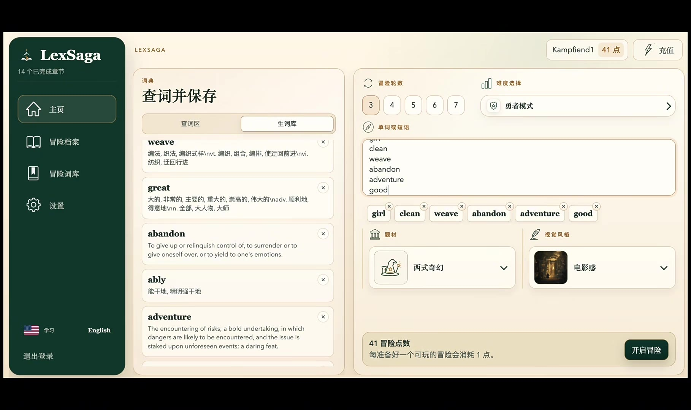

- 内容摘要：当然也可以直接手动输入想复习的单词或短语（01:28-01:32）
- 画面文字（OCR）：A LEXSAGA Kampfiend1 41 点充值
4. LexSaga 4
14 个已完成章节词典 C 四险轮数 ofl) 难度选择查词并保存从主页 3M 4(5)l¢6)|7 @ ”勇者模式 >
FAK 生词库 ©) 间疝或四加冒险档案 weave x
编法 , 织法 ,编织式样 vt 编织 ,组合 , 编排 BETH ni a
纺织 , 迁回行进 weave 加冒险词库 abandon
adventure
great % good|
$3 设置大的 , 非常的 , 主要的 , 重大的 , 崇高的 , 伟大的 \nadv. 顺利地，设置得意地 \ 部 , 大人物， x x x x x x
SRE. SR 20.20 girl clean weave abandon adventure good
abandon x i = 多视觉风格 To give up orrelinquish control of to surrender orto
give oneself over, or to yield to one's emotions
gS; maw ~ up v
ably x
能干地 , 精明强干地 adventure x
L= uy English The encountering of risks; a bold undertaking, in which
= dangers are likely to be encountered, and the issue is
staked upon unforeseen events; a daring feat 41 冒险点数 FREER 退出登录每准备好一个可玩的冒险会消耗 1 点。 i's

### 11. 01:42

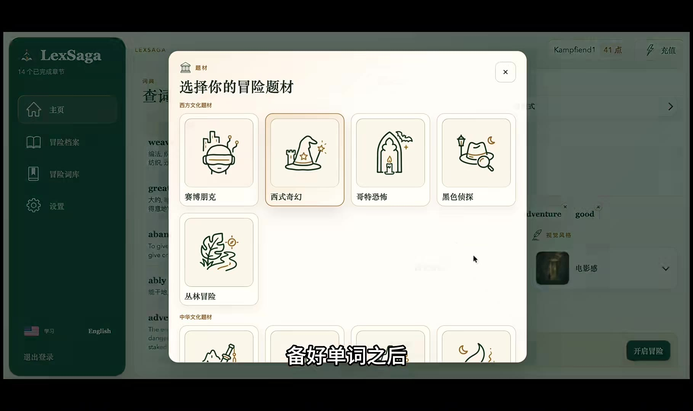

- 内容摘要：背好单词之后再来选这场冒险的轮术（01:41-01:44）
- 画面文字（OCR）：it ms 5
选择你的冒险题材 pp he 3 ¢
88 fF =
i
赛博朋克西式奇幻哥特恐怖黑色侦探
<5 从丛林冒险人 Ba So EL a) eee <));

### 12. 01:48

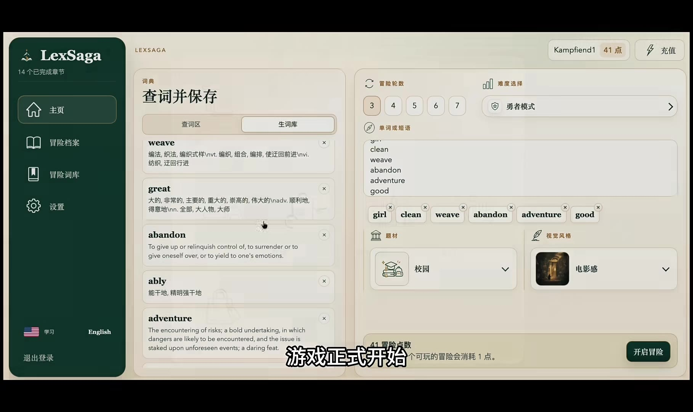

- 内容摘要：故事题材和画风选好之后点击开启冒险游戏正式开始（01:44-01:49）
- 画面文字（OCR）：A LEXSAGA Kampfiend1 41 点充值
4. LexSaga 4
14 个已完成章节 lg Cumin 上 [难度选择查词并保存 ANE sl 45 )le)l7 © 勇者模式 >
查词区生词库 (的本

[M 冒险档案 weave x Sy 编法织法 , 编织式样 vt 编织 ,组合 , 编排使还回前进 vvi clean 纺织 , 迁回行进 weave

LITT abandon

adventure

great x good

& 3 大的 , 非常的 , 主要的 , WARY, 崇高的 , 伟大的 adv 顺利地 BE 得意地 \ 部 , 大人物， x x x x x x
ER SE ALAR girl clean weave abandon adventure good
w
abandon x 爹题材办视觉风格 To give up or relinquish control of to surrender or to
give oneself over, or to yield to one's emotions.
Ep | nm v (7 v

ably x
能干地 , 精明强干地 adventure x

L= #3 English The encountering of risks; a bold undertaking, in which
dangers are likely to be encountered, and the issue is To
staked upon unforeseen events; a daring feat 0 ALBA 退出登录 FARE J4 个可玩的冒险会消耗 1 点。开启久险

### 13. 01:51

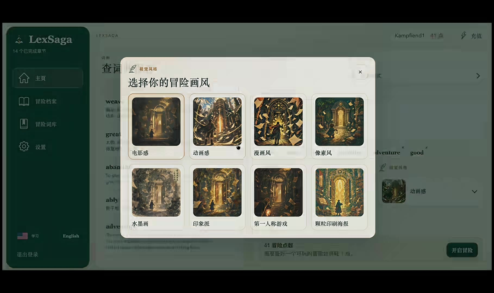

- 画面文字（OCR）：2 annus x
选择你的冒险画风
(© Ka \ TAR LA Yao << 2
a ER LEA) PN
| {art rs Pans (3 Sry 中 Ji i 了 ph 6 De % ROE ON
LE an MAN BE
| - 1 T= 5 cin
| 电影感 | | ams BER 像素风 gp Ty 5 = Say 8
Cs EB Emm
i 5 Ag er ef fir 区这 Vii
Se Bh ERT Ke
NEE Tan A ERR
er Ga a. = Neg BE
ki 印象派第一人称游戏颗粒印刷海报

### 14. 01:54

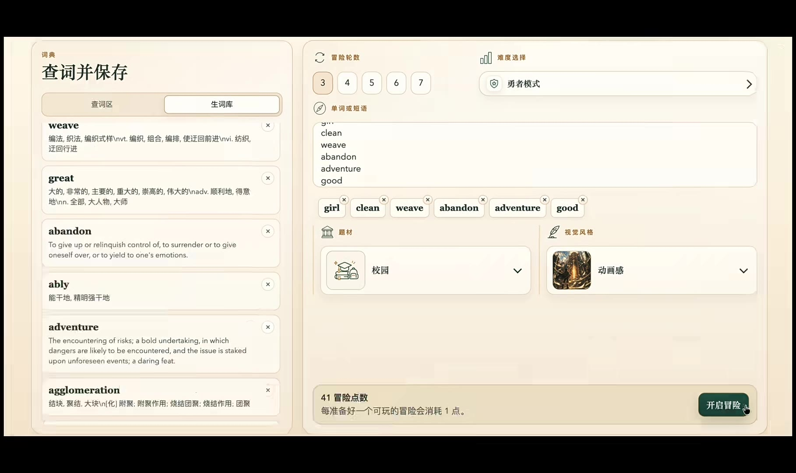

- 画面文字（OCR）：词典 (5)
I 间个冒险轮数 00[ 难度选择 BHR Sill 4 [5 [6] 7 ® ”勇者模式 >
FAR 生词库 @) 单词或短语 weave x cla:
编法织法 ,编织式样 vt 编织 , 组合 , 编排 BEEN HA lL 迁回行进 weave
abandon
adventure
great % good 大的 , 非常的 , 主要的 , 重大的 , 崇高的 , 伟大的 \nadv 顺利地 , 得意地 \nn. 全部, 大人物 , 大师 E x x x x x
nn. 全 y girl clean weave abandon adventure good
abandon x im an 视觉风格 To give up or relinquish control of to surrender orto give
oneself over, or to yield to one's emotions. Ww)
+, be <5 (ea aap came a
&h 校园 v i | D9 动画感 v
ably x S52
能干地 , 精明强干地 adventure x
The encountering of risks; a bold undertaking, in which
dangers are likely to be encountered, and the issue is staked
upon unforeseen events; a daring feat
agglomeration x 41 冒险点数结块 , 聚结 , 大块 m[ 化 ] 附聚 ; 附聚作用 ; 烧结团聚 ; 烧结作用 ; 团聚 gr FRE 开启冒险每准备好一个可玩的冒险会消耗 1 点。

### 15. 01:56

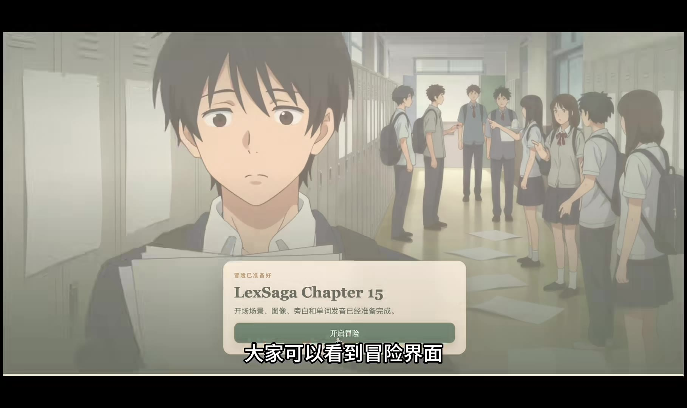

- 画面文字（OCR）：二

### 16. 02:00

- 内容摘要：大家可以看到冒险界面沿用了文字冒险游戏的形式，你输入的单词和短语（01:55-02:01）
- 内容摘要：会自然的出现在故事文本和人物对话里（02:01-02:04）
- 内容摘要：遇到其他看不懂的内容随时选中ai会结合当前语境（02:04-02:08）
- 画面文字（OCR）：_ TE ER . .
— 退出冒险三 i Cae in 第 3 轮加， 1 y ] ~~
wo = : 3 |i A | Mr | i 隐藏单词 0/6
| 4 | \ Il { 多费 v & p girl 一 < | | 1H Xo! 4 a9 Eg | ¥
® [ A | fl 111 Y 4 | + 二除了 rm
\ Za" § ve TRL
| ho 4 Ly | il A | (4 ! JA
at | Hd | I No | tom
| A FE LAA i
rN hy 7 ©
I 】四时 a ¥ |
Your partner looks at you with worried eyes. a _—
sg 你输六的单词和短语会自然的

### 17. 02:20

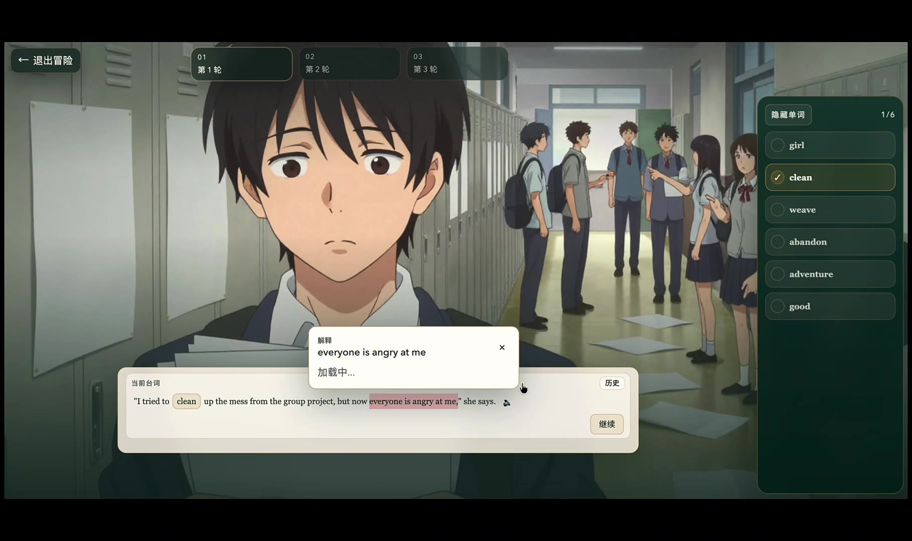

- 内容摘要：且是它的含义或直接翻译，要是又发现了新的生词，顺手存进生词库（02:09-02:14）
- 内容摘要：下次冒险继续调用，就这样一点一点突破自己的舒适圈（02:14-02:19）

### 18. 02:23

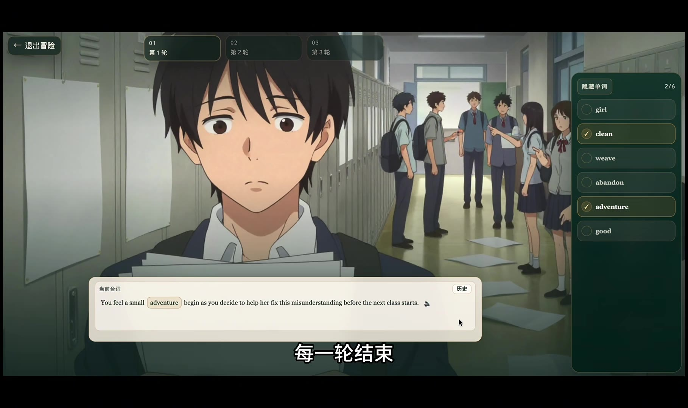

- 内容摘要：每一轮结束你都要做出选择（02:22-02:25）

### 19. 02:27

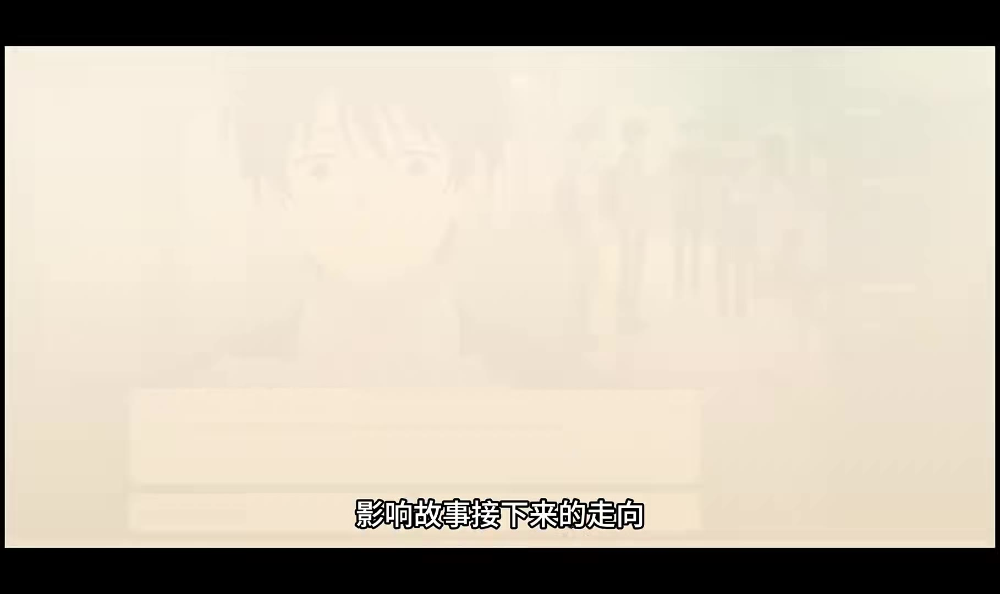

- 内容摘要：而你的每一次选择都会影响故事接下来的走向，也就是说你不是在看单词（02:25-02:31）

### 20. 02:32

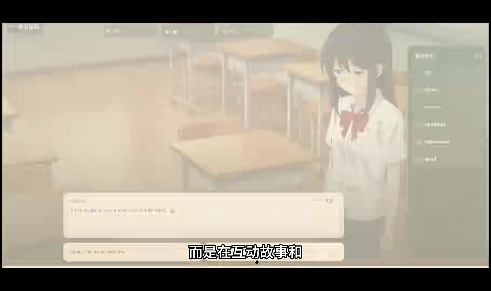

- 内容摘要：而是在互动故事和画面构成的具体情境里（02:31-02:34）

### 21. 02:36

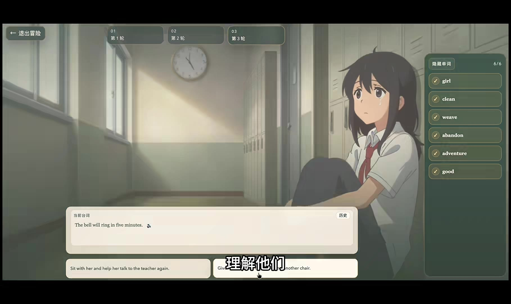

- 内容摘要：一遍又一遍的遇见他们，理解他们，完成所有选择之后（02:34-02:38）

### 22. 02:40

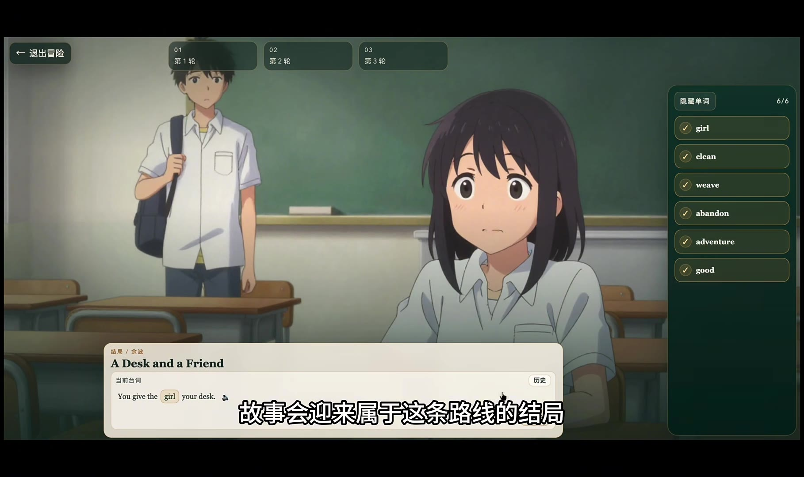

- 内容摘要：故事会迎来属于这条路线的结局（02:38-02:41）
- 内容摘要：你输入的单词和短语会在故事回顾里再次集中出现，帮你加深印象（02:41-02:46）

### 23. 02:51

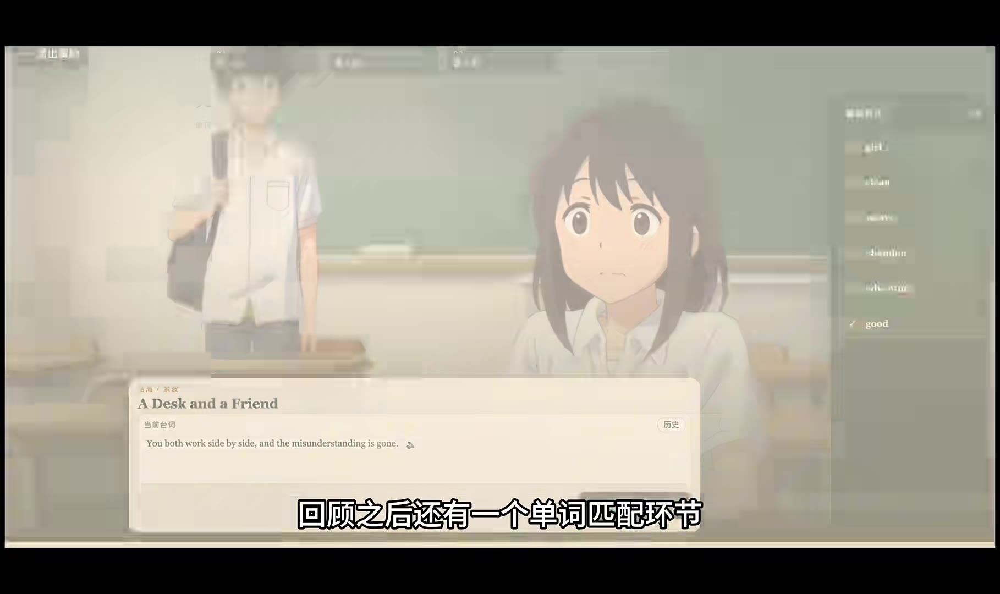

- 内容摘要：回顾之后还有一个单词匹配环节（02:51-02:53）

### 24. 02:59

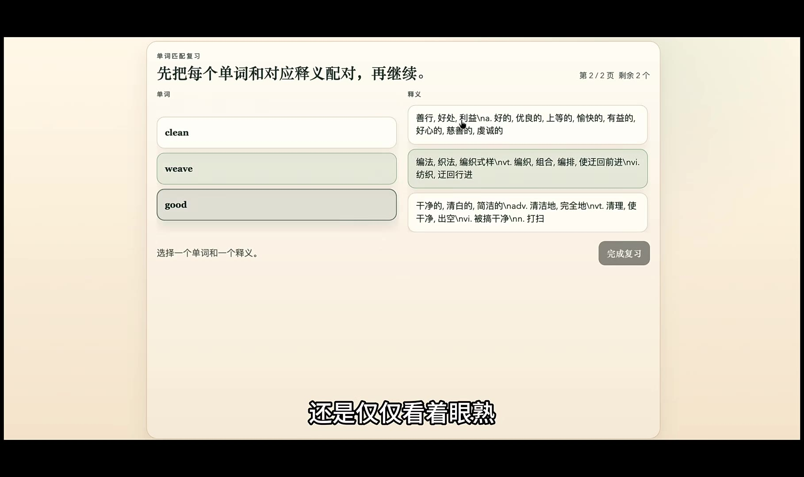

- 内容摘要：把单词和对应释义一一配对，检查自己到底是真懂了，还是仅仅看着眼熟（02:53-03:00）
- 内容摘要：回到主页，还有一个刚才没介绍的设置难度（03:00-03:04）
- 内容摘要：网站目前提供四种适合不同的英语水平新手模式，面向初学者（03:04-03:09）

### 25. 03:19

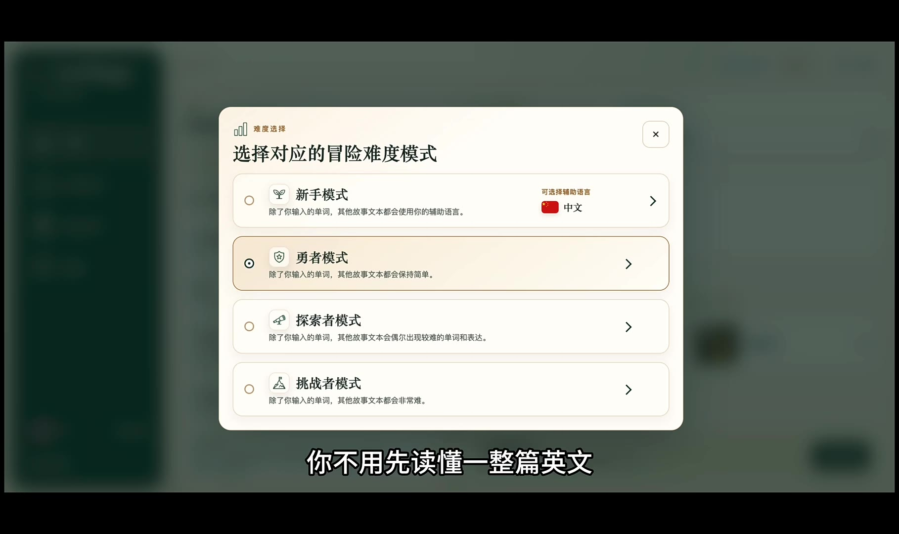

- 内容摘要：除了你要学的目标单词（03:09-03:11）
- 内容摘要：其余故事文本都会使用中文等辅助语言，也就是说屏幕上呈现的是中英混杂（03:11-03:17）
- 内容摘要：的故事你不用先读懂（03:17-03:19）
- 内容摘要：一整篇英文就能把注意力集中在目标词上（03:19-03:22）
- 内容摘要：在看得懂剧情的前提下，建立语境展示效果如下，他说（03:22-03:27）

### 26. 03:39

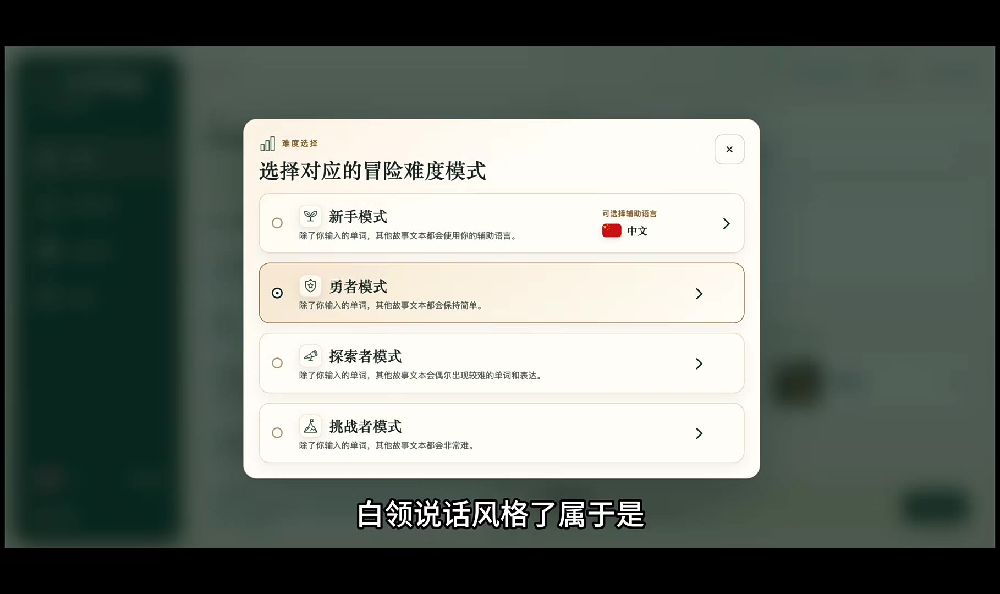

- 内容摘要：这道门被一种古老的wave保护着，只有用正确的方式才能解开（03:27-03:32）
- 内容摘要：你感受到这场adventure的真正考验，不是战斗，而是信任（03:33-03:38）
- 内容摘要：白灵说话风格了（03:38-03:39）
- 内容摘要：属于是勇者模式（03:39-03:41）
- 内容摘要：会用比较简单的英文编写故事，适合已经有一些基础，但还不习惯长篇阅读的用户（03:41-03:47）

### 27. 03:59

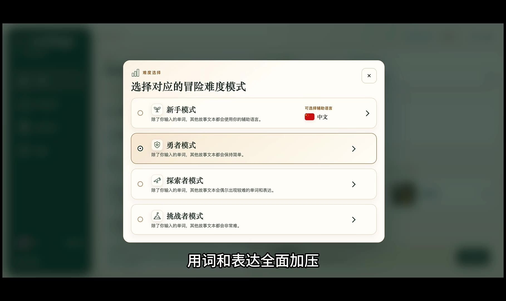

- 内容摘要：探索者模式会在目标词之外，偶尔夹带一些更难的单词和表达，复习的同时（03:47-03:53）
- 内容摘要：顺便接触新的语言知识，挑战者模式则面向中高级学习者（03:53-03:58）
- 内容摘要：用词和表达全面加压，逼你真正突破舒适圈，冒险之外，网站里还有冒险档案（03:58-04:05）
- 内容摘要：你完成的每场冒险都在这里，每一轮对应的单词故事文本和场景图片，下次回来复习（04:05-04:11）

### 28. 04:19

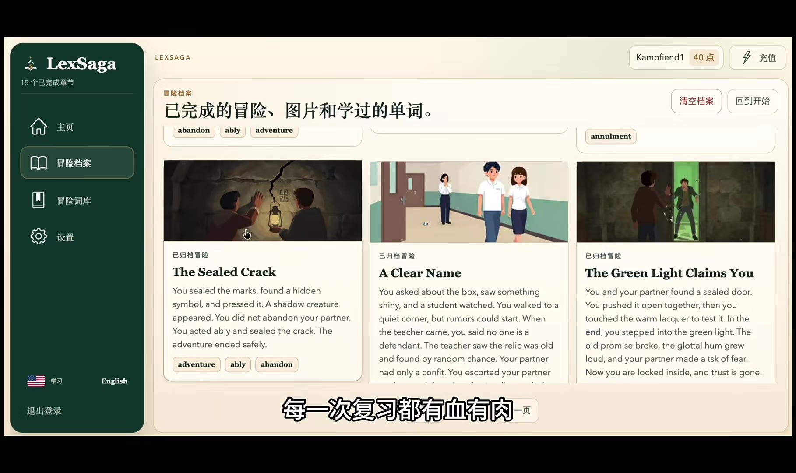

- 内容摘要：你看到的不再是一条孤零零的单词释义（04:11-04:15）
- 内容摘要：而是一段你曾经亲身经历过的故事，每一次复习都有血有肉（04:15-04:20）
- 内容摘要：而冒险词库记录了所有被你用于生成冒险的单词（04:22-04:26）
- 内容摘要：可以在这里集中复习，点开一张单词卡（04:26-04:29）

### 29. 04:39

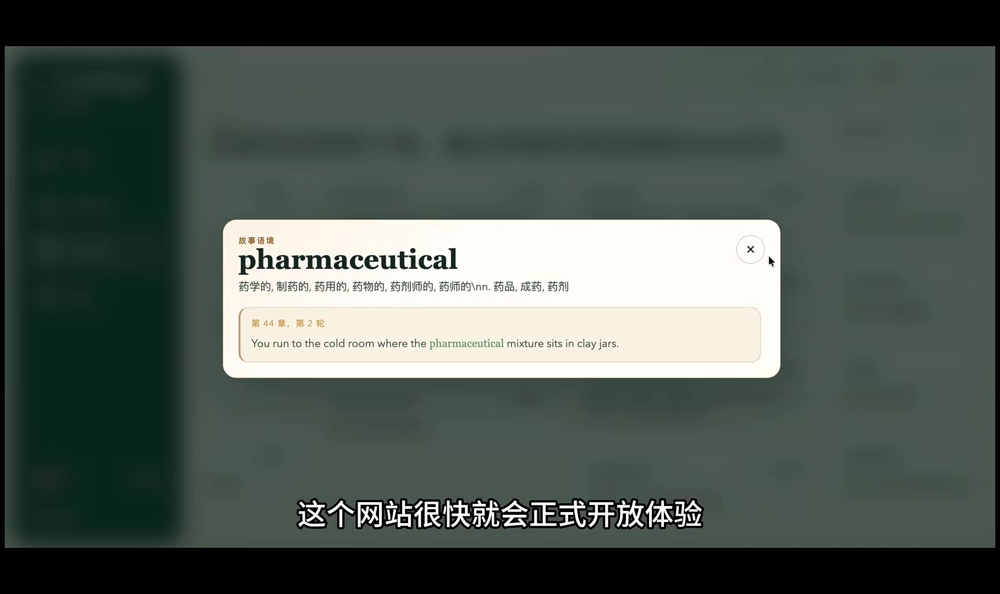

- 内容摘要：还能看到他在不同冒险里出现过的故事语境（04:29-04:33）
- 内容摘要：通过一段段具体的经历，而不是脱离语境的中文释义，重新回忆起它的含义（04:33-04:39）
- 内容摘要：这个网站很快就会正式开放体验（04:39-04:41）
- 内容摘要：地址我会放在评论区，置顶之后主包也会继续在b站分享后续的功能开发和产品迭代（04:41-04:49）

### 30. 04:59

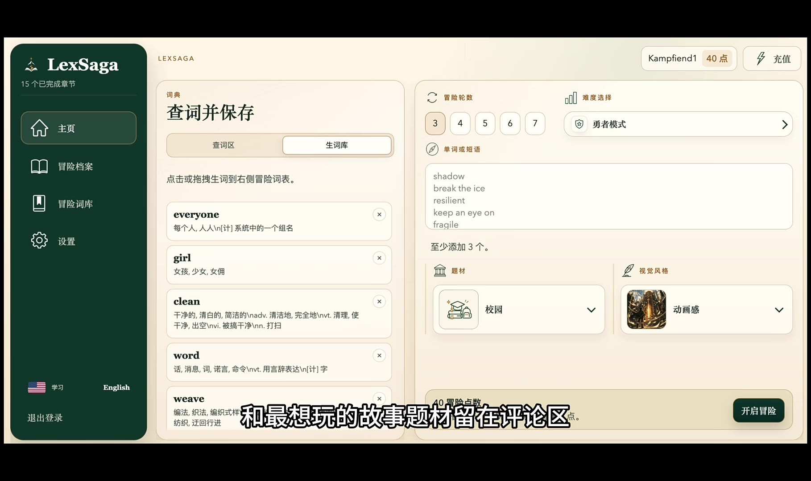

- 内容摘要：如果你也觉得背单词不该只剩下枯燥的重复（04:49-04:52）
- 内容摘要：欢迎来一场属于自己的单词冒险，也欢迎把你的实际体验遇到的问题（04:52-04:57）
- 内容摘要：和最想玩的故事题材留在评论区（04:57-05:00）

## 视频画面文字 (OCR)

> OCR 仅供参考，可能包含识别错误；请以视频画面和转写来源为准。

### 关键帧 1 · 0.5s

所退出冒险 01 02 03 | | |
第 1 轮第 2 轮 EE | | |
TT Ta
| | | | | | [Sei 隐藏单词 2/4
| |
d | | | | | eredential 国 = : : ‘|Z cool
Bie ¥ YE —
| ’ ~ [] 一
= 本 : B
|
当前台词历史入
0 = < [=
CET

### 关键帧 2 · 1.53s

22 HY pl ANE ANA 12

### 关键帧 3 · 4.9s

< 退出冒险 01 02 03
第办属守 2 第 3 轮
i
隐藏单词 03
y ‘weave
pe ’ =
和 abandon
， | he Ie F Ac > ;
本 >»
| A
\ - /
1 加所 oN 5 »
a)
当前台词历史反放中"主包直接把单词塞进

### 关键帧 4 · 7.57s

i LEXSAGA Kampfiend1 48 点充值
4 LexSaga 7 x
13 个已完成章节 isl 清空档案 | EEF
ris . = 清空到开始已完成的冒险、图片和学过的单词。价主页 Pr gs = 上人了 r
FF GE IEF A
- oe rah Aros Zo =.
名冒险档案已归档冒险已归档冒险已归档冒险
A Friend Found The Stone's Price The Paper Under the Bench 加冒险词库 You pushed through the crowded hallway, You kept your partner's trust, opened the You asked Maria for details, then a student for
bumped into Mei, and helped her. You stayed door carefully, and fled with the stone. But clues. With time running out, you checked a
to talk and became friends, even though you the sound chased you. In the end, you paper under a bench. It was her notes. You
{es 设置 were late for class. abandoned the stone to stop the danger. helped her ably and did not abandon her.
= Your adventure ended in quiet safety.
ably | agglomeration | agile great ably | adventure | abandon
abandon | ably | adventure
awesome
; s TMA
Na ok
oy | pc x |
J |
有 inf :
= +3 English i
i — SE A XS =
ie Ele

### 关键帧 5 · 9.27s

LEXSAGA Kampfiend1 48 充值
4 LexSaga 4
13 个已完成章节置险档案 Fie wf fo 清空档案回到开始已完成的冒险、图片和学过的单词。
AREY =
Es A. =< . S [| 中 ol [-
MO mex oF sig Jim -
yi, 8 下请 )
已归档冒险已归档冒险已归档冒险 fe) 设置粉未耗尽之后 The Sealed Crack A Clear Name 你检查了飞行器和斗篷上的粉末，用粉未安全 You sealed the marks, found a hidden You asked about the box, saw something 解除了符文门。粉末耗尽，门后只有空室和熄 symbol, and pressed it. A shadow creature shiny, and a student watched. You walked to a
灭的飞行器。你安全了，但失去了追踪敌人的 appeared. You did not abandon your partner. quiet corner, but rumors could start. When 线索。 You acted ably and sealed the crack. The the teacher came, you said no one is a
adventure ended safely. defendant. The teacher saw the relic was old
airplane ambush apparel
and found by random chance. Your partner
adventure | | ably | abandon
annulment had only a confit. You escorted your partner 和 to class, and the misunderstanding ended.
random relic confit escort
== 3 English NEP
EE 上 -页 | 第 1 页 | Fm

### 关键帧 6 · 20.44s

° LEXSAGA Kampfiend1 41 & 充值
4 LexSaga 7x
14 个已完成章节 HA 、个 [1 ofl] 难度选择查词并保存 PARES 4 人 5 从 4 从了四 “勇者模式 >
HAR 生词库 oy re
MO mex 点击或拖搜生词到右侧冒险词表。 Shacow
break the ice
M ww resilient
clean x keep an eye on 干净的 , 清白的 , 简洁的 \nadv. 清洁地 , 完全地 \nvt 清理 , 使 fragile
{ob wm 干净出空 mvi 被摘干净 mn. 打扫至少添加 3 个。 1
word x i = ZF 视觉风格话 ,消息 , 词 , 诺言 ,命令 vt 用言辞表达 wm[ 计 ] 字 weave x TAY 西式奇幻 v 3 电影感 v
BF, 织法 , 编织式样 vt 编织 ,组合 , 编排 ,使还回前进 vvi 纺织 , 迁回行进 great x
大的 , 非常的 , 主要的 , 重大的 , 崇高的 , 伟大的 nadv 顺利地，
=" Estes 得意地 \nn. 全部 ,大人物 , 大师
4A BEGG EX y i. .
退出登录 abandon 中 YX 一个 GE 个可玩的冒险会消耗 1 点。开启冒险

### 关键帧 7 · 40.38s

< LEXSAGA Kampfiend1 41 fi 入 LexSaga ampfien 多充值
14 个已完成章节 Ld g C umes ofl) mss 查词并保存人主页 | 4 川 5 川 5617 © ”勇者模式 >
将词区生词 @) 站可知 mers 点击或拖搜生词到右侧冒险词表。 shadow
break the ice
LIRCTS ian
clean x keep an eye on 干净的 , 清白的 ,简洁的 adv 清洁地 , 完全地 \nvt 清理 ,使 fragile
{ob 设置 Fig, 出空 vi 被摘干净 \n. 打扫至少添加 3 个。 1
word 使 mw Z 视觉风格话消息 , 词 , 诺言 , 命令 vt 用言辞表达 wm[ 计 ] 字 weave x TAY 西式奇幻 v 3 电影感 Vv 编法织法 ,编织式样 vt 编织 ,组合 , BH, 使还回前进 vi 纺织 , 迁回行进 great x
= i 大的 , 非常的 , 主要的 , 重大的 , 崇高的 , 伟大的 adv 顺利地，
= 习 Brel 得意地 \nn. 全部 ,大人物 , 大师
= ANY TN
Hi Tn S| EAH 和 Trmommanit 1 5. SHAE

### 关键帧 8 · 60.31s

: LEXSAGA Kampfiend1 41 = 充值
4 LexSaga 7s
14 个已完成章节 HR 5 个 [1 ofl] 难度选择查词并保存合主页 sll (4567 @ “勇者模式 >
查词区生词库 @) 单词或短语
@) 单词或短语
[[O mex 点击或拖搜生词到右侧冒险词表。 RAW 加冒险词库 resilient
clean x keep an eye on 干净的 , 清白的 , 简洁的 nadv 清洁地 , 完全地 \nvt 清理 , 使 ragile
{ob wm 干净 ,出空 mvi 被摘干净 n. 打扫至少添加 3 个。入 word x om mn ZF 视觉风格话 , 消息 , 词 , 诺言 ,命令 vt 用言辞表达 wm[ 计 ] 字 weave x TAY 西式奇幻 v 3 电影感 v
编法 , 织法 , 编织式样 vt 编织 ,组合 , WF, BITRE \nvi 纺织 , 迁回行进 great x
I 大的 , 非常的 , 主要的 , 重大的 , 崇高的 , 伟大的 adv 顺利地，
Ea ESTEE 得意地 \nn. 全部 ,大人物 , 大师 Noose Stoo, 开启冒险退出登录 abandon 5 ARTE TE Ee a TS 险会消耗 1 点。

### 关键帧 9 · 80.25s

A ho Kampfiend1 41 点充值
4 LexSaga 7 x
14 个已完成章节
2 并保存他四险轮数 ofl) 难度选择 ANE 得词 5 3 4]|5]l6])7 © “勇者模式 >
FAK 生词库 1
©) wan
[MO mews 点击或拖搜生词到右侧冒险词表。 shadow 加冒险词库 resilient
clean x keep aneye on 干净的 , 清白的 ,简洁的 adv 清洁地 , 完全地 \nvt 清理 ,使 fragile
{ob wm 干净出空 mvi 被摘干净 mn. 打扫有 ZR Mo
word x 使 ms 视觉风格话消息 , 词 , 诺言 , 命令 vt 用言辞表达 wm[ 计 ] 字 weave x TAY 西式奇幻 v 3 电影感 v
编法 , 织法 ,编织式样 vt BIR, BS, RH, (BERT 纺织 , 迁回行进 great x
= 大的 , 非常的 , 主要的 , 重大的 , 崇高的 , 伟大的 nadv 顺利地，三三学习 ESHER 得意地 \nn. 全部 ,大人物 , 大师退出登录 abandon El ea— ux) Bana 1 点。 THRE

### 关键帧 10 · 100.19s

A LEXSAGA Kampfiend1 41 点充值
4. LexSaga 4
14 个已完成章节词典 C 四险轮数 ofl) 难度选择查词并保存从主页 3M 4(5)l¢6)|7 @ ”勇者模式 >
FAK 生词库 ©) 间疝或四加冒险档案 weave x
编法 , 织法 ,编织式样 vt 编织 ,组合 , 编排 BETH ni a
纺织 , 迁回行进 weave 加冒险词库 abandon
adventure
great % good|
$3 设置大的 , 非常的 , 主要的 , 重大的 , 崇高的 , 伟大的 \nadv. 顺利地，设置得意地 \ 部 , 大人物， x x x x x x
SRE. SR 20.20 girl clean weave abandon adventure good
abandon x i = 多视觉风格 To give up orrelinquish control of to surrender orto
give oneself over, or to yield to one's emotions
gS; maw ~ up v
ably x
能干地 , 精明强干地 adventure x
L= uy English The encountering of risks; a bold undertaking, in which
= dangers are likely to be encountered, and the issue is
staked upon unforeseen events; a daring feat 41 冒险点数 FREER 退出登录每准备好一个可玩的冒险会消耗 1 点。 i's

### 关键帧 11 · 102.07s

it ms 5
选择你的冒险题材 pp he 3 ¢
88 fF =
i
赛博朋克西式奇幻哥特恐怖黑色侦探
<5 从丛林冒险人 Ba So EL a) eee <));

### 关键帧 12 · 108.67s

A LEXSAGA Kampfiend1 41 点充值
4. LexSaga 4
14 个已完成章节 lg Cumin 上 [难度选择查词并保存 ANE sl 45 )le)l7 © 勇者模式 >
查词区生词库 (的本

[M 冒险档案 weave x Sy 编法织法 , 编织式样 vt 编织 ,组合 , 编排使还回前进 vvi clean 纺织 , 迁回行进 weave

LITT abandon

adventure

great x good

& 3 大的 , 非常的 , 主要的 , WARY, 崇高的 , 伟大的 adv 顺利地 BE 得意地 \ 部 , 大人物， x x x x x x
ER SE ALAR girl clean weave abandon adventure good
w
abandon x 爹题材办视觉风格 To give up or relinquish control of to surrender or to
give oneself over, or to yield to one's emotions.
Ep | nm v (7 v

ably x
能干地 , 精明强干地 adventure x

L= #3 English The encountering of risks; a bold undertaking, in which
dangers are likely to be encountered, and the issue is To
staked upon unforeseen events; a daring feat 0 ALBA 退出登录 FARE J4 个可玩的冒险会消耗 1 点。开启久险

### 关键帧 13 · 111.73s

2 annus x
选择你的冒险画风
(© Ka \ TAR LA Yao << 2
a ER LEA) PN
| {art rs Pans (3 Sry 中 Ji i 了 ph 6 De % ROE ON
LE an MAN BE
| - 1 T= 5 cin
| 电影感 | | ams BER 像素风 gp Ty 5 = Say 8
Cs EB Emm
i 5 Ag er ef fir 区这 Vii
Se Bh ERT Ke
NEE Tan A ERR
er Ga a. = Neg BE
ki 印象派第一人称游戏颗粒印刷海报

### 关键帧 14 · 114.8s

词典 (5)
I 间个冒险轮数 00[ 难度选择 BHR Sill 4 [5 [6] 7 ® ”勇者模式 >
FAR 生词库 @) 单词或短语 weave x cla:
编法织法 ,编织式样 vt 编织 , 组合 , 编排 BEEN HA lL 迁回行进 weave
abandon
adventure
great % good 大的 , 非常的 , 主要的 , 重大的 , 崇高的 , 伟大的 \nadv 顺利地 , 得意地 \nn. 全部, 大人物 , 大师 E x x x x x
nn. 全 y girl clean weave abandon adventure good
abandon x im an 视觉风格 To give up or relinquish control of to surrender orto give
oneself over, or to yield to one's emotions. Ww)
+, be <5 (ea aap came a
&h 校园 v i | D9 动画感 v
ably x S52
能干地 , 精明强干地 adventure x
The encountering of risks; a bold undertaking, in which
dangers are likely to be encountered, and the issue is staked
upon unforeseen events; a daring feat
agglomeration x 41 冒险点数结块 , 聚结 , 大块 m[ 化 ] 附聚 ; 附聚作用 ; 烧结团聚 ; 烧结作用 ; 团聚 gr FRE 开启冒险每准备好一个可玩的冒险会消耗 1 点。

### 关键帧 15 · 116.17s

二

### 关键帧 16 · 120.13s

_ TE ER . .
— 退出冒险三 i Cae in 第 3 轮加， 1 y ] ~~
wo = : 3 |i A | Mr | i 隐藏单词 0/6
| 4 | \ Il { 多费 v & p girl 一 < | | 1H Xo! 4 a9 Eg | ¥
® [ A | fl 111 Y 4 | + 二除了 rm
\ Za" § ve TRL
| ho 4 Ly | il A | (4 ! JA
at | Hd | I No | tom
| A FE LAA i
rN hy 7 ©
I 】四时 a ¥ |
Your partner looks at you with worried eyes. a _—
sg 你输六的单词和短语会自然的

## 字幕文件

[TXT](./transcript/video.txt) | [JSON](./transcript/video.json) | [SRT](./transcript/video.srt) | [VTT](./transcript/video.vtt)

## 转写来源

[平台字幕 TXT](./transcript/platform/video.txt) | [平台字幕 JSON](./transcript/platform/video.json) | [平台字幕 SRT](./transcript/platform/video.srt) | [平台字幕 VTT](./transcript/platform/video.vtt) | [本地 ASR TXT](./transcript/asr/video.txt) | [本地 ASR JSON](./transcript/asr/video.json) | [本地 ASR SRT](./transcript/asr/video.srt) | [本地 ASR VTT](./transcript/asr/video.vtt)

## 其他来源转写

### 本地 ASR

- **00:00-00:08** 要備的單詞太多,太枯燥,被完轉頭就忘,主爆季節把單詞塞進了文字冒險遊戲以,玩一遍就記住了。
- **00:08-00:19** 相信很多人都同意,外與學習禮貝單詞是最枯燥,卻又完全繞不過去的一環,尤其是英語單詞和單詞之間根本不講道理。
- **00:19-00:28** 同樣是牛中文一個牛子,牛肉牛奶奶牛全都順理成章,英語裡卻是KLB's milk,三個毫不相干的詞,你只能一個一個硬肯。
- **00:28-00:48** 這樣不講道理的詞還有成千項萬個。對在一起就是一座祖傳的史山代碼,可問提是單詞又多又難,被它難堅持更難,就算一時記住了沒有具體的語境,也很容易轉頭就忘,這樣主爆想起自己小時候,其實很多英語單詞,我是在電子遊戲裡學會的。
- **00:48-00:55** 那時候大多數遊戲都沒有中文翻譯。為了玩懂劇情,我只能遇到一個聲詞,就暫停下來手動查一次詞點。
- **00:55-01:11** [uncertain] 但奇怪的是這些在遊戲裡查過的單詞,反而被我無痛寄了下來,因為我記住的,不僅是他們的中文詞異,還有他們出現時的角色,畫面和劇情,人際不住一張孤立的詞表,但記得住一段自己親身經歷的故事。
- **01:11-01:25** [uncertain] 既然這樣,為什麼不能把被單詞和遊戲體驗結合起來呢。於是主爆手錯了這個網站,打開網站主頁,首先是一個查詞區,你可以搜索小學的單詞,把他們保存進自己的聲詞庫。
- **01:25-01:32** 再把這次想複習的詞,拖進右邊的冒險詞表。當然也可以直接手動輸入想複習的單詞或短語。
- **01:32-01:57** 背好單詞之後,再來選這場冒險的輪述故事,題材和畫風。選好之後點擊開啟冒險遊戲正式開始。大家可以看到冒險見面。
- **01:57-02:06** [uncertain] 沿用了文字冒險遊戲的形式,你輸入的單詞和短語,會自然的出現在故事文本和人物對話裡,遇到其他看不懂的內容。
- **02:06-02:19** [uncertain] 隨時選中,AI會結合當前與盡,且是它的含義或之皆翻譯,要是又發現了新的聲詞,順手存進生詞庫。下次冒險繼續調用,就這樣,一點一點突破自己的舒適圈。
- **02:19-02:46** [uncertain] 每一輪結束你都要做出選擇,而你的每一次選擇,都會影響故事接下來的走向。也就是說,你不是在看單詞。而是在互動故事和畫面構成的具體情境裡,一邊又一邊的遇見他們,理解他們,完成所有選擇之後。故事會迎來屬於這條路線的結局,你輸入的單詞和短語,會在故事回顧裡再次集中出現幫你加深印象。
- **02:46-03:20** [uncertain] 回顧之後還有一個單詞匹配環節,把單詞和對應示意,一一配對,檢查自己到底是真懂了,還是精進看著眼熟。回到主頁還有一個剛才沒介紹的設置,難度,網站目前提供四種適合不同的英語水平。新手模式面向初學者,除了你要學的目標單詞,其於故事文本都會使用中文當輔助語言,也就是說,屁幕上呈現的是中英混雜,的故事,你不用先讀懂一整片英文。
- **03:20-03:32** 就能把注意力集中在目標詞上,再看得懂劇情的前提下建立語境,展示效果如下。他說,這道門被一種古老的Weave保護者,只有用正確的方式才能解開。
- **03:32-03:38** 你感受到這場Adventure的真正考驗,不是戰鬥,而是信任。
- **03:38-03:49** 白銀說話風格了屬於是,永久模式會用比較簡單的英文編寫故事,適合已經有一些基礎,但還不習慣墻篇閱讀的用戶,探索著模式會在目標詞之外。
- **03:49-03:55** [uncertain] 偶爾加代一些更難的單詞和表達,複習的同時,順便接觸新的語言知識。
- **03:55-04:04** [uncertain] 挑戰者模式,則面向中高級學習者,用詞和表達全面加壓,比你真正突破舒適圈,冒險之外往這裡,還有冒險檔案。
- **04:04-04:11** [uncertain] 你完成的每場冒險都在這裡,每一輪對應的單詞故事文本和場景不片,下次回來複習。
- **04:11-04:23** [uncertain] 你看到的不再是一條孤立您的單詞詩意,而是一段你曾經親身經歷過的故事,每一次複習,都有些有肉。而冒險辭酷。
- **04:23-04:32** [uncertain] 記錄了所有被你用於深層冒險的單詞,可以在這裡集中複習,點開一張單詞卡,還能看到它在不同冒險裡出現過的。
- **04:32-04:38** [uncertain] 故事與盡,通過一段段具體的經歷,而不是脫離與盡的中文詩意,重新回憶其他的含義。
- **04:38-04:43** [uncertain] 這個網站很快就會正式開放體驗,地址我會放在評論區制定。
- **04:43-04:48** [uncertain] 之後,主播也會繼續在避價分享,後續的功能開發和產品跌帶。
- **04:48-04:54** [uncertain] 如果你也覺得被單詞不該只剩下枯燥的重複,歡迎來一場屬於自己的單詞冒險。
- **04:54-04:59** [uncertain] 也歡迎把你的實際體驗遇到的問題,和最想玩的故事題材留在評論區。

## 视频转录

- **00:00-00:02** 要背的单词太多太枯燥
- **00:02-00:08** 背完转头就忘主包，直接把单词塞进了文字冒险游戏里，玩一遍就记住了
- **00:09-00:11** 相信很多人都同意
- **00:11-00:15** 外语学习里背单词是最枯燥却又完全绕不过去的一环
- **00:15-00:19** 尤其是英语单词和单词之间根本不讲道理
- **00:19-00:20** 同样是牛，中文一个牛字
- **00:20-00:22** 牛肉牛奶奶牛全都顺理成章
- **00:22-00:28** 英语里却是care obese milk三个毫不相干的词，你只能一个一个硬啃
- **00:28-00:34** 这样不讲道理的词，还有成千上万个堆在一起，就是一座祖传的屎山代码
- **00:34-00:36** 可问题是单词又多又难背
- **00:36-00:37** 它难坚持更难
- **00:37-00:44** 就算一时记住了，没有具体的语境也很容易转头就忘，这让主包想起自己小时候
- **00:44-00:50** 其实很多英语单词我是在电子游戏里学会的，那时候大多数游戏都没有中文翻译
- **00:50-00:51** 为了玩懂剧情
- **00:51-00:55** 我只能遇到一个生词就暂停下来手动查一次词典
- **00:55-01:00** 但奇怪的是这些在游戏里查过的单词反而被我无痛记了下来
- **01:00-01:06** 因为我记住的不只是他们的中文释义，还有他们出现时的角色画面和剧情
- **01:06-01:08** 人记不住一张孤立的词表
- **01:08-01:14** 但记得住一段自己亲身经历的故事，既然这样，为什么不能把背单词？
- **01:14-01:16** 和游戏体验结合起来呢
- **01:16-01:23** 于是主包手搓了这个网站，打开网站主页首先是一个查词区，你可以搜索想学的单词
- **01:23-01:25** 把它们保存进自己的生词库
- **01:25-01:28** 再把这次想复习的词拖进右边的冒险词表
- **01:28-01:32** 当然也可以直接手动输入想复习的单词或短语
- **01:41-01:44** 背好单词之后再来选这场冒险的轮术
- **01:44-01:49** 故事题材和画风选好之后点击开启冒险游戏正式开始
- **01:55-02:01** 大家可以看到冒险界面沿用了文字冒险游戏的形式，你输入的单词和短语
- **02:01-02:04** 会自然的出现在故事文本和人物对话里
- **02:04-02:08** 遇到其他看不懂的内容随时选中ai会结合当前语境
- **02:09-02:14** 且是它的含义或直接翻译，要是又发现了新的生词，顺手存进生词库
- **02:14-02:19** 下次冒险继续调用，就这样一点一点突破自己的舒适圈
- **02:22-02:25** 每一轮结束你都要做出选择
- **02:25-02:31** 而你的每一次选择都会影响故事接下来的走向，也就是说你不是在看单词
- **02:31-02:34** 而是在互动故事和画面构成的具体情境里
- **02:34-02:38** 一遍又一遍的遇见他们，理解他们，完成所有选择之后
- **02:38-02:41** 故事会迎来属于这条路线的结局
- **02:41-02:46** 你输入的单词和短语会在故事回顾里再次集中出现，帮你加深印象
- **02:51-02:53** 回顾之后还有一个单词匹配环节
- **02:53-03:00** 把单词和对应释义一一配对，检查自己到底是真懂了，还是仅仅看着眼熟
- **03:00-03:04** 回到主页，还有一个刚才没介绍的设置难度
- **03:04-03:09** 网站目前提供四种适合不同的英语水平新手模式，面向初学者
- **03:09-03:11** 除了你要学的目标单词
- **03:11-03:17** 其余故事文本都会使用中文等辅助语言，也就是说屏幕上呈现的是中英混杂
- **03:17-03:19** 的故事你不用先读懂
- **03:19-03:22** 一整篇英文就能把注意力集中在目标词上
- **03:22-03:27** 在看得懂剧情的前提下，建立语境展示效果如下，他说
- **03:27-03:32** 这道门被一种古老的wave保护着，只有用正确的方式才能解开
- **03:33-03:38** 你感受到这场adventure的真正考验，不是战斗，而是信任
- **03:38-03:39** 白灵说话风格了
- **03:39-03:41** 属于是勇者模式
- **03:41-03:47** 会用比较简单的英文编写故事，适合已经有一些基础，但还不习惯长篇阅读的用户
- **03:47-03:53** 探索者模式会在目标词之外，偶尔夹带一些更难的单词和表达，复习的同时
- **03:53-03:58** 顺便接触新的语言知识，挑战者模式则面向中高级学习者
- **03:58-04:05** 用词和表达全面加压，逼你真正突破舒适圈，冒险之外，网站里还有冒险档案
- **04:05-04:11** 你完成的每场冒险都在这里，每一轮对应的单词故事文本和场景图片，下次回来复习
- **04:11-04:15** 你看到的不再是一条孤零零的单词释义
- **04:15-04:20** 而是一段你曾经亲身经历过的故事，每一次复习都有血有肉
- **04:22-04:26** 而冒险词库记录了所有被你用于生成冒险的单词
- **04:26-04:29** 可以在这里集中复习，点开一张单词卡
- **04:29-04:33** 还能看到他在不同冒险里出现过的故事语境
- **04:33-04:39** 通过一段段具体的经历，而不是脱离语境的中文释义，重新回忆起它的含义
- **04:39-04:41** 这个网站很快就会正式开放体验
- **04:41-04:49** 地址我会放在评论区，置顶之后主包也会继续在b站分享后续的功能开发和产品迭代
- **04:49-04:52** 如果你也觉得背单词不该只剩下枯燥的重复
- **04:52-04:57** 欢迎来一场属于自己的单词冒险，也欢迎把你的实际体验遇到的问题
- **04:57-05:00** 和最想玩的故事题材留在评论区

## 图片

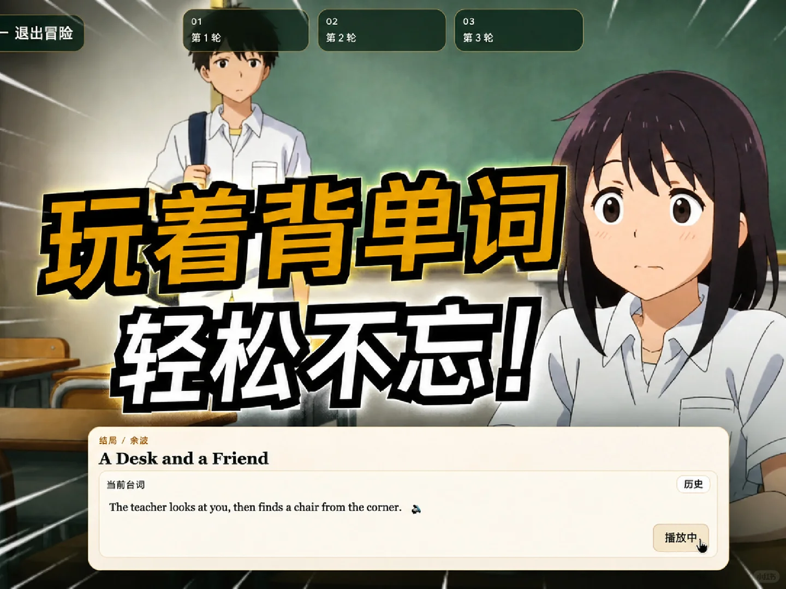

## 图片文字 (OCR)

> OCR 仅供参考，可能包含识别错误；请以原图为准。

出冒险
01
02
03
第1轮
第2轮
第3轮
玩着背单词
轻松不忘！
结局/余波
ADesk and aFriend
当前台词
历史
The teacher looks at you,then finds a chair from the corner.
2
播放中
