---
title: "为了解决哑巴英语，我做了个像素风学习游戏"
source: "https://www.xiaohongshu.com/discovery/item/6a53814f0000000022018795?app_platform=android&ignoreEngage=true&app_version=9.36.2&share_from_user_hidden=true&xsec_source=app_share&type=video&xsec_token=CBztOptAD5HbYypyfA9zvjyU49wrwtEZ4Abfsq4uTVFuQ%3D&author_share=1&xhsshare=CopyLink&shareRedId=N0dINjg3NUpMPko6S0EySDs0P0lFSjdL&apptime=1783867489&share_id=d84cbb72dab64d71a8af3d70bc04d85c&share_channel=copy_link"
author: "LinguaTown"
author_uid: "6721ac5e000000001c019a27"
date: "编辑于 3小时前 上海"
tags: ["我在小红书做游戏", "英语学习", "AI游戏", "像素风的游戏", "哑巴英语", "外语学习", "像素风游戏", "口语练习"]
platform: "xiaohongshu"
category: "游戏设计"
summary: "开发者制作像素风英语学习游戏，通过对话任务帮助用户摆脱哑巴英语。"
---

# 为了解决哑巴英语，我做了个像素风学习游戏

> 作者: LinguaTown | 日期: 编辑于 3小时前 上海 | 原文: https://www.xiaohongshu.com/discovery/item/6a53814f0000000022018795?app_platform=android&ignoreEngage=true&app_version=9.36.2&share_from_user_hidden=true&xsec_source=app_share&type=video&xsec_token=CBztOptAD5HbYypyfA9zvjyU49wrwtEZ4Abfsq4uTVFuQ%3D&author_share=1&xhsshare=CopyLink&shareRedId=N0dINjg3NUpMPko6S0EySDs0P0lFSjdL&apptime=1783867489&share_id=d84cbb72dab64d71a8af3d70bc04d85c&share_channel=copy_link

> **摘要**:开发者制作像素风英语学习游戏，通过对话任务帮助用户摆脱哑巴英语。

为何你考过了四六级，也刷了大量美剧，可是一遇到真实对话，还是听不懂、讲不出？
真正拉开差距的，从来不是你背了多少单词，而是能不能做到大胆开口，多听多练。
因此，我开发了一款像素风英语学习游戏。
在这里，我们把生活中遇到的各种真实问题，做成了游戏中的一个个英文对话任务。允许你和NPC练习开放式的即兴对话。
此外还有自由度更高的剧情模式（比如扮演侦探之类的，开发中）。
你不需要一开始就追求完美，只要在游戏中反复开口，英文就会慢慢熟练到脱口而出。 #我在小红书做游戏 #英语学习 #AI游戏 #像素风的游戏 #哑巴英语 #外语学习

#像素风游戏 #口语练习

## 视频

[视频 1](./video.mp4)

<video controls width="100%"><source src="./video.mp4" type="video/mp4">您的浏览器不支持视频播放。</video>

## 视频关键帧与转录(一幅图一句话)

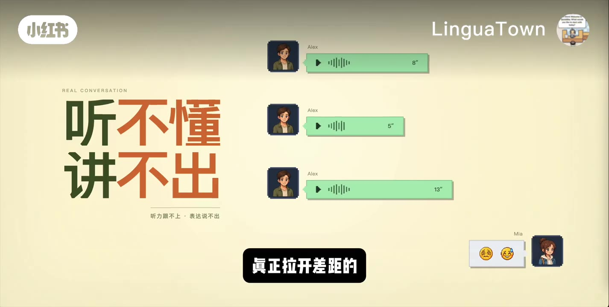

> **00:00-00:15** 为何你考过了四六级,也刷了大量美剧,可是一遇到真实对话,还是听不懂,讲不出。真正拉开差距的,从来不是你背了多少单词,而是能不能做到大胆开口,多听多练。

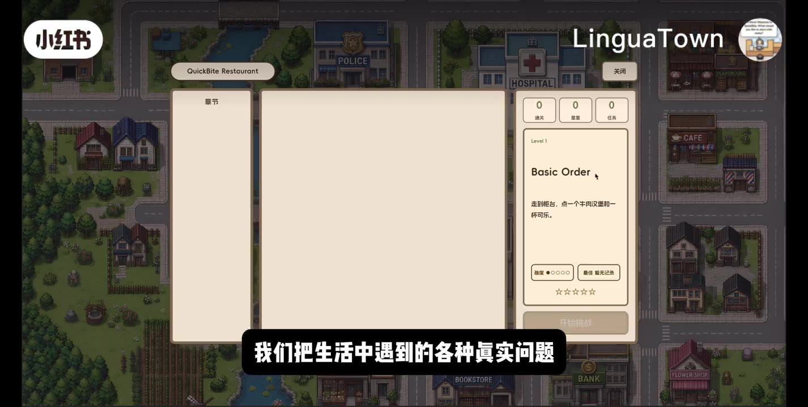

> **00:15-00:29** 因此,我开发了一款像素风英语学习游戏。在这里,我们把生活中遇到的各种真实问题,做成了游戏中的一个个英文对话任务,让你和NPC练习大量的即兴对话。

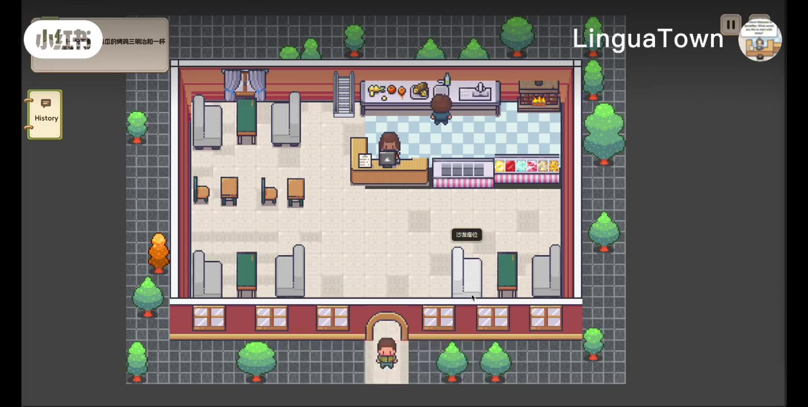

> **00:29-00:48** 现在我们遇到了第一个任务,点一份不要酸黄瓜的烤鸡三明治和一杯无冰气泡水。问题来了,我不知道怎么用英文讲酸黄瓜。如果是现实的话,这里就尴尬地卡住了。在游戏里,我们可以试着大胆开口,在英文中夹杂你不会的中文。

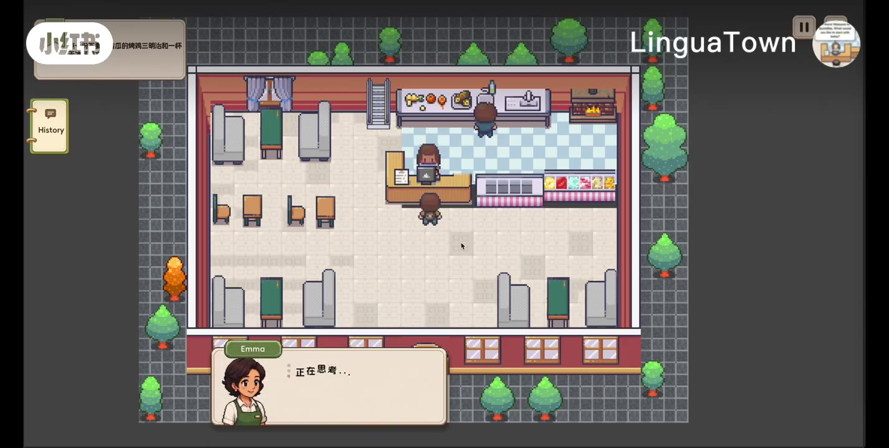

> **00:48-00:51** Hi there, what can I get for you today?

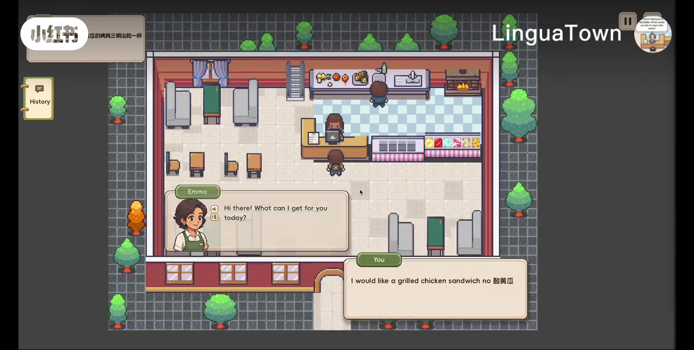

> **00:54-00:59** I would like a grilled chicken sandwich, no 酸黄瓜。

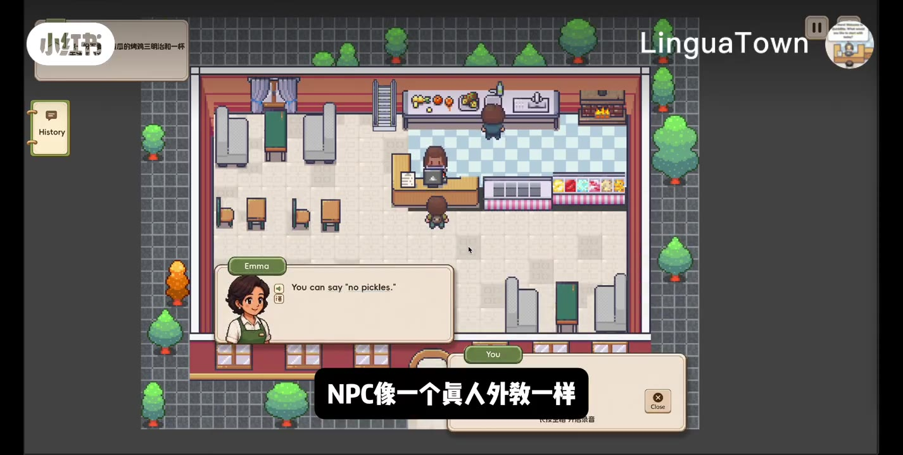

> **01:05-01:08** You can say no pickles.

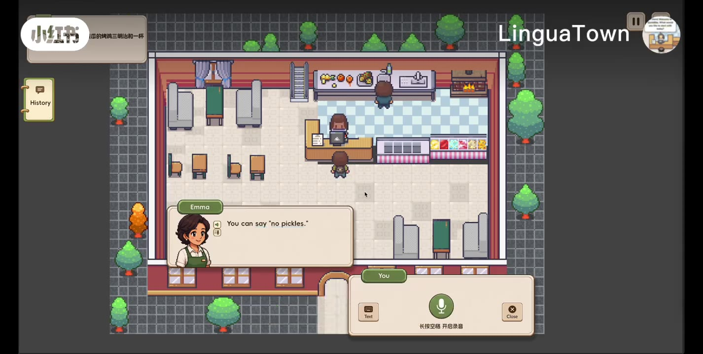

> **01:09-01:17** NPC像一个真人外教一样,通过影视纠正来完成了这个单词的教学。我们来练习一次。

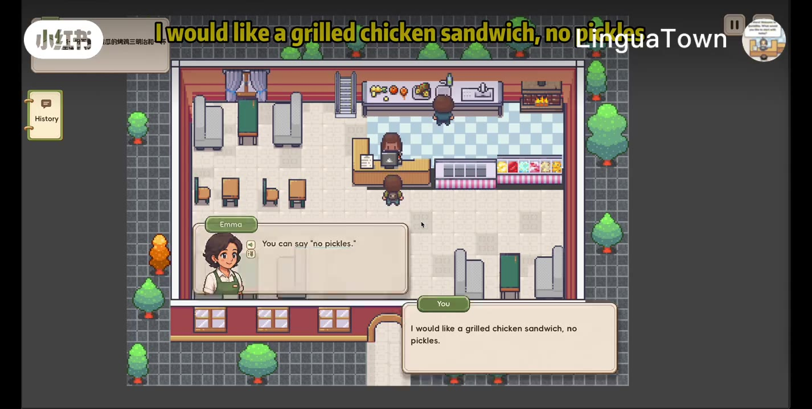

> **01:29-01:34** Got it, a grilled chicken sandwich with no pickles.

> **01:48-01:54** Sure, a sparkling water with no ice. For here or to go?

> **02:12-02:16** For here, can you confirm that's correct?

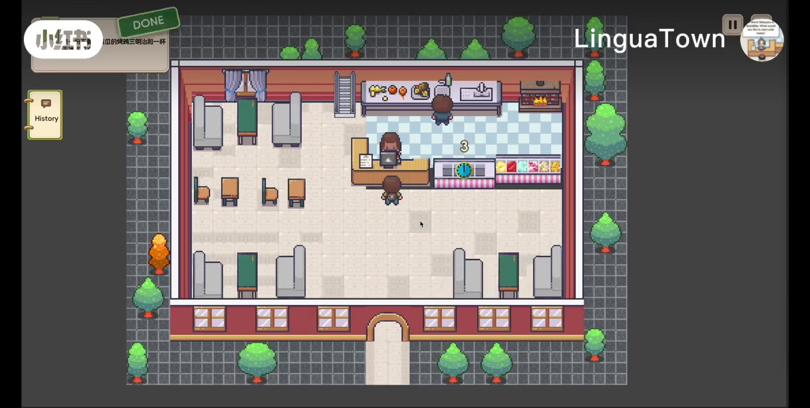

> **02:31-02:39** Please wait a moment and pick up your food at the pickup counter when it's ready. Thank you.

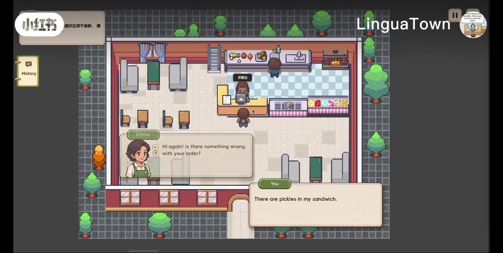

> **03:02-03:06** Hi again, is there something wrong with your order?

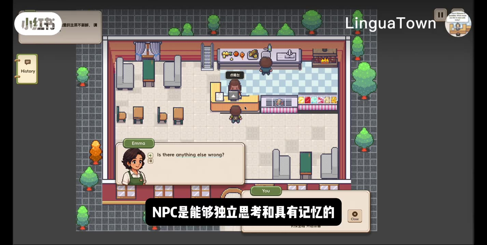

> **03:19-03:27** I don't see any pickles in it. It looks like we made it without pickles as you requested.

> **03:40-03:43** The lettuce is not fresh.

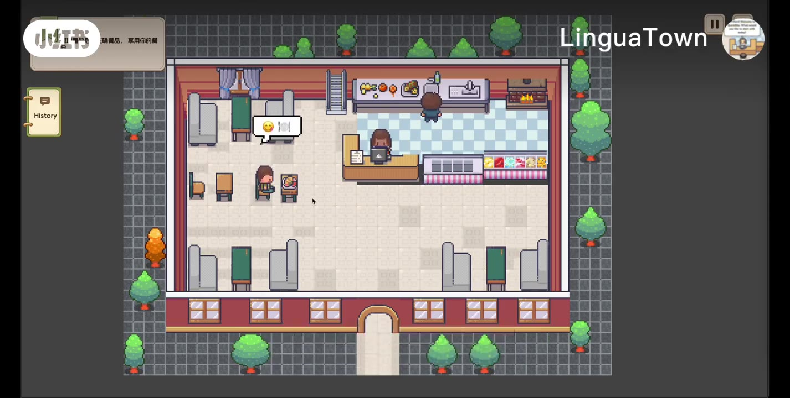

> **03:59-04:12** 以上两个小任务都是生活中可能会遇到的一些真实问题。我们的NPC也会表现得像一个真人外教一样,和你进行开放式的对话和影视教学。

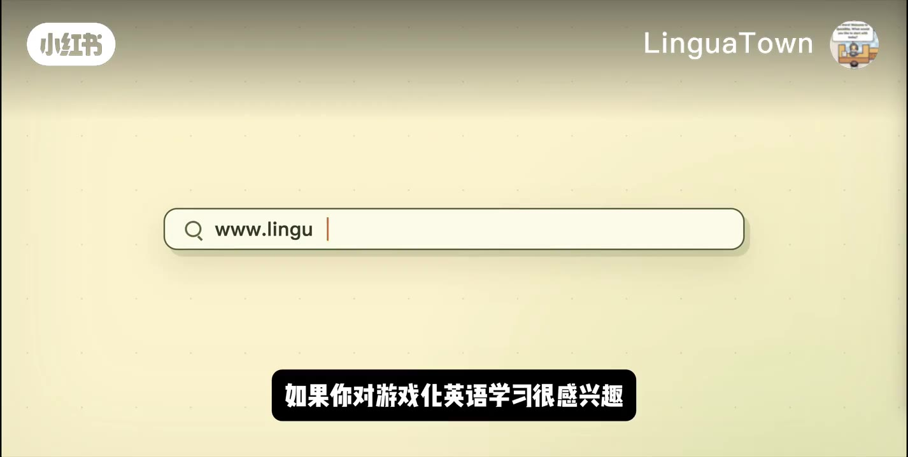

> **04:13-04:23** 我们还有更多的生活场景,以及自由度更高的故事模式。如果你对游戏化英语学习很感兴趣,请持续关注我们的项目。

> 共 16 段转录与帧对齐。

## 字幕文件

[TXT](./transcript/video.txt) | [JSON](./transcript/video.json) | [SRT](./transcript/video.srt) | [VTT](./transcript/video.vtt)

## 视频转录(完整逐段文本)

> 上方「视频关键帧与转录」已将 16 张关键帧与对应段落对齐。以下为 small 模型完整转录的 29 段,供参考。原始产物见上方字幕文件链接。

- **00:00-00:07** 为何你考过了四六级，也刷了大量美剧，可是一遇到真实对话还是听不懂，讲不出
- **00:07-00:14** 真正拉开差距的从来不是你背了多少单词，而是能不能做到大胆开口，多听多练
- **00:14-00:22** 因此我开发了一款像素风英语学习游戏，在这里我们把生活中遇到的各种真实问题
- **00:22-00:27** 做成了游戏中的一个个英文对话任务，让你和npc练习大量的即兴对话
- **00:29-00:35** 现在我们遇到了第一个任务，点一份不要酸黄瓜的烤鸡三明治和一杯无冰气泡水
- **00:35-00:42** 问题来了，我不知道怎么用英文讲酸黄瓜，如果是现实的话，这里就尴尬的卡住了
- **00:42-00:48** 在游戏里我们可以试着大胆开口，在英文中夹杂你不会的中文
- **00:48-00:51** Hi there,What can I get for you today?
- **00:54-00:57** I would like a grilled chicken sandwich
- **00:57-00:59** No酸黄瓜
- **01:05-01:08** You can say no pickles
- **01:09-01:17** Npc像一个真人外教一样，通过影视纠正来完成了这个单词的教学，我们来练习一次
- **01:17-01:22** I would like a grilled chicken,三文鱼吃no peacocks
- **01:28-01:33** Got it a grilled chicken sandwich with no pickles
- **01:35-01:37** What would you like to drink?
- **01:38-01:41** Sparkling water no ice
- **01:47-01:54** Sure a sparkling water with no ice for here or to go
- **01:55-01:56** For here
- **02:03-02:04** So
- **02:04-02:09** That's a grilled chicken sandwich with no pickles
- **02:09-02:13** And a sparkling water with no ice for here
- **02:13-02:15** Can you confirm that's correct?
- **02:17-02:19** Yes,It's correct
- **02:26-02:30** All right,Your order is confirm
- **02:31-02:36** Please wait a moment and pick up your food at the pickup counter
- **02:36-02:37** When it's ready
- **02:37-02:38** Thank you
- **02:47-02:54** 现在来了一个新任务，三明治里的生菜不太新鲜，让服务员给换成新鲜的
- **02:54-02:59** 不过我们先故意说错情况，看看npc是不是只会顺着我们的话讲
- **03:03-03:06** Is there something wrong with your order
- **03:07-03:10** 接apicos in my stand which
- **03:16-03:19** Let me check your sandwich
- **03:20-03:22** I don't see any pickles in it
- **03:23-03:27** It looks like we made it without pickles as you requested
- **03:28-03:30** Is there anything else wrong
- **03:31-03:39** 可以，Nbc是能够独立思考和具有记忆的，他并没有盲目顺着我说，那我们如实相告
- **03:40-03:43** The lettuce. It not fresh
- **03:50-03:53** I'm so sorry about that
- **03:53-03:58** Let me remake your sandwich with fresh lettuce right away
- **04:01-04:07** 以上两个小任务都是生活中可能会遇到到的一些真实问题，我们的npc
- **04:07-04:13** 也会表现得像一个真人外教一样，和你进行开放式的对话和影视教学
- **04:13-04:17** 我们还有更多的生活场景以及自由度更高的故事模式
- **04:17-04:23** 如果你对游戏化英语学习很感兴趣，请持续关注我们的项目

## 图片

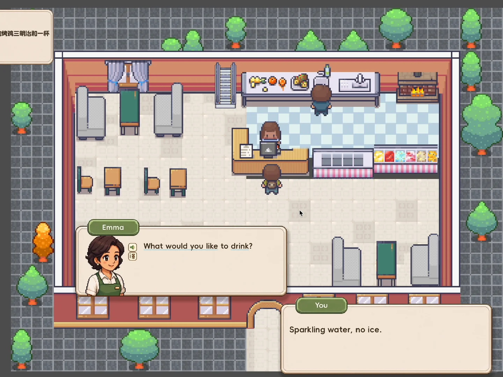

## 图片文字 (OCR)

烤鸡三明 ; 和一杯 11 A ry
| 11 aL - | -习习 d= a)
片 F——
| | = i
vi il E 下产权可三一 BE
CHEE eee rl EE
: x
司 (emma ]
id 大 2 What would you like to drink? Ig i il T
重 1H] eal | I 1
= A Sparkling water, no ice.
a - | :

## 评论 (共 4 条,已存 4 条)

详见 `comments-6a53814f0000000022018795.json`。
