---
title: "从输入到学会，Star Speller 用起来有多简单"
source: "https://www.xiaohongshu.com/discovery/item/6a71fd3b000000002c004e7a?app_platform=android&ignoreEngage=true&app_version=9.41.0&share_from_user_hidden=true&xsec_source=app_share&type=video&xsec_token=CBNwHDj1R5tAvDYimTy5OhYSzo-9hIKjoU9b7y5uatzbk%3D&author_share=1&xhsshare=CopyLink&shareRedId=N0dINjg3NUpMPko6S0EySDs0P0lFSjdL&apptime=1786279190&share_id=fbedbe12988c4863a0846ede2d06e110&share_channel=copy_link"
author: "🌟Star Speller🌟"
author_uid: "5569519d3397db11ec3a9700"
date: "08-04 中国香港"
tags: ["StarSpeller", "英语学习原来可以这么有趣", "语言学习", "翻译软件", "每日英语", "英语学习", "单词记忆", "Star Speller", "词根拆解", "语言学习工具"]
platform: "xiaohongshu"
category: "游戏设计/学习游戏机制"
summary: "本文介绍了Star Speller英语学习工具的四步使用方法：输入单词、看词根拆分、节奏游戏练习、回顾卡片。通过这种流程，用户不仅能记住单词，还能深入理解单词的构成和发音，真正认识而非死记硬背，体现了语言学习工具将趣味性与有效性结合的特点。"
---

# 从输入到学会，Star Speller 用起来有多简单

> 作者: 🌟Star Speller🌟 | 日期: 08-04 中国香港 | 原文: https://www.xiaohongshu.com/discovery/item/6a71fd3b000000002c004e7a?app_platform=android&ignoreEngage=true&app_version=9.41.0&share_from_user_hidden=true&xsec_source=app_share&type=video&xsec_token=CBNwHDj1R5tAvDYimTy5OhYSzo-9hIKjoU9b7y5uatzbk%3D&author_share=1&xhsshare=CopyLink&shareRedId=N0dINjg3NUpMPko6S0EySDs0P0lFSjdL&apptime=1786279190&share_id=fbedbe12988c4863a0846ede2d06e110&share_channel=copy_link

> **摘要**:本文介绍了Star Speller英语学习工具的四步使用方法：输入单词、看词根拆分、节奏游戏练习、回顾卡片。通过这种流程，用户不仅能记住单词，还能深入理解单词的构成和发音，真正认识而非死记硬背，体现了语言学习工具将趣味性与有效性结合的特点。

从输入到学会，Star Speller 用起来有多简单
①输入单词 → ②看词根拆分 → ③节奏游戏练习 → ④回顾卡片。四步走完，一个新单词已经在脑子里扎根了。不只是记单词，是真正认识一个词——知道它怎么拆、怎么读。
#StarSpeller #英语学习原来可以这么有趣 #语言学习 #翻译软件 #每日英语
08-04 中国香港

#英语学习 #单词记忆 #Star Speller #词根拆解 #语言学习工具

## 视频

[视频 1](./video.mp4)

<video controls width="100%"><source src="./video.mp4" type="video/mp4">您的浏览器不支持视频播放。</video>

附件: [音频](./audio/audio.wav) | [处理清单](./video_manifest.json)

## 视频图文总结

> 按关键帧关联完整视频转录；文字保留机器转写原文，时间点仅用于定位。

### 1. 00:00

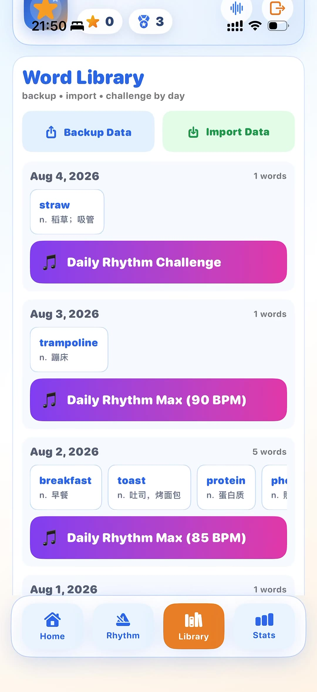

- 画面文字（OCR）：21:50
0
3
用
★
Word Library
backup
import·challenge by day
Import Data
Backup Data
Aug 4, 2026
1words
straw
n.稻草；吸管
Daily Rhythm Challenge
Aug3,2026
1 words
trampoline
n.蹦床
Daily Rhythm Max (90 BPM)
Aug 2,2026
5 words
breakfast
toast
protein
ph
n.早餐
n.吐司，烤面包
n.蛋白质
n.照
Daily Rhythm Max (85 BPM)
Aug 1,2026
1
words
Ish
Rhythm
Library
Home
Stats

### 2. 00:08

- 画面文字（OCR）：不
TRAMPOLINE
line
tram
po
/'trampalin/
n.
蹦床
Report issue
I see a big trampoline.
PHRASES
big trampoline
jump on a trampoline
From Spanish 'trampolin' meaning a diving board.
TAP TO SPEAK

### 3. 00:09

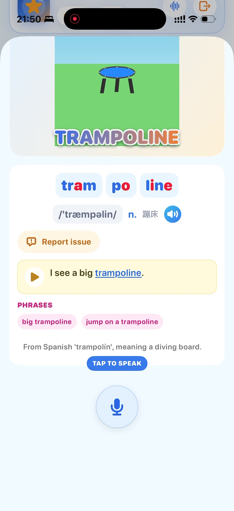

- 内容摘要：I see a big trampoline,Big trampoline,Jump on a trampoline（00:10-00:15）
- 画面文字（OCR）：T
TRAMPOLINE
line
tram
po
/'traempalinl
n.
蹦床
Report issue
I see a big trampoline.
PHRASES
big trampoline
jump on a trampoline
From Spanish 'trampolin'meaning a diving oard.
TAP TO SPEAK

### 4. 00:16

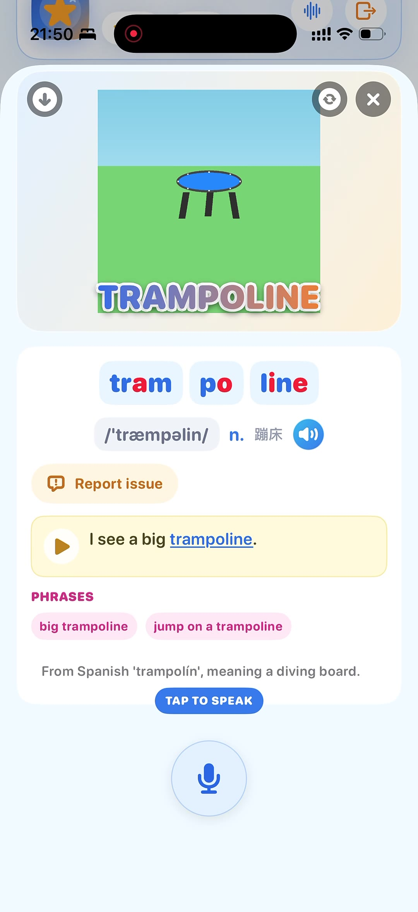

- 画面文字（OCR）：m
TRAMPOLINE
line
tram
po
/'traempalin/
n.
蹦床
Report issue
I see a big trampoline.
PHRASES
big trampoline
jump on a trampoline
From Spanish 'trampolin',meaning a diving board.
TAP TO SPEAK

### 5. 00:20

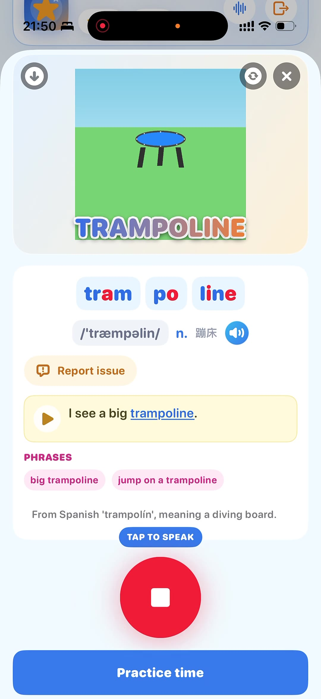

- 画面文字（OCR）：茶
TRAMPOLINE
line
tram
po
/'traempelin/
n.
蹦床
)
Report issue
I see a big trampoline.
PHRASES
big trampoline
jump on a trampoline
From Spanish 'trampolin'meaning a diving board.
TAP TO SPEAK

### 6. 00:21

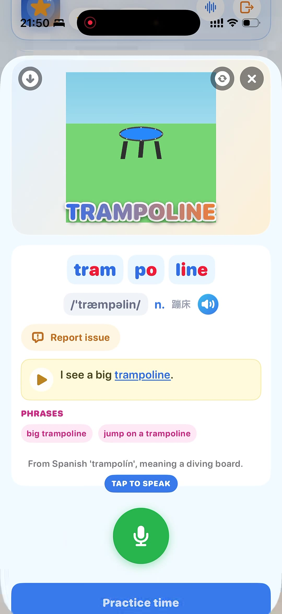

- 画面文字（OCR）：木
TRAMPOLINE
line
tram
po
/'traempalin/
蹦床
n.
Report issue
I see a big trampoline.
PHRASES
big trampoline
jump on a trampoline
From Spanish 'trampolin'meaning a diving board.
TAP TO SPEAK

### 7. 00:22

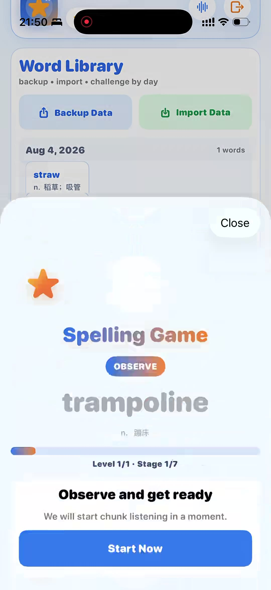

- 画面文字（OCR）：Word Library
import·challenge by day
backup
·
Backup Data
Import Data
Aug 4,2026
1words
straw
n.稻草；吸管
Close
Spelling
Game
OBSERVE
trampoline
蹦床
n.
Level 1/1·Stage 1/7
Observe and get ready
We will start chunk listening in a moment.
Start Now

### 8. 00:24

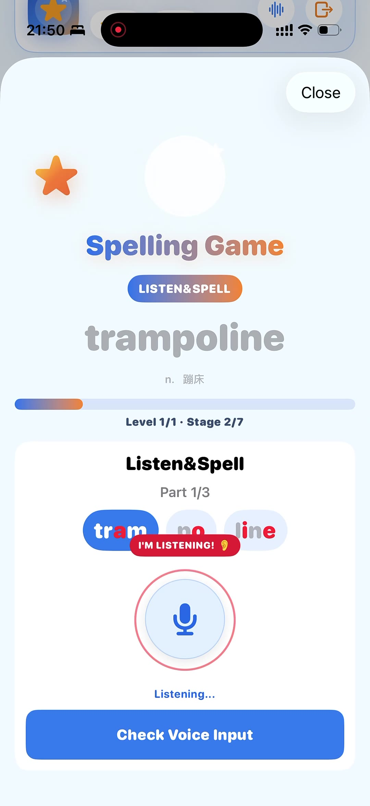

- 画面文字（OCR）：Close
Spelling
Game
LISTEN&SPELL
trampoline
n． 蹦床
Level 1/1 · Stage 2/7
Listen&Spell
Part 1/3
tram
line
I'MLISTENING!
Listening...
Check Voice Input

### 9. 00:26

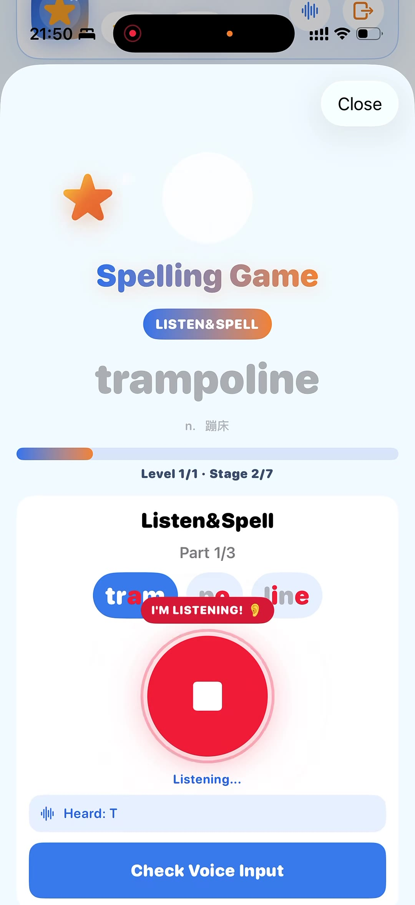

- 画面文字（OCR）：Close
Spelling
Game
LISTEN&SPELL
trampoline
n.蹦床
Level 1/1 · Stage 2/7
Listen&Spell
Part 1/3
tram
ine
I'MLISTENING!
Listening..
州
Heard: T
Check Voice Input

### 10. 00:28

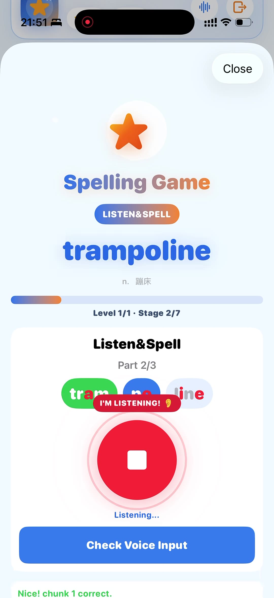

- 画面文字（OCR）：Close
Spelling
Game
LISTEN&SPELL
trampoline
n.蹦床
Level 1/1· Stage 2/7
Listen&Spell
Part 2/3
trar
line
I'MLISTENING!
Listening...
Check Voice Input

### 11. 00:31

- 画面文字（OCR）：Close
Spelling
Game
LISTEN&SPELL
trampoline
n. 蹦床
Level 1/1· Stage 2/7
Listen&Spell
Part 2/3
tram
line
I'MLISTENING!
Listening...
Check Voice Input

### 12. 00:32

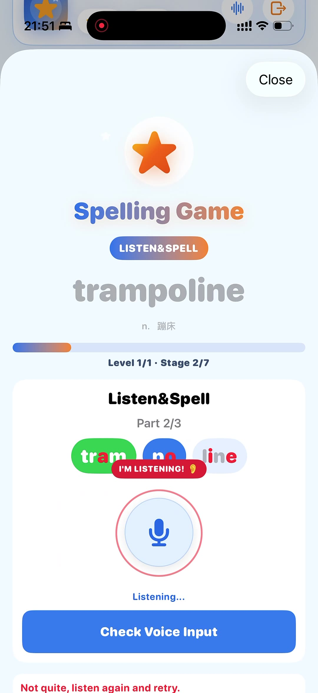

- 画面文字（OCR）：Close
Spelling
Game
LISTEN&SPELL
trampoline
n.蹦床
Level 1/1· Stage 2/7
Listen&Spell
Part 2/3
tram
iine
I'MLISTENING!
Listening...
Check Voice Input

### 13. 00:33

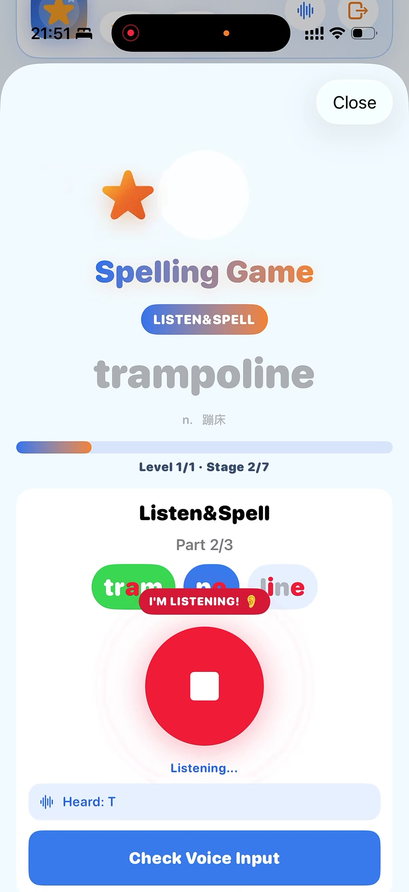

- 画面文字（OCR）：Close
Spelling
Game
LISTEN&SPELL
trampoline
n.蹦床
Level 1/1· Stage 2/7
Listen&Spell
Part 2/3
ine
trar
I'MLISTENING!
Listening...
帅
Heard: T
Check Voice Input

### 14. 00:35

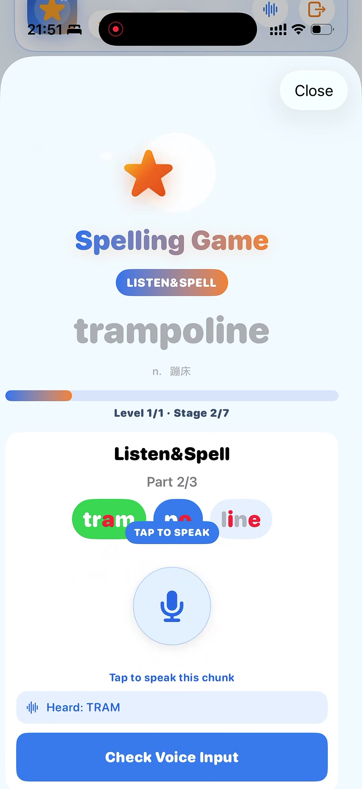

- 画面文字（OCR）：Close
Spelling
Game
LISTEN&SPELL
trampoline
n.蹦床
Level 1/1· Stage 2/7
Listen&Spell
Part 2/3
tram
line
TAP TO SPEAK
Tap to speak this chunk
Heard:TRAM
Check Voice Input

### 15. 00:37

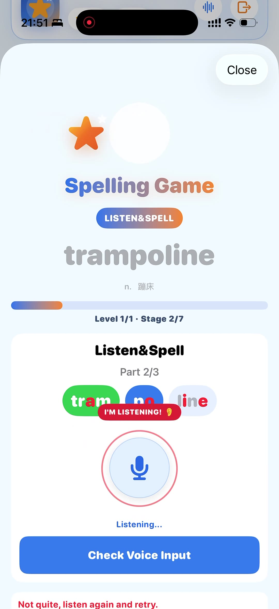

- 画面文字（OCR）：Close
Spelling
Game
LISTEN&SPELL
trampoline
n． 蹦床
Level 1/1· Stage 2/7
Listen&Spell
Part 2/3
tram
line
I'MLISTENING!
Listening...
Check Voice Input

### 16. 00:39

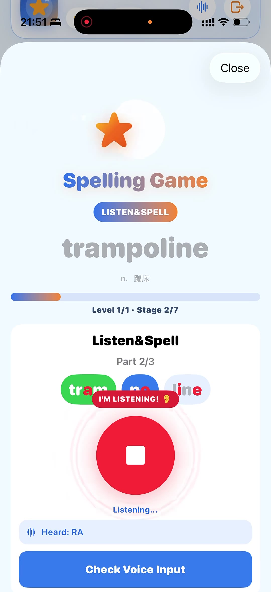

- 画面文字（OCR）：Close
Spelling
Game
LISTEN&SPELL
trampoline
n.蹦床
Level 1/1· Stage 2/7
Listen&Spell
Part2/3
trar
line
I'MLISTENING!
Listening...
帅
Heard:RA
Check Voice Input

### 17. 00:44

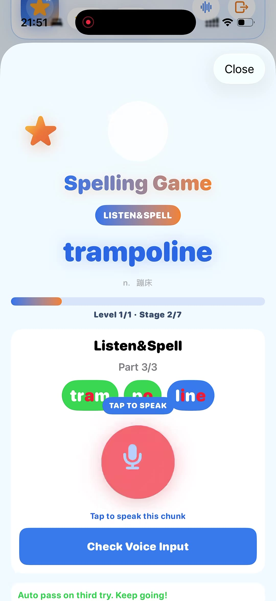

- 该时间点暂无可提取文字。

### 18. 00:47

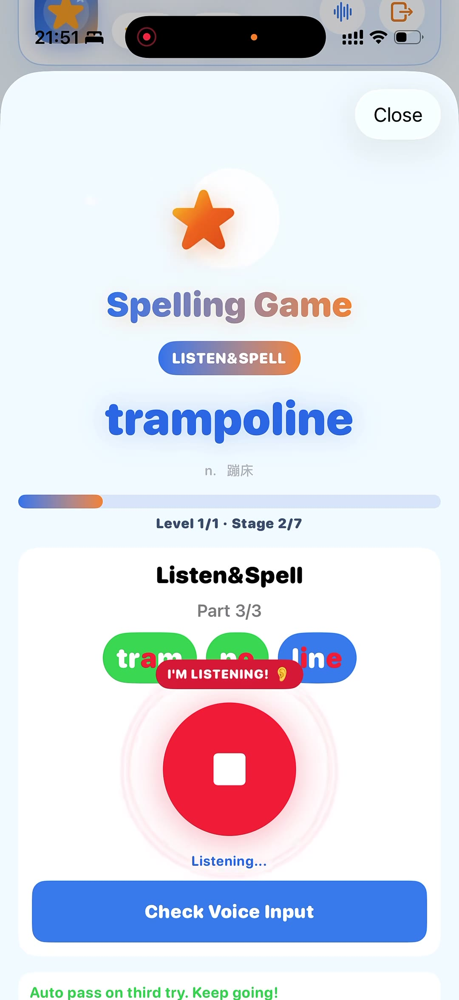

- 该时间点暂无可提取文字。

### 19. 00:49

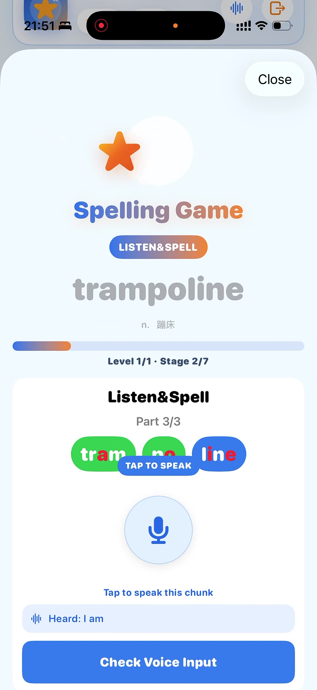

- 该时间点暂无可提取文字。

### 20. 00:51

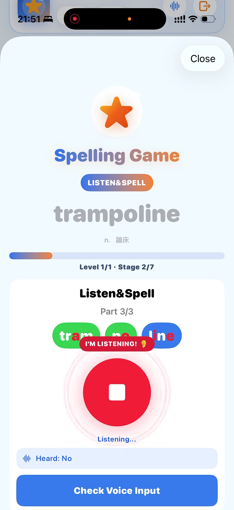

- 该时间点暂无可提取文字。

### 21. 00:54

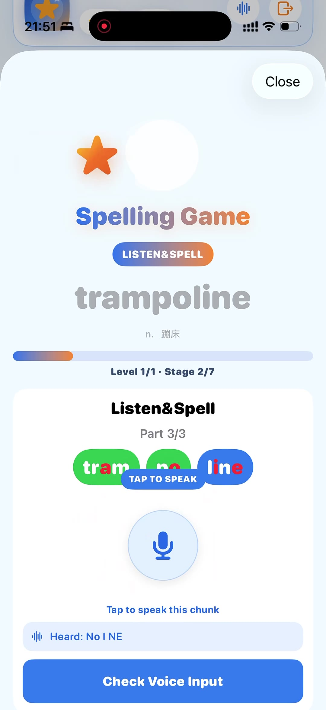

- 该时间点暂无可提取文字。

### 22. 00:55

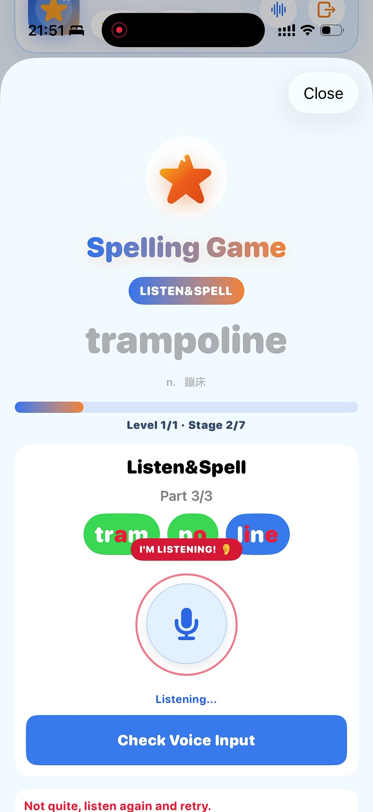

- 该时间点暂无可提取文字。

### 23. 01:03

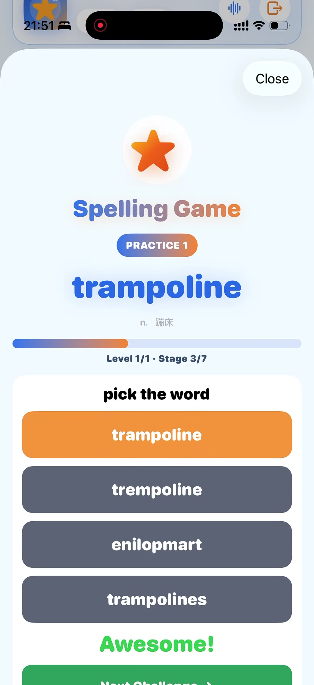

- 该时间点暂无可提取文字。

### 24. 01:11

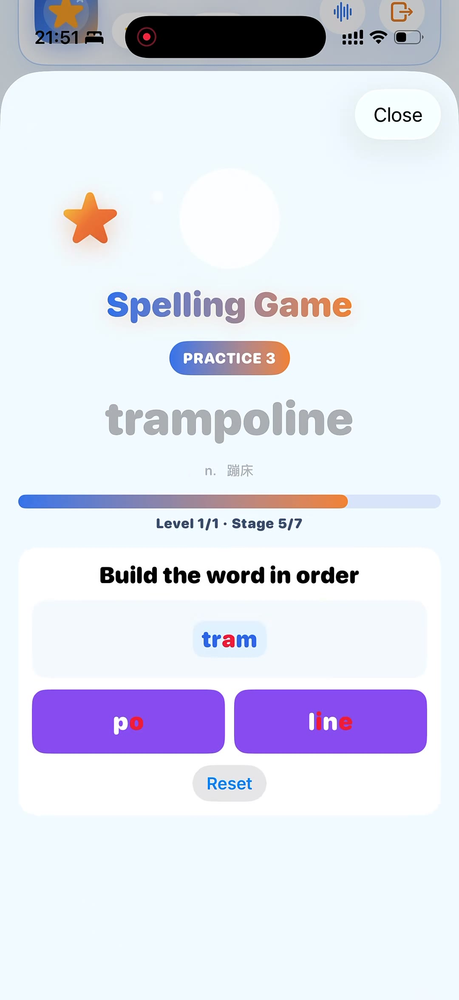

- 内容摘要：Trampoline（01:08-01:09）

### 25. 01:19

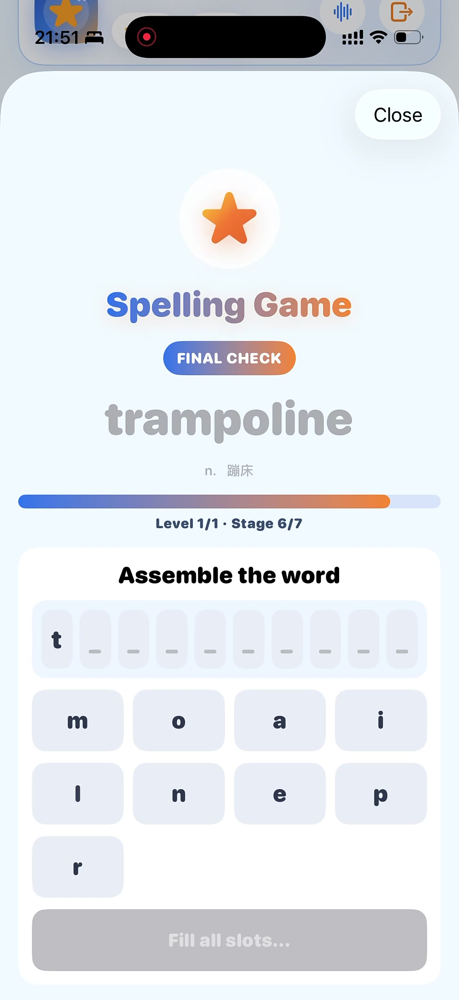

- 该时间点暂无可提取文字。

### 26. 01:27

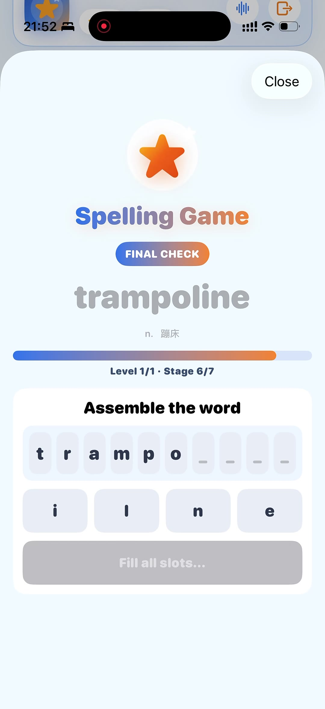

- 该时间点暂无可提取文字。

### 27. 01:35

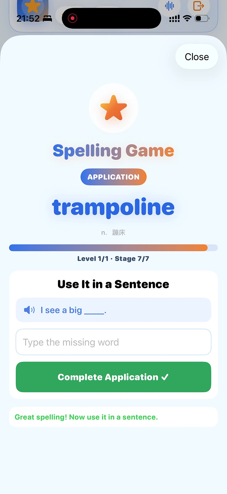

- 该时间点暂无可提取文字。

### 28. 01:42

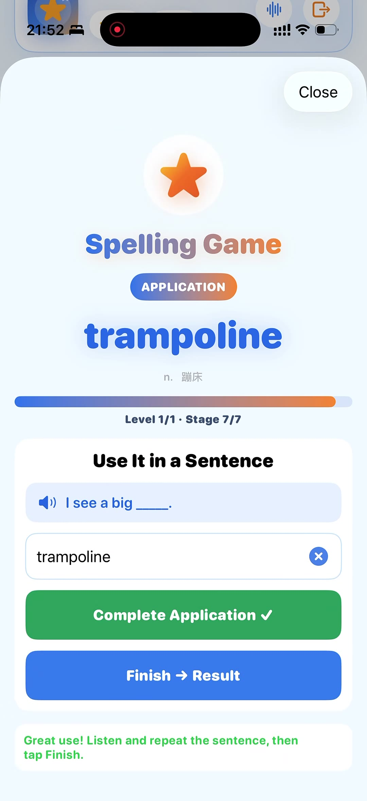

- 该时间点暂无可提取文字。

### 29. 01:50

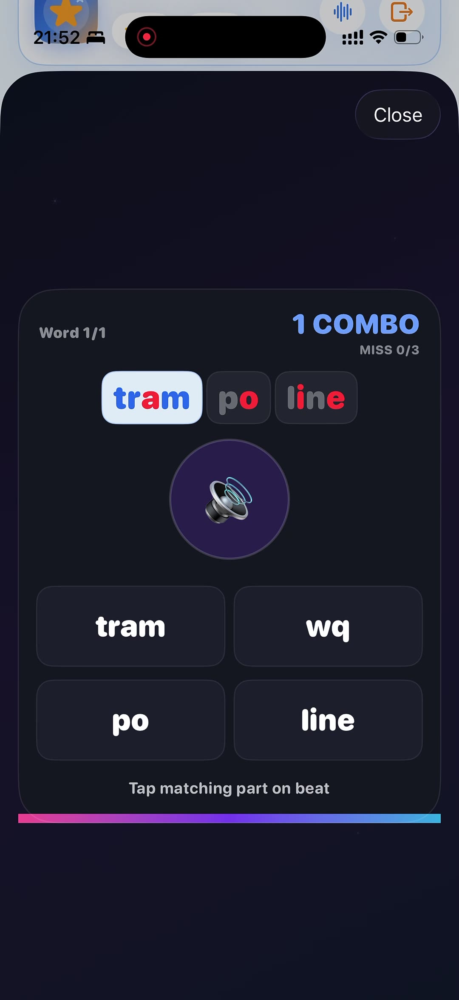

- 内容摘要：Clean（01:51-01:52）

### 30. 01:58

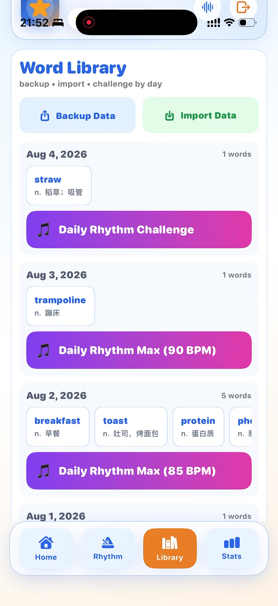

- 该时间点暂无可提取文字。

## 视频画面文字 (OCR)

> OCR 仅供参考，可能包含识别错误；请以视频画面和转写来源为准。

### 关键帧 1 · 0.5s

21:50
0
3
用
★
Word Library
backup
import·challenge by day
Import Data
Backup Data
Aug 4, 2026
1words
straw
n.稻草；吸管
Daily Rhythm Challenge
Aug3,2026
1 words
trampoline
n.蹦床
Daily Rhythm Max (90 BPM)
Aug 2,2026
5 words
breakfast
toast
protein
ph
n.早餐
n.吐司，烤面包
n.蛋白质
n.照
Daily Rhythm Max (85 BPM)
Aug 1,2026
1
words
Ish
Rhythm
Library
Home
Stats

### 关键帧 2 · 8.38s

不
TRAMPOLINE
line
tram
po
/'trampalin/
n.
蹦床
Report issue
I see a big trampoline.
PHRASES
big trampoline
jump on a trampoline
From Spanish 'trampolin' meaning a diving board.
TAP TO SPEAK

### 关键帧 3 · 9.37s

T
TRAMPOLINE
line
tram
po
/'traempalinl
n.
蹦床
Report issue
I see a big trampoline.
PHRASES
big trampoline
jump on a trampoline
From Spanish 'trampolin'meaning a diving oard.
TAP TO SPEAK

### 关键帧 4 · 16.27s

m
TRAMPOLINE
line
tram
po
/'traempalin/
n.
蹦床
Report issue
I see a big trampoline.
PHRASES
big trampoline
jump on a trampoline
From Spanish 'trampolin',meaning a diving board.
TAP TO SPEAK

### 关键帧 5 · 20.68s

茶
TRAMPOLINE
line
tram
po
/'traempelin/
n.
蹦床
)
Report issue
I see a big trampoline.
PHRASES
big trampoline
jump on a trampoline
From Spanish 'trampolin'meaning a diving board.
TAP TO SPEAK

### 关键帧 6 · 21.6s

木
TRAMPOLINE
line
tram
po
/'traempalin/
蹦床
n.
Report issue
I see a big trampoline.
PHRASES
big trampoline
jump on a trampoline
From Spanish 'trampolin'meaning a diving board.
TAP TO SPEAK

### 关键帧 7 · 22.43s

Word Library
import·challenge by day
backup
·
Backup Data
Import Data
Aug 4,2026
1words
straw
n.稻草；吸管
Close
Spelling
Game
OBSERVE
trampoline
蹦床
n.
Level 1/1·Stage 1/7
Observe and get ready
We will start chunk listening in a moment.
Start Now

### 关键帧 8 · 24.15s

Close
Spelling
Game
LISTEN&SPELL
trampoline
n． 蹦床
Level 1/1 · Stage 2/7
Listen&Spell
Part 1/3
tram
line
I'MLISTENING!
Listening...
Check Voice Input

### 关键帧 9 · 26.35s

Close
Spelling
Game
LISTEN&SPELL
trampoline
n.蹦床
Level 1/1 · Stage 2/7
Listen&Spell
Part 1/3
tram
ine
I'MLISTENING!
Listening..
州
Heard: T
Check Voice Input

### 关键帧 10 · 28.65s

Close
Spelling
Game
LISTEN&SPELL
trampoline
n.蹦床
Level 1/1· Stage 2/7
Listen&Spell
Part 2/3
trar
line
I'MLISTENING!
Listening...
Check Voice Input

### 关键帧 11 · 31.23s

Close
Spelling
Game
LISTEN&SPELL
trampoline
n. 蹦床
Level 1/1· Stage 2/7
Listen&Spell
Part 2/3
tram
line
I'MLISTENING!
Listening...
Check Voice Input

### 关键帧 12 · 32.04s

Close
Spelling
Game
LISTEN&SPELL
trampoline
n.蹦床
Level 1/1· Stage 2/7
Listen&Spell
Part 2/3
tram
iine
I'MLISTENING!
Listening...
Check Voice Input

### 关键帧 13 · 33.35s

Close
Spelling
Game
LISTEN&SPELL
trampoline
n.蹦床
Level 1/1· Stage 2/7
Listen&Spell
Part 2/3
ine
trar
I'MLISTENING!
Listening...
帅
Heard: T
Check Voice Input

### 关键帧 14 · 35.9s

Close
Spelling
Game
LISTEN&SPELL
trampoline
n.蹦床
Level 1/1· Stage 2/7
Listen&Spell
Part 2/3
tram
line
TAP TO SPEAK
Tap to speak this chunk
Heard:TRAM
Check Voice Input

### 关键帧 15 · 37.03s

Close
Spelling
Game
LISTEN&SPELL
trampoline
n． 蹦床
Level 1/1· Stage 2/7
Listen&Spell
Part 2/3
tram
line
I'MLISTENING!
Listening...
Check Voice Input

### 关键帧 16 · 39.92s

Close
Spelling
Game
LISTEN&SPELL
trampoline
n.蹦床
Level 1/1· Stage 2/7
Listen&Spell
Part2/3
trar
line
I'MLISTENING!
Listening...
帅
Heard:RA
Check Voice Input

## 字幕文件

[TXT](./transcript/video.txt) | [JSON](./transcript/video.json) | [SRT](./transcript/video.srt) | [VTT](./transcript/video.vtt)

## 转写来源

[平台字幕 TXT](./transcript/platform/video.txt) | [平台字幕 JSON](./transcript/platform/video.json) | [平台字幕 SRT](./transcript/platform/video.srt) | [平台字幕 VTT](./transcript/platform/video.vtt)

## 视频转录

- **00:10-00:15** I see a big trampoline,Big trampoline,Jump on a trampoline
- **01:08-01:09** Trampoline
- **01:51-01:52** Clean

## 图片

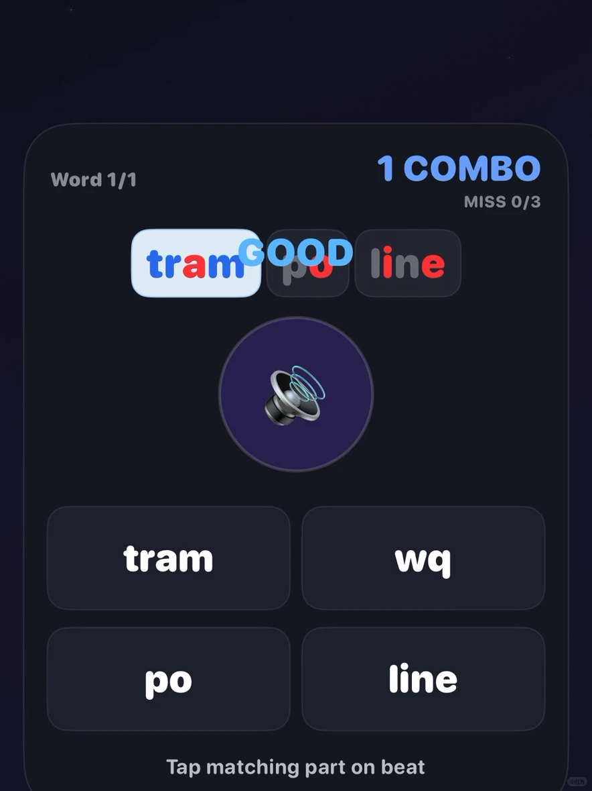

## 图片文字 (OCR)

> OCR 仅供参考，可能包含识别错误；请以原图为准。

1COMBO
Word 1/1
MISS0/3
tramGooD
line
tram
wq
line
po
Tapmatching part on beat
