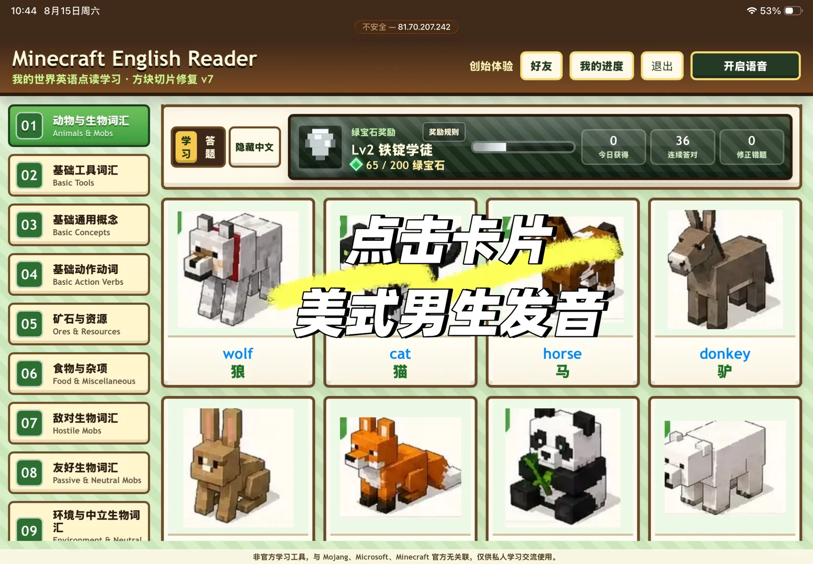
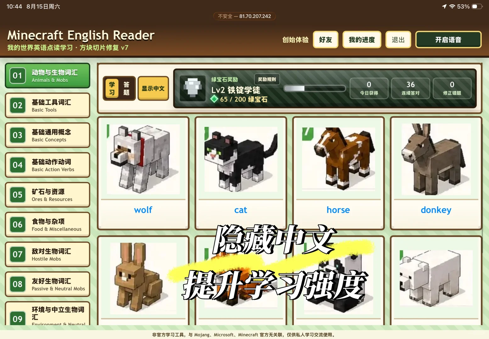
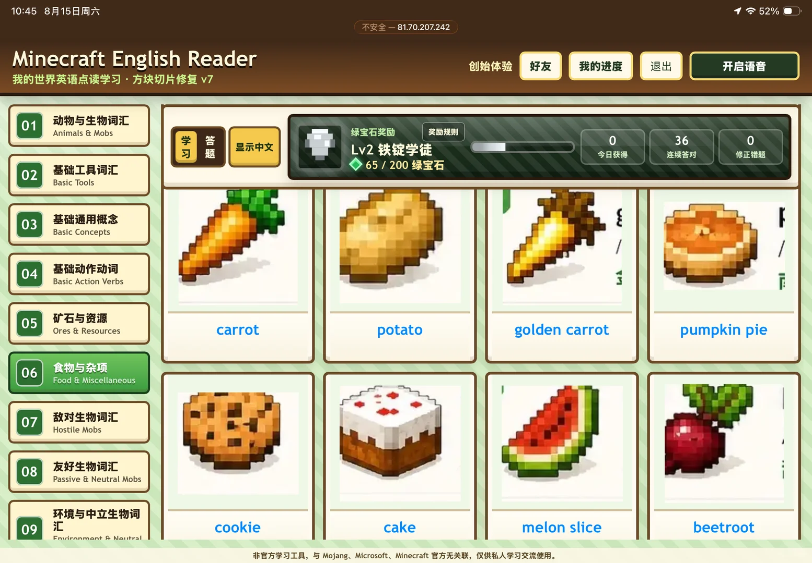
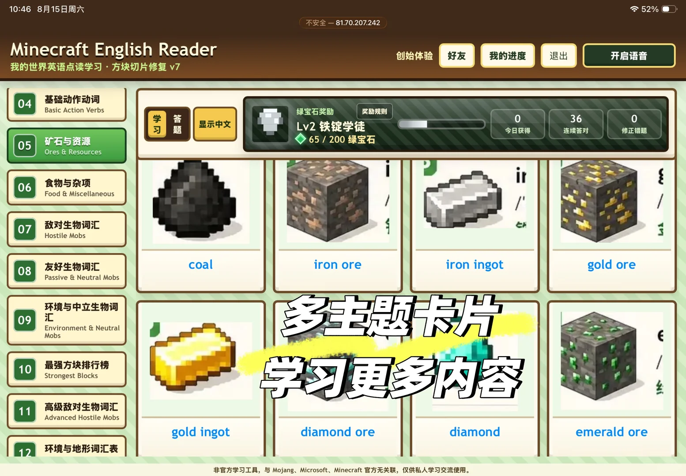
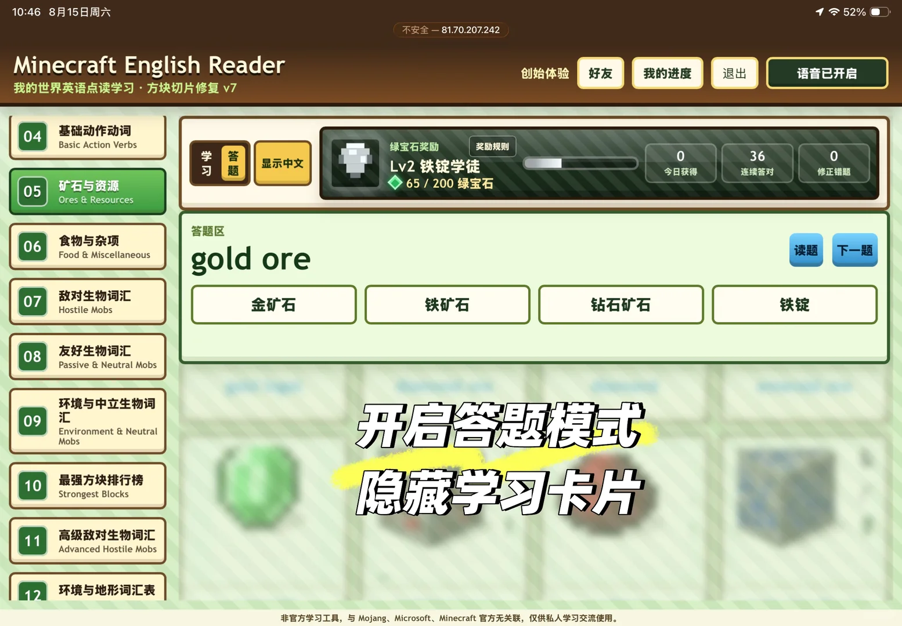
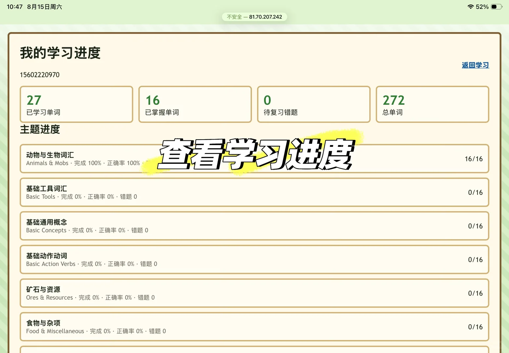
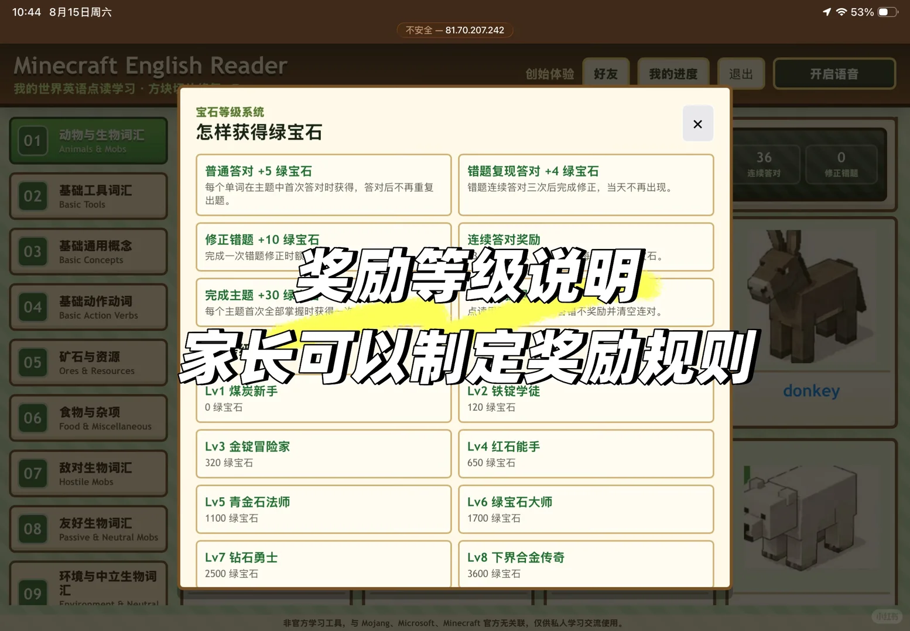
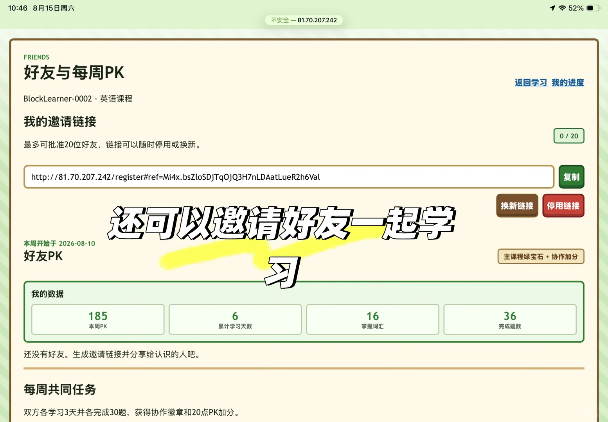

# 儿子喜欢玩我的世界我把它做成了英语学习

> 作者: Joven21 | 日期: 39分钟前 广东 | 原文: https://www.xiaohongshu.com/discovery/item/6a7fe0740000000035016be0?app_platform=android&ignoreEngage=true&app_version=9.42.0&share_from_user_hidden=true&xsec_source=app_share&type=normal&xsec_token=CBeG1PHR5oiXqCLeaip3kQ_KchLa_jCrw1k2xno3X5sNI%3D&author_share=1&xhsshare=CopyLink&shareRedId=N0dINjg3NUpMPko6S0EySDs0P0lFSjdL&apptime=1786767552&share_id=d715a705e9d846278e9057467445b88e&share_channel=copy_link

> **摘要**:作者为儿子开发了一款基于《我的世界》主题的英语学习工具Minecraft English Reader。该系统包含17个主题、272个单词，支持点读发音、隐藏中文回忆练习和答题模式，答错单词会进入复习队列需连续答对3次才能修正。系统还设计了绿宝石奖励、等级成长、连对奖励、主题徽章等激励机制，并保存学

儿子喜欢玩我的世界我把它做成了英语学习
最近一直在完善这套 Minecraft English Reader。
	
它不是简单地把单词放到网页里，而是希望把孩子熟悉的游戏元素，变成真正可以持续使用的英语学习工具。
	
目前已经整理了17个主题、约272个单词。孩子可以先点击卡片听美式发音，也可以隐藏中文进行回忆练习。进入答题模式后，答对的普通单词不会重复出现；答错的单词会进入复习队列，连续答对3次才算完成修正。
	
为了增加学习动力，我还加入了绿宝石奖励、等级成长、连续答对和主题徽章。完成一个主题后，系统会询问是否继续学习下一个主题。
	
整个系统会保存个人学习进度，退出后再次登录也能继续学习。
	
现在还在持续测试和优化中，重点观察孩子是否愿意主动点读、是否能记住错题，以及整套流程在平板横屏上的使用体验。
	
正在邀请小朋友参与体验，也欢迎家长提出真实使用反馈。
	
本项目为非官方英语学习工具，与 Mojang、Microsoft及Minecraft官方无关联，仅用于学习交流。
	
#儿童英语 #英语启蒙 #小学英语 #单词学习 #英语点读 #Minecraft #我的世界 #学习工具 #亲子学习 #教育产品
39分钟前 广东

#儿童英语学习 #Minecraft主题

## 图片

## 图片文字 (OCR)

> OCR 仅供参考，可能包含识别错误；请以原图为准。

不安全一81.70.207.242
Minecraft EnglishReader
创始体验
好友
我的进度
退出
开启语音
我的世界英语点读学习·方块切片修复v7
动物与生物词汇
01
Animals & Mobs
绿宝石奖励
奖励规则
学习
答题
0
36
隐藏中文
Lv2 铁锭学徒
今日获得
连续答对
修正错题
65/200
绿宝石
02
基础工具词汇
Basic Tools
基础通用概念
点击卡片
03
Basic Concepts
基础动作动词
04
Basic Action Verbs
美式男生发音
矿石与资源
05
Ores &t Resources
wolf
cat
horse
donkey
食物与杂项
狼
猫
马
06
驴
Food &Miscellaneous
07
敌对生物词汇
HostileMobs
08
友好生物词汇
Passive &Neutral Mobs
环境与中立生物词
09
汇
Fnvironment SNoutral

不安全一81.70.207.242
Minecraft English Reader
创始体验
好友
我的进度
退出
开启语音
我的世界英语点读学习·方块切片修复v7
动物与生物词汇
01
Animals & Mobs
绿宝石奖励
奖励规则
学
答题
36
0
显示中文
Lv2 铁锭学徒
习
今日获得
连续答对
修正错题
65/200绿宝石
基础工具词汇
02
Basic Tools
基础通用概念
03
Basic Concepts
04
基础动作动词
Basic Action Verbs
矿石与资源
05
Ores &tResources
wolf
cat
horse
donkey
06
食物与杂项
隐藏中文
Food &Miscellaneous
07
敌对生物词汇
HostileMobs
提升学习强度
08
友好生物词汇
Passive & NeutralMobs
环境与中立生物词
09
汇
Fnvironmant SNoutral

beetroot
melon slice
cake
cookie
汇
60
环境与中立生物词
Passive & Neutral Mobs
08
友好生物词汇
Hostile Mobs
07
敌对生物词汇
Food &Miscellaneous
90
食物与杂项
pumpkin pie
golden carrot
potato
ee
Ores & Resources
05
矿石与资源
Basic Action Verbs
04
基础动作动词
Basic Concepts
03
基础通用概念
Basic Tools
02
65/200绿宝石
基础工具词汇
修正错题
连续答对
今日获得
Lv2 铁锭学徒
答题
习
36
显示中文
0
学
奖励规则
绿宝石奖励
Animals & Mobs
01
动物与生物词汇
我的世界英语点读学习·方块切片修复v7
开启语音
退出
我的进度
好友
创始体验
Reader
English
MinecraftE

不安全一81.70.207242
Minecraft English Reader
创始体验
好友
我的进度
退出
开启语音
我的世界英语点读学习·方块切片修复v7
基础动作动词
04
BasicAction Verbs
绿宝石奖励
奖励规则
学习
答题
0
36
0
显示中文
Lv2铁锭学徒
今日获得
连续答对
修正错题
矿石与资源
65/200绿宝石
05
Ores &Resources
食物与杂项
06
Food &Miscellaneous
07
敌对生物词汇
C
Hostile Mobs
友好生物词汇
coal
iron
ore
iron
ingot
gold
08
ore
Passive &NeutralMobs
多主题卡片
环境与中立生物词
09
汇
Environment & Neutral
Mobs
学习更多内容
10
最强方块排行榜
Strongest Blocks
高级敌对生物词汇
11
Advanced Hostile Mobs
gold
ingot
diamond ore
diamond
emerald
ore
环境与地形词汇表

不安全一81.70.207.242
Minecraft English Reader
创始体验
好友
我的进度
退出
语音已开启
我的世界英语点读学习·方块切片修复v7
04
基础动作动词
Basic Action Verbs
绿宝石奖励
奖励规则
学习
答
0
36
0
显示中文
Lv2 铁锭学徒
题
今日获得
连续答对
修正错题
矿石与资源
65/200绿宝石
05
Ores &Resources
答题区
食物与杂项
06
Pio
读题
下一题
Food & Miscellaneous
ore
07
敌对生物词汇
金矿石
铁矿石
钻石矿石
铁锭
Hostile Mobs
友好生物词汇
08
Passive & Neutral Mobs
环境与中立生物词
开启答题模式
09
汇
Environment &Neutral
Mobs
最强方块排行榜
隐藏学习卡片
0
Strongest Blocks
高级敌对生物词汇
Advanced Hostile Mobs
环境与地形词汇表

我的学习进度
返回学习
15602220970
27
16
0
272
已学习单词
已掌握单词
待复习错题
总单词
主题进度
查看学习进度
动物与生物词汇
16/16
Animals & Mobs·完成100%·正确率100%
基础工具词汇
0/16
BasicTools·完成0%·正确率0%·错题0
基础通用概念
0/16
BasicConcepts·完成0%·正确率0%·错题0
基础动作动词
0/16
Basic Action Verbs·完成0%·正确率0%·错题0
矿石与资源
0/16
Ores &Resources·完成0%·正确率0%·错题0
食物与杂项
0/16
Food&Miscellaneous·完成0%·正确率0%·错题0

ecraft
English
Reader
创始体验
好友
我的进度
退出
开启语音
世界英语点读学习·方块场
宝石等级系统
×
动物与生物词汇
怎样获得绿宝石
Animals & Mobs
36
0
普通答对+5绿宝石
错题复现答对+4绿宝石
连续答对
修正错题
基础工具词汇
每个单词在主题中首次答对时获得，答对后不再重复
错题连续答对三次后完成修正，当天不再出现。
Basic Tools
出题。
基础通用概念
修正错题+10绿宝石
连续答对奖励
奖励等级说明
BasicConcepts
完成一次错题修正时客
石。
完成主题+30绿
础动作动词
每个主题首次全部掌握时获得
c Action Verbs
错不奖励并清空连对。
家长可以制定奖励规则
与资源
Resources
Lv1煤炭新手
Lv2铁锭学徒
donkey
杂项
0绿宝石
120绿宝石
scellaneous
Lv3金锭冒险家
Lv4红石能手
词汇
320绿宝石
650绿宝石
bs
Lv5青金石法师
Lv6绿宝石大师
勿词汇
1100绿宝石
1700绿宝石
Neutral Mobs
Lv7
钻石勇士
Lv8
下界合金传奇
中立生物词
2500绿宝石
3600
绿宝石
ant S Nautral

FRIENDS
好友与每周PK
返回学习
我的进度
BlockLearner-0002·英语课程
我的邀请链接
0 /20
最多可批准20位好友，链接可以随时停用或换新。
http://81.70.207.242/register#ref=Mi4x.bsZloSDjTqOjQ3H7nLDAatLueR2h6Val
复制
还可以邀请好友一起学
换新链接
停用链接
本周开始于2026-08-10
好友PK
习
主课程绿宝石+协作加分
我的数据
185
16
36
本周PK
累计学习天数
掌握词汇
完成题数
还没有好友。生成邀请链接并分享给认识的人吧。
每周共同任务
双方备学习3天并务完成30题
