# 全科目战棋游戏

> 作者: 阿廖 | 日期: 4小时前 | 原文: https://www.xiaohongshu.com/discovery/item/6a753432000000000c033c00?app_platform=android&ignoreEngage=true&app_version=9.41.0&share_from_user_hidden=true&xsec_source=app_share&type=video&xsec_token=CBiojYszvscFvFCpq3gQcptUEXt6WNRyhptTPTQ9AaAZ4%3D&author_share=1&xhsshare=CopyLink&shareRedId=N0dINjg3NUpMPko6S0EySDs0P0lFSjdL&apptime=1786070154&share_id=df53277156b540ce80dcc70ac8941f4d&share_channel=copy_link

> **摘要**:这是一款将答题练习与像素战棋玩法相结合的全科目学习游戏，适用于补习班、安亲班等教学场景。玩家通过掷骰子规划路线、抢占地形，进攻前需先进行语文、数学、英语、科学等科目的答题对决，答对才能攻击，答错则丧失本回合行动权。游戏支持1-4人多种对战模式，将枯燥的做题转化为策略对抗，激发学生主动学习兴趣。

全科目战棋游戏
“不要打我的KING！”
“等一下，我这一题会！”
“老师，再来一局！”
我原本只是想把普通的答题练习，做得没有那么枯燥。
结果游戏一打开，孩子们讨论的已经不是：
“还要做几题？”
而是：
“骑兵先冲过去！”
“快占住桥梁！”
“蓝队的KING没有人保护！”
“这一题让我来答！”
这是一款把答题、策略和多人对战放在一起的像素战棋游戏。
每位玩家都有自己的军队。
有普通战士、移动点数翻倍的骑兵，还有必须保护好的KING。
玩家需要掷骰子、规划路线、穿过森林、抢占桥梁、绕开高山，再寻找机会攻击其他阵营。
但想消灭对方，不能只是把棋子走过去。
双方必须先进入答题对决！
答对，立即发动攻击。⚔️
答错，答题区会暂时冻结。
而对手还可以继续抢答！
棋子被击败后，还会直接碎裂成像素粒子。💥
最刺激的是，它不只是两个人玩。
支持：
🎮 单人挑战电脑
⚔️ 两人正面对战
🟢 三方混战
👑 四个阵营同时争霸
红队准备进攻。
蓝队守住KING。
绿队趁机偷袭。
黄队骑兵从另一边快速突进。
到了后面，孩子不只是要会答题，还会开始认真思考：
现在应该攻击谁？
骑兵要继续进攻，还是回来保护KING？
要不要先让另外两个阵营互相消耗？
哪一条路线可以避开敌人？
老师可以把任何科目的题目放进去。
语文、数学、英语、科学、历史、地理，甚至老师自己的复习题，都可以变成战场中的攻击任务。
学生以为自己正在玩一场策略战争。
实际上，他们正在不断练习：
理解题目、快速判断、知识应用、专注力，还有团队讨论。
比起一直提醒：
“快点做题。”
现在变成孩子主动问：
“老师，下一题是什么？”
把知识放进战场以后，答题不再只是完成任务。
而是决定——
谁能活到最后。
#补习 #安亲 #功课 #补习班 #功课班 #安亲班 #老师 #家长 #小学  #补习老师
4小时前

#战棋游戏 #答题练习

## 视频

[视频 1](./video.mp4)

<video controls width="100%"><source src="./video.mp4" type="video/mp4">您的浏览器不支持视频播放。</video>

附件: [音频](./audio/audio.wav) | [处理清单](./video_manifest.json)

## 视频图文总结

> 按关键帧关联完整视频转录；文字保留机器转写原文，时间点仅用于定位。

### 1. 00:00

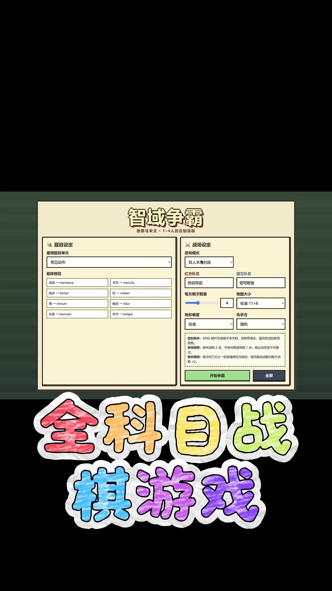

- 内容摘要：全顾目战骑游戏（00:00-00:01）
- 画面文字（OCR）：Tr ) ol — Zh, =
全一 -
I=IN]
像素马来文。1-4 人回合制战棋
4 题目设定这战场设定套用题目单元游戏模式题库预览红方队名蓝方队名一一四
[四
: 胜利条件 : KING 被歼灭或棋子全灭时，该阵营淘汰 ; 最后存活的阵营 i
1 获胜。 1
1 移动规则 : 森林消耗 2 点，平地与桥梁消耗 1 点，高山与河流不可通
| 过， i
| 骑兵规则 : SASH EERANE, BEBNSEARTR |
1 数 x2。 H
EN
SD .
Ea y
"o = -
=== v
ve we al J 4
SN 4 AN »~
h -
MC = CTS
— QQ - a 上 Se
= (rd Gr 2 LY)
aa 轧 “ae ey
> ~ 0
dd [ Ce ~ = /
"AAW \

### 2. 00:01

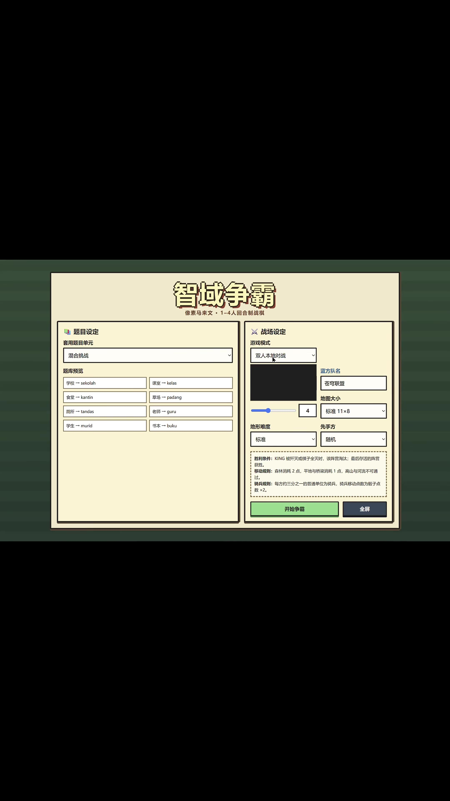

- 内容摘要：孩子为了保住贴（00:01-00:03）
- 画面文字（OCR）：& a | ] — =
全三 ] = fa
— j = 1B3= |
像素马来文。1-4 人回合制战棋
4 题目设定汉战场设定套用题目单元游戏模式混合挑战 > RAH -|
题库预览蓝方队名
[四
i SECRET
| 胜利条件 : KING 被歼灭或棋子全灭时，该阵营淘汰 ) 最后存活的阵营 |
1 获胜。 1
i 移动规则 : 森林消耗 2 点，平地与桥梁消耗 1 点，高山与河流不可通 i
ih A
| 骑兵规则 : SAA=SZEBRANE, BEBHSEARTR i
1 数 x2。 1
a Ee I
ER

### 3. 00:04

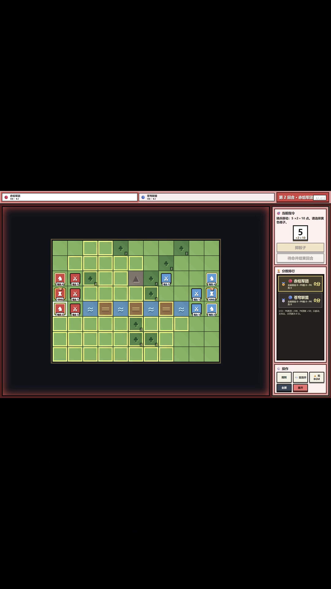

- 内容摘要：居然抢着打贴（00:03-00:04）
- 画面文字（OCR）：EET)
当前指令骑兵移动 : 5 x2 = 10 点。请选择黄色格子。
| 11 加 | 分数排行回 | 同 [=] 图避 Ea
[sam afd | N es] BE | [AE [aa 国定 [4] 3s ah rer 0 分
0
团圆 [2] =) ===
[nell | foe] HEEREET [| Mine] § Emma “0 分 fo
[a] x BE=EE=EE=EE x 加 So non
| 2} [x] x 到 Hoi. FEHR 05.

### 4. 00:05

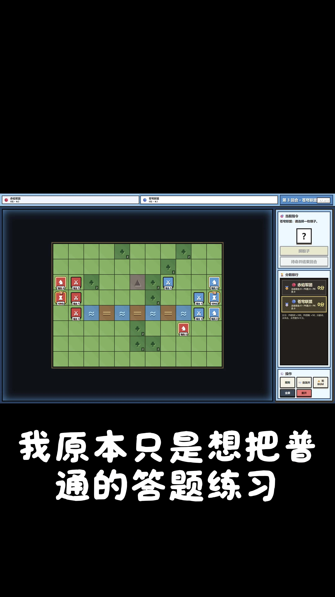

- 画面文字（OCR）：H
BEER BEER ER
EER mE
ESE em
2) =
Ri:E =E=E = EEE me
| | | BR:-ER
| | | | EEE 国轩昌国轿轩本轿曙轿轿
[===]
| ==
我原本只是想把普 oN ME oem 通的答题练习 MP) EWES >

### 5. 00:06

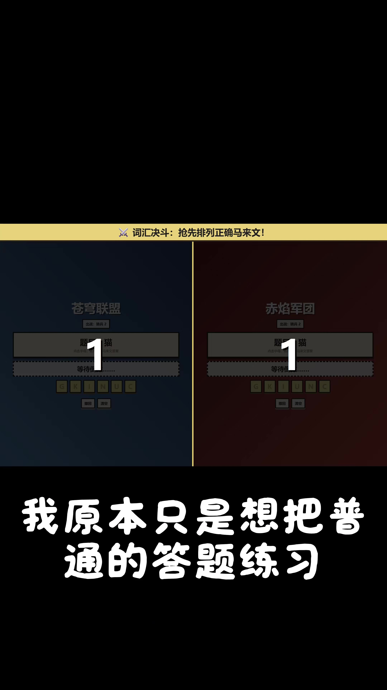

- 内容摘要：我原本只是想把普通的打贴练习（00:04-00:07）
- 画面文字（OCR）：1 1
我原本只是想把普过的答题练习

### 6. 00:09

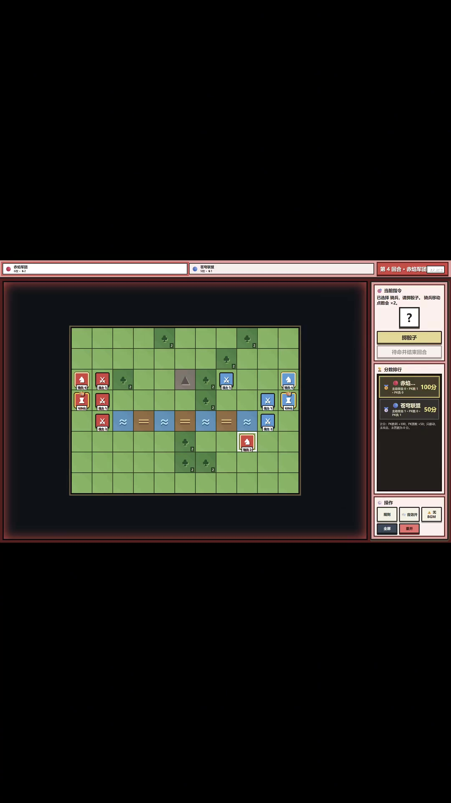

- 内容摘要：或者没有那么枯燥（00:07-00:09）
- 画面文字（OCR）：© 当前指令已选择 Wk, BRT. 骑兵移动点数会 x2。
| 11 本 | 分数排行回同 | AE) CE) i 10043
回国 | REE g hl ar 5043
RE =F =F - EEN smn

ES {tice 3) Fok, FER 0 分 -
| 操作
[oo JL or][e2]

### 7. 00:10

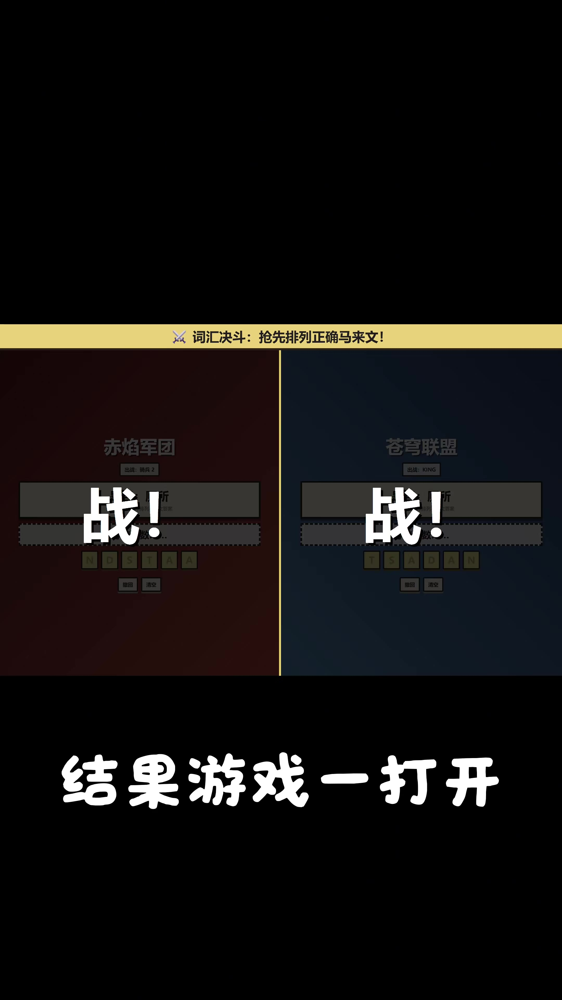

- 内容摘要：结果游戏一打开（00:09-00:11）
- 画面文字（OCR）：° °
成 | 1
® ®
结时游戏一打开全 < 人
=

### 8. 00:11

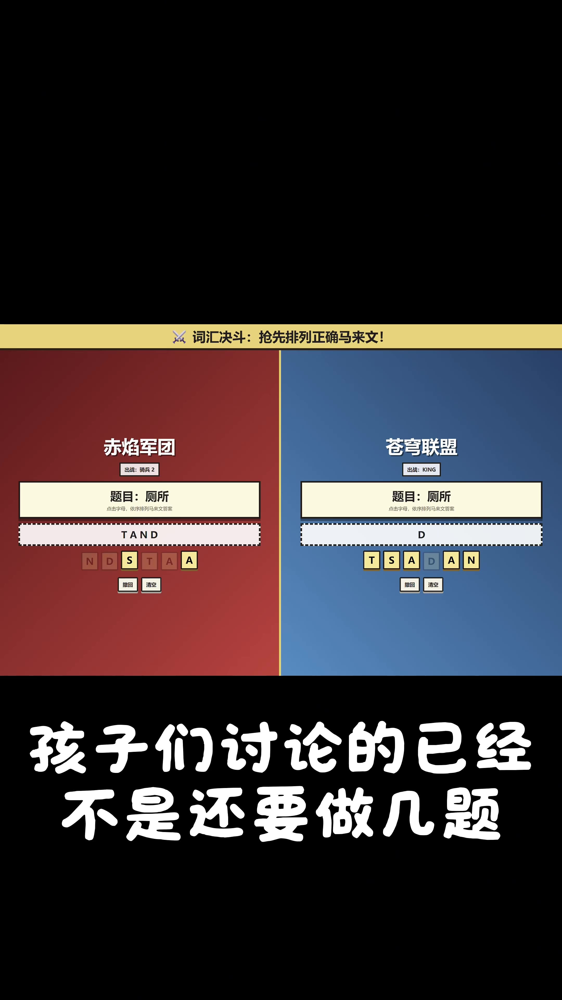

- 画面文字（OCR）：[st]
PLT | 和。
| JNA A | [7s J{a 0A ){n]
om oo
® 所 SA eR 孩子们讨论的已经所不是还妥做几题

### 9. 00:12

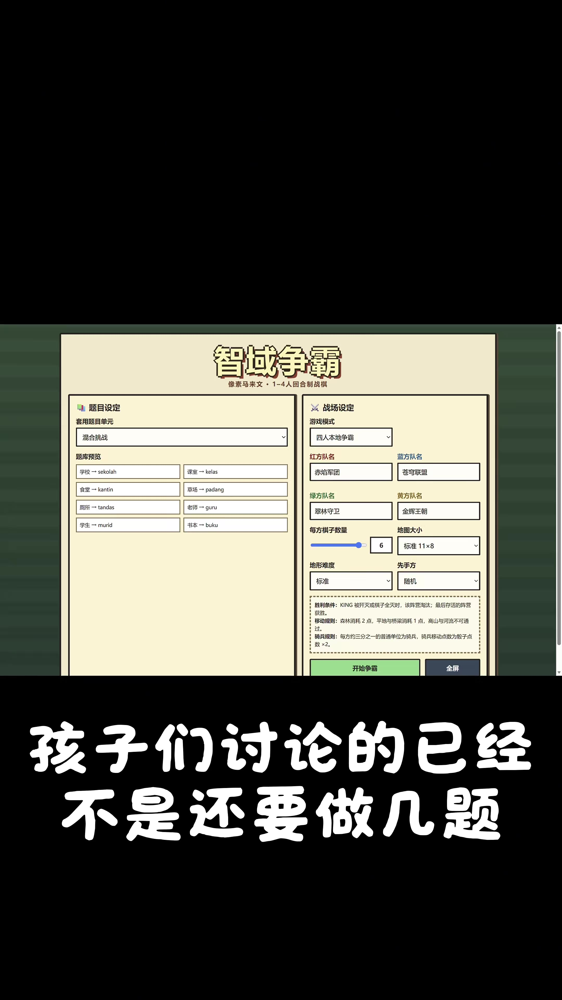

- 内容摘要：孩子们讨论的已经股市（00:11-00:13）
- 画面文字（OCR）：Raa [1 | = A =
全一 js |
mm 二 FE p=
像素马来文。 1-4 人回合制战棋
4 题目设定 *% 战场设定套用题目单元游戏模式混合挑战 v 四人本地争霸 v
题库预览红方队名蓝方队名绿方队名黄方队名一 .已地形难度先手方人上胜利条件 : KING 被政灭或棋子全灭时，该阵营淘汰 ; 最后存活的阵营 |
1 获胜。 H
| 移动规则 : 森林消耗 2 5, FIBSTRER 1 A, RUSTRRTE
| 过 |
| BEAN: 每方约三分之一的普通单位为骑兵，骑兵移动点数为股子点 |
1 数 x2。 H
on

### 10. 00:14

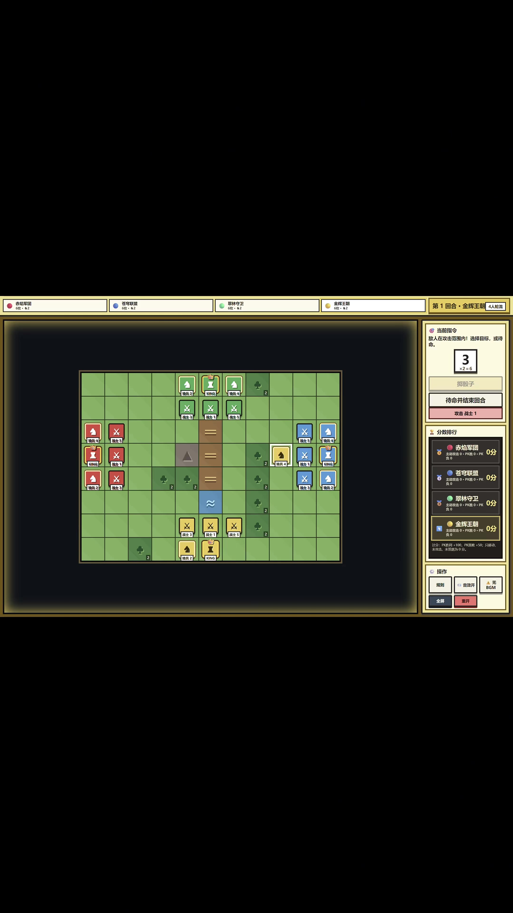

- 内容摘要：还要做几题（00:13-00:14）
- 画面文字（OCR）：当前指令敌人在攻击范围内 ! 选择目标，或待命。
Lobby HERR ——
[===] ETE
O 赤焰军团
[x] ES BEEEE Bn ES [=] = 一 i
| ] [ | © THE
[a] ES ss = ES = be CO it
0
[mal | Yue) [aa | Nua) 2
® ETE
| | 相国 | | bd ii Sif 负 0
EE 图 [x | ® 金辉王朝
| JE) En 未攻击、未答题为 0 分 -
[zl | ang]
操作
[= [oe]

### 11. 00:15

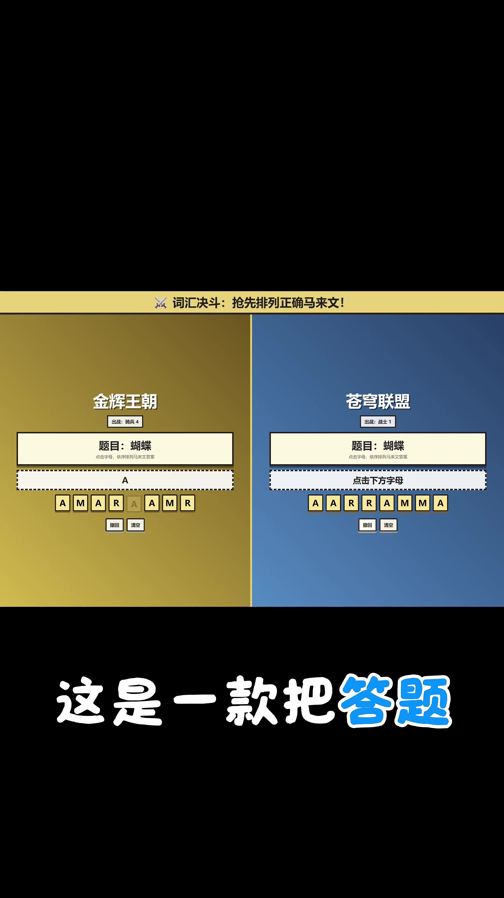

- 内容摘要：这是一款把打贴（00:14-00:15）
- 内容摘要：策略和多人对战（00:15-00:16）
- 画面文字（OCR）：ECAR: 抢先排列正确马来文 !
c=
EE. | ee 四上加四上加辐加加加四上回回加四加回避 mm
[
WX —3R 把答题

### 12. 00:20

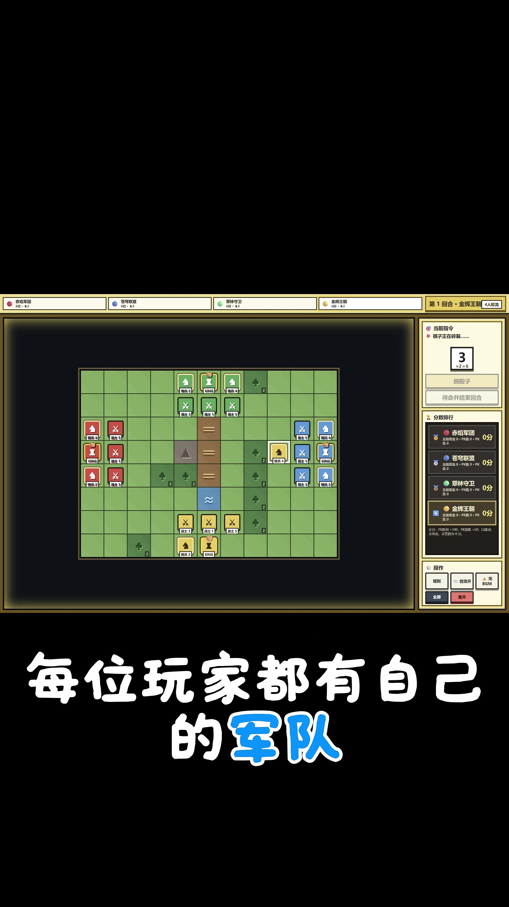

- 内容摘要：放在一起的像素战骑游戏（00:16-00:19）
- 内容摘要：每位玩家都有自己的军队（00:19-00:22）
- 画面文字（OCR）：% 1 BIA - SER wr]
当前指令棋子正在碎和裂 .……

BERR EE NEN
|
BERR === NRE oo
OE | | EBL) pen,
[=] [EAE
Tz] = [in]
fio
aE EE ECL) ema
fio
BERN EER EEN
ET al
CE ee) |
操作 |
aes

### 13. 00:21

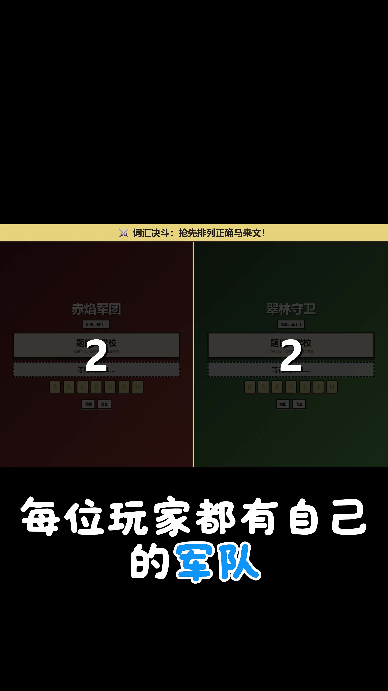

- 画面文字（OCR）：2 2
每位玩家都有自己 HB

### 14. 00:22

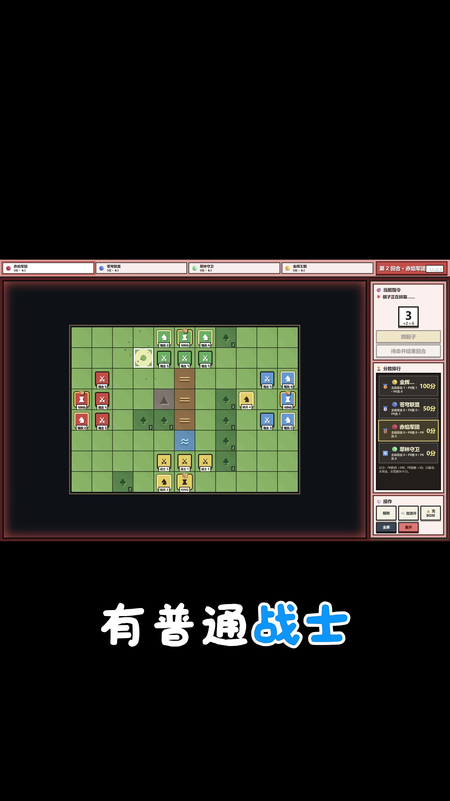

- 内容摘要：有普通战士（00:22-00:23）
- 画面文字（OCR）：err Jewe [ev Jerr EGG 当前指令棋子正在碎裂 .……
国面面国同回回 .本面面
| | SE | —
HINER - NEE
BE =
BE | AE Ee)
Bil=asl BES
CL EEE | | 2255
foe Ee ee
EN BoE ENEN
Maz 2) | Ming]
操作
a

### 15. 00:25

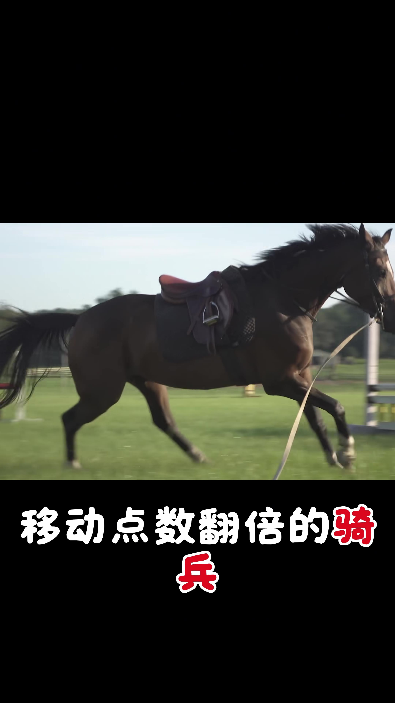

- 内容摘要：移动减述翻背的旗边（00:23-00:25）
- 画面文字（OCR）：- I -人 yy / -一 AN §

att wh

### 16. 00:28

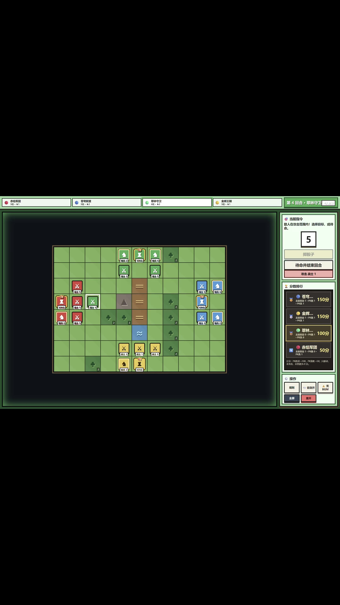

- 内容摘要：还有必须保护好的开玩笑（00:25-00:28）
- 画面文字（OCR）：(asm mre
F | 当前指令敌人在攻击范围内 ! 选择目标，或待 Lon hk Lo HERR os
x x EET
FENCE EE Ea
[nel | GaP | oso] [ine]
pl] Es EL £5
[mold | Yas) [eof | wea) Sins
“PK 负 0
圆回回 =
ello 0
HERE [af | Yow if | oes] “HER B sans rmo- 505
| aE) | oo 未攻击、未答题为 0 分 -
[zl | Mang]
|. J |

### 17. 00:30

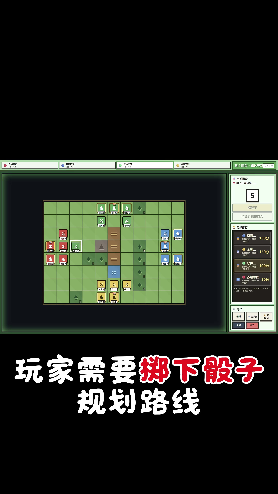

- 内容摘要：玩家需要制头子（00:28-00:30）
- 内容摘要：规划路线（00:30-00:31）

### 18. 00:31

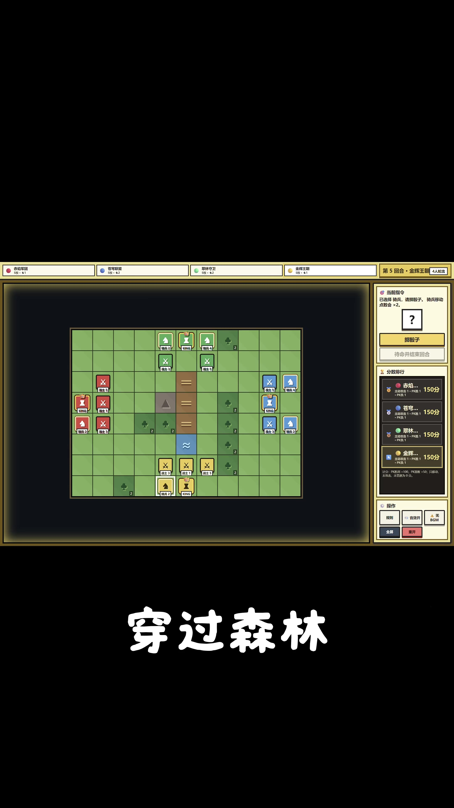

- 该时间点暂无可提取文字。

### 19. 00:32

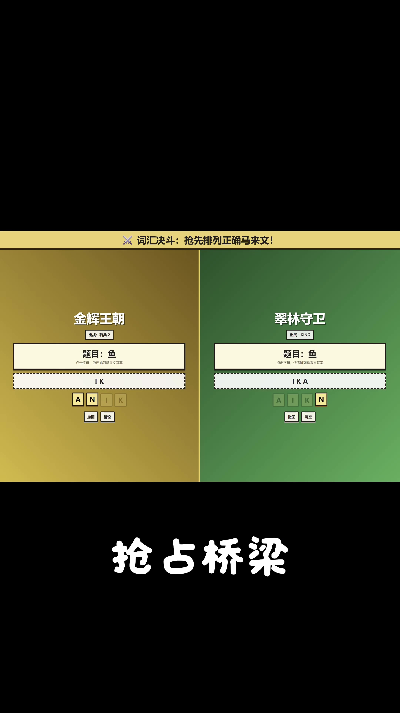

- 内容摘要：穿过森林抢战调量（00:31-00:32）
- 内容摘要：扰开高山（00:32-00:34）

### 20. 00:35

- 内容摘要：再吸引攻击其他阵营（00:34-00:36）

### 21. 00:36

- 内容摘要：但想消灭对方（00:36-00:38）

### 22. 00:39

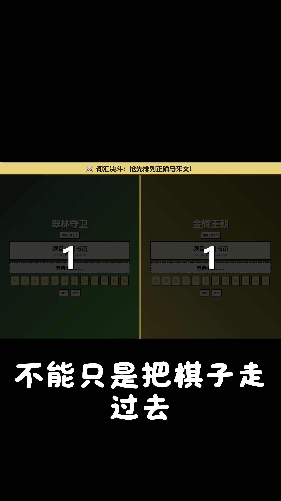

- 内容摘要：不能只是把旗子走过去（00:38-00:40）

### 23. 00:41

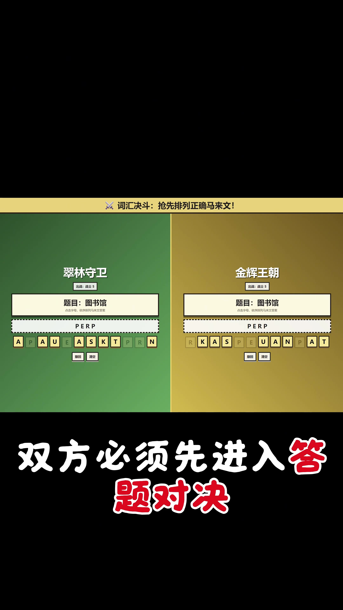

- 内容摘要：双方必须先进入打体对卷（00:40-00:43）

### 24. 00:44

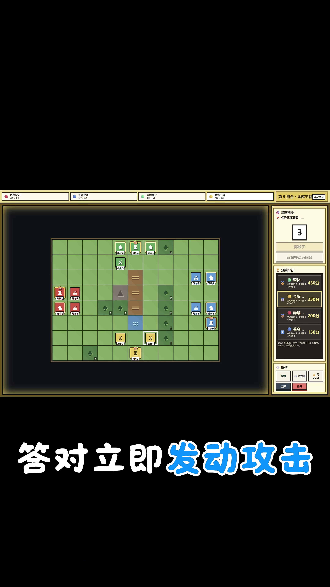

- 内容摘要：打队立即发动攻击（00:43-00:45）
- 内容摘要：打错（00:45-00:46）

### 25. 00:49

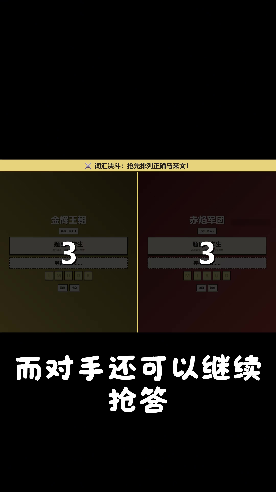

- 内容摘要：打体区会战时动截（00:46-00:48）
- 内容摘要：而对手还可以继续抢达（00:48-00:51）
- 内容摘要：最刺激的是（00:51-00:52）

### 26. 00:54

- 内容摘要：他不只是两个人玩（00:52-00:54）
- 内容摘要：他可以担任挑战电脑（00:54-00:56）
- 内容摘要：两人正面对战（00:56-00:57）

### 27. 00:59

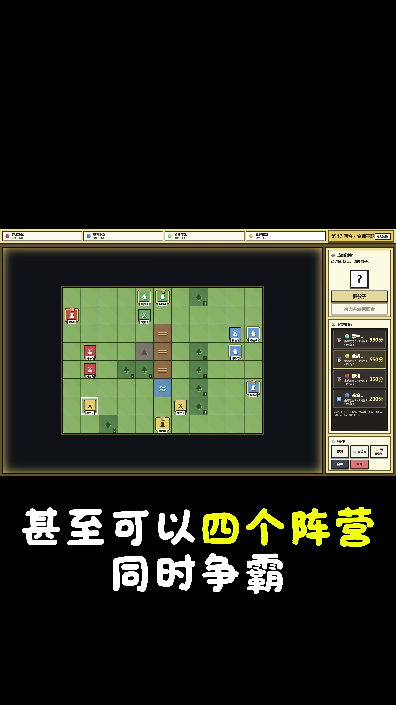

- 内容摘要：三方混战（00:57-00:58）
- 内容摘要：甚至可以四个阵营同时争霸（00:58-01:00）

### 28. 01:04

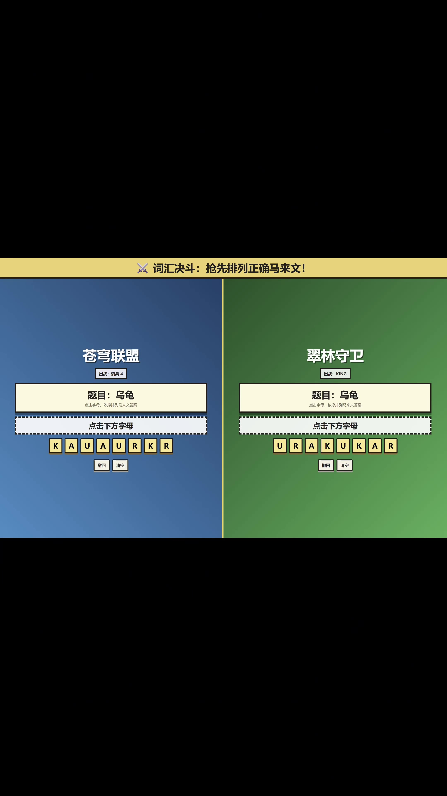

- 内容摘要：老师可以把任何科目的题目放进去（01:00-01:04）
- 内容摘要：语文 数学 英语 科学 历史 地理（01:04-01:07）

### 29. 01:09

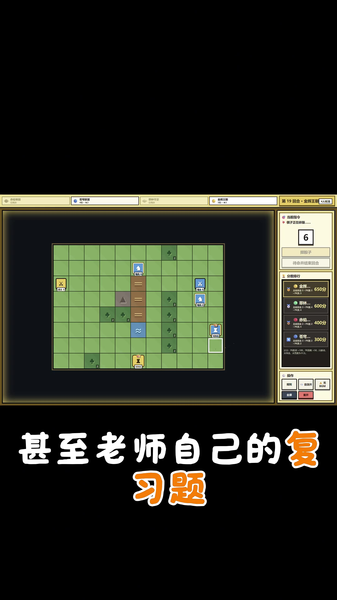

- 内容摘要：甚至老师自己的复习体（01:07-01:10）
- 内容摘要：都可以变成战场中的攻击任务（01:10-01:12）

### 30. 01:14

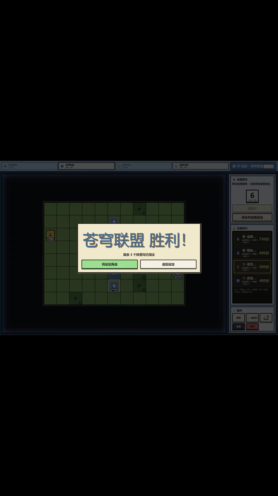

- 内容摘要：一场设略战争（01:12-01:14）

## 视频画面文字 (OCR)

> OCR 仅供参考，可能包含识别错误；请以视频画面和转写来源为准。

### 关键帧 1 · 0.5s

Tr ) ol — Zh, =
全一 -
I=IN]
像素马来文。1-4 人回合制战棋
4 题目设定这战场设定套用题目单元游戏模式题库预览红方队名蓝方队名一一四
[四
: 胜利条件 : KING 被歼灭或棋子全灭时，该阵营淘汰 ; 最后存活的阵营 i
1 获胜。 1
1 移动规则 : 森林消耗 2 点，平地与桥梁消耗 1 点，高山与河流不可通
| 过， i
| 骑兵规则 : SASH EERANE, BEBNSEARTR |
1 数 x2。 H
EN
SD .
Ea y
"o = -
=== v
ve we al J 4
SN 4 AN »~
h -
MC = CTS
— QQ - a 上 Se
= (rd Gr 2 LY)
aa 轧 “ae ey
> ~ 0
dd [ Ce ~ = /
"AAW \

### 关键帧 2 · 1.6s

& a | ] — =
全三 ] = fa
— j = 1B3= |
像素马来文。1-4 人回合制战棋
4 题目设定汉战场设定套用题目单元游戏模式混合挑战 > RAH -|
题库预览蓝方队名
[四
i SECRET
| 胜利条件 : KING 被歼灭或棋子全灭时，该阵营淘汰 ) 最后存活的阵营 |
1 获胜。 1
i 移动规则 : 森林消耗 2 点，平地与桥梁消耗 1 点，高山与河流不可通 i
ih A
| 骑兵规则 : SAA=SZEBRANE, BEBHSEARTR i
1 数 x2。 1
a Ee I
ER

### 关键帧 3 · 4.67s

EET)
当前指令骑兵移动 : 5 x2 = 10 点。请选择黄色格子。
| 11 加 | 分数排行回 | 同 [=] 图避 Ea
[sam afd | N es] BE | [AE [aa 国定 [4] 3s ah rer 0 分
0
团圆 [2] =) ===
[nell | foe] HEEREET [| Mine] § Emma “0 分 fo
[a] x BE=EE=EE=EE x 加 So non
| 2} [x] x 到 Hoi. FEHR 05.

### 关键帧 4 · 5.43s

H
BEER BEER ER
EER mE
ESE em
2) =
Ri:E =E=E = EEE me
| | | BR:-ER
| | | | EEE 国轩昌国轿轩本轿曙轿轿
[===]
| ==
我原本只是想把普 oN ME oem 通的答题练习 MP) EWES >

### 关键帧 5 · 6.27s

1 1
我原本只是想把普过的答题练习

### 关键帧 6 · 9.43s

© 当前指令已选择 Wk, BRT. 骑兵移动点数会 x2。
| 11 本 | 分数排行回同 | AE) CE) i 10043
回国 | REE g hl ar 5043
RE =F =F - EEN smn

ES {tice 3) Fok, FER 0 分 -
| 操作
[oo JL or][e2]

### 关键帧 7 · 10.36s

° °
成 | 1
® ®
结时游戏一打开全 < 人
=

### 关键帧 8 · 11.17s

[st]
PLT | 和。
| JNA A | [7s J{a 0A ){n]
om oo
® 所 SA eR 孩子们讨论的已经所不是还妥做几题

### 关键帧 9 · 12.27s

Raa [1 | = A =
全一 js |
mm 二 FE p=
像素马来文。 1-4 人回合制战棋
4 题目设定 *% 战场设定套用题目单元游戏模式混合挑战 v 四人本地争霸 v
题库预览红方队名蓝方队名绿方队名黄方队名一 .已地形难度先手方人上胜利条件 : KING 被政灭或棋子全灭时，该阵营淘汰 ; 最后存活的阵营 |
1 获胜。 H
| 移动规则 : 森林消耗 2 5, FIBSTRER 1 A, RUSTRRTE
| 过 |
| BEAN: 每方约三分之一的普通单位为骑兵，骑兵移动点数为股子点 |
1 数 x2。 H
on

### 关键帧 10 · 14.13s

当前指令敌人在攻击范围内 ! 选择目标，或待命。
Lobby HERR ——
[===] ETE
O 赤焰军团
[x] ES BEEEE Bn ES [=] = 一 i
| ] [ | © THE
[a] ES ss = ES = be CO it
0
[mal | Yue) [aa | Nua) 2
® ETE
| | 相国 | | bd ii Sif 负 0
EE 图 [x | ® 金辉王朝
| JE) En 未攻击、未答题为 0 分 -
[zl | ang]
操作
[= [oe]

### 关键帧 11 · 15.29s

ECAR: 抢先排列正确马来文 !
c=
EE. | ee 四上加四上加辐加加加四上回回加四加回避 mm
[
WX —3R 把答题

### 关键帧 12 · 20.22s

% 1 BIA - SER wr]
当前指令棋子正在碎和裂 .……

BERR EE NEN
|
BERR === NRE oo
OE | | EBL) pen,
[=] [EAE
Tz] = [in]
fio
aE EE ECL) ema
fio
BERN EER EEN
ET al
CE ee) |
操作 |
aes

### 关键帧 13 · 21.97s

2 2
每位玩家都有自己 HB

### 关键帧 14 · 22.97s

err Jewe [ev Jerr EGG 当前指令棋子正在碎裂 .……
国面面国同回回 .本面面
| | SE | —
HINER - NEE
BE =
BE | AE Ee)
Bil=asl BES
CL EEE | | 2255
foe Ee ee
EN BoE ENEN
Maz 2) | Ming]
操作
a

### 关键帧 15 · 25.15s

- I -人 yy / -一 AN §

att wh

### 关键帧 16 · 28.37s

(asm mre
F | 当前指令敌人在攻击范围内 ! 选择目标，或待 Lon hk Lo HERR os
x x EET
FENCE EE Ea
[nel | GaP | oso] [ine]
pl] Es EL £5
[mold | Yas) [eof | wea) Sins
“PK 负 0
圆回回 =
ello 0
HERE [af | Yow if | oes] “HER B sans rmo- 505
| aE) | oo 未攻击、未答题为 0 分 -
[zl | Mang]
|. J |

## 字幕文件

[TXT](./transcript/video.txt) | [JSON](./transcript/video.json) | [SRT](./transcript/video.srt) | [VTT](./transcript/video.vtt)

## 转写来源

[本地 ASR TXT](./transcript/asr/video.txt) | [本地 ASR JSON](./transcript/asr/video.json) | [本地 ASR SRT](./transcript/asr/video.srt) | [本地 ASR VTT](./transcript/asr/video.vtt)

## 视频转录

- **00:00-00:01** 全顾目战骑游戏
- **00:01-00:03** 孩子为了保住贴
- **00:03-00:04** 居然抢着打贴
- **00:04-00:07** 我原本只是想把普通的打贴练习
- **00:07-00:09** 或者没有那么枯燥
- **00:09-00:11** 结果游戏一打开
- **00:11-00:13** 孩子们讨论的已经股市
- **00:13-00:14** 还要做几题
- **00:14-00:15** 这是一款把打贴
- **00:15-00:16** 策略和多人对战
- **00:16-00:19** 放在一起的像素战骑游戏
- **00:19-00:22** 每位玩家都有自己的军队
- **00:22-00:23** 有普通战士
- **00:23-00:25** 移动减述翻背的旗边
- **00:25-00:28** 还有必须保护好的开玩笑
- **00:28-00:30** 玩家需要制头子
- **00:30-00:31** 规划路线
- **00:31-00:32** 穿过森林抢战调量
- **00:32-00:34** 扰开高山
- **00:34-00:36** 再吸引攻击其他阵营
- **00:36-00:38** 但想消灭对方
- **00:38-00:40** 不能只是把旗子走过去
- **00:40-00:43** 双方必须先进入打体对卷
- **00:43-00:45** 打队立即发动攻击
- **00:45-00:46** 打错
- **00:46-00:48** 打体区会战时动截
- **00:48-00:51** 而对手还可以继续抢达
- **00:51-00:52** 最刺激的是
- **00:52-00:54** 他不只是两个人玩
- **00:54-00:56** 他可以担任挑战电脑
- **00:56-00:57** 两人正面对战
- **00:57-00:58** 三方混战
- **00:58-01:00** 甚至可以四个阵营同时争霸
- **01:00-01:04** 老师可以把任何科目的题目放进去
- **01:04-01:07** 语文 数学 英语 科学 历史 地理
- **01:07-01:10** 甚至老师自己的复习体
- **01:10-01:12** 都可以变成战场中的攻击任务
- **01:12-01:14** 一场设略战争

## 图片

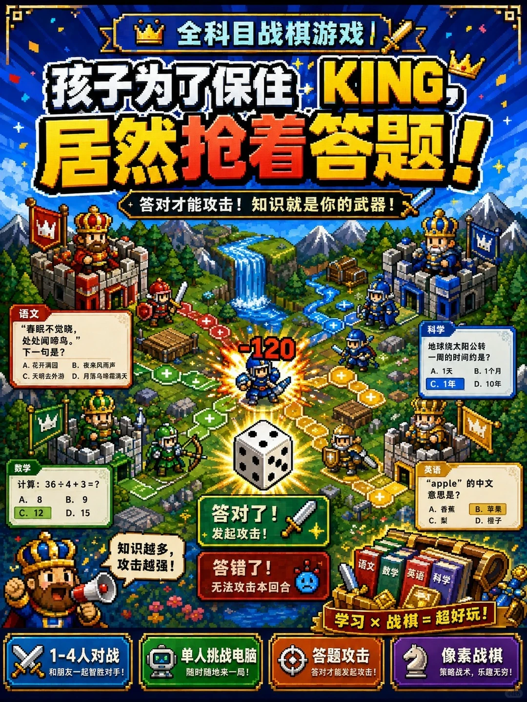

## 图片文字 (OCR)

> OCR 仅供参考，可能包含识别错误；请以原图为准。

全科目战棋游戏！
孩子为了保住KING
居然抢着答题！
答对才能攻击！知识就是你的武器！
语文
“春眠不觉晓，
科学
-120
处处闻啼鸟。
地球绕太阳公转
下一句是？
一周的时间约是？
A.花开满园
B.夜来风雨声
A.1天
B.1个月
C.天明去外游
D.月落乌啼霜满天
C.1年
D.10年
数学
英语
apple"
的中文
计算：36÷4+3=？
意思是？
A.
8
B.
9
答对了！
A.香蕉
B.苹果
C.12
D.15
C.梨
D.橙子
发起攻击！
知识越多，
答错了！
语文
攻击越强！
数学
英语
科学
无法攻击本回合
学习×战棋=超好玩！
1-4人对战
单人挑战电脑
答题攻击
像素战棋
和朋友一起智胜对手！
随时随地来一局！
答对才能发起攻击！
策略战术，乐趣无穷！
