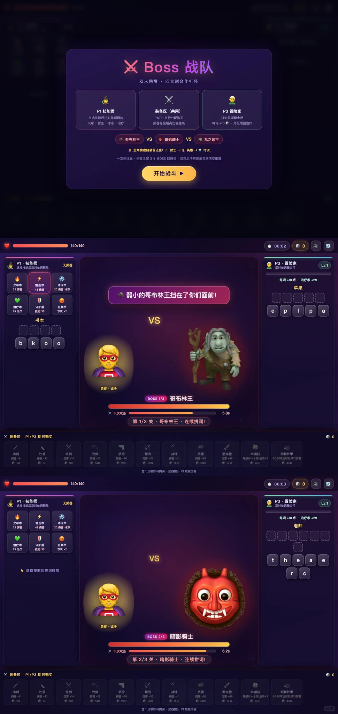

# 娃背单词像上刑?

> 作者: 爱英语米斯特潘Draven | 日期: 7小时前 广东 | 原文: https://www.xiaohongshu.com/discovery/item/6a7fc5cd000000002c00281a?app_platform=android&ignoreEngage=true&app_version=9.42.0&share_from_user_hidden=true&xsec_source=app_share&type=normal&xsec_token=CBeG1PHR5oiXqCLeaip3kQ_Lm3w8JrulnRDeH3diQ-6PQ%3D&author_share=1&xhsshare=CopyLink&shareRedId=N0dINjg3NUpMPko6S0EySDs0P0lFSjdL&apptime=1786783896&share_id=8c696a38544f4e8ab8bd9897a279590a&share_channel=copy_link

> **摘要**:这是一篇推荐英语单词学习游戏的家长分享帖。文章介绍了一款通过拼写单词释放技能打BOSS的游戏，包含技能师和冒险家两种角色、三大BOSS关卡及十余种玩法模式。游戏单词贴合课本单元，有中文意思提示，并支持双人同屏合作，将背单词转化为孩子主动上瘾的游戏体验。

娃背单词像上刑?
那是没遇到这个打BOSS的单词游戏!
谁懂啊家人们😭
以前让我娃背单词,那叫一个鸡飞狗跳
现在?天天追着我喊"妈妈再打一关!"
就是这款boss打怪🎮
**拼对单词 = 放技能!**
拼出 FIRE 放火球 🔥、拼出 ZAP 放雷击 ⚡
单词拼得越快,BOSS 死得越快!
玩法太上头了:
🧙 P1 技能师:选技能→拼单词→释放技能打BOSS
🧝 P3 冒险家:拼单词赚金币→买装备升级
🧌 三大BOSS:哥布林王→暗影骑士→龙之领主
血量 240→520→950,一个比一个狠
最打动我的是:
📚 单词**完全贴合课本单元**,这周学哪课练哪课
💡 拼写区上方有**中文意思提示**,娃自己就能认词
👨👩👧 双人同屏合作,亲子/俩娃都能一起玩
里面还有 格斗、坦克大战、植物大战僵尸……十几种模式轮着玩
写作业前要先"打一关"才肯动笔🤣
#英语启蒙 #亲子游戏 #单词游戏 #小学英语 #带娃神器 #宝藏app
7小时前 广东

#英语单词游戏 #亲子互动 #小学英语启蒙 #单词学习APP #游戏化学习

## 图片

## 图片文字 (OCR)

> OCR 仅供参考，可能包含识别错误；请以原图为准。

Boss
战队
双人同屏
回合制合作打怪
P1技能师
装备区（共用）
P3冒险家
自选技能后拼对单词释放
P1/P3自行分配购买
拼对单词赚金币
火球·雷击·冰冻·治疗
武器等级越高伤害越高
每词+10·升级增强治疗
4
哥布林王
VS
暗影骑士
VS
,
龙之领主
主角勇者随装备进化：武士→英雄→传说
开始战斗
140/140
00:02
P1·技能师
无武器
P3·冒险家
选择技能后拼对单词释放
Lv.1
拼对单词赚金币
每词+10
治疗术+29
火球术
雷击术
冰冻术
32伤害
48伤害
20伤害·冰冻
苹果
弱小的哥布林王挡在了你们面前！
治疗术
守护质
狂暴术
29治疗
抵档35
下次×2
p
p
a
e
书本
VS
b
k
勇者·徒手
BOSS1/3
哥布林王
X下次攻击
5.8s
第1/3关·哥布林王·连续拼词！
装备区·P1/P3均可购买
木剑
七首
铁
战斧
手枪
蜡弓
战锤
伤害+10
伤害+14
伤害+33
手雷
激光枪
伤害+19
伤害+26
幸运符
荆棘护甲
伤害+6
伤害41
伤害+52
55
280
伤害+68
90
140
每拼对一个词金币+3
200
BOSS次击时反弹12伤害
。
30
380
©
500
.
680
450
450
金币足够即可购买·武器提升P1技能伤害
140/140
00:03
P1·技能师
无武器
P3·冒险家
选择技能后拼对单词释放
Lv.1
拼对单词赚金币
雷击术
冰冻术
每词+10
治疗术+29
火球术
32伤害
48伤害
20伤害·冰冻
老师
治疗术
守护盾
狂暴术
29治疗
抵档35
下次×2
VS
t
h
e
a
e
选择技能后拼词释放
F
C
勇者·徒手
BOSS2/3
暗影骑士
X下次攻击
6.2s
第2/3关·暗影骑士·连续拼词！
装备区·P1/P3均可购买
