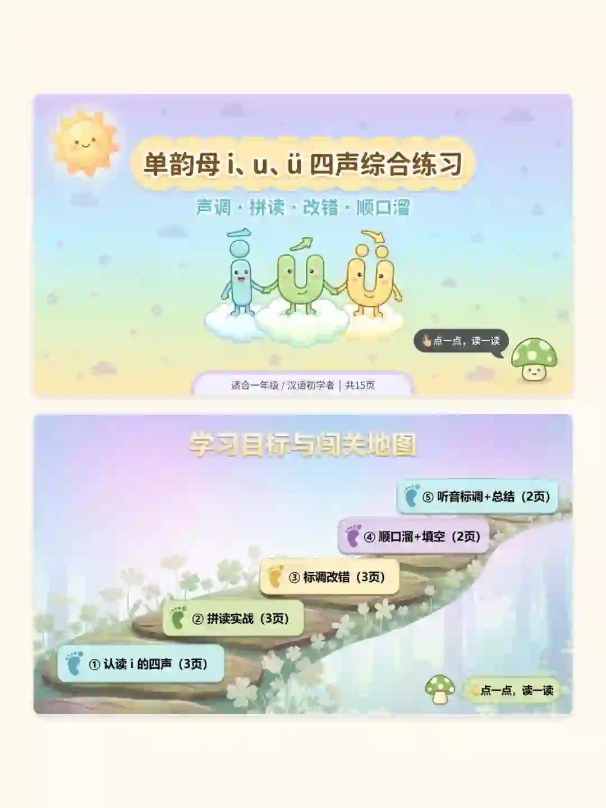

# 幼小衔接必备｜单韵母i u ü四声调训练

> 作者：幼小绘本补给站 | 发布时间：昨天 23:28（广东）  
> 原文：[小红书笔记](https://www.xiaohongshu.com/explore/6a6a1c010000000022019cb5?app_platform=android&ignoreEngage=true&app_version=9.39.1&share_from_user_hidden=true&xsec_source=app_share&type=normal&xsec_token=CBTwyawcjB3__4ymgScDAIDAAX8_gcA2kQAwvD8bwNCQA=&author_share=1&xhsshare=CopyLink&shareRedId=N0dINjg3NUpMPko6S0EySDs0P0lFSjdL&apptime=1785341476&share_id=493d5596ed784addbc7cfc78220c6abc&share_channel=copy_link)

## 内容摘要

很多孩子容易混淆 `u` 和 `ü`。这份课件围绕单韵母 `i`、`u`、`ü` 的四声调进行集中训练，把认读、发音口型、声母拼读和规则记忆组合在一起，并加入游戏化练习，适合幼小衔接、一年级拼音启蒙和课堂复习。

## 课件板块

- **四声认读**：练习 `i`、`u`、`ü` 的一声、二声、三声、四声，并搭配手势朗读。
- **口型对照**：通过口型图帮助孩子观察发音方式，可对着镜子练习。
- **声母拼读**：安排声母与韵母的拼读训练，将一、二声和三、四声分开练习。
- **标调规则**：集中讲解单韵母标调，以及 `ü` 与声母组合时的规则。
- **重点口诀**：`i戴帽，点藏好；ü戴帽，点不跑`。`n、l遇见ü，两点不能丢！`
- **闯关游戏**：包括标调改错、听音写韵母、认读挑战等互动练习。

## 教学使用建议

1. 先让孩子观察 `i`、`u`、`ü` 的口型，再进行单音节模仿。
2. 按声调分组朗读，先练一、二声，再练三、四声，降低一次记忆的负担。
3. 用手势配合声调方向，帮助孩子建立声音和调型之间的联系。
4. 通过镜子检查口型，尤其关注 `u` 与 `ü` 的唇形差异。
5. 将标调改错和听音写韵母放在最后，作为理解检查，而不是一开始就进行书写。
6. 拼读时重点复习 `n`、`l` 遇到 `ü` 时两点保留的规则。

## 原文内容

很多孩子分不清 `u` 和 `ü`，这份课件把难点全部讲透：

- `i`、`u`、`ü` 四声认读，搭配手势朗读。
- 口型对照图，孩子可以对着镜子练习。
- 声母拼读练习，一、二声与三、四声分开训练。
- 重点难点包括标调规则和 `ü` 两点取舍口诀。
- `i戴帽，点藏好；ü戴帽，点不跑`。
- `n、l遇见ü，两点不能丢！`
- 闯关游戏包括标调改错、听音写韵母、认读挑战。

作者强调课件互动形式丰富，适合课堂使用，能够提高小朋友的参与度。

## 话题标签

`#一年级拼音` `#幼小衔接拼音` `#i u ü` `#拼音课件` `#拼音启蒙` `#小学语文` `#幼儿拼音` `#拼音公开课` `#教师备课` `#拼音PPT`

## 评论

页面显示共 1 条评论：

- **果果早教动画馆**：👉笔记同款 拼音启蒙绘本合集（置顶评论，昨天 23:34，广东）
