---
title: "开发我的世界小游戏学英语"
source: "https://www.xiaohongshu.com/discovery/item/6a795094000000002403db7f?app_platform=android&ignoreEngage=true&app_version=9.41.2&share_from_user_hidden=true&xsec_source=app_share&type=normal&xsec_token=CBbzJ-qlSO3gyftIWJKS0Tyx6LCATUMGOoWsTEc_sH_Ko%3D&author_share=1&xhsshare=CopyLink&shareRedId=N0dINjg3NUpMPko6S0EySDs0P0lFSjdL&apptime=1786336321&share_id=bf3b3d993d5a4100a4359580ee86d9ab&share_channel=copy_link"
author: "aaaqqq"
author_uid: "5a0c4e754eacab424afc4450"
date: "2天前 北京"
tags: ["我的世界", "学英语神器", "英语学习", "游戏化学习", "方块英语大陆", "PowerUp4"]
platform: "xiaohongshu"
category: "游戏设计/学习游戏机制"
summary: "作者结合孩子正在学习的英语教材，开发了一款基于《我的世界》的英语学习小游戏「方块英语大陆·WordCraft Academy」。游戏涵盖挖矿学单词、合成台造句、NPC任务、Boss测验等玩法，对应教材Power Up 4的九个单元，通过寓教于让的方式让孩子边玩游戏边学习英语。"
---

# 开发我的世界小游戏学英语

> 作者: aaaqqq | 日期: 2天前 北京 | 原文: https://www.xiaohongshu.com/discovery/item/6a795094000000002403db7f?app_platform=android&ignoreEngage=true&app_version=9.41.2&share_from_user_hidden=true&xsec_source=app_share&type=normal&xsec_token=CBbzJ-qlSO3gyftIWJKS0Tyx6LCATUMGOoWsTEc_sH_Ko%3D&author_share=1&xhsshare=CopyLink&shareRedId=N0dINjg3NUpMPko6S0EySDs0P0lFSjdL&apptime=1786336321&share_id=bf3b3d993d5a4100a4359580ee86d9ab&share_channel=copy_link

> **摘要**:作者结合孩子正在学习的英语教材，开发了一款基于《我的世界》的英语学习小游戏「方块英语大陆·WordCraft Academy」。游戏涵盖挖矿学单词、合成台造句、NPC任务、Boss测验等玩法，对应教材Power Up 4的九个单元，通过寓教于让的方式让孩子边玩游戏边学习英语。

开发我的世界小游戏学英语
孩子喜欢我的世界游戏，结合孩子在学的英语教材开发了我的世界小游戏，边玩游戏边学习
#我的世界 #学英语神器
2天前 北京

#英语学习 #游戏化学习 #方块英语大陆 #PowerUp4

## 图片

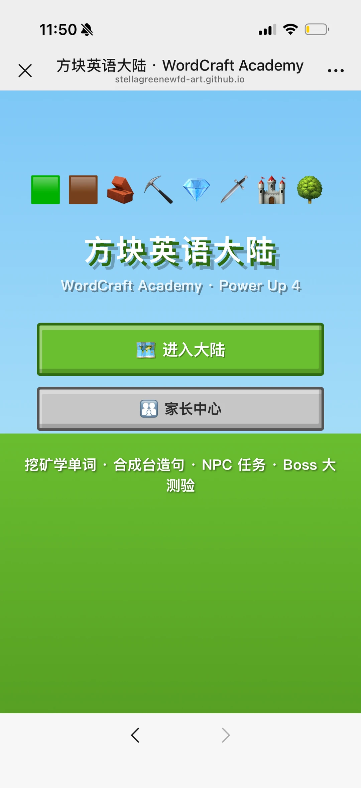

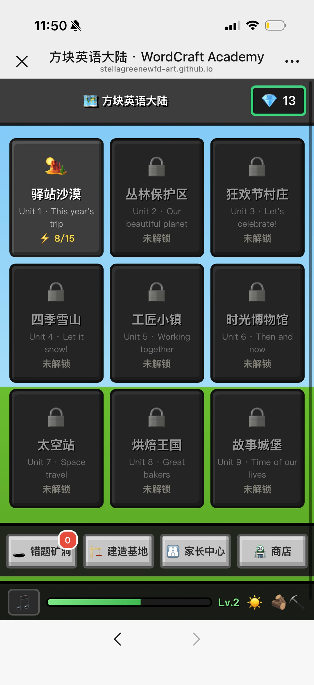

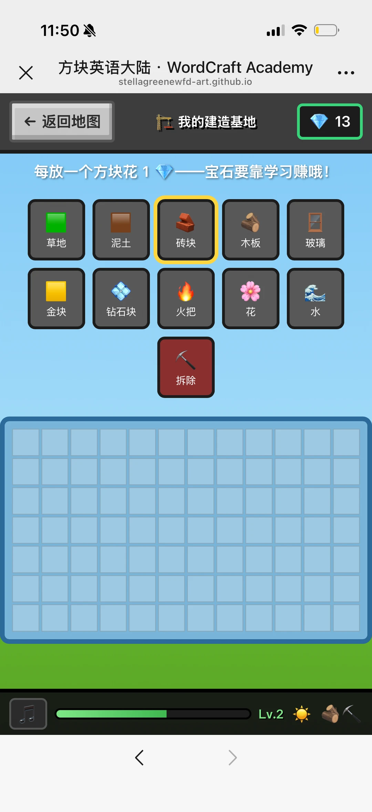

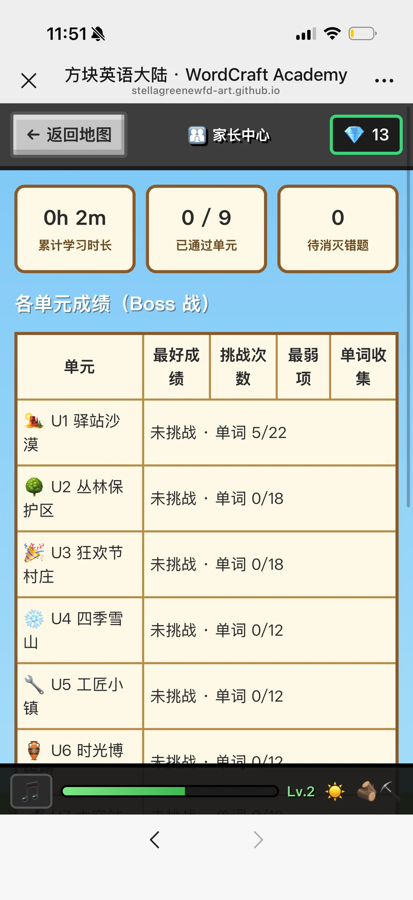

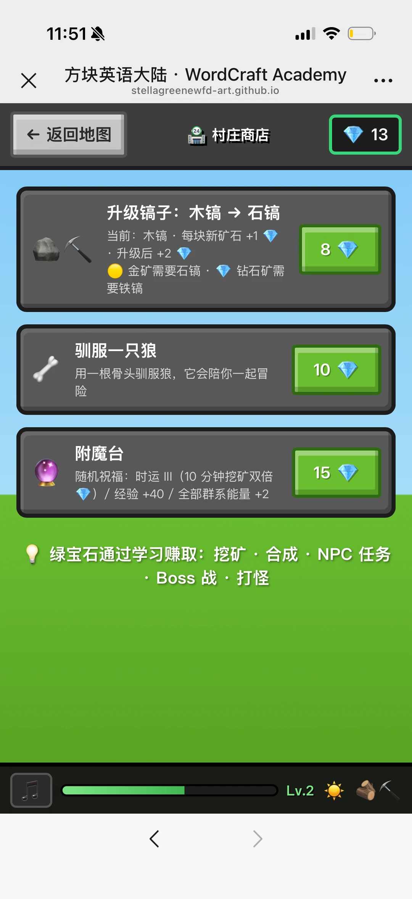

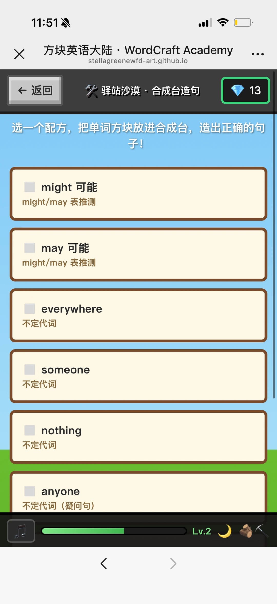

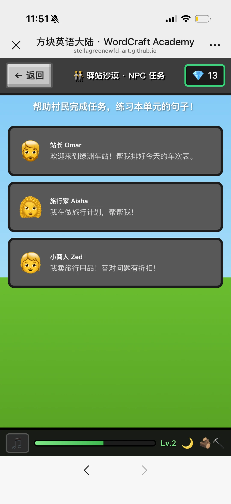

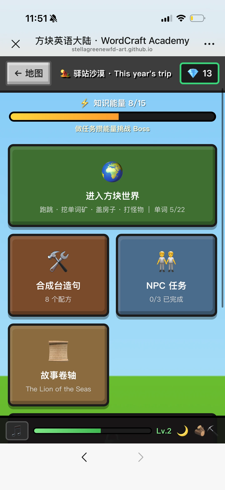

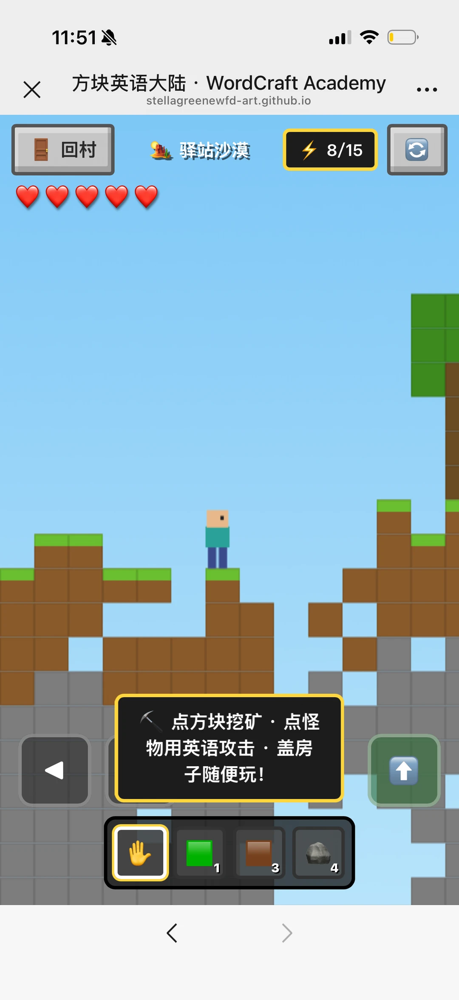

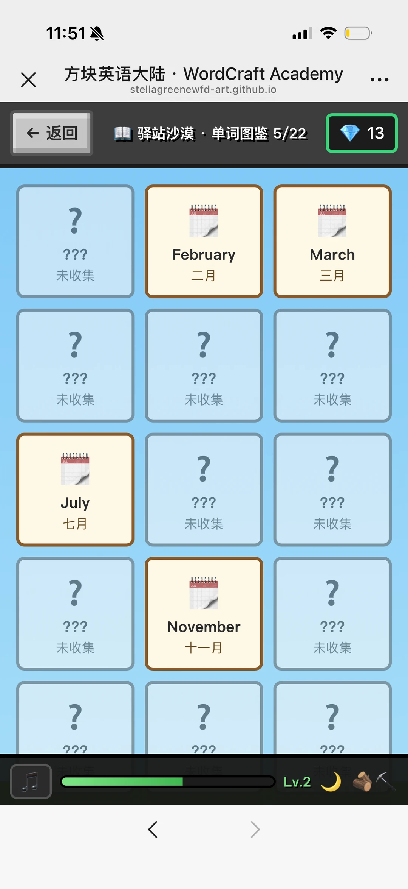

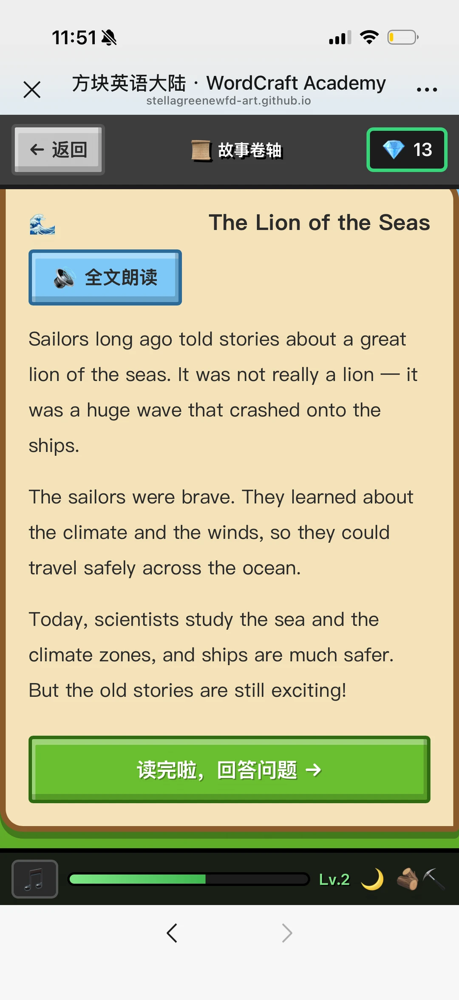

## 图片文字 (OCR)

> OCR 仅供参考，可能包含识别错误；请以原图为准。

方块英语大陆·WordCraft Academy
X
stellagreenewfd-art.github.io
方块英语大陆
WordCraft Academy·Power Up 4.
进入大陆
家长中心
挖矿学单词·合成台造句·NPC任务·Boss大
测验

ツ
X
方块英语大陆·WordCraft Academy
stellagreenewfd-art.github.io
方块英语大陆
13
驿站沙漠
丛林保护区
狂欢节村庄
Unit1·Thisyear's
Unit2·Our
Unit3·Let's
trip
beautiful planet
celebrate!
8/15
未解锁
未解锁
四季雪山
工匠小镇
时光博物馆
Unit 4·Letit
Unit
5
Working
Unit6·Thenand
snow!
together
now
未解锁
未解锁
未解锁
太空站
烘焙王国
故事城堡
Unit7·Space
Unit8·Great
Unit9·Timeofour
travel
bakers
lives
未解锁
未解锁
未解锁
错题矿
商店
洞
建造基地
家长中心
Lv.2

Lv.2
拆除
钻石块
金块
火把
宝石要靠学习赚哦！
每放一个方块花
13
我的建造基地
返回地图
stellagreenewfd-art.github.io
X
方块英语大陆·WordCraft Academy

X
方块英语大陆·WordCraft Academy
stellagreenewfd-art.github.io
13
←
返回地图
家长中心
Oh 2m
0/9
0
累计学习时长
已通过单元
待消灭错题
各单元成绩
(Boss战)
挑战次
最弱
单词收
最好成
单元
集
绩
数
项
U1驿站沙
未挑战·单词 5/22
漠
U2丛林保
未挑战·单词0/18
护区
U3 狂欢节
未挑战·单词0/18
村庄
U4 四季雪
未挑战·单词0/12
U5工匠小
未挑战·单词 0/12
镇
9n
时光博
SSS
未挑战·单词0/12
Lv.2

11:51
X
方块英语大陆·WordCraft Academy
stellagreenewfd-art.github.io
返回地图
13
←
村庄商店
升级镐子：木镐→石镐
当前：木镐·每块新矿石+1
8
升级后+2
金矿需要石镐·
钻石矿需
要铁镐
驯服一只狼
10
用一根骨头驯服狼，它会陪你一起冒
险
附魔台
随机祝福：时运Ⅲ（10分钟挖矿双倍
15
）/经验+40/全部群系能量+2
绿宝石通过学习赚取：挖矿·合成·NPC任务
·Boss战·打怪
Lv.2

1151/
方块英语大陆·WordCraft Academy
X
stellagreenewfd-art.github.io
13
返回
驿站沙漠·合成台造句
选一个配方，把单词方块放进合成台，造出正确的句
子！
might 可能
might/may 表推测
may 可能
might/may表推测
everywhere
不定代词
someone
不定代词
nothing
不定代词
anyone
不定代词
（疑问句）
Lv.2

11:51次
X
方块英语大陆·WordCraft Academy
stellagreenewfd-art.github.io
返回
←
驿站沙漠·NPC任务
13
帮助村民完成任务，练习本单元的句子！
站长Omar
欢迎来到绿洲车站！帮我排好今天的车次表。
旅行家Aisha
我在做旅行计划，帮帮我！
小商人Zed
我卖旅行用品！答对问题有折扣！
Lv.2

11:51
X
方块英语大陆·WordCraft Academy
stellagreenewfd-art.github.io
← 地图
13
驿站沙漠·This year's trip
知识能量8/15
做任务攒能量挑战BoSs
进入方块世界
跑跳·挖单词矿·盖房子·打怪物|单词5/22
任务
合成台造句
NPC
0/3
已完成
8个配方
故事卷轴
TheLionofthe Seas
Lv.2

11.51
方块英语大陆·WordCraft Academy
stellagreenewfd-art.github.io
回村
驿站沙漠
8/15
点方块挖矿·点怪
物用英语攻击·盖房
子随便玩！
3

X
方块英语大陆·WordCraft Academy
stellagreenewfd-art.github.io
返回
驿站沙漠·单词图鉴5/22
13
←
1
？
???
February
March
未收集
二月
三月
？
2
？
？?
???
？??
未收集
未收集
未收集
1200000
?
？
JUL
July
???
?？?
七月
未收集
未收集
？
？
???
???
November
未收集
十一月
未收集
？
？
i
？？？
？？？
？？？
Lv.2

X
方块英语大陆·WordCraft Academy
stellagreenewfd-art.github.io
返回
故事卷轴
13
The Lion of the Seas
全文朗读
Sailors long ago told stories about a great
lion of the seas. It was not really a lion —it
was a huge wave that crashed onto the
ships.
The sailors were brave. They learned about
the climate and the winds, so they could
travel safely across the ocean.
Today, scientists study the sea and the
climate zones, and ships are much safer.
But the old stories are still exciting!
读完啦，回答问题
Lv.2
