# 敢信！8岁小孩开发的学习英语游戏操作说明

> 作者: blocklegend | 日期: 08-03 陕西 | 原文: https://www.xiaohongshu.com/discovery/item/6a705f710000000005031c46?app_platform=android&ignoreEngage=true&app_version=9.42.0&share_from_user_hidden=true&xsec_source=app_share&type=video&xsec_token=CBe5vZXLcBNQj0OFKQ4XwrhLbZ78NdzF_XqlYrMdJp0Y0%3D&author_share=1&xhsshare=CopyLink&shareRedId=OD06N0RGNj42NzUyOTgwNjY7OTg8RkdL&apptime=1786782864&share_id=9c87a665dd9d42dba794fc32785c06b7&share_channel=copy_link

> **摘要**:8岁小学生TuTu利用大模型开发了一款名为"方块传奇blocklegend"的英语学习游戏，旨在通过游戏化方式让小朋友在玩耍中自愿学习英语。该视频为游戏操作说明，开发者希望游戏能获得更多人喜爱并帮助更多小朋友学英语。

敢信！8岁小孩开发的学习英语游戏操作说明
Hello,叔叔阿姨小朋友们，我是TuTu,我是一名小学生，这是我用大模型开发的一款在玩游戏中自愿学习英语的游戏，名字叫做“方块传奇”blocklegend.
	
本视频为操作说明，希望我这个游戏能获得更多人的喜爱，能帮助更多小朋友学英语，谢谢。
	
#方块传奇blocklegend #游戏中学习 #英语学习原来可以这么有趣 #创造性游戏 #学英语 #小学生英语 #有趣的学习 #互动式教学 #边玩边学习 #oc
08-03 陕西

#儿童编程 #英语学习游戏

## 视频

[视频 1](./video.mp4)

<video controls width="100%"><source src="./video.mp4" type="video/mp4">您的浏览器不支持视频播放。</video>

附件: [音频](./audio/audio.wav) | [处理清单](./video_manifest.json)

## 视频图文总结

> 按关键帧关联完整视频转录；文字保留机器转写原文，时间点仅用于定位。

### 1. 00:00

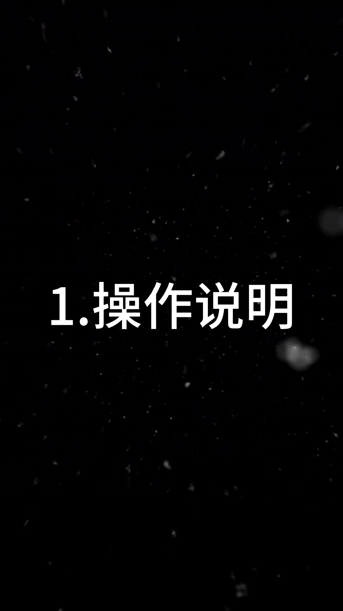

- 画面文字（OCR）：1 .操作说明

### 2. 00:04

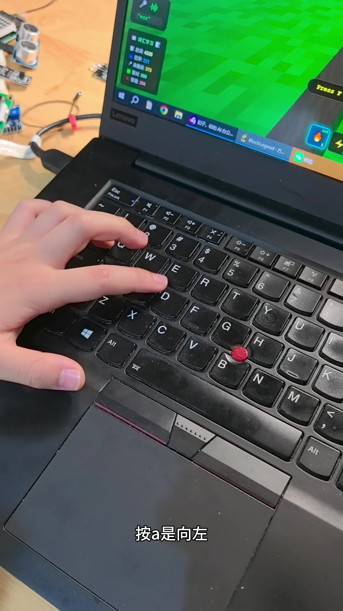

- 内容摘要：一操作说明按w是向前，按s是向后，按a是向左，呃按d是按右（00:00-00:06）
- 画面文字（OCR）：»
yo x
— Vong |
= 从 a,
5 + ME ou,
} 如
; < 0 B ~ 本
= x
o SLT Ee 一 vy. i 76 / 7 全 = 4
yw TE a
人 Shy. V/- SL
) LA 国人大 4 Via po &
| Ar SS W/o 个 > =
> 4 7 & 大 SN 4 (a x
yy > ss ~
: 3 SS f
A / SNNIG
5 aE |
SS

### 3. 00:05

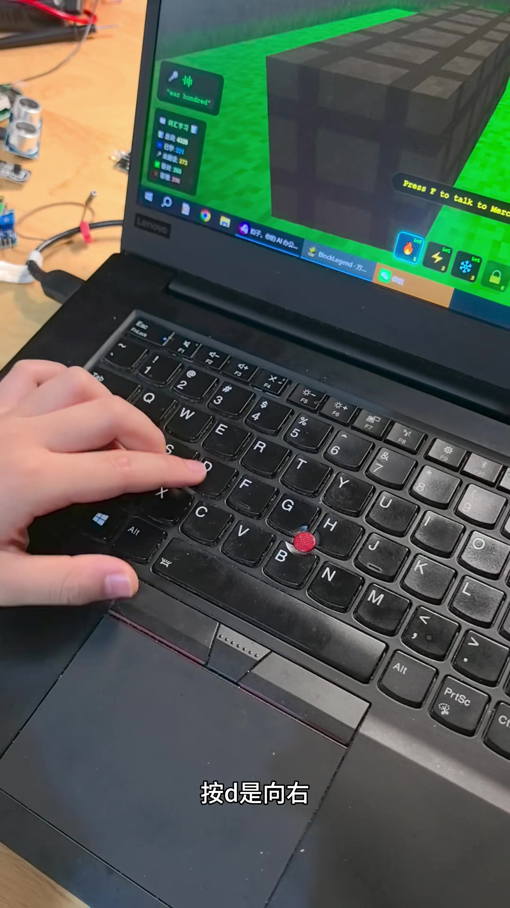

- 画面文字（OCR）：- LAH a di PR
- EN
’ Cary,
L tea"
- ; I~
J BN ss 四 em
= Egle
~ = 2
/ 7
7 Vac 4 NG Foy = ..
f= SS Zhe y/ ~Y ~~ 2%
(RNS 4 J sa [AR
CHE 多 . < d
2 7% Via > ay
= a /人 2
EER, TS
- s Ho : 人 i 多 & 7 [2 & a
2 fo IAN 8 PP 信和 SS SR
Sa [75 SN 四 SV Cy 按 d 是向有

### 4. 00:07

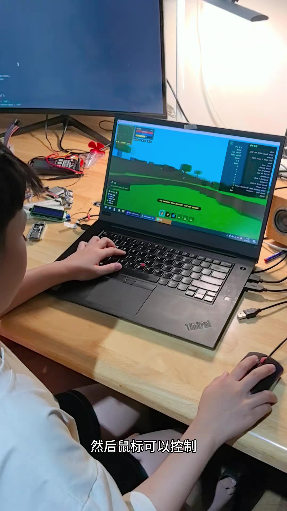

- 画面文字（OCR）：ad
TT
7 Rl ss N
va / Vf
7, ne | “| s
YA 、 \ 一二大 8
NA Fa
gS) GPT -
vam 5
~ ‘= - LY = ma ; ;
EE 一 R=
L a re 7
5 ne [eng ~ man?
“Sal ti =
一一二 ER 一
7 - LI) Fas ~ 二 @ ee >
-3 ’ # 8
Fa ( 2 = ) “4
——— 4 ~ Ca AF 7 ) -
- 区下 %. » 7s ’ “ae - ,y
3 / 他 “Ze 1 4 性 ~ 7 4 7 FF a
= 人 Ar 万有和 JR A
5 人全全天下 Ra 全 7 二
=F J 4 / A 2 — -
~~ —
) g Be /
4 Fa
mw 二
4 o ’ 四 aa |
和 | - 4
= y 2X
\ Tg B >
| 2
> — ET f= ay |
然后鼠标可以宇市 | 和
>
8
f
AS pi

### 5. 00:08

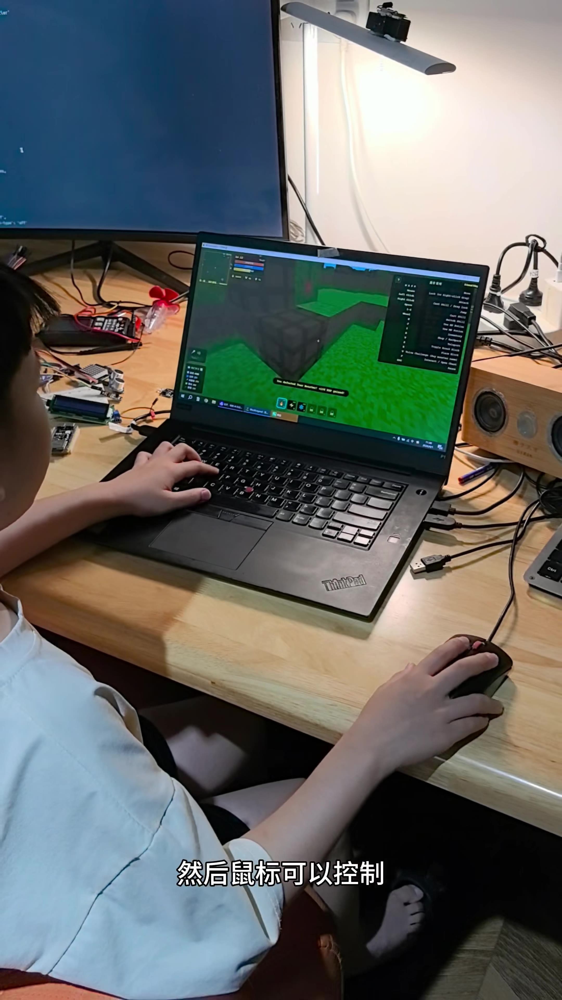

- 画面文字（OCR）：wa 一 5 =,
\ T NO
a
Am
i |
-
Fe
= —d \
A = TIE 4
We oF | TOE NS
“hi: | A. PE BRC
> = 二 ”二 CE 2 -一 ==
Gi ot IS er
“< CE SE ra ~ 1
! a= i SE |
7 本 A) i
14 4 1 ’ dere ~~ SR 二 - > 一 on 0 vs < Z jo 2 = 7 一 = | > /
i — = LY Se Jr & = 7 / >
= TY AST = 2
a 7 0 07 一 IAA 人
| = | fe——tf"
SSS ~ am = 4
2 Cy 8
外 RE T \
" 0g EE 2 a 了 | pre ya J
\ - Rac - < —— = =
—— a - -
gr ‘ £5 < NN 道 — eg -
A iE TE LAE
7 然局最标可以控般

### 6. 00:09

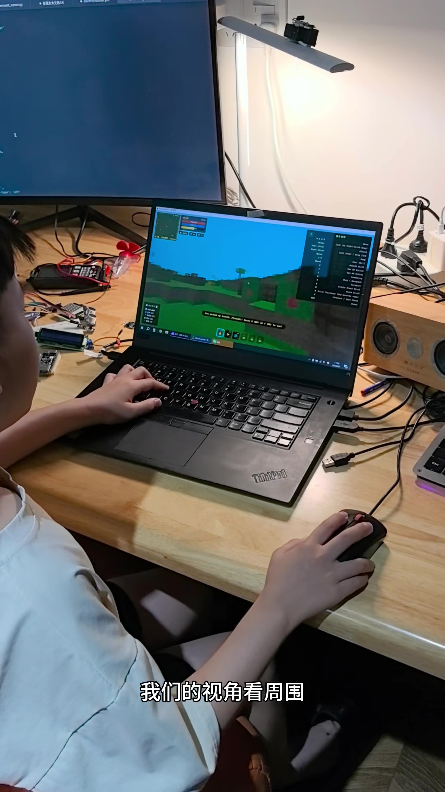

- 内容摘要：按空格是跳，然后鼠标可以控制我们的视角看周围，然后左键是用打用刀砍，按右键是发魔法（00:06-00:14）
- 画面文字（OCR）：rere » SRESRA 9 SETI aa ir
wt “N- Pe.
1
as or |
人
/ | } Te |
Se Es P
~ ~ Vir a el x 7
， Sp i | A : sas AC
= : < RS >
Sa | an
4 — po ”29 ~ s B
[a 一 (一 == — sd 人
= Ngad i
: ofr EE
yy y BN CL
= . = a a ~ Jr 2 4 外 > —
4 V/A re / 7 S -
yy i ey) / -AAA
“oy £3 -一一 =
: ey Aa ANY 1 :
ES 一人天于 A
二 -— : 多 4 Na.
和村 T FA
Eh — /
cD SM =~ 天四 g. 5 —
ae = oNl 4 / Sa
~~
“ — x wa 本 ~~ —
、
ES AN va
=
我们的秽用看周转
7a 1 | \
/
’ J
#

### 7. 00:16

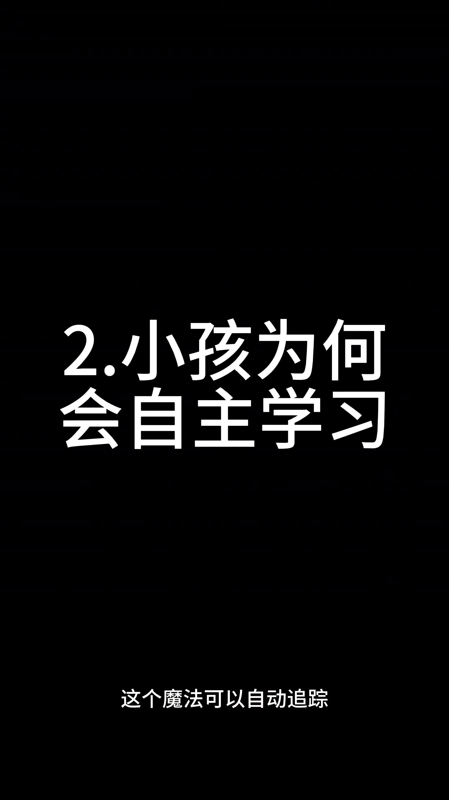

- 内容摘要：这个魔法可以自动追踪（00:14-00:16）
- 内容摘要：二小孩为何会自主学习？（00:16-00:18）
- 画面文字（OCR）：2. 小孩为何
Z 三 FF >)
这个魔法可以自动追踪

### 8. 00:18

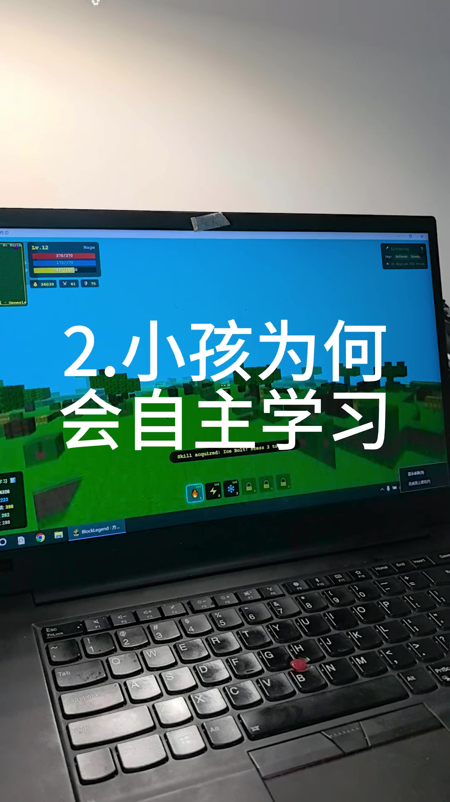

- 内容摘要：如果我们遇到怪物不念单词的话会打得很慢，如果念出单词的话就能实现暴击伤害（00:18-00:24）
- 画面文字（OCR）：和
T 2) Lv.12 Mage ,
| eS
EOE EX EXD
ld
$
) 1 \\¥Z )> 本
®
一人 HES |
= ofl 了 ,| *. LE i
$398
: IL
RAD S $v
AD EN 用人 SIE REN
0 = Ne \& — NN NX XS
- AN pan” we A B\ © WD SN \ No
a |e Le NS Na \ < Ne NS
- 了电台 oe) a, NSN \> Se
LEN de oT 6
EVA =
or \ J 并总 < 一
| \ NS P NL
5 \ 5 \

### 9. 00:24

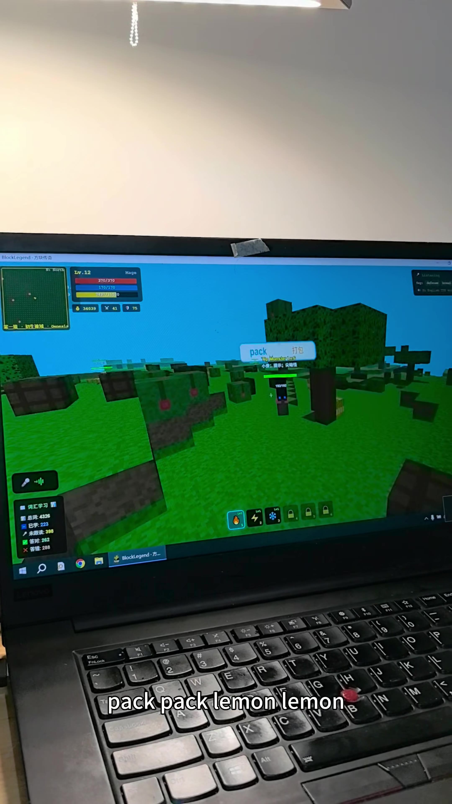

- 内容摘要：Lemon lemon（00:26-00:27）
- 画面文字（OCR）：EEE SN .
SEES =
|
| a :一 mm
® 3039 fl x a1] 0s
kn mE omnes
AHR; BR; RE
pi
mares A 四 wa 4
m 8 a2 ® 4, AN -二 gn 已学 :223
p FER 398
答对 : 262
x 答错 288 i
LE es
er LC
SN SS
KE = a = SR Ne
AAA re. N
\ —— ow ESET NN So
| ei \ 7s B\< = EO N AAS SS X
& \ TT) 一《< SS N\ ) <
ome TA RAT AE a. < \e¢ SS
Track’packiemon leon NA
: \CG
Ce
1 [= \ > \ Ne 3
: il NG \
} 一一 . lt |
| BR\

### 10. 00:32

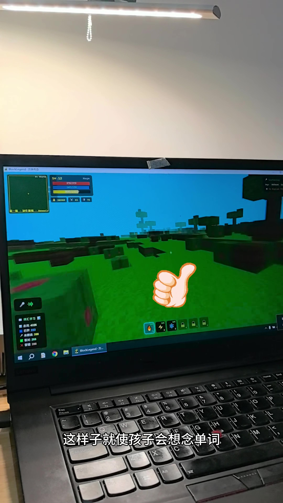

- 内容摘要：这样子就使孩子会想念单词（00:30-00:33）
- 画面文字（OCR）：EE —— a
ch.
Em) v.12 Mage 了
© mesmo
| & 34080 ¥ a 9 15
一鼻 _-
2 引 mares BW -
< 全 4， 3 8 hd RATE
pe
534: 266
X E288
| apo 0 © m El
» rc、 Se Ne 本
2 —_ ~ Zo << Ne i
— ’ 5 fe ve = SS =» NS = N |
= Esc 3 B= foes Co De P\ © > SS SS \ »
= AE Nt ea AN ow NX
| 2 (Ee) @ mE A IN 六
2 \ rn awe AL, Se tw Xs
RFE ARSE © 、
PCS.
- \ |B 3 \

### 11. 00:34

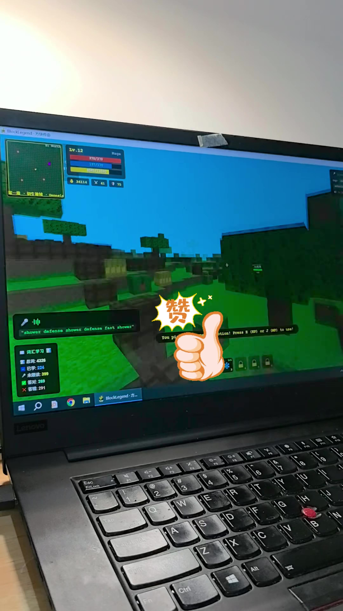

- 内容摘要：现在给大家表演一个打boss，如果不破防他会打的很慢（00:33-00:39）
- 画面文字（OCR）：ee . _— a — -— ) a)
z Lv.12 —
i 二 mas
< ® san wo mn
A -eaaai
+ +
年 >
户 »
: ax © JE tion! Press 有 (EP) or J OM) to use’
You 了 aces 加 To
a J 辣 AP FBR 399
答对 269
X #29
问 ¢ Bloddegend 方 ~
«a DB 9
- ~- a Na Xs =<
: p— en RN SS ANA
eC SNS NRE
\ —— S\N SN NN R
NE es Nl
CT Ne FPL Ded
- NT A S\N
gp 一 AN \
Cs AX 】
| = =O
_— ER 一
|

### 12. 00:41

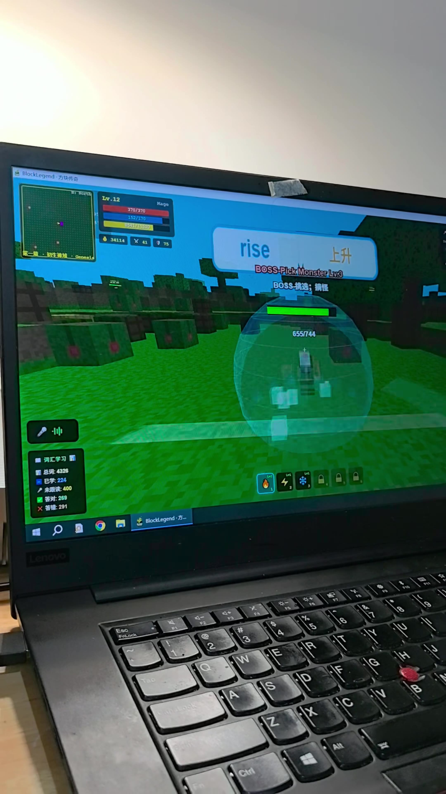

- 画面文字（OCR）：上和 — ¥ \
Lv.12 a — PM
| a — =
! CT
@ 34114 || x Vive a 0s So
-和 iin] ik : - rt
os BOSSE Mnstep ugg
\ -二 BOSS iki%; Mts
—_ 655/744
2 i
maces 0
m 总词 : 4326 - 中已学 : 224 ¢ 3 s
2 FIER 400
答对 - 269
X 答错 - 291
==> a 0 B® [TC
» : wh a SN
a AAA: ha 3 Sa \ - NS Ne
"UA Ui 1 RNAN SS
ER Nh AS §
¥ esc > 人 NS AN Py ) AN XX \
\ == a \& NE As SN
Ee Be \ a) SR \ BC
NS ，一
_— - 2 . \
- 4 ) Be WS 党 XL 一 CC x ) 司

### 13. 00:45

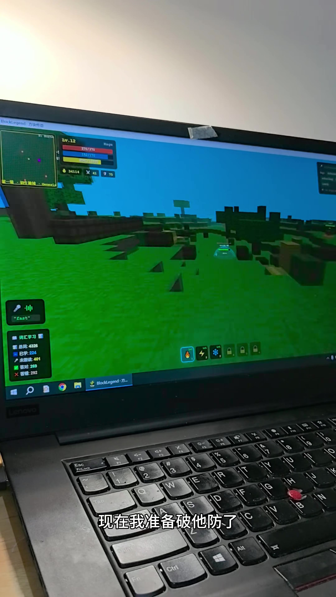

- 内容摘要：它有个防护罩，就是这外面的这些蓝色的东西，现在我准备破它房了，Pardon（00:42-00:48）
- 画面文字（OCR）：BockLeqend - pipes 一
«mmm ™
JER) 上
| 2 Sau x ales
2
mares 二
w on ax
2 2 EU 答对 : 269
X E292
apa 9 po | Set 地 SR~ NE < S
AN 一 SS
I NG > Se © SS NS Ne
EE ea SCN Oo AS —rr, OS
\ NA oe BN Ns SOUR 六 We Se 、 SNs AAS SS Sa N A
| < SEN
| 3 2200 | XY = a ©. NN
Ce ER 二 MEER SWMET 、
JR \ E, AN AN
| - Sa ) 3

### 14. 00:49

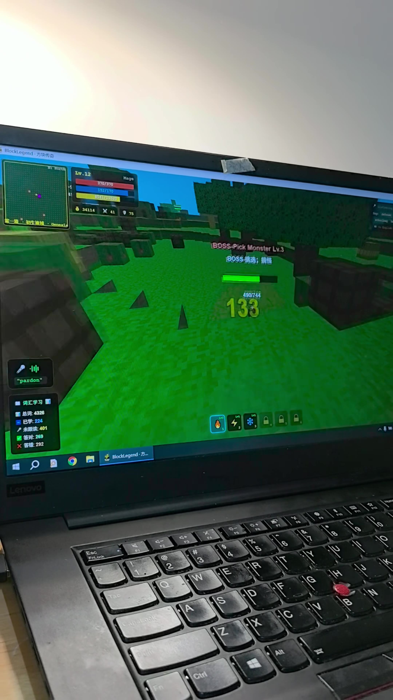

- 内容摘要：呐，防护罩变成红色了，就说明它破防了（00:49-00:52）
- 画面文字（OCR）：Socklegend pipe 和了 -: v
Mage n i
NE ee
| a - a nme a, >
| § ® sau ¥ a Chem \
BOSS Pick Monster Ly.3
BOSS-%; mE
Asana
133
2 i
maces 外站 ( 4. J iw
401
L cari
x 答错 - 292 x
y= ¢ bloddegend
a OBO
SS NO x.
\ Ne NS Aes NS Ni >
mm A T= 0 Sa NS SS NS Ne S$
ax NC N wr < SS ANA \ : NS
mR = AE Ne 0) SS 六
| 0 dc NE SE) 起 SS \ SS
0 CE NS
NE SN ， SN, 一
| BB yO
\ “» \
fo SE NA 一 CS 、 = RB
i ne

### 15. 00:54

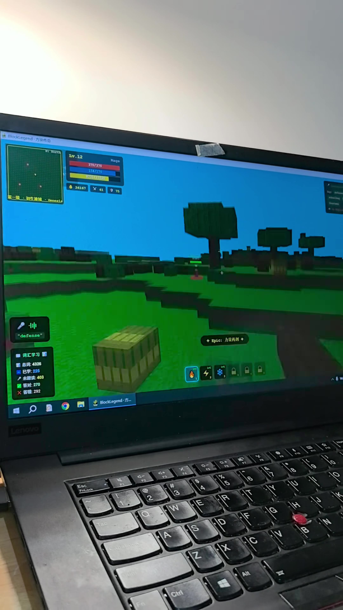

- 内容摘要：破防了就非常好打（00:52-00:54）
- 内容摘要：这样子我们就不得不学英语（00:54-00:56）
- 画面文字（OCR）：pn Legend yin cn 二 CS ss OO || \
Lv.12 " ~ a, - =
Co Tome :
v ‘ CT ery,
3 ® 34167 | yw alon i
= |
+
1
jdecensay OL + Epic: 力量药剂 +
maAre3 NW
m £m 4 —
> a ¢ 你下答对 - 270
x 答错 : 292
BlockLegend 方 -
a Oo 8 OBE
© RR ss:
- SS \ FRI» DN
a Ns S\N - AN SN
\ ESS ag) 辣 : ES SS NS Se SS SS
— 4 ae NS NS 3 NY \
AEB LY
1) Na) SS X \ =. SS
Sd J KD = ) AN ® \
a RE Aw \ \
a 了】
| Er oN R SN -
NS
_ 全入六一 CA RB

### 16. 00:56

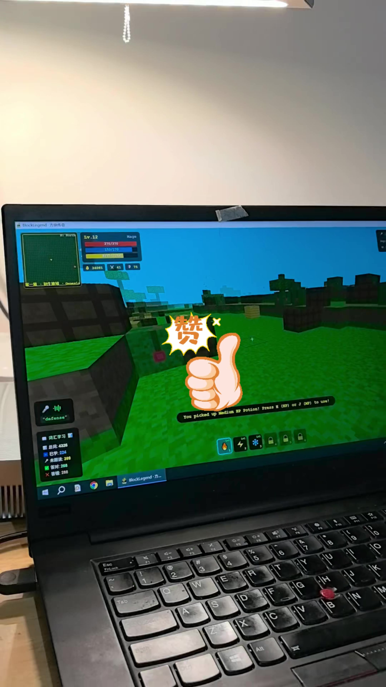

- 画面文字（OCR）：= —
ree kana | BZ TE
| | EE \
| RL)
| .| dumiXauldn 人
- Pe og
a : 到 dg press § (EP) OF 3 om) to we!
ra = 央 tet 0 GARB
» HERI
wt 268
X 2
re 方 Ml “eon © 上一一
3
— = ~ 、 Se 这一
” 二“ 一 = ad) an — S A NS NSS
wi 2D ia S NS
z= eso - CE po SS \ 六
& pz \ \ - ‘ 2 i — NN NS \ )
€ — 2 =i NN A \ SS NS
po “ - . >
CT \ TER
» 上 gs. A\\! ne NS
AN - SN \
o>
和 - se
— -—

### 17. 00:57

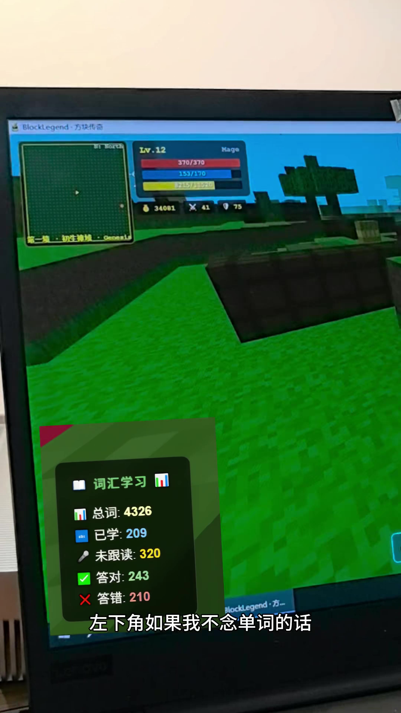

- 该时间点暂无可提取文字。

### 18. 00:59

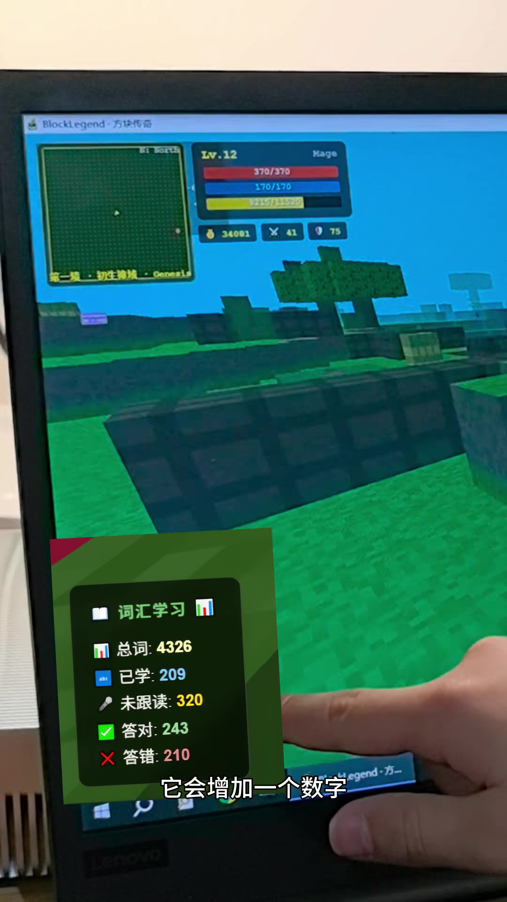

- 内容摘要：左下角如果我不念单词的话，它会增加一个数字过来，看看我今天学了多少（00:56-01:02）

### 19. 01:00

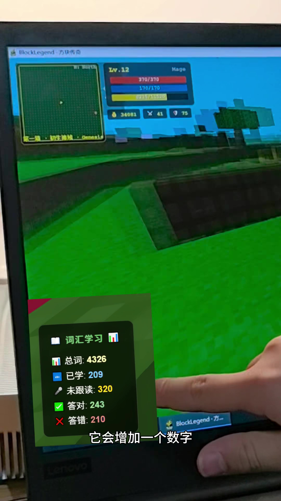

- 该时间点暂无可提取文字。

### 20. 01:04

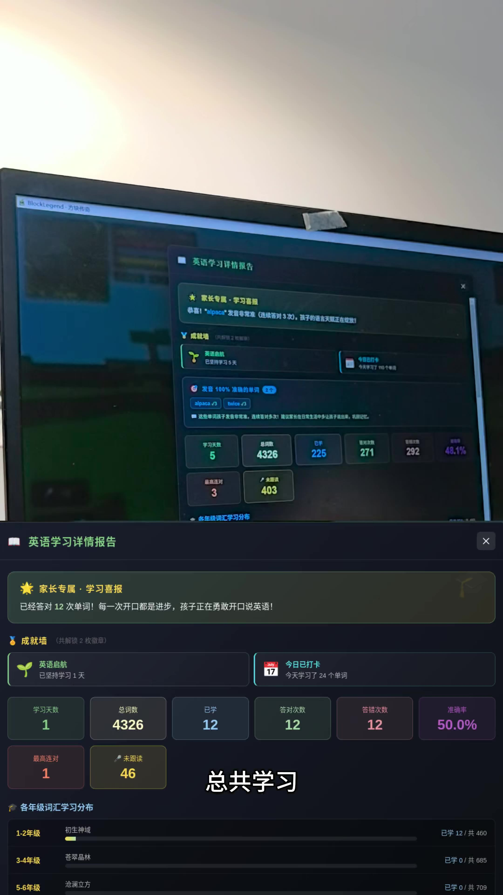

- 该时间点暂无可提取文字。

### 21. 01:05

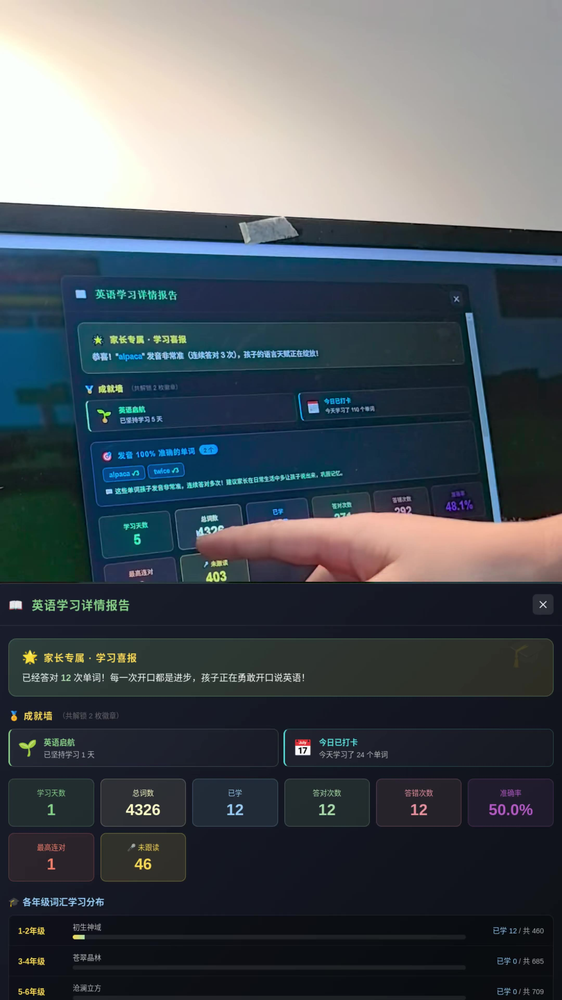

- 内容摘要：总共学习（01:03-01:06）

### 22. 01:13

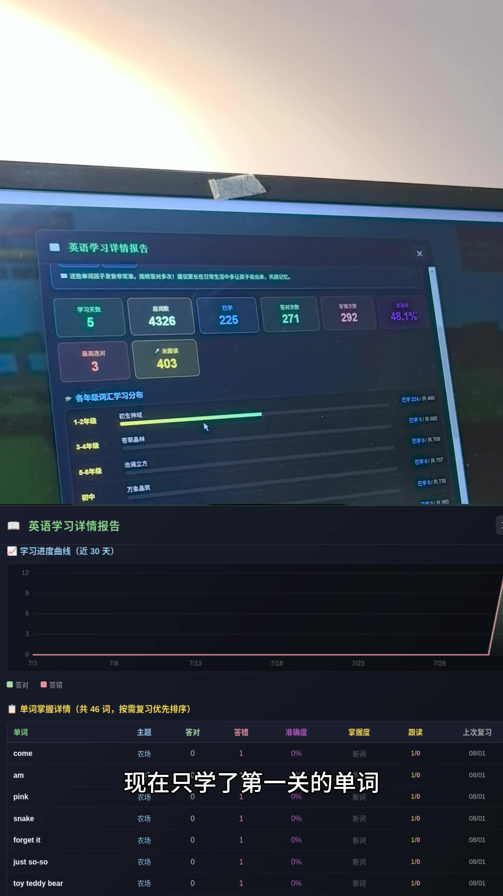

- 内容摘要：已学二百二十五。总词数四千三百二十六，现在只学了第一关的单词（01:06-01:14）

### 23. 01:14

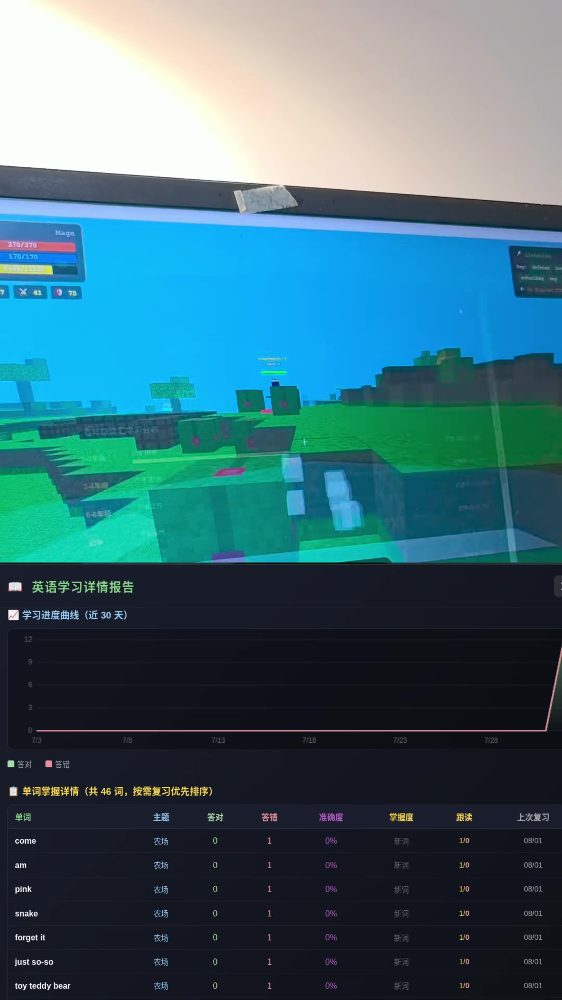

- 该时间点暂无可提取文字。

### 24. 01:19

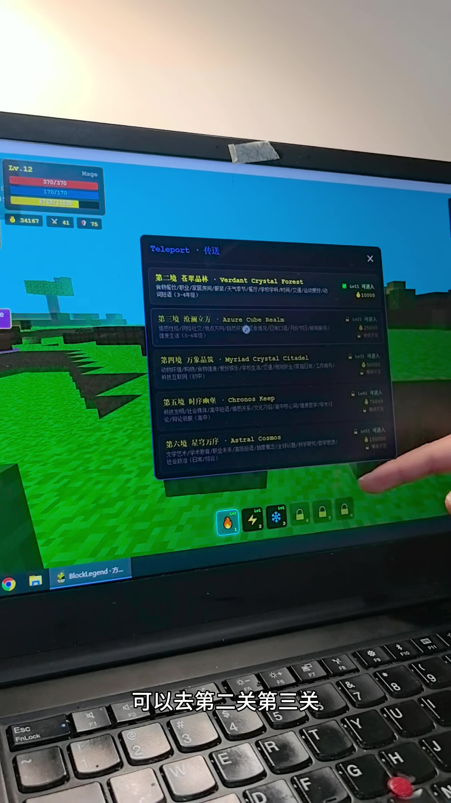

- 内容摘要：三越玩越想学，如果我们有钱了，可以去第二关第三关（01:15-01:19）

### 25. 01:21

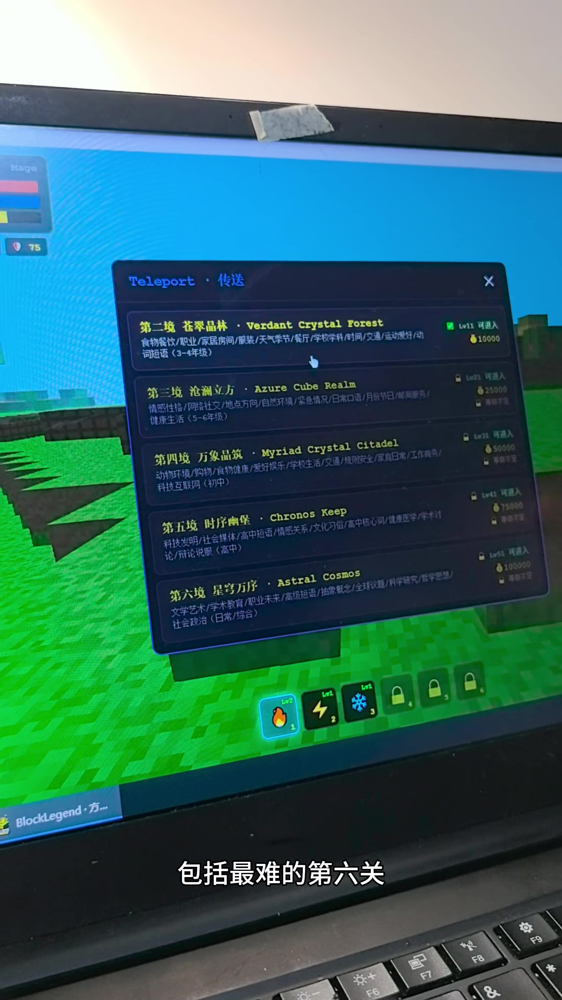

- 内容摘要：包括包括这难的第六关进第二关花了我一万块钱（01:19-01:23）

### 26. 01:29

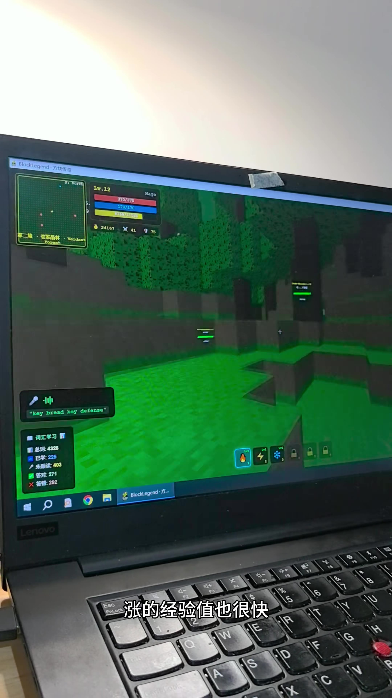

- 内容摘要：这是一个声音。这里面的怪怪物掉的钱钱都很多，长的经验值也很快（01:24-01:30）
- 内容摘要：Approximately. A pricing motley（01:30-01:33）

### 27. 01:37

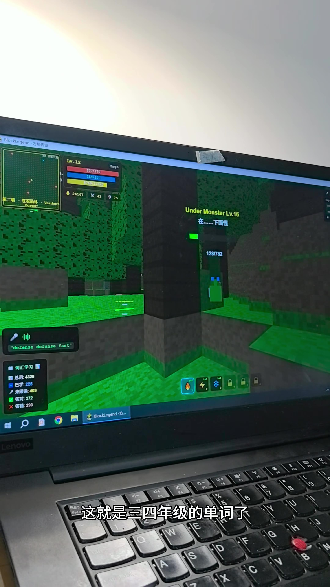

- 内容摘要：这样的。这就是三四年级的单词了，Face catch catch（01:35-01:41）

### 28. 01:46

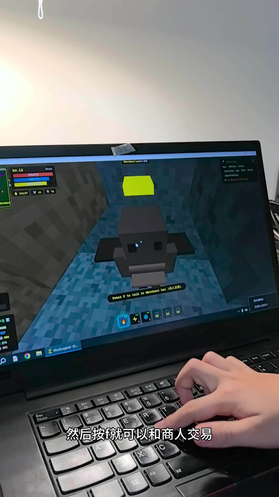

- 内容摘要：然后按f就可以和商人交易，把这个名片给卖掉（01:44-01:49）

### 29. 01:54

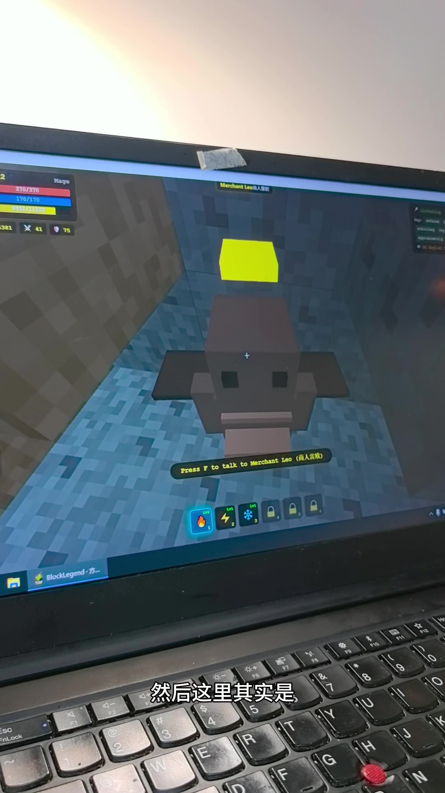

- 内容摘要：这个卖掉，这些卖没用的东西都可以卖掉（01:49-01:53）
- 内容摘要：然后这里其实是有个操作按钮的（01:53-01:55）
- 内容摘要：点击这个问号就可以展开（01:55-01:57）

### 30. 02:02

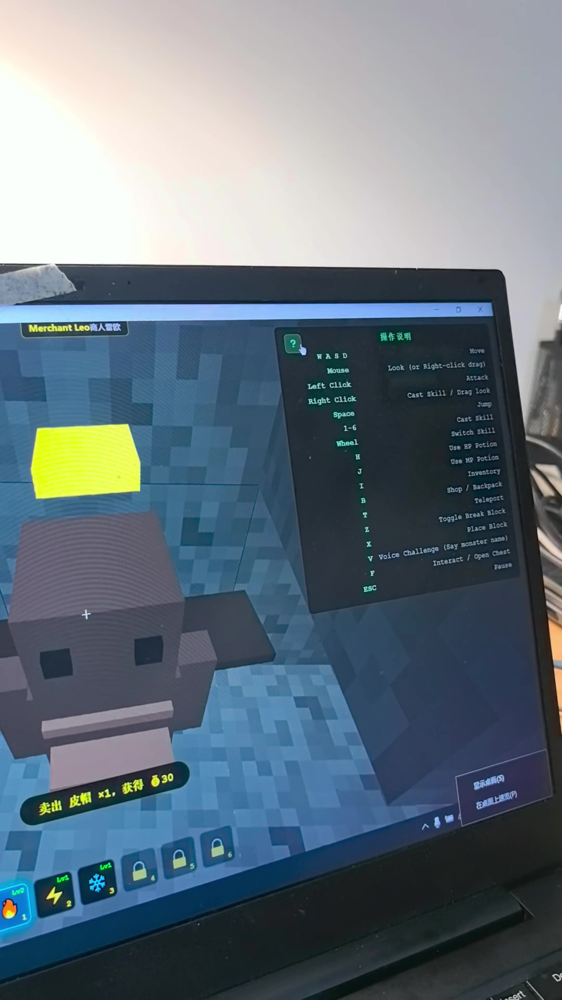

- 内容摘要：都是英文的，要认识才才行，其实我刚才说的所有东西这这里都有（01:57-02:01）

## 视频画面文字 (OCR)

> OCR 仅供参考，可能包含识别错误；请以视频画面和转写来源为准。

### 关键帧 1 · 0.5s

1 .操作说明

### 关键帧 2 · 4.63s

»
yo x
— Vong |
= 从 a,
5 + ME ou,
} 如
; < 0 B ~ 本
= x
o SLT Ee 一 vy. i 76 / 7 全 = 4
yw TE a
人 Shy. V/- SL
) LA 国人大 4 Via po &
| Ar SS W/o 个 > =
> 4 7 & 大 SN 4 (a x
yy > ss ~
: 3 SS f
A / SNNIG
5 aE |
SS

### 关键帧 3 · 5.82s

- LAH a di PR
- EN
’ Cary,
L tea"
- ; I~
J BN ss 四 em
= Egle
~ = 2
/ 7
7 Vac 4 NG Foy = ..
f= SS Zhe y/ ~Y ~~ 2%
(RNS 4 J sa [AR
CHE 多 . < d
2 7% Via > ay
= a /人 2
EER, TS
- s Ho : 人 i 多 & 7 [2 & a
2 fo IAN 8 PP 信和 SS SR
Sa [75 SN 四 SV Cy 按 d 是向有

### 关键帧 4 · 7.6s

ad
TT
7 Rl ss N
va / Vf
7, ne | “| s
YA 、 \ 一二大 8
NA Fa
gS) GPT -
vam 5
~ ‘= - LY = ma ; ;
EE 一 R=
L a re 7
5 ne [eng ~ man?
“Sal ti =
一一二 ER 一
7 - LI) Fas ~ 二 @ ee >
-3 ’ # 8
Fa ( 2 = ) “4
——— 4 ~ Ca AF 7 ) -
- 区下 %. » 7s ’ “ae - ,y
3 / 他 “Ze 1 4 性 ~ 7 4 7 FF a
= 人 Ar 万有和 JR A
5 人全全天下 Ra 全 7 二
=F J 4 / A 2 — -
~~ —
) g Be /
4 Fa
mw 二
4 o ’ 四 aa |
和 | - 4
= y 2X
\ Tg B >
| 2
> — ET f= ay |
然后鼠标可以宇市 | 和
>
8
f
AS pi

### 关键帧 5 · 8.62s

wa 一 5 =,
\ T NO
a
Am
i |
-
Fe
= —d \
A = TIE 4
We oF | TOE NS
“hi: | A. PE BRC
> = 二 ”二 CE 2 -一 ==
Gi ot IS er
“< CE SE ra ~ 1
! a= i SE |
7 本 A) i
14 4 1 ’ dere ~~ SR 二 - > 一 on 0 vs < Z jo 2 = 7 一 = | > /
i — = LY Se Jr & = 7 / >
= TY AST = 2
a 7 0 07 一 IAA 人
| = | fe——tf"
SSS ~ am = 4
2 Cy 8
外 RE T \
" 0g EE 2 a 了 | pre ya J
\ - Rac - < —— = =
—— a - -
gr ‘ £5 < NN 道 — eg -
A iE TE LAE
7 然局最标可以控般

### 关键帧 6 · 9.9s

rere » SRESRA 9 SETI aa ir
wt “N- Pe.
1
as or |
人
/ | } Te |
Se Es P
~ ~ Vir a el x 7
， Sp i | A : sas AC
= : < RS >
Sa | an
4 — po ”29 ~ s B
[a 一 (一 == — sd 人
= Ngad i
: ofr EE
yy y BN CL
= . = a a ~ Jr 2 4 外 > —
4 V/A re / 7 S -
yy i ey) / -AAA
“oy £3 -一一 =
: ey Aa ANY 1 :
ES 一人天于 A
二 -— : 多 4 Na.
和村 T FA
Eh — /
cD SM =~ 天四 g. 5 —
ae = oNl 4 / Sa
~~
“ — x wa 本 ~~ —
、
ES AN va
=
我们的秽用看周转
7a 1 | \
/
’ J
#

### 关键帧 7 · 16.73s

2. 小孩为何
Z 三 FF >)
这个魔法可以自动追踪

### 关键帧 8 · 18.68s

和
T 2) Lv.12 Mage ,
| eS
EOE EX EXD
ld
$
) 1 \\¥Z )> 本
®
一人 HES |
= ofl 了 ,| *. LE i
$398
: IL
RAD S $v
AD EN 用人 SIE REN
0 = Ne \& — NN NX XS
- AN pan” we A B\ © WD SN \ No
a |e Le NS Na \ < Ne NS
- 了电台 oe) a, NSN \> Se
LEN de oT 6
EVA =
or \ J 并总 < 一
| \ NS P NL
5 \ 5 \

### 关键帧 9 · 24.85s

EEE SN .
SEES =
|
| a :一 mm
® 3039 fl x a1] 0s
kn mE omnes
AHR; BR; RE
pi
mares A 四 wa 4
m 8 a2 ® 4, AN -二 gn 已学 :223
p FER 398
答对 : 262
x 答错 288 i
LE es
er LC
SN SS
KE = a = SR Ne
AAA re. N
\ —— ow ESET NN So
| ei \ 7s B\< = EO N AAS SS X
& \ TT) 一《< SS N\ ) <
ome TA RAT AE a. < \e¢ SS
Track’packiemon leon NA
: \CG
Ce
1 [= \ > \ Ne 3
: il NG \
} 一一 . lt |
| BR\

### 关键帧 10 · 32.97s

EE —— a
ch.
Em) v.12 Mage 了
© mesmo
| & 34080 ¥ a 9 15
一鼻 _-
2 引 mares BW -
< 全 4， 3 8 hd RATE
pe
534: 266
X E288
| apo 0 © m El
» rc、 Se Ne 本
2 —_ ~ Zo << Ne i
— ’ 5 fe ve = SS =» NS = N |
= Esc 3 B= foes Co De P\ © > SS SS \ »
= AE Nt ea AN ow NX
| 2 (Ee) @ mE A IN 六
2 \ rn awe AL, Se tw Xs
RFE ARSE © 、
PCS.
- \ |B 3 \

### 关键帧 11 · 34.3s

ee . _— a — -— ) a)
z Lv.12 —
i 二 mas
< ® san wo mn
A -eaaai
+ +
年 >
户 »
: ax © JE tion! Press 有 (EP) or J OM) to use’
You 了 aces 加 To
a J 辣 AP FBR 399
答对 269
X #29
问 ¢ Bloddegend 方 ~
«a DB 9
- ~- a Na Xs =<
: p— en RN SS ANA
eC SNS NRE
\ —— S\N SN NN R
NE es Nl
CT Ne FPL Ded
- NT A S\N
gp 一 AN \
Cs AX 】
| = =O
_— ER 一
|

### 关键帧 12 · 41.09s

上和 — ¥ \
Lv.12 a — PM
| a — =
! CT
@ 34114 || x Vive a 0s So
-和 iin] ik : - rt
os BOSSE Mnstep ugg
\ -二 BOSS iki%; Mts
—_ 655/744
2 i
maces 0
m 总词 : 4326 - 中已学 : 224 ¢ 3 s
2 FIER 400
答对 - 269
X 答错 - 291
==> a 0 B® [TC
» : wh a SN
a AAA: ha 3 Sa \ - NS Ne
"UA Ui 1 RNAN SS
ER Nh AS §
¥ esc > 人 NS AN Py ) AN XX \
\ == a \& NE As SN
Ee Be \ a) SR \ BC
NS ，一
_— - 2 . \
- 4 ) Be WS 党 XL 一 CC x ) 司

### 关键帧 13 · 45.72s

BockLeqend - pipes 一
«mmm ™
JER) 上
| 2 Sau x ales
2
mares 二
w on ax
2 2 EU 答对 : 269
X E292
apa 9 po | Set 地 SR~ NE < S
AN 一 SS
I NG > Se © SS NS Ne
EE ea SCN Oo AS —rr, OS
\ NA oe BN Ns SOUR 六 We Se 、 SNs AAS SS Sa N A
| < SEN
| 3 2200 | XY = a ©. NN
Ce ER 二 MEER SWMET 、
JR \ E, AN AN
| - Sa ) 3

### 关键帧 14 · 49.2s

Socklegend pipe 和了 -: v
Mage n i
NE ee
| a - a nme a, >
| § ® sau ¥ a Chem \
BOSS Pick Monster Ly.3
BOSS-%; mE
Asana
133
2 i
maces 外站 ( 4. J iw
401
L cari
x 答错 - 292 x
y= ¢ bloddegend
a OBO
SS NO x.
\ Ne NS Aes NS Ni >
mm A T= 0 Sa NS SS NS Ne S$
ax NC N wr < SS ANA \ : NS
mR = AE Ne 0) SS 六
| 0 dc NE SE) 起 SS \ SS
0 CE NS
NE SN ， SN, 一
| BB yO
\ “» \
fo SE NA 一 CS 、 = RB
i ne

### 关键帧 15 · 54.33s

pn Legend yin cn 二 CS ss OO || \
Lv.12 " ~ a, - =
Co Tome :
v ‘ CT ery,
3 ® 34167 | yw alon i
= |
+
1
jdecensay OL + Epic: 力量药剂 +
maAre3 NW
m £m 4 —
> a ¢ 你下答对 - 270
x 答错 : 292
BlockLegend 方 -
a Oo 8 OBE
© RR ss:
- SS \ FRI» DN
a Ns S\N - AN SN
\ ESS ag) 辣 : ES SS NS Se SS SS
— 4 ae NS NS 3 NY \
AEB LY
1) Na) SS X \ =. SS
Sd J KD = ) AN ® \
a RE Aw \ \
a 了】
| Er oN R SN -
NS
_ 全入六一 CA RB

### 关键帧 16 · 56.43s

= —
ree kana | BZ TE
| | EE \
| RL)
| .| dumiXauldn 人
- Pe og
a : 到 dg press § (EP) OF 3 om) to we!
ra = 央 tet 0 GARB
» HERI
wt 268
X 2
re 方 Ml “eon © 上一一
3
— = ~ 、 Se 这一
” 二“ 一 = ad) an — S A NS NSS
wi 2D ia S NS
z= eso - CE po SS \ 六
& pz \ \ - ‘ 2 i — NN NS \ )
€ — 2 =i NN A \ SS NS
po “ - . >
CT \ TER
» 上 gs. A\\! ne NS
AN - SN \
o>
和 - se
— -—

## 字幕文件

[TXT](./transcript/video.txt) | [JSON](./transcript/video.json) | [SRT](./transcript/video.srt) | [VTT](./transcript/video.vtt)

## 转写来源

[平台字幕 TXT](./transcript/platform/video.txt) | [平台字幕 JSON](./transcript/platform/video.json) | [平台字幕 SRT](./transcript/platform/video.srt) | [平台字幕 VTT](./transcript/platform/video.vtt) | [本地 ASR TXT](./transcript/asr/video.txt) | [本地 ASR JSON](./transcript/asr/video.json) | [本地 ASR SRT](./transcript/asr/video.srt) | [本地 ASR VTT](./transcript/asr/video.vtt)

## 其他来源转写

### 本地 ASR

- **00:00-00:01** B 操作說明
- **00:01-00:02** NW是向前
- **00:02-00:03** S是向後
- **00:03-00:04** A是向主
- **00:04-00:06** D3i右
- **00:06-00:07** N 空格是跳
- **00:07-00:07** 然後
- **00:07-00:09** 屬於可以控制我們的自找看
- **00:09-00:10** 周圍
- **00:10-00:13** 如果竟然是用反右招
- **00:13-00:14** 按右鍵時8摩
- **00:14-00:15** 16
- **00:15-00:16** 這個摩法可以自動追蹤
- **00:16-00:18** 2 小孩為何會自主學習
- **00:18-00:20** 如果我們遇到怪物不念單詞的話
- **00:20-00:21** 會打得很慢
- **00:21-00:22** 如果念主單詞的話
- **00:22-00:24** 就能實現暴擊傷害
- **00:24-00:25** 2
- **00:25-00:26** 2
- **00:26-00:27** 1
- **00:27-00:30** 1
- **00:30-00:34** 這樣子就使孩子會強烈擔心
- **00:34-00:35** 現在大家表演一個
- **00:35-00:36** 打爆時
- **00:36-00:37** 如果不換房
- **00:37-00:38** 他們會打得很慢
- **00:38-00:42** 不好意思
- **00:42-00:43** 還有個防護罩
- **00:43-00:45** 就是這外面的這些懶序的東西
- **00:45-00:46** 現在我準備破他房了
- **00:46-00:48** Pardon
- **00:48-00:50** 嗯
- **00:50-00:51** 防護罩跟他胡說了
- **00:51-00:52** 就說明他破房了
- **00:52-00:54** 個房了就非常好打
- **00:54-00:56** 這樣子我們就不得不學
- **00:56-00:57** 可惜下角
- **00:57-00:58** 如果我不念單詞的話
- **00:58-01:00** 他會增加一個數字
- **01:00-01:03** 不然看看我今天選了多少
- **01:03-01:05** 總共學習
- **01:06-01:08** 一學225
- **01:08-01:11** 總值數4,326
- **01:11-01:15** 再直覺第一關的單詞
- **01:15-01:15** 3
- **01:15-01:16** 律完月想學
- **01:16-01:17** 如果我們有錢
- **01:17-01:19** 可以去第二關街上關
- **01:19-01:21** 包括最難的第六關
- **01:21-01:24** 今天第二關花了我一萬塊錢
- **01:24-01:25** 這是一個生流
- **01:25-01:28** 這裡面的怪物掉的錢
- **01:28-01:28** 錢都很多
- **01:28-01:30** 找的經驗值也很快
- **01:30-01:31** Approximately
- **01:31-01:34** Approximately
- **01:36-01:38** 這就是三四年級的單詞
- **01:38-01:39** Face
- **01:39-01:47** App就可以和商人交易
- **01:47-01:50** 這個明天給賣掉
- **01:50-01:51** 這個賣掉
- **01:51-01:53** 沒有的東西都可以賣掉
- **01:53-01:55** 這裡其實是有個操作按鈕的
- **01:55-01:57** 眼睛這個萬化就可以展開
- **01:57-01:59** 都是英文的要認識錢
- **01:59-02:01** 其實我當天說的所有東西
- **02:01-02:02** 這裡都有

## 视频转录

- **00:00-00:06** 一操作说明按w是向前，按s是向后，按a是向左，呃按d是按右
- **00:06-00:14** 按空格是跳，然后鼠标可以控制我们的视角看周围，然后左键是用打用刀砍，按右键是发魔法
- **00:14-00:16** 这个魔法可以自动追踪
- **00:16-00:18** 二小孩为何会自主学习？
- **00:18-00:24** 如果我们遇到怪物不念单词的话会打得很慢，如果念出单词的话就能实现暴击伤害
- **00:26-00:27** Lemon lemon
- **00:30-00:33** 这样子就使孩子会想念单词
- **00:33-00:39** 现在给大家表演一个打boss，如果不破防他会打的很慢
- **00:42-00:48** 它有个防护罩，就是这外面的这些蓝色的东西，现在我准备破它房了，Pardon
- **00:49-00:52** 呐，防护罩变成红色了，就说明它破防了
- **00:52-00:54** 破防了就非常好打
- **00:54-00:56** 这样子我们就不得不学英语
- **00:56-01:02** 左下角如果我不念单词的话，它会增加一个数字过来，看看我今天学了多少
- **01:03-01:06** 总共学习
- **01:06-01:14** 已学二百二十五。总词数四千三百二十六，现在只学了第一关的单词
- **01:15-01:19** 三越玩越想学，如果我们有钱了，可以去第二关第三关
- **01:19-01:23** 包括包括这难的第六关进第二关花了我一万块钱
- **01:24-01:30** 这是一个声音。这里面的怪怪物掉的钱钱都很多，长的经验值也很快
- **01:30-01:33** Approximately. A pricing motley
- **01:35-01:41** 这样的。这就是三四年级的单词了，Face catch catch
- **01:44-01:49** 然后按f就可以和商人交易，把这个名片给卖掉
- **01:49-01:53** 这个卖掉，这些卖没用的东西都可以卖掉
- **01:53-01:55** 然后这里其实是有个操作按钮的
- **01:55-01:57** 点击这个问号就可以展开
- **01:57-02:01** 都是英文的，要认识才才行，其实我刚才说的所有东西这这里都有

## 图片

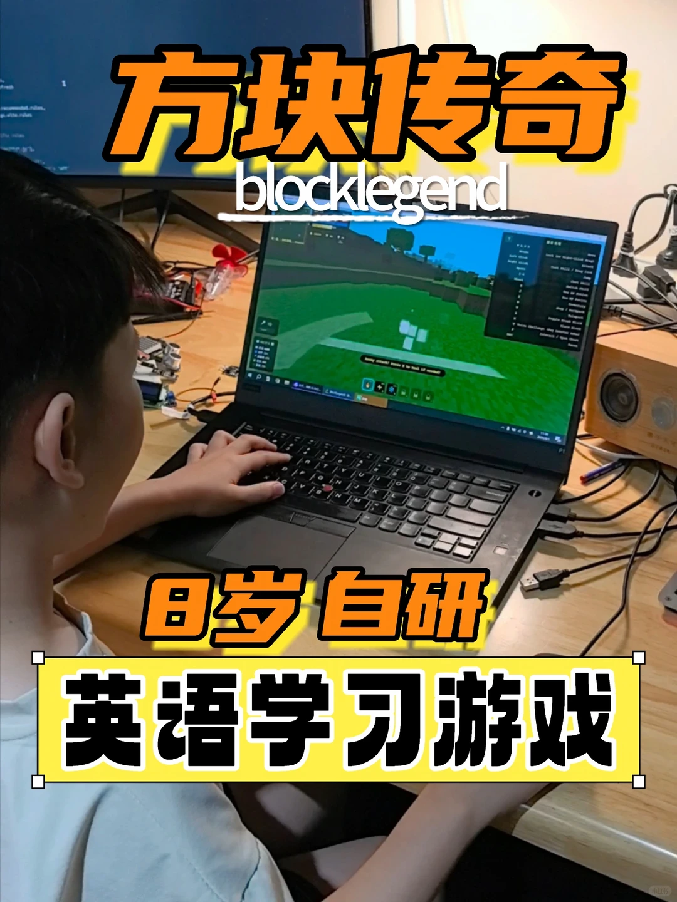

## 图片文字 (OCR)

> OCR 仅供参考，可能包含识别错误；请以原图为准。

方块传奇
blocklegend
自研
岁
英语学习游戏
门
