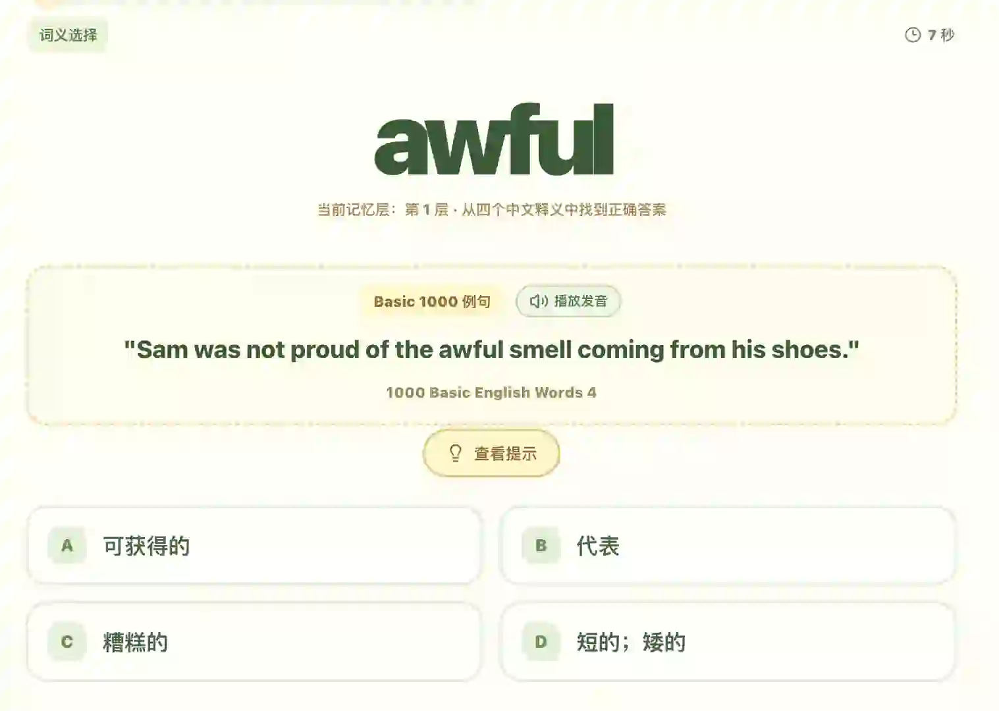

# 每天背20个单词，一个暑假能啃下Basic 1000吗？

> 作者: 海淀涵妈 | 日期: 2026/8/14 | 原文: https://www.xiaohongshu.com/discovery/item/6a7e75f50000000033008358?xsec_token=CB8JVDb2t_4e9H2AVQKNnoM9Gz_9DzxItwdQa5Z0ErU7E%3D&xsec_source=app_share

我和 AI 搭的背单词工作台最近升级了，朋友问我：每天就 20 个词，是不是太少了？
我直接用数据说话。
图1 是新增的 Basic 1000 词库路线：
- 960 个日常英语高频基础词
- 分成 48 关，每关正好 20 词
- 每天一关，48 天一轮，比直接刷 3500 词压力小太多
图2 是学习页，现在每个词都配了 Basic 1000 例句 + 真人发音。
比如 awful：
"Sam was not proud of the awful smell coming from his shoes."
点一下就听整句，娃不是孤立记"awful=糟糕的"，而是放进句子里理解。
再配上之前的莱特纳盒子 5 级复习 + 闯关地图，答对升级、答错回炉。
每天 20 个到底够不够？ 我的结论是：能坚持才是王道。20 个不多不少，娃不抵触，48 天一轮下来基础词就扎牢了。
你们每天给娃定多少词？评论区聊聊 👇

## 图片

