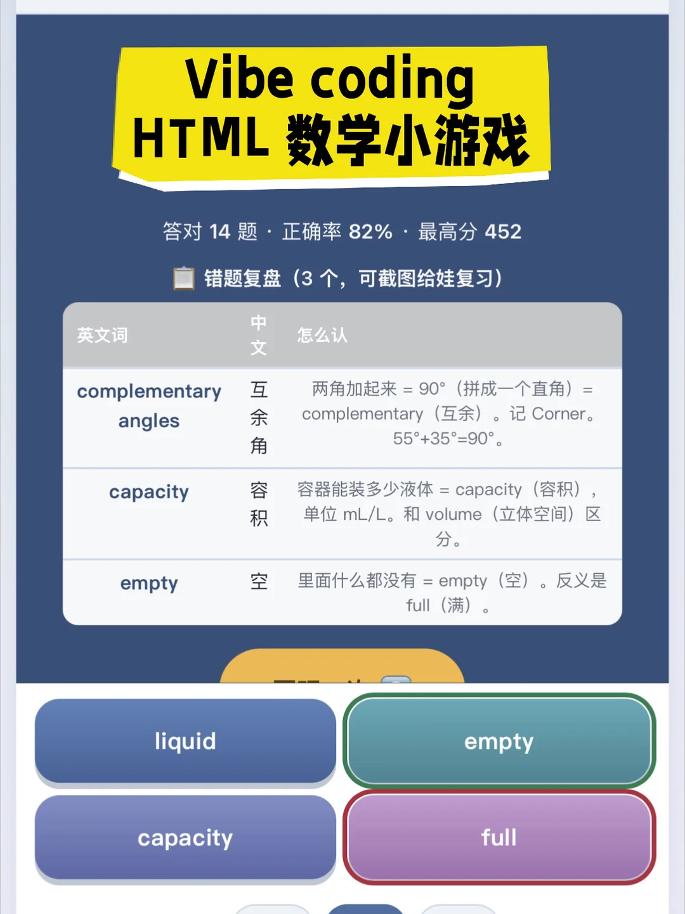

---
title: "现在娃的练习，已经开始像游戏一样了啊"
source: "https://www.xiaohongshu.com/discovery/item/6a48f1ac000000000f017497?app_platform=android&ignoreEngage=true&app_version=9.36.2&share_from_user_hidden=true&xsec_source=app_share&type=video&xsec_token=CBkeoCzBB37B_xH_sohxJ1Q11eij6iBap3BVsDpQZ4JIE%3D&author_share=1&xhsshare=CopyLink&shareRedId=N0dINjg3NUpMPko6S0EySDs0P0lFSjdL&apptime=1783219082&share_id=f0c2f19aff134d8ca45dcaf1e9ec977c&share_channel=copy_link"
author: "悉尼陪读妈妈 Jessica"
author_uid: "65dd909b0000000005008bee"
date: "编辑于 昨天 19:53 澳大利亚"
platform: "xiaohongshu"
category: "游戏设计"
---

# 现在娃的练习，已经开始像游戏一样了啊

> 作者: 悉尼陪读妈妈 Jessica | 日期: 编辑于 昨天 19:53 澳大利亚 | 原文: https://www.xiaohongshu.com/discovery/item/6a48f1ac000000000f017497?app_platform=android&ignoreEngage=true&app_version=9.36.2&share_from_user_hidden=true&xsec_source=app_share&type=video&xsec_token=CBkeoCzBB37B_xH_sohxJ1Q11eij6iBap3BVsDpQZ4JIE%3D&author_share=1&xhsshare=CopyLink&shareRedId=N0dINjg3NUpMPko6S0EySDs0P0lFSjdL&apptime=1783219082&share_id=f0c2f19aff134d8ca45dcaf1e9ec977c&share_channel=copy_link

感叹抄错题的时代真的要过去了！
	
以前陪娃复习，大多数时候其实是在"盯"。
	
把讲义摊开，把重点划出来，把错题抄一遍，再盯着他订正。
娃坐在那儿写，妈站在旁边催。
	
但很多知识，其实不是"抄会"的。
而是要"玩起来"之后，才能真正记住。
	
所以我用AI做了一个新东西：
	
把娃从学校带回的讲义 / 练习卷
直接变成「能玩的小游戏」。
	
讲义拍照丢给AI，几分钟就生成一个手机打开就能玩的小游戏：
✓ 不用装App，点开就玩
✓ 能选难度，从热身到挑战
✓ 能计分，娃为了破纪录主动刷
✓ 答错会暂停讲解，不是错了就翻篇
✓ 打完自动生成错题本，截图就是复习清单
✓ 还能中英对照，新移民娃刚好用
AI会根据讲义内容，自动设计最适合的玩法。
	
单词表，会变成配对消除；
数学概念，会变成闯关答题；
易混知识点，会变成找不同。
	
以前是我追着娃复习， 现在是娃追着我喊"再来一局"。
让知识"活"起来，复习才不用靠吼。
	
陪读妈妈 #AI辅导 #小学数学 #海外陪读 #悉尼生活 #AI育儿#vibecoding#WeeklyPick

## 视频

[视频 1](./video.mp4)

<video controls width="100%"><source src="./video.mp4" type="video/mp4">您的浏览器不支持视频播放。</video>

## 图片

## 评论 (共 1 条,已存 1 条)

详见 `comments-6a48f1ac000000000f017497.json`。
