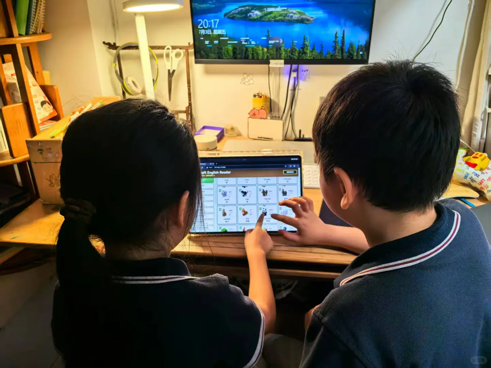
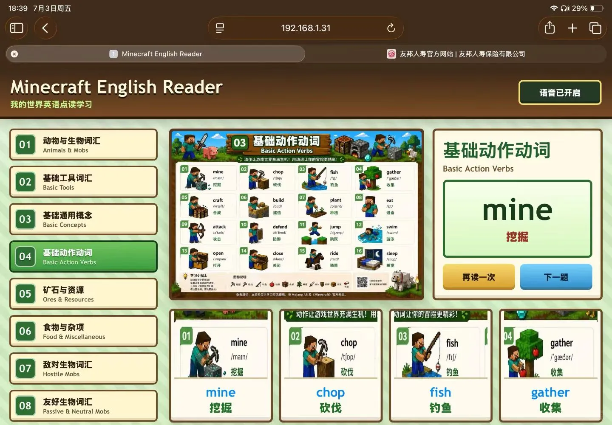
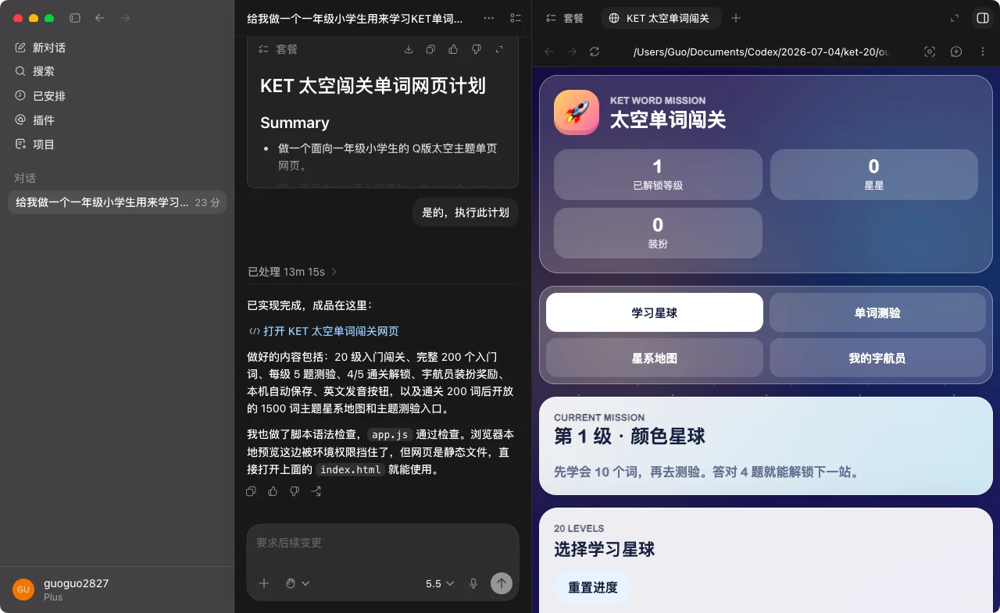
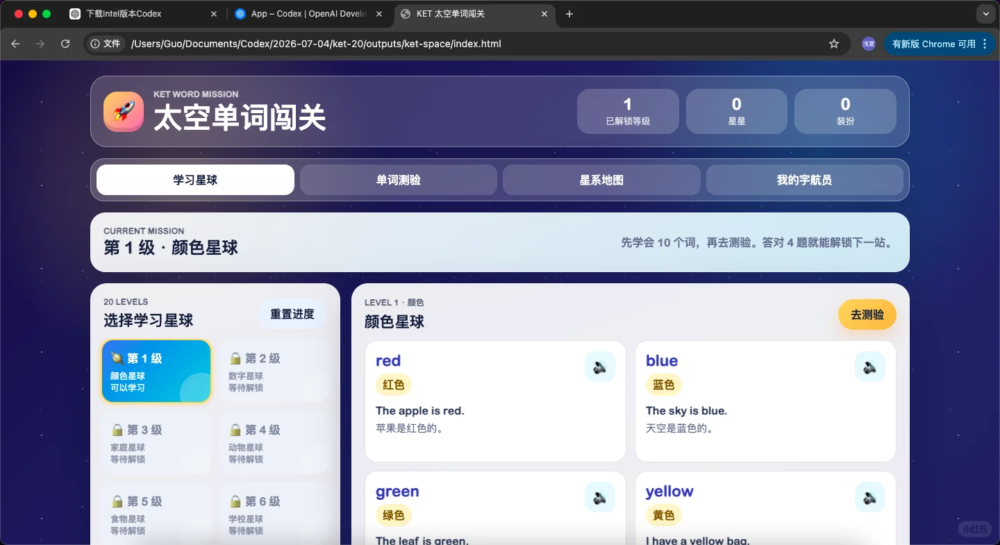
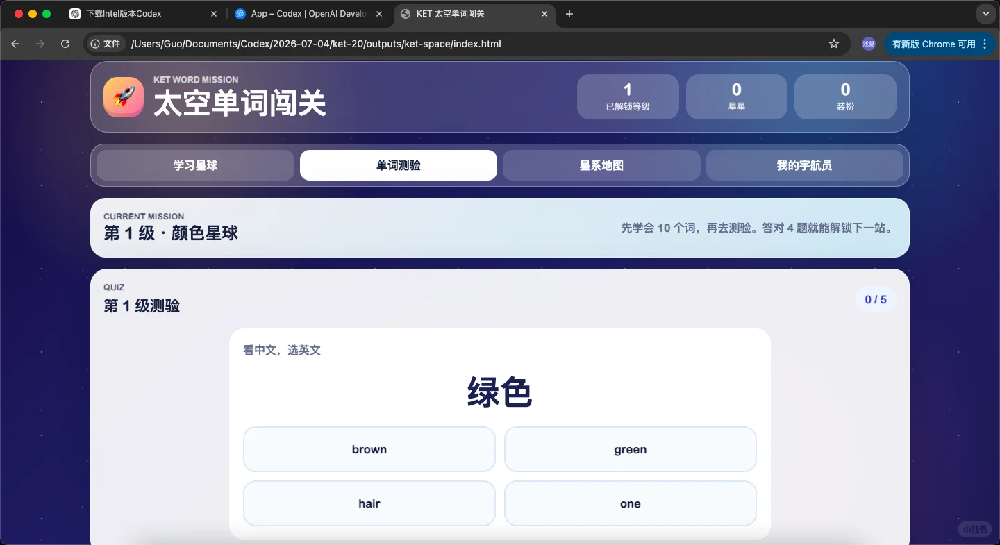
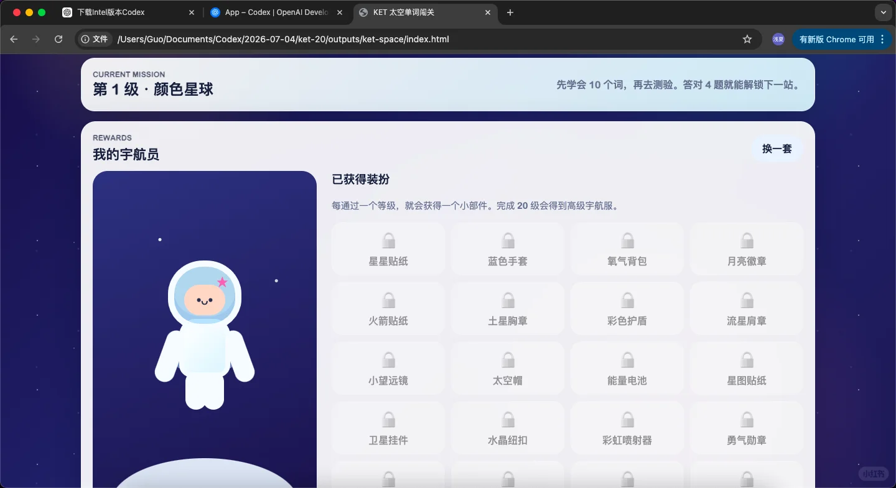
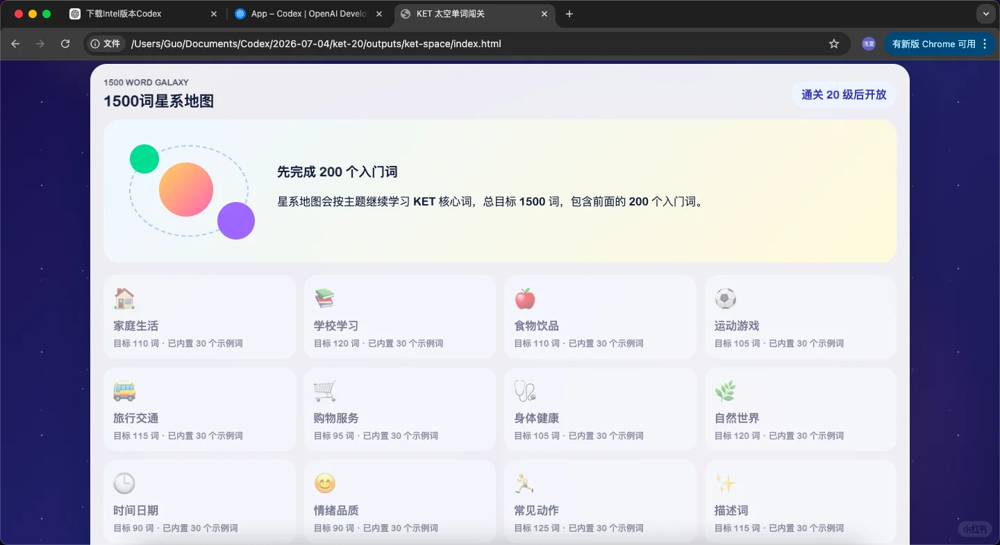

---
title: "给0基础一年级儿子手搓一个KET单词学习系统"
source: "https://www.xiaohongshu.com/discovery/item/6a491a95000000001003f72a?app_platform=android&ignoreEngage=true&app_version=9.36.2&share_from_user_hidden=true&xsec_source=app_share&type=normal&xsec_token=CB-tVnmE3VSoJzDGT3meBgJCFNGK4Te-f4z6JBYwzQPO4%3D&author_share=1&xhsshare=CopyLink&shareRedId=N0dINjg3NUpMPko6S0EySDs0P0lFSjdL&apptime=1783216811&share_id=27954301ae074a8b802f5d17dd122bf3&share_channel=copy_link"
author: "Joven21"
author_uid: "55b6350bdc02d22d7470e2da"
date: "昨天 22:37 广东"
platform: "xiaohongshu"
category: "游戏设计"
---

# 给0基础一年级儿子手搓一个KET单词学习系统

> 作者: Joven21 | 日期: 昨天 22:37 广东 | 原文: https://www.xiaohongshu.com/discovery/item/6a491a95000000001003f72a?app_platform=android&ignoreEngage=true&app_version=9.36.2&share_from_user_hidden=true&xsec_source=app_share&type=normal&xsec_token=CB-tVnmE3VSoJzDGT3meBgJCFNGK4Te-f4z6JBYwzQPO4%3D&author_share=1&xhsshare=CopyLink&shareRedId=N0dINjg3NUpMPko6S0EySDs0P0lFSjdL&apptime=1783216811&share_id=27954301ae074a8b802f5d17dd122bf3&share_channel=copy_link

昨天，我花了 2 个小时，用 Codex 手搓出了一个《我的世界英语点读学习》系统。
结果没想到，儿子的学习热情一下被点燃了。
于是今天，孩子妈妈直接给我下了新需求：
做一个 KET 1500 词学习系统。😂
如果是以前，我可能会觉得这是一个"大项目"。
但这一次，我只用了 30 分钟，就把第一版基础系统搭出来了。
剩下要做的，不再是"从 0 开发"，而是不断优化体验：
✅ 奖励系统 ✅ 游戏化闯关 ✅ 现实奖励机制（积分兑换、家庭奖励） ✅ 学习数据统计 ✅ AI个性化复习
突然发现，AI真正改变的，并不是写代码。
而是把一个家长脑子里的教育想法，快速变成孩子可以玩的产品。
以前，一个灵感可能永远停留在"想法"。
现在，一个晚上，就能变成可以陪孩子学习的工具。
我越来越觉得：
未来最有价值的能力，不一定是会写代码，而是能够快速把自己的想法变成产品。
AI，正在把这件事的门槛降到越来越低。
#AI编程 #Codex #ChatGPT #AI教育 #KET #英语启蒙 #英语学习 #育儿 #程序员带娃 #AI工具 #游戏化学习 #教育科技 #独立开发 #VibeCoding #我的世界 #AI改变生活

## 图片

## 评论 (共 5 条,已存 5 条)

详见 `comments-6a491a95000000001003f72a.json`。
