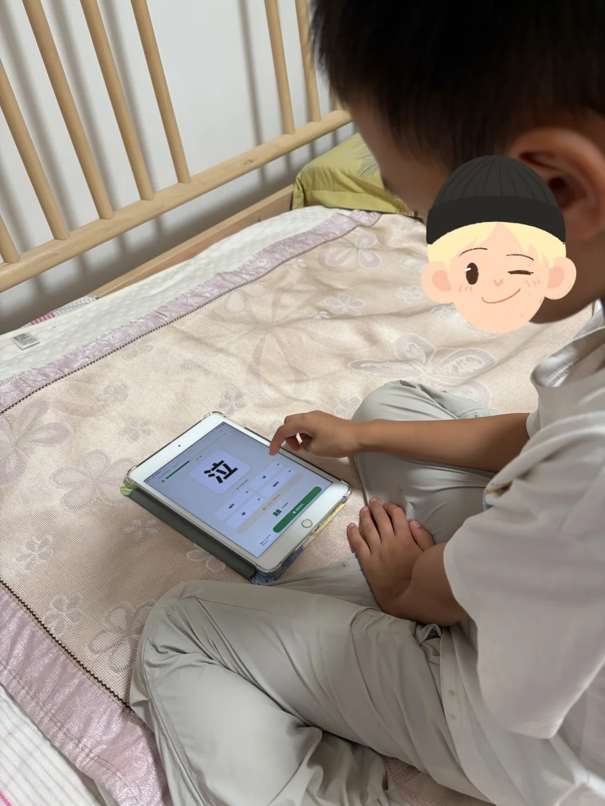
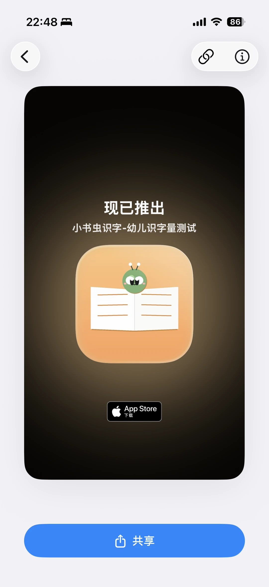
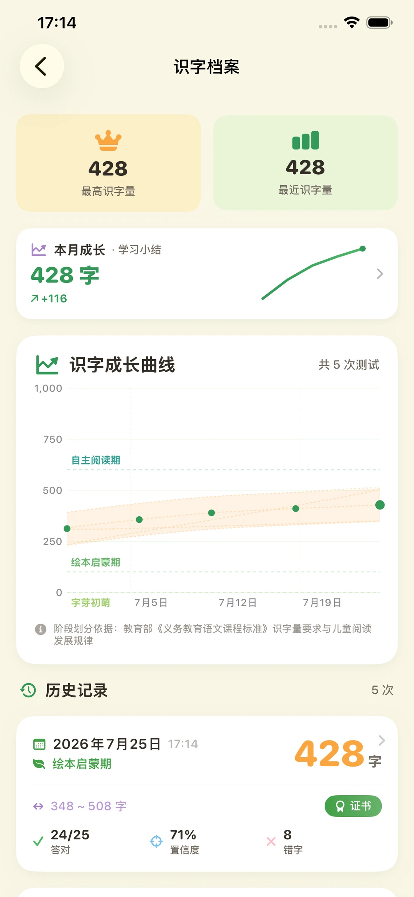

# 给儿子写的识字App，审核第9天才过

> 作者: 小书虫识字 | 日期: 52分钟前 江苏 | 原文: https://www.xiaohongshu.com/discovery/item/6a807e2b00000000330129ec?app_platform=android&ignoreEngage=true&app_version=9.42.0&share_from_user_hidden=true&xsec_source=app_share&type=normal&xsec_token=CBPPKckb8DVUVP0UiB9Q5UUCYoYvfyNBSsOm2EZdT08OQ%3D&author_share=1&xhsshare=CopyLink&shareRedId=N0dINjg3NUpMPko6S0EySDs0P0lFSjdL&apptime=1786807026&share_id=1d30d88193474630b0f42d2c499f9e13&share_channel=copy_link

> **摘要**:作者为即将上小学的儿子开发了一款识字App，定位儿童类应用审核严格，提交后第9天才通过审核。该App主打无广告、家长可控使用时长，包含识字量测试、翻牌字卡、识字报告、错字本和可打印字卡等功能，数据基于教育部课程标准划分阶段。作者表示将持续记录孩子识字量变化，邀请家长交流育儿经验。

给儿子写的识字App，审核第9天才过
今天是我提交审核的第9天,终于通过了。
都说现在用AI写iOS App的人太多，待审的应用排长队，这9天我算是亲身体验了一回。
这是给马上上小学的儿子写的。
起因很简单：感觉他幼儿园学的字越来越多，时长感叹：咦，这个字他认识，那个字他也认识啊！啥时学的！！
试过的识字App游戏多、关屏难，我想做一个能准确测识字量、报告记录详细、可打印错字卡、用多久家长说了算、还没有广告的。
因为定位儿童类，Apple审核格外严格，反复改了几次才过。里面放了我最想给儿子的几样：识字量测试、翻牌字卡、识字报告、错字本、可打印的字卡等等。
接下来我每周都会记录他的识字量变化。带娃认字的家长,一起交流呀。
#幼儿识字 #认字
52分钟前 江苏

#识字App #幼儿教育 #iOS开发 #亲子育儿 #App审核

## 图片

## 图片文字 (OCR)

> OCR 仅供参考，可能包含识别错误；请以原图为准。

泣
asan
&
黑典
O
2325

86
i
现已推出
小书虫识字-幼儿识字量测试
App Store
下载
共享

>
识字档案
三
428
428
最近识字量
最高识字量
本月成长·学习小结
428字
λ+116
识字成长曲线
共5次测试
1,000
750
自主阅读期
500
250
绘本启蒙期
0
字芽初萌
7月5日
7月12日
7月19日
?
阶段划分依据：教育部《义务教育语课程标准》识字量要求与童阅读
发展规律
①
历史记录
5次
428
曲
2026年7月25日17：14
字
绘本启蒙期
348～508字
Q
证书
←
24/25
71%
8
C
X
置信度
错字
答对
