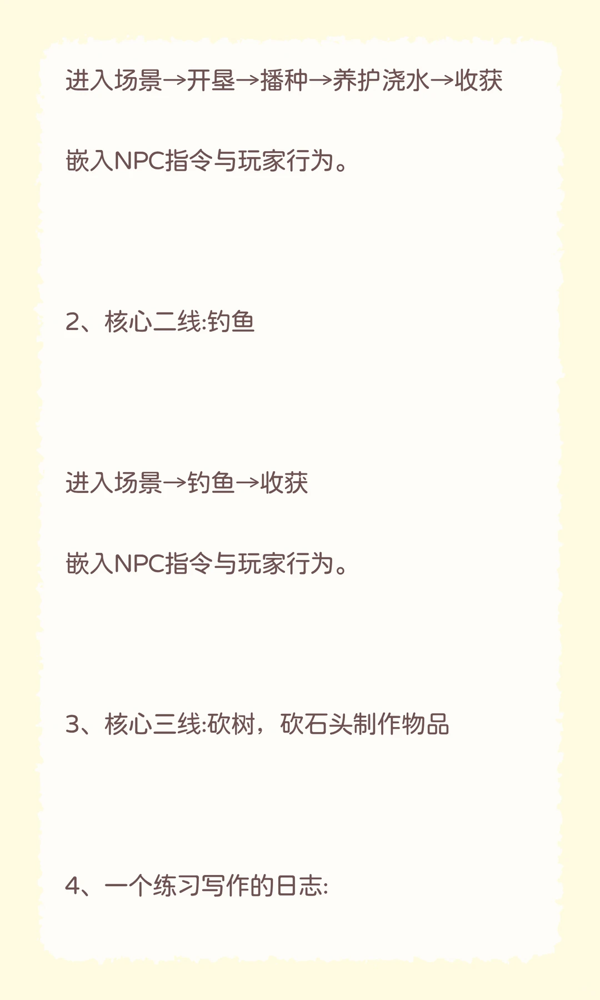
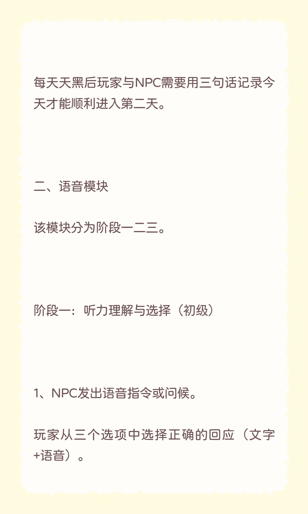
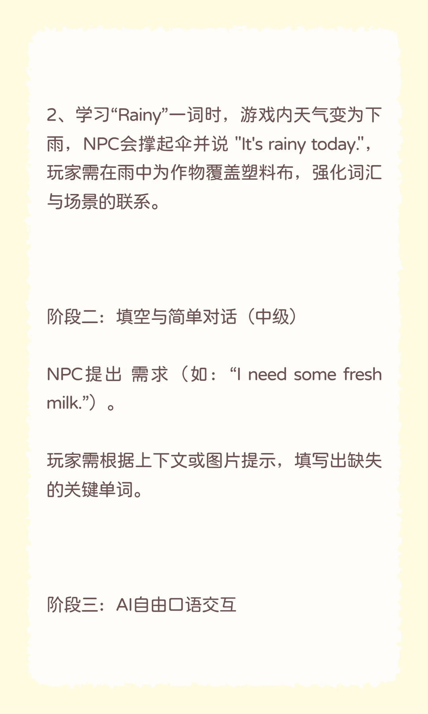
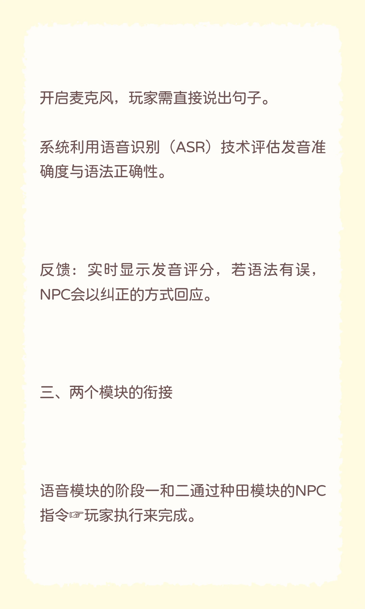

---
title: "英语交互式学习游戏  开发进度更新1"
source: "https://www.xiaohongshu.com/discovery/item/6a74026f0000000033009c0a?app_platform=android&ignoreEngage=true&app_version=9.41.0&share_from_user_hidden=true&xsec_source=app_share&type=normal&xsec_token=CBSE-AOafHQ2VRvscaRrF_7l0cWAE9LT40C_xHPJwqAeI%3D&author_share=1&xhsshare=CopyLink&shareRedId=N0dINjg3NUpMPko6S0EySDs0P0lFSjdL&apptime=1785995390&share_id=7f39ea2497574a82a3214f02e2997a78&share_channel=copy_link"
author: "安卿 月亮🌙与六便士"
author_uid: "5cf2217000000000050007ad"
date: "5小时前 河北"
tags: ["howto入门codex", "游戏IF剧场", "游戏开发", "互动式游戏", "游戏中学习", "创造英语语言环境", "英语学习原来可以这么有趣", "英语学习游戏", "交互式学习", "AI语音对话", "种田模块"]
platform: "xiaohongshu"
category: "游戏设计/学习游戏机制"
summary: "作者分享了一款英语交互式学习游戏的开发进度。游戏包含种田与语音对话两大模块：种田模块通过种植、钓鱼、砍树等玩法嵌入NPC指令，并要求玩家用三句话日志记录每日活动；语音模块分初、中、高三个阶段，涵盖听力选择、填空及AI自由口语交互，结合ASR技术评估发音与语法。两大模块通过NPC指令和大语言模型API"
---

# 英语交互式学习游戏  开发进度更新1

> 作者: 安卿 月亮🌙与六便士 | 日期: 5小时前 河北 | 原文: https://www.xiaohongshu.com/discovery/item/6a74026f0000000033009c0a?app_platform=android&ignoreEngage=true&app_version=9.41.0&share_from_user_hidden=true&xsec_source=app_share&type=normal&xsec_token=CBSE-AOafHQ2VRvscaRrF_7l0cWAE9LT40C_xHPJwqAeI%3D&author_share=1&xhsshare=CopyLink&shareRedId=N0dINjg3NUpMPko6S0EySDs0P0lFSjdL&apptime=1785995390&share_id=7f39ea2497574a82a3214f02e2997a78&share_channel=copy_link

> **摘要**:作者分享了一款英语交互式学习游戏的开发进度。游戏包含种田与语音对话两大模块：种田模块通过种植、钓鱼、砍树等玩法嵌入NPC指令，并要求玩家用三句话日志记录每日活动；语音模块分初、中、高三个阶段，涵盖听力选择、填空及AI自由口语交互，结合ASR技术评估发音与语法。两大模块通过NPC指令和大语言模型API

英语交互式学习游戏 开发进度更新1
英语交互式学习游戏  开发进度更新1#howto入门codex #游戏IF剧场 #游戏开发 #互动式游戏 #游戏中学习 #创造英语语言环境 #英语学习原来可以这么有趣
5小时前 河北

#英语学习游戏 #交互式学习 #AI语音对话 #种田模块

## 图片

## 图片文字 (OCR)

> OCR 仅供参考，可能包含识别错误；请以原图为准。

英语交互式学习
游戏开发进度
更新
游戏设计融合种田与语音对话模块，通过
NPC指令与AI互动提升玩家写作与语言能
力。

我写了一个初步框架，供感兴趣的朋友参考
讨论，参与进来哈
游戏一共两个模块，种田模块和语音对话模
块。
一、种田模块
1、
核心一线：种植

进入场景→开垦→播种→养护浇水→收获
嵌入NPC指令与玩家行为。
2、
核心二线：钓鱼
进入场景→钓鱼→收获
嵌入NPC指令与玩家行为。
3、核心三线：砍树，砍石头制作物品
一个练习写作的日志：
4、

每天天黑后玩家与NPC需要用三句话记录今
天才能顺利进入第二天。
二、
语音模块
该模块分为阶段一二三。
阶段一：
听力理解与选择
（初级）
1、NPC发出语音指令或问候。
玩家从三个选项中选择正确的回应
（文字
+语音）。

2、学习“Rainy”一词时，游戏内天气变为下
雨，NPc会撑起伞并说"It'srainytoday."，
玩家需在雨中为作物覆盖塑料布，强化词汇
与场景的联系。
阶段二：填空与简单对话
舌（中级）
NPC提出
需求（如：“l need some fresh
milk.”）。
玩家需根据上下文或图片提示，填写出缺失
的关键单词。
阶段三：AI自由口语交互

开启麦克风，玩家需直接说出句子。
系统利用语音识别（ASR)
技术评估发音准
确度与语法正确性。
反馈：实时显示发音评分，若语法有误，
NPC会以纠正的方式回应。
三、两个模块的衔接
语音模块的阶段一和二通过种田模块的NPC
指令玩家执行来完成。

阶段三通过调用大语言模型的API来加入和
驱动NPC角色对话行为活动完成。AI系统整
体框架的对话就是决策执行循环。
