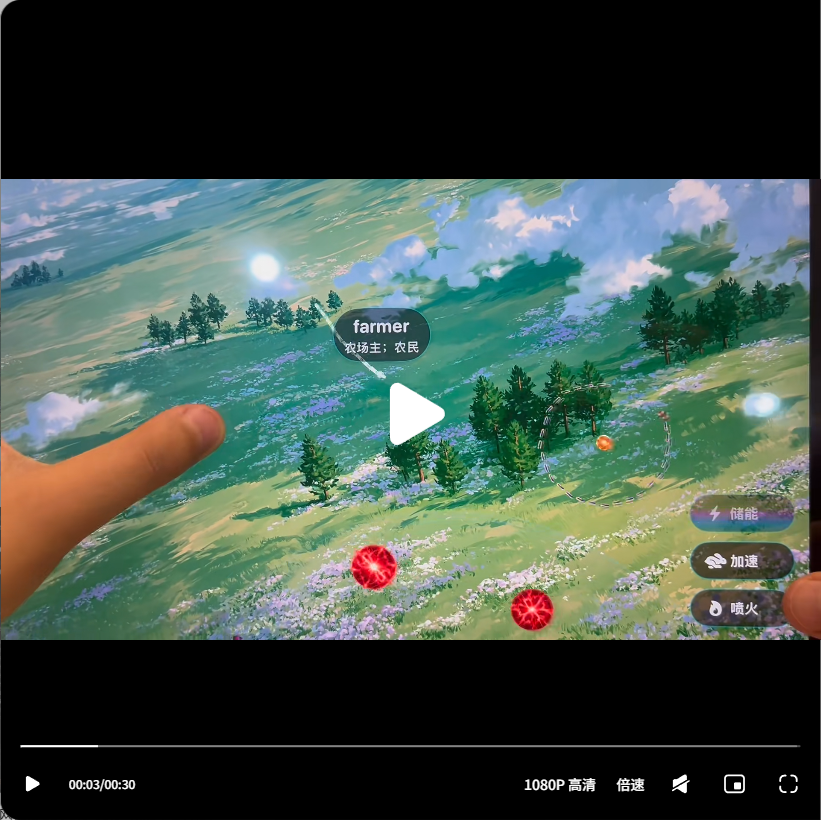
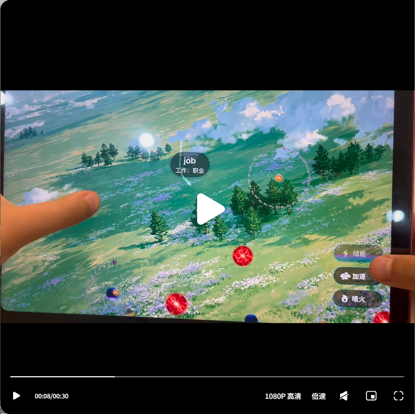
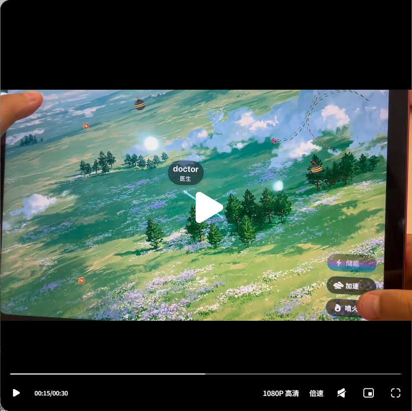
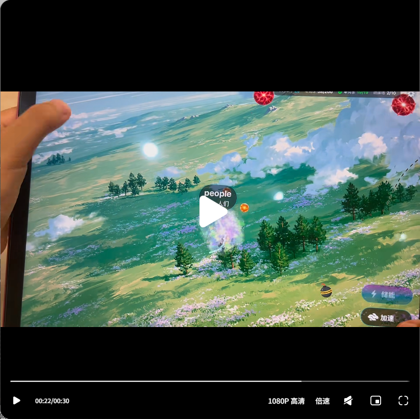
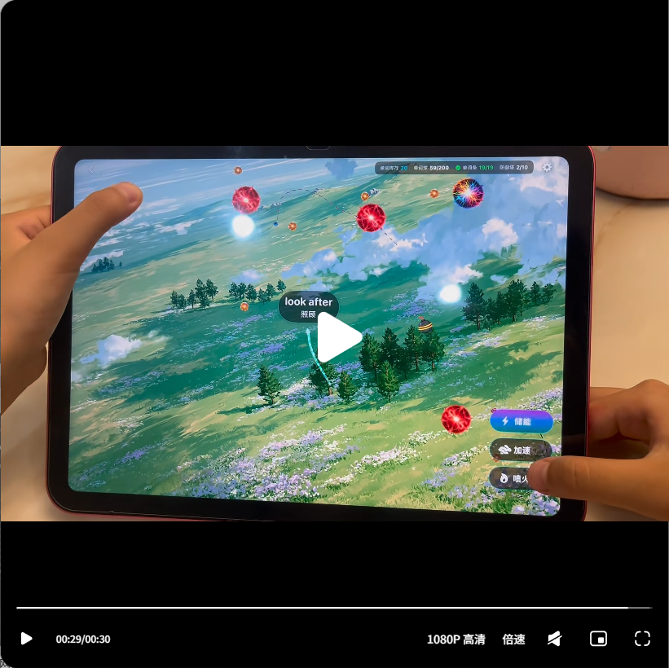

# 英语觉醒：贪吃蛇趣味记词模式

> 作者：以沫英语 | 发布时间：1小时前  
> 原文：[小红书笔记](https://www.xiaohongshu.com/explore/6a6b5a340000000032022efd?xsec_token=CBrwrUH2kIauxETRO643PJBku5r3fWNHc8Q0v0fm2ZY3o=&xsec_source=app_share)

## 内容摘要

“英语觉醒”提供一种贪吃蛇式的趣味记词模式，玩法沿用经典贪吃蛇：

- 游戏场景中出现印有课本同步单词的小球。
- 蛇移动并吃掉小球，完成词汇收集。
- 吃到单词后自动朗读，强化视觉识别和听觉输入。
- 闯关、移动和收集构成即时反馈，减少单纯死记硬背的枯燥感。
- 词汇内容贴合课堂学习进度，适合把课内单词练习融入碎片化游戏时间。

## 学习设计拆解

### 游戏化输入

传统单词练习通常是列表、卡片或选择题；贪吃蛇模式增加了移动、目标和即时结果，让孩子需要在游戏中主动寻找并收集词汇。

### 视觉与听觉联动

单词显示在小球表面，吃到后自动朗读。视觉识别负责建立词形印象，朗读则提供发音输入，形成“看到单词 -> 听到发音 -> 完成收集”的短反馈回路。

### 课本同步

内容不追求泛化词库，而是围绕课本同步词汇设计，降低学习内容与课堂进度脱节的问题，更适合作为课后巩固工具。

## 适合的使用方式

- 每次设定一个短时间关卡，避免只追求游戏分数。
- 游戏结束后挑出没有记住的单词，单独进行跟读和造句。
- 结合课本单元使用，先学课文词汇，再用游戏做重复接触。
- 家长可以关注孩子是否能听到单词后说出中文含义，而不只看通关结果。

## 原文内容

“英语觉醒”这个软件提供贪吃蛇趣味记词模式，玩法沿用经典贪吃蛇。小球表面印有课本同步单词，蛇吃掉小球便自动朗读词汇。一边闯关游玩，一边背诵课内单词，摆脱枯燥死记硬背，贴合课堂学习进度。

## 页面信息

- 页面显示视频时长约 30 秒。
- 页面显示互动区有 2 次互动，未加载出具体评论文本。
- 页面未公开显示完整评论内容，因此本笔记不虚构评论。

## 视频截图

已从视频播放器截取 5 个时间点的本地画面，便于离线查看：

### 00:03

### 00:08

### 00:15

### 00:22

### 00:29

## 配图与视频

小红书页面提供视频/图文媒体，除上述本地截图外，仍保留可访问的原始媒体链接：

