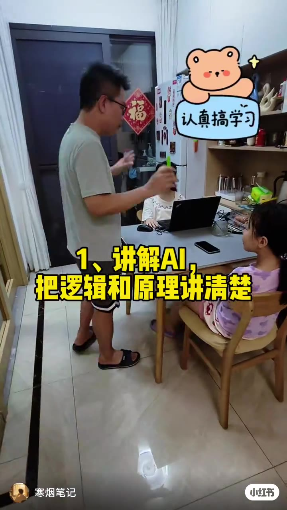
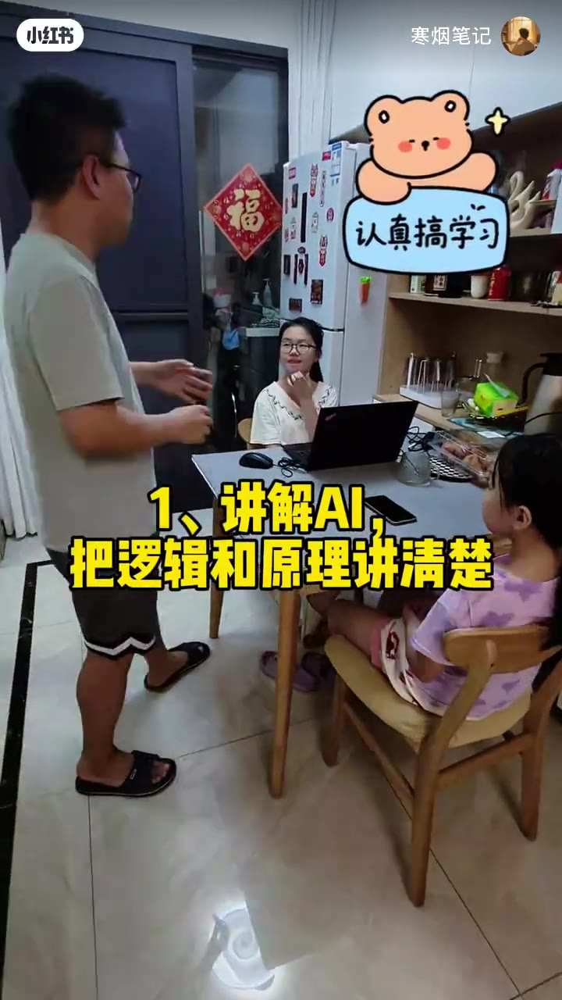
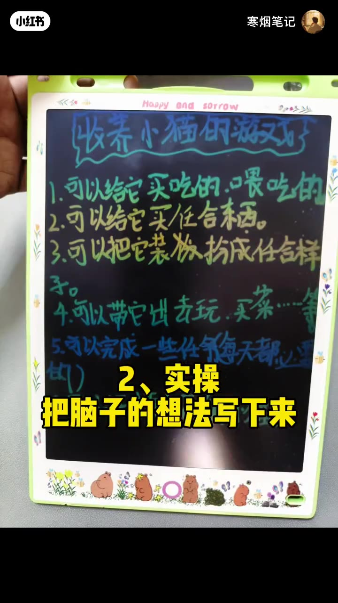
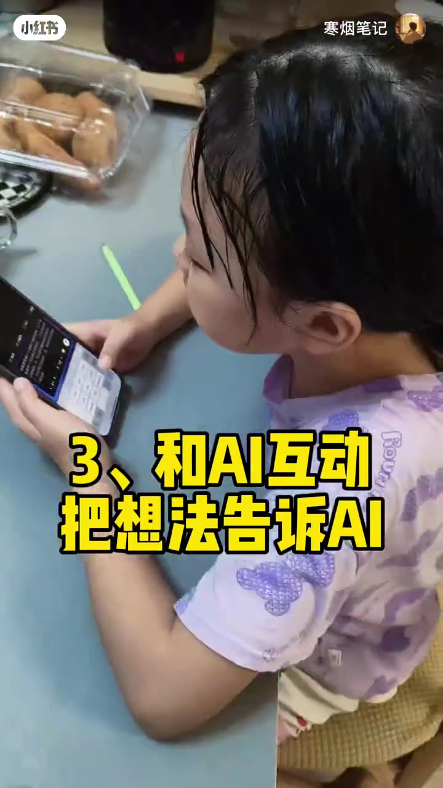
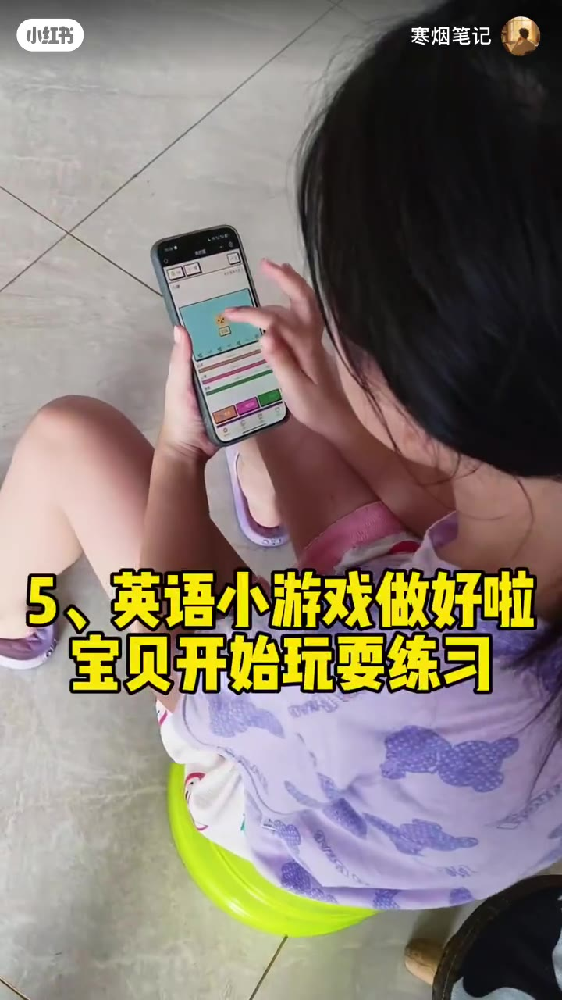
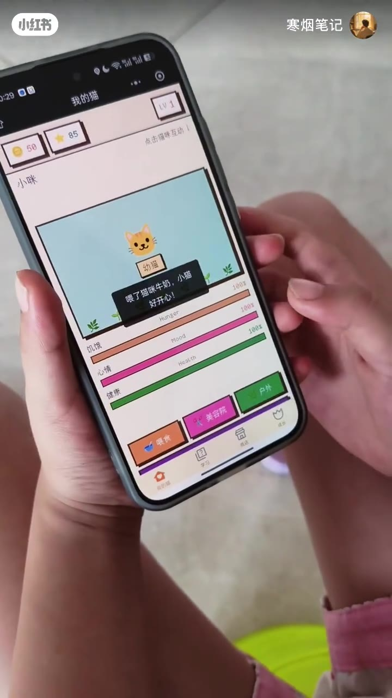
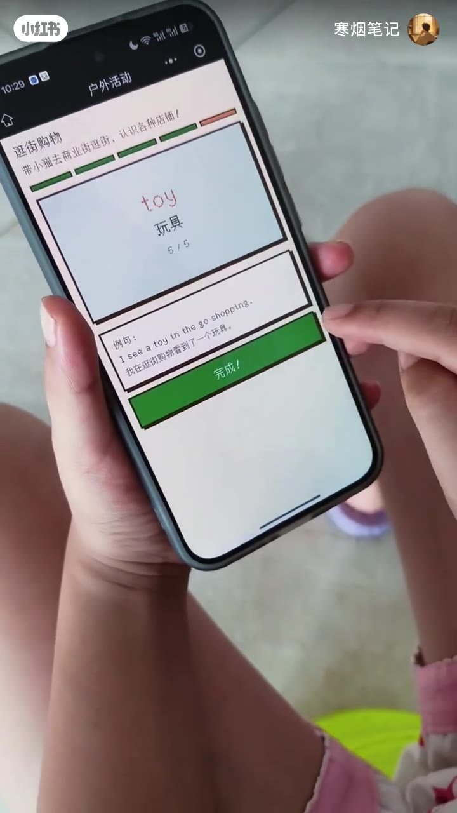
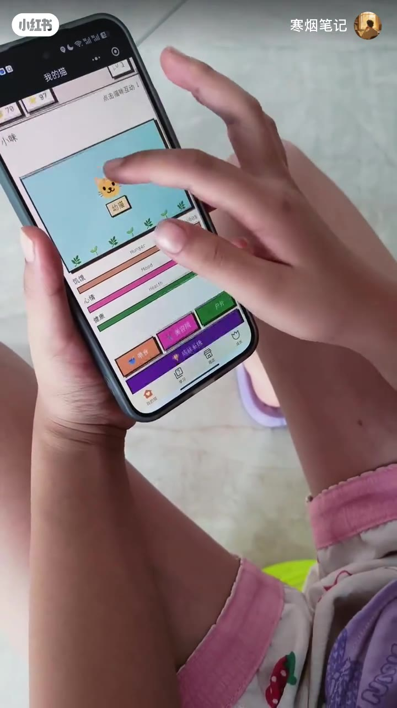
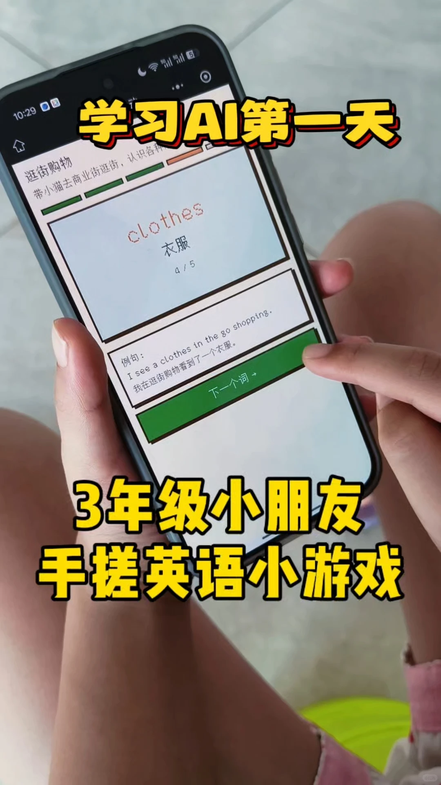

---
title: "让孩子们体会到学习的快乐！"
source: "https://www.xiaohongshu.com/discovery/item/6a5aef9000000000010315ac?app_platform=android&ignoreEngage=true&app_version=9.38.1&share_from_user_hidden=true&xsec_source=app_share&type=video&xsec_token=CBzO4QiUMp0b2-x2RUlw2ww0-kNH1enW8rmWFq9mbuElU%3D&author_share=1&xhsshare=CopyLink&shareRedId=N0dINjg3NUpMPko6S0EySDs0P0lFSjdL&apptime=1784375013&share_id=56553c4ae280422a90ec53d1992f1617&share_channel=copy_link"
author: "寒烟笔记"
author_uid: "65228c1a000000002a035408"
date: "11小时前 广东"
tags: ["学习AI", "亲子教育", "学习英语", "英语小游戏", "AI学习", "英语启蒙", "趣味学习", "小学英语"]
platform: "xiaohongshu"
category: "游戏设计"
summary: "记录孩子学习AI的第一天，通过带小猫去商业街逛街的小游戏，让3年级小朋友在趣味互动中学习英语单词clothes（衣服），并通过例句练习表达。内容结合生活场景与AI工具，将学习融入游戏，体现了快乐学习、寓教于乐的亲子教育理念。"
---

# 让孩子们体会到学习的快乐！

> 作者: 寒烟笔记 | 日期: 11小时前 广东 | 原文: https://www.xiaohongshu.com/discovery/item/6a5aef9000000000010315ac?app_platform=android&ignoreEngage=true&app_version=9.38.1&share_from_user_hidden=true&xsec_source=app_share&type=video&xsec_token=CBzO4QiUMp0b2-x2RUlw2ww0-kNH1enW8rmWFq9mbuElU%3D&author_share=1&xhsshare=CopyLink&shareRedId=N0dINjg3NUpMPko6S0EySDs0P0lFSjdL&apptime=1784375013&share_id=56553c4ae280422a90ec53d1992f1617&share_channel=copy_link

> **摘要**:记录孩子学习AI的第一天，通过带小猫去商业街逛街的小游戏，让3年级小朋友在趣味互动中学习英语单词clothes（衣服），并通过例句练习表达。内容结合生活场景与AI工具，将学习融入游戏，体现了快乐学习、寓教于乐的亲子教育理念。

📝记录孩子学习AI第一天#学习AI #亲子教育 #学习英语 #英语小游戏

#AI学习 #英语启蒙 #趣味学习 #小学英语

## 视频

[视频 1](./video.mp4)

<video controls width="100%"><source src="./video.mp4" type="video/mp4">您的浏览器不支持视频播放。</video>

## 视频关键帧

## 视频画面文字 (OCR)

### 关键帧 1 · 0.5s

福
认真搞学习
1、讲解AI
国
把逻辑和原理讲清楚
寒烟笔记

### 关键帧 2 · 5.88s

小红书
福
认真搞学习
1、讲解AI
把逻辑和原理讲清楚

### 关键帧 3 · 11.27s

2
Happy and sorrow
收养小猫的游戏
1.可以给它买吃的，喂吃的
2.可以给它买任合东西。
3.可以把它装板扮成任合样
吃
4.可以带它出去玩.买菜…等
5.可以完成一些任命每天都
2、实操
印
把脑子的想法写下来

### 关键帧 4 · 16.65s

把想法告诉AI
3、和AI互动
烟毛记

### 关键帧 5 · 22.03s

寒烟笔记
英语小游戏做好啦
宝贝开始玩耍练习

### 关键帧 6 · 27.41s

三
5
我的猫
50
85
LV1
点击猫味互动
幼猫
喂了猫咪牛奶，小猫
好开心！
100%
Hunger
饥饿
100%
Mood
心情
100x
Health
健康
户外
美容院
喂食
d
线店
学学
我的

### 关键帧 7 · 32.8s

逛街购物
带小猫去商业街逛街，认识各种店铺！
toy
玩具
5/5
例句：
I see a toy in the go shopping.
我在逛街购物看到了一个玩具。
完成！

### 关键帧 8 · 38.18s

欢
心情
健康
Y
点击猫味互动
销食
Hunger
口
o
Heatth
C
回
美容院
茶
印

## 字幕文件

[TXT](./transcript/video.txt) | [JSON](./transcript/video.json) | [SRT](./transcript/video.srt) | [VTT](./transcript/video.vtt)

## 视频转录

## 图片

## 图片文字 (OCR)

学习
AI
第一天
逛街购物
带小猫去商业街逛街，认识各种
clothes
衣服
4/5
例句：
I see a clothes in the go shopping.
我在逛街购物看到了一个衣服。
下一个词→
3年级小朋友
搓英语小游戏
