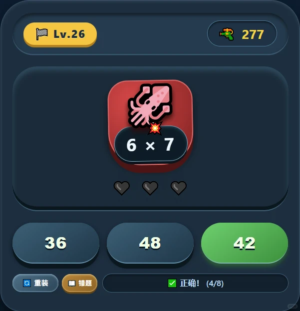
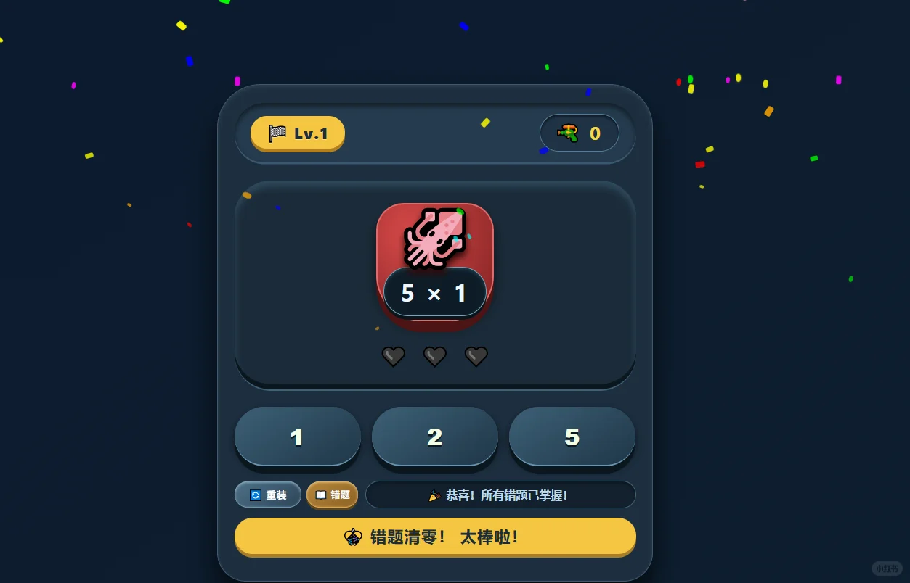
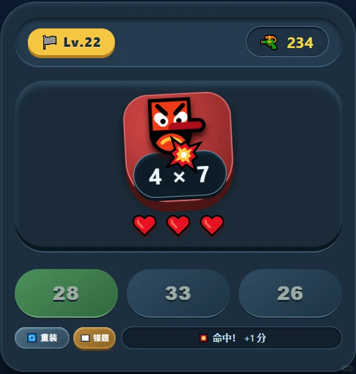

# 这个乘法游戏我玩了一下午…太上头了！😱

> 作者: AI助学馆 | 日期: 2小时前 山东 | 原文: https://www.xiaohongshu.com/explore/6a6700fb000000000f01c96c?xsec_token=CBGpHo0krP7XCmiq46Or-X71oQZyVf-p6l-xL3oiJMXnY=&xsec_source=app_share

> **摘要**:一款把九九乘法表做成闯关游戏的网页小游戏，包含即时答题、错题本、错题试炼、怪物变身和清空错题后的奖励机制，支持手机电脑直接打开。

姐妹们！我儿子为了玩这个游戏居然主动把九九乘法表背了五遍！什么神仙游戏这么有魔力？

### 玩法超简单

小怪兽出乘法题，你选答案，选对就开枪。答对子弹会飞出去，答错就记住这道题，下次再来。

### 错题本设计

答错的题目会自动收进“错题本”，点击“错题试炼”就能专门练错题。全部清空后还会放烟花，成就感直接拉满。

### 不同敌人和闯关体验

小怪兽还会变身，每次出现的敌人都不一样，有外星人、幽灵、小恶魔和龙，打起来特别带感。

### 随时打开就能玩

不用下载，手机电脑都能玩。等餐、排队、睡前都能来两局，把碎片时间利用起来。

真的比死记硬背有趣很多，家有小学生的一定要存！

你们家娃最怕哪句乘法口诀？评论区告诉我，我让游戏里多出这道题。

#乘法表 #趣味学 #宝藏网页游戏 #学习打卡 #数学启蒙 #在家早教 #益智游戏 #错题本 #闯关游戏 #游戏化学习

## 图片

