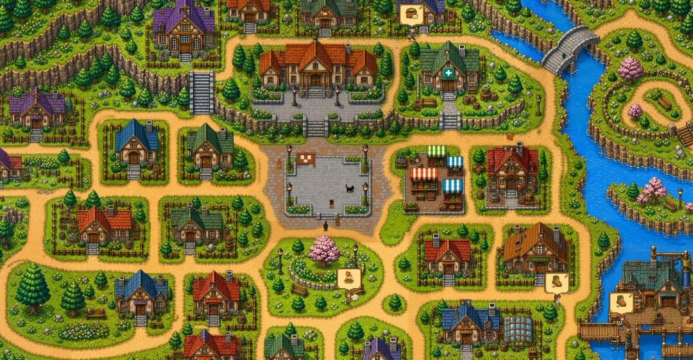

# 开源的单机像素小镇模拟游戏，AI实时驱，每个人都有自己的性格、职业、记忆和人际关系

> 作者: 大概是BUG | 平台: 微信公众号 | 日期: 2026-08-10 08:53 | 原文: https://mp.weixin.qq.com/s/qRZPlb18Sxi2dOteoaLm5Q

> **摘要**: my_ai_town用Godot 4.7做的单机像素小镇模拟游戏。

## my_ai_town

> 用Godot 4.7做的单机像素小镇模拟游戏。居民不是按固定脚本走的NPC，而是由大语言模型实时驱动——每个人都有自己的性格、职业、记忆和人际关系，会根据当前在干嘛、在哪、周围发生了啥来自主决定下一步行动。

Github地址

https://github.com/mewamew/my_ai_town



## 功能特性

- 自主生活系统：居民自己安排工作、休息、社交，不依赖玩家触发
- 自然对话：聊天内容基于人物性格、关系亲疏、手头工作和现场情况实时生成
- 记忆持续：经历、承诺、未办事项会跨多次游戏会话保存，读档后接着用
- 世界日志：所有确认发生的事件、活动、对话都有记录，可按人物/类型/日期筛选
- 真实结果：移动、工作、交谈、物品操作都经过世界系统校验，返回实际结果
- 熟人社会：居民互相认识，但私人关系从本局实际经历中慢慢建立
- 玩家介入：你可以亲自进去逛，跟居民聊天、发公告、传照片、改天气，然后看影响怎么传开

## 当前实现

仓库当前覆盖小镇运行、室内外移动、居民 Agent、职业与工作链、居民对话、玩家化身、记忆与关系、世界日志、天气、存档以及主要游戏界面。项目仍在持续开发，现阶段重点是让居民在工作、生活和关系变化中保持自然交流，并让行为结果、记忆与界面呈现形成完整闭环。

## 获取与运行

当前仓库提供源码。可直接下载的桌面版本将在准备完成后发布到 GitHub Releases。

### 环境要求

- Godot 4.7 稳定版
- 可用的 LLM Provider 与 API Key
- 支持 Godot 4.7 的桌面系统
- Windows 发布版默认使用兼容渲染，可通过 Direct3D 11（ANGLE）运行，并在需要时回退到原生 OpenGL

### 从源码启动

```
git clone https://github.com/mewamew/my_ai_town.git
cd my_ai_town
```

使用 Godot 打开 `game/project.godot`，运行项目后在模型设置页配置 LLM Provider。模型密钥只应通过游戏内设置保存，不要写入仓库。

### 基本操作

- WASD 或方向键：移动玩家化身
- E：与附近目标互动
