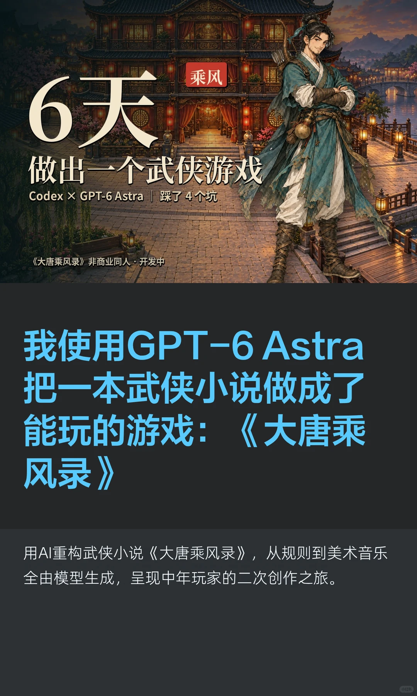
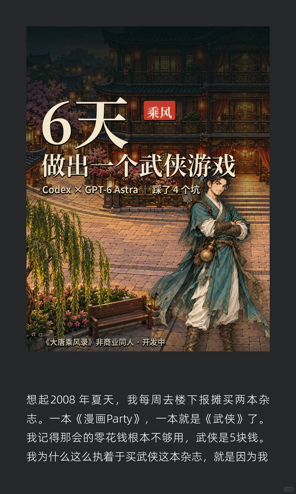
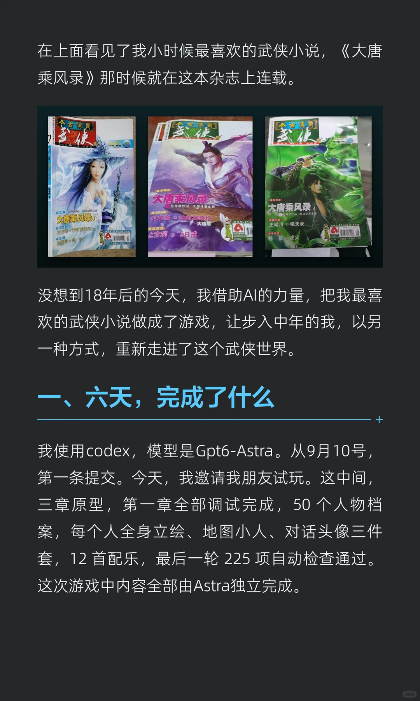
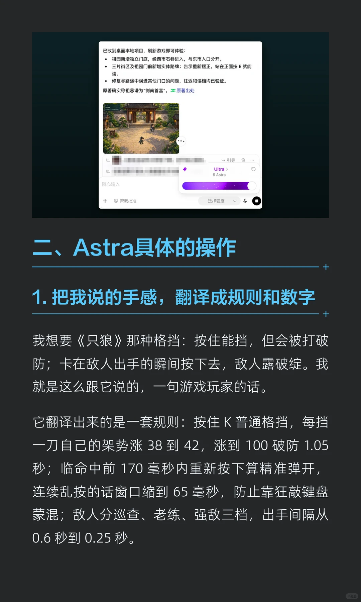
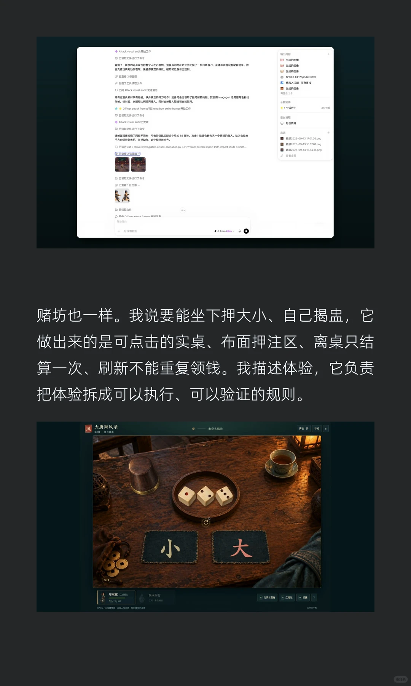
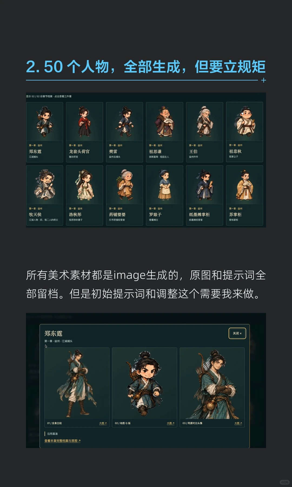
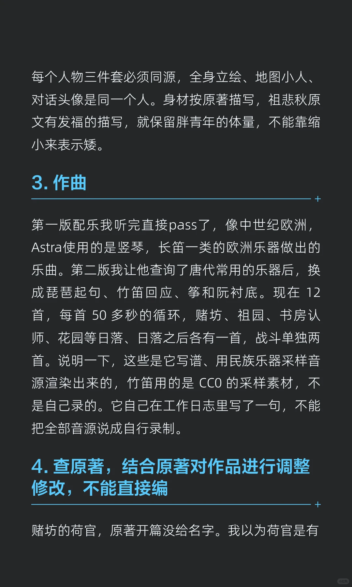
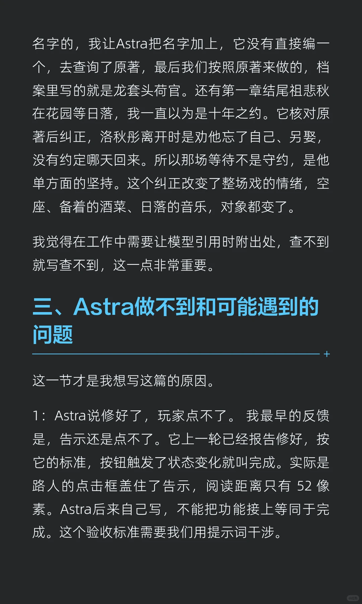
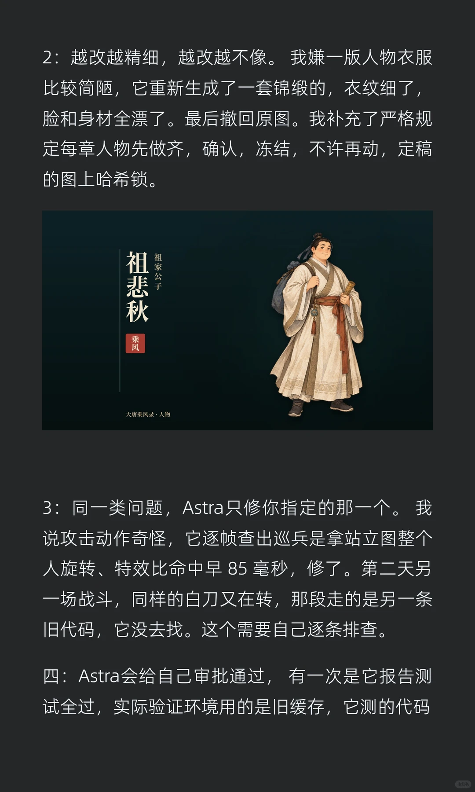
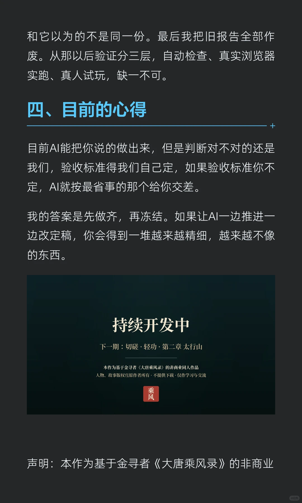

# 我使用GPT-6 Astra把一本武侠小说做成了能

> 作者: 牧之Atomi | 日期: 昨天 22:15 日本 | 原文: https://www.xiaohongshu.com/discovery/item/6aa9530d00000000110369b0?xsec_token=CB470gtloWAvUmWL0JvNlhF9lIkQ15u1Y73QvkCHrAR0s%3D&xsec_source=app_share

> **摘要**:我使用GPT-6 Astra把一本武侠小说做成了能

我使用GPT-6 Astra把一本武侠小说做成了能
2008年我每周去楼下报摊买《武侠》，为了追上面连载的《大唐乘风录》。
18年后，我用 Codex + GPT-6 Astra，六天把它做成了能在浏览器里玩的游戏：三章原型，50个人物档案，12首配乐，代码、画、曲、测试全是它做的。我只做三件事：定方向、试玩挑毛病、拍板。
声明：本作为基于金寻者《大唐乘风录》的非商业同人作品，版权归原作者，与爱奇艺出品的同名动画无关。不提供下载，仅作学习与交流。改编制作同名游戏只是出于我本人对喜爱作品的致敬，圆自己一个梦。#我在小红书做游戏 #AI游戏 #Ai #GPT6 #codex
昨天 22:15 日本

## 图片

## 图片文字 (OCR)

> OCR 仅供参考，可能包含识别错误；请以原图为准。

6天
乘风
做出一个武侠游戏
Codex× GPT-6Astra|踩了4个坑
《大唐乘风录》非商业同人·开发中
我使用GPT-6
Astra
把一本武侠小说做成了
能玩的游戏：
《大唐乘
风录》
用AI重构武侠小说《大唐乘风录》，从规则到美术音乐
全由模型生成，呈现中年玩家的二次创作之旅。

6天
乘风
做出一个武侠游戏
CodexXGPT-6Astra 踩了4个坑
《大唐乘风录》非商业同人·开发中
想起2008年夏天，我每周去楼下报摊买两本杂
志。一本《漫画Party》，一本就是《武侠》了。
我记得那会的零花钱根本不够用，武侠是5块钱。
我为什么这么执着于买武侠这本杂志，就是因为我

在上面看见了我小时候最喜欢的武侠小说，《大唐
乘风录》那时候就在这本杂志上连载。
今古傅奇
武保
苦得司
发使
今古傳奇
武使
大唐乘风录
金寻者作品千里休妻之卷
大唐乘风录
大唐乘风录
时未寒
·神封英雄坛
母者作品前功尽弃之
珠南江湖
COFNA
大结局
王晴川吼天录
求·刘质
客创秘生
上官瑶
.飞日戒
关课武任
白·梵
Y
杨
叛虎火
没想到18年后的今天，我借助AI的力量，把我最喜
欢的武侠小说做成了游戏，让步入中年的我，以另
一种方式，重新走进了这个武侠世界。
一、六天，完成了什么
我使用codex，模型是Gpt6-Astra。从9月10号，
第一条提交。今天，我邀请我朋友试玩。这中间，
三章原型，第一章全部调试完成，50个人物档
案，每个人全身立绘、地图小人、对话头像三件
套，12首配乐，最后一轮225项自动检查通过。
这次游戏中内容全部由Astra独立完成。

已改到桌面本地项目，刷新游戏即可体验：
祖园新增独立门庭，经西市石巷进入，与东市入口分开。
三片街区及祖园门前新增实体路牌；告示重新摆正，站在正面按E就能
读。
修复寻路途中误进其他门口的问题，往返和读档均已验证。
原著确实称祖思谦为“剑南首富”。不原著出处
引导
日
Ultra>
6 Astra
随心输入
+
2
帮我批准
选择强度
、Astra具体的操作
1.把我说的手感，翻译成规则和数字
我想要《只狼》那种格挡：按住能挡，但会被打破
防；卡在敌人出手的瞬间按下去，敌人露破绽。我
就是这么跟它说的，一句游戏玩家的话。
它翻译出来的是一套规则：按住Κ普通格挡，每挡
一刀自己的架势涨38到42，涨到100破防1.05
秒；临命中前170毫秒内重新按下算精准弹开，
连续乱按的话窗口缩到65毫秒，防止靠狂敲键盘
蒙混；敌人分巡查、老练、强敌三档，出手间隔从
0.6秒到0.25秒。

Attack visual audt开始工作
输出内容
中已读取文件道行了
生成的图像
查到了：新加的近身吹击把整个人左右旋转，查兵则量在站立围上了一根白线当刀，身体和武器没有配合起来，我
会先修这两处助作表现，保留你确定的弹反、被防和近身号规。
山
生成的固像
生成的图像
③已直看2张面像
127.0.0.1:4176/nex.m
加截了工具读取文件
"
乘风入江湖·雨夜客栈
巴向Atack visualauit发消息
生成的图像
再显示2个
现有查具素材只有站姿，缺少真正的挥刀动作：道身号击也误用了拉弓射的帧，我会用magegen追用原角色补
作额，核对脸，衣醒和比例后需接入，同时去接整人旋转和白线假刀
子智能体
officerattackframeszheng bowstrikeframes开始工作
1个运行中
38完成
中已读取文件道行了命令
后台进程
Attackvisualaud已
后台终端
已读取文件运行了命令
来源
逐复现还发现了两处不同步：号击特效比实际命中早约85毫秒，攻击中遗还会转向另一个更近的数人，这次会让出
2026-09-1317.01.06.png
手方向保持到收招，并把动作、命中和特效对齐。
γfrompathbimportPathiportshutilpPath
2026-09-1316.07.0.png
已运行cat>iprivate/tmppac
2026-09-1315.54.16.png
⑤已宜看2作图像
查看全部
已读取文件道行了命
③已查看1张图像
已读取文件
发值
心入
+
批准
6 Astra Utra
赌坊也一样。我说要能坐下押大小、自己揭盅，它
做出来的是可点击的实桌、布面押注区、离桌只结
算一次、刷新不能重复领钱。我描述体验，它负责
把体验拆成可以执行、可以验证的规则。
风
大唐乘风录
1·
龙套头贴坊
声·开
存档
小
大
20
郑东江湖头
尚未同行
72/10
，总会
WASD/内动点人动·郑乐
交谈/宣
江湖记
行票
已有至本机

2.50个人物，全部生成，但要立规矩
显示52/52份章节档案·点击查看三件套
第一章·益州
第一章·益州
第一章·益州
第一章·益州
第一章·益州
第一章·益州
郑东霆
龙套头荷官
樊雷
祖思谦
王伯
祖悲秋
江湖捕头
赌坊荷官
益州总捕头
剑南富商·祖园主人
益州件作
祖家公子
第一章·益州
第一章·益州
第一章·益州
第一章·益州
第一章·益州
第一章·益州
牧天侯
洛秋彤
药铺婆婆
罗娘子
纸墨摊掌柜
苏掌柜
江湖人物·郑、祖二人的师父
祖悲秋的妻子
东市药铺经营者
香霜摊主
纸墨摊经营者
客栈掌柜
所有美术素材都是image生成的，原图和提示词全
部留档。但是初始提示词和调整这个需要我来做。
郑东霆
关闭×
第一章·益州·江湖捕头
01/全身立绘
大图
02/地图Q版
大图
03/同源对白头像
大图
沿用基准
查看本章完整档案与原图

每个人物三件套必须同源，全身立绘、地图小人、
对话头像是同一个人。身材按原著描写，祖悲秋原
文有发福的描写，就保留胖青年的体量，不能靠缩
小来表示矮。
3.作曲
第一版配乐我听完直接pass了，像中世纪欧洲，
Astra使用的是竖琴，长笛一类的欧洲乐器做出的
乐曲。第二版我让他查询了唐代常用的乐器后，换
成琵琶起句、竹笛回应、筝和阮衬底。现在12
首，每首50多秒的循环，赌坊、祖园、书房认
师、花园等日落、日落之后各有一首，战斗单独两
首。说明一下，这些是它写谱、用民族乐器采样音
原渲染出来的，竹笛用的是CCO的采样素材，不
是自己录的。它自己在工作日志里写了一句，不能
把全部音源说成自行录制。
4.查原著，结合原著对作品进行调整
修改，不能直接编
赌坊的荷官，原著开篇没给名字。我以为荷官是有

名字的，我让Astra把名字加上，它没有直接编一
个，去查询了原著，最后我们按照原著来做的，档
案里写的就是龙套头荷官。还有第一章结尾祖悲秋
在花园等日落，我一直以为是十年之约。它核对原
著后纠正，洛秋彤离开时是劝他忘了自己、另娶，
没有约定哪天回来。所以那场等待不是守约，是他
单方面的坚持。这个纠正改变了整场戏的情绪，空
座、备着的酒菜、日落的音乐，对象都变了。
我觉得在工作中需要让模型引用时附出处，查不到
就写查不到，这一点非常重要。
三、Astra做不到和可能遇到的
问题
这一节才是我想写这篇的原因。
1：Astra说修好了，玩家点不了。我最早的反馈
是，告示还是点不了。它上一轮已经报告修好，按
它的标准，按钮触发了状态变化就叫完成。实际是
路人的点击框盖住了告示，阅读距离只有52像
素。Astra后来自己写，不能把功能接上等同于完
成。这个验收标准需要我们用提示词干涉。

2：越改越精细，越改越不像。我嫌一版人物衣服
比较简陋，它重新生成了一套锦缎的，衣纹细了，
脸和身材全漂了。最后撤回原图。我补充了严格规
定每章人物先做齐，确认，冻结，不许再动，定稿
的图上哈希锁。
祖悲秋
祖家公子
乘风
大唐乘风录·人物
3：同一类问题，Astra只修你指定的那一个。我
说攻击动作奇怪，它逐帧查出巡兵是拿站立图整个
人旋转、特效比命中早85毫秒，修了。第二天另
一场战斗，同样的白刀又在转，那段走的是另一条
旧代码，它没去找。这个需要自己逐条排查。
四：Astra会给自己审批通过，有一次是它报告测
试全过，实际验证环境用的是旧缓存，它测的代码

和它以为的不是同一份。最后我把旧报告全部作
废。从那以后验证分三层，自动检查、真实浏览器
实跑、真人试玩，缺一不可。
四、目前的心得
目前AI能把你说的做出来，但是判断对不对的还是
我们，验收标准得我们自己定，如果验收标准你不
定，AI就按最省事的那个给你交差。
我的答案是先做齐，再冻结。如果让AI一边推进一
边改定稿，你会得到一堆越来越精细，越来越不像
的东西。
持续开发中
下一期：切磋·轻功·第二章太行山
本作为基于金寻者《大唐乘风录》的非商业同人作品
人物、故事版权归原作者所有·不提供下载·仅作学习与交流
乘风
声明：本作为基于金寻者《大唐乘风录》的非商业

己一个梦。
同名游戏只是出于我本人对喜爱作品的致敬，
画无关。
同人作品，
不提供下载，仅作学习与交流。
与爱奇艺出品的同名动
改编制作
，圆自

## 评论 (共 6 条,已存 6 条)

详见 `comments-6aa9530d00000000110369b0.json`。
