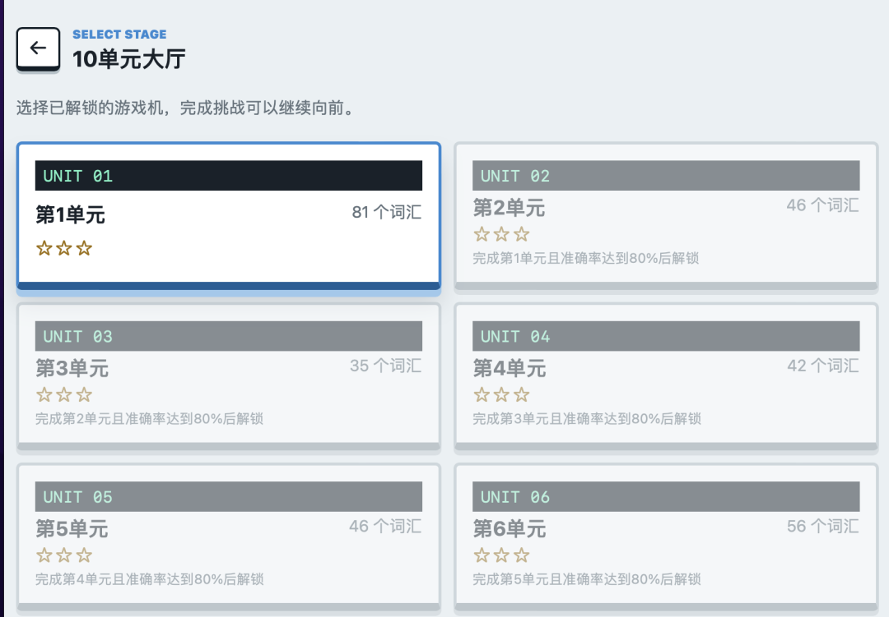
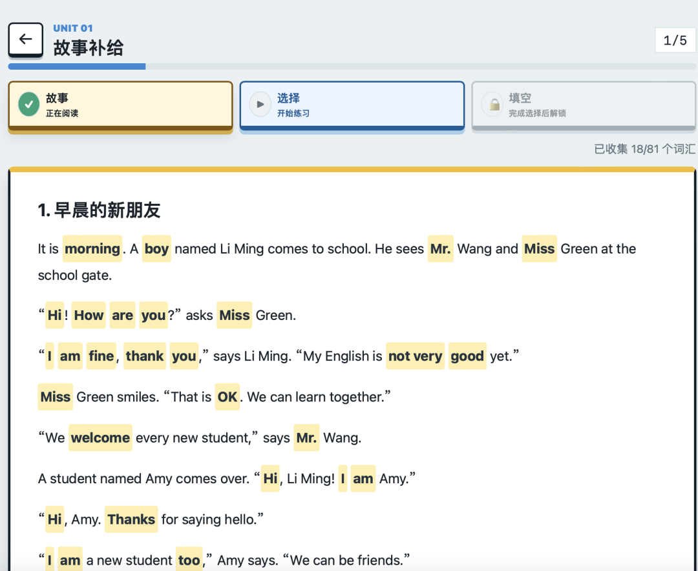
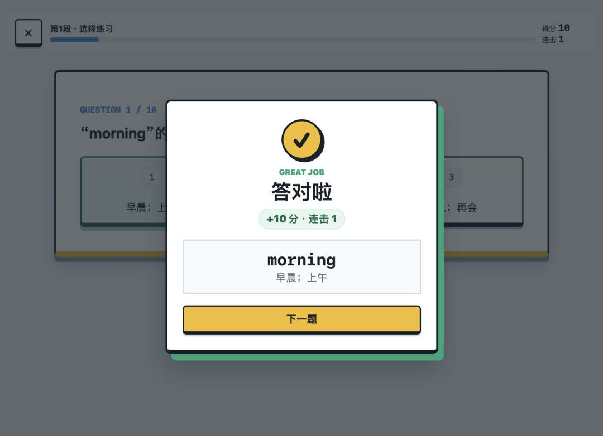
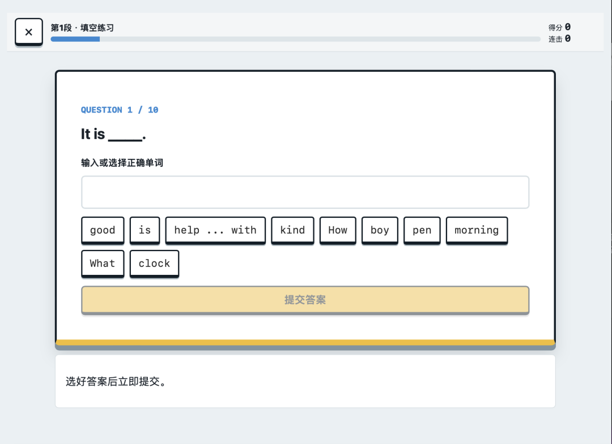

# 我用 Ai把 10 单元英语单词，做成了个能闯关的游戏

> 作者: 在成长的路上 | 平台: 微信公众号 | 日期: 2026-07-23 20:10 | 原文: https://mp.weixin.qq.com/s/CMIlknh8TfmHna6eRHEsrw

> **摘要**: 孩子英语基础差，不愿意学怎么办？英语嘛，作为非英语老师来说，不就是两个点么，单词和语法。

## 姑娘英语基础差，每次让她练单词、做题，总是不情愿的坐在桌旁，半天也不动笔，不想学，怎么办？

## 英语嘛，作为非英语老师来说，不就是两个点么，单词和语法。

## 单词认识记住，语法掌握，英语还不是小意思。

## 子背英语单词，太枯燥，还记不住！。

为了让孩子更容易记住单词，我做了一个尝试：

把 10 个单元的英语词汇，先写成故事，再做成一个可以在网页上玩的闯关游戏。用游戏的方式提升孩子对英语的兴趣。

整个过程并没有想象中那么神秘。下面，我把这次实践完整分享出来。

## 一：整理资料

我最开始拿到的是教材页面图片。

如果直接让 AI 根据图片写故事，很容易出现几个问题：

第一，单词可能提取不完整；第二，不同单元的词汇可能混在一起；第三，后面发现错误时，很难追溯到原始资料。

所以，我用codex和obsidion先搭建了一个最小知识库。

原始图片放进 `raw/yuanshi/`，从图片中识别出来的单元词汇保存到 `raw/danyuan/`，整理完成的词汇故事放到 `wiki/sources/`。

这样做的好处是，每一层都很清楚：

原始资料负责留底，单元文件负责保存词汇，故事文件负责教学使用。以后发现哪个词有问题，可以一路找到对应的原始图片，而不是靠猜。

## 二：让单词出现在故事

词汇整理好以后，我开始让 Codex 按单元写故事。

这里有一个非常重要的要求：不能只使用一部分重点词，而是每个单元的全部单词都要出现在故事中。

为如果有些词没有出现在故事中，孩子在后面的练习中突然遇到它，就会觉得很陌

为了方便孩子理解，我还给故事中的重点单词加上中文解释。孩子读到单词时，不需要查词典，就能知道它在当前故事中的含义。

故事不能为单词而写得生硬，为了杜绝这种情况，我让 AI 尽量使用简单句，把场景放在学校、家庭、朋友和日常生活中。

最后，10 个单元都生成了对应的词汇故事，并进行了词汇覆盖检查。

## 三：增加练习题

只有故事还不够。

孩子读完以后，还需要知道他到底有没有理解这些单词。

所以，每个单元都加入了选择题、填空题和参考答案。最初的版本是每个单元各有一组练习，后来在实际体验中，我发现一篇故事比较长，如果读完整篇再统一答题，很容易忘记前面的内容。

于是，我把故事进一步拆成了小段。

现在整个游戏一共有10个单元、54段故事。每一段后面都有10道选择题和10道填空题，总共生成了1080道题。

学习路径也变得更清楚：

先读一段故事，再做10道选择题，然后完成10道填空题，最后进入下一段。

这种“小步闯关”的方式，对孩子更友好。每次只完成一个短任务，压力不会太大，又能持续获得反馈。

## 四：形成网页游戏

内容准备好以后，我开始让 Codex 搭建网页游戏。

第一版已经可以完成基本流程：

选择单元，阅读故事，点击单词查看中文意思，然后完成选择题和填空题。每个单元完成后，系统会记录成绩和解锁进度。

游戏进度直接保存在浏览器里，不需要注册账号，也不用搭建复杂的服务器。对家庭学习和小范围教学来说，这种方式已经够用了。

但第一版做成孩子试玩后，很快就发现了几个问题。

页面上虽然显示了“故事、选择、填空”，但它们只是状态标签，并不是真正的按钮。孩子看到后会下意识点击，但页面没有反应。

选好答案后，反馈出现在页面下方。手机屏幕比较小，看不到下面的变化也会觉得“是不是没有点上”。

这就是实际使用和自己想象之间的差距。

很多功能从代码角度看没有坏，但从用户角度看，就是“不好用”。

## 五：根据体验继续修改

发现问题以后，我重新调整了交互方式。

现在，“故事、选择、填空”都变成了真正可以操作的阶段按钮。

读完故事后，“选择”阶段解锁；完成选择题后，“填空”阶段解锁；还没有解锁的阶段会显示锁定状态，已经完成的阶段会显示绿色勾号。

这样一眼就知道：

我现在在哪一步，下一步要做什么，哪些内容已经完成。

选择题的选项也增加了点击反馈。填空题点击词库中的单词后，答案框会显示对应内容，按钮本身也会出现选中状态。

这些看起来只是小改动，却直接决定了学生愿不愿意继续玩下去。

## 六：让孩子体验成就感

这次优化中，我还增加了一个答对庆祝弹窗。

每答对一道题，页面都会出现“答对啦”，同时显示正确单词、中文意思、本题得分和当前连击次数。

弹窗上还有轻量的彩纸动画，但不会过度花哨。点击“下一题”，就能继续闯关。

为什么要做这个反馈？

因为学习游戏不能只有题目，还要有及时的成就感。

成年人可能觉得“答对一道题而已，没必要庆祝”，但对孩子来说，这个瞬间很重要。明确的反馈会告诉他：刚才的努力是有效的，我可以继续挑战下一题。

当然，庆祝不能拖慢学习节奏。所以它不会自动播放很久，也不会强制等待，孩子可以自己决定什么时候进入下一题。

## 七：再次测试

网页能打开，不代表游戏就真的做好了。

完成修改后，我分别进行了内容检查、功能测试、生产构建和浏览器测试。

自动化测试一共23项，全部通过。

我还分别用手机尺寸和电脑尺寸跑完了一整段学习流程，包括：

阅读故事、点击单词、播放发音、完成10道选择题、完成10道填空题，以及进入本段结算页面。

测试时还要检查按钮是否能点、文字是否重叠、页面是否左右溢出、庆祝弹窗是否完整显示。

这些检查比较琐碎，但非常有必要。因为孩子不会告诉你“这个页面存在响应式布局问题”，他只会说：“这个不好玩。”

这次实践也让我更确定一件事：

做教育产品，不能只看功能有没有实现，还要站在学生角度看一遍。

他知不知道下一步该做什么？
       点击以后有没有明显反应？
       答错时能不能得到帮助？
       答对时有没有一点成就感？

把这些小问题处理好，一个简单的单词网页，才真正有可能变成孩子愿意使用的学习游戏。

我是丁香，家有两个初中生，如果对ai教育有兴趣，欢迎留言交流。
相关文章：
[我用AI给孩子做了个闯关游戏，不喜欢英语的她一口气连闯五关](https://mp.weixin.qq.com/s?__biz=MzAwNjc3MTg1OA==&mid=2649327317&idx=1&sn=6134e886912c4424c7fb1ad3a8df5436&scene=21#wechat_redirect)
