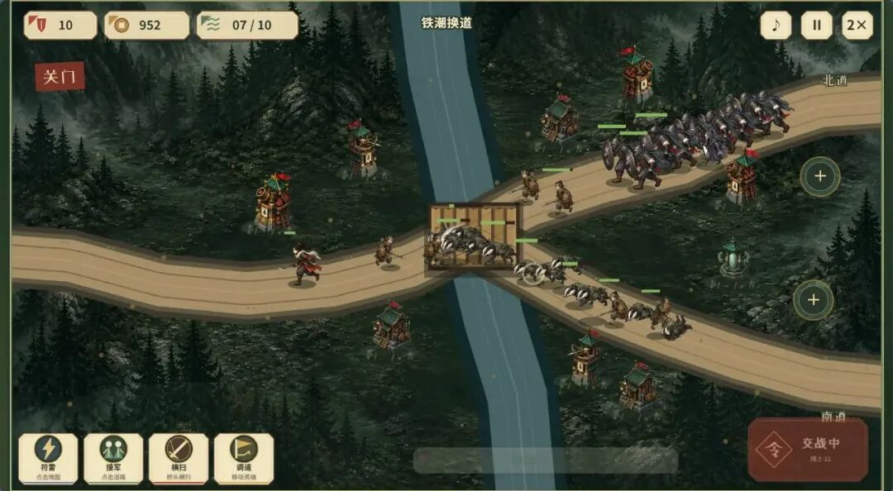
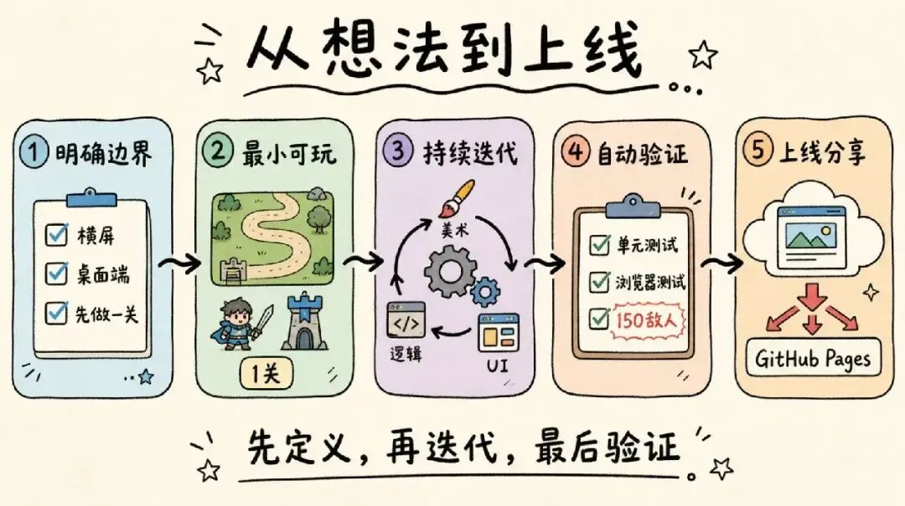
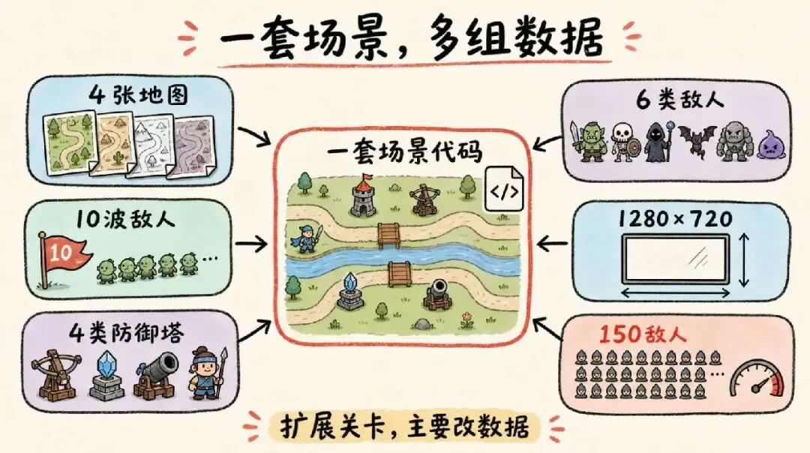
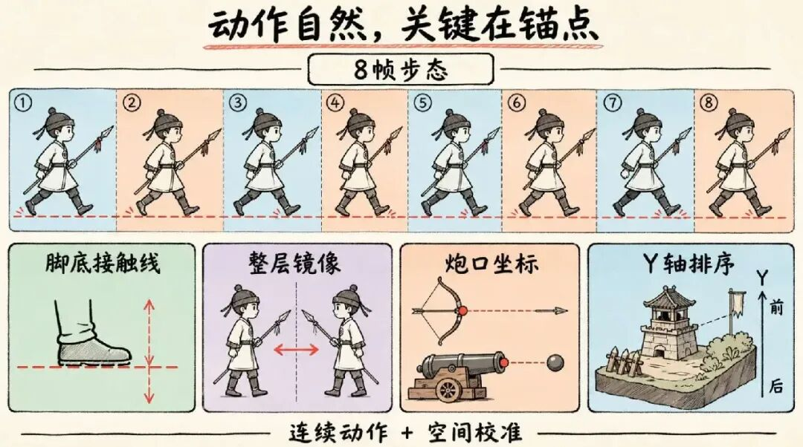
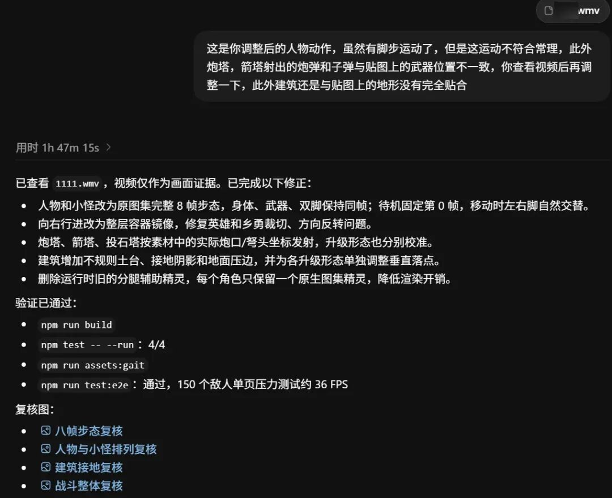
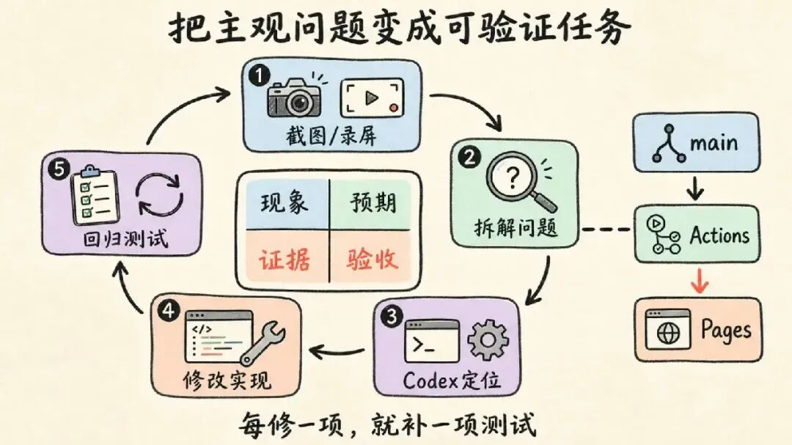
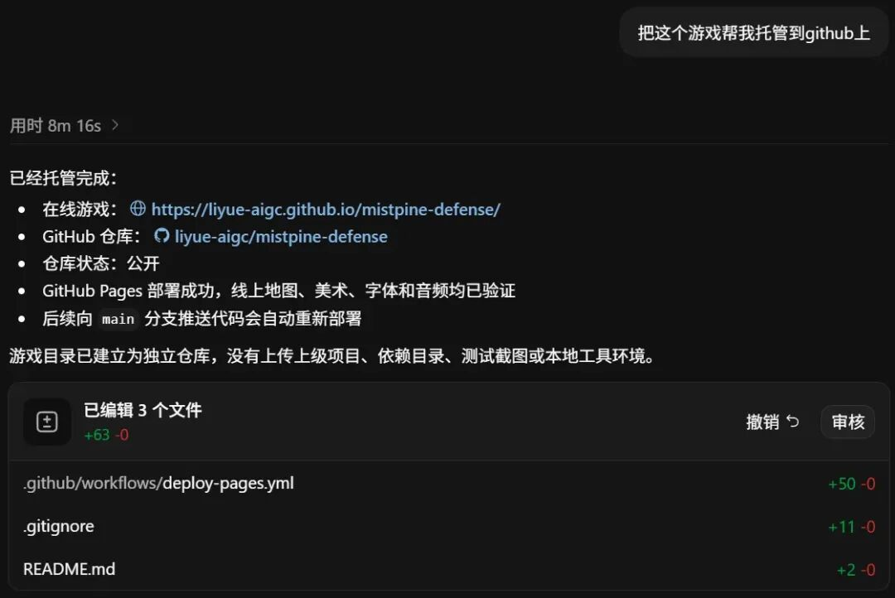

# 我用Codex做了第 3 款游戏，附详细教程。

> 作者: 丶平凡世界 | 平台: 微信公众号 | 日期: 2026-08-31 16:24 | 原文: https://mp.weixin.qq.com/s/GxFxD8kuACwePidXjIbfrg

> **摘要**: 大家好，我是李岳。

大家好，我是李岳。

之前做了两款网页游戏，虽然玩的人不多，但是整体可玩性还不错。

[我用Codex开发了一款在线游戏，附详细教程。](https://mp.weixin.qq.com/s?__biz=MzA3MTg4NjY4Mw==&mid=2457349133&idx=1&sn=66d203e55ddc6e02c04dc10d78c89b13&scene=21#wechat_redirect)

[我用Codex做了第二款游戏，附详细教程。](https://mp.weixin.qq.com/s?__biz=MzA3MTg4NjY4Mw==&mid=2457349264&idx=1&sn=b8cd249ef2fe2eed64f6176c6dd3cb88&scene=21#wechat_redirect)

在做完这两款小游戏后，我一直想验证一件事：**现在的 Codex，究竟只是更会“把代码跑起来”，还是在游戏逻辑、美术资源和 UI 设计上也真的进步了？**

塔防游戏很适合做这次测试。

它同时包含寻路、索敌、伤害、波次、技能、升级等逻辑，也要求地图、人物动作、建筑落地感和战斗反馈彼此配合。

任何一个环节只是“能用”，最终成品都会显得像拼起来的 Demo。于是，我开始制作第 3 款游戏：《雾松关 》。

## 这是一款什么样的塔防？

《雾松关》是一款原创东方奇幻横版路线塔防网页游戏。

目前包含 4 张地图，每关有不同的道路、河流、桥梁和建造位置，敌人会从两条路线分批进攻。

前面两关挺简单的，从第三关开始就异常困难了，我至今测试还没通关。

玩家可以建造连弩台、符石塔、火罐炮和乡勇营。四类建筑分别承担快速射击、法术伤害、范围轰炸和近战拦截。

英雄可以自由调遣和释放横扫，战场技能还包括范围符雷与临时援军。

随着关卡推进，重甲、疾行、治疗、飞行单位与最终 BOSS 会逐步加入。

游戏无需安装，建议使用电脑浏览器体验：

**游玩地址：**

> https://liyue-aigc.github.io/mistpine-defense/

**游戏源代码：**

> https://github.com/liyue-aigc/mistpine-defense



## 一、先让 Codex 规划，不要直接开写

我的第一条需求没有停留在“帮我做个塔防游戏”，而是给出了明确边界：固定横屏地图、桌面浏览器优先、保留英雄、先完成一个可测试关卡，并提前考虑性能和连续动作贴图。

可以把需求写成下面这种结构：

```
目标：制作一款可直接在浏览器运行的横版路线塔防。
范围：先完成一关，包含双路线、四类塔、英雄、技能与完整胜负流程。
约束：固定 1280×720，桌面端优先；大量敌人同时出现时仍要流畅。
验收：人物方向正确、走路有左右脚交替、建筑贴地、弹道从武器位置发射。
```

Codex 先把需求拆成地图、战斗、单位、UI、资源和性能几部分，再开始搭建原型。

技术栈最终选择 `Phaser 4`、`TypeScript` 和 `Vite`。

`Phaser` 负责场景与渲染，`TypeScript` 约束游戏实体数据，`Vite` 让开发和静态部署都足够简单。



从需求到上线的 Codex 游戏开发流程

## 二、先把游戏逻辑做成“可扩展的数据”

塔防最容易出现的问题，是第一关写得很快，第二关却要复制整套代码。

我让 Codex 把路线、建造点、河流、桥梁、波次和难度倍率都整理成关卡配置；**同一个场景只读取不同数据，就能生成不同地图。**

敌人沿折线路径移动，防御塔定时扫描范围内目标，近战单位负责拦截，投射物记录速度、伤害类型和爆炸半径。

升级逻辑统一修改等级、伤害、射程和士兵属性。

后来新增 3 张地图时，主要工作变成填写路线与波次数据，而不是重新写战斗系统。

性能方面，我给 Codex 的要求也很具体：

- 每个角色只保留一个图集精灵；
- 走路帧按照实际移动距离推进；
- 方向变化时镜像整个美术容器；
- 避免在每帧创建新对象；
- 使用固定逻辑步长，并用 150 个敌人的压力场景检查帧率。



数据驱动的塔防游戏结构

## 三、美术不是“生成一张图”就结束了

这次最费时间的部分其实是人物动作和建筑贴合。

早期版本虽然有人物贴图，但左右脚没有自然交替，角色更像在地面平移；向右移动时还出现过裁切残留。

炮塔和箭塔的弹丸，也不是从炮口与弩头真正发出。

解决方法不是简单换图，而是同时调整素材与渲染逻辑：

- 角色改用完整八帧步行动画，为每一帧记录脚底接触线；
- 向右移动时镜像整个人物层，避免单独翻转裁切区域；
- 塔的发射点则按原始素材坐标逐个标定。
- 建筑下方增加地基、泥土边缘和统一的 Y 轴深度排序，让塔真正“长在”地图上。



八帧步态、镜像、炮口与建筑接地校准UI 也经历了一次推倒重做。

第一版只是常见的圆角面板，信息层级混乱。

后来改成旧纸、青玉、黄铜与朱砂组成的边关军令风格：资源放在左上，系统控制放在右上，技能集中在左下，波次军令放在右下。

技能冷却增加数字、环形进度和底部进度条，小字号说明也重新避开装饰线。

虽说做了很多调整，但是还是存在一些美术上的小问题。

## 四、用截图和视频建立调试闭环

我发现，和 Codex 协作时，最有效的反馈公式是：**现象 + 预期 + 证据 + 验收方式**。

例如，不要只说“人物走路不自然”，而要说明“第二和第六帧应该分别表现左右腿向前，脚底接触点不能上下跳，向右时不能出现透明裁切残留”，再附上录屏。



Codex 就可以从图集帧、镜像方式、步幅和 Y 偏移逐项排查。

同样的方法也用来修复 BOSS 攻击动画被走路控制器中断、乡勇营待机仍播放动画、建筑悬浮、弹道起点错误、升级后射程没有增长等问题。

每修好一项，就把它加入自动化检查，避免下一轮改动把旧问题带回来。



截图、录屏、Codex 修改与回归测试闭环

## 五、补齐声音、难度和可验证性

背景音乐与战斗音效使用 Web Audio API 生成，中文军令使用 Edge TTS 合成。

网页浏览器要求用户交互后才能播放声音，因此音频系统会在玩家点击“进入布防”时解锁，而不是页面加载时强行播放。

难度不是单纯增加血量。

我让后续关卡同时减少初始金币和守备值，提高敌人生命、速度与攻击，并重新组合双路出兵、重甲、治疗和飞行单位。这样玩家必须调整塔的组合与技能时机。

项目同时保留三层验证：

- 单元测试检查路线与关卡数据；
- 浏览器端测试自动完成建塔、升级、施放技能、人物转向和场景重开；
- 压力测试一次生成 150 个敌人观察帧率。常用命令如下：

```
npm test
npm run build
npm run test:e2e
```

## 六、把游戏部署到 GitHub Pages

上线前，Codex 先检查了 Git 仓库边界，发现游戏目录原本位于另一个仓库内部，于是为游戏建立独立仓库，并通过 `.gitignore` 排除 `node_modules`、构建产物、测试截图和本地工具环境。

Vite 的资源基础路径设置为相对路径，随后添加 GitHub Actions：每次推送到 `main` 分支，自动执行 `npm ci`、`npm run build`，再把 `dist` 上传到 GitHub Pages。

最后分别请求线上 HTML、脚本、高清地图和音频文件，确认都返回 200，并在远程页面实际进入第一波战斗。



## 写到最后

我的结论是：在规则明确的前提下，Codex 已经能承担从玩法规划、工程实现、素材管线、自动化测试到上线部署的一整条工作流。

它处理战斗逻辑和工程问题很稳定，美术与 UI 也比以前更能持续迭代，但“好不好看”“动作是否自然”仍需要人给出具体判断。

真正有效的用法，不是期待一句提示词直接生成成品，而是把 Codex 当成能持续读代码、看截图、分析视频、修改实现并补回归测试的开发伙伴。

先定义边界，再做最小可玩版本；用真实画面指出问题；每次修改都给出可验证标准。

这样做，AI 才不只是加快写代码，而是参与完成一个真正能够发布的作品。

以上，既然看到这里了，如果觉得不错，随手点个赞、在看、转发三连吧，如果想第一时间收到推送，也可以给我个星标⭐～

谢谢你看我的文章，我们，下次再见。
