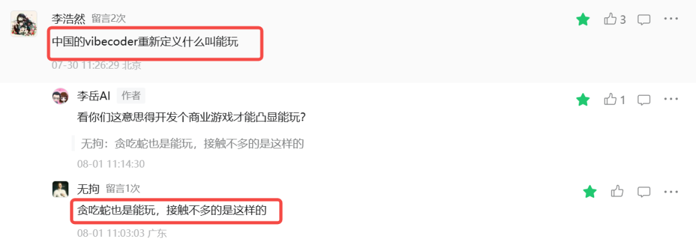
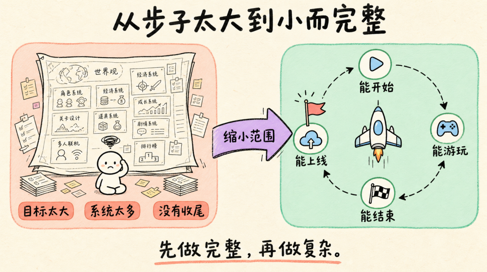
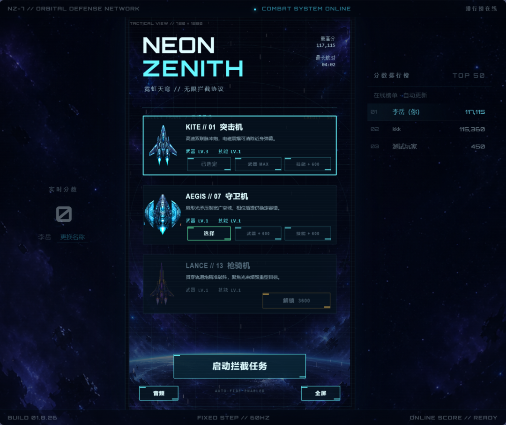
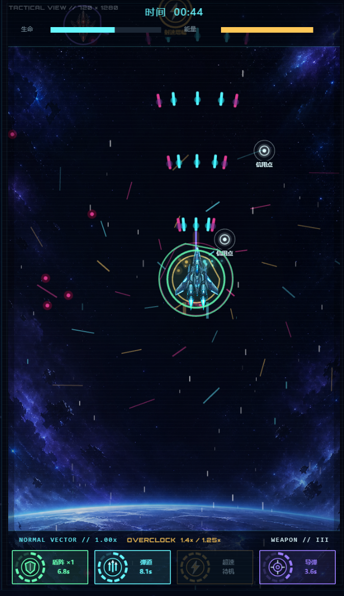
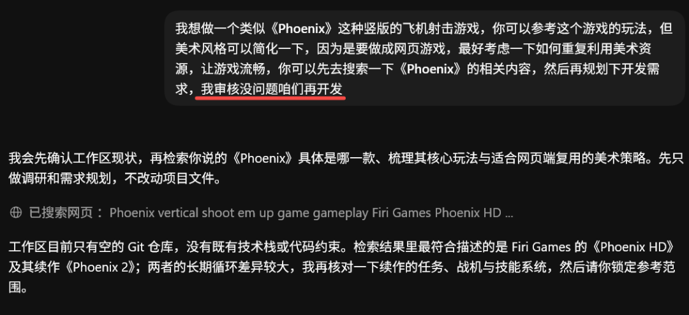
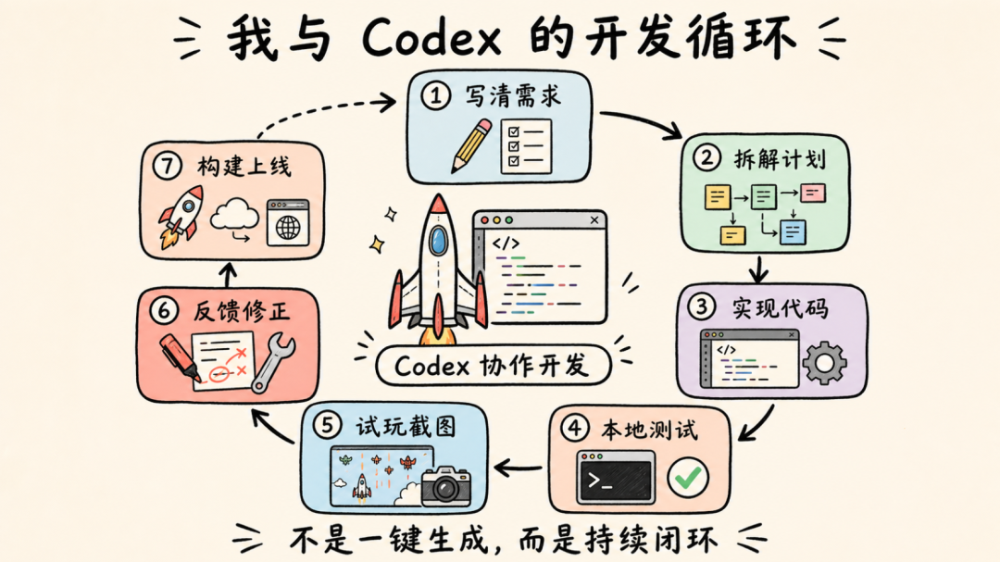
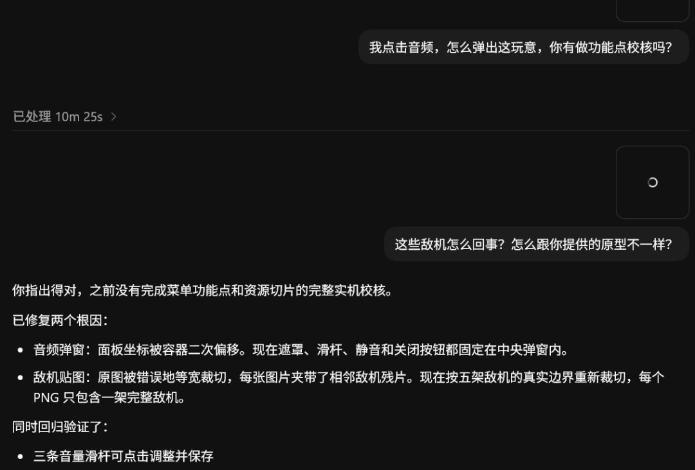
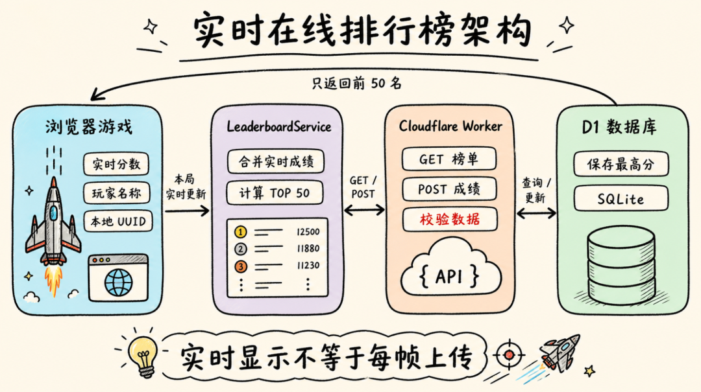
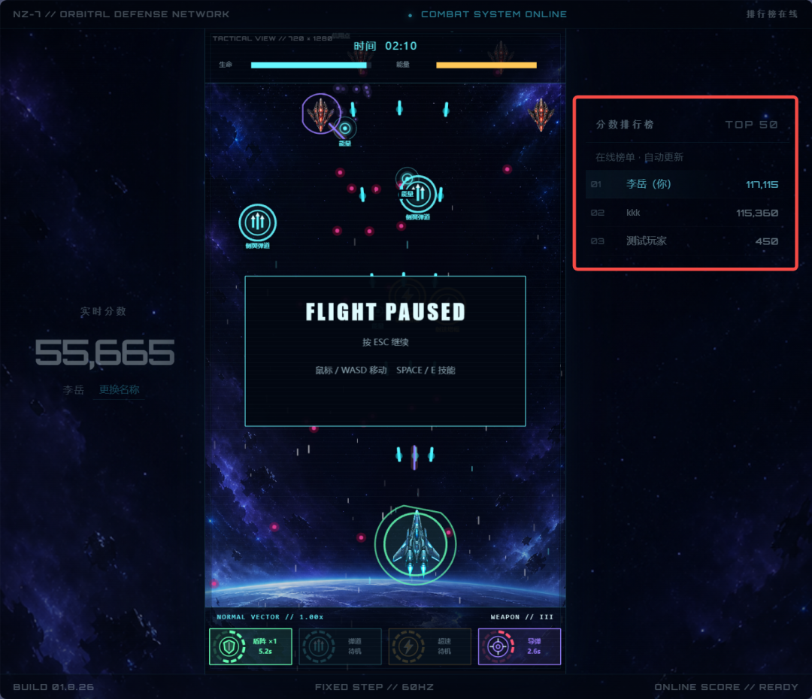
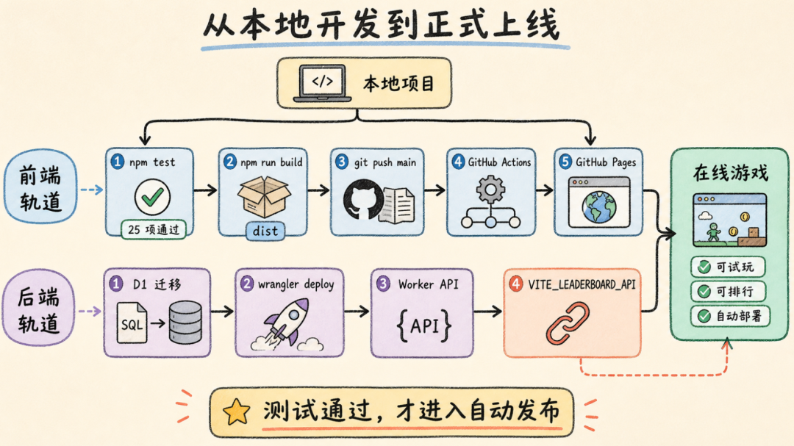

# 我用Codex做了第二款游戏，附详细教程。

> 作者: 丶平凡世界 | 平台: 微信公众号 | 日期: 2026-08-05 14:00 | 原文: https://mp.weixin.qq.com/s/GA-A-M1qFdsMA4pTyXiT7w

> **摘要**: 大家好，我是李岳。

大家好，我是李岳。

今天再分享一下我做的第二个游戏。

第一款游戏的问题不是没有想法，而是想法太多。我一开始就想做完整世界观、复杂系统和大量内容，结果每个部分都做了一点，却没有任何一个部分真正完成。

[我用Codex开发了一款在线游戏，附详细教程。](https://mp.weixin.qq.com/s?__biz=MzA3MTg4NjY4Mw==&mid=2457349133&idx=1&sn=66d203e55ddc6e02c04dc10d78c89b13&scene=21#wechat_redirect)

原本不想继续做了，但是看到留言区里的这段振聋发聩的嘲讽，反而激起了我继续做下去的想法。



我一个连编程都不会的人，能按自己想法做出游戏出来，感觉还是挺开心的一件事。那些质疑嘲讽的声音只会让我更加努力去完善下一款游戏。

吸取第一款游戏的经验后，第二次我决定先把目标缩小：**不追求庞大的体量，而是做一款能开始、能游玩、能结束、能记录成绩，也能真正分享给别人玩的小游戏。**

最终完成的作品叫《NEON ZENITH｜霓虹天穹》，是一款竖版科幻射击网页游戏。它也是我第一次比较完整地走完“提出想法—开发—测试—上线—收集反馈”的全过程。



从复杂但未完成，到小而完整

## 试玩地址

游戏不需要安装客户端，打开网页、输入玩家名称即可开始。

**试玩地址和项目地址见评论区。**



游戏首页

## 游戏玩法

游戏采用 720×1280 的竖版画布。鼠标、WASD 或方向键控制战机移动，战机会自动射击，Space 或 E 释放主动技能，Esc 暂停。

首版有三架战机：突击机使用高频脉冲炮和范围震爆；守卫机使用扇形炮与护盾；枪骑机使用贯穿炮和持续光束。后两架需要信用点解锁，武器与技能还可升级。

前五分钟会在 1 分 30 秒、3 分钟和 4 分 30 秒出现 Boss。从第 5 分钟开始，Boss 被高压弹幕取代：第一次持续 30 秒，此后每隔 90 秒出现一轮，持续时间增加 10 秒。到第 14 分钟后，游戏进入永久高压状态。

敌机会掉落叠层护盾、额外弹道、射速增幅和制导导弹。每个技能持续 10 秒，底部技能栏用 12 格圆形钟表显示剩余时间。当任意三个技能同时激活时，战机会进入超频模式，并出现旋转圆环、尾迹和螺旋线条等火力全开效果。



美术采用霓虹科幻风。战机和敌机使用原创图片，护盾、爆炸、尾焰和弹幕则复用基础资源，通过颜色、缩放和程序绘制形成差异。音乐分普通战斗和高压两套循环，主要音效由 Web Audio API 合成。

## 如何使用 Codex 开发游戏

很多人第一次用 AI 写代码，会直接说：“帮我做一个飞机大战游戏。”然后等待它一次性交付成品。

我的做法不同。我把 Codex 当成一个能持续协作的开发搭档：先让它规划需求，再进入项目修改代码、运行测试、检查构建结果，最后根据截图继续修正。





我与 Codex 的迭代开发循环

### 1. 先写清楚规则

我没有一开始就让 Codex 写代码，而是先整理 MVP：画布尺寸、操作方式、三架战机、Boss 时间、高压循环、技能掉落、存档、音频和验收流程。

例如，“游戏越来越难”被改成了两个可以测试的公式：

text

```
高压开始时间 = 300 + 90 × n
高压持续时间 = 30 + 10 × n
```

当规则足够明确，Codex 才能把它写成独立函数，并通过虚拟时钟验证 5 分钟、6 分 30 秒和 14 分钟等关键节点。

我总结下来，一条合格的游戏需求至少要说明：玩家做什么、一局如何推进、数据如何保存，以及什么结果才算验收通过。

### 2. 选择适合网页游戏的技术栈

项目使用 Phaser 4.2、TypeScript 和 Vite。Phaser 负责渲染、场景与输入；TypeScript 约束战机、敌人、武器和存档数据；Vite 负责本地开发与生产构建；Vitest 用于自动测试。

代码按职责拆分：`src/game` 保存战斗、场景、音频和存档，`src/online` 负责排行榜，`worker` 与 `migrations` 保存在线接口和数据库迁移，`tests` 与 GitHub 工作流负责验证和发布。

本地运行：

bash

```
git clone https://github.com/liyue-aigc/neon-zenith.git
cd neon-zenith
npm install
npm run dev
```

### 3. 用截图修正体验问题

代码能运行，不代表体验正确。早期版本出现过音频面板覆盖机库、敌机缩放变形、结算战机过大、侧栏过亮和超频全屏闪白等问题。

我会把截图交给 Codex，指出问题区域、保留内容和验收要求。与其说“技能栏不好看”，不如说：

> “技能掉落不明显；底部改成 12 格圆环倒计时；拾取后显示技能名称，1 秒后消失；全部技能持续 10 秒；护盾要有特效，额外弹道使用不同颜色。”

这种描述接近测试条件。Codex 可以定位代码、修改效果，再补充持续时间、叠加数量和圆环格数测试。AI 可以快速实现系统，但平衡、审美和手感仍然需要人来判断。



这里的截图不小心清理掉了

## 添加实时在线排行榜

最初排行榜只保存在浏览器中，不同玩家无法看到彼此成绩。为了让游戏真正具备在线试玩的感觉，我使用 Cloudflare Worker 和 D1 增加了在线排行榜。



在线排行榜架构整体架构是：

text

```
浏览器游戏
  → LeaderboardService 合并本局实时成绩
  → Cloudflare Worker 提供 GET／POST API
  → D1 保存每个玩家的最高分
```

D1 中只有一张排行榜表，主要保存玩家 UUID、名称、分数、战机、生存时间和更新时间。Worker 提供三个接口：

text

```
GET  /health       检查服务
GET  /leaderboard  获取前 50 名
POST /leaderboard  提交成绩
```

提交时会校验 UUID、2～16 个字符的玩家名称、分数范围、生存时间、战机类型和请求来源。数据库使用 `ON CONFLICT` 更新，只有新成绩更高时才覆盖历史成绩。

右侧排行榜能实时显示玩家是否进入前 50 名，但并不是每帧上传。浏览器先获取榜单，再把当前分数临时合并、排序；只有一局结束后才向 Worker 提交最终成绩。这样既有实时反馈，也不会制造大量请求。如果 Worker 没有配置，游戏会自动退回本地榜单。



居然有兄弟找到我的Github提前体验了

## 部署 D1 和 Worker

首先登录 Cloudflare：

bash

```
npx wrangler login
```

创建数据库：

bash

```
npx wrangler d1 create neon-zenith-leaderboard
```

把返回的数据库 ID 写入 `wrangler.jsonc`，配置 D1 绑定：

jsonc

```
{
"name":"neon-zenith-leaderboard",
"main":"worker/index.ts",
"d1_databases":[{
"binding":"DB",
"database_name":"neon-zenith-leaderboard",
"database_id":"<YOUR_D1_DATABASE_ID>"
}]
}
```

然后执行远程迁移并部署：

bash

```
npx wrangler d1 migrations apply neon-zenith-leaderboard --remote
npx wrangler deploy
```

以上这些信息不需要你配置，你只需要授权给Codex，它会帮你全部搞定。

## 自动上线到 GitHub Pages

前端使用 GitHub Pages 托管。先在仓库的：

text

```
Settings → Secrets and variables → Actions → Variables
```

创建变量：

text

```
VITE_LEADERBOARD_API=https://你的-worker.workers.dev
```

项目中的 GitHub Actions 会在 `main` 分支收到推送后依次执行：安装依赖、运行测试、生产构建、上传 `dist`、部署 GitHub Pages。



从本地开发到 GitHub Pages 上线本地确认后只需要：

bash

```
git add .
git commit -m "feat: publish game"
git push origin main
```

GitHub Pages 的自定义工作流需要上传构建产物，并给部署任务配置 `pages: write` 和 `id-token: write` 权限。

以上发布动作需要先安装一个Github CLI，然后授权给Codex操作就可以了，也不需要你自己去一个一个的设置发布，你只需要最终确认是否发布成功。

## 测试和上线时踩过的坑

项目现有 7 个测试文件、25 项测试，覆盖 Boss、高压循环、技能、排行榜、Worker 校验和存档恢复。

bash

```
npm test
npm run build
```

上线时主要遇到过三个问题：

1. GitHub Pages 部署在二级路径，图片和音乐不能直接从网站根目录读取，需要使用 Vite 的基础路径。

2. 浏览器音频需要由用户点击初始化。游戏开始不能等待音乐下载完成，否则网络稍慢就像按钮失效。正确方式是战斗立即开始，音乐异步加载。

3. Worker 必须正确配置 CORS，允许正式 GitHub Pages 域名和本地开发地址，同时仍要在服务端校验成绩，不能完全相信浏览器提交的数据。

## 写在最后

《NEON ZENITH》规模并不大，但它让我第一次更认真地把“完整”放在“庞大”前面。

Codex 没有替我决定什么才好玩，也不能代替审美判断。它真正改变的是反馈速度：**我可以快速把想法变成可运行版本，再通过试玩、截图和测试不断修正。**

如果你也想用 AI 做游戏，我建议先选择一个边界清楚的项目，写明规则和验收条件，再让 Codex 参与规划、开发、测试和上线。先完成一个小作品，再去挑战更复杂的目标。

最后欢迎大家试玩，也欢迎反馈操作、难度、画面、音乐和排行榜方面的问题。

以上，既然看到这里了，如果觉得不错，随手点个赞、在看、转发三连吧，如果想第一时间收到推送，也可以给我个星标⭐～

谢谢你看我的文章，我们，下次再见。
