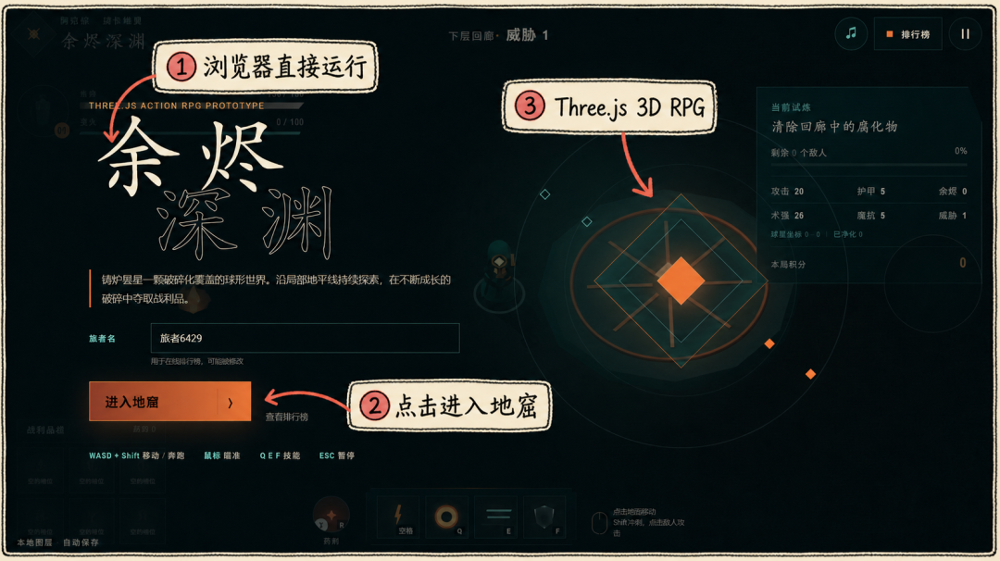
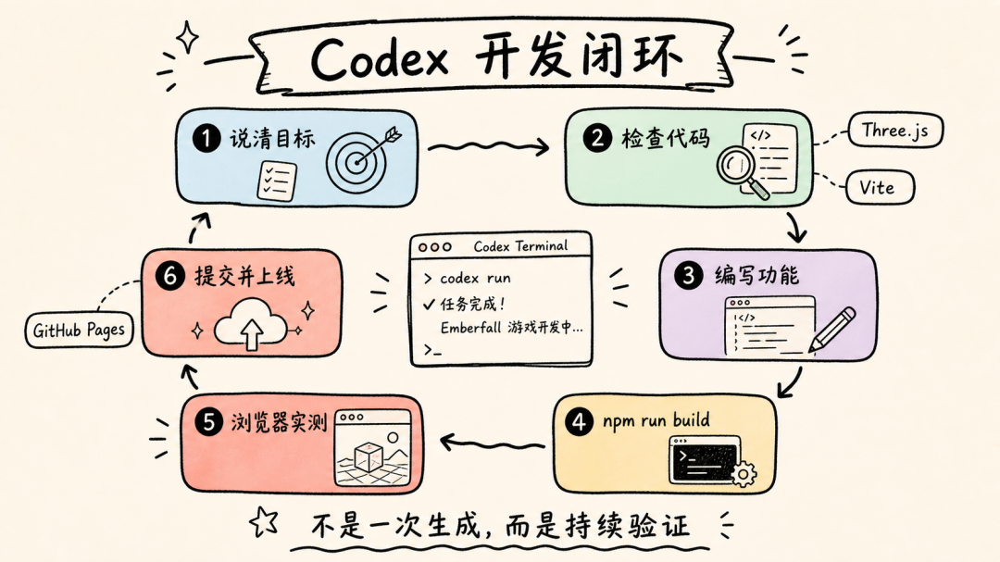
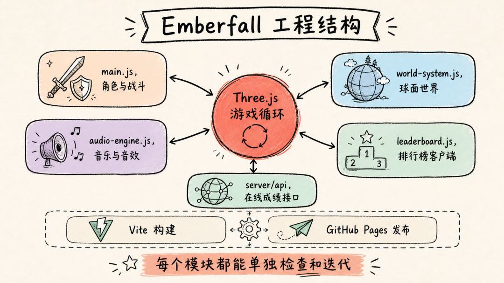
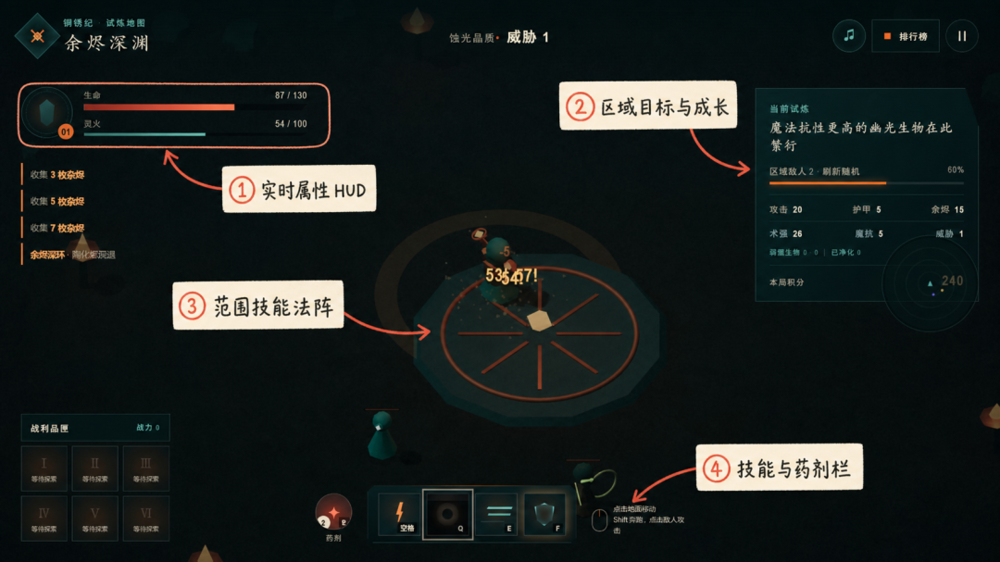
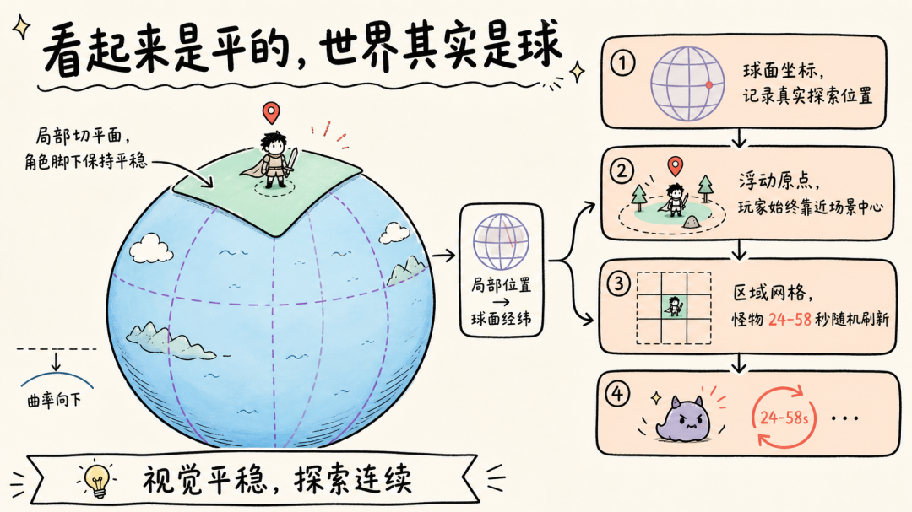
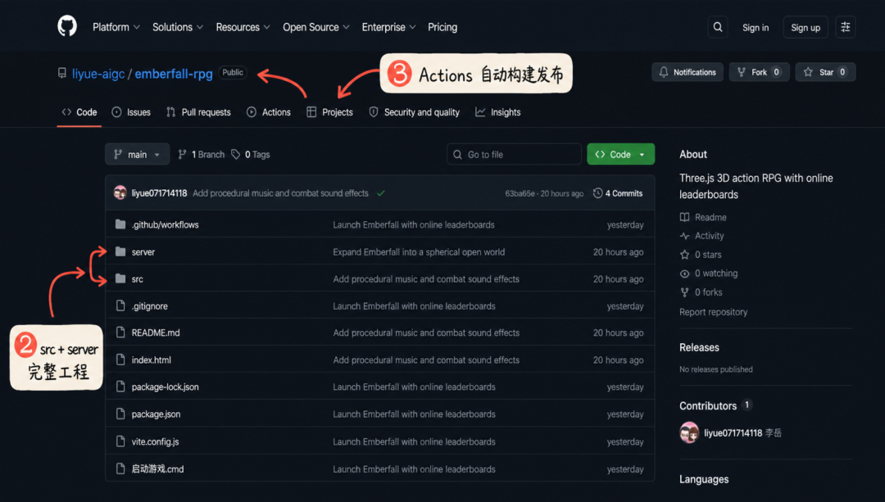

# 我用Codex开发了一款在线游戏，附详细教程。

> 作者: 丶平凡世界 | 平台: 微信公众号 | 日期: 2026-07-29 14:00 | 原文: https://mp.weixin.qq.com/s/0ZKlEGITiWmyzi99xD-1Og

> **摘要**: 大家好，我是李岳。

大家好，我是李岳。

前几天我突然冒出一个有点不靠谱的念头，我想做一款有《火炬之光》那种俯视角刷怪感觉的 3D RPG，但它最好不要安装客户端，点开网页就能玩。

问题也很直接，我不是专业游戏程序员，更没有准备好一整套模型、动作、音效和服务器资源。

我手里只有一句需求。

于是我把这句话发给了 Codex。

我原本的预期很低，能在浏览器里放一个方块，点一下地面，方块会移动，就算赢。结果这个项目后来有了会走路和奔跑的角色，有了吟唱、冲刺、护盾和范围法术，有了远程怪、随机装备、成长属性、BOSS 全屏技能、球形开放世界、循环配乐、在线排行榜。

甚至真的上线了。

你现在就能直接打开玩。

在线试玩

> https://liyue-aigc.github.io/emberfall-rpg/

GitHub 项目源码

> https://github.com/liyue-aigc/emberfall-rpg

游戏名字叫《余烬深渊 Emberfall》。整个项目主要使用 Three.js 和 Vite。人物、怪物、地形、粒子和音效都由代码生成，没有安装 Blender，也没有下载几个 G 的素材包。



在线运行的《余烬深渊》首页当页面真的在浏览器里跑起来，我第一反应是，这玩意居然真能玩。

不是哥们，我一开始真的只想试试。

所以这篇文章不聊玄学，我把完整过程拆开，尽量写成一份你今天就能照着做的教程。先说清楚，我做出来的仍然是原型，离商业游戏差得远。但它已经跨过了一个很关键的门槛:**从一段想法变成了可以分享、可以更新、可以让别人游玩的东西**。

### 1、先别急着做大作，先让 Codex 做出最小闭环

第一轮需求，我只说清楚两件事。

使用 Three.js，游戏在本地网页运行。

这两句话看着普通，其实已经确定了技术边界。Three.js 负责 3D 场景，Vite 负责开发服务器和构建，本地网页意味着先不碰复杂客户端打包。

如果你也想复现，先准备 Node.js 和 Git，然后在 Codex 里直接给出类似这样的任务。

text

```
请用 Three.js 开发一个俯视角 3D 动作 RPG 原型
项目放在 D:\WebGames\MyRPG
使用 Vite，支持 npm run dev 和 npm run build
先实现角色移动、镜头跟随、一个敌人和一次普通攻击
完成后请实际构建，并在浏览器里验证
```

这里最重要的不是 Three.js，而是最后一句。

完成后请实际验证。

Codex 的价值不只是写出一段看起来像代码的文本。它会查看目录、安装依赖、创建文件、运行构建、读取报错，再打开网页检查按钮能不能点、画面有没有出现。发现问题后继续改，改完再测。

这才是开发。



Codex 从需求到上线的开发闭环我觉得很多人用 Codex 没得到好结果，是因为只给了一个很大的愿望，却没有给验收条件。你说「帮我做个游戏」，它只能猜。你说「角色能用 WASD 移动，Shift 奔跑，Q 键释放范围技能，构建必须通过」，它就有一张可以逐项打勾的清单。

这块需要注意一下，第一轮千万别把联机、商城、十个职业和开放世界全塞进去。先让角色动起来，先让攻击命中，先让死亡和重开跑通。闭环能跑，再往上加东西。

### 2、把工程骨架搭好，再谈画面

项目初始化以后，本地启动其实很简单。

powershell

```
cd D:\WebGames\Emberfall
npm install
npm run dev
```

浏览器访问 `http://127.0.0.1:5173/`，就能看到开发版本。准备发布前再执行一次。

powershell

```
npm run build
```

真正容易乱的是代码结构。小游戏刚开始时，一个 `main.js` 什么都能塞，场景、角色、敌人、碰撞、UI 全写进去，几百行以后就会变成祖传意大利面。

Codex 在后续迭代里把职责逐渐拆开。`main.js` 管角色、战斗和主循环，`world-system.js` 管球面坐标、区域和地形，`audio-engine.js` 管程序化音乐与音效，`leaderboard.js` 管排行榜客户端，`server/api` 则处理在线成绩接口。



Emberfall 的真实工程结构对于 Three.js，最小场景离不开 `Scene`、`PerspectiveCamera`、`WebGLRenderer` 和灯光。俯视角 RPG 还要多做一步，镜头不能僵硬地焊死在角色头顶，而是要跟随一个目标点做平滑插值。角色奔跑时镜头稍微拉远，受到 BOSS 重击时加入短暂震屏，手感一下就出来了。

画面也是同样的道理。

因为没有 Blender，Codex 用 `Group`、球体、圆柱和低多边形几何体拼出角色。肩膀下面挂手臂，大腿下面挂小腿，法杖再挂到手上。走路时左右腿反向摆动，奔跑提高摆幅，吟唱时手臂抬起、身体后仰，法术释放的一瞬间再把动作推到峰值。

它不是动作捕捉。

但角色从滑动的棋子变成了一个会发力的小人。

如果你想让 Codex 把画面做细，别只说「更精美」。

可以写成

text

```
角色需要待机、步行、奔跑、普攻、吟唱和施法六种状态，
动作之间平滑过渡，技能释放时需要地面法阵、环绕粒子、能量柱和残影
```

描述越接近验收表，结果越稳定。

### 3、战斗好不好玩，关键不是特效多，而是反馈闭环

角色能动以后，我开始一轮一轮加战斗。

先是普通火矢，然后是余烬震环、裂隙步、铜卫结界。再往后加入近战爬兽、远程幽魂和猎手，最后是会释放大范围物理震击与近乎全屏魔法风暴的 BOSS。

比较骚的事是，Codex 不只写技能伤害，它还把技能拆成动作时间线。按下 Q，角色进入吟唱状态，法阵先亮起，粒子开始围绕，到了释放点才计算伤害和击退。F 键的护盾也是先构筑，再生成包裹角色的几何护罩。

于是战斗不再是按键以后敌人凭空掉血。

它有前摇，有爆发，有声音，有镜头反馈。



真实战斗画面与 HUD 标注成长系统则把一场战斗接到下一场。怪物死亡后掉落余烬、经验、药剂和随机装备。装备分普通、稀有、史诗、传说四档，可以提升普通攻击、技能强度、生命、护甲、魔抗和攻速。

敌人也不能原地踏步。

游戏会参考探索距离、净化区域数量和玩家等级，提高怪物生命、伤害、防御与数量。这样玩家捡到传说装备以后不会立刻进入无敌割草，新的区域仍然有压力。

这里我也踩了一个很真实的坑。加了远程怪以后，开局几只怪同时输出，角色很容易瞬间躺下。测试截图时我甚至得先开盾、喝药，再放范围技能。。。这恰好说明浏览器实测不是走形式。数值问题只有真的玩，才会冒出来。

### 4、最难的一步，把平面地图改造成球形世界

我后来提了一个挺折腾人的需求。

我希望角色视角看起来是平的，但整个大地图其实是一颗球，可以一直探索。不同区域的怪物死后随机刷新，还要保留球面坐标和成长难度。

听着有点拧巴对吧。

Codex 给出的方案是局部切平面加球面坐标，再配一个浮动原点。角色脚下只渲染球面的一小块，所以视觉上像平地。玩家移动时，系统把局部位移累计到全局球面坐标，并持续重建附近区域。角色在场景里始终靠近中心，远处世界却在不断向前展开。



球形开放世界的实现思路这套做法解决了两个问题。一个是大坐标下的浮点精度，另一个是网页端不可能一次加载整颗星球。

区域则用稳定的坐标种子生成。走到某个网格，就能得到对应生态、威胁等级和怪物组合。清空以后记录净化状态，并在 24 到 58 秒之间生成随机刷新时间。玩家离开再回来，系统仍然知道这里发生过什么。

说真的，这一段最能体现 Codex 的能力。它不是只会写按钮和表单。只要需求能被拆成坐标系统、状态数据、加载范围和验证标准，它可以继续处理相当具体的游戏工程问题。

当然，代价也很真实。程序化地形会重复，球面接缝、区域密度和性能都需要长期调优。现在的版本更像一颗能持续行走的小星球原型，不是《无人深空》。

承认这个差距，反而更有意思。

### 5、没有音频文件，也能先把氛围做出来

最后一轮，我让 Codex 加循环背景音乐、普通攻击和技能音效。

它没有去网上随便扒一首歌，而是用 Web Audio API 实时合成。一个 64 步序列负责背景旋律和低音，振荡器、滤波器与噪声分别组合出火矢、冲刺、护盾、受击、掉落和 BOSS 预警。

这样做的好处很朴素，没有版权风险，不需要下载音频包，项目体积也不会突然膨胀。

浏览器有自动播放限制，所以音乐必须等用户第一次点击「进入地窟」后才启动。右上角的音符按钮负责静音，设置会写入本地存储。这里也能看出工程思维，功能不是「能发声」就结束，还要考虑浏览器规则、用户控制和状态保存。

如果你要 Codex 做类似功能，可以把请求写成「使用 Web Audio API 生成原创循环配乐，首次交互后解锁，加入总音量与静音开关，并分别为攻击、施法、受击、掉落和 BOSS 预警设计音效」。比一句「加点声音」有效得多。

### 6、从本地能跑，到任何人点开都能玩

本地版本稳定以后，Codex 创建了 Git 仓库，整理 README，配置 GitHub Actions，把前端发布到 GitHub Pages。排行榜则通过独立的接口保存单局最高分和累计积分，接口失败时自动回退到本地榜，不让游戏因为网络抖一下就卡死。



GitHub 源码与自动部署发布流程其实就三步，构建通过，提交代码，推送主分支。后面的 GitHub Actions 会自动安装依赖、执行 `npm run build`、上传产物并部署。

这一点我很喜欢。

### 写到最后

Codex 不只把项目交付成一个躺在硬盘里的文件夹，还把源码、文档、构建和在线地址一起交付。下一次修改技能、怪物或者音乐，只要推送新提交，线上版本就会跟着更新。

回头看整个过程，我给 Codex 的需求其实一直在变。从「做个简单网页游戏」，到「动作精细一点」，再到「加远程怪和全屏 BOSS 技能」，然后突然来一句「地图能不能做成球」。

传统外包听到这里可能已经开始改报价了。

Codex 的反应是检查现有代码，判断哪些模块要改，动手实现，构建，打开浏览器测试，再把结果交回来。

它当然不是全自动游戏公司。审美方向、玩法取舍、难度好不好玩，仍然需要人来判断。模型和动画也受限于程序化几何，想做商业级角色，Blender、美术资产、动作捕捉和更成熟的引擎迟早要进场。

但它把一件以前需要跨过很多门槛的事，压缩成了一个人可以不断试错的过程。

我有时候觉得，**AI 编程最让人兴奋的地方并不是少写了多少行代码。而是那些过去只会在脑子里停留十分钟的念头，现在有机会活下来。**

它先变成一个方块，再变成一个会奔跑的法师，再变成一颗可以继续往前走的小星球。

开头那个不靠谱的念头，最后真的开火了。

如果你也有一个一直想做、但总觉得自己技术不够的小游戏，我不知道它最终能不能成为作品。

但你完全可以把第一句需求发给 Codex。

先让角色动起来。

以上，既然看到这里了，如果觉得不错，随手点个赞、在看、转发三连吧，如果想第一时间收到推送，也可以给我个星标⭐～

谢谢你看我的文章，我们，下次再见。
