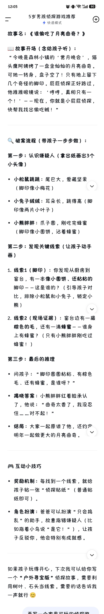
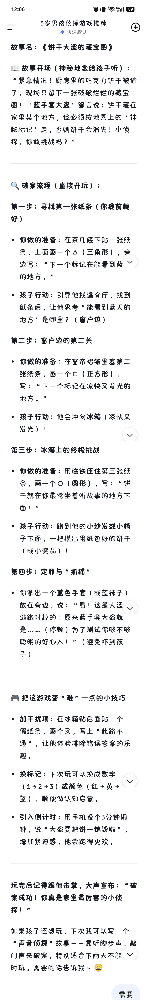
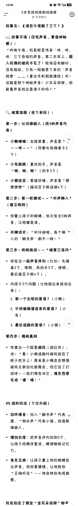
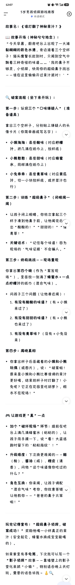
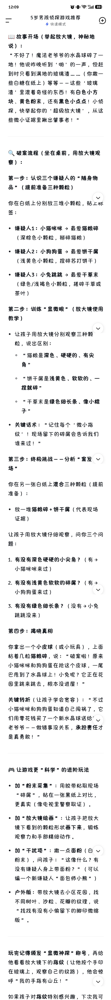

---
title: "用deepseek给娃找侦探游戏真是太方便"
source: "https://www.xiaohongshu.com/discovery/item/6a531619000000001c0253a7?app_platform=android&ignoreEngage=true&app_version=9.36.2&share_from_user_hidden=true&xsec_source=app_share&type=normal&xsec_token=CBztOptAD5HbYypyfA9zvjyUlgJ2fstkkKZO86QkKvr8Q%3D&author_share=1&xhsshare=CopyLink&shareRedId=N0dINjg3NUpMPko6S0EySDs0P0lFSjdL&apptime=1783845648&share_id=aec1a17bca284b85b7b1bb70abc3963c&share_channel=copy_link"
author: "素素不吃素_s"
author_uid: "5a3a5cd2e8ac2b3cb62ed83e"
date: "5小时前 上海"
tags: ["侦探", "玩游戏", "游戏中学习", "培养观察力", "解谜游戏", "观察力提升", "娃的兴趣养成记", "亲子互动", "侦探游戏", "DeepSeek", "在家游戏", "儿童启蒙"]
platform: "xiaohongshu"
category: "游戏设计"
summary: "家长用DeepSeek为孩子生成多种在家玩的侦探游戏，边玩边学"
---

# 用deepseek给娃找侦探游戏真是太方便

> 作者: 素素不吃素_s | 日期: 5小时前 上海 | 原文: https://www.xiaohongshu.com/discovery/item/6a531619000000001c0253a7?app_platform=android&ignoreEngage=true&app_version=9.36.2&share_from_user_hidden=true&xsec_source=app_share&type=normal&xsec_token=CBztOptAD5HbYypyfA9zvjyUlgJ2fstkkKZO86QkKvr8Q%3D&author_share=1&xhsshare=CopyLink&shareRedId=N0dINjg3NUpMPko6S0EySDs0P0lFSjdL&apptime=1783845648&share_id=aec1a17bca284b85b7b1bb70abc3963c&share_channel=copy_link

> **摘要**:家长用DeepSeek为孩子生成多种在家玩的侦探游戏，边玩边学

台风天不能出门，想起娃最近喜欢听小鸡敦敦侦探故事，试了几次，deepseek给了好几个侦探游戏，都是在家方便玩的。
	
娃玩得停不下来，deepseek给故事给得停不下来[点赞R][点赞R][点赞R][点赞R]太方便了！！#侦探 #玩游戏 #游戏中学习 #培养观察力 #解谜游戏 #观察力提升 #娃的兴趣养成记

#亲子互动 #侦探游戏 #DeepSeek #在家游戏 #儿童启蒙

## 图片

## 图片文字 (OCR)

12:05 o:= Nel
_ 5 岁男孩侦探游戏推荐全
4 快速模式故事名 : 《谁偷吃了月亮曲奇 ? 》已故事开场 ( 念给孩子听 ) :

“ 今晚是森林小镇的 “党月晚会 ” ，猫头麻阿姨烤了一盘金灿灿的月亮曲奇 .

可她一转身，盘子空了 ! 只有地上留下几个奇怪的脚印。屁屁侦探正好路过，他推推眼镜说 : “ 哼哼，真相只有一个 ! '一一现在，你就是小屁屁侦探，

REF IKE Hozm! ”

以 \ 破案流程 ( 带孩子一步步做 ) :

第一步 : 认识嫌疑人 ( 拿出纸男出 3 个小头像 )

。小松鼠跳跳 : ERK, BERR
( 脚印像小梅花 )

。小兔子绕绒 : 耳杀长 HBS ( 脚印像两片小叶子 )

。小陵昱胖 : MF®, Rloz REE
( 脚印像小圆饼，沾着蜂蜜 )

第二步 : 发现关键线索 ( 让孩子动手

@®)

1. 线索 1 ( 脚印 ) : 你发现从厨房到窗台，有一串像小圆饼、还粘粘的脚印一一这是谁的 ? (引导孩子对比，排除小松鼠和小兔子，锁定小 AE)

2. 线索 2 ( 现场证据 ) : BSE 棕色的毛，还有一滴蜂密 -- - 谁身上有蜂蜜 ? (只有小能胖胖刚吃过 BE!)

第三步 : 最后的推理。 OF: “了脚印圆圆粘巾、有棕色毛、还有蜂蜜 REG?”

。揭晓答案 : 小能胖胖红着了脸承认 TT, fig: “ 曲奇太香了，我没忍住 .… .对不起 ! ”

。结局 : 大家一起原谅了他，还约定明年一起做更大的月亮曲奇。 “

全互动小技巧。奖励机制 : 每找到一个线索，就给孩子贴一张 “ 侦探贴纸 ” ( 普通贴纸即可 ) 。。角色扮演 : 爸爸可以扮演 “只会的乱 ” 的助手 ,故意指错嫌疑人 (Lt
wWisE NBR “RE! ”) ，让孩 FRM, SF BAF,

如果孩子玩得开心，下次我可以给你写一个 “户外寻宝版 ”侦探故事，需要利用树叶、石头当线索。需要的话告诉我一声就行 ©

< 世人了一 II 二人 (上大 HA NE

12:06 o:= NE
_ 5 岁男孩侦探游戏推荐 @
加 4 快速模式故事名 : 《饼干大盗的藏宝图》

El 故事开场 ( 神秘地念给孩子听 ) :

“紧急情况 ! 厨房里的巧克力饼干被偷了 ,，现场只留下一张破破烂烂的藏宝图 ! “ 蓝手套大盗'留言说 : 饼干藏在家里某个地方，但必须按地图上的 “ 神秘标记走，否则饼干会消失 ! IR 探，你敢挑战吗 ? ”

C 破案流程 ( 直接开玩 ) :

第一步 : 寻找第一张纸条 ( 你提前藏好 )

。你做的准备 : 在茶几人旗下贴一张纸条，上面因一个 A (三角形 ) , &
NE: “下一个标记在能看到蓝 . 六的地方。”

。孩子行动 : 引导他找遍客厅，找到 MEG, ，让他思考 “能看到赣天的地方 ”是哪里 ? (窗户边 )

第二步 : 窗户边的第二关。你做的准备 : 在窗帘初皱里塞第二张纸条，图一个口 (ERE) ,
写 : “下一个标记在凉快又发光的地方。”

。孩子行动 : 他会冲向冰箱 (凉快又发光 ) ! 、第三步 : 冰箱上的终极挑战。你做的准备 : 用磁铁压住第三张纸条，国一个 O (BF) ,5: «iH 干就在你最常坐着听故事的地方下面 ! ”

。孩子行动 : 跑到他的小沙发或小椅子下面，一把摸出用纸包好的饼干
( 或小奖品 ) !

EOL: 定罪与 “ 抓捕 ”

。你拿出一个蓝色手套 (或蓝袜子 )
放在旁边 , 说 : “看 ! 这是大盗、逃跑时掉的 ! 原来蓝手套大盗就是 .… (BE) 为了测试你够不够聪明的好心人 ! ” (BES OF RZ 子 )

MA 把这游戏变 “ 难 ”一点的小技巧。加和干扰项 : 在冰箱贴后面贴一个假纸条，男个又，写上 “此路不通 ”，让他体验排除错误答案的乐趣。。换标记 : 下次玩可以换成数字
(1222?>3) 或颜色 ( 红 > 黄 > 一蓝 ) ，顺便做认知启蒙。。引入倒计时 : 用手机设个 3 分钟六钟，说 “大盗要把饼干销毁啦 ”，增加紧迫感，他会跑得更欢。玩完后记得跟他击掌，大声宣布 : “ 破案成功 ! 你真是家里最厉害的小侦探 ! ”

如 0 果孩子还想玩，下次我可以写一个

“声音侦探 ”故事 - 一靠听脚步声、敲门声来破案，特别适合下雨天不能 Vv 时玩。需要的话告诉我 ~ ©

需要

12:06 o:=Nn aA
_ 5 岁男孩侦探游戏推荐 @
= 4 快速模式故事名 : (BEFERBT=T?)

El 故事开场 ( 储低声音，营造神秘感 ) :

“ 昨晚午夜，玩具想里传来 0&8 0%]
吹'三下奇怪的声音。第二天早上 ,起人玩偶的披风不见了 ! 现场没有上脚印，没有指纹，只有一段被录下来的 “声音线索' … ..。 ( 拿出手机假装播放 ) off!
这就是那个神秘声音 ! 小耳杀侦探，你能靠声音找出是谁干的吗 ?”

CL 破案流程 ( 坐下来玩 ) :

第一步 : 认识嫌疑人 ( 用 3 种声音代
x)

。 EERE: 走路笨重，声音是 “、、一一噬一一 ” (用拳头轻插桌子 2
下 )

。小免跳跳 : 喜欢拍手，声音是
“ogg. 49. HW” (IBF3T)

。 IMRRRE: BENE, BER “YW
Wb (EHS FHREEGLT)
第二步 : 第一轮测试一一 “ 听声辩人 ”

( 建立规则 )

。你蒙上孩子的眼睛，依次发出 3 种声音，让他猜是谁 .

。关键话术 : “ 听仔细哦，每个嫌 V
人的 “脚步声'都不一样 ! ”

第三步 : 终极挑战 -一 “破案三连问 ”

。你发出一组声音序列 (比如 : %iE 和桌 2 下，人停顿，再拍手 3 下，停顿，最后摇豆子瓶 4 下 ) 。。问孩子 3 个问题 (让他指出来或说出来 ) :

1. 第一个出现的是谁 ? (小能 )

2. 中间偷偷溜进来的是谁 ? (小免 )

3. 最后逃跑的是谁 ? (小猴 ) “

FOL: 揭晓真相。你拿出一个红色披风 ( 或红布 ) ，说 :“ 看 ! 小猴迷跑时披风挂在了柜子把手上 ! 原来是小猴皮皮想借披风去参加化装舞会，但它忘了打 BF —- 一我们得告诉它，借东西要 Mm 进阶玩法 (下次升级 )

。加环境音 : NAN “BEE” KK ©
BR. “BIKE” KERNS, ，创造新嫌疑人。。增加长度 : 把声音序列加到 5 个，让孩子按顺序复述，顺便锻炼记忆力。。角色互换 : 让孩子蒙上你的眼睛发出声音，你故意猜错，让他教你
“正确听法 ”- 一他会特别有成就玩完别忘了癸发 “ 金耳杀侦探 ” 称呈

12:07 oO: k= Ea
_ 5 岁男孩侦探游戏推荐全加 4 快速模式故事名 : 《谁打翻了神秘果汁 ?》
| 故事开场 (Roc) :
“SRR, BERS LEM T —KM 黏糊糊的彩色水渍，旁边滚着三个空杯子 ! 猫头鹰警长赶到时，只闻到空气中球着三种奇怪的味道 ... ...。我的鼻子不够灵，小侦探，快用你的超级鼻子找出一一谁在这里偷偷开过果汁派对 ! 7
以破案流程 ( 坐下来开玩 ) :
第一步 : 认识三个 “口味嫌疑人 ” ( 准 BER)
拿出三个空杯子，分别贴上嫌疑人的头像卡片 (你简单画或写名字 ) : o
。小猴淘淘 : 最爱酸味 (FUT 汁，挤几滴在纸巾上，放杯底 )
。 ERE: 最爱甜味 (WHEE 水，同样滴在纸巾上 )
。 REF: 最爱青草味 ( 对应黄瓜汁，切一小块放杯底，或芹菜汁也
17)
第二步 : 训练 “超级鼻子 ” ( 闭眼闻一闻 )
。让孩子财上眼睛，你依次拿起三个 MF ZFS Fai, 让他闻完后、出 “ 酸酸的 ! ”“ 甜甜的 ! ” “1x
青草 ! ”
。关键话术 : “ 记住每个味道 ! 因为现场的 “气味证据' AEWA. ”
第三步 : AMS —- 一现场重现你拿出第四个碗 ( 作为 “ 案发现场 ”) ，里面放一张滴了蜂蜜水 + 一点总柠檬汁的纸巾 ( 混合气味 ) 。。问孩子三个问题 ( 让他凑近闻 ) :
1. 有没有酸酸的味道 ?” (有、?> 小猴来过了 )

2. 有没有甜甜的味道 ? ( 有 ?> 小能也来过了 )

3. 有没有青草味 ? (没有 > 小免没来 )

第四步 : 揭晓真相。 MEL FC BBE IMEI KE 玩偶 (或图片 ) , ft: “破案啦 !
原来是小猴和小能比赛谁调的果汁更好喝，结果抢杯子时打翻了 ! 小 RE? 它正在花园里吃胡萝卜 IR 本不在现场 ! ”

外让游戏更 “ 真 ”一点。加个 “破坏现场 ”环节 : 提前在吧台上滴几滴蜂密水 ( 粘粘的 ) ，让护子用手摸一下，说 “看 ! KEik 跑时留下的 “ 粘粘指纹 ” ! ”

。升级难度 : 下次换更难闻的 -一酯
( 酸 ) . 8D (BL) . BR ( 清香 ) ，问他 “这个味道像你吃过的什么 ? ”

。角色互换 : 你来闻，让孩子调配
“混合气味 ” 考你，你故意答错 ~
UHR -—— “BBN FAKE
oi! ”

玩完记得宣布 : “超级鼻子侦探 8B

案成功 ! ”奖励他喝一小杯真正的果汁 (安全起见，蜂蜜水换成宝宝能喝的 ) 。如果家里有手电简，下次我可以写一个

“影子侦探 ”故事 - 一靠墙壁上的影子变化来抓 “ 小偷 ”，特别适合晚上关灯玩。需要的话告诉我 ~ LO

12:08 oo: aa

_ 5 岁男孩侦探游戏推荐 @
加 4 快速模式故事名 : 《谁动了保险柜里的彩虹糖 ? 》

LI 故事开场 ( 神秘地拿出镜子 BF 电简照向镜子，让光斑反射到墙上 ) :

“ 叮 ! 银行保险柜警报响了 ! 里面的
“七彩彩虹糖'被偷走了一半。保安说，小偷没留下指纹，但天花板上的监控摄像头拍到了一束奇怪的光 -- (你用手电简照镜子，让光斑在天花板上移动 ) 看 ! 这束光在墙上跳来跳去，像在传递秘密信号 ! 小侦探，快用你的 “ 光之镜 : ，跟着光斑的路线找出小偷藏在哪儿 ! ”

以破案流程 ( 坐在客厅，用手电简和镜子玩 ) : hd 第一步 : 认识三个 “藏身处 ” (提前用纸写上位置，贴在三个角落 )

你在客厅三个位置贴上标签 :

。沙发底下 ( 贴 “ 小能洞 ”)

。窗帘后面 (MW “MRE” )

。桌子底下 ( 贴 “ 老鼠埠 ” )

第二步 : 训练 “ 光之反射 ” (孩子掌握技能 )

。你用手电简斜着照向镜子，让孩、调整镜子角度，把光斑反射到指和十位置 (比如先射向沙发，再射向窗帘 ) 。。关键话术 : “ 光遇到镜子会 “ 转变 ” ! 小偷就是靠镜子把彩虹糖
“ 运'出去的，因为窗户太高够不着 ! ”

第三步 : 终极挑战 -一还原 “ 光路 ”

你把小玩偶 (彩虹糖 ) 放在客厅中央的桌子上。然后你在三个藏身处各放一张 NEF ( 代表 “光路线索 ”) :

。线索 1 (沙发底下 ) : KE tw Vv
(左上箭头 ) ，写 “ 光从这里来 ”

。线索 2 (窗帘后面 ) : KX LE
( 右上箭头 ) ，写 “ 光在这里停了一下 ”

。线索 3 ( 桌子底下 ) : 纸条上画 !
(向下箭头 ) ，写 “ 光落在这里 ”

你的操作 ( 先别让孩子看见 ) :

1. 你站在桌子旁，用手电简照向镜子，调整镜子角度，让光斑先反射到沙发底下 ( 亮一下 )

2. 然后快速转动镜子，让光斑跳到 ~
帘后面 ( 亮一下 )

3. 最后再转镜子，让光斑最终落在桌子底下的玩偶上 ( 停住 )

问孩子 3 个问题 ( 让他指着光斑轨迹说 ) :

1. 光从哪里出发 ? (从你手上的手电简 > 镜子 2 沙发)

2. 光在哪儿停了一下 ? ( 窗帘 )

3. 光最后落到了哪里 ? ( 桌子底下，彩虹糖旁边 ! )

第四步 : 揭晓真相机你从桌子底下拿出小玩偶，翻过来，底下贴着一张小纸条，上面画着狐狸头

1%.

你说 : “破案啦 ! 原来狐狸先生就是小偷 ! 它用镜子把光反射到三个地方，是为了混淆保安视线 ( 假装光在乱跑 ) ，实际上它趁乱用尾巴卷走了彩虹糖 ! 不过 .… ..。( 摊开手掌，露出几颗真彩虹 HB) 它说只是借去开生日派对，现在把糖还给银行啦 ! ”

人身让游戏更 “ 懂脑 ”的进阶玩法。加 “光路记录图 ”: 给孩子一张纸和笔，让他男出光斑的行走路线
( 箭头连接三个点 ) , BETH 维 .

。加 “干扰镜 ”: 你偷偷在另一个角落放第二面镜子，让光斑多反射一次，问护子 “多了一个拐弯 IME 是不是有同伙 ?9 ”

。换目标 : 下次把 “彩虹糖 ” 换成他的小汽车钥匙，说 “小偷想偷走你的车库钥是 ”，更有代入感 . v

。 BAM: 用太阳光代替手电简 it 孩子观察 “阳光从窗户进来 > 照到镜子 > 反射到墙上 ”，顺便科普
“ 光沿直线传播和反射 ”。玩完记得宣布 : “ 光之侦探，破案成功 ! 连光都逃不过你的眼睛 ! ”奖励他吃一颗真彩虹糖 ( 顺便数数颜色，巩固认各) 。如果家里有放大镜，下次我可以写一个

“ 微物侦探 ” 故事- 一用放大镜找 *

纹、纤维、小颗粒，把科学实验和破肤结合。需要的话告诉我 ! 44

12:09 (OF ERIN 89)

_ 5 岁男孩侦探游戏推荐 @
加 4 快速模式已故事开场 ( 举起放大镜，神秘地说 ) :

“不好了 ! 魔法老爷和爷的水品球碎了一地 ! 他说昨晚听到 “ 哟'的一声，但赶到时只看到满地的玻璃渣 ... ...( 你撒一些白糖在纸上 ) 等等 -一这些 “ 玻璃 BB 里混着奇怪的东西 ! 有白色小方块、黄色粉末，还有黑色小点点 ! 小侦探，快举起你的 “超级放大镜 ” ，从这些微小证据里揪出第事者 ! ”

C BERG ( 坐在桌前，用放大镜观察 ) :

第一步 : 认识三个嫌疑人的 “随身物品 ” (提前准备三种颗粒 )

你在白纸上分别放三堆小颗粒，贴上味签 :

。嫌疑人 1 : 小猫咪咪 > 最爱猫粮碎
( 深棕色小颗粒，租碎猫粮 )

。嫌疑人 2 : 小狗狗蛋 > KEHTE
(浅黄色小颗粒，捏碎苏打饼干 )

。嫌疑人 3 : 小免跳跳 > 最爱干草末
( 绿色 / 浅褐色小颗粒，搓碎干草或茶叶 )

第二步 : 训练 “ 显微眼 ” ( 放大镜使用教学 )

。让孩子用放大镜分别观察三种颗粒，说出区别 :

。“ 猫粮是深色、硬硬的、有类角 9

。 “饼干屑是浅黄色、软软的、一捏就碎 ”

。 “干草末是绿色细长条、像小棍子 ”

。关键话术 : “ 记住每个 “微小指
8 | 现场留下的碎屑会告诉我们谁来过 ! ”

第三步 : 终极挑战 - 一分析 “ 案发 Vv

in”

你在另一张白纸上混合三种颗粒 ( 提前准备 ) :

。放一堆猫粮碎 + HTM ( 代表现场 AEE)

UZ FARRKRBIFONE, ，问你三个问题 :

1. 有没有深色硬硬的小尖角 ? (有 >
小猫咪咪来过 )

2. 有没有浅黄色软软的碎属 ? (有、>*
NEED) hd

3. 有没有绿色细长条 ? (没有 ?> 小免跳跳没来 )

第四步 : 揭晓真相你拿出一个小皮球 ( 或小玩具 ) ，上面粘着几粒猫粮碎，说 : “破案啦 ! 原来 NIBKKFDP ETI PRK, — FE 巴甩到了水品球上 ! 小免呢 ? 它正在花园里跳来跳去，根本没进屋 ! ”

关键转折 ( 让孩子学会宽容 ) : “不过 BKK FINE REO CART, E

MNMAREBRAT —THKIHKES 、老爷化- 一做错事没关系，承担责任才是真勇敢 ! ”

人身让游戏更 “科学 ”的进阶玩法。加 “粉末采集 ”: 用胶带粘取现场
“ 碎属 ”，贴在一张黑纸上对比，更真实 ( 像电视里警察取证 ) 。。加 “ 放大镜绘画 ”: 让孩子把放大镜下看到的颗粒形状国下来，锻炼观察力和手部精细动作。。加 “干扰项 ”: 撒一点面粉 (B ~
mE) ，问孩子 : “这像什么 ?有没有嫌疑人身上带面粉 ? ” ( 可以编一个新嫌疑人 “面包师小能 ” )

。户外版 : 带放大镜去小区花园，找不同树叶、沙粒、花瓣的纹理，说
“ 找找有没有小偷留下的脚印微缩玩完记得颁发 “ 显微神探 ”称号，再给他看看放大镜下的指纹 ( 让他按个手印在玻璃上，观察自己的纹路 ) ，他会惊呼 “ 我的手指有山丘 ! ” v

如果孩子对指纹特别感兴趣，下次我可

12:13 o:=Nn aa
_ 5 岁男孩侦探游戏推荐 @
加 4 快速模式这个 “指纹追踪 ”故事把刑侦剧经典场景搬进家里，5 岁男孩会超兴奋自己

“提取指纹 ”。你只需准备一支铅笔

( 2B 或 HB ) 、一把小刀或卷笔刀 (HIB 笔用 ) 、透明上胶带、一张白纸 .
故事名 : 《谁动了我的宝藏盒 ?》已故事开场 ( 人压低声音，拿出一个带盖的小盒子 ) :

“这是你的 “宝藏盒' (里面放一枚硬币或小宝石 ) ，今天早上我发现盖子被人打开过 ! 旁边留着一个模糊的指纹 ... ..。( 你在盒盖上用指腹轻轻按一下，留下肉眼几乎看不见的印子 ) 普通眼睛看不见，但 “指纹侦探 AHF!
小侦探，快用你的 “指纹显形术， ,” ，一一是谁偷偷碰了你的宝藏 ?”

CL 破案流程 ( 边做实验边破案 ) :

第一步 : 认识三个嫌疑人的 “指纹类 Br (科普环节 )

你在白纸上提前画三个简单指纹图案 :

。小猴皮皮 > JY ( 画一图圈像蜗
4%)

。 INREBE > RPL (&BBEHE 的开口纹路 ) 一

« PRER > SHY ( 画像小山丘一样的弧线 )

关键话术 : “每个人的指纹都不一样 !
就像你的 “手指身份证 ” 。”

BH: 训练 “ 指纹提取术 ” (孩子亲手操作 )

你教孩子提取自己的指纹 :

1. 用铅笔芯在纸上来回涂抹，涂出一块 2 厘米见方的黑色区域 ( 越黑越好 ) o

2. 让孩子在手指上挠一搓，让指尖沾上铅笔灰

3. 把透明胶带粘在沾了灰的手指上，轻轻按寿

4. 撕下胶带，贴在白纸上 -- 一味 ! 指纹出现了 !

第三步 : 现场取证 -一提取 “宝藏盒 ”

上的指纹你的准备 : 提前在盒盖内侧 (或侧面 )

用你的手指按一个指纹 ( 按之前手指在头发上擦一下，油脂更多 PIES HF
ofr) 。。让护子用同样方法 : 用铅笔灰涂在盒盖指纹处，再用胶带粘取。。对比 : 把提取到的指纹贴在白纸上，和你之前自己的指纹样本对比
( 或者提前印好三个嫌疑人的指纹样本 ) 。第四步 : 比对分析 - 一锁定嫌疑人你拿出三个嫌疑人的 “指纹卡片 ” (IR 前用上面方法提取好小猴、小能、小免的指纹贴在纸上 ) :

1. 让孩子用放大镜看盒盖上的指纹是圆圈纹还是开口纹还是山丘纹

2. 对比三张卡片，找到匹配的那一个
3. 揭晓 : 是小能嘟嘟的指纹 ! 原来它路过时闻到了宝藏盒里饼干的香味，忍不住打开看了一眼，看完忘记关盖子了。结局升华 : “小熊嘟嘟承认了错误，它说 “我该先问你再打开一一尊重别人的东西，是好朋友该做的事 ! ”

人由让游戏更 “和刑侦 ”的进阶玩法。加 “多嫌疑人现场 ”: EEE LIRR 两个不同指纹 LZ FHIR “BAD 个人来过 ! 他们是同伙吗 ? ”

。加 “时间推理 ”: 用粉笔在桌上男圈标记宝藏盒位置，说 “指纹旁边有一串水渍，是不是刚洗过手的人留下的 ?，谁刚刚洗过手 ? ” ( 引导观察生活细节 )

。加 “指纹档案库 : 给全家人都提取指纹，做成 “家庭指纹档案 ”，以后任何 “案件 ”都能拿来比对。户外版 : 在玻璃窗上提取指纹 ( 窗户上的指纹油脂更多，更容易提取 ) 。

AN 安全提示 : 削铅笔和用小刀的操作由家长完成 ; 做完实验后带护子用肥皂洗手，铅笔灰容易形脏衣物。玩完记得大声宣布 : “指纹神探 BE 成功 ! 你的眼睛比显微镜还厉害 ! »
t0 时和孩子 j 不相于 ”下交我可以写一个
