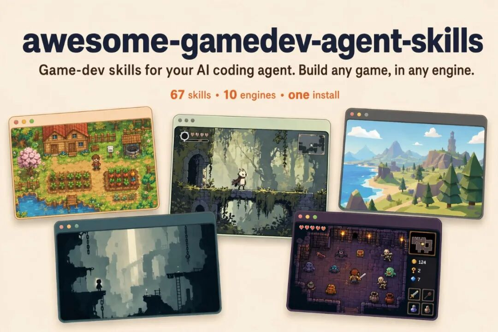
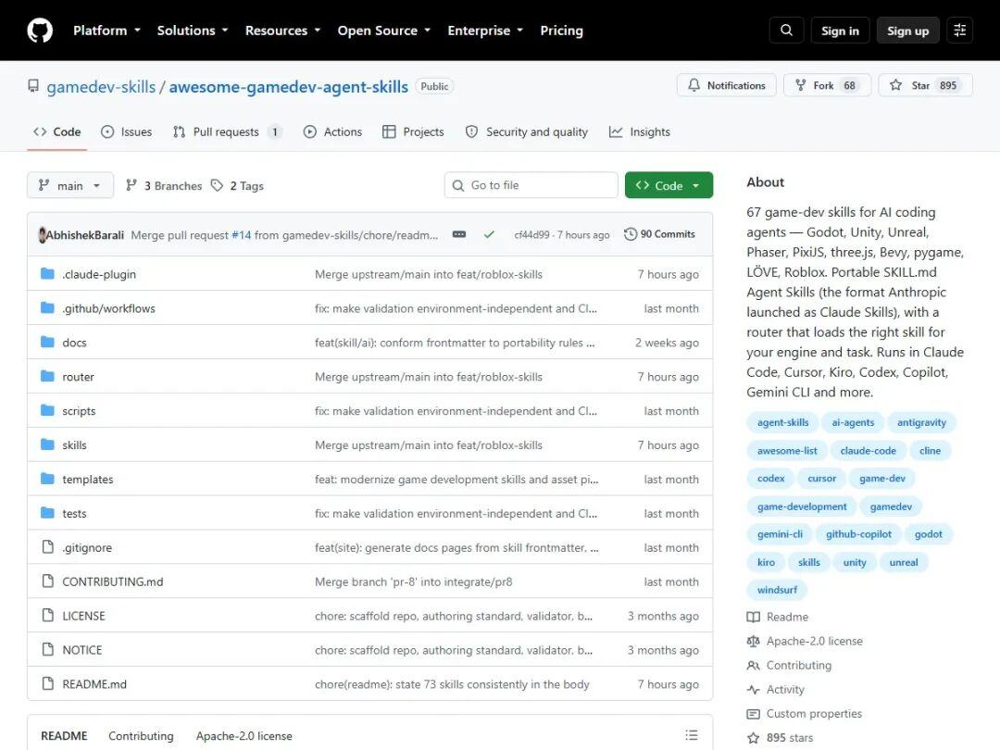
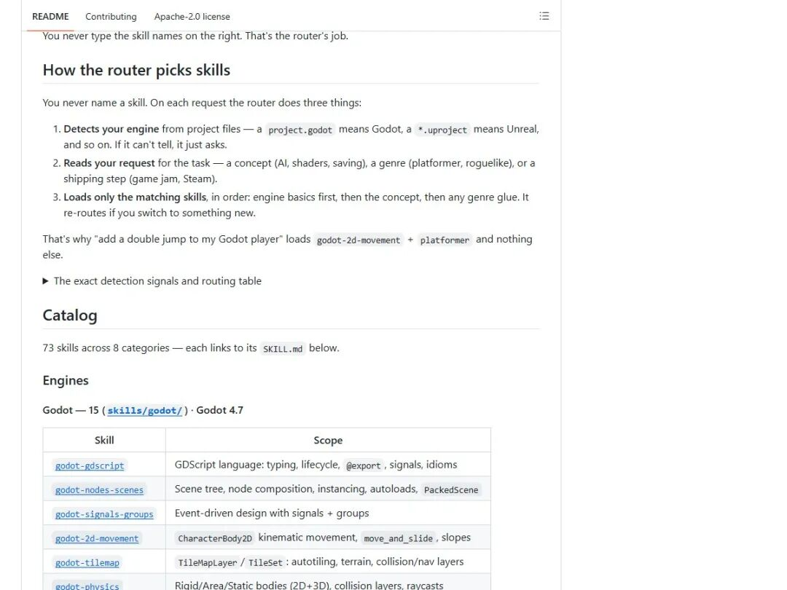
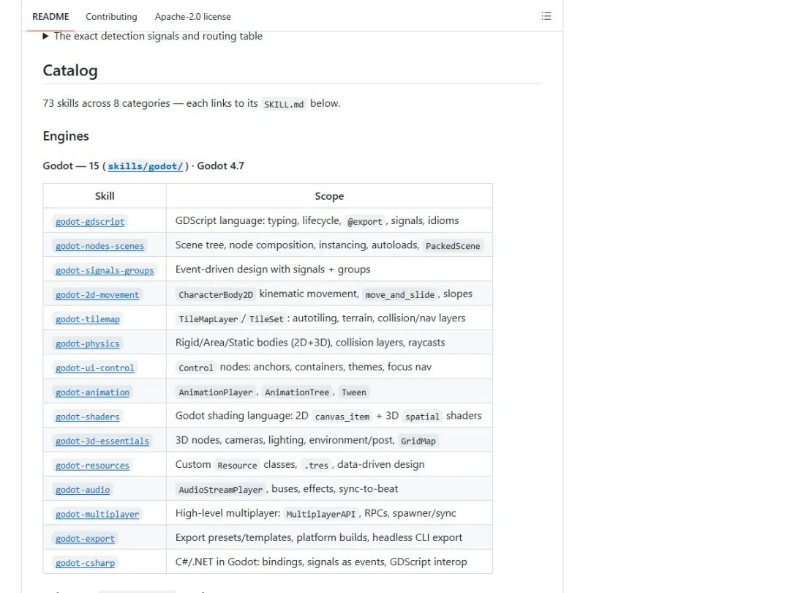
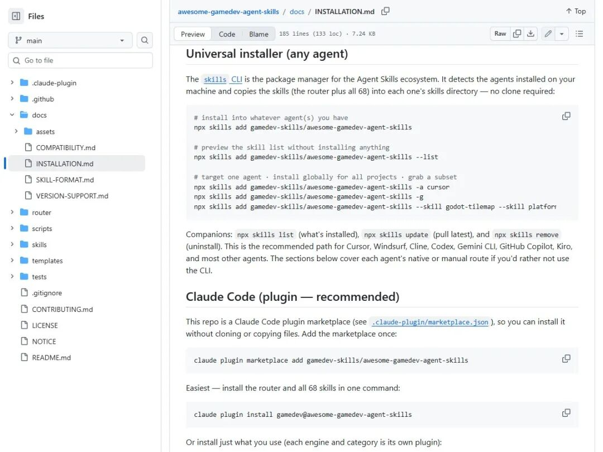
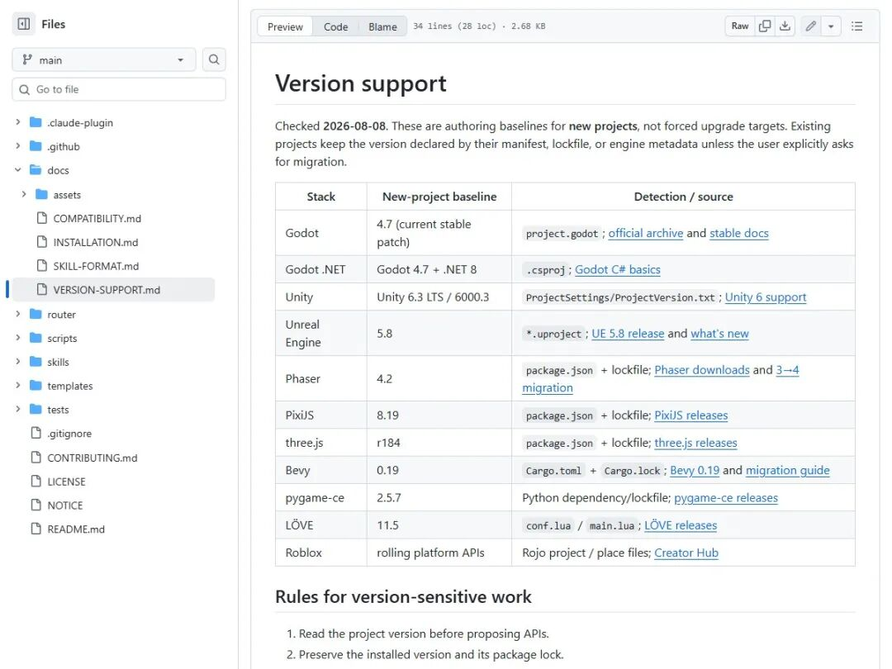

# 游戏开发 Agent 技能库：让 AI 按引擎分配任务

> 作者: 橘子的AI研习社 | 平台: 微信公众号 | 日期: 2026-09-09 08:02 | 原文: https://mp.weixin.qq.com/s/pciM9WrgKp0GbT0dxt8ZAQ

> **摘要**: gamedev-skills/awesome-gamedev-agent-skills 用 SKILL.md 和 router 把引擎、游戏 AI、资产、Shader、性能与发行流程组合起来；当前 main 已写到 73 个技能，但旧 Release 和文档仍有历史计数，接入前要固定版本并完成本机验证。

|  |  | GAME DEV · AGENT SKILLS |
| --- | --- | --- |

游戏开发的关键，不是让 AI 更会说

先读对引擎、岗位和任务，再把最小的一组游戏开发知识交给 Agent。



— 项目官方横幅：一次安装，按引擎和任务加载技能
来源：awesome-gamedev-agent-skills 官方仓库

ROUTER · ENGINE · DISCIPLINE · WORKFLOW

CORE VIEW

gamedev-skills/awesome-gamedev-agent-skills 不是新的模型，也不是运行时插件，而是一套给 AI coding agent 使用的游戏开发知识层：把引擎、开发学科、游戏类型和发布流程写成可按需加载的 SKILL.md，再用一个路由器决定当前任务需要哪几份。当前主分支 README 已写到 73 个技能；但旧 Release、安装文档和站点仍保留 67/68 的历史数字，使用时要以实际 ref 和提交为准。

01

CONTEXT · 上下文

它先解决的是游戏开发的上下文错配

通用 Agent 能写代码，不等于它知道一个游戏项目正在用哪套引擎、哪个版本、哪种资产组织方式。一个“做个双段跳”的请求，放在 Godot、Unity 和 Unreal 里，涉及的文件、生命周期、输入系统与验证方法并不一样；把泛化答案直接贴进项目，最容易得到能读懂、却接不上的代码。

这个仓库的核心交付物是带 frontmatter 的 SKILL.md 文件，以及一个独立的 router。技能按引擎、学科、类型和工作流分组，每份文件只讲一个边界清楚的能力；路由器先识别项目，再把任务拆成最小组合，减少 Agent 在无关知识里漫游。

官方 README 给出的检测信号很具体：看到 project.godot 就判断为 Godot，看到 *.uproject 就判断为 Unreal；如果无法判断，则要求补充信息。它改变的是“先加载什么”，不是替你完成编译、运行、验收或上线。



— 项目官方仓库页：router、skills、docs 与校验脚本并列存在
来源：GitHub 官方仓库页面

02

ROUTING · 路由

路由器不是模型，而是上下文编排层

官方描述的顺序是三步：检测引擎，读取任务，再按顺序加载匹配技能。引擎选择是排他的，先确定 Godot、Unity 或 Unreal；学科、游戏类型和发布流程则可以叠加。这样既避免一口气塞入全部知识，也不把跨领域任务切成孤立答案。

举一个官方示例：用户说“给我的 Godot 玩家加二段跳”，路由器组合 godot-2d-movement 与 platformer；如果请求变成 Unity RPG 背包，则会切到 unity-scriptableobjects、rpg 和 save-systems。用户说的是需求，不必先背下技能名。

这类输出本质上是“带边界的工作说明”：它能把输入、约束、版本和常见坑提前写给 Agent，但不能保证生成代码适配你的项目。真实团队仍要以差异审查、构建、自动化测试和编辑器内验收作为最后一关。



— 官方路由规则：引擎先行，学科、类型与工作流按需叠加
来源：项目官方 README

03

CATALOG · 覆盖面

覆盖面更像一张游戏生产地图

当前主分支的引擎类技能覆盖 Godot、Unity、Unreal、Phaser、PixiJS、three.js、Bevy、pygame、LÖVE 与 Roblox。对国内团队来说，价值不只在“能不能写一段代码”，而在同一套需求语言可以跨桌面、网页和不同引擎继续使用。

跨引擎学科目录更贴近制作现场：游戏 AI、行为树与 Utility AI、程序化生成、对话、存档、音频、Shader、物理调校、关卡、输入、游戏手感、UI/UX、相机和性能优化都被单独拆出。程序、技术美术、关卡和测试可以从各自的任务切入。

但 DCC 边界要说清楚：README 当前列出的是引擎与游戏生产技能，不是 Blender、Maya 或 Spine 的原生插件。它有资产生产与导入方向的通用工作流，却没有官方证据证明已经接管某个 DCC；把它当成知识路由层，比把它宣传成 DCC 集成更准确。



— 官方目录展示 Godot 的脚本、场景、动画、Shader、导出等技能
来源：项目官方 README

04

INSTALL · 安装

安装只需一条命令，但先看清它改什么

官方推荐的通用入口是 skills CLI：它会识别本机已有的 Agent，把 router 与技能文件复制到对应目录，不要求先克隆仓库。只想查看清单时可以先用 --list；想只服务 Codex，则可以用 -a codex 定向安装。

对 Codex、Gemini CLI、GitHub Copilot 和 Antigravity，官方文档给出的共享位置是 .agents/skills/；也可以按项目放置，或使用 CLI 的 agent 参数。安装的是 Markdown 能力文件与路由器，不会自动修改你的游戏源代码、场景、素材或构建产物。

教程命令按官方 README 与安装文档整理，未进行本机实测。生产团队建议先用 --list 看清将要进入 Agent 的内容，再固定仓库 ref 或提交，最后让一名熟悉引擎的人审查技能里的版本、脚本和权限边界。

| 使用边界这是按官方资料整理的接入路径，未安装、未克隆、未运行第三方仓库；命令是否适合你的 Agent 版本与组织权限，需要在隔离环境中自行确认。 |
| --- |



— 官方安装文档同时给出预览、定向 Agent 与全局安装参数
来源：项目官方 docs/INSTALLATION.md

OFFICIAL COMMANDS · 官方命令

先预览，再指定 Codex

```
npx skills add gamedev-skills/awesome-gamedev-agent-skills --list
npx skills add gamedev-skills/awesome-gamedev-agent-skills -a codex
```

按官方文档整理，未进行本机实测；本文没有安装、克隆或运行该仓库。

05

VERSION · 版本

版本锁定，是它最像生产工具的地方

游戏项目最怕“看起来正确”的旧 API。项目的版本支持表把新项目基线写出来：Godot 4.7、Unity 6.3 LTS/6000.3、Unreal 5.8、Phaser 4.2、PixiJS 8.19、three.js r184、Bevy 0.19，以及 pygame-ce、LÖVE 和 Roblox 的对应入口。

更重要的是，它没有把新基线写成强制升级建议。官方规则要求先读项目 manifest、lockfile 或引擎元数据，保留现有版本；如果做迁移，要阅读中间的官方迁移指南，不能把不同大版本的片段拼成一套“看上去能用”的答案。

对程序和技术美术，这个约束比“多一个示例”更值钱：它把 API 选择、资产导入、性能预算和验证步骤放在同一张版本地图上。不过这张表标注的检查日期是 2026 年 8 月 8 日，版本会继续漂移，落地前仍要回到项目当前版本和引擎官方文档。



— 官方版本支持表：基线、项目检测文件与一手文档来源
来源：项目官方 docs/VERSION-SUPPORT.md

06

WORKFLOW · 接入

它怎样进入真实团队的代码与资产流程

输入可以分成两层：项目文件提供引擎与版本信号，自然语言提供岗位和任务信号。输出则是被选中的技能说明、约束、示例和检查清单，供 Agent 生成代码或提出下一步；它不是把一个黑盒模型塞进游戏，也不会替团队决定是否接受改动。

程序可以把它接进“需求—改动—构建—测试”的循环，技术美术可以把资产方向、Shader、相机与性能规则放进同一次请求，策划和关卡可以从类型模板开始收敛玩法结构。资产技能还强调先锁视觉目标、做出家族化变体、确定性地规范输出，再把资源放回游戏里检查。

性能成本要分开看：技能文件不会在运行时增加 Draw Call 或 NPC 推理耗时；它真正消耗的是 Agent 的上下文、调用时间和团队审查时间。只加载匹配技能通常有利于控制上下文，但实际 token、模型费用和生成质量仍取决于所用 Agent、模型与项目规模，这是工程判断，不是仓库承诺。

07

LICENSE · 边界

许可证清楚，但安全与版本仍要自己把关

仓库根目录有 Apache-2.0 LICENSE 和 NOTICE，官方说明技能来自引擎、框架与平台的一手文档，并列出了商标与归属边界。许可证解决的是仓库内容的使用与再分发，不会自动替你解决项目代码、第三方素材、模型服务或引擎插件的授权问题。

GitHub Security 页面当前显示没有 SECURITY.md，也没有公开安全公告。它不是恶意项目证据，但意味着团队应把安装命令、脚本、技能里的外部链接和权限要求当成供应链材料审查；先用 --list，再固定来源，再在隔离环境验证，是更稳妥的顺序。

最后回到版本数字：当前 main 在 9 月 8 日的提交里把 README 主文统一到 73 个技能，但 v1.1.0 Release 仍是 67，安装文档和生成站点仍出现 68。今天可以按 main 阅读和准备，但正式团队接入要记录 commit、复核差异，并在升级时重新跑项目自己的构建与测试。

| 版本提示文章按 2026 年 9 月 9 日可见的官方 main、Release、docs、LICENSE、Security 与提交记录整理；没有安装、克隆或运行该仓库，不把官方示例写成实测结论。 |
| --- |

THE END · 直接结论

它不是“让 AI 自己做游戏”，而是先把知识放到正确的位置

对程序、技术美术、关卡和测试团队，这套仓库最值得借鉴的是路由与版本边界：同一句需求，先识别项目，再加载最小技能，再把改动放回真实构建和验收。它适合做团队 Agent 的知识底座；是否进入生产，则要看你固定的 commit、项目版本、素材授权和本机验证结果。

关注「橘子的AI研习社」

每天读懂一个 AI 关键变化。

和橘子一起追踪时代的每一个关键信号。
