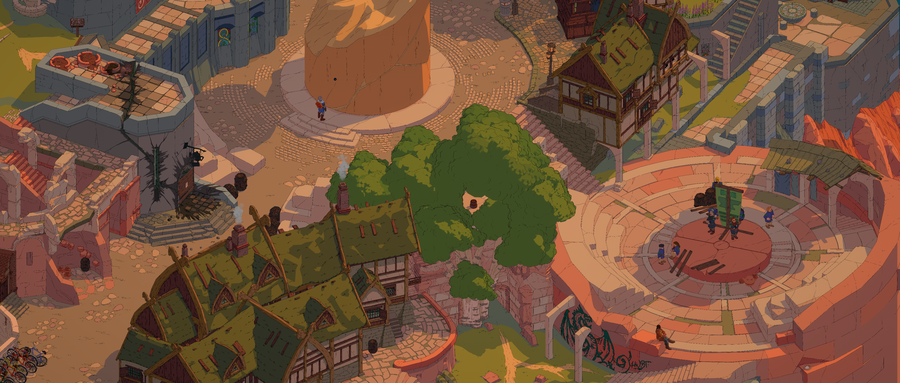
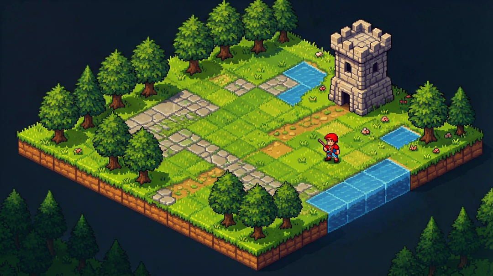
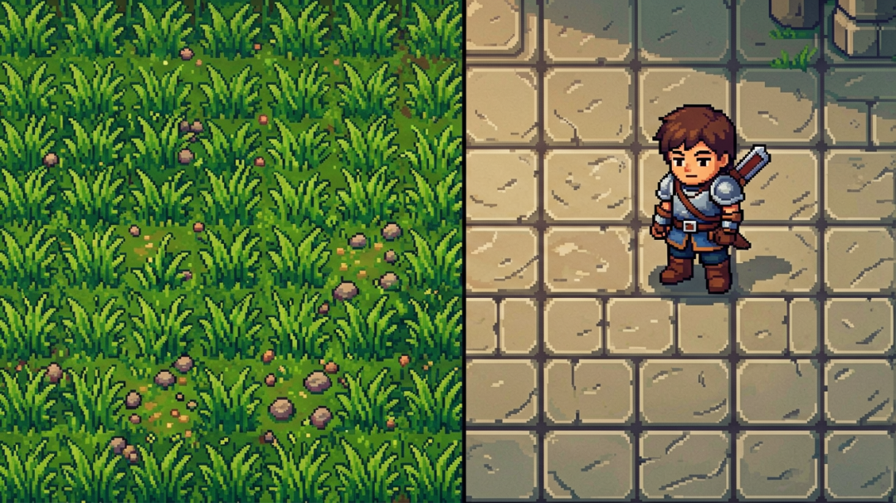
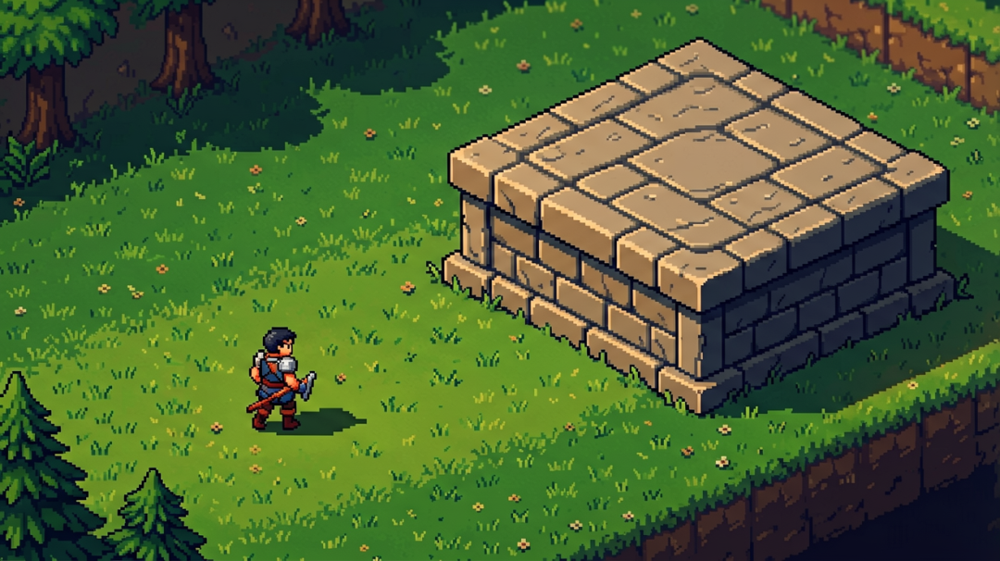
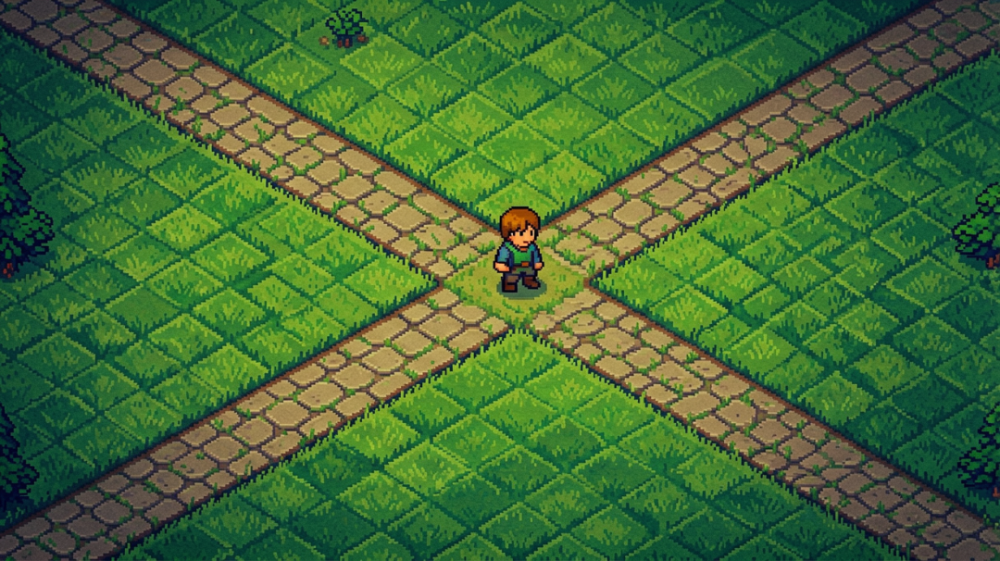
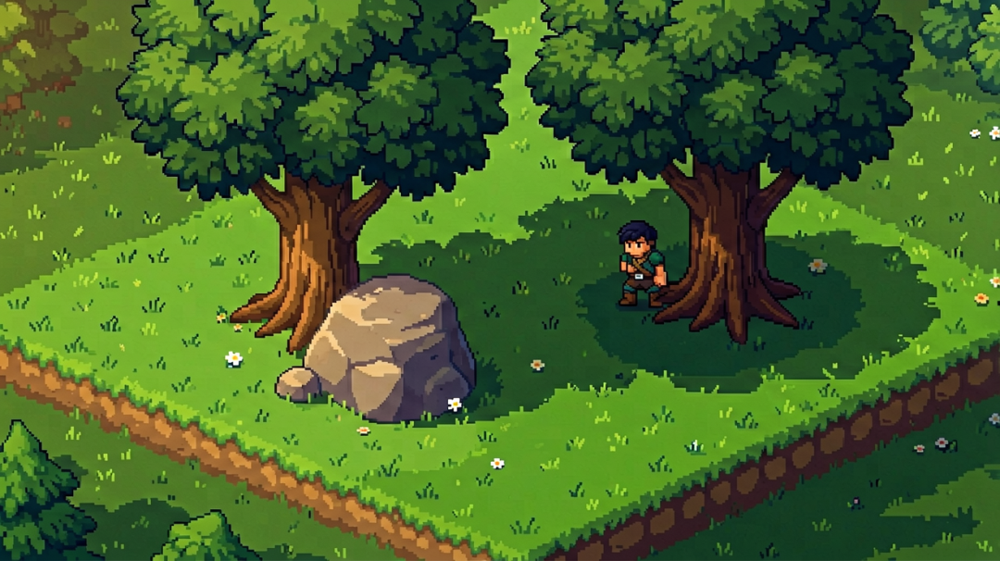
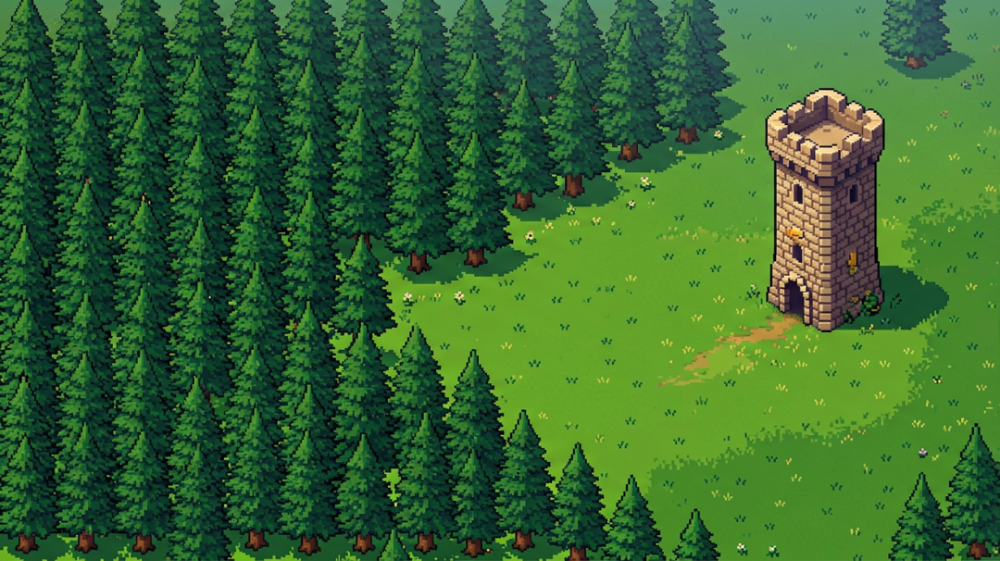

# 点不中英雄、在野区转晕？45°地图这6个设计死穴，坑过无数大厂

> 作者: DD熊 | 平台: 微信公众号 | 日期: 2026-08-08 12:20 | 原文: https://mp.weixin.qq.com/s/-sfg6Z5cOnz8zO7UUBp6nw

> **摘要**: 45°地图这6个设计死穴，坑过无数大厂

DD熊
原创出品 · 一切落地为核心

你有没有过这种体验：玩 DOTA2 明明点中了英雄，却没选中；走进野区转了两圈就不知道自己在哪；明明看着一条直路，走过去却是个死胡同。

问题不在你手残，在**地图的视角**。

45 度视角是游戏里最"骗人"的视角——玩家不是"走进"地图，而是"俯看"地图。这一个差异，让 45 度地图和横版、第一人称的设计逻辑**完全不是一回事**。今天这篇，把 45 度地图设计里最容易踩的 6 个坑一次讲透，每一个都有经典游戏当反面教材。

## 死穴一：tile 尺寸选错，画面又碎又盲

45 度地图的第一个决策，就是"一个格子（tile）该多大"。它本质是**产品决策**，由三件事共同决定：

- **游戏类型**：RTS / MOBA 要大局观，tile 偏小（DOTA2 用 128×64）；RPG 要精细场景，tile 偏大

- **角色比例**：角色高度应是 tile 高度的 2–3 倍，玩家才能从斜上方看清轮廓

- **屏幕分辨率**：tile 像素大小直接决定单屏能看到多少有效信息

如果 tile 太小，画面会显得"碎"；tile 太大，视野内区域太少，玩家会"盲"。

> 案例：DOTA2 选 128×64 的中等 tile，是为了在"看全局"和"看细节"之间平衡——tile 太小看不清英雄，太大则小地图覆盖不足。而《黑帝斯》（Hades）直接**抛弃 tile 制**，用自由布局换动作流畅度，因为快节奏战斗里"网格感"会限制手感。

## 死穴二：高度差"看不见"，玩家直接懵

45 度视角里**没有天然表现高低差的方式**——横版靠"上下跳"，第一人称靠"视角抬升"，而 45 度下，高度信息只靠两个脆弱线索传递：

1. **投影位置**：高处的物体阴影落在更低处

2. **物体底部位置**：高处物体的底部在屏幕上更"靠上"

这两个线索极脆弱，玩家一走神就忽略。GDC 有个经典教训：把箱子放高台时，**高台的切面必须换纹理**——如果高台切面用和地面一样的纹理，45 度视角会把它看成"地面上的花纹"，高度差瞬间消失。

正确做法三条：

- **投影必须一致**（通常固定右下 45°），不一致的投影是 45 度地图最致命的视觉错误

- **高台切面与地面要有明显纹理/颜色差**

- **高度差"门槛原则"**：要么完全能上、要么完全不能，别搞"能站不能走"的半高台

> DOTA2 把高差玩成了机制：走上高坡视野被抬高、能看穿战争迷雾，高坡打低坡还有 25% 攻击丢失。高度差从"美术问题"变成了"策略元素"。

## 死穴三：路径画成"直线"，屏幕上是锯齿

45 度地图的菱形网格有**两套坐标轴**：屏幕轴（横 X、纵 Y）和地图轴（约 40°和 -40°方向）。玩家"看的方向"和"走的方向"是两套坐标系。

这带来一个铁律：**别沿着屏幕轴画直线走廊**。沿屏幕横/纵走，玩家看到的不是一条路，而是锯齿状边界。路径应该沿**地图轴**（40°或 -40°）设计，屏幕上才看起来"直"。

> 案例：DOTA2 三条兵线是教科书——上路沿 -40°、下路沿 40°，天然形成"视线通道"，玩家不用看箭头就知道"这是去对面的路"。兵线上的小兵和塔，就是一串"路径标记物"。

## 死穴四：遮挡变"一片"，不是一条线

第一人称的遮挡是"前方一条线"（线性），45 度的遮挡是"一片区域"（面性）——建筑、大树、大石头会盖住一整块视野。

管理遮挡的核心是**给玩家"决定走进去"的理由**。副路径入口该有遮挡物（树丛、墙角），但尽头必须给回报：要么是怪/宝箱，要么是开阔风景。死胡同尽头如果啥都没有，玩家会觉得"被欺骗"——因为走到头已经花了一个决策，没回报就是损失。

> LOL 的草丛就是遮挡的变体：走进草丛的边际回报是"视野扩大"，但草丛里没人没资源时，多走那几步就没了回报。草丛+河道，构成了"可见/不可见"的二元悬念。

## 死穴五：密度没节奏，眼睛先累

45 度地图的视觉信息密度和大脑处理能力之间有个**临界点**：超过它，玩家眼睛累；低于它，地图显空。从"能用"到"好用"，关键就在找到这个临界点的**节奏交替**。

> DOTA2 的节奏是"兵线疏 + 野区密"交替；而那条横贯全图的蓝色河道，是高密度地图里突然出现的"视觉呼吸区"——眼睛终于能歇一下。这就是密度节奏的设计。

## 死穴六：网格感太重，假得明显

45 度地图大多基于菱形网格，但地图表现要"自然"。网格是人工的，画面要像长出来的。

最实用的检测方法：**把地图截图转灰度，去掉所有物体只看地面**。如果还能看到菱形重复图案，网格痕迹就太多了。

破局手法：用自然地形打断平行线的视觉重复——河道是一条斜跨全图的"破局线"，植被的不规则轮廓盖住 tile 的矩形边界，地形起伏打断网格的均匀排列。

> Hades 更彻底：直接非 tile 制，从根上消灭网格感，换来了动作自由度。代价是放弃了"地形层面的探索惊喜"，它用"混沌之门"和隐藏房间来补。

## 三个工具，治"迷路"

45 度迷路和其他视角不同：横版迷"左右"，第一人称迷"前方"，45 度迷的是——**"我到底站在哪？"** 三个工具能治：

1. **地标序列**：每个关键节点放独特造型（塔、城堡），玩家靠"先走到那座塔，再到那座城堡"导航，而不是靠坐标

2. **路径视觉引导**：一条"不知从哪来、到哪去"的路，是 45 度最常见的错误

3. **小地图旋转映射**：小地图方向要对齐"地图轴"，不是"屏幕轴"——DOTA2 和 LOL 都做了这层适配

> 最狠的是 Hades：**它干脆没有小地图**。用"发光门框=出口""固定房间序列""单色板区域"替代导航工具，证明好的 45 度地图能用"设计"替代"导航 UI"。

## 一个反直觉的真相

把 6 个死穴摊开看，会发现一件事：**45 度地图设计没有放之四海皆准的规矩**。

竞技 MOBA 要在公平和不对称美学间平衡，所以 DOTA2 / LOL 走"对称但有差异"；快节奏单人游戏要流畅操作，所以 Hades 放弃 tile 制和高度差；程序化生成游戏要躲重复感，所以《暗黑》用色板轮换+装饰随机+特殊房间。

**关键是把你游戏"最不能妥协的那条"排第一：** 要公平？选对称。要探索？加路径复杂度。要流畅战斗？压缩房间间过渡。每个选择都有代价——代价就是你放弃的那条路。知道放弃什么，比知道选什么更难。

下次你再点不中那个英雄、再在野区转晕，别骂自己手残。那是 45 度视角在跟你玩视错觉——而现在，你看懂了它的 6 个死穴。

你最喜欢哪款 45 度游戏？它在哪个死穴上做得最绝？评论区聊聊👇

🐻 关注DD熊，AI·游戏·美学，一起折腾点有意思的

本文由 **DD熊** 原创出品

👇 关注DD熊，AI·游戏·美学，一起折腾点有意思的
