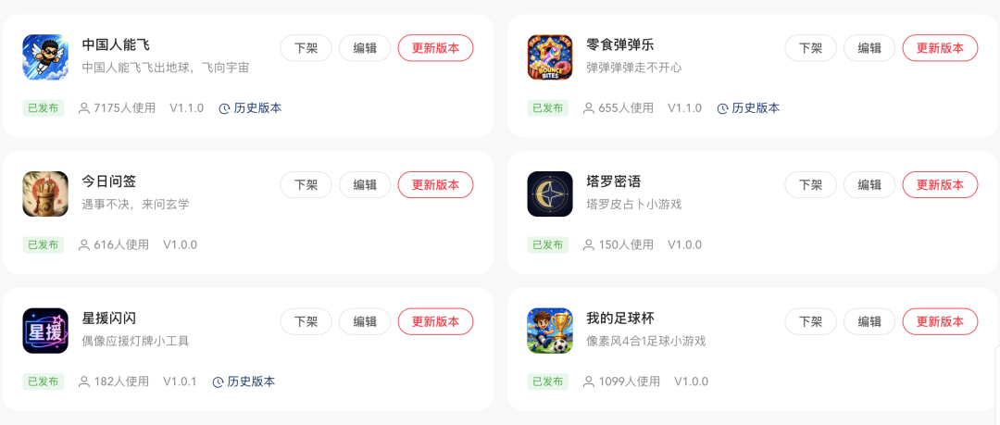

# 爆款《中国人能飞》Codex 可直接执行的完整项目 Prompt

> 作者: Niyao | 平台: 微信公众号 | 日期: 2026-08-29 23:47 | 原文: https://mp.weixin.qq.com/s/JJeXv3vVMT26LvcsjvTW9w

> **摘要**: 最近小某书全面上线了小工具能力，非千粉博主也可以上线自己的 Web 单应用部署到他们的服务上。

最近小某书全面上线了小工具能力，非千粉博主也可以上线自己的 Web 单应用部署到他们的服务上。关于这个活动的好处和参与方式我已经在之前的图文[我不允许还有开发不知道这个比赛！都去冲！](https://mp.weixin.qq.com/s?__biz=MzA4MDU1NjgzOA==&mid=2656259414&idx=1&sn=a5c7ebea06e8dfe804a5baf8320b042c&scene=21#wechat_redirect)中详细介绍了，本篇文章不再做更多赘述。本篇文章将以我实验性质的三个小游戏作为一个小系列，全开源我的小游戏 Prompt 和工作流，感兴趣的话速速关注我不迷路，不错过后续内容。



先看以上数据，小游戏《中国人能飞》是我在 8 月 26 日晚上传的小游戏，目前玩家人数已超 7000 人，而其他小游戏/小工具也只是周末上传不满一周，也都有比较不错的数据表现。

所以，这篇文章开始，我将选取上述表现比较好的《中国人能飞》、《零食弹弹乐》以及《今日问签》三款小游戏来做全 AI 开发流程介绍，并开源全部 prompt 所以感兴趣的话关注我不迷路，不错过后续内容。
我的小游戏流程
从一个梗 → 找玩法原型 → AI 生美术 → 生成游戏 Prompt 并使用 Codex 生成游戏项目 → 一遍遍调背景运动/美术切图 → 生成音乐 Prompt 并使用 Suno 生成游戏背景音乐 → 选好音乐定好美术打包上传提审 → 过审自动发布。

首先如果想要拿到平台推流，并且要做一个玩家喜欢的游戏，了解流行热梗是必须的。了解热梗的目的是了解年轻人到底喜欢什么，比如“中国人会飞”，就是揽佬最近发布的一首抽象的歌，不管他到底在唱啥，好玩就做。当然今年最火的莫过于“牛来”，但是“牛来”某书上做的挺多的，我也没什么很好的点子能超越，就放弃了。
有了好点子之后，就开始和 AI 沟通怎么设计玩法。由于我是应用程序出身，所以其实游戏的很多系统/专业名词并不懂，所以就让 AI 作为我的资深游戏策划，一起商定具体玩法。
《中国人能飞》小游戏 Prompt 全开源

>>>>>> 将以下内容直接全部复制给 Codex <<<<<<

## 《中国人能飞》Codex 可直接执行的完整项目 Prompt

你现在要直接产出一个可运行的纵向像素风 Web 小游戏，游戏名为《中国人能飞》。请不要只写方案，请直接生成完整项目代码、可运行资源、占位素材、配置文件、README 与启动方式，让我拿到后即可本地运行、继续迭代。

## 一、项目目标

制作一款2D 纵向无限上升跳跃/飞升类像素小游戏，核心体验是：

- 玩家控制一个带翅膀的小人，从中国城市地表一路向上飞
- 经历 地面 → 高楼 → 高空 → 云层 → 平流层 / 地球边缘 → 外太空
- 通过平台跳跃 / 自动上升 / 左右控制，持续向上突破高度
- 有 爱心生命值、障碍物、奖励道具、护盾、加速器
- 视觉重点是：背景不是静态图，而是连续超长、层级连贯、相对下移的滚动背景
- 玩家向上飞时，背景应相对向下运动，从而形成“玩家在持续上升”的视觉效果
- 玩家拾取 加速奖励 时，背景的下降速度必须同步明显加快，产生强烈冲刺感
- 最终目标是：飞到外太空

## 二、技术要求

请使用以下技术栈直接生成完整项目：

- Phaser 3
- TypeScript
- Vite
- 所有资源本地化，不依赖远程 CDN 素材
- 项目结构清晰，可维护，可继续扩展
- 输出为一个可直接运行的 Web 游戏

请生成：

1. 完整项目目录
2. 所有必要代码
3. 所有占位或生成型美术资源
4. 背景资源生成规则 / 资源说明
5. README（含安装、启动、构建说明）
6. 可运行 Demo

## 三、游戏定位

### 游戏类型

- 2D 像素风
- 纵向无限上升
- 平台跳跃 / 飞升躲避
- 轻街机
- 快节奏
- 一局可反复重开
- 适合手机竖屏和桌面浏览器竖屏预览

### 核心卖点

1. “中国人能飞”这个梗本身有记忆点
2. 从中国城市一路飞到外太空
3. 背景连续滚动特别重要，且层级衔接不能突兀
4. 加速器触发时，背景也要明显加速下移
5. 视觉要有像素街机爽感，而不是静态海报感

## 四、角色设定

请生成一个原创角色，但视觉方向参考我之前确认过的形象特征，不要做成之前那种过于可爱或鬼畜失控的风格，也不要照搬现成 IP。

### 角色视觉方向

- 像素风小人
- 男性 / 中性搞笑英雄感
- 黑色短发
- 黑色墨镜
- 黑色上衣，中间有红绿横条纹元素
- 白色裤子 / 短裤
- 背后有一对白色翅膀
- 表情可夸张，但整体要顺眼、耐看、易识别
- 需要有以下状态 / 动画帧：
- 待机
- 上升 / 飞行
- 下落
- 受伤
- 吃到加速器
- 护盾状态
- Game Over

### 角色风格要求

- 纯 2D pixel art
- 清晰像素边缘
- 适合游戏内小尺寸显示
- 需要有辨识度
- 不要做成海报插画风人物
- 必须适合实机游戏使用

## 五、核心玩法

### 核心循环

- 小人会持续向上进行平台跳跃 / 飞升
- 玩家通过 左右移动 控制落点
- 角色离开平台后会继续向上 / 下落运动
- 摄像机会持续跟随角色向上
- 背景则持续相对下移
- 玩家需要：
- 踩中平台
- 躲避障碍
- 收集道具
- 保持生命
- 不断刷新高度
- 最终飞向外太空

### 失败条件

- 爱心全部耗尽：失败
- 角色掉出屏幕底部：失败

### 成功 / 阶段目标

- 不设传统“通关结束”
- 但设计明确的阶段推进感
- 首次飞到外太空时，给予强反馈与成就感
- 外太空之后仍可继续刷高度纪录

## 六、操作方式

### 移动端

- 左半屏按住：向左移动
- 右半屏按住：向右移动

### PC 端

- A / ←：向左移动
- D / →：向右移动

### 操作原则

- 简单直接
- 不要复杂按键
- 不需要攻击键
- 重点是“移动找落点 + 收集道具 + 躲障碍”

## 七、生命系统

### 爱心生命

- 生命值使用 爱心 显示
- 最大 5 颗
- UI 样式类似：
- 满血：❤️❤️❤️❤️❤️
- 掉血后：❤️❤️❤️🤍🤍

### 规则

- 开局建议：4 颗心
- 最大上限：5 颗心
- 玩家可拾取爱心奖励恢复生命
- 若当前已满 5 颗，再拾取爱心：
- 不增加生命
- 可转化为少量加分或提示 “生命已满”

### 扣血规则

- 普通障碍：掉 1 颗心
- 强力障碍：掉 2 颗心
- 受击后需有短暂无敌时间（如 0.8 秒），避免连续瞬间掉光

## 八、道具系统

至少实现以下核心道具：

### 1）爱心

- 图标：像素爱心
- 效果：+1 颗心
- 上限：最多 5 颗

### 2）护盾

- 图标：像素蓝色护盾
- 效果：
- 持续 5 秒
- 持续期间碰到障碍不掉血

必须有明显视觉反馈：

- 角色周围出现护盾光圈
- UI 有护盾剩余时间

护盾只防障碍伤害，不防掉出屏幕死亡

### 3）加速器

- 图标：像素小火箭 / 推进器
- 效果：
- 持续 3 秒
- 角色高速向上冲刺
- 背景必须同步明显加速下移
- 摄像机与速度反馈要很强

要有强烈爽感：

- 拖尾
- 速度线
- 角色状态变化
- 背景滚动加速

加速器是非常重要的核心爽点

### 可选扩展道具（如果不影响主流程，可以顺带实现）

- 磁铁：自动吸取附近奖励
- 弹簧鞋：下一次跳跃更高

## 九、障碍系统

请实现多种障碍，且分布在不同高度层级中。

### 地面 / 高楼阶段障碍

- 炸弹
- 乌鸦 / 飞鸟
- 吊塔重物
- 带刺球
- 无人机

### 高空 / 云层阶段障碍

- 鸟群
- 雷云
- 飞机
- 高空气球障碍物

### 平流层 / 外太空阶段障碍

- 卫星碎片
- 太空垃圾
- 陨石
- 轨道装置

### 障碍要求

- 要有明确碰撞判定
- 撞击后要有受伤反馈
- 不同障碍可有不同危险程度
- 带刺 / 爆炸类可视为高伤害类型

## 十、平台系统

请至少实现多种平台，让玩法不单调。

### 平台类型

1. 普通平台
2. 移动平台
3. 易碎平台（可选）
4. 加速平台（踩中后略微额外上冲，可选）
5. 特殊主题平台（不同阶段换视觉）

### 平台要求

- 明确像素风
- 可读性高
- 落点清楚
- 与背景区分明显
- 不要和背景混在一起难辨认

## 十一、阶段与背景体系（最重要部分）

这是本项目的重中之重。

### 绝对关键要求

你必须实现一个连续的纵向背景系统，而不是单张静态图。

玩家向上飞时：

- 背景要相对下移
- 形成“玩家持续上升”的视觉错觉
- 不同高度要看到不同景观层级
- 每个层级之间必须过渡自然、可拼接、不卡断、不突兀

### 必须实现的 6 个层级

1. 地面城区
2. 高楼天际线
3. 高空
4. 云层
5. 平流层 / 地球边缘
6. 外太空

## 十二、背景设计硬性要求

### 1）每个层级都必须是“超长可滚动背景”

不是普通竖图，也不是宣传海报，而是游戏背景资产。

### 2）每个层级都要有“纵向延展感”

要让玩家感觉这个阶段非常长，不是一眼就过去。

### 3）每个层级之间必须连贯衔接

例如：

- 地面城区顶部 → 自然过渡到高楼区底部
- 高楼区顶部 → 自然过渡到高空区底部
- 高空区顶部 → 自然过渡到云层区底部
- 云层顶部 → 自然过渡到平流层底部
- 平流层顶部 → 自然过渡到外太空底部

不能突然换一张完全不同的背景导致割裂。

### 4）每个层级边缘必须可拼接

请把每个阶段设计成：

- 本阶段内部可连续滚动
- 本阶段底部与上一个阶段顶部可衔接
- 本阶段顶部与下一个阶段底部可衔接

### 5）要有“相对运动感”

背景不是一层死图，而要支持多层滚动：

- 远景层
- 中景层
- 近景层
- 特效层

例如：

- 地面城区：远景楼群、中景高楼、近景招牌 / 天台 / 水塔
- 云层：远景云海、中景云团、近景漂浮云与热气球
- 太空：远景星空、中景星云 / 地球边缘、近景卫星 / 小碎片

### 6）背景滚动速度要可控

- 普通上升时：稳定速度下移
- 玩家速度变快时：背景下移速度变快
- 拾取加速器时：背景明显加速下移
- 不同层级可有不同视差速度

## 十三、各阶段背景详细要求

### 阶段 1：地面城区

视觉关键词：

- 中国城市地表
- 街边店铺
- 居民楼
- 屋顶
- 水塔
- 空调外机
- 电线
- 店招
- 广告牌
- 吊塔
- 城市烟火气

要求：

- 层级非常丰富
- 有明显向上仰视的纵深感
- 不是单一街景
- 能表现“从地面起飞”

### 阶段 2：高楼天际线

视觉关键词：

- 更高的楼
- 密集摩天楼
- 天际线
- 城市塔楼
- 高空塔吊
- 直升机 / 远飞机
- 建筑顶部结构

要求：

- 比地面城区更空旷一点
- 逐步让天空面积变大
- 顶部要自然过渡到高空

### 阶段 3：高空

视觉关键词：

- 蓝天
- 稀薄云层
- 远飞机
- 高空气球
- 鸟群
- 远处云海
- 更大的天域空间

要求：

- 中间留出较清晰的玩法通道
- 两侧可以有更多环境变化
- 视觉上感到已经脱离城市

### 阶段 4：云层

视觉关键词：

- 巨型云海
- 云谷
- 层层云墙
- 热气球
- 飞机航迹
- 阳光穿透云层

要求：

- 是非常壮观、极长的云中穿行段落
- 有明显“穿越云海”的感觉
- 上下衔接必须自然

### 阶段 5：平流层 / 地球边缘

视觉关键词：

- 天空由蓝转深蓝
- 地球弧线若隐若现
- 稀薄云带
- 极光感光带
- 高空气球
- 卫星
- 近太空过渡感

要求：

- 必须是从“大气层”过渡到“近太空”的关键桥梁
- 不能突然直接黑成宇宙
- 要有强烈高度提升感

### 阶段 6：外太空

视觉关键词：

- 深色星空
- 星云
- 星星
- 卫星
- 太空碎片
- 远行星
- 轨道设施
- 地球边缘 / 地球发光弧

要求：

- 要有到达终极高度的震撼感
- 但仍然适合游戏背景使用
- 不是纯装饰海报
- 保持中间玩法通道相对干净

## 十四、背景衔接实现要求（非常重要）

请在代码和资源设计上显式实现以下逻辑：

### 背景不是一张图，而是一个“高度驱动的连续背景系统”

建议实现方式之一：

- 将背景拆分为多个阶段段落
- 每个段落使用可循环滚动的超长背景
- 在高度接近阶段边界时，开始做渐进式过渡
- 通过以下手段实现平滑衔接：
- 透明度混合
- 双背景叠加过渡
- 颜色 / 雾效过渡
- 远景先切换、近景后切换
- 环境元素逐步增加或减少

### 具体要求

- 低矮建筑逐步减少
- 高楼逐步变密
- 天空面积逐步变大
- 建筑逐步远离
- 城市轮廓变成远景
- 空中交通元素增加
- 薄云逐步变厚
- 云量逐步增加
- 地面痕迹淡出
- 云层逐步下沉为下方云海
- 天空颜色逐渐变深
- 开始出现地球边缘感
- 天空蓝色转为深蓝 / 黑蓝
- 星点逐步增加
- 卫星 / 轨道元素逐步增加
- 大气发光边缘过渡到太空感

### 拼接要求

每个层级底部与相邻层级顶部必须视觉上接得上，不能跳变。要让玩家在持续飞升时，感觉背景是在自然地向下滑过，而不是突然换皮。

## 十五、背景运动要求（必须实现）

### 普通状态

- 玩家持续上升
- 摄像机跟随玩家
- 背景以设定速度向下滚动
- 各视差层速度不同

### 高度提升时

- 背景滚动不应卡顿
- 越到高处，背景元素可适度稀疏变化，但仍保持连续运动感

### 玩家拾取加速器时

这是硬性要求，必须做到：

- 角色进入高速上冲状态
- 背景整体明显加速向下滚动
- 远景、中景、近景全部加速，但速度比例不同
- 要让玩家有“真的冲上去了”的强烈视觉反馈
- 可叠加：
- 拖尾
- 速度线
- 轻微镜头拉伸 / 震动
- 背景模糊感（可选，轻量即可）

### 加速结束时

- 背景速度要平滑恢复正常
- 不要生硬切回

## 十六、UI 设计要求

游戏主界面只保留核心 HUD，不要做复杂边栏说明 UI。

### 主 HUD

- 生命
- 用爱心显示
- 例如：❤️❤️❤️🤍🤍
- 当前高度
- 历史最高高度

示例：

- 当前高度：12876m
- 最高：25634m
- 护盾激活时显示剩余时间
- 加速器激活时显示剩余时间 / 特殊状态提示

### 屏幕中元素

- 角色
- 平台
- 道具
- 障碍
- 背景

### 文字风格

- 像素字体
- 中文
- 可读性强
- 不要做过度花哨 UI

## 十七、音效与反馈

请加入基础音效与反馈系统：

### 音效

- 跳跃
- 落地
- 受伤
- 吃爱心
- 护盾获得
- 加速器获得
- 加速冲刺
- Game Over
- 飞到关键高度提示

### 视觉反馈

- 受伤闪烁
- 护盾光圈
- 加速尾焰 / 拖尾
- 高度突破提示
- 到达新阶段提示
- 首次到达外太空时的强反馈提示

## 十八、阶段提示文案

建议在进入新层级时做简短像素提示：

- 进入高楼区
- 冲入高空
- 穿越云层
- 接近平流层
- 飞出大气层
- 到达外太空

外太空首次进入时可提示：

- 中国人真的飞到外太空了！

## 十九、结算界面

Game Over 后显示：

- 本次高度
- 最高纪录
- 飞到的阶段
- 剩余时间 / 道具使用统计（可选）
- 再来一次按钮

示例信息：

- 本次高度：xxxxx m
- 最高纪录：xxxxx m
- 已到达：云层 / 平流层 / 外太空

## 二十、项目结构建议

请生成清晰的目录结构，例如：

```
project/  public/  src/    assets/      sprites/      backgrounds/      ui/      audio/    scenes/    systems/    objects/    data/    utils/    main.ts  package.json  tsconfig.json  vite.config.ts  README.md
```

## 二十一、代码要求

- 代码清晰
- 可读性高
- 合理拆分模块
- 背景系统单独封装
- 道具系统单独封装
- 阶段 / 高度管理单独封装
- 碰撞逻辑清晰
- 可后续继续扩展

## 二十二、必须完成的核心模块

请确保至少完成这些模块：

1. 游戏主场景
2. 玩家控制与状态机
3. 平台生成 / 管理
4. 障碍生成 / 管理
5. 道具生成 / 管理
6. 爱心生命系统
7. 背景滚动系统
8. 阶段切换系统
9. 加速器联动背景加速系统
10. UI HUD
11. Game Over 与重开
12. README

## 二十三、验收标准

你产出的项目必须达到以下验收标准：

### 玩法层面

- 游戏能启动
- 能控制角色左右移动
- 能持续向上飞 / 跳
- 有平台、障碍、道具
- 有掉血、回血、护盾、加速器
- 有 Game Over

### 视觉层面

- 角色是可用的像素风角色
- 背景是纵向连续滚动的，不是静态一页
- 六个高度层级都有明确区分
- 各层级之间有连续过渡，不突兀
- 玩家上升时背景能相对下移
- 加速器触发时背景明显加速下移

### 技术层面

- 代码可以运行
- 项目可以构建
- 结构清晰
- 可继续二次开发

## 二十四、执行方式

请你不要停留在方案描述层。请直接开始生成：

1. 完整项目代码
2. 所需资源与占位图
3. 背景系统实现
4. README
5. 可运行版本

如果某些最终美术资源暂时无法一步到位，请优先生成：

- 可运行版本
- 统一风格占位像素资源
- 明确的资源替换位置

重点是：先让我拿到一个真的能跑、并且背景滚动逻辑正确、层级衔接正确、加速器能联动背景加速的版本。

## 二十五、最后的硬性提醒

这是最重要的约束，请务必遵守：

- 不要把背景当成静态海报图
- 必须实现超长纵向连续背景
- 必须实现阶段之间连贯衔接
- 必须实现背景相对下移来表现玩家上升
- 必须实现加速器触发时背景同步明显加速下降
- 必须让地面 → 高楼 → 高空 → 云层 → 平流层 / 地球边缘 → 外太空这条视觉链路自然成立
- 要让玩家在飞升时，视觉上真的感觉自己一路冲到了外太空

现在请开始直接生成这个项目。

>>>>>> 将以上内容直接全部复制给 Codex <<<<<<

小游戏的背景音乐 Prompt
>>>>>> 将以下内容直接全部复制给 Suno <<<<<<

## Suno Prompt

Instrumental only, no vocals, no lyrics.

Create an energetic retro pixel-art arcade game soundtrack for a humorous vertical jumping game called“中国人能飞 / Chinese People Can Fly”.

Style:

- 1990s arcade game music
- classic 8-bit / 16-bit chiptune
- retro Famicom / Super Nintendo inspired sound
- playful, funny, slightly absurd, but still heroic and exciting
- fast-paced vertical climbing feeling
- catchy looping melody
- strong sense of upward momentum
- light Chinese musical flavor subtly blended into retro game sounds
- occasional pentatonic melodic phrases
- crisp square-wave lead
- bouncy synth bass
- energetic electronic drums
- short arpeggios
- bright pixel-game sound palette

Mood:

- energetic
- optimistic
- funny
- adventurous
- addictive
- slightly chaotic
- “keep climbing higher”
- arcade challenge
- never too cute
- never cinematic or overly epic

Tempo:145–160 BPM

Structure:

- immediately catchy intro
- quickly enter the main gameplay groove
- repeating melodic hook suitable for continuous gameplay
- gradually add more energetic layers without becoming overwhelming
- include short rising arpeggios that feel like flying upward
- occasional tension moments to suggest obstacles
- strong rhythmic momentum
- seamless loop-friendly ending that can naturally return to the beginning

Game feeling:The player is a pixel character continuously jumping and flying upward from a Chinese city, passing buildings, clouds, the upper atmosphere, and eventually outer space.

The music should communicate:

“keep jumping, keep flying, higher and higher!”

It should feel fun when repeatedly played for several minutes.

Avoid:

- vocals
- lyrics
- orchestral soundtrack
- emotional piano
- cinematic trailer music
- anime opening
- overly cute kawaii music
- lo-fi chill
- dark horror
- heavy metal
- realistic acoustic instruments dominating the mix

Target feeling:

Retro arcade × vertical climbing × funny heroic energy × pixel game × unstoppable upward momentum.

>>>>>> 将以上内容直接全部复制给 Codex <<<<<<

好啦，开始享受游戏的快乐吧 🍻

推荐阅读

[我的十年（工作纯享版）](https://mp.weixin.qq.com/s?__biz=MzA4MDU1NjgzOA==&mid=2656257476&idx=1&sn=00f6f861aafb7188b9bd25e534ece32d&scene=21#wechat_redirect)

[写在 35 周岁之后——大龄程序员该如何应对裁员潮](https://mp.weixin.qq.com/s?__biz=MzA4MDU1NjgzOA==&mid=2656257795&idx=1&sn=08938cd85aff1a0984c03654af894a75&scene=21#wechat_redirect)

[失业笔记：叮！裁员礼包终于到账！](https://mp.weixin.qq.com/s?__biz=MzA4MDU1NjgzOA==&mid=2656257867&idx=1&sn=ed02ee421cf92d5cb69527d0bf908289&scene=21#wechat_redirect)

[Seedance2.0 创作AI 漫剧初体验：带我打开新世界的大门！](https://mp.weixin.qq.com/s?__biz=MzA4MDU1NjgzOA==&mid=2656258113&idx=1&sn=327cfbe3ef42536db53956005d085c2c&scene=21#wechat_redirect)

[Seedance2.0 制作漫剧逐渐上头，来看看我最新中秋独酌这一幕](https://mp.weixin.qq.com/s?__biz=MzA4MDU1NjgzOA==&mid=2656258125&idx=1&sn=7514154cfe4782afc2a69486b471ffe2&scene=21#wechat_redirect)

[Seedance2.0 进阶篇：玩转即梦无限画布，今天开始做导演！](https://mp.weixin.qq.com/s?__biz=MzA4MDU1NjgzOA==&mid=2656258225&idx=1&sn=3121950e261f939625eabf1efdc219e0&payreadticket=HMM4LMNMmr4jFSAw95Gvlq81fbdmRYsOaFE21w3ZCbRotBGBtiHZH1p6DUyCU9_eibjGVS8&scene=21#wechat_redirect)

[从一个想法到一款微信小游戏（上）：我如何用 GPT + GPT Image 2 + VSCode Copilot 独立开发《我的足球杯》](https://mp.weixin.qq.com/s?__biz=MzA4MDU1NjgzOA==&mid=2656259277&idx=1&sn=0bde3606f3d8e3cb698b2a4fca2b4ed2&scene=21#wechat_redirect)
