# 用codex做了个西游记鲤鱼精游戏

> 作者: 无量辰 | 日期: 编辑于 6天前 上海 | 原文: https://www.xiaohongshu.com/explore/6ab0d3050000000035013880?xsec_token=CBVHUfAj22P1wJ-AJ0oOXnc6YpBqR7IXQO5-G6UFydEH0=&xsec_source=pc_feed

> **摘要**:用codex做了个西游记鲤鱼精游戏

用codex做了个西游记鲤鱼精游戏
花了两周时间，用codex做了款西游记-灵感大王鲤鱼精那章节的游戏demo，后续有时间还想换种战斗模式做做大站红孩儿，大闹天宫之类[大笑R]@果味GW（AIGC） @爱狗todo #爱狗Aygol #爱狗todo #游戏 #小游戏安利 #游戏设计 #游戏开发 #codex #IP设计 #主kv设计
编辑于 6天前 上海

## 视频

[视频 1](./video.mp4)

<video controls width="100%"><source src="./video.mp4" type="video/mp4">您的浏览器不支持视频播放。</video>

附件: [音频](./audio/audio.wav) | [处理清单](./video_manifest.json)

## 视频图文总结

> 按关键帧关联完整视频转录；文字保留机器转写原文，时间点仅用于定位。

### 1. 00:00

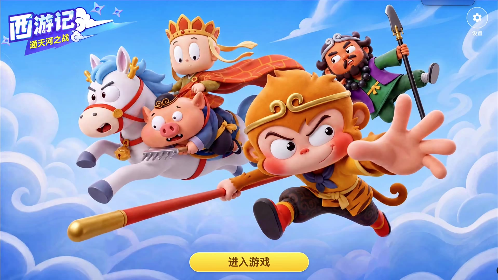

- 内容摘要：这是我用codex花了两周时间做出来的西游记主机的游戏，我们一起来看一下吧（00:00-00:06）
- 画面文字（OCR）：进入游戏
R
8
正

### 2. 00:06

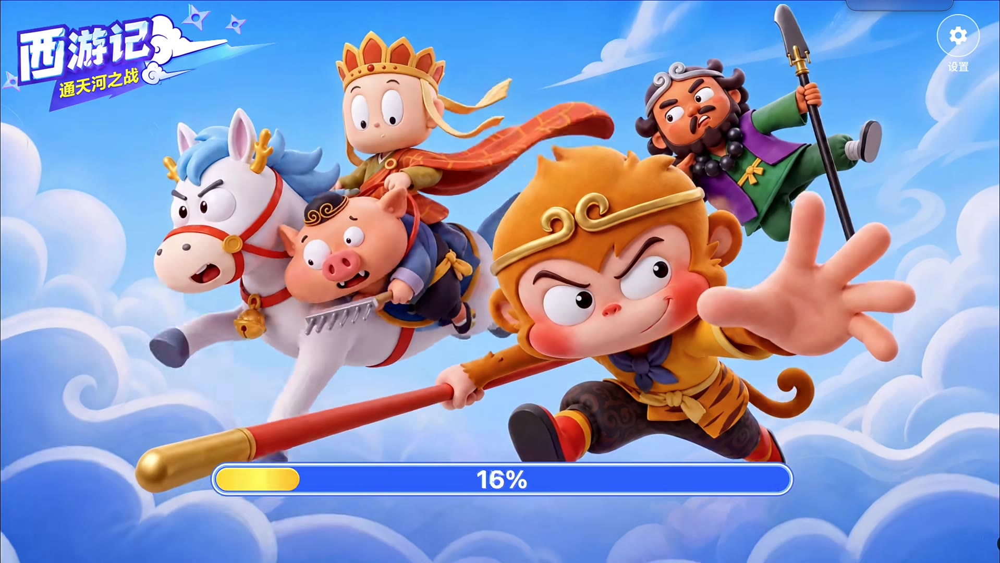

- 画面文字（OCR）：通天河之战
TIN
16%

### 3. 00:08

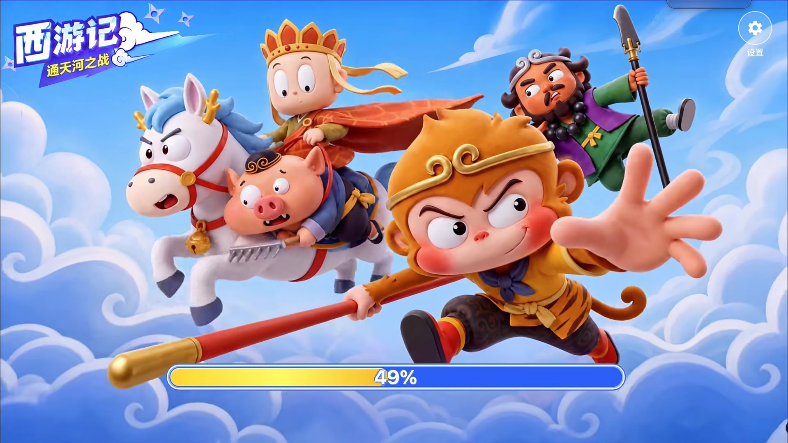

- 内容摘要：然后点击游戏会有一个加载动画（00:07-00:10）
- 画面文字（OCR）：49%

### 4. 00:10

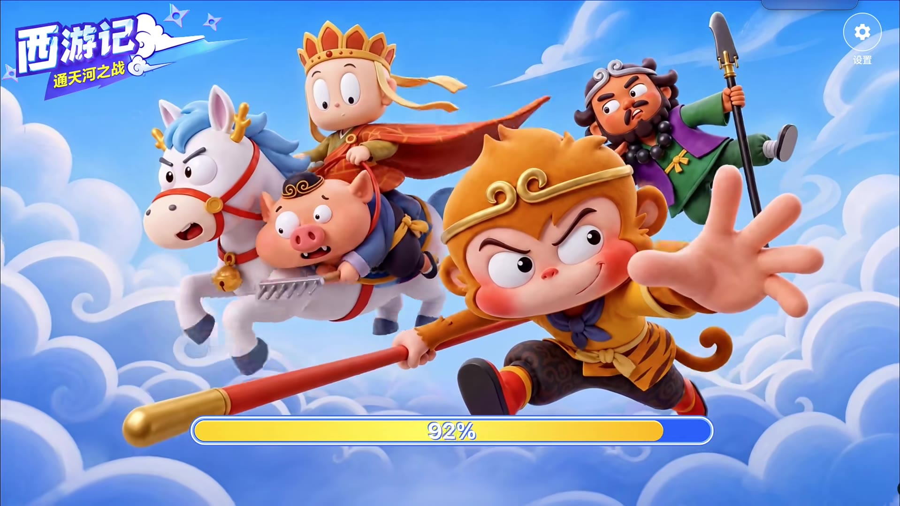

- 画面文字（OCR）：通大河之战
92%

### 5. 00:11

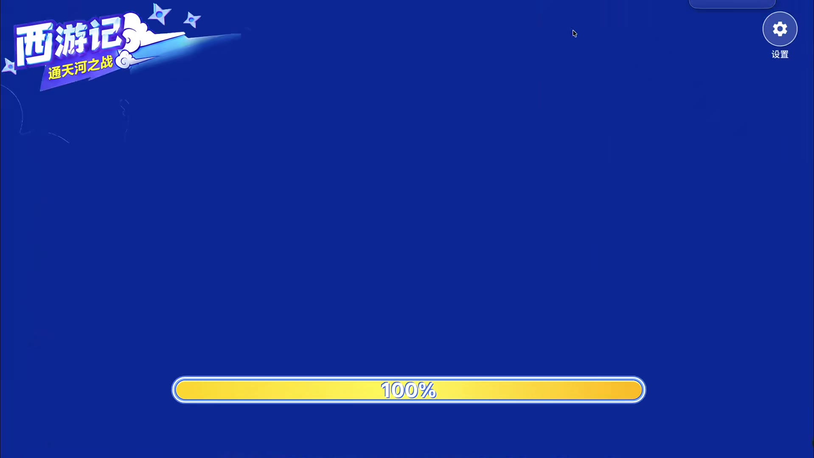

- 画面文字（OCR）：100%
通天河之战

### 6. 00:16

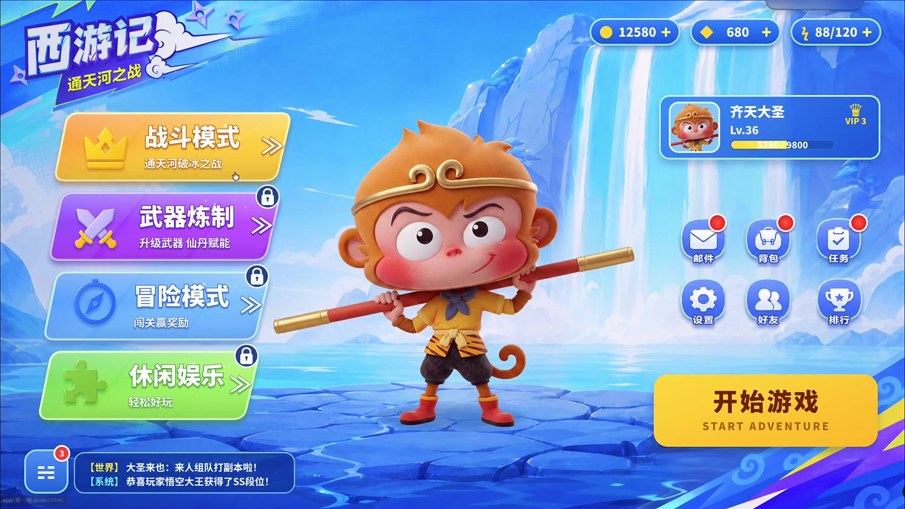

- 内容摘要：然后呢，来到了游戏的大厅页面（00:13-00:14）
- 内容摘要：现在是有一个战斗模式可以试玩，其他的还没有解锁，然后我们点击开始游戏（00:14-00:19）
- 画面文字（OCR）：12580
680
之
88/120
+
天河之战
齐天大圣
战斗模式
VIP3
Lv.36
5280/9800
通天河破冰之战
C
武器炼制
升级武器仙丹赋能
邮件
背包
任务
冒险模式
闯关赢奖励
设置
好友
排行
休闲娱乐
轻松好玩
开始游戏
3
START ADVENTURE
【世界】
大圣来也：来人组队打副本啦！
【系统】
恭喜玩家悟空大王获得了SS段位！

### 7. 00:20

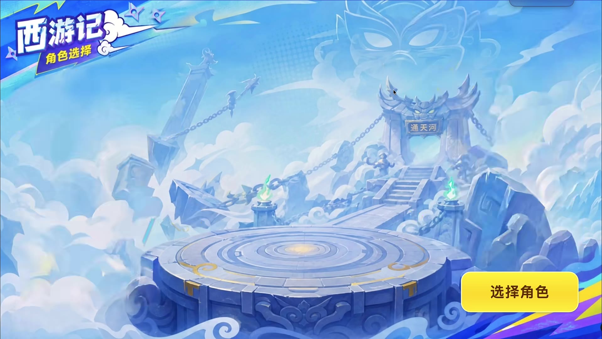

- 画面文字（OCR）：选择
福
通天河
选择角色

### 8. 00:24

- 内容摘要：然后呢，这里是做了四个可以选择的角色，第一个呢是孙悟空（00:20-00:26）
- 画面文字（OCR）：357
45
20
角色选择
LV
L
孙悟空
Lv.1b
0/100
孙悟空
攻击
120
+15
通天河
防御
100
+10
Lv.2
生命
1000
+80
猪八戒
速度
110
+8
Lv.3
如意金箍棒
Lv.1
沙悟净
C
挥舞金箍棒，对敌人造成
150%攻击力的伤害。
Lv.4
唐三藏
选择角色

### 9. 00:26

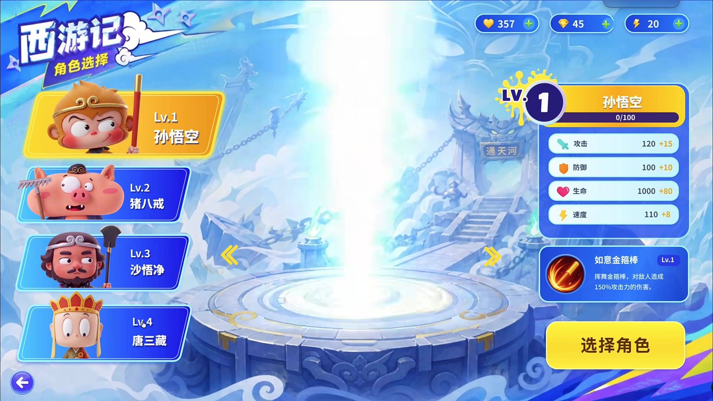

- 画面文字（OCR）：357
45
20
角色选择
LV
1
孙悟空
Lv.1
0/100
孙悟空
攻击
120
+15
通天河
防御
100
+10
Lv.2
生命
1000
+80
猪八戒
速度
110
8+
Lv.3
如意金箍棒
Lv.1
沙悟净
挥舞金箍棒，对敌人造成
150%攻击力的伤害。
Lv4
唐三藏
选择角色

### 10. 00:27

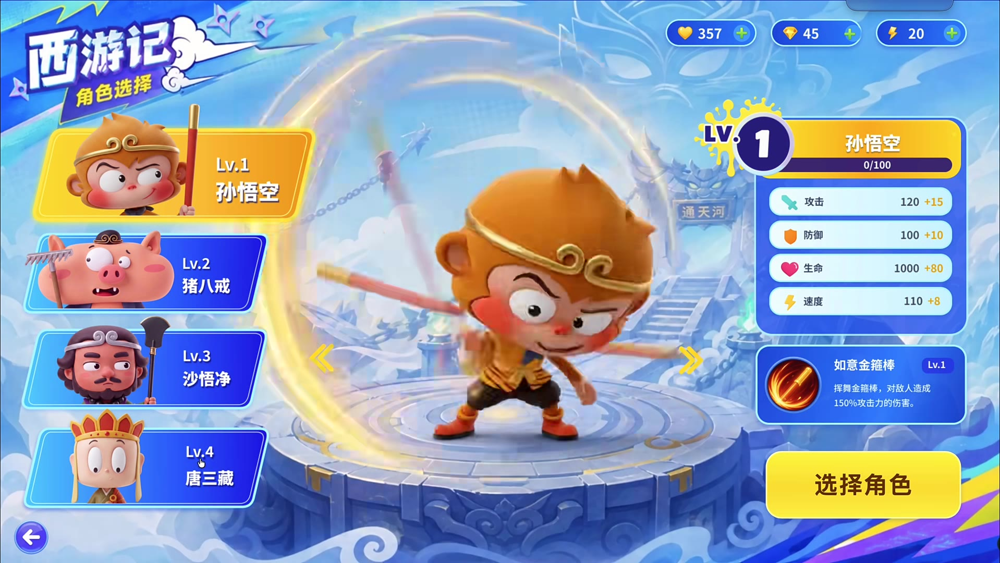

- 内容摘要：俺老孙来也（00:27-00:28）
- 画面文字（OCR）：357
45
20
角色选择
LV
1
孙悟空
Lv.1
0/100
孙悟空
攻击
120
+15
通天河
00000000
防御
100
+10
Lv.2
生命
1000
+80
猪八戒
速度
110
+8
Lv.3
如意金箍棒
Lv.1
沙悟净
挥舞金箍棒，对敌人造成
150%攻击力的伤害。
Lv.4
唐三藏
选择角色

### 11. 00:29

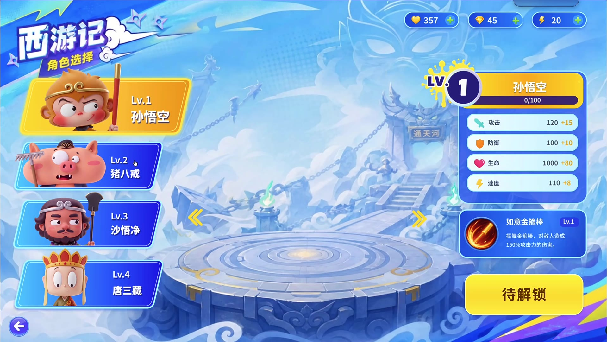

- 画面文字（OCR）：游记
角色选择
猪八戒
Lv.2
唐三藏
Lv.4
沙悟净
Lv.3
孙悟空
Lv.1
通天河
T
357
+
速度
生命
防御
攻击
S
待解锁
150%攻击力的伤害。
挥舞金箍棒，对敌人造成
如意金箍棒
孙悟空
0/100
1000+80
110+8
100+10
120+15
c
Lv.1

### 12. 00:32

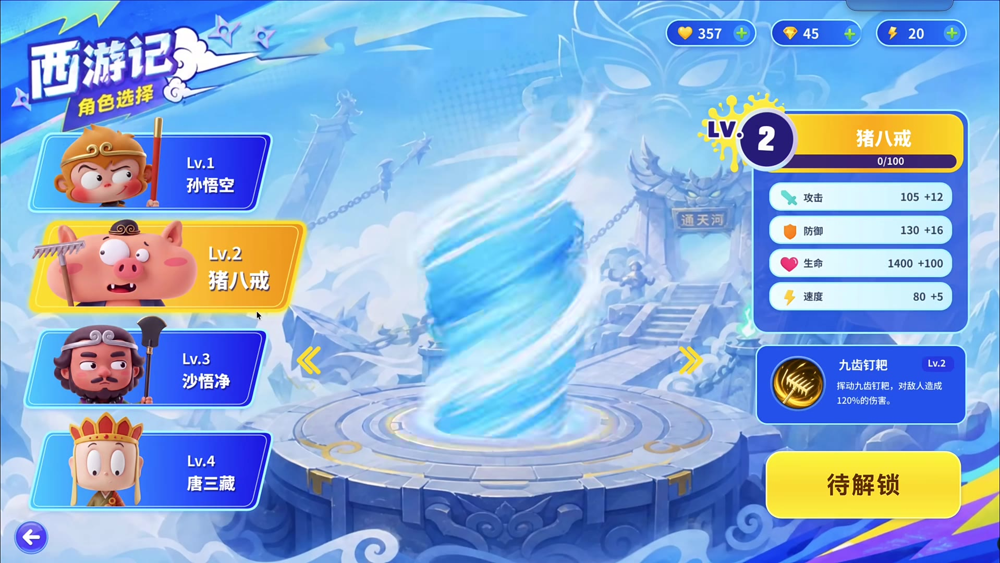

- 内容摘要：下一个是猪八戒，二师兄斯文又不能当饭吃（00:29-00:34）
- 画面文字（OCR）：G
357
45
20
马色选择
LV
2
猪八戒
0/100
Lv.1
孙悟空
攻击
105
+12
通天河
防御
130
+16
Lv.2
生命
1400
+100
猪八戒
速度
80
+5
Lv.3
九齿钉耙
Lv.2
沙悟净
挥动九齿钉耙，对敌人造成
120%的伤害。
Lv.4
待解锁
唐三藏

### 13. 00:33

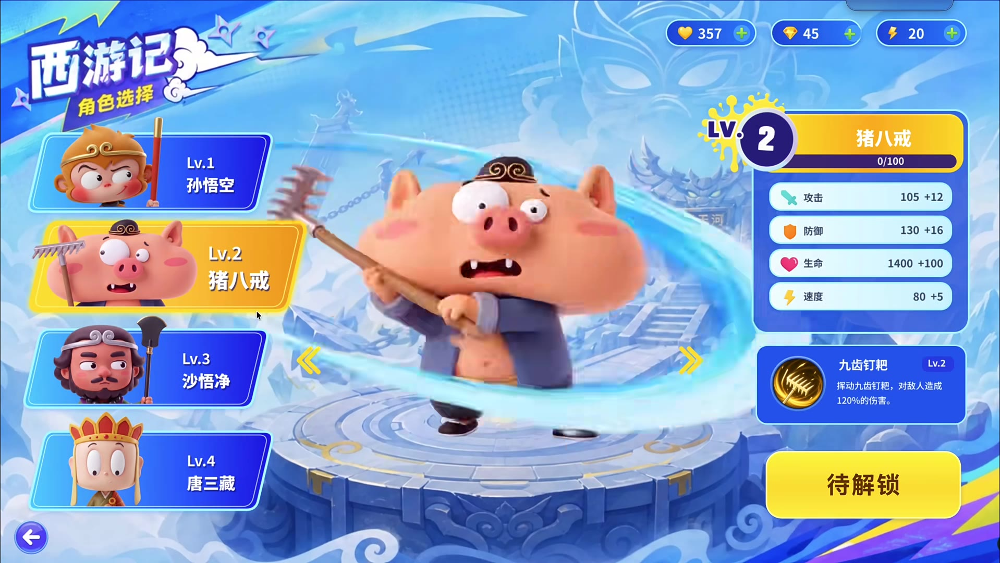

- 画面文字（OCR）：心
357
45
20
角色选择
LV
2
猪八戒
美
0/100
Lv.1
孙悟空
攻击
105
+12
防御
130
+16
Lv.2
生命
1400
+100
猪八戒
速度
80
+5
Lv.3
九齿钉耙
Lv.2
沙悟净
挥动九齿钉耙，对敌人造成
120%的伤害。
Lv.4
待解锁
唐三藏

### 14. 00:35

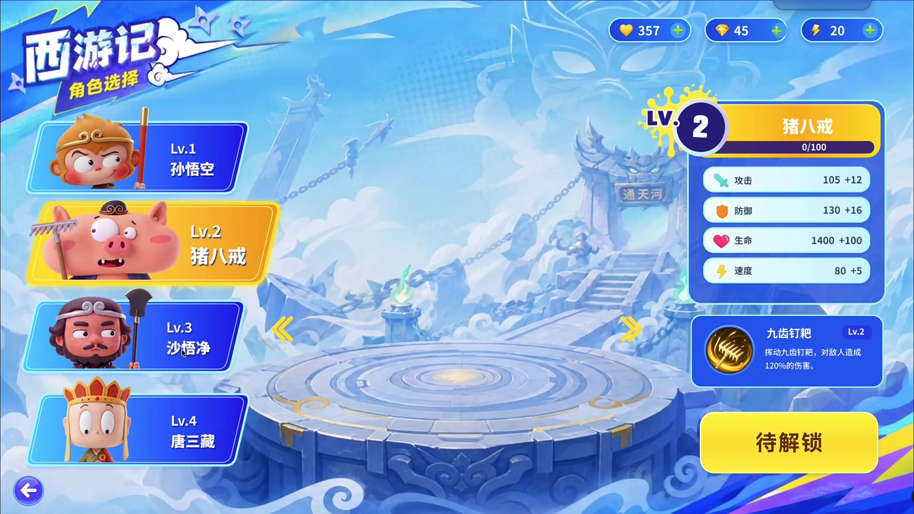

- 画面文字（OCR）：357
45
20
十
角色选择
LV
2
猪八戒
Lv.1
0/100
#
孙悟空
攻击
105
+12
通天河
防御
130
+16
Lv.2
生命
1400
+100
猪八戒
速度
80
+5
Lv.3
九齿钉耙
Lv.2
沙悟凈
挥动九齿钉耙，对敌人造成
120%的伤害。
Lv.4
待解锁
唐三藏

### 15. 00:37

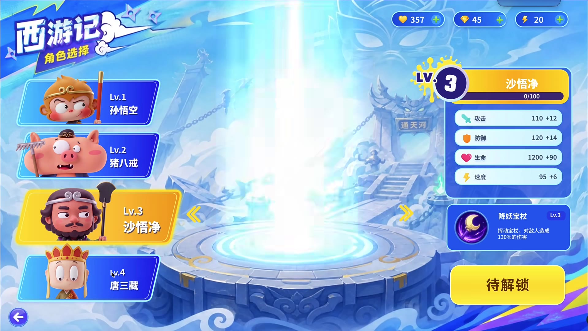

- 内容摘要：然后呢，是沙僧大师兄，师傅被妖怪抓走了（00:36-00:40）
- 画面文字（OCR）：357
45
20
LV
3
沙悟净
0/100
Lv.1
孙悟空
攻击
110
+12
通天河
防御
120
+14
Lv.2
生命
1200
+90
猪八戒
速度
95
+6
Lv.3
降妖宝杖
Lv.3
沙悟凈
挥动宝杖，对敌人造成
130%的伤害
v.4
待解锁
唐三藏

### 16. 00:39

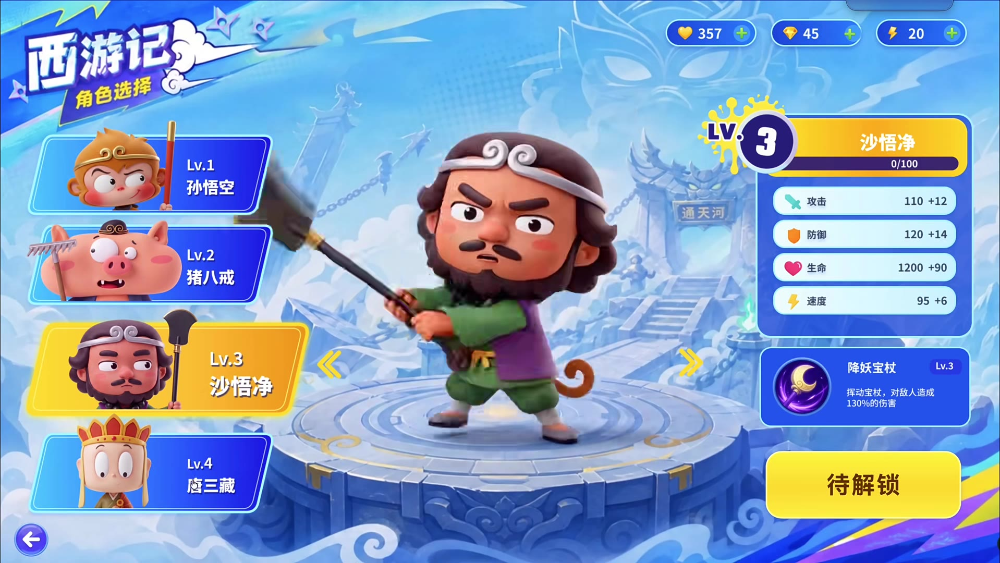

- 画面文字（OCR）：357
45
20
T
LV
3
沙悟净
0/100
Lv.1
孙悟空
攻击
110
+12
通天河
防御
120
+14
Lv.2
生命
1200
+90
猪八戒
速度
95
+6
Lv.3
降妖宝杖
Lv.3
沙悟净
挥动宝杖，对敌人造成
130%的伤害
Lv.4
待解锁
唐三藏

### 17. 00:40

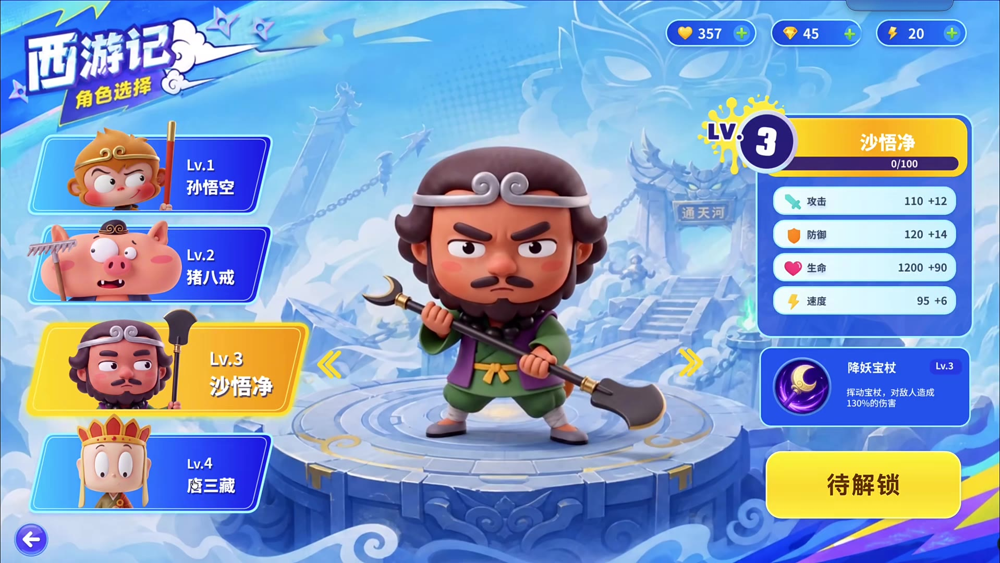

- 该时间点暂无可提取文字。

### 18. 00:41

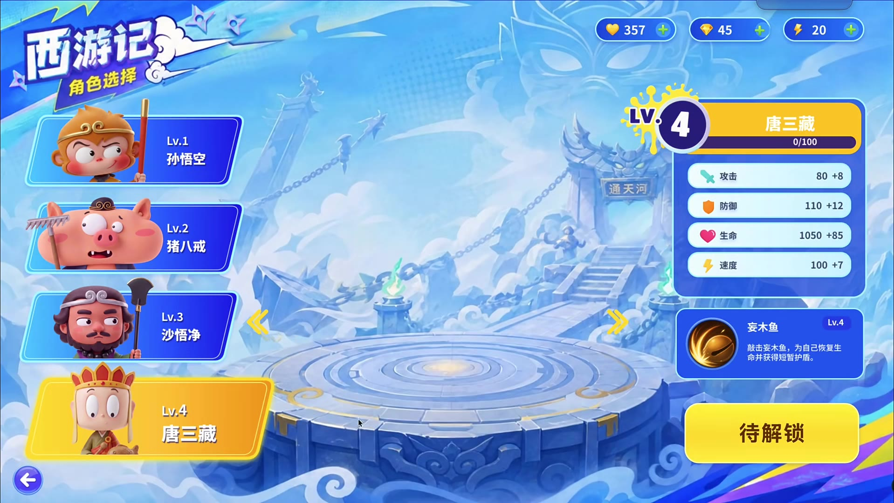

- 内容摘要：唐僧（00:41-00:42）

### 19. 00:48

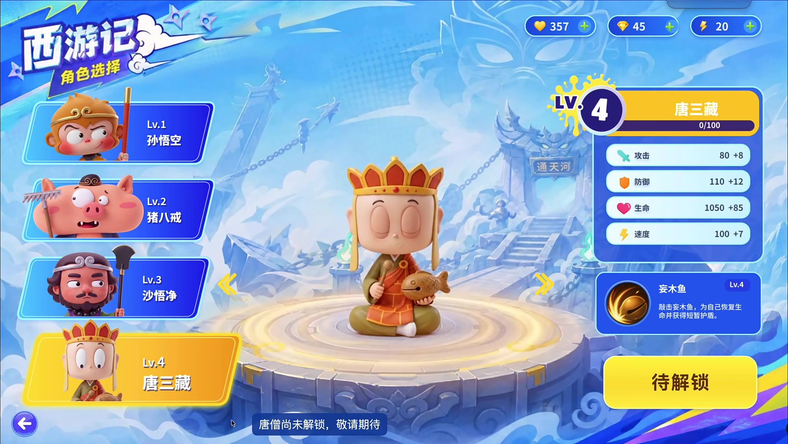

- 内容摘要：阿弥陀佛（00:45-00:47）

### 20. 00:51

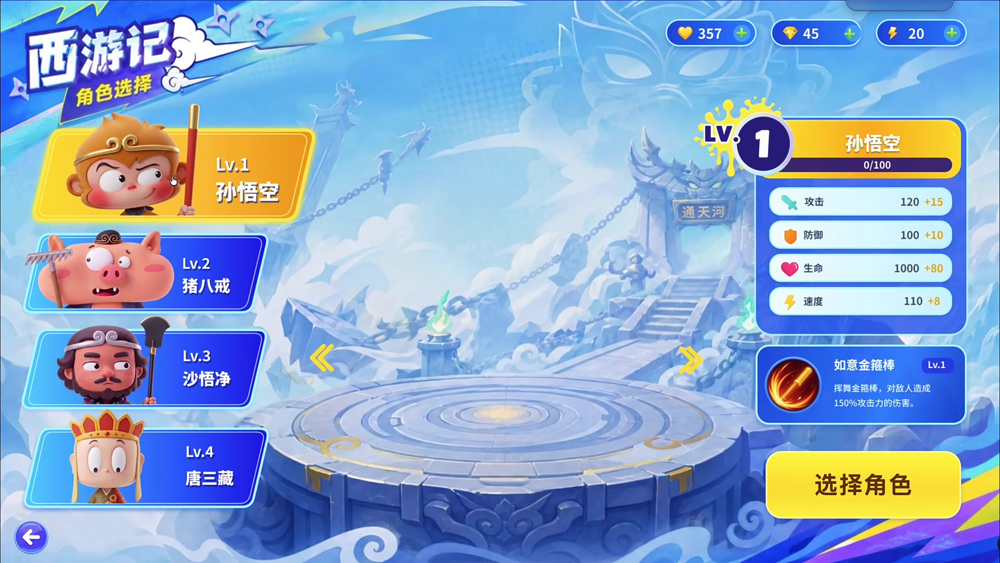

- 内容摘要：这些角色呢，目前只有孙悟空可以玩，让我们来点击孙悟空角色，选择角色（00:48-00:52）

### 21. 00:53

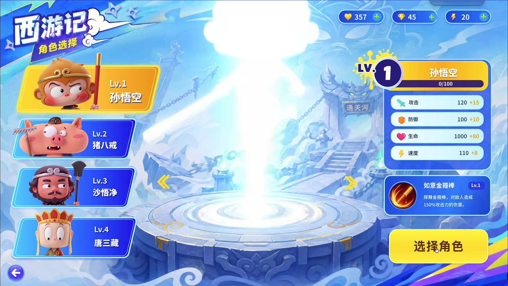

- 内容摘要：俺老孙来也（00:53-00:55）

### 22. 00:56

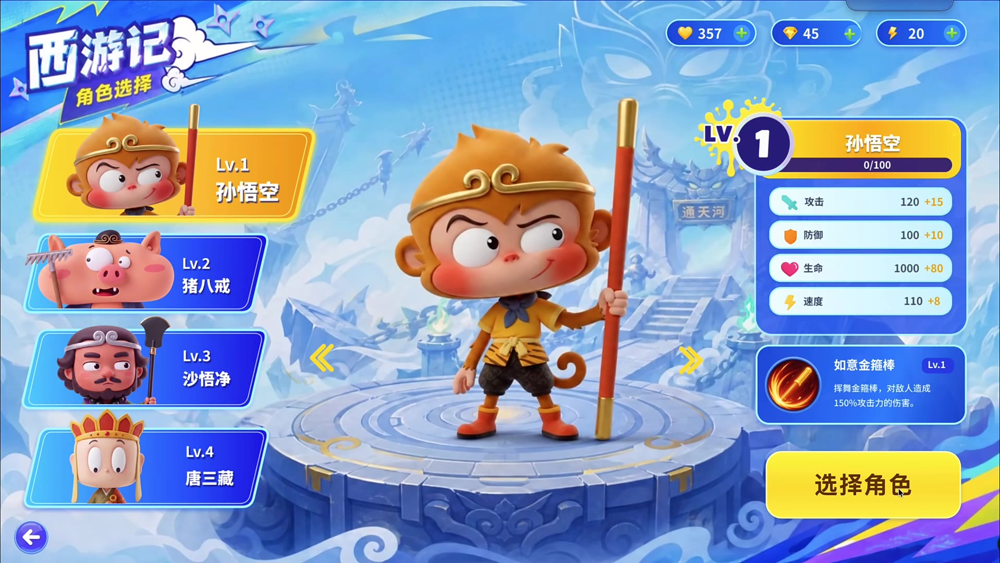

- 内容摘要：现在开始正式的游戏部分（00:57-00:59）

### 23. 01:04

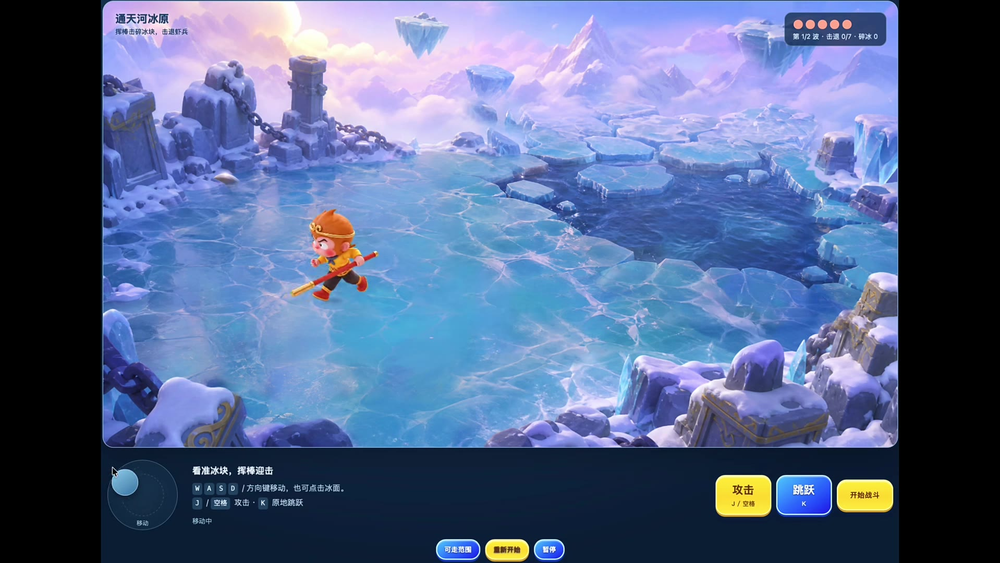

- 内容摘要：鼠标拖动这个圆形光标以及wast上下左右键都可以操控角色，J攻击k跳跃（00:59-01:06）
- 内容摘要：点击开始战斗（01:06-01:08）

### 24. 01:12

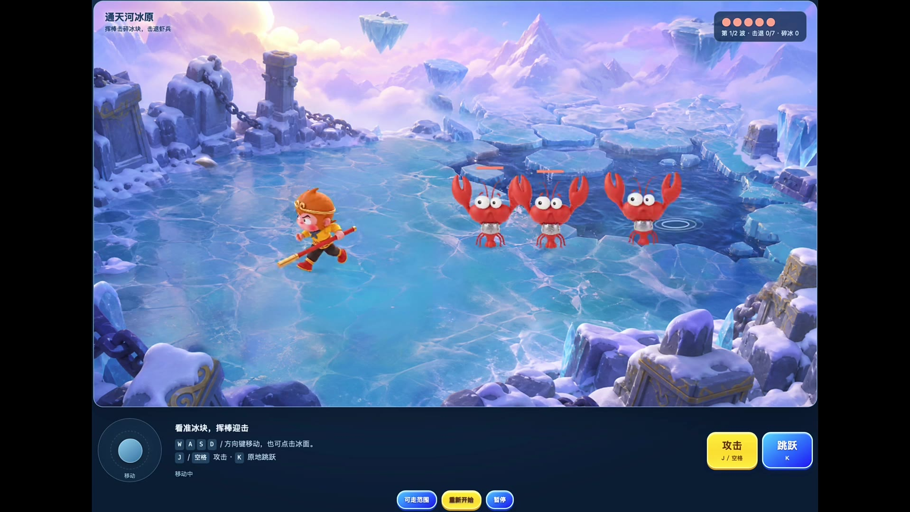

- 内容摘要：虾兵会跟随孙悟空，并向孙悟空扔冰块，孙悟空需要击打或躲开冰块击退小龙虾们（01:10-01:17）

### 25. 01:20

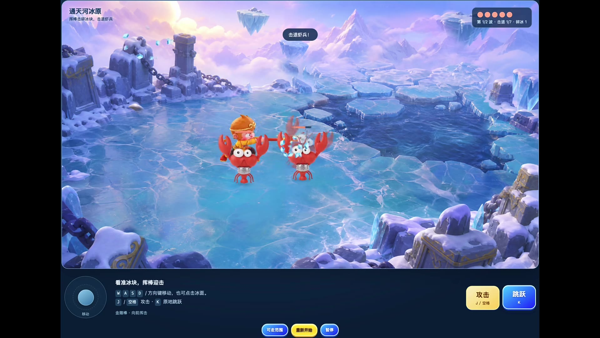

- 该时间点暂无可提取文字。

### 26. 01:28

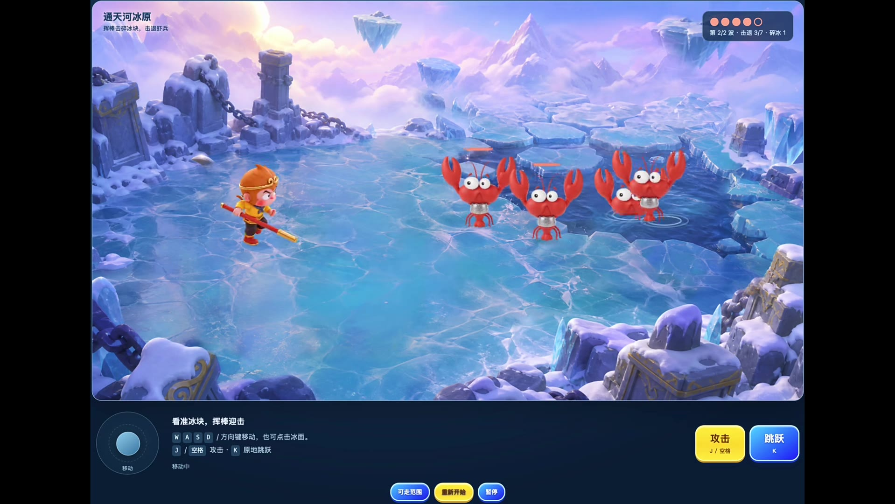

- 内容摘要：第二波冰块蓄积打两次（01:24-01:26）

### 27. 01:36

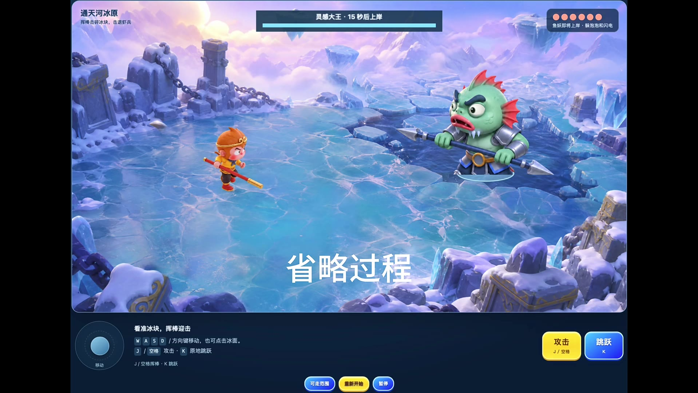

- 内容摘要：大boss来啦（01:34-01:35）
- 内容摘要：西游记通天河中要吃小孩的鲸鱼精也叫灵感大王（01:35-01:39）

### 28. 01:44

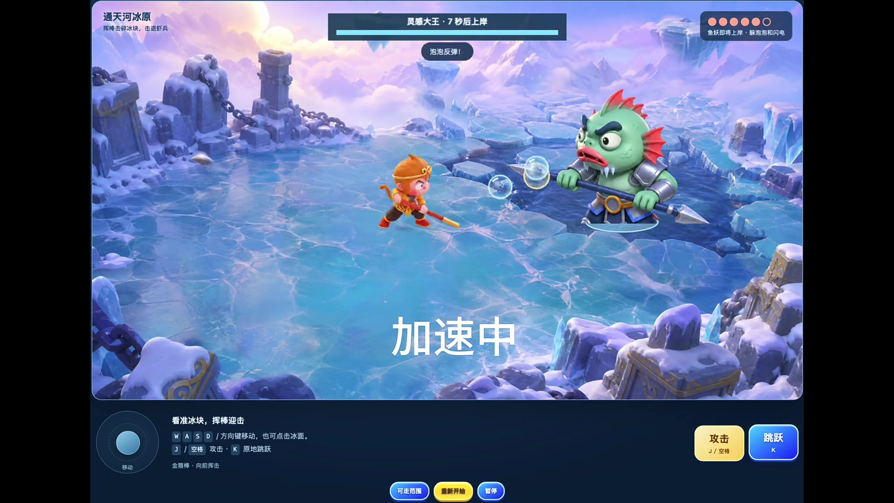

- 内容摘要：要避开或者击打泡泡，也要避开妖怪的蓝色圆圈闪电（01:39-01:44）

### 29. 01:52

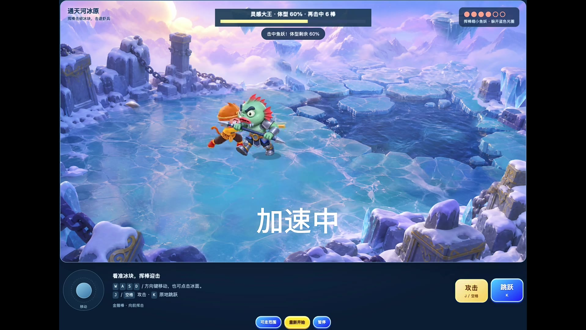

- 内容摘要：击打灵感大王，妖怪会变小（01:47-01:49）
- 内容摘要：第一关完成了西游记有很多有意思的章节（01:54-01:57）

### 30. 02:00

- 内容摘要：还挺适合做成小游戏，后续有机会会再更新别的关卡（01:57-02:00）

## 视频画面文字 (OCR)

> OCR 仅供参考，可能包含识别错误；请以视频画面和转写来源为准。

### 关键帧 1 · 0.5s

进入游戏
R
8
正

### 关键帧 2 · 6.83s

通天河之战
TIN
16%

### 关键帧 3 · 8.49s

49%

### 关键帧 4 · 10.63s

通大河之战
92%

### 关键帧 5 · 11.5s

100%
通天河之战

### 关键帧 6 · 16.47s

12580
680
之
88/120
+
天河之战
齐天大圣
战斗模式
VIP3
Lv.36
5280/9800
通天河破冰之战
C
武器炼制
升级武器仙丹赋能
邮件
背包
任务
冒险模式
闯关赢奖励
设置
好友
排行
休闲娱乐
轻松好玩
开始游戏
3
START ADVENTURE
【世界】
大圣来也：来人组队打副本啦！
【系统】
恭喜玩家悟空大王获得了SS段位！

### 关键帧 7 · 20.3s

选择
福
通天河
选择角色

### 关键帧 8 · 24.46s

357
45
20
角色选择
LV
L
孙悟空
Lv.1b
0/100
孙悟空
攻击
120
+15
通天河
防御
100
+10
Lv.2
生命
1000
+80
猪八戒
速度
110
+8
Lv.3
如意金箍棒
Lv.1
沙悟净
C
挥舞金箍棒，对敌人造成
150%攻击力的伤害。
Lv.4
唐三藏
选择角色

### 关键帧 9 · 26.33s

357
45
20
角色选择
LV
1
孙悟空
Lv.1
0/100
孙悟空
攻击
120
+15
通天河
防御
100
+10
Lv.2
生命
1000
+80
猪八戒
速度
110
8+
Lv.3
如意金箍棒
Lv.1
沙悟净
挥舞金箍棒，对敌人造成
150%攻击力的伤害。
Lv4
唐三藏
选择角色

### 关键帧 10 · 27.5s

357
45
20
角色选择
LV
1
孙悟空
Lv.1
0/100
孙悟空
攻击
120
+15
通天河
00000000
防御
100
+10
Lv.2
生命
1000
+80
猪八戒
速度
110
+8
Lv.3
如意金箍棒
Lv.1
沙悟净
挥舞金箍棒，对敌人造成
150%攻击力的伤害。
Lv.4
唐三藏
选择角色

### 关键帧 11 · 29.97s

游记
角色选择
猪八戒
Lv.2
唐三藏
Lv.4
沙悟净
Lv.3
孙悟空
Lv.1
通天河
T
357
+
速度
生命
防御
攻击
S
待解锁
150%攻击力的伤害。
挥舞金箍棒，对敌人造成
如意金箍棒
孙悟空
0/100
1000+80
110+8
100+10
120+15
c
Lv.1

### 关键帧 12 · 32.44s

G
357
45
20
马色选择
LV
2
猪八戒
0/100
Lv.1
孙悟空
攻击
105
+12
通天河
防御
130
+16
Lv.2
生命
1400
+100
猪八戒
速度
80
+5
Lv.3
九齿钉耙
Lv.2
沙悟净
挥动九齿钉耙，对敌人造成
120%的伤害。
Lv.4
待解锁
唐三藏

### 关键帧 13 · 33.63s

心
357
45
20
角色选择
LV
2
猪八戒
美
0/100
Lv.1
孙悟空
攻击
105
+12
防御
130
+16
Lv.2
生命
1400
+100
猪八戒
速度
80
+5
Lv.3
九齿钉耙
Lv.2
沙悟净
挥动九齿钉耙，对敌人造成
120%的伤害。
Lv.4
待解锁
唐三藏

### 关键帧 14 · 35.57s

357
45
20
十
角色选择
LV
2
猪八戒
Lv.1
0/100
#
孙悟空
攻击
105
+12
通天河
防御
130
+16
Lv.2
生命
1400
+100
猪八戒
速度
80
+5
Lv.3
九齿钉耙
Lv.2
沙悟凈
挥动九齿钉耙，对敌人造成
120%的伤害。
Lv.4
待解锁
唐三藏

### 关键帧 15 · 37.9s

357
45
20
LV
3
沙悟净
0/100
Lv.1
孙悟空
攻击
110
+12
通天河
防御
120
+14
Lv.2
生命
1200
+90
猪八戒
速度
95
+6
Lv.3
降妖宝杖
Lv.3
沙悟凈
挥动宝杖，对敌人造成
130%的伤害
v.4
待解锁
唐三藏

### 关键帧 16 · 39.63s

357
45
20
T
LV
3
沙悟净
0/100
Lv.1
孙悟空
攻击
110
+12
通天河
防御
120
+14
Lv.2
生命
1200
+90
猪八戒
速度
95
+6
Lv.3
降妖宝杖
Lv.3
沙悟净
挥动宝杖，对敌人造成
130%的伤害
Lv.4
待解锁
唐三藏

## 字幕文件

[TXT](./transcript/video.txt) | [JSON](./transcript/video.json) | [SRT](./transcript/video.srt) | [VTT](./transcript/video.vtt)

## 转写来源

[平台字幕 TXT](./transcript/platform/video.txt) | [平台字幕 JSON](./transcript/platform/video.json) | [平台字幕 SRT](./transcript/platform/video.srt) | [平台字幕 VTT](./transcript/platform/video.vtt) | [本地 ASR TXT](./transcript/asr/video.txt) | [本地 ASR JSON](./transcript/asr/video.json) | [本地 ASR SRT](./transcript/asr/video.srt) | [本地 ASR VTT](./transcript/asr/video.vtt)

## 其他来源转写

### 本地 ASR

- **00:00-00:04** 这是我用Codex 花两周时间做出来的西游记住期的游戏
- **00:04-00:06** 我们一起来看一下吧
- **00:07-00:14** 后拿来到了游戏的大廷页面
- **00:14-00:17** 现在是有一个战斗模式可以试玩
- **00:17-00:19** 其他的还没有解锁让我们点击开始游戏
- **00:20-00:23** 然后呢这里是做了四个可以选择的角色
- **00:23-00:25** 第一个呢是松空
- **00:27-00:28** 阿老孙来言
- **00:29-00:31** 下一个是初八届
- **00:32-00:34** 死纹又不能当饭吃
- **00:36-00:37** 然后呢是杀搜
- **00:38-00:40** 倒是修是否被腰鬼装走了
- **00:41-00:41** 唐森
- **00:45-00:46** 俄米陀佛
- **00:48-00:51** 这些角色呢目前只有松空可以玩让我们来点击
- **00:51-00:52** 松空角色选择角色
- **00:53-00:55** 阿老孙来言
- **00:57-00:59** 现在开始正式的游戏部分
- **00:59-01:01** 鼠标拖动制的原型光标
- **01:01-01:04** 以及WNST上下左右键都可以操控角色
- **01:04-01:06** 这攻击开跳跃
- **01:06-01:08** 点击开始战斗
- **01:10-01:11** 下冰会跟随松五空
- **01:11-01:13** 并效松五空扔冰块
- **01:13-01:15** 松五空需要击打互击开冰块
- **01:15-01:16** 击对小龙虾们
- **01:24-01:26** 第二波冰块是击打两次
- **01:35-01:39** 吸游击通天河中要吃小孩的精鱼精也叫灵感大王
- **01:39-01:41** 要避开或者击打爆炮
- **01:41-01:43** 也要避开腰怪的蓝色圆圈闪电
- **01:47-01:49** 击打灵感大王要怪会变小
- **01:49-01:55** 一关完成了
- **01:55-01:58** 吸游击有很多有意思的章节还挺适合做成小游戏
- **01:58-02:00** 后续有机会会在更新别的观卡

## 视频转录

- **00:00-00:06** 这是我用codex花了两周时间做出来的西游记主机的游戏，我们一起来看一下吧
- **00:07-00:10** 然后点击游戏会有一个加载动画
- **00:13-00:14** 然后呢，来到了游戏的大厅页面
- **00:14-00:19** 现在是有一个战斗模式可以试玩，其他的还没有解锁，然后我们点击开始游戏
- **00:20-00:26** 然后呢，这里是做了四个可以选择的角色，第一个呢是孙悟空
- **00:27-00:28** 俺老孙来也
- **00:29-00:34** 下一个是猪八戒，二师兄斯文又不能当饭吃
- **00:36-00:40** 然后呢，是沙僧大师兄，师傅被妖怪抓走了
- **00:41-00:42** 唐僧
- **00:45-00:47** 阿弥陀佛
- **00:48-00:52** 这些角色呢，目前只有孙悟空可以玩，让我们来点击孙悟空角色，选择角色
- **00:53-00:55** 俺老孙来也
- **00:57-00:59** 现在开始正式的游戏部分
- **00:59-01:06** 鼠标拖动这个圆形光标以及wast上下左右键都可以操控角色，J攻击k跳跃
- **01:06-01:08** 点击开始战斗
- **01:10-01:17** 虾兵会跟随孙悟空，并向孙悟空扔冰块，孙悟空需要击打或躲开冰块击退小龙虾们
- **01:24-01:26** 第二波冰块蓄积打两次
- **01:34-01:35** 大boss来啦
- **01:35-01:39** 西游记通天河中要吃小孩的鲸鱼精也叫灵感大王
- **01:39-01:44** 要避开或者击打泡泡，也要避开妖怪的蓝色圆圈闪电
- **01:47-01:49** 击打灵感大王，妖怪会变小
- **01:54-01:57** 第一关完成了西游记有很多有意思的章节
- **01:57-02:00** 还挺适合做成小游戏，后续有机会会再更新别的关卡

## 图片

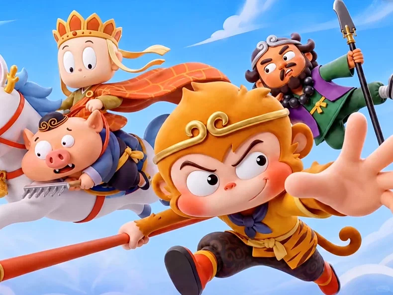

## 图片文字 (OCR)

> OCR 仅供参考，可能包含识别错误；请以原图为准。

ER 本 my" - an \2

2 昌 pe 过从
‘Jig \ = 二 ) % |

有 4 Vf 9) 六 y |
Ea ANGEL 《一 re
3. a A 一
