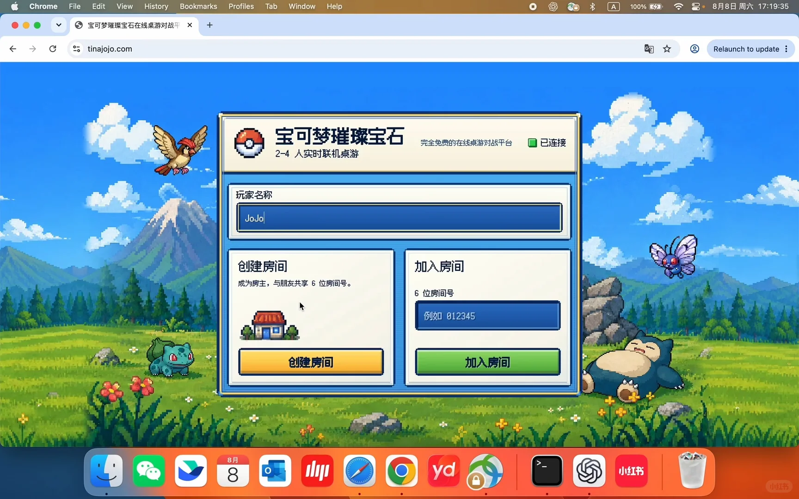
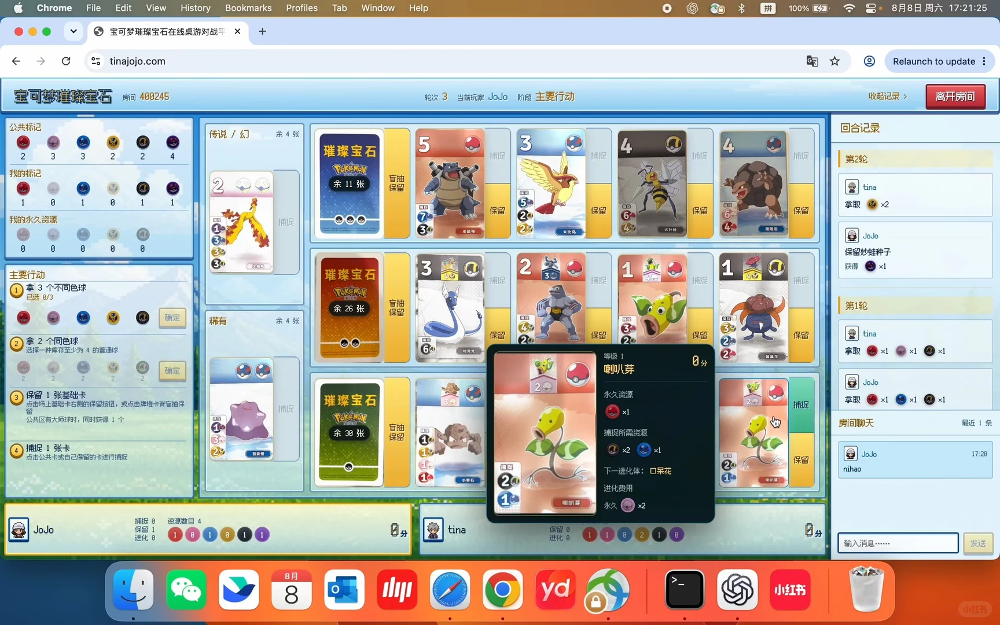

---
title: "花3天！用Codex把女朋友最爱的桌游搬到线上"
source: "https://www.xiaohongshu.com/discovery/item/6a7714cc0000000027021a29?app_platform=android&ignoreEngage=true&app_version=9.41.0&share_from_user_hidden=true&xsec_source=app_share&type=normal&xsec_token=CBDqcX51mDmssVxMj2ZL1N1sGy7JwcD44tXFe5b5yA4OQ%3D&author_share=1&xhsshare=CopyLink&shareRedId=N0dINjg3NUpMPko6S0EySDs0P0lFSjdL&apptime=1786202134&share_id=cd631d99fa78481cb2da182f6ba9ed98&share_channel=copy_link"
author: "JoJo"
author_uid: "5c146ba400000000060060e6"
date: "昨天 19:36 浙江"
tags: ["外滩大会全民黑客松", "外滩大会AICoding大赛", "vibecoding", "codex", "桌游", "璀璨宝石宝可梦", "情侣游戏", "宝可梦璀璨宝石", "在线桌游", "Codex开发", "实时联机对战", "独立游戏项目"]
platform: "xiaohongshu"
category: "游戏设计"
summary: "作者花3天时间借助Codex将女朋友喜爱的桌游《宝可梦璀璨宝石》搬到了线上,搭建出支持2-4人实时联机的免费对战平台。页面包含创建/加入房间、6位房间号匹配、轮次与回合记录、盲抽与保留、捕捉与进化等完整游戏流程,实现了盲抽、保留基础卡、拿取3个不同色球等核心机制,并集成房间聊天功能,让玩家可在浏览器"
---

# 花3天！用Codex把女朋友最爱的桌游搬到线上

> 作者: JoJo | 日期: 昨天 19:36 浙江 | 原文: https://www.xiaohongshu.com/discovery/item/6a7714cc0000000027021a29?app_platform=android&ignoreEngage=true&app_version=9.41.0&share_from_user_hidden=true&xsec_source=app_share&type=normal&xsec_token=CBDqcX51mDmssVxMj2ZL1N1sGy7JwcD44tXFe5b5yA4OQ%3D&author_share=1&xhsshare=CopyLink&shareRedId=N0dINjg3NUpMPko6S0EySDs0P0lFSjdL&apptime=1786202134&share_id=cd631d99fa78481cb2da182f6ba9ed98&share_channel=copy_link

> **摘要**:作者花3天时间借助Codex将女朋友喜爱的桌游《宝可梦璀璨宝石》搬到了线上,搭建出支持2-4人实时联机的免费对战平台。页面包含创建/加入房间、6位房间号匹配、轮次与回合记录、盲抽与保留、捕捉与进化等完整游戏流程,实现了盲抽、保留基础卡、拿取3个不同色球等核心机制,并集成房间聊天功能,让玩家可在浏览器

LIVE

#外滩大会全民黑客松 #外滩大会AICoding大赛 #vibecoding #codex #桌游 #璀璨宝石宝可梦 #情侣游戏 #宝可梦璀璨宝石 #在线桌游 #Codex开发 #实时联机对战 #独立游戏项目

## 图片

## 图片文字 (OCR)

> OCR 仅供参考，可能包含识别错误；请以原图为准。

宝可梦璀璨宝石在线桌游对战平
X
+
tinajojo.com
明 ☆
0
Relaunch to update
宝可梦璀璨宝石
完全免费的在线桌游对战平台
已连接
2-4
人实时联机桌游
玩家名称
JoJo
创建房间
加入房间
成为房主，与朋友共享6位房间号。
6位房间号
例如
012345
创建房间
加入房间
8月
8
yd
小红书

C
tinajojo.com
R
宝可梦璀璨宝石
2-4
人实时联机桌游
已连接
离开房间
400245
房间号
2
3
等待玩家
等待玩家
JoJo
（我）
tina
房主
在线
开始游戏
将以2人模式开始
8月
8
yd

宝可梦璀璨宝石在线桌游对战平
X
+
☆
0
Rela
tinajojo.com
收起记录
宝可梦璀璨宝石
轮次
1
当前玩家
JoJo
阶段
主要行动
房间
400245
回合记录
共标记
传说
7
幻
余4张
5
3
璀璨宝石
捕捉
捕捉
捕捉
捕捉
4
4
4
4
4
5
PoKeNON
的标记
余11张
盲抽
2
保留
随用
0
0
0
0
0
0
保留
模区
保留
编信
保留
保留
2
玩家完成
的永久资源
捕捉
OOO
4
大针
隆隆岩
水电
大比岛
0
0
0
0
0
3
2
1
1
要行动
璀璨宝石
30
捕捉
捕捉
4
捕捉
捕捉
拿3个不同色球
已选3/3
盲抽
余26张
保留
定
稀有
余4张
简理
楼印
保留
保留
保留
保留
拿2个同色球
选择一种库存至少为4的普通球
6
地壳花
力
口花
2
品品花
确定
2
2
2
2
2
1
保留1张基础卡
璀璨宝石
点击场上基础卡右侧的保留按钮，或点击牌堆卡背盲抽保
捕捉
捕捉
捕捉
捕捉
捕捉
留
POKENON
公共区有大师球时，同时获得1个
0
盲抽
房
余31张
保留
捕捉1张卡
点击公共卡或自己保留的卡进行捕捉
百直
保留
1牌
保留
保留
M
保留
小石
2
娃牌子
叭啡
捕捉
0
资源数目
JoJo
0
保留
8
捕捉
tina
0
资源数目
0
进化
8
0
7
0
0
保留
0
进化
8
0
0
0
0
0
9
8月
8
yd

8
P人
小红书
8月
进化0
peyt
进化0
pan
f
JoJo
0
0
0
0
0
思
捕捉
资源数目3
捕捉0
王MAM
2
944
T
T
保留
思
点击公共卡或自己保留的卡进行捕捉
保留
D
T
联
捕捉1张卡
0
还没有聊天消息。
D
余31张
U
盲抽
房间聊天
end
日
公共区有大师球时，同时获得1个
捕捉
思
捕捉
捕捉
璀璨宝石
点击场上基础卡右侧的保留按钮，或点击牌堆卡背盲抽保
捕捉
捕捉
保留1张基础卡
T
2
2
2
2
确定
HW
口
4
t
选择一种库存至少为4的普通球
2
拿2个同色球
2
2
思
8
保留
保留
23
£
余4张
稀有
确定
8期
B
8制
3
余26张
盲抽
已选8/3
KroS
拿3个不同色球
捕捉
捕捉
捕捉
捕捉
璀璨宝石
要行动
T
T
23
2
3
0
0
0
0
0
大
￥
3
oOO
捕捉
国
的永久资源
9
22
L
思
思
保留
[×
I×
I×
拿取
0
BR
S
招R
0
I
0
T
0
B
2
oror
余11张
盲抽
POKenoN
214408
第1轮
捕捉
捕捉
捕捉
捕捉
璀璨宝石
S
ε
4
ε
力
ε
∑
5
8
余4张
幻
传说
回合记录
公共标记
离开房间
收起记录
主要行动
阶段
tina
当前玩家
轮次
400245
房间
宝可梦璀璨宝石
Relaunch to update
0
☆
2
tinajojo.com
D
←
+
×
宝可梦璀璨宝石在线桌游对战平

宝可梦璀璨宝石在线桌游对战平
X
+
C
0
图
0
Relaunch to update
tinajojo.com
宝可梦璀璨宝石
主要行动
收起记录
离开房间
房间
400245
轮次3
当前玩家
JoJo
阶段
共标记
回合记录
传说/幻
余4张
5
3
璀璨宝石
2
3
3
2
2
捕捉
捕捉
捕捉
捕捉
4
第2轮
的标记
PoKeNoy
盲抽
2
余11张
保留
tina
N
1
0
1
0
1
1
福
编
拿取
编码
×2
保留
保留
保留
保留
的永久资源
捕捉
000
0
1
水龟
大比岛
大针
JoJo
0
0
0
0
0
保留妙蛙种子
3
2
1
1
火排
获得
×1
要行动
璀璨宝石
捕捉
30
捕捉
捕捉
4元
捕捉
拿3个不同色球
PoKeNoN
已选0/3
余26张
盲抽
第1轮
保留
确定
稀有
余4张
简
口
1理
保留
保留
保留
保留
tina
拿2个同色球
保相
选择一种库存至少为4的普通球
6
哈是
2
拿取
×1
×1
x1
等级
0
吴花
喇叭芽
分
确定
2
F
2
2
E
JoJo
保留1张基础卡
璀璨宝石
永久资源
点击场上基础卡右侧的保留按钮，或点击牌堆卡背盲抽保
20
拿取
×1
×1
捕捉
×1
留
捕捉
公共区有大师球时，同时获得1个
PoKeNoy
×1
信
盲抽
房间聊天
最近1
余38张
保留
0D
捕捉所需资源
3
捕捉1张卡
点击公共卡或自己保留的卡进行捕捉
百
×2
×1
JoJo
17:
隔理
保留
桶提
下一进化体：
口呆花
nihao
20
小学石
进化费用
电机器
1
喇叭芽
永久
×2
捕捉0
资源数目4
JoJo
保留1
tina
进化0
分
保留
0
进化0
7
分
输入消息...
8月
8
yd
山红书
